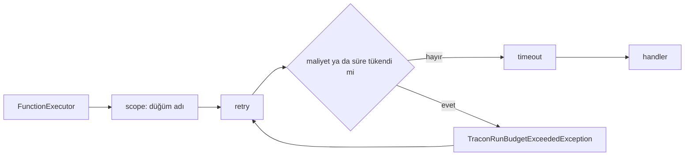

# Faz 210 — Bütçe Tükenince Fonksiyon Düğümü Başlamaz

> **Durum:** 📋 Planlandı (2026-10-14)
> **Plan onayı:** Bakımcı, 2026-10-14 — boyut kararı (yalnız maliyet ve süre) ve üç engelleyici soru sohbette cevaplandı: 🔒1 = A (`Failed` + `run_budget_exceeded`), 🔒2 = B (yalnız kodda muafiyet), 🔒3 = A (her denemeden önce). Bloklamayan 4-8 uygulamada karara bağlanır. Uygulama Faz 208 bitince başlar (bakımcı kararı; dosya örtüşmesi yok)
> **Kaynak:** [ADAYLAR.md](ADAYLAR.md) · **F-407**
> **Genellik:** Ağaç bütçesine maliyet (`MaxTotalCost`) ya da süre (`MaxDuration`) tavanı koyan ve ücretli fonksiyon düğümü (TTS, render, GPU) çalıştıran her host etkilenir. İş tüketici kodunda kalamaz: tavanı operatör kurulum ayarıyla koyar, düğümü başka biri yazar; denetimi her düğüme bırakmak, unutulan tek düğümde sözleşmeyi bozar. İlk ilke: bütçe model çağrısını durdurur ama ücretli düğümün başlamasına izin verir — kendi sözleşmesiyle çelişir. Faz 199 token dışı tutarı aynı bütçeye saydı (K-972); bugün yalnız fonksiyon düğümlerinden oluşan bir zincir `MaxTotalCost` ve `MaxDuration` ile **hiç** durmaz (§ Kanıt). İki pilot raporu "üretim maliyet tavanı" satırında bu kalemi adlandırır (podcast `:839`, video `:759`); ikisi aynı tüketicinin iki hattıdır, bu yüzden ikinci kanıt ilk ilkedir
> **Karşı görüş:** (1) "Düğüm kendi bütçesini okuyabilir: `TraconRunContext.Current.Budget` public'tir; iş tüketici kodunda kalsın." Cevap: tavan ağaç genelinde bir yönetişim sınırıdır; model çağrısı kapısı da her agent'a bırakılmadı. Kodla kurulan grafın özel executor'ı için okuma yolu belgelenir (§210.5). (2) "Davranış değişikliğidir (K1, Faz 199 bu yüzden ayırdı): tavan koymuş tüketicide ücretsiz son düğüm de reddedilir, run `Failed` olur." Cevap: varsayılan kurulum değişmez — `MaxTotalCost` ve `MaxDuration` varsayılanda kapalıdır, token boyutu bakımcı kararıyla kapının dışındadır (`MaxTotalTokens = 200_000` açık kalır). Değişiklik yalnız tavanı kendisi isteyen host'a ulaşır ve `CHANGELOG`'da adıyla anılır. Ücretsiz son düğüm 🔒2'nin konusudur
> **Önkoşul:** [Faz 208](arsiv/fazlar/208-WORKFLOW-KARAR-SOZLESMESI.md) (✅ kapandı, 2026-10-14) — ortak dosyalar (`samples/Tracon.Api/Program.cs`, `CHANGELOG.md`, `concepts/workflows.md`). Bu planın ölçümüne göre kapı fonksiyon sarmalayıcısındadır ve `WorkflowRunner`'a dokunulmaz; dokunmak gerekirse sembolle anılır (Faz 208 onu şu an değiştiriyor). [Faz 199](arsiv/fazlar/199-FONKSIYON-DUGUMU-MALIYETI.md) (token dışı tutar bütçeye girer) ve [Faz 205](arsiv/fazlar/205-GEC-BITEN-HARCAMA-KOTASI.md) (`TreeAccount`) kapalı. [Faz 209](209-WORKFLOW-GELEN-KUTUSU-VE-SURE.md)'dan bağımsızdır; aynı site sayfasına başka bölümde dokunur
> **Paketler:** `Tracon.Abstractions` (yalnız `internal` üye + XML), `Tracon.Core` (yalnız XML), `Tracon.Workflows`
> **Yeni paket:** Yok · **Migration:** Yok
> **Public API:** 🔒2 = A ise büyümüyor; 🔒2 = B ise `WorkflowFunctionOptions` bir özellik alır — `1.0.0` GA'dan (K-603) önce ucuz. Ölçüldü (2026-10-14): `wc -l src/*/PublicAPI.Shipped.txt` → 17 dosya, toplam 17 satır (her biri yalnız `#nullable enable`)
> **Tüketici yüzeyi:** site: `concepts/workflows.md` (`:41-47` red listesi, `:327` bütçe satırı, "Retry a node" `:344`, `:732-739` bütçe paragrafı), `guides/reliability.md:420-436`, `reference/configuration.md:94-97` (`AgentGraph:MaxDuration` satırı yok — eklenir), `guides/production.md:342-343` · sevk edilen: `AgentRunBudget` XML (`AgentRunBudget.cs:26-37`), `TraconRunBudgetExceededException` XML (`:3-26`), `TraconAgentGraphOptions.MaxTotalCost`/`MaxDuration` XML (`TraconOptions.cs:175-208`), 🔒2 = B ise `WorkflowFunctionOptions` XML, `src/Tracon.Workflows/README.md:160-166`, `CHANGELOG.md` `[Unreleased]` (`:1428` cümlesi + davranış değişikliği girdisi)
> **Manuel test alanı:** `docs/manuel-test/12-GOZLEMLENEBILIRLIK-MALIYET.md` (`MT-OBS-*`, MT-OBS-073'ün yanına)

---

## Bu Faza Başlarken

> `faz-baslangic` skill'ini uygula. Aşağıdaki liste o skill'in 2. adımıdır —
> **tamamını değil, yalnız işaret edilen bölümleri oku.**

0. **Önce F-524'ü kapat.** `Tracon.SqlServer`'ın dolaylı `System.Security.Cryptography.Pkcs` bağımlılığı yeni bir High advisory taşır (GHSA-846f-f764-76mx; ölçüldü 2026-10-14: `dotnet list src/Tracon.SqlServer package --vulnerable --include-transitive`). `TemplateInstantiationTests` `NU1902`/`NU1903` ile düşer; `kapanis` kapısı F-524 kapanmadan kırmızıdır. Kanal `kusur-giderme`; yama sürümü kararı `nuget-danismani`. Ayrıntı: `grep -n "F-524" docs/ADAYLAR.md`.
   Bu plan 2026-10-14'te `c5c820a7` tabanında ölçüldü; `main` sonra Faz 206, 207 ve 208'i aldı. `faz-uygulama` Adım 1 her yapısal iddiayı (dosya:satır) yeniden ölçer.
1. Bu doküman
2. Kararlar — dosyanın tamamını **okuma**, yalnız bu kalemleri grep'le:
   ```bash
   grep -n "K-096 \|K-630 \|K-632 \|K-887 \|K-972 \|K-990 " docs/KARARLAR.md
   ```
   **K-096** (bütçe ağaç boyunca tek nesnedir) · **K-630** (`run_budget_exceeded` → `QuotaExceeded`) ·
   **K-632** (bütçe muhasebesini `RunBudgetChatClient` taşır) · **K-887** (workflow katılımcısının reddi run'ı düşürür) ·
   **K-972** (token dışı tutar ağaç bütçesine girer) · **K-990** (workflow kökü kendi payını kapanırken yazar — §210.6'nın gerekçesi)
3. Önceki fazların devri:
   ```bash
   awk '/## Sonraki Faza Devir Notu/,0' docs/arsiv/fazlar/199-FONKSIYON-DUGUMU-MALIYETI.md
   awk '/## Sonraki Faza Devir Notu/,0' docs/arsiv/fazlar/205-GEC-BITEN-HARCAMA-KOTASI.md
   ```
   199: F-407'yi ayırdı, ön koşulu (tutarın bütçeye anında girmesi) sağladı. 205: `TreeAccount` ve kota yazımı — bu faz kotaya dokunmaz
4. Alan hafızası (bu faz üç alana dokunuyor):
   [`hafiza/workflows.md`](hafiza/workflows.md) (`NodeWrapper` sırası, "Düğüm adı ve run kapsamı AMBİYANT akar" notu) ·
   [`hafiza/olcum-kota-ve-secenekler.md`](hafiza/olcum-kota-ve-secenekler.md) (`QuotaExceeded` iki yoldan dolar) ·
   [`hafiza/cekirdek-calistirma.md`](hafiza/cekirdek-calistirma.md) (`AsyncLocal` yalnız okunur, yazılmaz)
5. Gerektiğinde: [`MIMARI.md`](MIMARI.md) § ağaç kuralları (`grep -n "K-096" docs/MIMARI.md`)

---

## Amaç

Ağaç bütçesi bugün yalnız model çağrısını ve yeni agent adımını durdurur. Maliyet ya da süre tavanı geçildikten sonra bir fonksiyon düğümü yine başlar ve ücretli işini yapar: TTS, render, GPU. Bu faz düğümün başına bir kapı koyar. Tavan geçildiyse düğüm başlamaz ve run, reddedilen bir agent adımı gibi biter. Kazanan, ücretli medya hattını tavanla koşan host'tur: tavan artık hattın kendi düğümlerini de kapsar.

- **F-407** — maliyet ya da süre boyutu tükenmişse fonksiyon düğümü başlamaz; token boyutu düğümü durdurmaz (bakımcı kararı, 2026-10-14).

**Vaat edilmeyen:** mutlak harcama tavanı. Koşan düğüm kesilmez; tutarı önceden bilinmeyen iş başlamadan ölçülemez. Kapı yalnız tavanı **geçmiş** bir ağaçta yeni düğümü başlatmaz. Son düğüm tavanı ne kadar aşarsa, ağaç o kadar aşar.

### Kapsam dışı — kapanışta aday açılır

| Kalem | Neden |
|---|---|
| Kiracı kotasıyla düğüm durdurma | §210.6: ölçüldü, tutarsız ve pahalı — sayaç koşan workflow'un kendi düğüm tutarını görmez |
| Ücretli tool çağrısının başlamadan reddi | Aynı model turunda istenen ikinci tool, ilk tool tavanı geçirse de koşar; sonraki model çağrısı reddedilir. Tool döngüsü MAF'tadır; ayrı tasarım ister |
| Checkpoint'ten devam eden run'ın bütçesi sıfırdan başlar | Ölçüldü (kod okuması): `WorkflowRunner.RunGuardedAsync` her yürütmede `AgentGraph.CreateBudget` ile yeni bütçe kurar; bütçe reddiyle düşen run checkpoint'ten devam ettirilirse reddedilen düğüm başlar. Model çağrısı kapısı için de bugün aynıdır |
| `reference/configuration.md`'de `AgentGraph:ChildDeadline` ve `WaitTimeout` satırı yok | Bu fazın konusu değil; yalnız `MaxDuration` satırı eklenir |

### Bugün ne çalışmıyor — doğrulanmış kanıt

| Kanıt | Gözlem |
|---|---|
| [`TraconWorkflowFunctionExtensions.cs:488-509`](../src/Tracon.Workflows/TraconWorkflowFunctionExtensions.cs) | `NodeWrapper` sırası `scope(retry(timeout(handler)))`; hiçbir katman bütçeyi okumaz. İki çağrı yeri: `:237` (ayarsız aile), `:439` (ayarlı aile); bütün `AddWorkflowFunction` aşırı yüklemeleri bu ikisinden geçer |
| [`RunBudgetChatClient.cs:99`](../src/Tracon.Core/Models/RunBudgetChatClient.cs) | Model çağrısı kapısı: `budget.IsExhausted` (token, maliyet, süre) |
| [`ChildAgentInvoker.cs:476-481`](../src/Tracon.Core/Graph/ChildAgentInvoker.cs), `:657` | Agent adımı başlarken `TryReserveRun()` okur (üç boyut + sayı); workflow adımında ret `TraconRunBudgetExceededException` olarak atılır. **Aday satırındaki "yalnız model çağrısı denetler" iddiası kısmen düştü:** agent adımının başlangıcı da denetlenir |
| [`AgentRunBudget.cs:157-175`](../src/Tracon.Abstractions/Runs/AgentRunBudget.cs) | Boyut başına yüklem **zaten public**: `IsTokenBudgetExhausted`, `IsCostBudgetExhausted`, `IsDurationBudgetExhausted`; `IsExhausted` üçünün birleşimidir. Yeni public yüklem gerekmez |
| [`AgentRunBudget.cs:296-310`](../src/Tracon.Abstractions/Runs/AgentRunBudget.cs) | `DescribeExceededLimit` önce token'ı adlandırır; token ve maliyet birlikte tükenmişse düğüm reddi yanlış boyutu söylerdi → düğüme ayrı metin gerekir |
| [`TraconOptions.cs:173`](../src/Tracon.Core/TraconOptions.cs), `:184`, `:208`, `:263-272` | `MaxTotalTokens = 200_000` açık; `MaxTotalCost` ve `MaxDuration` varsayılanı yok, `CreateBudget` sıfırı `null`'a çevirir → varsayılan kurulumda kapı hiç ret vermez |
| [`NonTokenCostAccumulator.cs:347-353`](../src/Tracon.Core/Recording/NonTokenCostAccumulator.cs), [`NonTokenUsageReporter.cs:45`](../src/Tracon.Core/Recording/NonTokenUsageReporter.cs) | Düğüm kalemi bütçeye **raporlandığı anda** ve depo yazımından **önce** girer; sonraki düğümün kapısı tutarı görür |
| [`WorkflowDefinitionValidator.cs:90-95`](../src/Tracon.Core/Workflows/WorkflowDefinitionValidator.cs), `:116` | Fonksiyon düğümü yalnız `Sequential` zincirde olur; düğüm adları tekildir |
| [`WorkflowDefinitionCompiler.cs:167-192`](../src/Tracon.Workflows/Internal/WorkflowDefinitionCompiler.cs) | Zincir elle kurulur: düğüm `i-1` → `i`. Fonksiyon düğümü paralel dalda koşmaz |
| `WorkflowRunner.PumpAsync` (sembol) | `TraconRunContext.SetCurrent(scope)` çalıştırmadan önce ve her adımda yazılır; düğüm gövdesi kök kapsamı ve bütçeyi görür (`NonTokenUsageReporter` aynı okumaya dayanır) |
| `WorkflowRunner.ToRunError` (sembol), [`DefaultRunErrorClassifier.cs:56`](../src/Tracon.Core/Runs/DefaultRunErrorClassifier.cs) | Run hatası `TraconException.ErrorType` yazar; `run_budget_exceeded` → `QuotaExceeded` |
| [`WorkflowNodeRetry.cs:21-27`](../src/Tracon.Workflows/Internal/WorkflowNodeRetry.cs), `:152`, `:174` | `QuotaExceeded` geçici sınıf değildir; ama tüketicinin sınıflandırıcısı onu geçici sayarsa ret yeniden denenir |
| [`WorkflowStepRefusalTests.cs:93-111`](../tests/Tracon.AspNetCore.FunctionalTests/WorkflowStepRefusalTests.cs), [`NonTokenSpendTests.cs:188-216`](../tests/Tracon.AspNetCore.FunctionalTests/NonTokenSpendTests.cs) | Emsal: reddedilen agent adımı → `Failed`, `run_budget_exceeded`, `QuotaExceeded`. Bugünkü testte düğümün tutarı yalnız **sonraki agent adımını** durdurur |
| [`concepts/workflows.md:327`](../docs-site/src/content/docs/concepts/workflows.md), [`guides/reliability.md:434-436`](../docs-site/src/content/docs/guides/reliability.md), [`CHANGELOG.md:1428`](../CHANGELOG.md) | Sevk edilen metin bugünkü açığı söz olarak yazar: "a function node still starts when the budget is already spent". `:1428` `[Unreleased]` içindedir |

> Kanıtlar 2026-10-14 tarihinde bu worktree'de doğrulandı. `WorkflowRunner` satır numarasıyla anılmaz: Faz 208 dosyayı değiştiriyor.

---

## 210.1 — Kapının yeri: fonksiyon sarmalayıcısı

Kapı `NodeWrapper`'a yeni bir katman olarak girer: `scope(retry(gate(timeout(handler))))`.



Neden burası, neden `WorkflowRunner` değil:

- **Pompa geç görür.** `InProcessExecution.RunStreamingAsync` yürütmeyi hemen başlatır (`hafiza/workflows.md`); `PumpAsync` olayları o arka plan görevinin arkasından okur. `SuperStepStartedEvent` pompaya ulaştığında düğüm başlamış olabilir; pompanın iptali ve süper adım sınırı bu yüzden yalnız sınırda keser. Sarmalayıcı ise handler'ın ilk satırından **önce** koşar.
- **Tek değişiklik yeri.** Bütün `AddWorkflowFunction` aileleri `NodeWrapper`'dan geçer (`:237`, `:439`).
- **`AsyncLocal` yazılmaz.** Kapı `TraconRunContext.Current?.Budget`'ı yalnız okur; çağırana geri akması gereken bir yazım yoktur (`hafiza/cekirdek-calistirma.md` tuzağı burada doğmaz).

Kapı gövdesi sırası:

1. `cancellationToken.ThrowIfCancellationRequested()` — çağıranın durdurması kazanır (`WorkflowNodeTimeout.Wrap` ve `RunDeadlineTests.Cancelling_a_run_while_the_deadline_has_already_passed_still_classifies_as_Canceled` emsali).
2. Kapsam ya da bütçe yoksa geç. Savunmadır: `WorkflowRunner.RunGuardedAsync` her yürütmede kapsamı ve bütçeyi kurar; kapsamsız çağrı yalnız doğrudan executor çağıran testte olur.
3. `budget.IsCostBudgetExhausted || budget.IsDurationBudgetExhausted` ise `TraconRunBudgetExceededException` at.
4. Yoksa handler'ı çağır.

🚨 **Yapısal iddia uygulamada ölçülür** (`faz-uygulama` Adım 1): fonksiyon düğümünün attığı `TraconException`'ın run satırına `ErrorType` olarak indiği, agent adımıyla aynı yoldan geçtiği iddiasıdır. Dayanak: agent adımı da bir `FunctionExecutor` alt tipidir (`WorkflowAgentStepExecutor`) ve `TraconWorkflowFunctionTimeoutException` aynı yoldan `workflow_function_timeout` yazar. İlk kırmızı test bunu doğrular.

## 210.2 — Hangi boyut durdurur

| Boyut | Düğümü durdurur mu | Gerekçe |
|---|---|---|
| Maliyet (`MaxTotalCost`) | **Evet** | Ücretli düğümün harcadığı birim budur (K-972) |
| Süre (`MaxDuration`) | **Evet** | Saat geçtiyse yeni iş başlamaz; koşan iş kesilmez |
| Token (`MaxTotalTokens`) | **Hayır** | Bakımcı kararı: varsayılanda açıktır (200.000); düğümü durdurursa her kurulumun davranışı değişirdi. Fonksiyon düğümü token harcamaz |
| Sayı (`MaxTotalRuns`) ve derinlik | **Hayır** | Fonksiyon düğümü alt run açmaz |

**Agent adımı ile fark bilinçlidir.** Agent adımı token tükenince de reddedilir (`TryReserveRun`), çünkü ilk işi bir model çağrısıdır ve o çağrı zaten reddedilirdi. Site bu farkı bir cümleyle söyler.

**Mesaj** (İngilizce, çalışma anı metni; son biçim uygulamada):

> `Could not start function node 'synthesize': The run tree's cost budget is exhausted (0.007600/0.005000). Raise Tracon:AgentGraph:MaxTotalCost to allow more. A node that is already running is not stopped.`

Maliyet ve süre birlikte tükenmişse önce maliyet adlandırılır (`DescribeExceededLimit` sırası). Metin `AgentRunBudget` içinde `internal` bir yöntemdir (`InternalsVisibleTo("Tracon.Workflows")` var, `Tracon.Abstractions.csproj:15`); boyut metinleri model reddiyle ortak yardımcıdan gelir, iki kopya olmaz.

## 210.3 — Reddin sonucu (🔒1)

Önerilen (🔒1 = A): reddedilen agent adımıyla **aynı** sonuç. Yeni tip, yeni olay, yeni sınıf yok.

| Yüzey | Sonuç |
|---|---|
| Run durumu | `Failed` |
| `error.type` / `error.class` | `run_budget_exceeded` / `QuotaExceeded` (K-630) |
| Olay | Düğüm kimliğiyle `ExecutorFailed` (güvenli metin, `ref:` kimliği) ve run'ın kapanış olayı — mevcut eşleme (`WorkflowEventMapper`). `ExecutorInvoked`'un ret öncesi yazılıp yazılmadığı **ölçülmeli** |
| Webhook | `run.failed`; `cost` reddedilmeden önce harcananı taşır (`WorkflowTreeSpend`, değişmez) |
| Kota | Workflow kökü kendi payını kapanırken yazar (K-990, değişmez) |
| Sonraki düğümler | Koşmaz (`WorkflowStepRefusalTests.A_node_after_a_step_past_its_wait_limit_never_runs` emsali) |
| Log | `WorkflowRunner.LogFailure` her düğüm hatası gibi `Error` yazar (agent adımı reddiyle aynı; Açık Soru 7) |

## 210.4 — Yeniden deneme ve iptal (🔒3)

Önerilen (🔒3 = A): kapı **her denemeden önce** koşar, çünkü `retry`'ın içindedir. Gerekçe: ikinci deneme de yeni ücretli iştir. İlk deneme raporladığı tutarla tavanı geçirdiyse ya da bekleme aralığında süre dolduysa, ikinci deneme başlamaz. Düğümün hatası o zaman ilk denemenin geçici hatası değil, bütçe reddidir; mesaj bunu söyler.

Açık Soru 4 (bloklamaz): tüketicinin `IRunErrorClassifier`'ı `run_budget_exceeded`'i geçici sınıfa koyarsa retry kapının reddini `MaxAttempts` kez, bekleyerek tekrarlar. Önerilen: `WorkflowNodeRetry` `TraconRunBudgetExceededException`'ı sınıflandırıcıya sormadan yeniden denemez. Ret bir run içinde değişmez: maliyet ve süre yalnız artar. Kural yereldir; `FinalFailure`'a girmez, çünkü çevrimiçi değerlendirme yeni bir run ile yeni bütçe açar ve orada ret değişebilir.

## 210.5 — Kapsam sınırları (ölçüldü, soru değil)

| Yer | Durum | Bu faz |
|---|---|---|
| Agent adımı | `ChildAgentInvoker.Refuse` başlarken `TryReserveRun()` okur | Değişmez (Açık Soru 5) |
| Loop iterasyonu | Harness Loop agent'ın kendi model turlarıdır; her tur `RunBudgetChatClient`'tan geçer (`AgentDefinitionCompiler.Agents.cs:404-412`) | Değişmez |
| Paralel dal | Fonksiyon düğümü yalnız `Sequential` zincirde koşar (`WorkflowDefinitionValidator.cs:90-95`); koşan bir agent adımının arka plan alt run'ı kesilmez (K-913, F-418) | Koşan iş kesilmez; site bunu yazar |
| Kodla kurulan graf (`AddWorkflow`) | Özel executor Tracon sarmalayıcısından geçmez | Kapı yok; site okuma yolunu belgeler: `TraconRunContext.Current?.Budget` ve iki public yüklem |
| Koşan düğüm | Kapı yalnız başlangıçta okur | Kesilmez |
| Eşzamanlı harcama | Kapı `Interlocked` sayaçları okur; arka plandaki bir alt run kapıdan sonra harcayabilir | Kesinlik vaat edilmez (`reliability.md` "not perfectly precise" paragrafı düğümü de anar) |

## 210.6 — Kiracı kotasıyla düğüm durdurma: kapsam dışı

Aday satırı bunu "ayrı karar" diye bıraktı; plan ölçtü ve **kapsam dışı** önerir:

- **Tutarsız.** K-990'a göre workflow kökü kendi payını (fonksiyon düğümlerinin tutarı) **kapanırken** yazar. Düğüm başında okunan sayaç, koşan workflow'un kendi düğüm tutarını görmez; yalnız biten agent adımlarının (alt run, kapanırken yazar) payını görür. Aynı workflow'da agent tutarı sayılır, düğüm tutarı sayılmaz.
- **Pahalı.** `QuotaEnforcer.CheckAsync` (`QuotaEnforcer.cs:72`) her çağrıda iki depo okuması yapar (`:94`, `:105`) ve bugün yalnız giriş noktalarında koşar (`WorkflowEndpoints.cs:847`, `AgentEndpoints.cs:254`, `TriggerEndpoints.cs:345`, `QuotaGate.cs:47`). Düğüm başına okuma, bellek içi bir yüklemi depo turuna çevirir.

Tutarlı bir sürüm, koşan ağacın bellekteki payını sayaçla birleştirmeyi ister — ayrı bir tasarım. Kapanışta aday açılır.

## 210.7 — Ücretsiz düğüm (🔒2)

Örnek: `render` (ücretli) → `store` (ücretsiz). `render` tavanı geçerse `store` reddedilir, run `Failed` olur; ödenmiş render çıktısı saklanmaz. Bugün `store` koşar ve run `Completed` biter.

Önerilen (🔒2 = B): muafiyet **yalnız kodda**, kayıt anında: `options.StartsWhenBudgetIsSpent = true` (ad taslaktır). Varsayılan `false`: her düğüm kapıdan geçer. Gerekçe: bir fonksiyonun para harcayıp harcamadığı kodunun özelliğidir; operatör ayarı (düğüm başına tanım alanı) tavanı arayüzden gevşetmeye kapı açardı. Muaf düğüm de raporladığı tutarı bütçeye ekler; yalnız başlangıç kapısını atlar.

Örnek uygulama `word-count`'u (`Program.cs:836`, model çağrısı yok) muaf işaretler; manuel case 5 bunu gösterir.

## 210.8 — Tüketici yüzeyi ve sürüm notu

- `concepts/workflows.md:327` ve `guides/reliability.md:434-436`: "a function node still starts…" cümlesi tersine döner; boyut tablosu (§210.2) ve "mutlak tavan değil" cümlesi girer.
- `concepts/workflows.md:41-47`: red listesine fonksiyon düğümü eklenir. "Retry a node" bölümü: denemenin de reddedildiği bir cümle.
- `reference/configuration.md`: `AgentGraph:MaxDuration` satırı eklenir; `MaxTotalCost` satırı düğüm kapısını anar.
- `guides/production.md:342-343`: maliyet ve süre bütçesi satırları düğümü anar.
- `CHANGELOG.md` `[Unreleased]`: `:1428`'deki cümle düzeltilir (aynı sürüm, henüz yayımlanmadı); ayrı bir **Behavior change** girdisi: kapı, iki boyut, token dışarıda, koşan düğüm kesilmez, iki tavanı da koymayan kurulum etkilenmez, (B ise) muafiyet.
- `src/Tracon.Workflows/README.md:160-166`: bütçe cümlesi düğüm kapısını anar.

---

## Planlanan Public API

> Taslak imzalardır. Gerçekleşen imzalar kapanışta ayrı bir bölüme yazılır.

```csharp
// Tracon.Abstractions — AgentRunBudget: yalnız internal; public yüzey değişmez
internal bool IsNodeStartExhausted => IsCostBudgetExhausted || IsDurationBudgetExhausted;
internal string DescribeNodeStartExhaustion(); // maliyet önce, sonra süre; token'ı hiç adlandırmaz

// Tracon.Workflows/Internal — yeni
internal static class WorkflowNodeBudgetGate
{
    public static Func<TInput, IWorkflowContext, CancellationToken, ValueTask<TOutput>> Wrap<TInput, TOutput>(
        Func<TInput, IWorkflowContext, CancellationToken, ValueTask<TOutput>> handler,
        string functionName);
}

// Tracon.Workflows — yalnız 🔒2 = B ise
public sealed class WorkflowFunctionOptions
{
    /// <summary>
    /// Gets or sets whether the node starts even when the call tree's cost or time
    /// budget is already spent. <see langword="false"/> (the default) refuses it.
    /// </summary>
    public bool StartsWhenBudgetIsSpent { get; set; }
}
```

Kırıcılık: sealed sınıfa özellik eklemek GA'dan sonra da kaynak ve ikili uyumludur. Kırıcı olan kapının **davranışıdır**; preview'da serbesttir ve `CHANGELOG`'da adıyla anılır. `TraconRunBudgetExceededException` imzası değişmez, yalnız XML'i.

### HTTP `endpoint`'leri

Yok.

### Arayüz payı

Yok.

---

## Planlanan Dosya Listesi

```
src/Tracon.Abstractions/Runs/
├── AgentRunBudget.cs                       (internal yüklem + metin; boyut metni yardımcıları; XML remarks)
└── TraconRunBudgetExceededException.cs     (XML: düğüm reddi)
src/Tracon.Core/TraconOptions.cs            (XML: MaxTotalCost, MaxDuration)
src/Tracon.Workflows/
├── TraconWorkflowFunctionExtensions.cs     (NodeWrapper: scope(retry(gate(timeout(handler)))))
├── WorkflowFunctionOptions.cs              (🔒2 = B: özellik + sınıf özeti)
├── PublicAPI.Unshipped.txt                 (🔒2 = B: +2 satır)
├── README.md                               (:160-166)
└── Internal/
    ├── WorkflowNodeBudgetGate.cs           (yeni)
    └── WorkflowNodeRetry.cs                (Açık Soru 4 = A)
samples/Tracon.Api/Program.cs               (🔒2 = B: word-count muaf)
tests/Tracon.Core.UnitTests/Graph/AgentRunBudgetTests.cs
tests/Tracon.Workflows.UnitTests/
├── WorkflowNodeBudgetGateTests.cs          (yeni)
└── WorkflowNodeRetryTests.cs
tests/Tracon.AspNetCore.FunctionalTests/FunctionNodeBudgetGateTests.cs   (yeni)
docs-site/src/content/docs/{concepts/workflows,guides/reliability,guides/production,reference/configuration}.md
CHANGELOG.md
docs/manuel-test/12-GOZLEMLENEBILIRLIK-MALIYET.md
```

`WorkflowRunner.cs` listede yoktur. Uygulama onu değiştirmek zorunda kalırsa bu bir plandan sapmadır ve Faz 208'in son hâli üzerine yapılır.

---

## Hata Modları ve Testler

> Mutlu yoldan değil, **ne bozulabilir**den türetilir. Seviyeyi plan seçer.
> Kapı `AsyncLocal` kapsamını MAF'in arka plan görevinde okur: bu sınırı yalnız
> fonksiyonel test kanıtlar ([`test-seviyeleri.md`](../.agents/ortak/test-seviyeleri.md)).

| # | Ne bozulabilir | Seviye | Test |
|---|---|---|---|
| 1 | Önceki düğüm maliyet tavanını geçirdi, sonraki fonksiyon düğümü yine başlar (bugünkü davranış) | Fonksiyonel | `FunctionNodeBudgetGateTests.A_function_node_does_not_start_once_the_cost_budget_is_spent` — taban sürümde kırmızı; ikinci düğümün handler'ı hiç çağrılmaz, kalemi `usage`'ta yok |
| 2 | Süre geçti, sonraki düğüm başlar | Fonksiyonel (`ManualTimeProvider`, `RunDeadlineTests` emsali) | `…does_not_start_once_the_time_budget_has_passed` — ilk düğüm saati ilerletir |
| 3 | Yalnız token tükenmişken düğüm reddedilir (bakımcı kararına aykırı) | Fonksiyonel + Birim | `…A_spent_token_budget_does_not_stop_a_function_node` (run `Completed`) · `AgentRunBudgetTests.A_spent_token_budget_does_not_refuse_a_node_start` |
| 4 | Varsayılan kurulumun davranışı değişir | Birim + mevcut testler | `WorkflowNodeBudgetGateTests.A_default_budget_never_refuses` (`CreateBudget` varsayılanları, token tükenmiş); `NodeUsageTests`, `NonTokenSpendTests`, `WorkflowStepRefusalTests`, `RunDeadlineTests` değiştirilmeden yeşil |
| 5 | Koşan düğüm kesilir ya da çıktısı kaybolur | Fonksiyonel | Test 1'in iddiası: tavanı geçiren düğüm tamamlanır, kalemi kayıtlıdır |
| 6 | Ret agent adımından farklı biter (durum, tip, sınıf, olay, webhook) | Fonksiyonel | Test 1: `Failed`, `run_budget_exceeded`, `QuotaExceeded`, düğüm kimliğiyle `ExecutorFailed`; `…the_refused_run_failed_webhook_carries_what_was_spent_before` |
| 7 | Reddedilen run'ın kota girdisi ilk düğümün tutarını kaybeder | Fonksiyonel | `…the_refused_runs_quota_entry_counts_the_first_nodes_amount` |
| 8 | Mesaj token'ı adlandırır (token ve maliyet birlikte tükenmiş) | Birim | `AgentRunBudgetTests.The_node_start_message_names_cost_even_when_tokens_are_spent_too` |
| 9 | Kapı yalnız bir kayıt ailesine girer | Fonksiyonel | Ayarlı (`TSettings`) fonksiyonla test 1'in ikizi |
| 10 | Yeniden denenen düğümün sonraki denemesi tavan geçildikten sonra başlar (🔒3) | Birim | `WorkflowNodeBudgetGateTests.A_retried_node_does_not_start_its_next_attempt_once_the_budget_is_spent` |
| 11 | Sınıflandırıcı reddi geçici sayar, retry döner (Açık Soru 4) | Birim | `WorkflowNodeRetryTests.A_budget_refusal_is_never_retried_even_when_the_classifier_calls_it_transient` |
| 12 | İptal edilmiş run bütçe reddi diye kapanır | Birim + Fonksiyonel | `…A_cancelled_call_throws_the_cancellation_before_the_budget_refusal`; run `Canceled` kalır |
| 13 | Kapsamsız ya da bütçesiz çağrı `NullReferenceException` atar | Birim | `…A_call_outside_a_run_scope_passes` |
| 14 | Tam sınırda (`ConsumedCost == MaxTotalCost`) davranış model kapısından farklı | Birim | `…A_cost_exactly_at_the_ceiling_refuses` (`>=`, model kapısıyla aynı) |
| 15 | Kalem yazımı düşünce kapı tutarı görmez | Fonksiyonel | `…a_failed_item_write_still_stops_the_next_node` — bütçe yazımdan önce artar (`NonTokenUsageReporter.cs:45`) |
| 16 | Muaf düğüm reddedilir ya da muafiyet kaydı yok sayılır (🔒2 = B) | Fonksiyonel | `…a_node_registered_to_start_when_the_budget_is_spent_still_runs` |
| 17 | Agent adımının bugünkü reddi değişir | Fonksiyonel | `WorkflowStepRefusalTests.A_step_the_tree_budget_refuses_fails_the_workflow_as_quota_exceeded` değiştirilmeden yeşil |

Beş soru:

- **İptal** — satır 12.
- **Eşzamanlılık** — test yok, bilinçli: zincir sıralıdır; arka plan alt run'ının kapıdan sonraki harcaması kesinlik vaadinin dışındadır (§210.5) ve site bunu yazar.
- **Boş/aşırı girdi** — satır 13 (kapsam yok), 14 (sınır); doymuş sayaç (`long.MaxValue`) `IsCostBudgetExhausted`'ı `true` bırakır (`AgentRunBudgetCostTests` mevcut).
- **Başka kiracının kaydı** — uygulanmaz: kapı depo okumaz, bütçe ağaç başınadır (K-096).
- **Alt sistem hatası** — satır 15.

---

## Manuel Kabul Case'leri

> Kapanışta `docs/manuel-test/12-GOZLEMLENEBILIRLIK-MALIYET.md` içine eklenir
> (numara kapanışta alınır). Örnek uygulama anahtarsız, SQLite ile koşar
> (Faz 199 § Örnek Uygulama Koşumu tuzağı: `Tracon__PostgreSql__ConnectionString=` boşaltılır).

| # | Ön koşul | Adımlar | Beklenen sonuç |
|---|---|---|---|
| 1 | `Tracon__AgentGraph__MaxTotalCost=0.005`; workflow `speak` → `synthesize` | `PUT …/workflows/budget-gate`, `POST …/run`; run kaydını ve `GET /api/runs/{id}/usage`'ı oku | Run `Failed`, `error.type=run_budget_exceeded`, mesaj `Could not start function node 'synthesize': The run tree's cost budget is exhausted (…)`; `usage` yalnız `speak` kalemini listeler |
| 2 | Aynı ayar; workflow `word-count` → `speak` | Çalıştır | Run `Completed`: `speak` başlarken tavan geçilmemişti, koşarken geçti ve kesilmedi; `nonTokenCost.amount` tavanın üstünde |
| 3 | `Tracon__AgentGraph__MaxDuration=00:00:02`; workflow `render(seconds=3)` → `synthesize` | Çalıştır | `render` tamamlanır, `synthesize` başlamaz; mesaj süre bütçesini ve `MaxDuration`'ı adlandırır; `Failed` |
| 4 | Varsayılan ayarlar (tavan yok) | Case 1'in workflow'u | Run `Completed`, iki kalem — varsayılan kurulum değişmedi |
| 5 | 🔒2 = B; case 1'in ayarı; workflow `speak` → `word-count` (muaf) | Çalıştır | Run `Completed`; `word-count` koştu |
| 6 | `Tracon__AgentGraph__MaxTotalTokens=1`; workflow `support` (agent) → `speak` | Çalıştır | Run `Completed`: token tükendi ama düğüm başladı. Echo modeli usage bildirmiyorsa case otomatik karşılığına (test 3) devredilir — **ölçülmeli** |

---

## Açık Sorular

> 🔒 = engelleyici, plan onayından önce cevaplanır. Kalanlar uygulama sırasında karara bağlanır.
>
> **Cevaplar (bakımcı, 2026-10-14):** 🔒1 = A · 🔒2 = B · 🔒3 = A. Tasarım bölümlerindeki "Önerilen" seçenekler bu yüzden plandır; "yalnız 🔒2 = B ise" ile işaretli maddeler kapsamdadır.

| # | Soru | Seçenekler | Öneri |
|---|---|---|---|
| 1 🔒 | Reddedilen düğümün workflow'u nasıl biter | A: `Failed` + `run_budget_exceeded` (`QuotaExceeded`) + `ExecutorFailed` + `run.failed`; yeni tip ve olay yok · B: `Canceled` + ayarı adlandıran sebep (`RunTimeout` emsali) · C: düğüm atlanır, run `Completed` | **A** — reddedilen agent adımı ve model çağrısıyla aynı kimlik (K-630, K-887). B, sitenin "`MaxDuration` refusal ends `Failed`" sözünü (`concepts/workflows.md:696-698`) bozar. C, K-887'nin kapattığı kusuru (ret metni sonraki düğüme akar, run `Completed`) geri açar |
| 2 🔒 | Ücretsiz düğüm muafiyeti | A: yok — her fonksiyon düğümü kapıdan geçer · B: yalnız kodda, kayıt anında `WorkflowFunctionOptions.StartsWhenBudgetIsSpent` (varsayılan `false`) · C: tersine opt-in — yalnız "ücretli" işaretli düğüm kapıdan geçer | **B** — ödenmiş çıktıyı saklayan ücretsiz son düğüm reddedilmez; muafiyet kodun özelliğidir, operatör arayüzden tavanı gevşetemez. A en basit ama tavan koyan host'ta ücretsiz son düğümü düşürür. C varsayılanda hiçbir düğümü kapsamaz; F-407'nin amacı gerçekleşmez |
| 3 🔒 | Yeniden denenen düğüm | A: kapı her denemeden önce (`retry(gate(…))`) · B: yalnız ilk denemeden önce (`gate(retry(…))`) | **A** — ikinci deneme de yeni ücretli iştir; B tavan geçildikten sonra `MaxAttempts - 1` ücretli deneme bırakır |
| 4 | Sınıflandırıcı `run_budget_exceeded`'i geçici sayarsa | A: `WorkflowNodeRetry` bütçe reddini sormadan yeniden denemez (yerel kural) · B: sınıflandırıcıya bırakılır · C: `FinalFailure`'a eklenir | **A** — bir run içinde ret değişmez. C çevrimiçi değerlendirmeyi de etkiler; orada yeni run yeni bütçe açar |
| 5 | Agent adımı da yalnız maliyet ve süreyle mi reddedilsin | A: değişmez (`TryReserveRun`, üç boyut + sayı) · B: token boyutu agent adımından da çıkar | **A** — agent adımının ilk işi model çağrısıdır ve token reddi onu zaten durdururdu; B yalnız hemen düşen bir alt run satırı açar |
| 6 | Muafiyet (🔒2 = B) katalogda görünsün mü | A: hayır · B: `WorkflowFunctionDescriptor` + `GET` fonksiyon listesi + konsol | **A** — ihtiyaç ölçülmedi; B public sözleşmeyi ve üretilen istemcileri büyütür |
| 7 | Ret logu | A: `Error` (bugünkü `LogFailure`, agent reddiyle aynı) · B: `Warning` | **A** — `WorkflowRunner`'a dokunmaz; iki ret aynı seviyede kalır |
| 8 | Mesajda iki boyut birlikte tükenmişse | A: önce maliyet · B: ikisi de | **A** — `DescribeExceededLimit` sırası; tek ayarı adlandırır |

---

## Bitiş Ölçütleri (DoD)

- [ ] Maliyet: `speak` → `synthesize`, tavan geçilmiş — run `Failed`, `error.type=run_budget_exceeded`, `error.class=QuotaExceeded`; `synthesize`'ın handler'ı çağrılmadı (`FunctionNodeBudgetGateTests`, taban sürümde kırmızı)
- [ ] Süre: aynı sonuç; mesaj `MaxDuration`'ı adlandırır
- [ ] Token: yalnız token tükenmişken düğüm başlar, run `Completed`
- [ ] Varsayılan kurulum: `NodeUsageTests`, `NonTokenSpendTests`, `WorkflowStepRefusalTests`, `RunDeadlineTests` değiştirilmeden yeşil
- [ ] 🔒3'ün cevabı testle sabit; Açık Soru 4'ün cevabı testle sabit
- [ ] (🔒2 = B) muaf düğüm koşar; `PublicAPI.Unshipped.txt` +2 satır
- [ ] `CHANGELOG.md` `[Unreleased]`: `:1428` cümlesi düzeltildi, davranış değişikliği girdisi yazıldı
- [ ] Dört doğrulama kapısı sıfır uyarı verir (`python3 scripts/kapi.py kapanis --taban <faz öncesi commit>`)
- [ ] `samples/Tracon.Api` ile gerçek `run` yapıldı (manuel case 1-4), çıktı belgeye yazıldı
- [ ] `secret` taraması boş döndü (`kapi.py tarama`)
- [ ] Manuel kabul case'leri `docs/manuel-test/12-GOZLEMLENEBILIRLIK-MALIYET.md` içine eklendi; otomatikleştirilebilenler koşuldu
- [ ] `faz-denetim` koşuldu; 🔴 bulgu kalmadı
- [ ] `docs-site/` güncellendi; `npm run check` temiz

### Doğrulama komutları

```bash
# Kapı ve emsal testler
python3 scripts/kapi.py test --proje Tracon.AspNetCore.FunctionalTests --sinif "*FunctionNodeBudgetGateTests" "*WorkflowStepRefusalTests" "*NonTokenSpendTests" "*RunDeadlineTests"
python3 scripts/kapi.py test --proje Tracon.Workflows.UnitTests --sinif "*WorkflowNodeBudgetGateTests" "*WorkflowNodeRetryTests"

# Örnek uygulama (case 1)
curl -s -X PUT http://localhost:5081/tracon/api/workflows/budget-gate -H "Authorization: Bearer $TOKEN" \
  -H "Content-Type: application/json" \
  -d '{"kind":"Sequential","nodes":[{"name":"speak","kind":"Function","settings":{"voice":"alloy"}},{"name":"synthesize","kind":"Function","settings":{"provider":"tone","voice":"high"}}]}'
curl -s http://localhost:5081/tracon/api/runs/<id>/usage -H "Authorization: Bearer $TOKEN"
```

Ayar alanları örnek uygulamanın kendi yorumlarından alındı (`Program.cs:880`, `:1007`); `SpeakSettings.Voice` zorunludur, `SynthesizeSettings`'in iki alanı isteğe bağlıdır.

---

## Riskler

| Risk | Önlem |
|------|-------|
| Tavan koyan host'ta ücretsiz son düğüm reddedilir, ödenmiş çıktı saklanmaz | 🔒2 = B muafiyeti; `CHANGELOG` davranış değişikliği girdisi; site boyut tablosu |
| Kullanıcı mutlak tavan bekler | Site ve `CHANGELOG` "koşan düğüm kesilmez, tavan mutlak değil" der (§Amaç) |
| Bütçe reddiyle düşen run checkpoint'ten devam ettirilir, yeni bütçeyle reddedilen düğüm başlar | Kapsam dışı (aday). Kuyruklu run'ın kurtarması bu yola yalnız run kapanması ile öğe raporu arasındaki çökme penceresinde girer (`WorkflowRecovery` remarks: kendi başına düşen run bu yola ulaşmaz) |
| `hafiza/workflows.md` bütçesi dolu (15991/16000 B, %0 boş); `NodeWrapper` sırası notu güncellenmeli | Kapanışta not güncellenirken yer açılır: eski satır `HAFIZA-GECMISI.md`'ye taşınır, silinmez |
| Faz 208 aynı örnek uygulama dosyasına ve `CHANGELOG`'a yazar | Uygulama Faz 208 commit'lendikten sonra başlar; çakışma metinseldir |
| `ExecutorInvoked` olayının ret öncesi yazılıp yazılmadığı bilinmiyor | Test 1 olay sırasını ölçer; site yalnız ölçüleni yazar |

---

<!-- ============================================================
     AŞAĞISI KAPANIŞTA DOLDURULUR — `faz-tamamlama` skill'i.
     Plan anında boş kalır. Başlıkları SİLME.
     ============================================================ -->

## Plandan Sapmalar

> Kapanışta doldurulur. Plan ile gerçek arasındaki fark **gizlenmez** — sonraki
> oturumun en değerli bilgisidir.

## Bu Fazda Verilen Kararlar

> Kapanışta doldurulur. Fazın kararları burada yazılır. Dört kategoriden birine
> giren karar (AGENTS.md) ayrıca `docs/KARARLAR.md`'ye K-NNN ve kategori
> etiketiyle girer ve numarası burada anılır; girmeyen karar yalnız burada
> kalır (`faz-tamamlama` Adım 8). Plan numara rezerve etmez.

## Gerçekleşen Public API

> Kapanışta doldurulur. Koddaki **gerçek** imzalar.

## Dosya Listesi (gerçekleşen)

> Kapanışta doldurulur.

## Süreç Ölçümü

> Kapanışta doldurulur. **Tablo olarak** — onay kutusu DEĞİL.

| Metrik | Değer |
|---|---|
| Plan revizyonu sayısı | |
| Düzeltme turu sayısı | |
| 🔴 bulgu: gerçek / gürültü / araştırılacak | |
| Fazın ürettiği regresyon | |
| Faz kapandıktan sonra bulunan kusur | |

## Denetim Bulguları

> Kapanışta doldurulur — `faz-denetim` çıktısı. Her satır: bulgu · seviye
> (🔴/🟡/🟢) · sonuç (düzeltildi / gerekçelendi / F-NN olarak devredildi).
> Bulgu yoksa "🔴 ve 🟡 yok" yazılır; boş bırakılmaz.

## Sonraki Faza Devir Notu

> Kapanışta doldurulur: devralınan sözleşmeler, bilinen tuzaklar (🚨), yarım
> kalan işler, sıradaki faz.
