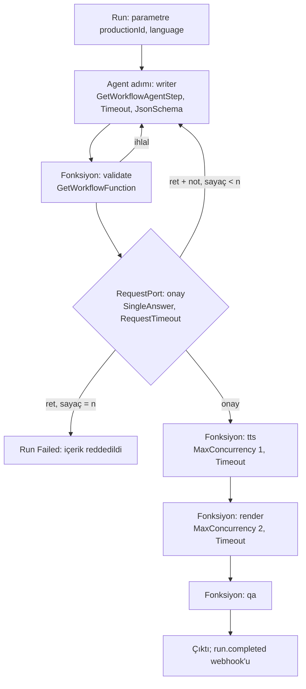

# Faz 211 — Kod Grafında Düğüm Yetenekleri ve Revizyon Döngüsü

> **Durum:** 📋 Planlandı (2026-10-15)
> **Plan onayı:** kapsam kararları bakımcıdan, 2026-10-15 (tam paket · yeni `GetWorkflowAgentStep` · agent adımı akışsız · SDK sabiti ayrı iş). Yazılı planın onayı bekleniyor — onaylanmadan uygulama başlamaz.
> **Kaynak:** **F-537**, **F-538**, **F-539**
> **Genellik:** İnsan onayı ve revizyon geri kenarı taşıyan her workflow kod grafı ister, çünkü saklanan tanım yalnız doğrusal agent/fonksiyon zinciridir ([`WorkflowNodeReference.cs:19-23`](../src/Tracon.Abstractions/Workflows/WorkflowNodeReference.cs)). Faz 196 (düğüm süresi), 199 (düğüm adlı maliyet), 200 (agent sürüm sabiti) ve 210 (bütçe kapısı) yetenekleri yalnız saklanan zincire ulaştı; kod grafı yazan her tüketici bunları kaybeder. Bütçe kapısı tüketici kodunda kurulamaz, çünkü `AgentRunBudget.IsNodeStartExhausted` internal'dır. Kanıt: iki tüketici hattı (video yol A, podcast insan onayı genişlemesi) ve örnek uygulamanın kendi `BuildSummarizeAndApprove` grafı ([`samples/Tracon.Api/Program.cs:1612-1670`](../samples/Tracon.Api/Program.cs)) aynı boşluğa düşer.
> **Karşı görüş:** (1) "Kod grafı yazan tüketici kendi `Executor`'ını yazar." Cevap: süre, retry, katı ayar okuması ve düğüm adlı maliyet kopyalanabilir, ama bütçe kapısı kopyalanamaz. `AIAgentBinding` geri kenarda `TurnToken` ister; unutulursa run hata vermeden çıktısız biter (ölçüldü, § Bugün ne çalışmıyor). (2) "Onay düğümü saklanan tanıma girsin; operatör düzenlesin." Cevap: bu faz dışı. K-131 ve K-901 ile çatışır, konsol editörü ve kalıcı veri değişir; F-411 onayı `Loop` ölçütüne taşıma yönündedir.
> **Önkoşul:** Faz 196, 199, 200, 208, 209, 210 (kapandı) · `kusur-giderme` F-536 (Loop'lu agent akışta yalnız son iterasyonu verir; 2026-10-15)
> **Paketler:** `Tracon.Workflows`, `Tracon.Core`, `Tracon.AspNetCore`
> **Yeni paket:** Yok · **Migration:** Yok
> **Public API:** Büyüyor — `1.0.0` GA'dan (K-603) önce ucuz. `PublicAPI.Shipped.txt` dosyaları boştur (`wc -l src/*/PublicAPI.Shipped.txt` uygulama başında ölçülür)
> **Tüketici yüzeyi:** site: yeni `guides/review-and-revise-workflow.md`; `concepts/workflows.md` (kod workflow'u bölümü), `capabilities.md` (workflow satırı), `reference/configuration.md` (`AgentGraph:ChildDeadline` satırı, F-528) · sevk edilen: `GetWorkflowFunction` ve `GetWorkflowAgentStep` XML `<example>`, `src/Tracon.Workflows/README.md`, `CHANGELOG.md`
> **Manuel test alanı:** [`docs/manuel-test/15-WORKFLOWS.md`](manuel-test/15-WORKFLOWS.md)

---

## Bu Faza Başlarken

> `faz-baslangic` skill'ini uygula. Aşağıdaki liste o skill'in 2. adımıdır —
> **tamamını değil, yalnız işaret edilen bölümleri oku.**

1. Bu doküman
2. Kararlar — dosyanın tamamını **okuma**, yalnız bu kalemleri grep'le:
   ```bash
   grep -n "K-495\|K-587\|K-897\|K-900\|K-901\|K-958\|K-959\|K-960\|K-972\|K-989\|K-994\|K-999\|K-1002\|K-889" docs/KARARLAR.md
   ```
   **K-495** (karma zincirde agent adımı `WorkflowAgentStepExecutor`; `AIAgentBinding` giriş dışında koşmaz) ·
   **K-587** (retry yalnız kayıtlı fonksiyon düğümünde, kendi çağrısının içinde) ·
   **K-897** (workflow parametre şeması ve bağlama) ·
   **K-900** (fonksiyon ayarı katı okumayla doğrulanır) ·
   **K-901** (aynı fonksiyon bir zincirde iki kez kullanılmaz; yapısal değişiklik eski checkpoint'i reddettirir) ·
   **K-958 / K-959 / K-960** (fonksiyon süresi · agent adımı süresi `ChildDeadline`'ı ezer · tanım `RunTimeout`'u ve `MaxRunTimeout`) ·
   **K-972** (token dışı tutar ayrı toplamdır) ·
   **K-989** (agent sürüm sabiti) ·
   **K-994** (tek cevap modu) ·
   **K-999** (bütçe kapısı) ·
   **K-1002** (istek süresi) ·
   **K-889** (akışsız döngü son turu döner)
3. Önceki fazların devir notları — yalnız ilgili bölüm:
   ```bash
   awk '/## Sonraki Faza Devir Notu/,0' docs/arsiv/fazlar/210-BUTCE-DUGUM-KAPISI.md
   awk '/## Sonraki Faza Devir Notu/,0' docs/arsiv/fazlar/209-WORKFLOW-GELEN-KUTUSU-VE-SURE.md
   ```
4. Alan hafızası: [`hafiza/workflows.md`](hafiza/workflows.md) (MAF executor ve checkpoint tuzakları) ·
   [`hafiza/workflow-cevaplari.md`](hafiza/workflow-cevaplari.md) (cevap run'ı, tek cevap) ·
   [`hafiza/maf-harness-ve-loop.md`](hafiza/maf-harness-ve-loop.md) (Loop'un akış davranışı)
5. Gerektiğinde: [`MIMARI.md`](MIMARI.md) workflow bölümü

---

## Amaç

Bir tüketici, insan onayı ve sınırlı revizyon taşıyan uçtan uca bir workflow'u
kod grafıyla kurar ve saklanan zincirin bütün düğüm yeteneklerini alır: düğüm
süresi, retry, bütçe kapısı, düğüm adlı maliyet, katı ayar, agent sürüm sabiti,
workflow başına süre ve run parametreleri. Pahalı düğümün (GPU TTS, render)
eşzamanlılığı fonksiyon başına sınırlanır. Süresi dolan istek host'a webhook ile
bildirilir.

- **F-537** — kod grafında fonksiyon düğümü ve agent adımı; workflow agent adımı akışsız koşar; kod kaydında `RunTimeout` ve `Parameters`
- **F-538** — fonksiyon başına eşzamanlılık sınırı (`WorkflowFunctionOptions.MaxConcurrency`)
- **F-539** — istek süresi dolunca `run.failed` webhook'u

### Bugün ne çalışmıyor — doğrulanmış kanıt

| Kanıt | Gözlem |
|---|---|
| [`WorkflowFunctionRegistry.cs:19`](../src/Tracon.Workflows/Internal/WorkflowFunctionRegistry.cs), [`:156`](../src/Tracon.Workflows/Internal/WorkflowFunctionRegistry.cs) | Kayıtlı fonksiyonu executor'a çeviren `CreateExecutor` internal'dır; yalnız saklanan zincir derleyicisi çağırır ([`WorkflowDefinitionCompiler.cs:221`](../src/Tracon.Workflows/Internal/WorkflowDefinitionCompiler.cs)) |
| [`TraconWorkflowFunctionExtensions.cs:492-519`](../src/Tracon.Workflows/TraconWorkflowFunctionExtensions.cs) | Sarmalayıcı zincir `scope(retry(gate(timeout(handler))))` yalnız bu yoldan kurulur |
| [`WorkflowAgentBinding.cs:70-80`](../src/Tracon.Workflows/WorkflowAgentBinding.cs) | `GetWorkflowAgent` süre ve sürüm almaz; adım kurulum geneli `ChildDeadline` (2 dk, [`TraconOptions.cs:241`](../src/Tracon.Core/TraconOptions.cs)) ile koşar |
| MAF 1.20.0 `AIAgentHostExecutor` (internal; probe ile ölçüldü, 2026-10-15) | Geri kenarla dönen mesaj `TurnToken` olmadan agent'ı koşturmaz; run hata vermeden çıktısız `Idle` biter. Cevap run'ı token göndermez ([`WorkflowRunner.cs:1769-1772`](../src/Tracon.Workflows/Internal/WorkflowRunner.cs)). K-495'in tuzağı kod grafında da geçerlidir |
| [`WorkflowAgentStepExecutor.cs:39`](../src/Tracon.Workflows/Internal/WorkflowAgentStepExecutor.cs) | Agent adımı `RunStreamingAsync` ile koşar; akış yolunda yapılandırılmış yanıt onarımı yoktur ([`StructuredResponseValidatingAgent.cs:279-350`](../src/Tracon.Core/Compilation/StructuredResponseValidatingAgent.cs)) |
| [`WorkflowRegistrationOptions.cs:15,27,47`](../src/Tracon.Workflows/WorkflowRegistrationOptions.cs) | Kod kaydı yalnız `Description`, `ResponseMode`, `RequestTimeout` taşır |
| [`WorkflowRunner.cs:2298-2312`](../src/Tracon.Workflows/Internal/WorkflowRunner.cs) | Kod workflow'u tanımsızdır; `RunTimeout` kurulum değerinde (10 dk) kalır |
| [`WorkflowRunner.cs:1099`](../src/Tracon.Workflows/Internal/WorkflowRunner.cs) | Kod workflow'unun parametre şeması boştur; her değer `unknown` reddi alır |
| [`WorkflowFunctionOptions.cs:17,25,55,77`](../src/Tracon.Workflows/WorkflowFunctionOptions.cs) | Fonksiyon başına eşzamanlılık sınırı yoktur; tek sınır süreç başına ve kiracılara ortak `MaxConcurrentRuns`'tır |
| [`WorkflowRequestExpirationService.cs:43-52`](../src/Tracon.Workflows/Internal/WorkflowRequestExpirationService.cs) | Servis webhook yayıncısı almaz; süresi dolan run `Failed` kapanır ama `run.failed` yayınlanmaz (Faz 209 bilinen sınırı) |
| [`WorkflowCatalog.cs:184-195`](../src/Tracon.Workflows/Internal/WorkflowCatalog.cs) | Kod grafı her run'da yeniden kurulur; executor alanında tutulan revizyon sayacı her cevap run'ında sıfırlanır |

> Kanıtlar 2026-10-15 tarihinde doğrulandı.



---

## 211.1 — Kod grafında fonksiyon düğümü: `GetWorkflowFunction`

`AddWorkflowFunction` ile kaydedilen fonksiyonu kod grafına koyan public
yol. İçi saklanan zincirle **aynı** `CreateExecutor` çağrısıdır; aynı
sarmalayıcı zinciri kurar: düğüm kapsamı (Faz 199), retry (K-587), bütçe
kapısı (K-999), süre (K-958), katı ayar okuması (K-900).

- Executor kimliği fonksiyon adıdır. Aynı fonksiyon bir grafta iki kez
  kullanılmaz; gerekirse kodda ikinci ad kaydedilir (K-901 emsali). Bu yüzden
  düğüm adlı maliyet kalemi fonksiyonun adını taşır ve tekildir.
- Bilinmeyen fonksiyon adı ve okunamayan ayar graf kurulurken
  `TraconException` atar; mesaj workflow'u ve fonksiyonu adlandırır. Graf her
  run'da kurulduğu için hata ilk düğümden önce run'ı `Failed` bitirir.
- Ayar `JsonElement?` olarak verilir ve kayıttaki `TSettings`'e katı okunur
  (Açık Soru 1).

## 211.2 — Kod grafında agent adımı: `GetWorkflowAgentStep`

`WorkflowAgentStepExecutor` (bir `FunctionExecutor`) döner; saklanan karma
zincirle aynı kod yoludur. `TurnToken` istemez, bu yüzden geri kenarda
güvenlidir. Girdi ve çıktı `List<ChatMessage>`'dır.

- `Timeout` adımın `ChildDeadline`'ını ezer (K-959 kod yoluna genişler).
- `AgentVersion` adımı veritabanı agent'ının bir sürümüne sabitler (K-989).
  Graf fabrikası senkrondur; sabit sürüm sorunu bu yüzden derlemede değil,
  adım çalışırken ve model çağrısından önce adımı adıyla düşürür. Bu fark
  belgelenir.
- Executor kimliği agent'ın katalog adıdır; `WorkflowGraphReader` agent adını
  kimlikten okur ([`WorkflowAgentStepExecutor.cs:11-17`](../src/Tracon.Workflows/Internal/WorkflowAgentStepExecutor.cs)).
  Aynı agent iki düğümde kullanılmaz.
- Adımın MAF oturumu yoktur. Revizyon girdisi taslağı ve geri bildirimi
  kendisi taşır; rehber bunu örnekle gösterir.
- `GetWorkflowAgent` değişmez: preview.3'te sevk edildi; opsiyonel parametre
  eklemek ikili kırıcıdır.

## 211.3 — Workflow agent adımı akışsız koşar

`WorkflowAgentStepExecutor` `agent.RunAsync` çağırır. Saklanan karma zincir
ve yeni kod adımı birlikte değişir.

- Yapılandırılmış yanıt onarımı workflow adımında çalışır
  (`Tracon:StructuredResponse:Enabled` ve `MaxRepairAttempts` ile; adım
  Tracon damgalı oturum taşımaz).
- Karma zincir zaten `MessageDelta` yaymıyordu (K-495); görünen akış değişmez.
- Executor'ın bugünkü yorumu "alt run tam mesaj ve usage geçmişini akışlı
  yolda tutar" der ([`WorkflowDefinitionCompiler.cs:132-134`](../src/Tracon.Workflows/Internal/WorkflowDefinitionCompiler.cs)).
  Akışsız yolun aynı geçmişi yazdığı **ölçülmeli**; ölçüm testi aşağıdadır.
- Hazır desenler (`AgentWorkflowBuilder`) MAF'ın kendi executor'ıyla akışlı
  koşar; bu faz onları değiştirmez. Onlarda Loop F-536 ile son iterasyonu
  verir, onarım yoktur. Site bunu yazar.

## 211.4 — Kod kaydında `RunTimeout` ve `Parameters`

`WorkflowRegistrationOptions` iki alan alır. İkisi de saklanan tanımın
kuralını taşır.

- `RunTimeout` (`TimeSpan?`): K-960 — kurulum değerini kısaltır,
  `MaxRunTimeout` tavanına kadar uzatır. Tavanı aşan değer host açılışında
  workflow'u adlandıran bir doğrulama hatasıyla düşer (Açık Soru 2). Tavan
  sonradan düşürülürse run tavana kesilir ve kesme loglanır (saklanan tanımla
  aynı).
- `Parameters` (`IReadOnlyList<AgentParameter>`): K-897 — runner doğrular,
  HTTP erken `400` verir, kuyruklu run değeri taşır, agent adımı yalnız kendi
  şemasındaki adları alır. `GET /api/workflows/{name}` şemayı gösterir.
  Kuyruk yükünde yalnız kimlik durur kuralı (bakımcı kararı, 2026-10-15)
  böylece kod grafında da uygulanır: `productionId` parametre olur.

## 211.5 — Fonksiyon başına eşzamanlılık: `WorkflowFunctionOptions.MaxConcurrency`

`int?`; `null` sınırsızdır (K1). Değer kayıtta `≥ 1` doğrulanır. Sınır süreç
geneli ve fonksiyon başınadır; saklanan zincire ve kod grafına birlikte ulaşır.

- Sıra: `scope(retry(limit(gate(timeout(handler)))))`. Her deneme slotu yeniden
  alır; retry beklemesinde slot bırakılır. Bütçe kapısı slot alındıktan sonra
  okunur, çünkü bekleme sırasında bütçe tükenebilir.
- Bekleme run'ın token'ına bağlıdır (iptal ve `RunTimeout`), düğüm `Timeout`'una
  sayılmaz: süre düğümün kendi işini sınırlar.
- Sınır replika sayısıyla çoğalır; site bunu yazar. Kiracı adaleti F-322'dir,
  bu fazın dışındadır.

## 211.6 — İstek süresi dolunca webhook

`WorkflowRequestExpirationService` opsiyonel `IWebhookPublisher` alır. Run'ı
`Failed` kapattığı dalda `run.failed` yayınlar; yük runner kapanışıyla aynı
yardımcıdan kurulur ([`WorkflowRunner.cs:2021-2030`](../src/Tracon.Workflows/Internal/WorkflowRunner.cs)).
Yayın hatası loglanır, kapanışı bozmaz. Bütün istekleri cevaplanmış run'ı
`Completed` kapattığı dalda `run.completed` yayınlar (Açık Soru 3).
`workflow.request.answered` (F-523) bu faz dışıdır.

## 211.7 — Örnek, rehber ve revizyon sayacı

- `samples/Tracon.Api`: `review-and-revise` kod grafı (§ diyagram). Writer
  `JsonSchema` çıktı verir; `validate` ihlalde writer'a döner; onay
  `RequestPort<ReviewRequest, ReviewDecision>`; ret notu ve önceki taslak
  writer'ın girdisidir; sayaç n'de run'ı düşürür; medya düğümleri sahte TTS ve
  render'dır, `ReportUsageAsync` ile maliyet bildirir, `Timeout` ve
  `MaxConcurrency` taşır. Kayıt: `SingleAnswer`, `RequestTimeout`,
  `RunTimeout`, `Parameters`.
- 🚨 Revizyon sayacı executor alanında **tutulmaz**: her cevap yeni bir run'dır
  ve graf yeniden kurulur. Sayaç `IWorkflowContext` durumunda tutulur
  (`QueueStateUpdateAsync` / `ReadStateAsync`). Durumun cevap run'ında
  checkpoint'ten geri geldiği Tracon'da **ölçülmedi**; uygulamanın ilk işi bu
  ölçümdür. **Doğrulanmadı — `maf-api-kesfi` ile ölçülmeli** (imzalar ve
  checkpoint davranışı).
- Site: `guides/review-and-revise-workflow.md` — graf, sayaç, ret notu,
  kesinti sonrası devam (`ResumeInterruptedRuns`), maliyet ve bütçe.

---

## Planlanan Public API

> Taslak imzalardır. RS0026 yüzünden opsiyonel parametre yalnız tek aşırı
> yüklemede kalmaz; K-902 deseni uygulanır (`Action<Options>`).

```csharp
// Tracon.Workflows
public static class WorkflowFunctionBinding
{
    public static ExecutorBinding GetWorkflowFunction(this IServiceProvider services, string functionName);
    public static ExecutorBinding GetWorkflowFunction(
        this IServiceProvider services, string functionName, Action<WorkflowFunctionStepOptions> configure);
}

public sealed class WorkflowFunctionStepOptions
{
    public TimeSpan? Timeout { get; set; }
    public JsonElement? Settings { get; set; }
}

public static class WorkflowAgentBinding // mevcut sınıf; yeni üyeler
{
    public static ExecutorBinding GetWorkflowAgentStep(
        this IServiceProvider services, string workflowName, string agentName);
    public static ExecutorBinding GetWorkflowAgentStep(
        this IServiceProvider services, string workflowName, string agentName,
        Action<WorkflowAgentStepOptions> configure);
}

public sealed class WorkflowAgentStepOptions
{
    public string? Description { get; set; }
    public TimeSpan? Timeout { get; set; }
    public int? AgentVersion { get; set; }
}

public sealed class WorkflowRegistrationOptions // mevcut; yeni alanlar
{
    public TimeSpan? RunTimeout { get; set; }
    public IReadOnlyList<AgentParameter> Parameters { get; set; } = [];
}

public sealed class WorkflowFunctionOptions // mevcut; yeni alan
{
    public int? MaxConcurrency { get; set; }
}
```

- `ExecutorBinding` MAF tipidir; sarmalanmaz (K3).
- Bugün eklemek bedava / sonradan eklemek: `WorkflowRegistrationOptions` ve
  `WorkflowFunctionOptions` `sealed class`'tır, alan eklemek kaynak kırmaz;
  yeni statik metotlar kırmaz.

### HTTP `endpoint`'leri

Yeni uç yok. `GET /api/workflows/{name}` kod workflow'unun parametre şemasını
da döner (saklanan tanımla aynı alan).

### Arayüz payı

Yok. Konsol kod workflow'unu bugünkü gibi salt okunur gösterir.

---

## Planlanan Dosya Listesi

```
src/Tracon.Workflows/
├── WorkflowFunctionBinding.cs            (yeni)
├── WorkflowFunctionStepOptions.cs        (yeni)
├── WorkflowAgentStepOptions.cs           (yeni)
├── WorkflowAgentBinding.cs               (GetWorkflowAgentStep)
├── WorkflowRegistrationOptions.cs        (RunTimeout, Parameters)
├── WorkflowFunctionOptions.cs            (MaxConcurrency)
├── TraconWorkflowFunctionExtensions.cs   (limit halkası)
├── Internal/WorkflowAgentStepExecutor.cs (RunAsync)
├── Internal/WorkflowRunner.cs            (kod RunTimeout ve Parameters okuması)
├── Internal/WorkflowRequestExpirationService.cs (webhook)
└── PublicAPI.Unshipped.txt
samples/Tracon.Api/                       (review-and-revise grafı)
docs-site/src/content/docs/guides/review-and-revise-workflow.md (yeni)
tests/Tracon.Workflows.UnitTests/         (kayıt doğrulaması)
tests/Tracon.AspNetCore.FunctionalTests/  (graf, revizyon, devam, webhook)
```

---

## Hata Modları ve Testler

| Ne bozulabilir | Seviye | Test sınıfı |
|---|---|---|
| Kod grafındaki fonksiyon düğümü süreyi, retry'ı, bütçe kapısını veya düğüm adlı maliyeti almaz | Fonksiyonel | `CodeWorkflowFunctionNodeTests` |
| Bilinmeyen fonksiyon adı veya okunamayan ayar run'ı ilk düğümden sonra düşürür | Fonksiyonel | `CodeWorkflowFunctionNodeTests` |
| Geri kenardan dönen mesaj agent adımını koşturmaz (`TurnToken` tuzağı) | Fonksiyonel | `CodeWorkflowRevisionTests` |
| Revizyon sayacı cevap run'ında sıfırlanır; n'inci retten sonra run sürer | Fonksiyonel (checkpoint + cevap) | `CodeWorkflowRevisionTests` |
| Agent adımı `Timeout`'u ve `AgentVersion`'ı uygulanmaz | Fonksiyonel | `CodeWorkflowAgentStepTests` |
| Akışsız adımda alt run'ın mesaj ve usage geçmişi eksik yazılır | Fonksiyonel (kayıt sınırı) | `WorkflowAgentStepRecordingTests` |
| JSON ihlali workflow adımında onarılmaz | Fonksiyonel | `WorkflowAgentStepRepairTests` |
| Onay isteyen tool'lu agent adımı akışsız yolda reddi kaybeder | Fonksiyonel | `WorkflowAgentStepRecordingTests` |
| Kod `RunTimeout`'u tavanı aşar ve host açılır | Birim (açılış doğrulaması) + Fonksiyonel | `CodeWorkflowRegistrationValidationTests` |
| Kod workflow'una parametre değeri ulaşmaz veya bilinmeyen ad kabul edilir | Fonksiyonel (HTTP + kuyruk) | `CodeWorkflowParameterTests` |
| `MaxConcurrency` aşılır; retry beklemesinde slot tutulur; iptal bekleyeni bırakmaz | Fonksiyonel (eşzamanlılık) | `WorkflowFunctionConcurrencyTests` |
| Bekleme sırasında tükenen bütçe düğümü başlatır | Fonksiyonel | `WorkflowFunctionConcurrencyTests` |
| Süresi dolan run için `run.failed` yayınlanmaz; yayın hatası kapanışı bozar | Fonksiyonel | `WorkflowRequestExpiryWebhookTests` |
| Kesinti sonrası devam kod grafında son checkpoint'ten sürmez | Fonksiyonel (kuyruk + yeniden başlatma) | `CodeWorkflowRevisionTests` |
| Başka kiracı, başka kiracının bekleyen isteğine cevap verir | Sözleşme | mevcut `TenantIsolationContract` + `CodeWorkflowRevisionTests` |

Beş soru: iptal (bekleyen slot, adım süresi) · eşzamanlılık (`MaxConcurrency`,
iki cevap) · boş/aşırı girdi (sınırsız revizyon, boş ret notu) · başka kiracı
(cevap ve gelen kutusu) · alt sistem hatası (webhook yayını, `store`).

---

## Manuel Kabul Case'leri

| # | Ön koşul | Adımlar | Beklenen sonuç |
|---|---|---|---|
| 1 | Örnek uygulama, SQLite | `review-and-revise`'ı `Prefer: respond-async` ile başlat; isteği reddet (not ile); ikinci taslağı onayla | İkinci writer çağrısı notu ve ilk taslağı görür; medya düğümleri bir kez koşar; run `Completed` |
| 2 | Aynı | n kez reddet | Run `Failed`, hata sınıfı adlandırılır; medya düğümü koşmaz |
| 3 | Aynı | Render düğümü sırasında süreci öldür; yeniden başlat | Run son checkpoint'ten sürer; onay yeniden sorulmaz |
| 4 | `RequestTimeout` 1 dk | Cevap verme | Run `Failed` (`WorkflowRequestExpired`); webhook alıcısı `run.failed` alır |
| 5 | Üç run aynı anda | Hepsini onayla | `tts` düğümü aynı anda en çok `MaxConcurrency` kez koşar (log ve zaman damgası) |
| 6 | `RunTimeout` tavanın üstünde | Host'u başlat | Açılış workflow'u adlandıran hatayla düşer |

---

## Açık Sorular

| # | Soru | Seçenekler | Öneri |
|---|---|---|---|
| 1 | Fonksiyon ayarı kod grafında hangi tiple verilir? | A: yalnız `JsonElement?` · B: `JsonElement?` + `SetSettings<TSettings>(value)` yardımcısı (aynı katı seçenekle yazar) | **B**: tek okuma yolu (K-900) korunur, kod yazan tüketici tipli değer verir |
| 2 | Kod `RunTimeout`'u tavanı aşarsa? | A: host açılışında hata · B: run'da kes ve logla | **A**: kod değeri dağıtımla gelir; açılışta düşmek sessiz kesmeden iyidir. Tavan sonradan düşerse B davranışı (saklanan tanımla aynı) |
| 3 | Süre dolumu servisi `Completed` dalında `run.completed` yayınlasın mı? | A: evet · B: yalnız `run.failed` | **A**: run kapanışının bütün yolları aynı olayı yayınlar |
| 4 | `MaxConcurrency` beklemesi run olayı yazsın mı? | A: yazmaz, `Debug` log · B: yeni olay tipi | **A**: yeni olay tipi sözleşme büyütür; ihtiyaç ölçülmedi |

---

## Bitiş Ölçütleri (DoD)

- [ ] Kod grafındaki `GetWorkflowFunction` düğümü saklanan zincirdeki aynı fonksiyonla aynı süre, retry, bütçe kapısı ve düğüm adlı maliyet davranışını verir (fonksiyonel test)
- [ ] Geri kenarla dönen mesaj `GetWorkflowAgentStep` adımını koşturur; n'inci ret run'ı düşürür; sayaç cevap run'ları arasında korunur
- [ ] Workflow agent adımında `JsonSchema` ihlali `MaxRepairAttempts` ile onarılır
- [ ] Kod kaydının `RunTimeout`'u ve `Parameters`'ı saklanan tanımla aynı kuralla uygulanır
- [ ] `MaxConcurrency` aynı anda koşan deneme sayısını sınırlar; iptal bekleyeni bırakır
- [ ] Süresi dolan run `run.failed` webhook'u üretir
- [ ] Dört doğrulama kapısı sıfır uyarı verir
- [ ] `samples/Tracon.Api` ile gerçek `run` yapıldı (ret → revizyon → onay; kesinti sonrası devam), çıktı belgeye yazıldı
- [ ] `secret` taraması boş döndü
- [ ] Manuel kabul case'leri `docs/manuel-test/15-WORKFLOWS.md` içine eklendi; otomatikleştirilebilenler koşuldu
- [ ] `faz-denetim` koşuldu; 🔴 bulgu kalmadı
- [ ] `docs-site/` güncellendi (yeni rehber, `concepts/workflows.md`, `capabilities.md`, `reference/configuration.md`); `npm run build` + `check-links.mjs` temiz

### Doğrulama komutları

```bash
# Kod grafı revizyon döngüsü (örnek uygulama)
curl -s -X POST http://localhost:5081/tracon/api/workflows/review-and-revise/run \
  -H 'Prefer: respond-async' -H 'Content-Type: application/json' \
  -d '{"message":"start","parameters":{"productionId":"p-1","language":"tr"}}'
curl -s http://localhost:5081/tracon/api/workflows/requests?state=pending
```

---

## Riskler

| Risk | Önlem |
|------|-------|
| MAF iç executor davranışı sürümle değişir (`TurnToken`, checkpoint durumu) | Geri kenar ve sayaç fonksiyonel testle kilitlenir; MAF yükseltmesinde test kırmızı olur |
| Akışsız adım bugünkü kayıt veya onay davranışından ayrılır | Ölçüm testi önce yazılır; fark CHANGELOG'da davranış değişikliği olarak anılır |
| Graf değişikliği bekleyen run'ın resume'unu reddettirir (K-901) | Rehber yazar: kod grafı değişince bekleyen run eski sürümle sürmez |
| Her cevap run'ı yeni bütçeyle başlar (F-531) | Rehber yazar; revizyon tavanı (n) ve `MaxTotalCost` birlikte verilir. F-531 ayrı kalemdir |
| `MaxConcurrency` replika sayısıyla çoğalır | Site yazar; dağıtık sınır kapsam dışıdır |

---

<!-- ============================================================
     AŞAĞISI KAPANIŞTA DOLDURULUR — `faz-tamamlama` skill'i.
     Plan anında boş kalır. Başlıkları SİLME.
     ============================================================ -->

## Plandan Sapmalar

> Kapanışta doldurulur.

## Bu Fazda Verilen Kararlar

> Kapanışta doldurulur.

## Gerçekleşen Public API

> Kapanışta doldurulur.

## Dosya Listesi (gerçekleşen)

> Kapanışta doldurulur.

## Süreç Ölçümü

> Kapanışta doldurulur.

| Metrik | Değer |
|---|---|
| Plan revizyonu sayısı | |
| Düzeltme turu sayısı | |
| 🔴 bulgu: gerçek / gürültü / araştırılacak | |
| Fazın ürettiği regresyon | |
| Faz kapandıktan sonra bulunan kusur | |

## Denetim Bulguları

> Kapanışta doldurulur.

## Sonraki Faza Devir Notu

> Kapanışta doldurulur.
