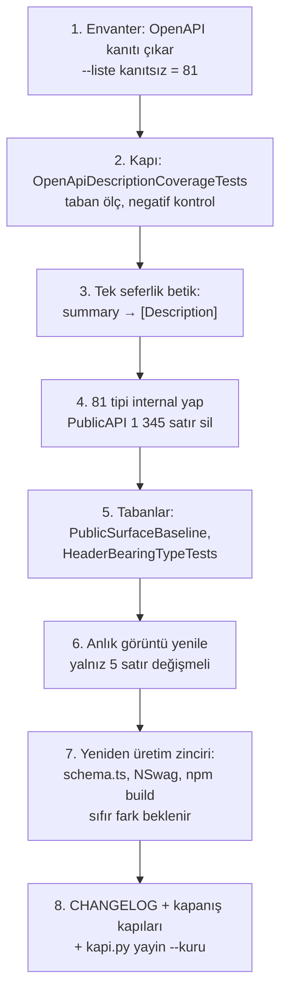

# Faz 212 — HTTP DTO'larını Daralt: Yalnız OpenAPI İçin Public Olan 81 Tip

> **Durum:** 🚧 Uygulanıyor (başladı 2026-10-16)
> **Plan onayı:** onaylandı — farukatasoy, 2026-10-16 ("planı uygula", `faz-uygulama` ile). Kapsam kararı: **UR-010 B**, farukatasoy, 2026-10-16 ([`YAYIN-HAZIRLIK.md`](YAYIN-HAZIRLIK.md) §7). Açık Soru 1 ve 2'de önerilen seçenek (A) uygulandı; kullanıcıya ayrıca sorulmadı, itiraz gelirse geri alınır.
> **Kaynak:** [ADAYLAR.md](ADAYLAR.md) · **F-554**
> **Genellik:** Her .NET tüketicisi. 1.0 sözü bugün 81 HTTP DTO'sunu da kapsar; .NET tüketicisi bunları kullanmaz (`Tracon.Client` kendi DTO'larını üretir). İş tüketici kodunda kalamaz: sözleşme bizim. İkinci kanıt: ilk ilke (donan yüzey küçüldükçe söz ucuzlar) ve [Faz 182](arsiv/fazlar/182-PUBLIC-API-YUZEY-DARALTMA.md) emsali (91 tip, aynı ölçüt).
> **Karşı görüş:** Faz 182 "OpenAPI şema tipi daraltılmaz" dedi: üretici yalnız public tipin XML'ini taşır, tip `internal` olunca `description` silinir. **Cevap:** Bu doğrudur ve ölçüldü; plan onu çözer, yok saymaz. `[Description]` aynı metni geri getirir (5 tip / 12 özellik denendi, fark yok). Bedeli: 393 metin tek yere taşınır. Kopya değil **taşıma** olduğu için ikinci kaynak doğmaz; kaybı görünür kılan yeni bir kapı eklenir (§212.4).
> **Önkoşul:** Yok. [Faz 213](213-TESISAT-ARAYUZLERI-VE-UYE-HIJYENI.md) bu fazdan **sonra** gelir (ikisi de `PublicAPI.Unshipped.txt` ve envanter betiğini değiştirir; paralel koşmaz).
> **Paketler:** `Tracon.Abstractions`, `Tracon.AspNetCore`, `Tracon.Core` (+ `scripts/`, `tests/`)
> **Yeni paket:** Yok · **Migration:** Yok
> **Public API:** **Küçülüyor.** 81 tip ve 1 345 `PublicAPI.Unshipped.txt` satırı gider (AspNetCore 1 058 · Abstractions 258 · Core 29). `PublicAPI.Shipped.txt` bugün **0** satırdır: `find src -name PublicAPI.Shipped.txt -exec cat {} + | grep -vcE '^\s*$|^#'` → `0`. Daraltma `1.0.0`'dan önce bedavadır; sonra her biri major sürümdür.
> **Tüketici yüzeyi:** site: Yok (API referansında 81 üretilen sayfa kalkar; izlenen hiçbir sayfa onlara bağlanmaz). Sevk edilen: `CHANGELOG.md` `[Unreleased]` → **Removed**, 81 tipin her biri adıyla (K-864 kapısı ister); OpenAPI belgesi `docs/openapi/tracon.json` yalnız 5 `description` satırı değişir (§212.3)
> **Manuel test alanı:** [`manuel-test/25-SAGLIK-TESHIS-OPENAPI.md`](manuel-test/25-SAGLIK-TESHIS-OPENAPI.md)

---

## Bu Faza Başlarken

> `faz-baslangic` skill'ini uygula. Aşağıdaki liste o skill'in 2. adımıdır —
> **tamamını değil, yalnız işaret edilen bölümleri oku.**

1. Bu doküman
2. Kararlar — dosyanın tamamını **okuma**, yalnız bu kalemleri grep'le:
   ```bash
   grep -n "K-850\|K-352\|K-864\|K-603" docs/KARARLAR.md
   ```
   **K-850** (kanıtsız tip `internal`; "OpenAPI şema tipi daraltılmaz" bu kararın devir notundadır, Faz 182) · **K-352** (OpenAPI belgesini tüketicinin `AddOpenApi()`'si üretir) · **K-864** (kırılma sürüm notunda adıyla anılır) · **K-603** (`Shipped` dolumu `1.0.0`'a kadar boş)
3. [Faz 182](arsiv/fazlar/182-PUBLIC-API-YUZEY-DARALTMA.md) — yalnız devir notu:
   ```bash
   awk '/## Sonraki Faza Devir Notu/,0' docs/arsiv/fazlar/182-PUBLIC-API-YUZEY-DARALTMA.md
   ```
   Bu faz onun ikinci kuralını (OpenAPI şema tipi daraltılmaz) **değiştirir**; neden değiştiği §212.1'dedir.
4. Alan hafızası:
   [`hafiza/http-uc-guvenlik-ve-sozlesme.md`](hafiza/http-uc-guvenlik-ve-sozlesme.md) (satır 30: OpenAPI açıklama tuzağı; satır 39: `cref` tuzağı) ·
   [`hafiza/analyzer-tanilari.md`](hafiza/analyzer-tanilari.md) (§ Public yüzey daraltma tarifi: `~` önekli satırlar, `RS0017`) ·
   [`hafiza/nswag-istemci-uretimi.md`](hafiza/nswag-istemci-uretimi.md) (yeniden üretim sırası, satır 60-62)
5. `python3 scripts/public-yuzey-envanteri.py --help` — bu fazın ölçüm aracı

---

## Amaç

81 HTTP DTO'su yalnız bir sebeple public: üretici, `description` metnini yalnız public tipin XML'inden alır. Bu tipleri 1.0'a dondurmak, kimsenin kullanmadığı 1 345 satırı sonsuza dek taşımak demektir. Faz tipleri `internal` yapar, metni `[Description]` özniteliğine **taşır** ve OpenAPI belgesinin değişmediğini kanıtlar.

- **F-554** — 81 tipi `internal` yap; `description` metnini `[Description]`'a taşı; yeni HTTP DTO'su artık `internal` doğar (envanter kuralı değişir); metin kaybını gören kapı ekle.

### Bugün ne çalışmıyor — doğrulanmış kanıt

| Kanıt | Gözlem |
|---|---|
| [`public-yuzey-envanteri.py`](../scripts/public-yuzey-envanteri.py) `_tuketici_kaniti` | OpenAPI şema adı "tüketici kanıtı" sayılır; 161 tip bu kanıtla public kalır. Kanıt çıkarılınca **81** tip kanıtsız kalır (63 AspNetCore · 17 Abstractions · 1 Core; 79 `record`, 2 `enum`) |
| [`tests/Tracon.AspNetCore.FunctionalTests/OpenApiDocumentTests.cs:116`](../tests/Tracon.AspNetCore.FunctionalTests/OpenApiDocumentTests.cs) | Açıklamalı özellik tabanı `> 500`; anlık görüntüde 1 164 özellik var, 298'i bu 81 tipte. Hepsi silinse 866 kalır: **kapı kaybı görmez** |
| [`tests/Tracon.AspNetCore.FunctionalTests/HeaderBearingTypeTests.cs:43`](../tests/Tracon.AspNetCore.FunctionalTests/HeaderBearingTypeTests.cs) | `GetExportedTypes()` ile tarar ve `:50`'de `WebhookSaveRequest`'i bekler; tip `internal` olunca kırılır |
| `src/Tracon.Abstractions/Tracon.Abstractions.csproj:14-73` | `InternalsVisibleTo`: Core, Workflows, AspNetCore, Mcp, üç SQL sağlayıcı, Voice, dört model sağlayıcı ve beş test projesi. **Yeni grant gerekmez** |
| `src/Directory.Build.props:219-222` | `<Ad>.UnitTests/.IntegrationTests/.FunctionalTests` otomatik IVT alır; `Tracon.AspNetCore.FunctionalTests` (27 tipi kullanır) kapsanır |
| `PublicAPI.*.txt` (9 875 satır) | 81 tipten birini başka bir public imzada anan satır **yok** (`CS0050/51/53` riski 0); taban liste ve `where` kısıtlarında da 0 |
| `docs/hafiza/http-uc-guvenlik-ve-sozlesme.md:30` | Tuzağın kaydı. Ölçüm: üretici başka derlemedeki public olmayan sembolü atar; IVT sayılmaz |

> Kanıtlar 2026-10-16'da doğrulandı (HEAD `69e9cf59`). Hiçbiri derlenip koşturulmadı; derleme ve test doğrulaması uygulamanın ilk işidir.

---

## 212.1 — Neden Faz 182'nin kuralı değişiyor

Faz 182 iki şeyi birleştirdi: "OpenAPI şeması tüketici kanıtıdır" ve "tipi daraltırsan açıklama gider". İkincisi doğru kaldı, birincisi yanlış bir sonuç çıkardı: kanıt, tipin **public kalma** sebebi sayıldı. Oysa .NET tüketicisi bu tiplere dokunmaz; HTTP tüketicisi şemayı görür, CLR tipini değil.

Değişen şey: açıklamayı taşımanın yolu artık ölçülmüş (`[Description]`). Kural şöyle olur:

- HTTP istek ve yanıt DTO'su **`internal`** doğar. Açıklama `[Description]` ile yazılır.
- Envanter betiği OpenAPI şema adını **kanıt saymaz**. Yeni bir public DTO `--denetle`'yi kırmızı yapar.
- Başka kanıtı olan tip (sample, site sayfası, seam imzası) public kalır; bu kural onları etkilemez.

Bu bir karardır (kategori `public-api`) ve K-850'nin devir notundaki ikinci kuralı geçersiz kılar. Numarayı bu faz kapanışta alır; plan rezerve etmez.

## 212.2 — Kapsam: 81 tip (EK-A)

Liste elle tutulmaz, **araçla üretilir**. Adım 1 betikten OpenAPI kanıtını çıkarır; `--liste kanıtsız` çıktısı bu listedir ve DoD'nin "81" iddiasının tek kaynağıdır.

Gruplama bağımsız: altı çoklu tip grubu var (örnek: `AgentValidationReport` + `ValidationMessage` + `ValidationSeverity`), hepsi birlikte taşınınca `CS0053` oluşmaz. Tek seferde taşı.

## 212.3 — Açıklama kaynağı: taşıma, kopya değil

Ölçülen: 81 tipte **393** metin (312 özellik + 81 tip özeti). Üretici yalnız `<summary>` (ve `<value>`) alır; `<remarks>` taşınmaz. Bu yüzden:

1. Her `<summary>` metni `[Description("…")]` olur (özellikte `[property: Description]` yalnız konumsal `record` için: `UploadDocumentResponse`, `KnowledgeContracts.cs:47`).
2. `///` bloğundan `<summary>` **silinir**, `<remarks>` kalır. İki kopya doğmaz; kaynak öznitelik olur.
3. Dönüştürme kuralları (üreticiden ölçüldü, 388/393 birebir eşleşti): `<c>x</c>` → `` `x` `` · `<see langword="null"/>` → `` `null` `` · `<see cref="T:…"/>` → tip adı · satır başı girintisi atılır, çok satırlı metin (75 adet) `\n` ile kalır · `<strong>` ham kalır (1 adet, `WebhookSaveRequest.SecretConfigurationKey`).
4. **5 özellik `cref`'i** (örnek `WorkflowSaveRequest.AgentNames`) bugün `IReadOnlyList&lt;string&gt;? WorkflowSaveRequest.AgentNames` diye bozuk çıkar ([`hafiza/http-uc-guvenlik-ve-sozlesme.md`](hafiza/http-uc-guvenlik-ve-sozlesme.md) satır 39). Düz metne çevrilir. **Anlık görüntüde yalnız bu 5 `description` satırı değişir**; başka her satır birebir aynıdır.
5. Taşıma **tek seferlik bir betikle** yapılır (geçici; iş bitince silinir, `AGENTS.md` çalışma alanı kuralı). Elle yazma 393 yerde hata üretir.

> **Doğrulanmadı — ölçülmeli:** enum tipinde (`CanaryDecisionKind`, `ValidationSeverity`) tip düzeyi `[Description]`'ın şemaya geçmesi; `Microsoft.AspNetCore.OpenApi` 10.0.10'un `[Description]`'ı net8/net9 tüketicilerinde de okuması (bu paketler çok hedeflidir; üretici tüketicinin paketidir).

## 212.4 — Kaybı gören kapı

Bugünkü kapı kaybı görmez (`> 500` tabanı 866'da geçer). Yeni kapı: `OpenApiDescriptionCoverageTests` (Fonksiyonel).

- `docs/openapi/tracon.json`'daki her şemanın ve her özelliğin `description`'ı vardır; özellikte açıklama `oneOf` dalındaysa o da sayılır (`find_desc` kuralı).
- **Açıklamasız** şema/özellik sayısı bir tabana bağlanır (`openapi-undescribed-baseline.txt`): bugünkü değer uygulamanın ilk adımında **ölçülür**, sonra yalnız küçülür. Sayı artarsa kırmızı. Üretilmiş MEAI polimorfik tipleri (`AIContent*`) tabana girer, gerekçesiyle.
- Anlık görüntü yenileme (`TRACON_OPENAPI_REFRESH=1`) tabanı gizlice yeniden yazmaz: taban ayrı bir dosyadır.

Negatif kontrol zorunlu: bir DTO'dan `[Description]` kaldırılınca kapı kırmızı olur; geri konunca yeşil.

## 212.5 — Sıra



Her adım bir commit olabilir; adım 1 `kapi.py tarama`'yı adım 4'e kadar kırmızı bırakır (81 kanıtsız tip). Adım 1-4'ü aynı çalışma ağacında bitir.

---

## Planlanan Public API

> Taslak. Gerçekleşen bölüm kapanışta doldurulur.

```csharp
// Hiçbir yeni imza yok. 81 tip public → internal.
// Tracon.AspNetCore (63): AcceptedRunResponse … WorkflowVersionDiffResponse
// Tracon.Abstractions (17): AgentValidationReport … ValidationSeverity
// Tracon.Core (1): OnlineEvaluationSummary
// Tam liste: python3 scripts/public-yuzey-envanteri.py --liste kanıtsız
[Description("…")]            // özet buraya taşınır
internal sealed record WorkflowRollbackRequest { … }
```

### HTTP `endpoint`'leri

Değişmez. Yol, yöntem, şema adı, `required`, tür ve `$ref` aynıdır. Anlık görüntü farkı: 5 `description` satırı (§212.3 madde 4).

### Arayüz payı

Yok.

---

## Planlanan Dosya Listesi

```
scripts/public-yuzey-envanteri.py            (OpenAPI kanıtı çıkar)
scripts/public_yuzey_envanteri_test.py       (yeni vaka)
src/Tracon.AspNetCore/**/*Contracts*.cs      (63 tip: internal + [Description])
src/Tracon.Abstractions/**                   (17 tip)
src/Tracon.Core/**                           (1 tip)
src/*/PublicAPI.Unshipped.txt                (−1 345 satır)
tests/Tracon.Core.UnitTests/Architecture/public-surface-baseline.txt
tests/Tracon.AspNetCore.FunctionalTests/OpenApiDescriptionCoverageTests.cs   (yeni)
tests/Tracon.AspNetCore.FunctionalTests/openapi-undescribed-baseline.txt     (yeni)
tests/Tracon.AspNetCore.FunctionalTests/HeaderBearingTypeTests.cs            (GetTypes)
docs/openapi/tracon.json · packages/tracon-client/src/schema.ts · src/Tracon.Client/Generated/*
CHANGELOG.md · docs/hafiza/http-uc-guvenlik-ve-sozlesme.md · docs/hafiza/analyzer-tanilari.md
```

---

## Hata Modları ve Testler

> Sınır geçen davranış (DI · HTTP · kiracı · akış · depo · paket) birim testiyle kanıtlanamaz — [`.agents/ortak/test-seviyeleri.md`](../.agents/ortak/test-seviyeleri.md).

| Ne bozulabilir | Seviye | Test |
|---|---|---|
| Açıklama sessizce silinir (en büyük risk; mevcut kapı 866'da geçer) | Fonksiyonel | `OpenApiDescriptionCoverageTests` + `OpenApiSnapshotTests` (yalnız 5 satır) |
| `internal` tip HTTP'de bağlanmaz ya da serileşmez | Fonksiyonel | 107 dosyada 27 tipi kullanan mevcut `AspNetCore.FunctionalTests` paketi (yeşil kalmalı) |
| Şema adı, `required` veya nullability kayar | Fonksiyonel | `OpenApiSnapshotTests` (bayt karşılaştırma) · `ClientCoverageTests` · `schema-drift.test.ts` |
| İstemci yeniden üretiminde açıklama tabanı düşer | Birim | `ClientDescriptionBaselineTests` (taban 357) |
| Yeni public DTO sessizce girer | Birim | `public_yuzey_envanteri_test.py` + `kapi.py tarama` (negatif kontrol: geçici public DTO → kırmızı) |
| `RS0017` / `CS0053` / `CS0050` | Derleme | `dotnet build` (uyarı = hata) |
| Paketlenmiş tüketici 81 tipten birine bağlanıyor | Paket | `kapi.py yayin --kuru` (altı dış sample + şablon) |
| `HeaderBearingTypeTests` tipi göremez | Fonksiyonel | aynı sınıf, `GetTypes()` ile |
| Kırılma sürüm notunda anılmaz | Paket | `kapi.py yayin` ApiCompat tabanı (`breaking_changes.py`) |

Beş soru (iptal · eşzamanlılık · boş/aşırı girdi · başka kiracı · alt sistem hatası): **uygulanmaz.** Faz yeni kod yolu eklemez; yalnız görünürlük ve öznitelik değişir. Bu cümle bilinçli bir karardır, atlanmış değil.

---

## Manuel Kabul Case'leri

> Kapanışta `docs/manuel-test/25-SAGLIK-TESHIS-OPENAPI.md` içine eklenir.

| # | Ön koşul | Adımlar | Beklenen sonuç |
|---|---|---|---|
| 1 | `samples/Tracon.Api` çalışıyor, `AddOpenApi()` açık | `curl -s :5081/openapi/v1.json` → `WorkflowSaveRequest.description` | Metin dolu (bugün tüketici uygulamada boş olabilir: K-352; `[Description]` bunu iyileştirir) |
| 2 | Aynı host | `POST /tracon/api/workflows` geçerli gövdeyle | `200`/`201`; gövde `internal` tipe bağlanır |
| 3 | `Tracon.Client` ve `@tracon/client` yeniden üretildi | `git diff --stat` | Yalnız §212.3 madde 4'teki 5 açıklama; başka satır yok |
| 4 | Temiz makine, paketlenmiş `Tracon.AspNetCore` | Dış proje 81 tipten birine `using` ile bağlanmaya çalışır | `CS0122` (erişilemez) |

---

## Açık Sorular

| # | Soru | Seçenekler | Öneri |
|---|---|---|---|
| 1 | Yeni kapı tabanı: MEAI polimorfik tipleri (`AIContent*`) tabana girer mi, yoksa kapı onları hiç saymaz mı? | A: tabana gerekçeyle girer · B: kapı `AIContent*` önekini dışlar | A — kapı sayısı gerçeği gösterir; MEAI yükseltmesi (F-557) tabanı oynatırsa görünür |
| 2 | `<remarks>` bloğu 24 tipte ve 18 özellikte var; üretici taşımaz. `internal` tipte `<remarks>` kalsın mı? | A: kalsın (bakımcı notu) · B: sil | A — bu faz metin silmez, yalnız `<summary>`'yi taşır |

---

## Bitiş Ölçütleri (DoD)

- [ ] `python3 scripts/public-yuzey-envanteri.py --denetle` çıkış `0`; kanıt kuralı değişikliğinden **sonra** `--liste kanıtsız` boş
- [ ] 81 tipin her biri `internal`; `cat src/*/PublicAPI.Unshipped.txt | grep -vcE '^\s*$|^#'` → `9 875 − 1 345 = 8 530`
- [ ] `OpenApiSnapshotTests` yeşil ve `git diff docs/openapi/tracon.json` **yalnız 5 `description` satırı** gösteriyor
- [ ] `OpenApiDescriptionCoverageTests` yeşil; negatif kontrol (öznitelik kaldır → kırmızı) kayda geçti
- [ ] `packages/tracon-client` `npm run generate` + `npm run build` sonrası `src/schema.ts` farkı yalnız o 5 satır; NSwag zinciri sonrası `src/Tracon.Client/Generated/` farkı aynı 5 satır
- [ ] `CHANGELOG.md` `[Unreleased]` → Removed, 81 tipin her biri adıyla; `kapi.py yayin --kuru` yeşil
- [ ] Dört doğrulama kapısı sıfır uyarı: `python3 scripts/kapi.py kapanis --taban <faz öncesi commit>`
- [ ] `samples/Tracon.Api` ile gerçek `run` yapıldı, çıktı belgeye yazıldı
- [ ] `secret` taraması boş döndü (`kapi.py tarama`)
- [ ] Manuel kabul case'leri `docs/manuel-test/25-SAGLIK-TESHIS-OPENAPI.md` içine eklendi; otomatikleştirilebilenler koşuldu
- [ ] `faz-denetim` koşuldu; 🔴 bulgu kalmadı
- [ ] K-850 devir notunun ikinci kuralı yeni `K-*` ile geçersiz kılındı; `hafiza/http-uc-guvenlik-ve-sozlesme.md` satır 30 güncellendi
- [ ] Site: `docs-site/` `npm run check` temiz (81 üretilen sayfa kalkar, bağlantı kırığı olmamalı)

### Doğrulama komutları

```bash
python3 scripts/public-yuzey-envanteri.py --liste kanıtsız | wc -l          # kural değişince 81
find src -name PublicAPI.Shipped.txt -exec cat {} + | grep -vcE '^\s*$|^#'  # 0
TRACON_OPENAPI_REFRESH=1 python3 scripts/kapi.py test --proje Tracon.AspNetCore.FunctionalTests --sinif "*OpenApiSnapshotTests"
git diff --stat docs/openapi/tracon.json                                     # 5 satır
curl -s http://localhost:5081/openapi/v1.json | python3 -c "import json,sys; print(json.load(sys.stdin)['components']['schemas']['WorkflowSaveRequest'].get('description'))"
```

---

## Riskler

| Risk | Önlem |
|------|-------|
| Açıklama kaybı mevcut kapılarda görünmez | §212.4 kapısı; negatif kontrol; anlık görüntü farkı elle okunur |
| 393 metin elle taşınırken bozulur | Tek seferlik betik; anlık görüntü doğrulayıcıdır (388/393 birebir ölçüldü) |
| Tüketici uygulamanın kendi OpenAPI belgesi değişir | `[Description]` açıklamayı **ekler** (K-352'de boş çıkıyordu); çıkarım, manuel case 1 ölçer |
| Bu fazın kuralı K-850 devir notuyla çelişir | Yeni `K-*` kapanışta; `hafiza` satırı güncellenir |
| `Faz 213` aynı dosyaları değiştirir | Sıra: önce 212; paralel koşulmaz |
| Çoklu hedef (net8/net9) tüketicisi `[Description]`'ı okumaz | 212.3'teki "doğrulanmadı" notu; ilk iş ölç |

---

<!-- ============================================================
     AŞAĞISI KAPANIŞTA DOLDURULUR — `faz-tamamlama` skill'i.
     Plan anında boş kalır. Başlıkları SİLME.
     ============================================================ -->

## Plandan Sapmalar

> Kapanışta doldurulur. Plan ile gerçek arasındaki fark **gizlenmez** — sonraki oturumun en değerli bilgisidir.

## Bu Fazda Verilen Kararlar

> Kapanışta doldurulur. Dört kategoriden birine giren karar (AGENTS.md) ayrıca `docs/KARARLAR.md`'ye K-NNN ve kategori etiketiyle girer; plan numara rezerve etmez.

## Gerçekleşen Public API

> Kapanışta doldurulur.

## Dosya Listesi (gerçekleşen)

> Kapanışta doldurulur.

## Süreç Ölçümü

> Kapanışta doldurulur. **Tablo olarak** — onay kutusu DEĞİL.

| Metrik | Değer |
|---|---|
| Plan revizyonu sayısı | |
| Düzeltme turu sayısı | |
| 🔴 bulgu: gerçek / gürültü / araştırılacak | |
| Fazın ürettiği regresyon | |
| Faz kapandıktan sonra bulunan kusur | |

## Denetim Bulguları

> Kapanışta doldurulur — `faz-denetim` çıktısı. Bulgu yoksa "🔴 ve 🟡 yok" yazılır.

## Sonraki Faza Devir Notu

> Kapanışta doldurulur: devralınan sözleşmeler, bilinen tuzaklar (🚨), yarım kalan işler, sıradaki faz.

---

## EK-A — Kapsam (81 tip, 2026-10-16 ölçümü)

> Liste yalnız okuma kolaylığı içindir. Doğru kaynak: `--liste kanıtsız` (kural değişikliğinden sonra).

**`Tracon.Abstractions` (17):** `AgentValidationReport`, `CanaryDecisionKind`, `CanaryEvaluation`, `ContextWindowEstimate`, `DataSubjectErasureResult`, `ImageGenerationOperatorRequest`, `ImageGenerationOperatorResponse`, `JudgeFailure`, `JudgeRunResponse`, `RetentionPreview`, `RunCostRecalculationResult`, `SessionBranchRequest`, `SessionBranchResult`, `SpeakRequest`, `SpeakResponse`, `ValidationMessage`, `ValidationSeverity`

**`Tracon.AspNetCore` (63):** `AcceptedRunResponse`, `AgentDetailResponse`, `AgentRollbackRequest`, `AgentSkillRequest`, `AgentVersionDiffResponse`, `ApiKeyCreateRequest`, `ApprovalDecisionRequest`, `CurrentTenantResponse`, `EvalCaseInput`, `EvalCasePromotionRequest`, `EvalRunDetailResponse`, `EvalRunTriggerRequest`, `EvalSuiteSaveRequest`, `ExperimentCanaryResponse`, `ExperimentResultsResponse`, `ExperimentSaveRequest`, `InboundTriggerAcceptedResponse`, `InboundTriggerResponse`, `InboundTriggerSaveRequest`, `JobDetailResponse`, `JobScheduleSaveRequest`, `JobTriggerRequest`, `LiveVoiceSessionCreateRequest`, `LiveVoiceSessionCreateResponse`, `LiveVoiceSessionStatusResponse`, `LoopCriterionCatalogResponse`, `LoopCriterionKindResponse`, `LoopJudgeModelResponse`, `McpOAuthStartResponse`, `McpPromptArgumentsRequest`, `McpRefreshResponse`, `QuotaSaveRequest`, `QuotaUsageResponse`, `RetentionPolicySaveRequest`, `RetentionRunTriggerResponse`, `RunComparisonResponse`, `RunComparisonSide`, `RunFeedbackRequest`, `RunInputResponse`, `RunReplayResponse`, `SearchKnowledgeHit`, `SessionDetailResponse`, `SkillScriptGrantRequest`, `TenantEgressPolicyRequest`, `TenantEgressPolicyResponse`, `TenantProviderBindingRequest`, `TenantProviderBindingResponse`, `TenantRequest`, `ToolApprovalRuleRequest`, `TraconAuthenticationMeta`, `TraconMetaResponse`, `TraconRoleMeta`, `TraconStorageMeta`, `UploadDocumentResponse`, `WebhookSaveRequest`, `WebhookTestResponse`, `WorkflowFunctionResponse`, `WorkflowRespondHttpRequest`, `WorkflowResumeHttpRequest`, `WorkflowRollbackRequest`, `WorkflowRunHttpRequest`, `WorkflowSaveRequest`, `WorkflowVersionDiffResponse`

**`Tracon.Core` (1):** `OnlineEvaluationSummary`
