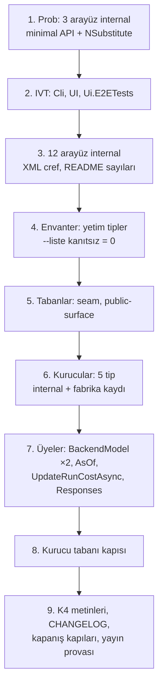

# Faz 213 — Tesisat Arayüzleri ve Üye Hijyeni

> **Durum:** ✅ Tamamlandı (2026-10-16)
> **Plan onayı:** onaylandı — farukatasoy, 2026-10-16, "planı uygula". Kapsam kararları: **UR-011 B** ve **UR-009 B** ([`YAYIN-HAZIRLIK.md`](YAYIN-HAZIRLIK.md) §7). **Sapma:** UR-011 14 arayüz saydı; ölçüm ikisini public tutmayı gerektiriyor (§213.1); onay bu sapmayı kapsar. Dört Açık Soru ayrı ayrı cevaplanmadı; uygulama dördünde de **önerilen A** seçeneğini aldı (Plandan Sapmalar §1).
> **Kaynak:** [ADAYLAR.md](ADAYLAR.md) · **F-555**, **F-556**
> **Genellik:** Her .NET tüketicisi. Donacak yüzeyde hiçbir tüketicinin uygulamadığı 12 arayüz ve DI'ın kurduğu 5 tipin public kurucusu var; 1.0'dan sonra her biri major sürümdür. İş tüketici kodunda kalamaz. İki kalem bir fazda, çünkü aynı altyapıyı paylaşır: aynı `PublicAPI.Unshipped.txt`, aynı envanter kapısı, aynı `InternalsVisibleTo` ve aynı CHANGELOG girdisi.
> **Karşı görüş:** (1) MIMARI K4 "her genişleme noktası değiştirilebilir" der; XML'i "tüketicinin kendi kaydı kazanır" diyen 8 arayüzü `internal` yapmak bu sözü daraltır. (2) K-614 / K-866'nın `IToolRegistry` için yeniden açılma koşulu doğdu ve kullanıcı yine de public tuttu (Faz 188). **Cevap:** K4 "belgelenmiş seam" anlamına gelecek şekilde daraltılır (yeni `K-*`, kapanışta). Seam'i rehber, sample ya da contract suite belgeler; bu 12 arayüzün hiçbirini hiçbiri belgelemez, uygulayanların hepsi `internal` veya test sınıfıdır (ölçüldü). `IToolRegistry` farklıdır: rehber (`write-your-own-tool.md:160`) onu anar ve değiştirmek 4 güvenlik sarmalayıcısını düşürür; bu yüzden "çağrılır, uygulanmaz" listesinde kalır, `internal` olmaz.
> **Önkoşul:** [Faz 212](arsiv/fazlar/212-HTTP-DTO-DARALTMA.md) — ikisi de `PublicAPI.Unshipped.txt` ve `scripts/public-yuzey-envanteri.py` dosyalarını değiştirir; paralel koşmaz. **Tamamlandı (2026-10-16).** Başlangıç sayıları: `PublicAPI.Unshipped.txt` toplamı `8530`; `public-surface-baseline.txt` Abstractions `423`, AspNetCore `23`, Core `79`; `public-yuzey-envanteri.py --liste kanıtsız` boş ve OpenAPI şeması artık kanıt değil. Yeni HTTP DTO'su `internal` + `[Description]` doğar (devir notu: Faz 212).
> **Paketler:** `Tracon.Abstractions`, `.Core`, `.AspNetCore`, `.Mcp`, `.Workflows`, `.Voice`, `.OpenAI`, `.UI`, `.Cli` (yalnız `InternalsVisibleTo`)
> **Yeni paket:** Yok · **Migration:** Yok
> **Public API:** **Küçülüyor.** `PublicAPI.Shipped.txt` bugün **0** satırdır (`find src -name PublicAPI.Shipped.txt -exec cat {} + | grep -vcE '^\s*$|^#'` → `0`); daraltma `1.0.0`'dan önce bedavadır.
> **Tüketici yüzeyi:** site: `guides/voice.md` ve `reference/configuration.md` (kalkan `BackendModel` anahtarı), `guides/write-your-own-store.md:48` (`UpdateRunCostAsync` varsayılanı), `concepts/workflows.md` ve `capabilities.md` hiç değişmez · sevk edilen: `src/Tracon.Abstractions/README.md:20` (tip sayıları), `UseUI()` ve `IWebhookStore` XML'i, `CHANGELOG.md` `[Unreleased]`
> **Manuel test alanı:** [`manuel-test/01-KURULUM-VE-PAKETLEME.md`](manuel-test/01-KURULUM-VE-PAKETLEME.md) — packed-consumer case'leri; MCP (`18`), ses (`19`) ve arayüz (`09`) alanlarına birer case

---

## Bu Faza Başlarken

> `faz-baslangic` skill'ini uygula. Aşağıdaki liste o skill'in 2. adımıdır —
> **tamamını değil, yalnız işaret edilen bölümleri oku.**

1. Bu doküman
2. Kararlar — dosyanın tamamını **okuma**, yalnız bu kalemleri grep'le:
   ```bash
   grep -n "K-866\|K-867\|K-902\|K-850\|K-614\|K-509\|K-663\|K-144" docs/KARARLAR.md
   ```
   **K-866** (DI'ın kurduğu tipin kurucusu `internal`) · **K-867** (opsiyonel parametre varsayılanı çağırana derlenir) · **K-902** (`AddWorkflowFunction` iki parametreli aşırı yükleme **değişmez**) · **K-850** (seam = public arayüz; kanıt ölçütü) · **K-614** (`IToolRegistry`) · **K-509** (`IServiceCollection` kayıt alıcısı sayılır) · **K-663** (`AddJobHandler` sıradan bağımsız) · **K-144** (`Experiment.AssignmentKey` bilerek tutulur)
3. [Faz 188](arsiv/fazlar/188-DI-KURUCU-DARALTMA.md) ve [Faz 182](arsiv/fazlar/182-PUBLIC-API-YUZEY-DARALTMA.md) — yalnız devir notları:
   ```bash
   awk '/## Sonraki Faza Devir Notu/,0' docs/arsiv/fazlar/188-DI-KURUCU-DARALTMA.md
   ```
   Faz 188 opsiyonel parametreli kurucuları ölçtü ve **orada durdu**; bu fazın 5 tipi kapsam dışı kaldığı için kaçtı.
4. Alan hafızası:
   [`hafiza/analyzer-tanilari.md`](hafiza/analyzer-tanilari.md) (daraltma tarifi: `~` satırlar, `RS0017`, kurucu tabanı) ·
   [`hafiza/genisleme-noktalari-ve-denetim.md`](hafiza/genisleme-noktalari-ve-denetim.md) (seam kayıtları) ·
   [`hafiza/aspnetcore-di.md`](hafiza/aspnetcore-di.md) (fabrika kaydı)
5. [`MIMARI.md`](MIMARI.md) satır 142-143 (K4) — yalnız o iki satır; daraltılacak cümle orada

---

## Amaç

Donmadan önce yüzeyden iki tür fazlalık çıkar. **Birincisi** tesisat arayüzleri: Tracon paketlerinin kendi aralarında kullandığı, hiçbir tüketicinin uygulamadığı 12 arayüz ve yalnız onların imzasında yaşayan tipler. **İkincisi** üye hijyeni: DI'ın kurduğu 5 tipin public kurucusu, hiçbir yerde okunmayan 3 public üye, çağırana derlenen bir opsiyonel `tenantId`.

- **F-555** — 12 arayüzü ve yetim kalan tiplerini `internal` yap; 9 "çağrılır, uygulanmaz" arayüzü belgele; K4'ü "belgelenmiş seam" olarak daralt.
- **F-556** — DI'ın kurduğu 5 tipin kurucusunu `internal` yap (fabrika kaydı); 3 işlevsiz üyeyi sil; `UpdateRunCostAsync`'in `tenantId = null` varsayılanını kaldır; aynı kusur sınıfının yeni örneğini yakalayan kurucu tabanı kapısını ekle.

### Bugün ne çalışmıyor — doğrulanmış kanıt

| Kanıt | Gözlem |
|---|---|
| `src/Tracon.Abstractions/**` 14 arayüz (aşağıda) | Başka hiçbir public imzada anılmaz (tüm `PublicAPI.*.txt` taraması); `where` kısıtı yok; uygulayanların hepsi `internal` veya test sınıfı |
| [`src/Tracon.Abstractions/Tools/IToolRegistry.cs:11`](../src/Tracon.Abstractions/Tools/IToolRegistry.cs) | Emsal: "Do not implement or replace this service". Zorlama: [`ToolRegistrationValidationService.cs:18`](../src/Tracon.Core/Tools/ToolRegistrationValidationService.cs) `registry is not IVerifiedToolRegistry` ise `TraconException` |
| [`SingleTenantContext.cs:21`](../src/Tracon.Core/Tenancy/SingleTenantContext.cs) | `public SingleTenantContext(IOptions<TraconOptions>)`; kaydı tip tabanlı (`Registration.Core.cs:29`); örnek, rehber ve README'de `new` yok |
| [`HttpTenantContext.cs:43`](../src/Tracon.AspNetCore/Tenancy/HttpTenantContext.cs) | Public kurucu; kaydı `Replace(<ITenantContext, HttpTenantContext>)` (`TraconTenancyBuilderExtensions.cs:54`); hiçbir yerde `new` yok |
| [`TimeoutAIFunction.cs:47`](../src/Tracon.Core/Tools/TimeoutAIFunction.cs) ve `:62` | İki public kurucu (ikincisi `TimeProvider` ekledi); boru hattında yalnız 3 bağımsız değişkenli kurucu çağrılır (`ToolWrapperChain.cs:108`); 4'lü yalnız testte |
| `CompiledAgentCache`, `DefaultRunAttributionContext` | Örtük public kurucu; kayıtlar `Registration.Core.cs:293` ve `:35`; örnek DI ile çözer ([`samples/Tracon.Samples.CustomAgentSource.Tests/JsonFileAgentSourceRunTests.cs:71`](../samples/Tracon.Samples.CustomAgentSource.Tests/JsonFileAgentSourceRunTests.cs)) |
| [`OpenAILiveOptions.cs:49`](../src/Tracon.OpenAI/Live/OpenAILiveOptions.cs) `BackendModel` | Tek yazan bağlayıcı (`OpenAILiveProviderExtensions.cs:128-131`); **okuyan 0** |
| [`LiveVoiceContracts.cs:249`](../src/Tracon.Abstractions/Voice/LiveVoiceContracts.cs) `BackendModel` | Yazan 0, okuyan 0 |
| [`QuotaTypes.cs:238`](../src/Tracon.Abstractions/Quotas/QuotaTypes.cs) `QuotaUsageQuery.AsOf` | `[Obsolete]` ("no effect because no store applies it"); preview.3'ten beri CHANGELOG'da **Deprecated**; okuyan ve yazan 0 |
| [`IRunStore.cs:371`](../src/Tracon.Abstractions/Runs/IRunStore.cs) `UpdateRunCostAsync(…, string? tenantId = null)` | Public imzada opsiyonel `tenantId` taşıyan **tek** üye; `null` "kiracı denetimi yok" demektir (`IRunStore.cs:29-34`). Üretim çağıranı kiracıyı geçer (`RunCostRecalculationService.cs:107`); atlayanlar: sevk edilen `RunStoreContract.cs:2477`, `SqliteDialectTests.cs:39`, `SqlServerDialectTests.cs:39` |
| [`LiveVoiceContracts.cs:264`](../src/Tracon.Abstractions/Voice/LiveVoiceContracts.cs) `Responses` | Seçilirse [`OpenAILiveProvider.cs:111`](../src/Tracon.OpenAI/Live/OpenAILiveProvider.cs) `NotSupportedException` ("not implemented yet"); uç `502` döner ([`Voice/LiveVoiceEndpoints.cs:230-243`](../src/Tracon.AspNetCore/Voice/LiveVoiceEndpoints.cs)), açılışta hata yok. `delegationMode` OpenAPI belgesinde **yok** (tel sözleşmesi değil) |

> Kanıtlar 2026-10-16'da doğrulandı (HEAD `69e9cf59`). İlk denetimin iki iddiası **yanlış** çıktı ve plandan çıkarıldı: (a) "`UseScheduling`/`AddJobHandler<T>` K-867'ye aykırı" — K-867 böyle bir kural koymaz; K-509 `IServiceCollection`'ı geçerli alıcı sayar, K-663 sıradan bağımsızlık ister. (b) "`TimeoutAIFunction` dört aşırı yükleme" — iki kurucu.

---

## 213.1 — Arayüzler: 14 aday, 12 `internal`, 2 public

Her arayüz için sıkı ölçüt: bir rehber, sample ya da XML'in "tüketici kendi uygulamasını kaydedebilir" vaadi **belgelenmiş bir yetenekse** `internal` olmaz.

| Karar | Arayüz | Kanıt |
|---|---|---|
| **`internal`** (4 — vaat yok) | `IAuditDecorated`, `IStatePreflightReader`, `IWebhookPublisher`, `IWorkflowFunctionCatalog` | Uygulayanlar `internal` (`Auditing*Store` ×9, `SqlStatePreflightReader`, `WebhookPublisher`, `WorkflowFunctionRegistry`); `Directory.Build.props:226-233` "depolama sağlayıcısı yazmak sevk edilen seam değildir" der |
| **`internal`** (8 — vaat yalnız XML'de, K4 daralır) | `IAuditActorResolver`, `IMcpOAuthCoordinator`, `IMcpPromptClient`, `IMcpResourceClient`, `IMcpResourceContextProviderFactory`, `IMcpToolRefresher`, `ITraconDrainState`, `ITraconUiProvider` | XML "tüketicinin kendi kaydı kazanır" der; rehber ve sample yok. Alternatif yol belgelidir (`Audit:ActorClaimType`, `configuration.md:146`) |
| **public kalır** (UR-011'den sapma) | `IVoiceHealthCheck` | `guides/voice.md:202` ve `src/Tracon.Voice/README.md:111` tüketiciye "kendi sentezleyicinin `IVoiceHealthCheck`'i kullanılır" der; K-215 |
| **public kalır** (UR-011'den sapma) | `IWorkflowRunner` | Workflow'u süreç içinde çalıştırmanın tek public yolu (Workflows `PublicAPI`'de başka çalıştırma API'si yok); `WorkflowRunner.cs:1105` "tüketici doğrudan çağırabilir" der. **Çağrılır, uygulanmaz** listesine girer |

`ITraconUiProvider` `Tracon.AspNetCore`'da tanımlıdır (`Ui/ITraconUiProvider.cs:28`), `Tracon.Abstractions`'ta değil.

**Yetim tipler.** Arayüz gidince yalnız onun imzasında yaşayan tipler kanıtsız kalır (benzetim: 14 arayüz için 19 tip — `McpOAuth*Result`, `McpPromptListResult`, `McpRefreshOutcome`, `McpResourceListResult`, `StateGenerationTally`, `StatePreflightTarget`, `StateSample`, `WebhookEventPayload` ve altı `Webhook*Summary`). Liste elle tutulmaz: **`public-yuzey-envanteri.py --liste kanıtsız` boşalana kadar** her kalan tip `internal` olur ya da `public-yuzey-gerekceleri.tsv`'ye gerekçe alır. `IWorkflowRunner` public kaldığı için `WorkflowRespondRequest`/`WorkflowResumeRequest` yetim değildir.

**`InternalsVisibleTo`.** Eksik üç grant (ölçüldü):

| Veren | Alan | Sebep |
|---|---|---|
| `Tracon.Abstractions` | `Tracon.Cli` | `StateCheckCommand.cs:58` `IStatePreflightReader` kullanır |
| `Tracon.AspNetCore` | `Tracon.UI` | `TraconUiBuilderExtensions.cs:42` `ITraconUiProvider` kaydeder |
| `Tracon.AspNetCore` | `Tracon.Ui.E2ETests` | `UiHost.cs:312` |

Kalan her gereken grant zaten var (Core, Workflows, AspNetCore, Mcp, SQL sağlayıcıları, Voice, model sağlayıcıları ve test projeleri). Paket sürümleri birebir sabit (`Directory.Build.props:148-165`), yani paketler arası IVT kilit adımlıdır.

**Çağrılır, uygulanmaz (9).** `IAgentCatalog`, `IJobDispatcher`, `IModelProviderRegistry`, `ISpeechProviderResolver`, `IVoicePricingReader`, `IMigrationApplier`, `ISqlPersistenceDiagnostics`, `ITraconBuilder`, `IWorkflowRunner`. Emsal `IToolRegistry.cs:11`'in XML cümlesidir. **Zorlama eklenmez:** `IToolRegistry`'nin başlangıç reddi, değiştirilince 4 güvenlik sarmalayıcısının düşmesi içindir; bu dokuzunda öyle bir yük yok (Açık Soru 3). `ISpeechProviderResolver` (`SpeechProviderContracts.cs:49`) ve `IVoicePricingReader` (`SpeechContracts.cs:190`) bugün "tüketicinin kaydı kazanır" der; bu cümleler yeniden yazılır.

**Seam muhasebesi.** `internal` olan her arayüz şunları değiştirir:

- `SeamContractDocumentationTests` kaynakta `^public interface` arar; `seam-contract-baseline.txt`'in 164 satırından 26'sı bayatlar. Test "gate has gone stale" ile kırılır; satırlar silinir.
- `PublicSurfaceBaselineTests` tabanı yenilenir.
- Arayüzü genişleme noktası diye anan yerler: `ARCHITECTURE.md:44-45,71` · `docs/MIMARI.md:49,72,78,79,100,142-143` · `README.md:281` · `docs-site/.../getting-started/index.md:67` · `capabilities.md:325` · `docs/hafiza/{genisleme-noktalari-ve-denetim,dokumantasyon,frontend,http-uc-tuzaklari,aspnetcore-di}.md` · `docs/manuel-test/{00-INDEKS,15,16,21,23}-*.md`. Kesin liste için `grep -rn "<ArayuzAdi>" docs docs-site/src ARCHITECTURE.md README.md` koşulur.
- Public XML'i `internal` bir arayüze `cref` veren yerler yeniden yazılır: `IWebhookStore.cs:12-13`, `WorkflowDefinition.cs:67,76`, `IWorkflowCheckpointStore.cs:25`, `TraconDrainOptions.cs:21`, `UseUI()` açıklaması.
- `src/Tracon.Abstractions/README.md:20` "85 arayüz / 404 tip" sayılarını söyler; yeni sayıyla güncellenir.
- Kırılma sürüm notunda her tip adıyla anılır (K-864).

## 213.2 — Üye hijyeni

| # | İş | Bu faz mı? | Gerekçe |
|---|---|---|---|
| a | `SingleTenantContext`, `HttpTenantContext`, `TimeoutAIFunction` (iki kurucu), `CompiledAgentCache`, `DefaultRunAttributionContext`: kurucu `internal`, kayıt **fabrika** olur | **Evet** | K-866 kuralı; Faz 188 yalnız opsiyonel parametreli kurucuları ölçtü. Tip tabanlı kayıt `internal` kurucuda çalışma anında patlar, bu yüzden fabrika zorunlu |
| b | `OpenAILiveOptions.BackendModel`, `LiveVoiceSessionOptions.BackendModel`, `QuotaUsageQuery.AsOf` sil | **Evet** | Okuyan yok; dondurulursa 1.x boyunca "etkisiz ama var" olur |
| c | `IRunStore.UpdateRunCostAsync`: `tenantId = null` varsayılanı kalkar, `string?` kalır | **Evet** | K-867 sınıfı; ikili uyumlu, kaynak kırıcı yalnız üç çağıranda |
| d | `LiveVoiceDelegationMode.Responses` | **Evet — Açık Soru 1** | Seçilince çalışmayan bir enum üyesi 1.x'e donmamalı |
| e | `kurucu tabanı` kapısı | **Evet — Açık Soru 2** | Aynı kusur sınıfı iki kez sessiz geçti (Faz 188 kapsamı, bu faz) |
| f | `TraconAgentSessionStore` | Hayır → **F-560** | İlk denetimin "yalnız DI kurar" iddiası kısmen yanlış: XML (`:23-26`) tüketiciye "bu örneği `IsolationKeyScopedAgentSessionStore` ile sar" der, yani kurulması gerekir. Üstelik taban tipi (`AgentSessionStore`) MAF Hosting ≥ 1.22'de taşındı |
| g | `AddWorkflowFunction<TIn,TOut>` çift aşırı yükleme | Hayır | K-902 ("iki parametreli aşırı yükleme değişmez"); yeniden açma koşulu oluşmadı. Kırılma bedeli 4 test ve 2 sayfa |
| h | `UseScheduling`, `AddJobHandler<T>` `IServiceCollection` üstünde | Hayır | K-509 ve K-663; ilk denetimin iddiası yanlıştı |
| i | Rota varsayılanları (`MapTracon("/tracon")` …) | Hayır → **F-559** | Değiştirmek UI, istemci ve dokümanı kırar; kural olarak yazılır |
| j | `Experiment.AssignmentKey` | Hayır | K-144 bilerek tutar; üç SQL sağlayıcıda kalıcı, telde var |
| k | `TraconWebhookOptions.SignatureTolerance` | Hayır | Okuyan yok ama XML "alıcıya önerilen değeri Tracon yalnız belgeler" der; `configuration.md:474` belgeli anahtardır. Bilinçli belgeleme seçeneği |

**Kurucu tabanı kapısı (e).** `PublicSurfaceBaselineTests.OptionalConstructors.cs` kalıbı: kapsam "public, soyut olmayan, `record` olmayan, `*Options`/`*Settings`/`Exception` olmayan sınıfta public kurucu"; her giriş gerekçeli (≥ 40 karakter). Sınıf taraması: 164 `record` olmayan sınıftan 25'i bu kapsamda (6'sı tüketicinin kurduğu: `AgentRunBudget`, `FakeModelProvider`, `TraconToolRegistration`, `DefaultRunErrorClassifier`, `FixedTenantContext`, `MutableTenantContext`; 5'i yukarıdaki a); kalan ~14 taban girişi olur. Yeni bir sınıf kırmızı yapar. Tabana girmek kolay, girmesi gerekçe ister; taban yalnız küçülür.

> **Doğrulanmadı — ölçülmeli:** (1) `internal` bir arayüzü `[FromServices]` ile alan minimal API uçlarının (`GovernanceEndpoints.cs:49,429,459,505,534,571`) çalışma anında bağlanması ve `NSubstitute` vekillerinin `internal` arayüzde çalışması — ilk iş 3 arayüzle probla. (2) Hiçbir dış tüketicinin `TraconAgentSessionStore` veya `CompiledAgentCache`'i kendi kurmadığı (repo dışı kanıt yok, tüketici geri bildirimi 0).

## 213.3 — Sıra



---

## Planlanan Public API

> Taslak. Gerçekleşen bölüm kapanışta doldurulur.

```csharp
// Yeni imza yok. internal olur: 12 arayüz + yetim tipleri (envanter belirler).
internal interface IMcpToolRefresher { … }          // Abstractions, IVT ile Mcp/Core/AspNetCore

// Kurucu: internal; kayıt fabrika.
public sealed class SingleTenantContext : ITenantContext
{
    internal SingleTenantContext(IOptions<TraconOptions> options) { … }
}
services.TryAddSingleton<ITenantContext>(p => new SingleTenantContext(p.GetRequiredService<IOptions<TraconOptions>>()));

// Silinir:
//   OpenAILiveOptions.BackendModel · LiveVoiceSessionOptions.BackendModel · QuotaUsageQuery.AsOf
// Değişir:
ValueTask UpdateRunCostAsync(…, string? tenantId, CancellationToken cancellationToken = default);   // varsayılan yok
```

### HTTP `endpoint`'leri

Değişmez. `LiveVoiceDelegationMode` OpenAPI belgesinde yoktur; `Responses` kararı tel sözleşmesine dokunmaz.

### Arayüz payı

Yok.

---

## Planlanan Dosya Listesi

```
src/Tracon.Abstractions/**                      (12 arayüz + yetim tipler, UpdateRunCostAsync, BackendModel, AsOf)
src/Tracon.Abstractions/Tracon.Abstractions.csproj   (IVT: Tracon.Cli)
src/Tracon.AspNetCore/Tracon.AspNetCore.csproj  (IVT: Tracon.UI, Tracon.Ui.E2ETests)
src/Tracon.Core/TraconServiceCollectionExtensions.Registration.Core.cs   (fabrika kayıtları)
src/Tracon.Core/{Tenancy,Tools}/*.cs · src/Tracon.AspNetCore/Tenancy/*.cs · TraconTenancyBuilderExtensions.cs
src/Tracon.OpenAI/Live/{OpenAILiveOptions,OpenAILiveProviderExtensions}.cs
src/Tracon.Testing.Contracts.Xunit/Contracts/RunStoreContract.cs   (tenantId açık)
src/*/PublicAPI.Unshipped.txt
tests/Tracon.Core.UnitTests/Architecture/{seam-contract-baseline.txt,public-surface-baseline.txt,SeamContractDocumentationTests.cs}
tests/Tracon.Core.UnitTests/Architecture/PublicSurfaceBaselineTests.*.cs · public-constructor-baseline.txt (yeni)
scripts/public-yuzey-gerekceleri.tsv
docs/MIMARI.md · ARCHITECTURE.md · README.md · src/Tracon.Abstractions/README.md
docs-site/src/content/docs/{guides/voice.md,guides/write-your-own-store.md,reference/configuration.md}
CHANGELOG.md
```

---

## Hata Modları ve Testler

| Ne bozulabilir | Seviye | Test |
|---|---|---|
| Fabrika kaydı tanıyı bozar (tanı örnek tipine bakar) | Fonksiyonel | `ServiceRegistrationSnapshotTests` (Type → Factory satırları `:127,:128,:164`); tanı `RequiredBindingValidator.cs:156`, `TraconDiagnosticsCollector.cs:291` `GetType()` karşılaştırır |
| Tüketicinin kendi `ITenantContext` kaydı kazanmaz (K4) | Fonksiyonel | `DiConstructedServiceResolutionTests` + yeni: tüketici kaydı varsa `SingleTenantContext` kurulmaz |
| `HttpTenantContext` çözülmez (AspNetCore'da bugün test yok) | Fonksiyonel | `DiConstructedServiceResolutionTests`'e çözme iddiası |
| `internal` arayüz DI'dan çözülmez ya da uçta bağlanmaz | Fonksiyonel | `GovernanceEndpointTests`, `McpToolCacheTests` ve mevcut MCP/workflow/ses fonksiyonel paketi |
| `Tracon.UI` / `Tracon.Cli` derlenmez (IVT eksik) | Derleme | `dotnet build Tracon.slnx` |
| Vekil sınıf `internal` arayüzde kurulamaz (NSubstitute) | Birim | `Tracon.Core.UnitTests` (`DynamicProxyGenAssembly2` IVT'si `Directory.Build.props:219-222`) |
| Yetim tip public kalır, envanter kırmızı | Birim | `public_yuzey_envanteri_test.py` + `kapi.py tarama` |
| Tohum config'te kalan `BackendModel` anahtarı **sessizce yok sayılır** | Birim | `VoiceLiveOptionsBindingTests`: bilinmeyen anahtar başlangıcı bozmaz; CHANGELOG'da **Removed** |
| `Responses` yapılandırması (Açık Soru 1'e göre) açılışta reddedilmez, uç `502` verir | Fonksiyonel | `VoiceLiveOptionsBindingTests.cs:37,52,71` + yeni: seçilen davranışı kanıtlayan vaka |
| `UpdateRunCostAsync(tenantId)` atlayan sevk edilen contract paketi | Sözleşme | `RunStoreContract.cs:2477` açık `tenantId` geçer; üç SQL sağlayıcı + bellek içi koşar |
| Seam tabanı bayat | Birim | `SeamContractDocumentationTests` (26 satır silinir) |
| K4 metni kodla çelişir | Doküman | `dokuman-bakim.py --denetle` + `grep` taraması (§213.1 listesi) |
| Yeni DI kurulu tip public kurucuyla girer | Birim | kurucu tabanı kapısı (negatif kontrol: geçici public kurucu → kırmızı) |

Beş soru (iptal · eşzamanlılık · boş/aşırı girdi · başka kiracı · alt sistem hatası): görünürlük ve kayıt biçimi değişir, çalışma anı mantığı değişmez. İki istisna: **başka kiracı** — `UpdateRunCostAsync(null)` bugün kiracı denetimini kapatır; varsayılan kalkınca atlayan çağıran derleme hatası alır (bu faz o riski kapatır). **Alt sistem hatası** — `Responses` seçimi bugün `502` verir; yeni davranış Açık Soru 1'de.

---

## Manuel Kabul Case'leri

| # | Ön koşul | Adımlar | Beklenen sonuç |
|---|---|---|---|
| 1 | Temiz makine, paketlenmiş `Tracon.Abstractions` | Dış proje `IMcpToolRefresher` ve `IWebhookPublisher`'a bağlanır | `CS0122` (erişilemez) |
| 2 | `samples/Tracon.Api` `UseMcp()` ile | `POST /tracon/api/mcp-servers/refresh` | `200`; MCP kayıtsızken `501` |
| 3 | `UseUI()` ile çalışan host | `GET /tracon/ui` | Arayüz yüklenir (`EmbeddedUiProvider` internal, `Tracon.UI` IVT ile görür) |
| 4 | Tek kiracılı host | `GET /tracon/api/tenants/current` | Varsayılan kiracı döner; fabrika kaydı davranışı değiştirmez |
| 5 | `Tracon:Voice:Live:BackendModel` yapılandırmada kalmış | Host'u başlat | Başlangıç bozulmaz; anahtar yok sayılır, CHANGELOG'da anılır |
| 6 | Özel `ITenantContext` kaydı | Host'u başlat, `GET /tracon/api/tenants/current` | Tüketici kaydı kazanır |

---

## Açık Sorular

| # | Soru | Seçenekler | Öneri |
|---|---|---|---|
| 1 | `LiveVoiceDelegationMode.Responses` | A: üyeyi sil, enum'u `Client` tek üyeyle bırak, bağlayıcı bilinmeyen adı başlangıçta reddetsin · B: üye kalsın, `VoiceLiveOptionsValidator` başlangıçta reddetsin · C: enum'u ve iki `DelegationMode` seçeneğini tümden sil | **A** — eklemek sonra bedava (enum büyümesi A-76'da kurala bağlanır), çalışmayan üyeyi dondurmak değil. C anahtarı belgeli yapılandırmadan siler (`voice.md:597`) |
| 2 | Kurucu tabanı kapısı bu fazda mı? | A: bu fazda · B: F-559'a bırak | **A** — kusur sınıfı iki kez sessiz geçti; kapı ~14 girişle küçük |
| 3 | Çağrılır-uygulanmaz 9 arayüze `IToolRegistry` tipi başlangıç reddi eklensin mi? | A: yalnız XML cümlesi · B: reddi de ekle | **A** — reddin sebebi güvenlik sarmalayıcılarının düşmesiydi; bu dokuzunda yok |
| 4 | UR-011'den sapma: `IVoiceHealthCheck` ve `IWorkflowRunner` public kalır | A: kalır (kanıt) · B: UR-011 gibi 14'ü de `internal` yap | **A** — B belgelenmiş iki yeteneği (rehber + README, süreç içi workflow çalıştırma) siler. Onay isteği |

---

## Bitiş Ölçütleri (DoD)

- [x] `python3 scripts/public-yuzey-envanteri.py --denetle` çıkış `0`; 12 arayüz ve envanterin bulduğu tüm yetim tipler `internal` — 591 tip, kanıtsız 0; 23 yetim tip
- [x] `grep -rn "IMcpToolRefresher\|IAuditDecorated\|IWebhookPublisher" src/*/PublicAPI.Unshipped.txt` boş (12 arayüzün hiçbiri public değil) — sayım `0` (12 arayüz de, 35 tip adı da)
- [x] `SingleTenantContext`, `HttpTenantContext`, `TimeoutAIFunction`, `CompiledAgentCache`, `DefaultRunAttributionContext` kurucuları `internal`; `PublicAPI.Unshipped.txt`'te kurucu satırı yok; hepsi fabrikayla kayıtlı — `PublicAPI.Unshipped.txt`'te kurucu satırı 0; kayıtlar fabrika (`ServiceRegistrationSnapshotTests` 3 satır `Factory`); `DiConstructedServiceResolutionTests` ve iki negatif kontrol (aşağı)
- [x] `OpenAILiveOptions.BackendModel`, `LiveVoiceSessionOptions.BackendModel`, `QuotaUsageQuery.AsOf` kodda, `PublicAPI`'de ve belgede yok — `grep -rn "BackendModel\|\bAsOf\b" src docs-site` boş (CHANGELOG hariç)
- [x] `UpdateRunCostAsync` imzasında `= null` yok; `RunStoreContract` açık `tenantId` geçer; `write-your-own-store.md:48` güncel — `RunStoreContract.cs` ve iki dialect testi `AmbientTenant.TenantId` / `context.TenantContext.TenantId` geçer; bench ve örnek de güncellendi
- [x] Açık Soru 1'in seçimi uygulandı ve `VoiceLiveOptionsBindingTests`'te kanıtlandı — dört ret vakası (`responses`, `Responses`, `1`, `not-a-mode`) + `CLIENT` kabulü; örnek uygulamada canlı ses kayıtlıyken `DelegationMode=Responses` host'u açılışta düşürür (çıkış 134), `BackendModel` anahtarı host'u düşürmez
- [x] Kurucu tabanı kapısı yeşil; negatif kontrol (geçici public kurucu → kırmızı) kayda geçti — negatif kontrol: `PublicAPI.Unshipped.txt`'e geçici `SingleTenantContext` kurucu satırı → `+ Tracon.Core:Tracon.SingleTenantContext: new public constructor on a concrete class` kırmızı; satır geri alınınca yeşil. Denetçi kapıyı Python'da yeniden kurdu: ölçülen 17 = taban 17
- [x] `seam-contract-baseline.txt` ve `public-surface-baseline.txt` yenilendi; `SeamContractDocumentationTests` yeşil — seam −23 satır; Abstractions 423→389, AspNetCore 23→22
- [x] K4 geçen her metin güncellendi (`grep -rn "her genişleme noktası\|every extension point" docs docs-site/src ARCHITECTURE.md README.md AGENTS.md`) — README, ARCHITECTURE, `MIMARI.md` K4, `MIMARI-GUVENLIK.md`, site `concepts/index.md` + `getting-started/index.md`; kalan tek eşleşme ("full picture, including … every extension point") başka bir anlamda
- [x] `CHANGELOG.md` `[Unreleased]`: **Removed** (her tip adıyla, `BackendModel` ×2, `AsOf`), **Changed** (`UpdateRunCostAsync`, kurucular); `kapi.py yayin --kuru` yeşil — `kapi.py yayin --kuru --surum 1.0.0-preview.5.213` yeşil: "Kırıcı liste: 127 tip, 0 TFM düşüşü, 5 paket — hepsi 'Unreleased' notunda", 20 paket, 6 exact-version sample + Native AOT + net8.0 tüketici smoke
- [x] Dört doğrulama kapısı sıfır uyarı: `python3 scripts/kapi.py kapanis --taban <faz öncesi commit>` — `kapanis --taban f3b266c3` çıkış 0, 10 adım (tarama 8,8 sn · bakım 2,0 · Python 9,9 · harita 0,1 · denetim paketi 0,3 · build 109 sn 0 uyarı · test 734 sn, 38 koşumda 23.338 test, 0 kırmızı, 19 atlanan · pack 9 · format 149 · performans 158 (`AppendEvent` 112 B) · site 48 sn, 996 sayfa); denetim düzeltmesinden SONRA koşuldu
- [x] `samples/Tracon.Api` ile gerçek `run` yapıldı, çıktı belgeye yazıldı — Production, bellek içi depo: `POST /tracon/api/agents/summarizer/run` → SSE `200`, iki run `Completed` (`echo-1`, kiracı `default`); `GET /api/diagnostics`: `ITenantContext` → `SingleTenantContext` `isBuiltInDefault: true` (fabrika kaydı tanıyı bozmadı), `IRunAttributionContext` → örneğin `DemoRunAttributionContext` `isBuiltInDefault: false` (tüketici kaydı kazandı); `GET /tracon/api/tenants/current` → `{"tenantId":"default"}`; `POST /tracon/api/mcp-servers/refresh` → `200 {"toolCount":0}`; `GET /tracon/` → `200 text/html`, `./assets/index-*.js` → `200`
- [x] `secret` taraması boş döndü — `kapi.py tarama` temiz (17 işaretli sentetik credential atlandı)
- [x] Manuel kabul case'leri `docs/manuel-test/01-KURULUM-VE-PAKETLEME.md`, `18-MCP-VE-A2A.md`, `19-COK-MODLULUK-VE-SES.md`, `09-ARAYUZ-GENEL.md` içine eklendi; otomatikleştirilebilenler koşuldu — `MT-PKG-165` (gerçek paketlenmiş tüketici ölçümü) · `MT-MCP-084` · `MT-MM-140` · `MT-SEC-224` · `MT-UI-058`; plan case 3'ün adresi düzeltildi (Plandan Sapmalar §11)
- [x] `faz-denetim` koşuldu; 🔴 bulgu kalmadı — taze bağlamlı `faz-denetcisi`: 🔴 1 (gerçek, kapandı) · 🟡 2 (kapandı) · 🟢 3 (üçü işlendi) — bkz. "Denetim Bulguları"
- [x] Yeni `K-*` kayıtları açıldı: K4 daraltması (seam = belgelenmiş), K-850 seam tanımı, K-614/K-866 notu, `Responses` kararı — K-1013, K-1014, K-1015; K-850, K-614 ve K-866 satırlarına not

### Doğrulama komutları

```bash
python3 scripts/public-yuzey-envanteri.py --liste kanıtsız          # 0
python3 scripts/kapi.py tarama                                      # temiz
python3 scripts/kapi.py test --proje Tracon.Core.UnitTests --sinif "*SeamContract*" --tfm net10.0
curl -s -XPOST http://localhost:5081/tracon/api/mcp-servers/refresh # 200 (UseMcp) / 501
```

---

## Riskler

| Risk | Önlem |
|------|-------|
| `internal` arayüz uç bağlamasında ya da vekilde çalışmaz | İlk iş 3 arayüzle prob (§213.3 adım 1); çalışmazsa faz bu noktada durur |
| Tüketici kendi `IWebhookPublisher`/`ITraconDrainState` kaydını bir yerden öğrenmiş olabilir | Repoda kanıt yok (tüketici geri bildirimi 0); CHANGELOG'da **Removed** adıyla; K4 daralması karar kaydı |
| Fabrika kaydı tüketici `Replace` davranışını değiştirir | `TryAdd` korunur; "tüketici kaydı kazanır" testi (yukarıda) |
| Yetim tip listesi büyük çıkar | Envanter betiği tek doğru kaynak; `public-yuzey-gerekceleri.tsv` çıkış kapısı |
| Faz 212 ile `PublicAPI` birleştirme çakışması | Sıra: önce 212 |
| `BackendModel` anahtarı dokümanlı olduğu için sessiz yok sayma sürpriz yaratır | CHANGELOG + manuel case 5 |
| `TraconAgentSessionStore` bu fazın dışında kaldığı için `AgentSessionStore` taşınması freeze'i yine bloklar | F-560 (ön koşul: F-557) |

---

<!-- ============================================================
     AŞAĞISI KAPANIŞTA DOLDURULUR — `faz-tamamlama` skill'i.
     Plan anında boş kalır. Başlıkları SİLME.
     ============================================================ -->

## Plandan Sapmalar

1. **Onay ve Açık Sorular.** Plan "onay bekler" idi; kullanıcı "planı uygula, commit atabilirsin" dedi. Dört Açık Soru ayrı ayrı sorulmadı: planın önerisi **A** dördünde de uygulandı (1: `Responses` silindi, enum `Client`; 2: kurucu tabanı kapısı bu fazda; 3: dokuz arayüze yalnız XML cümlesi; 4: `IVoiceHealthCheck` ve `IWorkflowRunner` public). Biri geri alınmak istenirse yeri bellidir: kapı ve `Responses` bağımsız commit'lerdir.
2. **3 arayüzlük prob yapılmadı; 12 arayüz birlikte `internal` yapıldı.** Probun sorusu (minimal API `[FromServices]` ile `internal` bir arayüzü çalışma anında bağlar mı, vekil sınıf kurulur mu) şöyle ölçüldü: ilk derleme sıfır hata verdi, `GovernanceEndpointTests` + MCP + Drain 88 fonksiyonel test geçti (`IMcpOAuthCoordinator?`, `IMcpToolRefresher?`, `IMcpPromptClient?`, `IMcpResourceClient?` hepsi nullable `[FromServices]`; kayıtsızken `501`). Vekil sınıf riski ayrıca ölçüldü: `StorePersistenceTests` `Substitute.For<IAgentDefinitionStore, IAuditDecorated>()` ile `internal` bir arayüzde üç vekil kurar (ilk grep tek tipli biçimi aradığı için bunu kaçırmıştı; denetim buldu) ve `DynamicProxyGenAssembly2` IVT'si (`src/Directory.Build.props`) sayesinde geçer. Risk gerçekleşmedi.
3. **Yetim tip: planda 19 benzetim, gerçek 23** (iki tur): planın saydığına `McpOperationStatus`, `McpPromptArgumentSummary`, `McpPromptContent`, `McpPromptSummary`, `McpResourceContent`, `McpResourceSummary` ve `WorkflowFunctionDescriptor` eklendi. Liste elle tutulmadı; `public-yuzey-envanteri.py --liste kanıtsız` boşalana kadar döngü koşuldu.
4. **Beş MCP özet tipi OpenAPI şemasıdır ve `[Description]` istedi.** `McpPromptArgumentSummary`, `McpPromptSummary`, `McpPromptContent`, `McpResourceSummary`, `McpResourceContent` HTTP yanıtında şema olarak yaşıyor; `internal` olunca `OpenApiDescriptionCoverageTests` 24 açıklamanın kaybını yakaladı. Faz 212 kuralı uygulandı: `<summary>` yerine `[Description]`, **aynı metin**. `docs/openapi/tracon.json` byte-aynı kaldı (`OpenApiSnapshotTests` yenilenmeden geçti). Plan "belge değişmez" diyordu — doğru; ama bu iş planın dosya listesinde yoktu. `WorkflowFunctionDescriptor` etkilenmedi: HTTP tarafı `WorkflowFunctionResponse` ile projekte eder.
5. **Seam tabanından 26 değil 23 satır düştü**, ve bir kapı ek olarak taşındı: `SeamContractDocumentationTests.A_guarantee_limit_contract_states_what_is_NOT_guaranteed` `ITraconDrainState` XML'ini arıyordu. Tüketiciye dönük cümle public ayarın (`TraconDrainOptions.Enabled`) metnine taşındı ve kapı oraya bağlandı (`"does not, by itself"`, `"backup mechanism"`).
6. **Public XML'de planın listesinden fazla yer vardı:** `TraconMcpOptions` (`McpOAuthOperationStatus.NotConfigured`), `TraconWorkflowFunctionExtensions` (`WorkflowFunctionDescriptor.SettingsSchema`), `IWorkflowRunner` (`IMcpToolRefresher`). Plandaki `IWorkflowCheckpointStore.cs:25` gerekmedi: atıf `IWorkflowRunner.ResumeStreamingAsync`'e ve o public kaldı. Tüketici-dışı `internal` arayüzlerin XML'indeki "tüketicinin kaydı kazanır" cümleleri de yeniden yazıldı (sekiz arayüz) — derleyici bunu istemez, ama yalan söyleyen bir yorum bırakmak sonraki oturumu yanıltır.
7. **Kurucu tabanı 17 giriş, planın "~14"ü değil.** Kapsam kuralı plandaki gibi (public, soyut olmayan, statik olmayan, `record` olmayan sınıf; `*Options`/`*Settings`/`*Exception` hariç). Tür (sınıf/yapı/soyut) `PublicAPI.Unshipped.txt`'ten okunamadığı için kapı paketin kendi kaynağındaki bildirimi tarar (`record struct`lar — `RunEventDraft`, `CallableAgentInfo`, `ResolvedCallableAgents`, `ConversationBranch` — ve 53 soyut sözleşme sınıfı kapsam dışı kalır); bildirimi bulunamayan tip kapsamda kalır. Üç fiyat geçersiz kılma tipi, `TraconToolAttribute` ve `JobContext`/`AttachmentContent`/`SpeechAudio`/`SpeechDialogueAudio`/`ToolApprovalContext` planın sayımında yoktu. `PublicSurfaceBaselineTests.OptionalConstructors.cs`'in değerlendirici ve bayat-silme yardımcıları paylaşıma açıldı (`EvaluateConstructorBaseline`, `RemoveStaleConstructorEntries`).
8. **`Responses` ek işleri.** `OpenAILiveProvider`'ın `switch`'i `Client => "client"` ve tanımsız değerde `ArgumentOutOfRangeException` oldu (eski `_ => "client"` sessiz düşüşü kalktı). `OptionsKeyCoverage` "test değeri varsayılana eşit" kuralı tek üyeli enum'da geçilemez: `DelegationMode` `exempt` oldu, anahtarın okunduğunu bağlayıcının reddi kanıtlar (`VoiceLiveOptionsBindingTests`). Ret `Bind` içinde, `InvalidOperationException` ile ve başlangıçta olur; `UseLiveVoice(Action<VoiceLiveOptions>)` yolunda enum'a sayı atamak hâlâ mümkündür ve o yolda ret yoktur (provider ilk oturumda `ArgumentOutOfRangeException` verir) — plan bunu istemedi, YAGNI.
9. **`bench/Tracon.Benchmarks/NoOpRunStore.cs`** `IRunStore`'u uyguluyordu ve `tenantId = null` taşıyordu (`MA0061`); planın dosya listesinde yoktu. Örnek (`samples/Tracon.Samples.FileRunStore`) ve rehber (`write-your-own-store.md:48`) planlıydı.
10. **`AspNetCore`'un hiç `InternalsVisibleTo`'su yoktu.** `Tracon.AspNetCore.csproj`'a yeni `ItemGroup` (Tracon.UI, Tracon.Ui.E2ETests) eklendi; `Tracon.Abstractions.csproj`'a `Tracon.Cli`.
11. **Manuel case 3'ün adresi yanlıştı.** Plan `GET /tracon/ui` dedi; UI önek köküne eşlenir (`GET /tracon/`, `UiEndpoints.Map` `"/"` ve `"/{**path}"`). Case buna göre yazıldı ve örnek uygulamada ölçüldü (`/tracon/` `200 text/html`, gömülü varlık `200`); `/tracon/ui` de `200` verir ama bu SPA yedek rotasıdır. Arayüzsüz derlemede (`-p:TraconFrontendEnabled=false`) uç `404` verir. Case 2'nin `501` yarısı ve case 6 örnek uygulamada ölçülemez (`UseMcp()` ve özel `ITenantContext` için `Program.cs` değişikliği ister; K-834) — fonksiyonel testlere devredildi (`Refresh_returns_501_when_Mcp_not_registered`, `A_tenant_context_the_consumer_registers_before_AddTracon_is_the_one_that_resolves`).
12. **Dokuz "çağrılır, uygulanmaz" arayüzünün XML cümlesi ilk geçişte unutuldu.** Plan bunu Amaç'ta ve §213.1'de açıkça istiyordu; uygulama yalnız sekiz `internal` arayüzün "kaydı kazanır" cümlelerini yeniden yazdı. Bağımsız denetim buldu (🔴 1, gerçek): `IAgentCatalog`, `IModelProviderRegistry`, `IJobDispatcher`, `ISpeechProviderResolver`, `IVoicePricingReader`, `IMigrationApplier`, `ISqlPersistenceDiagnostics`, `ITraconBuilder` ve `IWorkflowRunner` "Call this interface; do not implement or replace it" cümlesi aldı (sebep arayüze göre yazıldı: `ISpeechProviderResolver` için egress ve kimlik bilgisi denetimi atlanırdı); `IToolRegistry` satırı `Tracon.Abstractions/README.md`'nin "Extension points" tablosundan çıkıp "çağrılır, uygulanmaz" paragrafına taşındı. Zorlama (başlangıç reddi) eklenmedi (Açık Soru 3 A).
13. **`docs-site/.../reference/configuration.md`'de `BackendModel` anahtarı yoktu** (planın tüketici yüzeyi bunu öngörmüştü); anahtar yalnız `guides/voice.md` tablosundaydı.

## Bu Fazda Verilen Kararlar

**`docs/KARARLAR.md`'ye girenler (kategori: `public-api`):**

- **K-1013** — Seam = bir rehberin, sample'ın veya contract suite'in tüketiciye uygulatmayı anlattığı public arayüz; 12 tesisat arayüzü ve 23 yetim tip `internal`; MIMARI K4 "belgelenmiş genişleme noktası" olarak daraldı; K-850'ye seam tanımı notu, K-614'e `IToolRegistry` "çağrılır, uygulanmaz" notu (UR-011 B, kullanıcı kararı).
- **K-1014** — DI'ın ve araç boru hattının kurduğu beş tipin kurucusu `internal`, kaydı fabrika; somut sınıfın her public kurucusu `public-constructor-baseline.txt`'e gerekçeyle bağlı; `UpdateRunCostAsync` `tenantId` varsayılanı yok; `BackendModel` ×2 ve `QuotaUsageQuery.AsOf` silindi (K-866 ve K-867'nin devamı; UR-009 B, kullanıcı kararı).
- **K-1015** — `LiveVoiceDelegationMode.Responses` silindi, `Tracon:Voice:Live:DelegationMode` bilinmeyen adı başlangıçta reddeder (Açık Soru 1 A, planın önerisi).

**Faz içinde kalan yerel tercihler (`K-*` açılmadı):** kurucu tabanı anahtarı `<paket>:<tip>` (parametre sayısı yok; tek amaç tipin varlığı); ret `Bind` içinde, doğrulayıcıda değil (ham dize yalnız orada görünür); `OptionsKeyCoverage` istisnası; `ITraconDrainState` garanti-sınırı kapısının `TraconDrainOptions.Enabled`'a taşınması; `[Description]` metinleri XML özetinin birebir kopyası.

## Gerçekleşen Public API

`PublicAPI.Unshipped.txt` toplamı **8530 → 8077** (−453 satır). Envanter: **591 tip, kanıtsız 0** (`--denetle` çıkış 0). Taban (`public-surface-baseline.txt`): Abstractions 423 → **389**, AspNetCore 23 → **22**, Core 79 (değişmedi). `seam-contract-baseline.txt`: −23 satır.

```csharp
// internal oldu (35 tip). Abstractions (34): IAuditActorResolver, IAuditDecorated, IMcpOAuthCoordinator,
// IMcpPromptClient, IMcpResourceClient, IMcpResourceContextProviderFactory, IMcpToolRefresher,
// IStatePreflightReader, ITraconDrainState, IWebhookPublisher, IWorkflowFunctionCatalog + 23 yetim tip
// (McpOAuth{Complete,Start}Result, McpOAuthOperationStatus, McpOperationStatus, McpPrompt{ArgumentSummary,Content,
// ListResult,Summary}, McpRefreshOutcome, McpResource{Content,ListResult,Summary}, StateGenerationTally,
// StatePreflightTarget, StateSample, Webhook{Approval,Eval,Job,Quota,Run,Score}Summary, WebhookEventPayload,
// WorkflowFunctionDescriptor). AspNetCore (1): ITraconUiProvider.

// Tip public, kurucu internal (kayıt fabrika):
internal SingleTenantContext(IOptions<TraconOptions> options)
internal HttpTenantContext(IHttpContextAccessor, IOptions<TraconOptions>, IOptions<TraconTenancyOptions>)
internal TimeoutAIFunction(AIFunction, TimeSpan, ILogger<TimeoutAIFunction>)                         // ve TimeProvider'lı kardeşi
internal CompiledAgentCache()          internal DefaultRunAttributionContext()

// Silindi:
OpenAILiveOptions.BackendModel · LiveVoiceSessionOptions.BackendModel · QuotaUsageQuery.AsOf · LiveVoiceDelegationMode.Responses

// Değişti (kaynak kırıcı, ikili uyumlu):
ValueTask IRunStore.UpdateRunCostAsync(Guid runId, RunCost? cost, string? tenantId, CancellationToken cancellationToken = default);
```

HTTP `endpoint`'leri: değişmedi (`docs/openapi/tracon.json` byte-aynı).

## Dosya Listesi (gerçekleşen)

```
src/Tracon.Abstractions/{Audit,Diagnostics,Mcp,Runs,Webhooks,Workflows,Voice,Quotas}/**   12 arayüz + 23 tip internal; 5 MCP özeti [Description]; UpdateRunCostAsync; BackendModel; AsOf; Responses
src/Tracon.Abstractions/Tracon.Abstractions.csproj · README.md                              IVT Tracon.Cli · sayılar (79 arayüz / 389 tip)
src/Tracon.AspNetCore/Tracon.AspNetCore.csproj                                              IVT Tracon.UI, Tracon.Ui.E2ETests (yeni ItemGroup)
src/Tracon.AspNetCore/{Ui/ITraconUiProvider.cs,Tenancy/*.cs}                                internal arayüz · internal kurucu + fabrika Replace
src/Tracon.Core/{TraconServiceCollectionExtensions.Registration.Core.cs,Tenancy,Tools,Runs,Compilation,Hosting,Voice}/**   fabrika kayıtları · internal kurucular · DelegationMode ret
src/Tracon.Core/Storage/InMemoryRunStore.Lifecycle.cs · src/Tracon.Sql.Shared/Stores/SqlRunStore.cs   UpdateRunCostAsync imzası
src/Tracon.OpenAI/Live/{OpenAILiveOptions,OpenAILiveProvider,OpenAILiveProviderExtensions}.cs
src/Tracon.{Mcp,Workflows,UI}/…                                                              public XML'de internal atıflar
src/Tracon.Testing.Contracts.Xunit/Contracts/RunStoreContract.cs                             açık tenantId
src/*/PublicAPI.Unshipped.txt                                                                Abstractions, AspNetCore, Core, OpenAI
bench/Tracon.Benchmarks/NoOpRunStore.cs · samples/Tracon.Samples.FileRunStore/FileRunStore.cs
tests/Tracon.Core.UnitTests/Architecture/{PublicSurfaceBaselineTests.Constructors.cs (yeni), public-constructor-baseline.txt (yeni), PublicSurfaceBaselineTests.OptionalConstructors.cs, SeamContractDocumentationTests.cs, seam-contract-baseline.txt, public-surface-baseline.txt}
tests/Tracon.Core.UnitTests/Configuration/{ServiceRegistrationSnapshotTests,VoiceLiveOptionsBindingTests}.cs
tests/Tracon.AspNetCore.FunctionalTests/DiConstructedServiceResolutionTests.cs
tests/Tracon.OpenAI.UnitTests/OpenAILiveStartupValidationTests.cs
tests/{Tracon.Core.UnitTests,Tracon.Workflows.UnitTests,Tracon.AspNetCore.FunctionalTests,Tracon.Sqlite.IntegrationTests,Tracon.SqlServer.IntegrationTests}/…   UpdateRunCostAsync imzası
CHANGELOG.md · README.md · ARCHITECTURE.md · docs/{MIMARI.md,MIMARI-GUVENLIK.md,hafiza/*,manuel-test/*}
docs-site/src/content/docs/{concepts/index.md,getting-started/index.md,guides/voice.md,guides/write-your-own-store.md} · docs-site/public/llms-full.txt
```

**Testler (yeni/değişen):** `PublicSurfaceBaselineTests.Public_constructors_of_concrete_classes_match_the_checked_in_baseline` (+ 15 ayrıştırıcı vakası); `DiConstructedServiceResolutionTests` (+4: `CompiledAgentCache` tek örnek, yapılandırılmış `DefaultTenantId`, tüketici bağlamı kazanır, `UseTenancy` → `HttpTenantContext`; ilk vaka üç tipi daha çözer); `VoiceLiveOptionsBindingTests` (+5: dört ret vakası, `CLIENT` büyük/küçük harf); `OpenAILiveStartupValidationTests.A_BackendModel_key_left_in_configuration_is_ignored_and_the_host_starts`; `ServiceRegistrationSnapshotTests` (3 satır `Factory`).

## Süreç Ölçümü

| Metrik | Değer |
|---|---|
| Plan revizyonu sayısı | 0 (plan metni uygulama sırasında değişmedi; sapmalar bu dokümanda) |
| Düzeltme turu sayısı | 5 — `MA0061` (bench `NoOpRunStore`) · yeni kapının iki derleme hatası (`MA0006`, `CS8604` statik başlatma sırası) · Core'da 5 kırmızı (iki taban, kayıt anlık görüntüsü, `OptionsKeyCoverage`, drain garanti kapısı) · `OpenApiDescriptionCoverageTests` 24 kayıp açıklama · denetim 🔴 1 |
| 🔴 bulgu: gerçek / gürültü / araştırılacak | 1 / 0 / 0 |
| Fazın ürettiği regresyon | 0 commit edilmiş (kırılmalar commit öncesi kapıda yakalandı: açıklama kaybı OpenAPI testinde, XML sözü denetimde) |
| Faz kapandıktan sonra bulunan kusur | ölçülmedi (faz bu commit'le kapanıyor; sonraki `kusur-giderme` koşumu doldurur) |

## Denetim Bulguları

Taze bağlamlı `faz-denetcisi` (2026-10-16, taban `f3b266c3`, çalışma ağacı); kod yazmadı, derleme/test koşmadı. Triyajı kullanıcı seçti (🔴 için "gerçek").

| # | Seviye | Bulgu | Triyaj | Sonuç |
|---|---|---|---|---|
| 1 | 🔴 | Dokuz "çağrılır, uygulanmaz" arayüzü XML cümlesi almadı; `ISpeechProviderResolver` ve `IVoicePricingReader` hâlâ "a consumer's own registration wins" diyordu; `Abstractions/README.md` `IToolRegistry`'yi "Extension points" tablosuna koyuyordu | **gerçek** | Düzeltildi: dokuz arayüze cümle, iki "kaydı kazanır" cümlesi yeniden yazıldı, README tablosu düzeltildi. Dokuz dosya okundu; `ShippedDocumentationSelfContainmentTests`, `SeamContractDocumentationTests`, `StorePersistenceTests` yeşil. Bu sözü zorlayan bir kapı yoktur (yalnız okuma kapatır): **F-567** |
| 2 | 🟡 | `01` ve `09` manuel case'leri eklenmemişti | — | Düzeltildi: `MT-PKG-165` (gerçek paketlenmiş tüketici, hata kodları ölçüldü) ve `MT-UI-058` |
| 3 | 🟡 | "NSubstitute bu arayüzlerde hiç kullanılmıyor" yanlış (`StorePersistenceTests` `IAuditDecorated` ile üç vekil kurar) | — | Düzeltildi: Plandan Sapmalar §2; `StorePersistenceTests` kapanış koşumunda yeşil |
| 4 | 🟢 | `UseLiveVoice(Action<VoiceLiveOptions>)` yolunda tanımsız `DelegationMode` reddedilmiyor (`500`) | — | Devredildi: **F-565** |
| 5 | 🟢 | Kurucu tabanı gerekçeleri yalnız uzunluk denetler, doğruluk denetlemez | — | Devredildi: **F-566** |
| 6 | 🟢 | `ADAYLAR.md` F-508 `DelegationMode` sessiz düşmesini hâlâ sayıyordu | — | Düzeltildi: F-508 metni güncellendi |

**Denetçinin temiz saydığı başlıklar:** PublicAPI satırları (silinen 454, eklenen 1; kalıntı yok) · fabrika kayıtları (tanı `GetType()` ile örneğe bakar, `ImplementationType` okuyan kod yok) · kurucu kapısı (Python'da yeniden kuruldu: 17 = taban 17, test tiyatrosu değil) · `DelegationMode` reddi (tek bağlama yolu `UseLiveVoice(IConfiguration)`) · HTTP/OpenAPI (24 `[Description]` metni belgeyle birebir) · public XML (kalıntı yok) · site/README/ARCHITECTURE taraması · CHANGELOG kapsamı · imza-gövde.

**Uygulayanın ek negatif kontrolleri (denetimden bağımsız):** (a) `ITenantContext` kaydı tip tabanlı (`TryAddSingleton<ITenantContext, SingleTenantContext>()`) → `DiConstructedServiceResolutionTests` 6 vaka kırmızı (`A suitable constructor for type 'Tracon.SingleTenantContext' could not be located`); (b) fabrika `Options.Create(new TraconOptions())` kurarsa → yalnız `The_single_tenant_context_reads_the_configured_default_tenant` kırmızı; ikisi de geri alındı. (c) Kurucu kapısı: geçici satırla kırmızı, geri alınca yeşil.

## Sonraki Faza Devir Notu

**Sıradaki iş:** [`ADAYLAR.md`](ADAYLAR.md) **F-557** (bağımlılıkları en yeni sürüme yükselt, freeze sırası 2). Faz dokümanı henüz yok; `faz-planlama` açar. `YAYIN-HAZIRLIK.md` §4 "Freeze giriş ölçütleri" 1. madde (küçültme) **bitti**: A-74, A-75, A-79, A-78, A-80.

**Başlangıç sayıları (F-557 planı bunları ön koşul olarak yazar):** `PublicAPI.Unshipped.txt` toplamı `8077` · `public-surface-baseline.txt` Abstractions `389`, AspNetCore `22`, Core `79` · envanter toplam `591`, kanıtsız `0` · `seam-contract-baseline.txt` −23 satır · `public-constructor-baseline.txt` 17 giriş · kapanış kapısı 38 koşumda 23.338 test.

**Devralınan sözleşmeler:**

- **K-1013** — seam, uygulatmayı bir rehberin/sample'ın/contract suite'in anlattığı public arayüzdür; yeni bir tesisat arayüzü `internal` doğar. Kanıt `scripts/public-yuzey-envanteri.py --liste kanıtsız`. `IToolRegistry` ve dokuz arayüz "çağrılır, uygulanmaz"dır; XML cümlesi onları işaretler.
- **K-1014** — DI'ın veya araç boru hattının kurduğu bir sınıfın kurucusu `internal`, kaydı fabrikadır. Kapı `PublicSurfaceBaselineTests.Public_constructors_of_concrete_classes_match_the_checked_in_baseline`; yeni giriş **elle** ve gerekçeyle eklenir, `TRACON_PUBLIC_CTOR_REFRESH=1` yalnız bayat satırı siler. `UpdateRunCostAsync(…, string? tenantId, …)` varsayılansızdır.
- **K-1015** — `LiveVoiceDelegationMode` tek üyelidir (`Client`); yeni mod eklemek enum büyümesidir (A-76'nın kuralına bağlanacak). `Tracon:Voice:Live:DelegationMode` tanımsız adı açılışta reddeder.

**🚨 Tuzaklar:**

- `internal` yapılan bir HTTP gövde/yanıt tipi OpenAPI açıklamasını kaybeder: `OpenApiDescriptionCoverageTests` yakalar. Çözüm `<summary>` yerine `[Description]` (aynı metin). Beş MCP özet tipi bu fazda böyle düzeltildi.
- Arayüzsüz derlemede (`-p:TraconFrontendEnabled=false`) `UseUI()` uçları hiç bağlanmaz (`404`); arayüz kontrolü için tam derleme ister.
- `kapi.py yayin --kuru` aynı sürümün **farklı içerikli** eski adayını reddeder ve silmez. Eski aday elle silinmedi; bu faz `--surum 1.0.0-preview.5.213` kullandı (`artifacts/package/yayin/1.0.0-preview.5` 2026-10-14'ten kalmadır).
- `KARARLAR.md` bütçesi `586_000 → 692_000` yeniden kalibre edildi (Faz 212'den sonra %0 boşlukta idi; `karar-damit` yalnız 492 B taşıdı, dört satır 👤/🔁 kaynağı taşıdığı için elle bakılmalı). Bir sonraki karar da bu alarmı çalıştırırsa taşınacak içerik bulmak yerine **önce o dört satırı** (K-594, K-750, K-827, K-837) elle kısalt.
- `OptionsKeyCoverage` "test değeri varsayılana eşit" kuralı tek üyeli enum'da geçilemez; `exempt` kullan ve anahtarın okunduğunu başka bir testle kanıtla.

**Açık iş:** F-565 (`UseLiveVoice(Action)` yolu), F-566 (kurucu tabanı gerekçelerinin doğruluğu), F-567 ("çağrılır, uygulanmaz" cümlesi kapısız), **F-560** (`TraconAgentSessionStore` — public kurucu tabanda gerekçeli duruyor; ön koşul F-557). Site yayını (`faz-tamamlama` Adım 10) bakımcı eylemidir: `./scripts/site-deploy.sh` koşulmadı.
