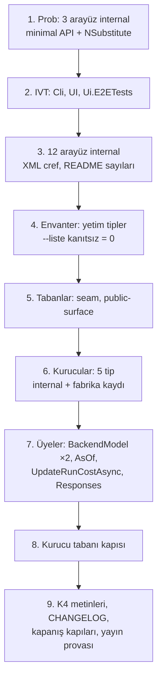

# Faz 213 — Tesisat Arayüzleri ve Üye Hijyeni

> **Durum:** 📋 Planlandı (2026-10-16)
> **Plan onayı:** onaylanmadı — plan metni onay bekler. Kapsam kararları verildi: **UR-011 B** ve **UR-009 B**, farukatasoy, 2026-10-16 ([`YAYIN-HAZIRLIK.md`](YAYIN-HAZIRLIK.md) §7). **Sapma:** UR-011 14 arayüz saydı; ölçüm ikisini public tutmayı gerektiriyor (§213.1). Onay bu sapmayı da kapsar. Uygulama onaydan önce başlamaz.
> **Kaynak:** [ADAYLAR.md](ADAYLAR.md) · **F-555**, **F-556**
> **Genellik:** Her .NET tüketicisi. Donacak yüzeyde hiçbir tüketicinin uygulamadığı 12 arayüz ve DI'ın kurduğu 5 tipin public kurucusu var; 1.0'dan sonra her biri major sürümdür. İş tüketici kodunda kalamaz. İki kalem bir fazda, çünkü aynı altyapıyı paylaşır: aynı `PublicAPI.Unshipped.txt`, aynı envanter kapısı, aynı `InternalsVisibleTo` ve aynı CHANGELOG girdisi.
> **Karşı görüş:** (1) MIMARI K4 "her genişleme noktası değiştirilebilir" der; XML'i "tüketicinin kendi kaydı kazanır" diyen 8 arayüzü `internal` yapmak bu sözü daraltır. (2) K-614 / K-866'nın `IToolRegistry` için yeniden açılma koşulu doğdu ve kullanıcı yine de public tuttu (Faz 188). **Cevap:** K4 "belgelenmiş seam" anlamına gelecek şekilde daraltılır (yeni `K-*`, kapanışta). Seam'i rehber, sample ya da contract suite belgeler; bu 12 arayüzün hiçbirini hiçbiri belgelemez, uygulayanların hepsi `internal` veya test sınıfıdır (ölçüldü). `IToolRegistry` farklıdır: rehber (`write-your-own-tool.md:160`) onu anar ve değiştirmek 4 güvenlik sarmalayıcısını düşürür; bu yüzden "çağrılır, uygulanmaz" listesinde kalır, `internal` olmaz.
> **Önkoşul:** [Faz 212](arsiv/fazlar/212-HTTP-DTO-DARALTMA.md) — ikisi de `PublicAPI.Unshipped.txt` ve `scripts/public-yuzey-envanteri.py` dosyalarını değiştirir; paralel koşmaz. **Tamamlandı (2026-10-16).** Başlangıç sayıları: `PublicAPI.Unshipped.txt` toplamı `8530`; `public-surface-baseline.txt` Abstractions `423`, AspNetCore `23`, Core `79`; `public-yuzey-envanteri.py --liste kanıtsız` boş ve OpenAPI şeması artık kanıt değil. Yeni HTTP DTO'su `internal` + `[Description]` doğar (devir notu: Faz 212).
> **Paketler:** `Tracon.Abstractions`, `.Core`, `.AspNetCore`, `.Mcp`, `.Workflows`, `.Voice`, `.OpenAI`, `.UI`, `.Cli` (yalnız `InternalsVisibleTo`)
> **Yeni paket:** Yok · **Migration:** Yok
> **Public API:** **Küçülüyor.** `PublicAPI.Shipped.txt` bugün **0** satırdır (`find src -name PublicAPI.Shipped.txt -exec cat {} + | grep -vcE '^\s*$|^#'` → `0`); daraltma `1.0.0`'dan önce bedavadır.
> **Tüketici yüzeyi:** site: `guides/voice.md` ve `reference/configuration.md` (kalkan `BackendModel` anahtarı), `guides/write-your-own-store.md:48` (`UpdateRunCostAsync` varsayılanı), `concepts/workflows.md` ve `capabilities.md` hiç değişmez · sevk edilen: `src/Tracon.Abstractions/README.md:20` (tip sayıları), `UseUI()` ve `IWebhookStore` XML'i, `CHANGELOG.md` `[Unreleased]`
> **Manuel test alanı:** [`manuel-test/01-KURULUM-VE-PAKETLEME.md`](manuel-test/01-KURULUM-VE-PAKETLEME.md) — packed-consumer case'leri; MCP (`18`), ses (`19`) ve arayüz (`09`) alanlarına birer case

---

## Bu Faza Başlarken

> `faz-baslangic` skill'ini uygula. Aşağıdaki liste o skill'in 2. adımıdır —
> **tamamını değil, yalnız işaret edilen bölümleri oku.**

1. Bu doküman
2. Kararlar — dosyanın tamamını **okuma**, yalnız bu kalemleri grep'le:
   ```bash
   grep -n "K-866\|K-867\|K-902\|K-850\|K-614\|K-509\|K-663\|K-144" docs/KARARLAR.md
   ```
   **K-866** (DI'ın kurduğu tipin kurucusu `internal`) · **K-867** (opsiyonel parametre varsayılanı çağırana derlenir) · **K-902** (`AddWorkflowFunction` iki parametreli aşırı yükleme **değişmez**) · **K-850** (seam = public arayüz; kanıt ölçütü) · **K-614** (`IToolRegistry`) · **K-509** (`IServiceCollection` kayıt alıcısı sayılır) · **K-663** (`AddJobHandler` sıradan bağımsız) · **K-144** (`Experiment.AssignmentKey` bilerek tutulur)
3. [Faz 188](arsiv/fazlar/188-DI-KURUCU-DARALTMA.md) ve [Faz 182](arsiv/fazlar/182-PUBLIC-API-YUZEY-DARALTMA.md) — yalnız devir notları:
   ```bash
   awk '/## Sonraki Faza Devir Notu/,0' docs/arsiv/fazlar/188-DI-KURUCU-DARALTMA.md
   ```
   Faz 188 opsiyonel parametreli kurucuları ölçtü ve **orada durdu**; bu fazın 5 tipi kapsam dışı kaldığı için kaçtı.
4. Alan hafızası:
   [`hafiza/analyzer-tanilari.md`](hafiza/analyzer-tanilari.md) (daraltma tarifi: `~` satırlar, `RS0017`, kurucu tabanı) ·
   [`hafiza/genisleme-noktalari-ve-denetim.md`](hafiza/genisleme-noktalari-ve-denetim.md) (seam kayıtları) ·
   [`hafiza/aspnetcore-di.md`](hafiza/aspnetcore-di.md) (fabrika kaydı)
5. [`MIMARI.md`](MIMARI.md) satır 142-143 (K4) — yalnız o iki satır; daraltılacak cümle orada

---

## Amaç

Donmadan önce yüzeyden iki tür fazlalık çıkar. **Birincisi** tesisat arayüzleri: Tracon paketlerinin kendi aralarında kullandığı, hiçbir tüketicinin uygulamadığı 12 arayüz ve yalnız onların imzasında yaşayan tipler. **İkincisi** üye hijyeni: DI'ın kurduğu 5 tipin public kurucusu, hiçbir yerde okunmayan 3 public üye, çağırana derlenen bir opsiyonel `tenantId`.

- **F-555** — 12 arayüzü ve yetim kalan tiplerini `internal` yap; 9 "çağrılır, uygulanmaz" arayüzü belgele; K4'ü "belgelenmiş seam" olarak daralt.
- **F-556** — DI'ın kurduğu 5 tipin kurucusunu `internal` yap (fabrika kaydı); 3 işlevsiz üyeyi sil; `UpdateRunCostAsync`'in `tenantId = null` varsayılanını kaldır; aynı kusur sınıfının yeni örneğini yakalayan kurucu tabanı kapısını ekle.

### Bugün ne çalışmıyor — doğrulanmış kanıt

| Kanıt | Gözlem |
|---|---|
| `src/Tracon.Abstractions/**` 14 arayüz (aşağıda) | Başka hiçbir public imzada anılmaz (tüm `PublicAPI.*.txt` taraması); `where` kısıtı yok; uygulayanların hepsi `internal` veya test sınıfı |
| [`src/Tracon.Abstractions/Tools/IToolRegistry.cs:11`](../src/Tracon.Abstractions/Tools/IToolRegistry.cs) | Emsal: "Do not implement or replace this service". Zorlama: [`ToolRegistrationValidationService.cs:18`](../src/Tracon.Core/Tools/ToolRegistrationValidationService.cs) `registry is not IVerifiedToolRegistry` ise `TraconException` |
| [`SingleTenantContext.cs:21`](../src/Tracon.Core/Tenancy/SingleTenantContext.cs) | `public SingleTenantContext(IOptions<TraconOptions>)`; kaydı tip tabanlı (`Registration.Core.cs:29`); örnek, rehber ve README'de `new` yok |
| [`HttpTenantContext.cs:43`](../src/Tracon.AspNetCore/Tenancy/HttpTenantContext.cs) | Public kurucu; kaydı `Replace(<ITenantContext, HttpTenantContext>)` (`TraconTenancyBuilderExtensions.cs:54`); hiçbir yerde `new` yok |
| [`TimeoutAIFunction.cs:47`](../src/Tracon.Core/Tools/TimeoutAIFunction.cs) ve `:62` | İki public kurucu (ikincisi `TimeProvider` ekledi); boru hattında yalnız 3 bağımsız değişkenli kurucu çağrılır (`ToolWrapperChain.cs:108`); 4'lü yalnız testte |
| `CompiledAgentCache`, `DefaultRunAttributionContext` | Örtük public kurucu; kayıtlar `Registration.Core.cs:293` ve `:35`; örnek DI ile çözer ([`samples/Tracon.Samples.CustomAgentSource.Tests/JsonFileAgentSourceRunTests.cs:71`](../samples/Tracon.Samples.CustomAgentSource.Tests/JsonFileAgentSourceRunTests.cs)) |
| [`OpenAILiveOptions.cs:49`](../src/Tracon.OpenAI/Live/OpenAILiveOptions.cs) `BackendModel` | Tek yazan bağlayıcı (`OpenAILiveProviderExtensions.cs:128-131`); **okuyan 0** |
| [`LiveVoiceContracts.cs:249`](../src/Tracon.Abstractions/Voice/LiveVoiceContracts.cs) `BackendModel` | Yazan 0, okuyan 0 |
| [`QuotaTypes.cs:238`](../src/Tracon.Abstractions/Quotas/QuotaTypes.cs) `QuotaUsageQuery.AsOf` | `[Obsolete]` ("no effect because no store applies it"); preview.3'ten beri CHANGELOG'da **Deprecated**; okuyan ve yazan 0 |
| [`IRunStore.cs:371`](../src/Tracon.Abstractions/Runs/IRunStore.cs) `UpdateRunCostAsync(…, string? tenantId = null)` | Public imzada opsiyonel `tenantId` taşıyan **tek** üye; `null` "kiracı denetimi yok" demektir (`IRunStore.cs:29-34`). Üretim çağıranı kiracıyı geçer (`RunCostRecalculationService.cs:107`); atlayanlar: sevk edilen `RunStoreContract.cs:2477`, `SqliteDialectTests.cs:39`, `SqlServerDialectTests.cs:39` |
| [`LiveVoiceContracts.cs:264`](../src/Tracon.Abstractions/Voice/LiveVoiceContracts.cs) `Responses` | Seçilirse [`OpenAILiveProvider.cs:111`](../src/Tracon.OpenAI/Live/OpenAILiveProvider.cs) `NotSupportedException` ("not implemented yet"); uç `502` döner ([`Voice/LiveVoiceEndpoints.cs:230-243`](../src/Tracon.AspNetCore/Voice/LiveVoiceEndpoints.cs)), açılışta hata yok. `delegationMode` OpenAPI belgesinde **yok** (tel sözleşmesi değil) |

> Kanıtlar 2026-10-16'da doğrulandı (HEAD `69e9cf59`). İlk denetimin iki iddiası **yanlış** çıktı ve plandan çıkarıldı: (a) "`UseScheduling`/`AddJobHandler<T>` K-867'ye aykırı" — K-867 böyle bir kural koymaz; K-509 `IServiceCollection`'ı geçerli alıcı sayar, K-663 sıradan bağımsızlık ister. (b) "`TimeoutAIFunction` dört aşırı yükleme" — iki kurucu.

---

## 213.1 — Arayüzler: 14 aday, 12 `internal`, 2 public

Her arayüz için sıkı ölçüt: bir rehber, sample ya da XML'in "tüketici kendi uygulamasını kaydedebilir" vaadi **belgelenmiş bir yetenekse** `internal` olmaz.

| Karar | Arayüz | Kanıt |
|---|---|---|
| **`internal`** (4 — vaat yok) | `IAuditDecorated`, `IStatePreflightReader`, `IWebhookPublisher`, `IWorkflowFunctionCatalog` | Uygulayanlar `internal` (`Auditing*Store` ×9, `SqlStatePreflightReader`, `WebhookPublisher`, `WorkflowFunctionRegistry`); `Directory.Build.props:226-233` "depolama sağlayıcısı yazmak sevk edilen seam değildir" der |
| **`internal`** (8 — vaat yalnız XML'de, K4 daralır) | `IAuditActorResolver`, `IMcpOAuthCoordinator`, `IMcpPromptClient`, `IMcpResourceClient`, `IMcpResourceContextProviderFactory`, `IMcpToolRefresher`, `ITraconDrainState`, `ITraconUiProvider` | XML "tüketicinin kendi kaydı kazanır" der; rehber ve sample yok. Alternatif yol belgelidir (`Audit:ActorClaimType`, `configuration.md:146`) |
| **public kalır** (UR-011'den sapma) | `IVoiceHealthCheck` | `guides/voice.md:202` ve `src/Tracon.Voice/README.md:111` tüketiciye "kendi sentezleyicinin `IVoiceHealthCheck`'i kullanılır" der; K-215 |
| **public kalır** (UR-011'den sapma) | `IWorkflowRunner` | Workflow'u süreç içinde çalıştırmanın tek public yolu (Workflows `PublicAPI`'de başka çalıştırma API'si yok); `WorkflowRunner.cs:1105` "tüketici doğrudan çağırabilir" der. **Çağrılır, uygulanmaz** listesine girer |

`ITraconUiProvider` `Tracon.AspNetCore`'da tanımlıdır (`Ui/ITraconUiProvider.cs:28`), `Tracon.Abstractions`'ta değil.

**Yetim tipler.** Arayüz gidince yalnız onun imzasında yaşayan tipler kanıtsız kalır (benzetim: 14 arayüz için 19 tip — `McpOAuth*Result`, `McpPromptListResult`, `McpRefreshOutcome`, `McpResourceListResult`, `StateGenerationTally`, `StatePreflightTarget`, `StateSample`, `WebhookEventPayload` ve altı `Webhook*Summary`). Liste elle tutulmaz: **`public-yuzey-envanteri.py --liste kanıtsız` boşalana kadar** her kalan tip `internal` olur ya da `public-yuzey-gerekceleri.tsv`'ye gerekçe alır. `IWorkflowRunner` public kaldığı için `WorkflowRespondRequest`/`WorkflowResumeRequest` yetim değildir.

**`InternalsVisibleTo`.** Eksik üç grant (ölçüldü):

| Veren | Alan | Sebep |
|---|---|---|
| `Tracon.Abstractions` | `Tracon.Cli` | `StateCheckCommand.cs:58` `IStatePreflightReader` kullanır |
| `Tracon.AspNetCore` | `Tracon.UI` | `TraconUiBuilderExtensions.cs:42` `ITraconUiProvider` kaydeder |
| `Tracon.AspNetCore` | `Tracon.Ui.E2ETests` | `UiHost.cs:312` |

Kalan her gereken grant zaten var (Core, Workflows, AspNetCore, Mcp, SQL sağlayıcıları, Voice, model sağlayıcıları ve test projeleri). Paket sürümleri birebir sabit (`Directory.Build.props:148-165`), yani paketler arası IVT kilit adımlıdır.

**Çağrılır, uygulanmaz (9).** `IAgentCatalog`, `IJobDispatcher`, `IModelProviderRegistry`, `ISpeechProviderResolver`, `IVoicePricingReader`, `IMigrationApplier`, `ISqlPersistenceDiagnostics`, `ITraconBuilder`, `IWorkflowRunner`. Emsal `IToolRegistry.cs:11`'in XML cümlesidir. **Zorlama eklenmez:** `IToolRegistry`'nin başlangıç reddi, değiştirilince 4 güvenlik sarmalayıcısının düşmesi içindir; bu dokuzunda öyle bir yük yok (Açık Soru 3). `ISpeechProviderResolver` (`SpeechProviderContracts.cs:49`) ve `IVoicePricingReader` (`SpeechContracts.cs:190`) bugün "tüketicinin kaydı kazanır" der; bu cümleler yeniden yazılır.

**Seam muhasebesi.** `internal` olan her arayüz şunları değiştirir:

- `SeamContractDocumentationTests` kaynakta `^public interface` arar; `seam-contract-baseline.txt`'in 164 satırından 26'sı bayatlar. Test "gate has gone stale" ile kırılır; satırlar silinir.
- `PublicSurfaceBaselineTests` tabanı yenilenir.
- Arayüzü genişleme noktası diye anan yerler: `ARCHITECTURE.md:44-45,71` · `docs/MIMARI.md:49,72,78,79,100,142-143` · `README.md:281` · `docs-site/.../getting-started/index.md:67` · `capabilities.md:325` · `docs/hafiza/{genisleme-noktalari-ve-denetim,dokumantasyon,frontend,http-uc-tuzaklari,aspnetcore-di}.md` · `docs/manuel-test/{00-INDEKS,15,16,21,23}-*.md`. Kesin liste için `grep -rn "<ArayuzAdi>" docs docs-site/src ARCHITECTURE.md README.md` koşulur.
- Public XML'i `internal` bir arayüze `cref` veren yerler yeniden yazılır: `IWebhookStore.cs:12-13`, `WorkflowDefinition.cs:67,76`, `IWorkflowCheckpointStore.cs:25`, `TraconDrainOptions.cs:21`, `UseUI()` açıklaması.
- `src/Tracon.Abstractions/README.md:20` "85 arayüz / 404 tip" sayılarını söyler; yeni sayıyla güncellenir.
- Kırılma sürüm notunda her tip adıyla anılır (K-864).

## 213.2 — Üye hijyeni

| # | İş | Bu faz mı? | Gerekçe |
|---|---|---|---|
| a | `SingleTenantContext`, `HttpTenantContext`, `TimeoutAIFunction` (iki kurucu), `CompiledAgentCache`, `DefaultRunAttributionContext`: kurucu `internal`, kayıt **fabrika** olur | **Evet** | K-866 kuralı; Faz 188 yalnız opsiyonel parametreli kurucuları ölçtü. Tip tabanlı kayıt `internal` kurucuda çalışma anında patlar, bu yüzden fabrika zorunlu |
| b | `OpenAILiveOptions.BackendModel`, `LiveVoiceSessionOptions.BackendModel`, `QuotaUsageQuery.AsOf` sil | **Evet** | Okuyan yok; dondurulursa 1.x boyunca "etkisiz ama var" olur |
| c | `IRunStore.UpdateRunCostAsync`: `tenantId = null` varsayılanı kalkar, `string?` kalır | **Evet** | K-867 sınıfı; ikili uyumlu, kaynak kırıcı yalnız üç çağıranda |
| d | `LiveVoiceDelegationMode.Responses` | **Evet — Açık Soru 1** | Seçilince çalışmayan bir enum üyesi 1.x'e donmamalı |
| e | `kurucu tabanı` kapısı | **Evet — Açık Soru 2** | Aynı kusur sınıfı iki kez sessiz geçti (Faz 188 kapsamı, bu faz) |
| f | `TraconAgentSessionStore` | Hayır → **F-560** | İlk denetimin "yalnız DI kurar" iddiası kısmen yanlış: XML (`:23-26`) tüketiciye "bu örneği `IsolationKeyScopedAgentSessionStore` ile sar" der, yani kurulması gerekir. Üstelik taban tipi (`AgentSessionStore`) MAF Hosting ≥ 1.22'de taşındı |
| g | `AddWorkflowFunction<TIn,TOut>` çift aşırı yükleme | Hayır | K-902 ("iki parametreli aşırı yükleme değişmez"); yeniden açma koşulu oluşmadı. Kırılma bedeli 4 test ve 2 sayfa |
| h | `UseScheduling`, `AddJobHandler<T>` `IServiceCollection` üstünde | Hayır | K-509 ve K-663; ilk denetimin iddiası yanlıştı |
| i | Rota varsayılanları (`MapTracon("/tracon")` …) | Hayır → **F-559** | Değiştirmek UI, istemci ve dokümanı kırar; kural olarak yazılır |
| j | `Experiment.AssignmentKey` | Hayır | K-144 bilerek tutar; üç SQL sağlayıcıda kalıcı, telde var |
| k | `TraconWebhookOptions.SignatureTolerance` | Hayır | Okuyan yok ama XML "alıcıya önerilen değeri Tracon yalnız belgeler" der; `configuration.md:474` belgeli anahtardır. Bilinçli belgeleme seçeneği |

**Kurucu tabanı kapısı (e).** `PublicSurfaceBaselineTests.OptionalConstructors.cs` kalıbı: kapsam "public, soyut olmayan, `record` olmayan, `*Options`/`*Settings`/`Exception` olmayan sınıfta public kurucu"; her giriş gerekçeli (≥ 40 karakter). Sınıf taraması: 164 `record` olmayan sınıftan 25'i bu kapsamda (6'sı tüketicinin kurduğu: `AgentRunBudget`, `FakeModelProvider`, `TraconToolRegistration`, `DefaultRunErrorClassifier`, `FixedTenantContext`, `MutableTenantContext`; 5'i yukarıdaki a); kalan ~14 taban girişi olur. Yeni bir sınıf kırmızı yapar. Tabana girmek kolay, girmesi gerekçe ister; taban yalnız küçülür.

> **Doğrulanmadı — ölçülmeli:** (1) `internal` bir arayüzü `[FromServices]` ile alan minimal API uçlarının (`GovernanceEndpoints.cs:49,429,459,505,534,571`) çalışma anında bağlanması ve `NSubstitute` vekillerinin `internal` arayüzde çalışması — ilk iş 3 arayüzle probla. (2) Hiçbir dış tüketicinin `TraconAgentSessionStore` veya `CompiledAgentCache`'i kendi kurmadığı (repo dışı kanıt yok, tüketici geri bildirimi 0).

## 213.3 — Sıra



---

## Planlanan Public API

> Taslak. Gerçekleşen bölüm kapanışta doldurulur.

```csharp
// Yeni imza yok. internal olur: 12 arayüz + yetim tipleri (envanter belirler).
internal interface IMcpToolRefresher { … }          // Abstractions, IVT ile Mcp/Core/AspNetCore

// Kurucu: internal; kayıt fabrika.
public sealed class SingleTenantContext : ITenantContext
{
    internal SingleTenantContext(IOptions<TraconOptions> options) { … }
}
services.TryAddSingleton<ITenantContext>(p => new SingleTenantContext(p.GetRequiredService<IOptions<TraconOptions>>()));

// Silinir:
//   OpenAILiveOptions.BackendModel · LiveVoiceSessionOptions.BackendModel · QuotaUsageQuery.AsOf
// Değişir:
ValueTask UpdateRunCostAsync(…, string? tenantId, CancellationToken cancellationToken = default);   // varsayılan yok
```

### HTTP `endpoint`'leri

Değişmez. `LiveVoiceDelegationMode` OpenAPI belgesinde yoktur; `Responses` kararı tel sözleşmesine dokunmaz.

### Arayüz payı

Yok.

---

## Planlanan Dosya Listesi

```
src/Tracon.Abstractions/**                      (12 arayüz + yetim tipler, UpdateRunCostAsync, BackendModel, AsOf)
src/Tracon.Abstractions/Tracon.Abstractions.csproj   (IVT: Tracon.Cli)
src/Tracon.AspNetCore/Tracon.AspNetCore.csproj  (IVT: Tracon.UI, Tracon.Ui.E2ETests)
src/Tracon.Core/TraconServiceCollectionExtensions.Registration.Core.cs   (fabrika kayıtları)
src/Tracon.Core/{Tenancy,Tools}/*.cs · src/Tracon.AspNetCore/Tenancy/*.cs · TraconTenancyBuilderExtensions.cs
src/Tracon.OpenAI/Live/{OpenAILiveOptions,OpenAILiveProviderExtensions}.cs
src/Tracon.Testing.Contracts.Xunit/Contracts/RunStoreContract.cs   (tenantId açık)
src/*/PublicAPI.Unshipped.txt
tests/Tracon.Core.UnitTests/Architecture/{seam-contract-baseline.txt,public-surface-baseline.txt,SeamContractDocumentationTests.cs}
tests/Tracon.Core.UnitTests/Architecture/PublicSurfaceBaselineTests.*.cs · public-constructor-baseline.txt (yeni)
scripts/public-yuzey-gerekceleri.tsv
docs/MIMARI.md · ARCHITECTURE.md · README.md · src/Tracon.Abstractions/README.md
docs-site/src/content/docs/{guides/voice.md,guides/write-your-own-store.md,reference/configuration.md}
CHANGELOG.md
```

---

## Hata Modları ve Testler

| Ne bozulabilir | Seviye | Test |
|---|---|---|
| Fabrika kaydı tanıyı bozar (tanı örnek tipine bakar) | Fonksiyonel | `ServiceRegistrationSnapshotTests` (Type → Factory satırları `:127,:128,:164`); tanı `RequiredBindingValidator.cs:156`, `TraconDiagnosticsCollector.cs:291` `GetType()` karşılaştırır |
| Tüketicinin kendi `ITenantContext` kaydı kazanmaz (K4) | Fonksiyonel | `DiConstructedServiceResolutionTests` + yeni: tüketici kaydı varsa `SingleTenantContext` kurulmaz |
| `HttpTenantContext` çözülmez (AspNetCore'da bugün test yok) | Fonksiyonel | `DiConstructedServiceResolutionTests`'e çözme iddiası |
| `internal` arayüz DI'dan çözülmez ya da uçta bağlanmaz | Fonksiyonel | `GovernanceEndpointTests`, `McpToolCacheTests` ve mevcut MCP/workflow/ses fonksiyonel paketi |
| `Tracon.UI` / `Tracon.Cli` derlenmez (IVT eksik) | Derleme | `dotnet build Tracon.slnx` |
| Vekil sınıf `internal` arayüzde kurulamaz (NSubstitute) | Birim | `Tracon.Core.UnitTests` (`DynamicProxyGenAssembly2` IVT'si `Directory.Build.props:219-222`) |
| Yetim tip public kalır, envanter kırmızı | Birim | `public_yuzey_envanteri_test.py` + `kapi.py tarama` |
| Tohum config'te kalan `BackendModel` anahtarı **sessizce yok sayılır** | Birim | `VoiceLiveOptionsBindingTests`: bilinmeyen anahtar başlangıcı bozmaz; CHANGELOG'da **Removed** |
| `Responses` yapılandırması (Açık Soru 1'e göre) açılışta reddedilmez, uç `502` verir | Fonksiyonel | `VoiceLiveOptionsBindingTests.cs:37,52,71` + yeni: seçilen davranışı kanıtlayan vaka |
| `UpdateRunCostAsync(tenantId)` atlayan sevk edilen contract paketi | Sözleşme | `RunStoreContract.cs:2477` açık `tenantId` geçer; üç SQL sağlayıcı + bellek içi koşar |
| Seam tabanı bayat | Birim | `SeamContractDocumentationTests` (26 satır silinir) |
| K4 metni kodla çelişir | Doküman | `dokuman-bakim.py --denetle` + `grep` taraması (§213.1 listesi) |
| Yeni DI kurulu tip public kurucuyla girer | Birim | kurucu tabanı kapısı (negatif kontrol: geçici public kurucu → kırmızı) |

Beş soru (iptal · eşzamanlılık · boş/aşırı girdi · başka kiracı · alt sistem hatası): görünürlük ve kayıt biçimi değişir, çalışma anı mantığı değişmez. İki istisna: **başka kiracı** — `UpdateRunCostAsync(null)` bugün kiracı denetimini kapatır; varsayılan kalkınca atlayan çağıran derleme hatası alır (bu faz o riski kapatır). **Alt sistem hatası** — `Responses` seçimi bugün `502` verir; yeni davranış Açık Soru 1'de.

---

## Manuel Kabul Case'leri

| # | Ön koşul | Adımlar | Beklenen sonuç |
|---|---|---|---|
| 1 | Temiz makine, paketlenmiş `Tracon.Abstractions` | Dış proje `IMcpToolRefresher` ve `IWebhookPublisher`'a bağlanır | `CS0122` (erişilemez) |
| 2 | `samples/Tracon.Api` `UseMcp()` ile | `POST /tracon/api/mcp-servers/refresh` | `200`; MCP kayıtsızken `501` |
| 3 | `UseUI()` ile çalışan host | `GET /tracon/ui` | Arayüz yüklenir (`EmbeddedUiProvider` internal, `Tracon.UI` IVT ile görür) |
| 4 | Tek kiracılı host | `GET /tracon/api/tenants/current` | Varsayılan kiracı döner; fabrika kaydı davranışı değiştirmez |
| 5 | `Tracon:Voice:Live:BackendModel` yapılandırmada kalmış | Host'u başlat | Başlangıç bozulmaz; anahtar yok sayılır, CHANGELOG'da anılır |
| 6 | Özel `ITenantContext` kaydı | Host'u başlat, `GET /tracon/api/tenants/current` | Tüketici kaydı kazanır |

---

## Açık Sorular

| # | Soru | Seçenekler | Öneri |
|---|---|---|---|
| 1 | `LiveVoiceDelegationMode.Responses` | A: üyeyi sil, enum'u `Client` tek üyeyle bırak, bağlayıcı bilinmeyen adı başlangıçta reddetsin · B: üye kalsın, `VoiceLiveOptionsValidator` başlangıçta reddetsin · C: enum'u ve iki `DelegationMode` seçeneğini tümden sil | **A** — eklemek sonra bedava (enum büyümesi A-76'da kurala bağlanır), çalışmayan üyeyi dondurmak değil. C anahtarı belgeli yapılandırmadan siler (`voice.md:597`) |
| 2 | Kurucu tabanı kapısı bu fazda mı? | A: bu fazda · B: F-559'a bırak | **A** — kusur sınıfı iki kez sessiz geçti; kapı ~14 girişle küçük |
| 3 | Çağrılır-uygulanmaz 9 arayüze `IToolRegistry` tipi başlangıç reddi eklensin mi? | A: yalnız XML cümlesi · B: reddi de ekle | **A** — reddin sebebi güvenlik sarmalayıcılarının düşmesiydi; bu dokuzunda yok |
| 4 | UR-011'den sapma: `IVoiceHealthCheck` ve `IWorkflowRunner` public kalır | A: kalır (kanıt) · B: UR-011 gibi 14'ü de `internal` yap | **A** — B belgelenmiş iki yeteneği (rehber + README, süreç içi workflow çalıştırma) siler. Onay isteği |

---

## Bitiş Ölçütleri (DoD)

- [ ] `python3 scripts/public-yuzey-envanteri.py --denetle` çıkış `0`; 12 arayüz ve envanterin bulduğu tüm yetim tipler `internal`
- [ ] `grep -rn "IMcpToolRefresher\|IAuditDecorated\|IWebhookPublisher" src/*/PublicAPI.Unshipped.txt` boş (12 arayüzün hiçbiri public değil)
- [ ] `SingleTenantContext`, `HttpTenantContext`, `TimeoutAIFunction`, `CompiledAgentCache`, `DefaultRunAttributionContext` kurucuları `internal`; `PublicAPI.Unshipped.txt`'te kurucu satırı yok; hepsi fabrikayla kayıtlı
- [ ] `OpenAILiveOptions.BackendModel`, `LiveVoiceSessionOptions.BackendModel`, `QuotaUsageQuery.AsOf` kodda, `PublicAPI`'de ve belgede yok
- [ ] `UpdateRunCostAsync` imzasında `= null` yok; `RunStoreContract` açık `tenantId` geçer; `write-your-own-store.md:48` güncel
- [ ] Açık Soru 1'in seçimi uygulandı ve `VoiceLiveOptionsBindingTests`'te kanıtlandı
- [ ] Kurucu tabanı kapısı yeşil; negatif kontrol (geçici public kurucu → kırmızı) kayda geçti
- [ ] `seam-contract-baseline.txt` ve `public-surface-baseline.txt` yenilendi; `SeamContractDocumentationTests` yeşil
- [ ] K4 geçen her metin güncellendi (`grep -rn "her genişleme noktası\|every extension point" docs docs-site/src ARCHITECTURE.md README.md AGENTS.md`)
- [ ] `CHANGELOG.md` `[Unreleased]`: **Removed** (her tip adıyla, `BackendModel` ×2, `AsOf`), **Changed** (`UpdateRunCostAsync`, kurucular); `kapi.py yayin --kuru` yeşil
- [ ] Dört doğrulama kapısı sıfır uyarı: `python3 scripts/kapi.py kapanis --taban <faz öncesi commit>`
- [ ] `samples/Tracon.Api` ile gerçek `run` yapıldı, çıktı belgeye yazıldı
- [ ] `secret` taraması boş döndü
- [ ] Manuel kabul case'leri `docs/manuel-test/01-KURULUM-VE-PAKETLEME.md`, `18-MCP-VE-A2A.md`, `19-COK-MODLULUK-VE-SES.md`, `09-ARAYUZ-GENEL.md` içine eklendi; otomatikleştirilebilenler koşuldu
- [ ] `faz-denetim` koşuldu; 🔴 bulgu kalmadı
- [ ] Yeni `K-*` kayıtları açıldı: K4 daraltması (seam = belgelenmiş), K-850 seam tanımı, K-614/K-866 notu, `Responses` kararı

### Doğrulama komutları

```bash
python3 scripts/public-yuzey-envanteri.py --liste kanıtsız          # 0
python3 scripts/kapi.py tarama                                      # temiz
python3 scripts/kapi.py test --proje Tracon.Core.UnitTests --sinif "*SeamContract*" --tfm net10.0
curl -s -XPOST http://localhost:5081/tracon/api/mcp-servers/refresh # 200 (UseMcp) / 501
```

---

## Riskler

| Risk | Önlem |
|------|-------|
| `internal` arayüz uç bağlamasında ya da vekilde çalışmaz | İlk iş 3 arayüzle prob (§213.3 adım 1); çalışmazsa faz bu noktada durur |
| Tüketici kendi `IWebhookPublisher`/`ITraconDrainState` kaydını bir yerden öğrenmiş olabilir | Repoda kanıt yok (tüketici geri bildirimi 0); CHANGELOG'da **Removed** adıyla; K4 daralması karar kaydı |
| Fabrika kaydı tüketici `Replace` davranışını değiştirir | `TryAdd` korunur; "tüketici kaydı kazanır" testi (yukarıda) |
| Yetim tip listesi büyük çıkar | Envanter betiği tek doğru kaynak; `public-yuzey-gerekceleri.tsv` çıkış kapısı |
| Faz 212 ile `PublicAPI` birleştirme çakışması | Sıra: önce 212 |
| `BackendModel` anahtarı dokümanlı olduğu için sessiz yok sayma sürpriz yaratır | CHANGELOG + manuel case 5 |
| `TraconAgentSessionStore` bu fazın dışında kaldığı için `AgentSessionStore` taşınması freeze'i yine bloklar | F-560 (ön koşul: F-557) |

---

<!-- ============================================================
     AŞAĞISI KAPANIŞTA DOLDURULUR — `faz-tamamlama` skill'i.
     Plan anında boş kalır. Başlıkları SİLME.
     ============================================================ -->

## Plandan Sapmalar

> Kapanışta doldurulur. Plan ile gerçek arasındaki fark **gizlenmez** — sonraki oturumun en değerli bilgisidir.

## Bu Fazda Verilen Kararlar

> Kapanışta doldurulur. Dört kategoriden birine giren karar (AGENTS.md) ayrıca `docs/KARARLAR.md`'ye K-NNN ve kategori etiketiyle girer; plan numara rezerve etmez.

## Gerçekleşen Public API

> Kapanışta doldurulur.

## Dosya Listesi (gerçekleşen)

> Kapanışta doldurulur.

## Süreç Ölçümü

> Kapanışta doldurulur. **Tablo olarak** — onay kutusu DEĞİL.

| Metrik | Değer |
|---|---|
| Plan revizyonu sayısı | |
| Düzeltme turu sayısı | |
| 🔴 bulgu: gerçek / gürültü / araştırılacak | |
| Fazın ürettiği regresyon | |
| Faz kapandıktan sonra bulunan kusur | |

## Denetim Bulguları

> Kapanışta doldurulur — `faz-denetim` çıktısı. Bulgu yoksa "🔴 ve 🟡 yok" yazılır.

## Sonraki Faza Devir Notu

> Kapanışta doldurulur: devralınan sözleşmeler, bilinen tuzaklar (🚨), yarım kalan işler, sıradaki faz.
