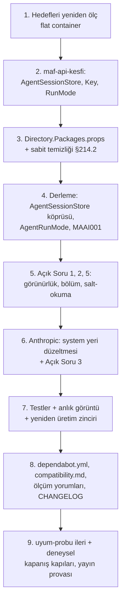

# Faz 214 — Çalışma Anı Bağımlılıkları ve MAF 1.25

> **Durum:** ✅ Tamamlandı (2026-10-16)
> **Plan onayı:** kullanıcı fazı `faza başla ve bitir` diyerek başlattı (2026-10-16); Açık Sorular 1-5 ayrıca yanıtlanmadı, **planın önerdiği seçenekle (A) uygulandı** — bkz. *Plandan Sapmalar* 1 ve *Bu Fazda Verilen Kararlar*. Kapsam kararı: **UR-009 B** (küçült → yükselt → modernize et), farukatasoy, 2026-10-16 ([`YAYIN-HAZIRLIK.md`](YAYIN-HAZIRLIK.md) §7).
> **Kaynak:** [ADAYLAR.md](ADAYLAR.md) · **F-557** (üç fazın birincisi: çalışma anı; [Faz 215](215-TEST-VE-DERLEME-ARACLARI.md) test ve derleme araçları, [Faz 216](216-NPM-BAGIMLILIKLARI.md) npm)
> **Genellik:** Her tüketici. Sevk edilen 20 paketin bağımlılık grafiği beş MAF minor sürümü geride (`1.20` → `1.25`); tüketici daha yeni MAF'ı kendi projesine alınca Tracon'un ikilisi `TypeLoadException` ile kırılır (A-59, ölçüldü). İş tüketici kodunda kalamaz. İkinci kanıt: ilk ilke (1.0 bu grafiği dondurur) ve bağımlılık botu PR'larının beş haftadır kırmızı kapanması (A-62).
> **Karşı görüş:** "Yükseltme kendi başına değer üretmez; ön sürüm Hosting her minor'da kırar, freeze'e yakın yükseltmek risk alır." **Cevap:** Freeze'den sonra yükseltme daha pahalıdır: zorunlu tip değişikliği (`AgentSessionStore` taşındı) 1.x içinde major ister. Deneme yükseltmesi (izole worktree, 2026-10-16) derlemeyi 6 dosyada yeşile çevirdi; kırılmalar bilinir ve aşağıda tek tek planlıdır. **Bu faz davranış değiştirmez:** upstream'in getirdiği davranış farkı ya korunur (eski davranış açıkça istenir) ya da Açık Soru olarak karara bağlanır.
> **Önkoşul:** [Faz 212](arsiv/fazlar/212-HTTP-DTO-DARALTMA.md), [Faz 213](arsiv/fazlar/213-TESISAT-ARAYUZLERI-VE-UYE-HIJYENI.md) (kapandı). Faz 215 ve 216 bu fazdan **sonra** gelir; üçü de `Directory.Packages.props`, `dependabot.yml` ve `CHANGELOG.md` değiştirir, paralel koşmaz.
> **Paketler:** `Tracon.AspNetCore`, `.Core`, `.Anthropic`, `.Google`, `.Azure`, `.OpenAI`, `.Sqlite`, `.SqlServer` (+ `Directory.Packages.props`, `.github/dependabot.yml`)
> **Yeni paket:** Yok · **Migration:** Yok
> **Public API:** **Değişiyor.** `TraconAgentSessionStore`'un taban tipi ve üç override'ı upstream yüzünden zorunlu değişir; Açık Soru 1'in önerisiyle tip `internal` olur (küçülür). `PublicAPI.Shipped.txt` bugün **0** satırdır (`find src -name PublicAPI.Shipped.txt -exec cat {} + | grep -vcE '^\s*$|^#'` → `0`); değişiklik `1.0.0`'dan önce bedavadır.
> **Tüketici yüzeyi:** site: `reference/compatibility.md:134-148` (test edilen sürümler: `1.20.0`/`10.9.0` → `1.25.0`/`10.11.0`) · sevk edilen: `src/Tracon.Anthropic/README.md` (thinking satırları, Açık Soru 3'e bağlı), `TraconAgentSessionStore` XML'i, `CHANGELOG.md` `[Unreleased]`
> **Manuel test alanı:** [`manuel-test/01-KURULUM-VE-PAKETLEME.md`](manuel-test/01-KURULUM-VE-PAKETLEME.md) (paketlenmiş tüketici) · `06-SAGLAYICI-DIGER.md` (Anthropic) · `08-OPENAI-UYUMLU-UCLAR.md` (Responses oturumu) · `18-MCP-VE-A2A.md` (A2A)

---

## Bu Faza Başlarken

> `faz-baslangic` skill'ini uygula. Aşağıdaki liste o skill'in 2. adımıdır —
> **tamamını değil, yalnız işaret edilen bölümleri oku.**

1. Bu doküman
2. Kararlar — dosyanın tamamını **okuma**, yalnız bu kalemleri grep'le:
   ```bash
   grep -n "K-008\|K-026\|K-872\|K-211\|K-197\|K-448\|K-543\|K-1013\|K-1014" docs/KARARLAR.md
   ```
   **K-008** (ön sürüm MAF yalnız `Tracon.AspNetCore`) · **K-026** (oturum yaşam döngüsü `AgentSessionManager`'da) · **K-872** (ön sürüm upstream tam sürümle sabitlenir) · **K-211** (Azure SDK'sı CPM altında çalışma anında sessiz kırılır) · **K-197**, **K-448** (CVE sabitleri) · **K-543** (bot grupları ve `ignore`) · **K-1013/K-1014** (seam tanımı; DI'ın kurduğu tipin kurucusu)
3. [Faz 213](arsiv/fazlar/213-TESISAT-ARAYUZLERI-VE-UYE-HIJYENI.md) — yalnız devir notu (`awk '/## Sonraki Faza Devir Notu/,0' …`): başlangıç sayıları ve `TraconAgentSessionStore`'un kurucu tabanındaki gerekçeli girişi
4. Alan hafızası: [`hafiza/paketleme-ve-dagitim.md`](hafiza/paketleme-ve-dagitim.md) (NU1605/NU1903, CPM) · [`hafiza/cekirdek-calistirma.md`](hafiza/cekirdek-calistirma.md) (oturum) · [`hafiza/http-uc-guvenlik-ve-sozlesme.md`](hafiza/http-uc-guvenlik-ve-sozlesme.md) (anlık görüntü farkı okunur)
5. Deneme yükseltmesinin farkı (yalnız referans, uygulanmaz): `git -C .claude/worktrees/agent-aa02ba7797a9e3efd diff` — worktree silindiyse plan bu dokümandadır
6. MAF tipleri için önce `maf-api-kesfi` — `AgentSessionStore`, `AgentSessionStoreKey`, `AgentRunMode` 1.25 imzaları

---

## Amaç

Sevk edilen paketlerin çalışma anı grafiğini en yeni sürümlere taşı; upstream'in zorladığı tip değişikliğini 1.0'dan önce yap; artık gereksiz CVE sabitlerini kaldır; botun bu kümeyi bir arada yükseltmesini sağla.

- **F-557 (1/3)** — MAF `1.25`, MEAI `10.11`, OpenAI `2.14`, platform `10.0.13`, sağlayıcı SDK'ları; `TraconAgentSessionStore`; Anthropic davranış farkları; CVE sabitleri; bot grupları (A-62).

### Bugün ne çalışmıyor — doğrulanmış kanıt

| Kanıt | Gözlem |
|---|---|
| `Directory.Packages.props:19` | `MicrosoftAgentsAIVersion` `1.20.0`; nuget.org `1.25.0` (2026-10-16, flat container). Hosting ailesi `[1.20.0-preview.260831.1]`; son `1.25.0-preview.261014.1`, kararlısı yok |
| `uyum-probu.cs -- ileri --tracon 1.0.0-preview.4` | Tüm upstream en yeni: **1 eksik tip** (`Microsoft.Agents.AI.Hosting.AgentSessionStore`) + **1 eksik üye** (`AgentRunMode.DisallowBackground`). Yalnız GA upstream: 0 eksik |
| [`src/Tracon.AspNetCore/Sessions/TraconAgentSessionStore.cs:30`](../src/Tracon.AspNetCore/Sessions/TraconAgentSessionStore.cs) | `public sealed class TraconAgentSessionStore : AgentSessionStore`; XML (`:23-26`) tüketiciye "bu örneği `IsolationKeyScopedAgentSessionStore` ile sar" der. `docs-site`'ta bu iki adı anan izlenen sayfa yok |
| `.github/dependabot.yml` | MAF, MEAI ve `Microsoft.*` platform ayrı gruplarda; `OpenAI` hiçbir grupta değil. MEAI 10.10+ `Microsoft.Extensions.*` 10.0.12+ ister; ayrı PR'lar `restore`'da kırmızıdır (A-62; PR #20…#37 birleştirilmeden kapandı) |
| `docs-site/src/content/docs/reference/compatibility.md:134-148` | Test edilen sürümleri `1.20.0` / `10.9.0` diye yazar |
| `src` | `1.20.0` veya "measured on 1.20" geçen 10 yorum; deneme 21 "ölçüldü" yorumu saydı — her biri yeniden ölçülür ya da tarihlenir |

> Kanıtlar 2026-10-16'da doğrulandı (HEAD `9aaa6544`). Deneme yükseltmesi aynı gün izole worktree'de koşuldu; sonuçları §214.2-214.6'dadır. **Deneme tabanı `1ae92822`'dir** (Faz 212 ve 213'ten önce; ajan worktree'si oturum başındaki commit'ten açıldı). Derleme hatası listeleri ve test sayıları bu yüzden uygulamanın ilk adımında HEAD üzerinde yeniden ölçülür.

---

## 214.1 — Hedef sürümler

| Küme | Bugün | Hedef | Not |
|---|---|---|---|
| MAF GA | `1.20.0` | `1.25.0` | `.Abstractions`, `.Harness`, `.OpenAI`, `.Workflows` |
| MAF Hosting | `[1.20.0-preview.260831.1]` | `[1.25.0-preview.261014.1]` | `.Hosting`, `.Hosting.A2A`, `.Hosting.AspNetCore`; `.Hosting.OpenAI` `[1.25.0-alpha.261014.1]`; K-872 tam sürüm |
| A2A | `[1.0.0-preview2]` | `[1.0.0-preview3]` | Hosting.A2A 1.25 ister |
| MEAI | `10.9.0` | `10.11.0` | beş paket |
| OpenAI SDK | `2.12.0` | `2.14.0` | MEAI 10.11 ister |
| Platform | `10.0.11` / `10.0.10` | `10.0.13` | `MicrosoftExtensionsVersion`, ASP.NET Core test/OpenApi, `Microsoft.Data.Sqlite` |
| Sağlayıcılar | Anthropic `12.39.0`, Google.GenAI `1.16.0`, Azure.Core `1.61.0` | `12.58.0`, `1.26.1`, `1.63.0` | `Azure.Identity` `1.21.0` zaten son; `Azure.AI.OpenAI` `2.1.0` son kararlı (F-558) |
| Veri | SqlClient `7.0.2`, Tokenizers `2.0.0` | `7.1.1`, `2.0.1` | — |

Hedefler uygulamanın ilk adımında **yeniden ölçülür** (flat container); daha yeni bir sürüm çıktıysa o alınır ve fark bu dokümana yazılır.

## 214.2 — CVE ve ölü sabitler

Deneme her sabiti kaldırıp yeniden `restore` etti (NU1903 aranarak):

| Sabit | Durum | İş |
|---|---|---|
| `Microsoft.Bcl.Memory` (K-448) | O200kBase 2.0.1 kendi `net8.0` grubunu taşır; paket grafikten çıkar | **Kaldır** (`PackageVersion` + Core'daki doğrudan referans) |
| `SQLitePCLRaw.*` `2.1.12` (K-197) | Data.Sqlite 10.0.13 `>= 2.1.13` ister; sabit NU1605 üretir; 2.1.13 açıksız | **Kaldır**; K-197'nin yeniden açılma koşulu oluştu |
| `Microsoft.OpenApi` `2.11.0` | AspNetCore.OpenApi 10.0.13 `[2.12.2, 3.0.0)` ister; sabit NU1605; 2.12.2 açıksız | **Kaldır** (3.x yalnız ASP.NET Core 11 ile — Faz 215) |
| `System.Security.Cryptography.Pkcs` ×3 | SqlClient 7.1.1 hâlâ açıklı 8.0.1/9.0.18 çeker | **Kalır**; yorumdaki ölçüm tarihi güncellenir |
| `OpenTelemetry.Api`, `.Extensions.Hosting` | Hiçbir `csproj` almıyor (K-055: exporter yok) | **Kaldır** |

Kanıt komutu: `dotnet restore Tracon.slnx` + `dotnet list Tracon.slnx package --vulnerable --include-transitive` → açık yok.

## 214.3 — `AgentSessionStore` 1.25'te: zorunlu değişiklik

Ölçüldü (MAF 1.25 metadata, 2026-10-16):

- Tip `Microsoft.Agents.AI.AgentSessionStore` oldu ve **GA** `Microsoft.Agents.AI.Abstractions` paketine taşındı; **`[Experimental("MAAI001")]`** taşır.
- Soyut üyeler `SaveSessionAsync(AIAgent, AgentSessionStoreKey, AgentSession, ct)` ve `GetSessionAsync(AIAgent, AgentSessionStoreKey, ct) → ValueTask<AgentSession?>` ("asla oluşturmaz"). Sanal: `GetOrCreateSessionAsync`, `GetService`. `DeleteSessionAsync` **kalktı**. `AgentSessionStoreKey(sessionId, partitions?)` da MAAI001.
- Çok kiracılı yalıtım artık kimlik önekiyle değil **`isolation` bölümüyle** (partition) yapılır.

Sonuçlar:

1. UR-005 A Tracon'un kendi deneysel katmanını reddetti: deneysel bir tabandan türeyen public tip 1.x'e donamaz. **Açık Soru 1** (öneri: `internal` + DI kaydı).
2. Köprü yalnız `key.SessionId`'yi okursa `IsolationKeyScopedAgentSessionStore` ile saran tüketicinin kiracıları **sessizce birleşir**. Bu bir güvenlik sınırıdır. **Açık Soru 2** (öneri: `isolation` bölümünü Tracon'un yalıtım anahtarına eşle, başka bölümü reddet).
3. Köprünün `GetSessionAsync`'i bugün oluştur-ya-da-getir yapar; yeni sözleşme "asla oluşturmaz" der. **Açık Soru 5** (öneri: `AgentSessionManager`'a `internal` salt-okuma yolu).
4. `AgentRunMode.DisallowBackground` kalktı → `AgentRunMode.ReturnMessage` (aynı `"message"` değeri). A2A 1.25 `AllowBackgroundResponses`'u artık `false` yapmaz, boş bırakır; yanıtın *mesaj* mı *görev* mi olduğunu bugün hiçbir test sınamaz → yeni test.
5. K-026 ve K-008'in "tip ön sürüm Hosting'de olduğu için AspNetCore'da" gerekçesi düşer (taban artık GA pakette). Tip yine AspNetCore'da kalabilir; gerekçe yeniden yazılır, yeni `K-*` kapanışta.

> **Doğrulanmadı — `maf-api-kesfi` ile ölçülmeli:** `IsolationKeyScopedAgentSessionStore`'un 1.25'te hangi bölüm adını yazdığı ve `AgentSessionStoreKey.Partitions`'ın tam tipi.

## 214.4 — Anthropic SDK 12.58: iki davranış farkı

| Fark | Sınıf | İş |
|---|---|---|
| `AsIChatClient` varsayılanı `AnthropicThinkingMode.Adaptive`; `ReasoningEffort` artık `thinking:{type:adaptive}` + `output_config.effort` gönderir. 3 test kırmızı (`ReasoningEffort_alone_becomes_an_enabled_thinking_budget`, `AnthropicRequestSettingsTests.cs:160`) | Upstream davranışı | **Açık Soru 3** (öneri: bu fazda bugünkü davranışı açıkça iste — `Extended`; uyarlanabilir thinking'e geçiş F-558'in modernleşme kararıdır) |
| Adaptör artık yalnız **baştaki** system mesajlarını üst düzey `system`'e taşır; Tracon önbellek işaretli talimatı kullanıcı turundan **sonra** ekler, bu yüzden talimat konuşma içinde `role:system` olarak gider ve önbellek kırılma noktası yanlış yerde kalır. 2 birim (`System_placement_*`, `:77,:97`) + 1 fonksiyonel (`AnthropicRequestSettingsEndpointTests…one_hour_cache`) kırmızı | **Tracon kusuru** (upstream açığa çıkardı) | Talimat bloğunu ilk system olmayan mesajdan **önce** ekle; üç test bunun kapısıdır |

## 214.5 — OpenAPI anlık görüntüsü

ASP.NET Core OpenApi 10.0.13 + Microsoft.OpenApi 2.12.2 dört şemaya `"examples":[null]` ekler (`LoopSettings`, `SubAgentSettings`, iki `headerConfigurationKeys`; +12 satır; fark `scratchpad/openapi-snapshot-drift.patch`'te). **Açık Soru 4** (öneri: kabul et, yeniden üretim zincirini koş).

## 214.6 — Bot grupları (A-62)

MAF, MEAI, OpenAI, A2A ve `Microsoft.Extensions.*`/`Microsoft.AspNetCore.*`/`Microsoft.Bcl.*`/`Microsoft.Data.*` **tek grupta** (`agent-stack`) yükselir; çünkü MEAI belli bir `Microsoft.Extensions.*` alt sınırı ister ve MAF belli bir MEAI ister. Ölçüt: bir sonraki bot PR'ı `restore`'u geçer. `OpenAI` bugün hiçbir grupta değildir. Kural gerekçesi K-543'ün yeniden açılma koşuludur ("gruplama bir sürüm hattı kısıtını artık korumuyorsa").

## 214.7 — Sıra



---

## Planlanan Public API

> Taslak. Gerçekleşen bölüm kapanışta doldurulur.

```csharp
// Açık Soru 1 = A ile:
internal sealed class TraconAgentSessionStore : Microsoft.Agents.AI.AgentSessionStore   // MAAI001 bastırması gerekçeli
{
    public override ValueTask<AgentSession?> GetSessionAsync(AIAgent agent, AgentSessionStoreKey key, CancellationToken ct);   // oluşturmaz
    public override ValueTask SaveSessionAsync(AIAgent agent, AgentSessionStoreKey key, AgentSession session, CancellationToken ct);
    public override ValueTask<AgentSession> GetOrCreateSessionAsync(AIAgent agent, AgentSessionStoreKey key, CancellationToken ct);
}
// MapTracon: services.TryAddSingleton<AgentSessionStore>(p => new TraconAgentSessionStore(...)) — tüketici kendi kaydıyla sarar (K4).
```

`PublicAPI.Unshipped.txt`: `TraconAgentSessionStore`'un 6 satırı gider; `public-constructor-baseline.txt`'teki gerekçeli girişi silinir (K-1014).

### HTTP `endpoint`'leri

Değişmez. Anlık görüntü farkı: Açık Soru 4.

### Arayüz payı

Yok.

---

## Planlanan Dosya Listesi

```
Directory.Packages.props · .github/dependabot.yml · CHANGELOG.md
src/Tracon.AspNetCore/Sessions/TraconAgentSessionStore.cs
src/Tracon.AspNetCore/TraconEndpointRouteBuilderExtensions.cs        (ResolveSessionStore, DI kaydı)
src/Tracon.AspNetCore/OpenAICompat/OpenAIResponsesEndpoints.cs        (üç çağrı: AgentSessionStoreKey)
src/Tracon.AspNetCore/A2A/TraconA2ABuilderExtensions.cs               (AgentRunMode.ReturnMessage)
src/Tracon.Core/Sessions/AgentSessionManager.cs                       (internal salt-okuma)
src/Tracon.Core/Tracon.Core.csproj                                    (Bcl.Memory referansı kalkar)
src/Tracon.Anthropic/**                                               (system yeri; thinking modu)
src/Tracon.AspNetCore/PublicAPI.Unshipped.txt
tests/Tracon.Core.UnitTests/Architecture/public-constructor-baseline.txt
tests/Tracon.AspNetCore.FunctionalTests/{SessionStoreIsolationTests,A2ARunModeTests}.cs   (yeni)
docs/openapi/tracon.json · packages/tracon-client/src/schema.ts · src/Tracon.Client/Generated/*
docs-site/src/content/docs/reference/compatibility.md · src/Tracon.Anthropic/README.md
```

---

## Hata Modları ve Testler

| Ne bozulabilir | Seviye | Test |
|---|---|---|
| İki yalıtım anahtarı aynı oturumu görür (bölüm okunmaz) | Fonksiyonel (kiracı sınırı) | `SessionStoreIsolationTests` (yeni): `IsolationKeyScopedAgentSessionStore` ile sarılı köprüde A'nın oturumu B'ye görünmez; bilinmeyen bölüm reddedilir |
| `GetSessionAsync` oturum oluşturur (sözleşme ihlali) | Birim | köprü testi: yok olan anahtar `null` döner, depo yazılmaz |
| Responses/A2A oturumu kaydedilmez ya da yüklenmez | Fonksiyonel | mevcut `OpenAIResponses*Tests`, `A2AEndpointTests` |
| A2A yanıtı mesaj yerine görev döner | Fonksiyonel | `A2ARunModeTests` (yeni) |
| Anthropic talimatı konuşma içine düşer, önbellek noktası kayar | Birim + Fonksiyonel | `System_placement_*` (3) + `AnthropicRequestSettingsEndpointTests` |
| Anthropic thinking davranışı sessizce değişir | Birim | `ReasoningEffort_alone_becomes_an_enabled_thinking_budget` (Açık Soru 3'ün seçimine göre) |
| Azure SDK OpenAI 2.14 ile çalışma anında kırılır (K-211) | Fonksiyonel | deneme: chat/akış/embedding çalışır, `AddDataSource` K-211'deki gibi `MissingMethodException` (değişmez); `Tracon.Azure.UnitTests` istek yolunu koşmaz → istek yolu testi eklenir |
| Kaldırılan sabit açığı geri getirir | Paket | `dotnet list package --vulnerable --include-transitive` + `restore` NU1903 yok |
| Paketlenmiş tüketici yeni grafikte kırılır | Paket | `kapi.py yayin --kuru` (altı dış sample + AOT smoke + net8 tüketici) |
| Upstream'in yeni sürümüyle ileri uyum | Paket (ikili) | `uyum-probu.cs -- ileri` (tüm en yeni) → 0 eksik |
| Deneysel tip public imzaya sızar | Paket (ikili) | `uyum-probu.cs -- deneysel` → yalnız `AddLoopEvaluator` ×4 (F-560) kalır |
| `WorkflowResponseOwnershipTests.A_client_that_goes_away…` kırmızı | Fonksiyonel | denemede bir kez düştü, izole üç kez geçti: **taban sürümde** izole koşulur (`kusur-giderme` Adım 2) |

Beş soru — **başka kiracı**: §214.3 madde 2 (yukarıdaki ilk satır). **İptal**: köprü `CancellationToken`'ı `AgentSessionManager`'a geçirir (mevcut). **Eşzamanlılık**: değişmez (`AgentSessionManager` sözleşmesi). **Boş girdi**: boş `SessionId` `ArgumentException`. **Alt sistem hatası**: oturum deposu hatası bugünkü gibi yükselir.

---

## Manuel Kabul Case'leri

| # | Ön koşul | Adımlar | Beklenen sonuç |
|---|---|---|---|
| 1 | Temiz makine, paketlenmiş 20 paket | `dotnet new tracon-api` + `restore` + `build` | NU1605/NU1903 yok; MAF `1.25.0` grafikte |
| 2 | `samples/Tracon.Api`, Anthropic anahtarı | `ReasoningEffort=Medium` ile `run` | İstek gövdesi Açık Soru 3'ün seçimine uyar (log/istek kaydı) |
| 3 | Aynı host | Uzun talimatlı agent ile iki tur | İkinci turda önbellek okuma token'ı > 0 (system yeri doğru) |
| 4 | `POST /tracon/v1/responses` `previous_response_id` ile | İki çağrı | Oturum sürer |
| 5 | A2A istemcisi | `message/send` | Yanıt mesajdır, görev değil |
| 6 | Tüketici `IsolationKeyScopedAgentSessionStore` kaydeder | İki kiracı aynı `conversation` kimliğiyle | Oturumlar ayrı |

---

## Açık Sorular

| # | Soru | Seçenekler | Öneri |
|---|---|---|---|
| 1 | `TraconAgentSessionStore` görünürlüğü (taban artık `[Experimental]`) | A: `internal` + `TryAddSingleton<AgentSessionStore>`; tüketici DI'dan sarar · B: public kalır, deneysel taban 1.x'e donar · C: public, Tracon'un kendi tabanı | **A** — UR-005 A deneysel tipi dondurmaz; K3 (MAF tipi doğrudan) ve K4 korunur |
| 2 | Bölüm (partition) anlamı | A: `isolation` → Tracon yalıtım anahtarı; diğer bölüm reddedilir (fail-closed) · B: bölümleri yok say | **A** — B kiracıları birleştirir |
| 3 | Anthropic thinking | A: bu fazda bugünkü davranışı açıkça iste (`Extended` + bütçe) · B: SDK'nın `Adaptive` varsayılanını kabul et, README ve rehberi düzelt | **A** — yükseltme fazı davranış değiştirmez; `Adaptive` F-558'de karara bağlanır (eski modeller reddedebilir) |
| 4 | `"examples":[null]` (4 şema) | A: kabul et, zinciri yeniden üret · B: dönüştürücüyle sil | **A** — upstream çıktısı; kod eklemez |
| 5 | `GetSessionAsync` "oluşturmaz" sözleşmesi | A: `AgentSessionManager`'a `internal` salt-okuma yolu · B: bugünkü oluştur-ya-da-getir kalsın | **A** — MAF içi çağıranlar `GetOrCreate` kullanır; sözleşme ihlali sessiz hata doğurur |

---

## Bitiş Ölçütleri (DoD)

- [x] `Directory.Packages.props` §214.1 hedeflerinde (flat container ile yeniden ölçüldü, plan sayılarıyla **aynı**: MAF 1.25.0, Hosting `[1.25.0-preview.261014.1]`, A2A `[1.0.0-preview3]`, MEAI 10.11.0, OpenAI 2.14.0, platform 10.0.13, Anthropic 12.58.0, Google.GenAI 1.26.1, Azure.Core 1.63.0, SqlClient 7.1.1, Tokenizers 2.0.1); `dotnet restore Tracon.slnx` uyarısız; `dotnet list Tracon.slnx package --vulnerable --include-transitive` → 47 proje "has no vulnerable packages", açık yok
- [x] §214.2'deki dört sabit grubu kaldırıldı (`Bcl.Memory`, `SQLitePCLRaw.*`, `Microsoft.OpenApi`, `OpenTelemetry.*`); `Pkcs` ×3 kaldı, **yeniden ölçüldü** (boş proje + `NuGetAudit`, SqlClient 7.1.1: net8.0 8.0.1, net9.0/net10.0 9.0.18, `NU1902` + `NU1903` sürüyor) ve `Directory.Packages.props` yorumu 2026-10-16 ile güncellendi
- [x] `uyum-probu.cs -- ileri --tuketici artifacts/package/yayin/1.0.0-preview.5.214/Tracon*.nupkg`: 1.237 üye, **0 eksik tip, 0 eksik üye, 0 çözülemeyen**; negatif kontrol (`Microsoft.Agents.AI(.Abstractions)@1.13.0`) 272 üyede **3 eksik tip + 2 eksik üye** raporladı (`AgentSessionStore`, `AgentSessionStoreKey`, `ToolAutoApprovalRuleContext`, …)
- [x] `uyum-probu.cs -- deneysel`: `public_maruziyet=4`, dördü `AddLoopEvaluator` (F-560); `TraconAgentSessionStore` listede yok
- [x] `SessionStoreIsolationTests` (8) ve `A2ARunModeTests` (1) yeşil. Mutasyon denetimi: bölümü yok sayan köprü 5 testi, `GetSessionAsync`'i oluşturan köprü 1 testi, `AgentRunMode.ReturnTask` 1 testi kırdı; `register.AgentRunMode` satırını silmek **hiçbir testi kırmaz** (MAF varsayılanı zaten mesajdır) — test sonucu sabitler, satırı değil
- [x] Anthropic `System_placement_*` (2 birim) ve `AnthropicRequestSettingsEndpointTests…one_hour_cache` yeşil; `ReasoningEffort_alone_becomes_an_enabled_thinking_budget` (3) yeşil — Açık Soru 3 = A (`Extended`)
- [x] Anlık görüntü yenilendi: `docs/openapi/tracon.json` **+12 satır**, hepsi `"examples":[null]` ×4 şema; `packages/tracon-client/src/schema.ts` +7/−1 (`@example null`); `Tracon.Client` üretilen dosyası **değişmedi**
- [x] `dependabot.yml`: tek `agent-stack` grubu; `compatibility.md` 1.25.0/10.11.0; `///` satırlarındaki 16 sürüm damgası ve 7 test yorumu yeniden ölçüldü (tablo: *Plandan Sapmalar* 5) — `dokuman-bakim.py` "Bağımlılık sürüm damgası" kapısı temiz
- [x] `CHANGELOG.md` `[Unreleased]`: Changed (bağımlılıklar), Removed (`TraconAgentSessionStore` adıyla), Fixed (Anthropic system yeri); `kapi.py yayin --kuru --surum 1.0.0-preview.5.214` EXIT 0 (altı dış sample + AOT smoke + net8 tüketici)
- [x] Dört doğrulama kapısı sıfır uyarı: `python3 scripts/kapi.py kapanis --taban 53249027` — *Örnek Uygulama Koşumu* altında sonuç
- [x] `samples/Tracon.Api` ile gerçek `run` yapıldı, çıktı belgeye yazıldı (*Örnek Uygulama Koşumu*)
- [x] `secret` taraması boş: `kapi.py tarama` "temiz (51 işaretli sentetik credential atlandı)"
- [x] Manuel kabul case'leri dört dosyaya eklendi: `MT-PKG-166`, `MT-PROV-090`, `MT-COMPAT-055`, `MT-COMPAT-056`, `MT-MCP-085`; otomatikleştirilebilenler (`MT-COMPAT-055`, `MT-MCP-085`) örnek uygulamada koşuldu; kalanı ➜ CI (gerçek Anthropic anahtarı, tüketici kaydı, yayın provası)
- [x] `faz-denetim` koşuldu — *Denetim Bulguları*
- [x] Yeni `K-*`: K-1016 (köprü görünürlüğü, bölüm anlamı, oluşturmama sözleşmesi, `MAAI001`), K-1017 (Anthropic istek davranışı); K-026/K-008 gerekçe notu, K-197/K-448 kapanış notu, K-211 yeniden ölçüm notu, K-543 grup notu

### Doğrulama komutları

```bash
dotnet restore Tracon.slnx && dotnet list Tracon.slnx package --vulnerable --include-transitive
dotnet run .agents/skills/nuget-danismani/scripts/uyum-probu.cs -- deneysel
python3 scripts/kapi.py test --proje Tracon.Anthropic.UnitTests --sinif "*AnthropicRequestSettingsTests*" --tfm net10.0
python3 scripts/kapi.py yayin --kuru --surum 1.0.0-preview.5.214
```

---

## Riskler

| Risk | Önlem |
|------|-------|
| Köprü bölümü yanlış okur, kiracılar birleşir | Açık Soru 2 + `SessionStoreIsolationTests`; fail-closed |
| Hosting ön sürümü bu fazla 1.0 arasında yine kırar | K-872 tam sabit; `uyum-probu ileri` her yayından önce |
| Anthropic farkı başka bir yolda (araç çağrısı, akış) da değişti | Sağlayıcının tüm birim testleri + manuel case 2-3 |
| Azure.AI.OpenAI 2.1.0 yeni OpenAI'yla başka bir yolda kırılır (K-211) | İstek yolu testi; asıl çözüm F-558 (düz `OpenAI` + `/openai/v1/`) |
| Deneme worktree'si silinir | Plan bu dokümanda bağımsızdır; fark yalnız referans |
| Kırmızı bir fonksiyonel testin sebebi bilinmez | Taban sürümde izole koşum (`kusur-giderme` Adım 2) |

---

<!-- ============================================================
     AŞAĞISI KAPANIŞTA DOLDURULUR — `faz-tamamlama` skill'i.
     Plan anında boş kalır. Başlıkları SİLME.
     ============================================================ -->

## Plandan Sapmalar

1. **Açık Sorular 1-5 kullanıcıya sorulmadı; planın önerdiği seçenekle (A) uygulandı.** Kullanıcı fazı "başla ve bitir" diye açtı ve plan metnini (önerileriyle) görmüştü; AGENTS.md "her belirsizliği sor" der — bu bir **sapmadır** ve kullanıcının geri alma hakkı saklıdır. Beş seçimin tümü K-1016/K-1017'de yazılı ve her biri tek commit'te geri alınabilir.
2. **Plan "MapTracon'da `TryAddSingleton<AgentSessionStore>`" dedi; bu yapılamaz.** `MapTracon` kurulmuş bir kapsayıcıyla çalışır, `Tracon.AspNetCore`'un servis kaydı yapan bir yöntemi yoktur. `ResolveSessionStore` aynı kaldı (tüketicinin kaydı kazanır, yoksa `internal` köprü). **Sonuç planın söylemediği bir şey:** tüketici köprüyü artık sarmalayamaz (tip adlandırılamaz). MAF yalıtımı isteyen kendi `AgentSessionStore`'unu verir ve bu `/v1/responses` için Tracon deposunun yerine geçer. Sarmalama ihtiyacı kanıtlanırsa DI'da adlandırılmış bir kayıt tasarlanır (K-1016 yeniden açılma koşulu). Hiçbir rehber, sample veya sözleşme paketi köprüyü kurmuyordu (`public-yuzey-gerekceleri.tsv` satırı yalnız tipin kendi XML'ini gerekçe gösteriyordu).
3. **`PublicAPI.Unshipped.txt`'ten 5 satır düştü, plan 6 dedi.** Tip, kurucu ve üç override; altıncı satır yoktu. Ek olarak `public-constructor-baseline.txt` (−1), `public-yuzey-gerekceleri.tsv` (−1) ve `public-surface-baseline.txt` (`Tracon.AspNetCore` 22 → 21) küçüldü.
4. **Plan "docs-site'ta bu iki adı anan izlenen sayfa yok" dedi — doğru, ama üretilen `docs-site/src/content/docs/api/` sayfaları vardı.** Bu dizin `.gitignore`'dadır (üretilir); tazelemek gerekmez.
5. **Sürüm damgası kapısı planın saydığı 10 yorumdan fazlasını buldu: 16 `///` bulgusu + 7 test yorumu.** Her biri yeniden ölçüldü ya da tarihlendi:

   | Yer | İddia | Yeniden ölçüm (2026-10-16) | Sonuç |
   |---|---|---|---|
   | `AnthropicStopReasonChatClient` ×2 | Adaptör yalnız `refusal`/`max_tokens`/`tool_use` eşler; aggregator server tool'un `input_json_delta`'sında atar | 12.58.0 decompile: `model_context_window_exceeded` → **Length**, `pause_turn` kendi adıyla geçer; aggregator `StreamedToolInput` ile birleştirir | **İddia bayattı** — yorum yeniden yazıldı; kod davranışı raw temsilden okuduğu için değişmedi |
   | `TraconA2AOptions` | `AddA2AServer` kayıt anıdır, yalnız adı verilen agent'ı yayımlar | 1.25 decompile: beş aşırı yükleme, hepsi açık agent ister | doğru |
   | `OpenAIResponsesEndpoints` ×2 | `IConversationStorage`/`IResponsesService`/`IAgentConversationIndex` `internal`; `ToAgentRunRequest` `function_call_output` kalemini `ArgumentException` ile reddeder | decompile + probe (`ToAgentRunRequest` dört gövdeyle) | doğru |
   | `RecordingLoopEvaluator` ×2 | Loop ilk "devam" diyen evaluator'da durur; `MaxIterations` turunda evaluator'a bakmaz | `LoopAgent` 1.25 decompile (`EvaluateAndBuildNextAsync`, `iteration >= _maxIterations`) | doğru |
   | `AggregatedResponseGuard` | `LoopAgent` toplamı son yanıta yerinde yazar; `OpenTelemetryAgent` raw temsili tercih eder | 1.25 decompile (`ApplyAggregatedUsage`, `RawRepresentation`) | doğru |
   | `StructuredResponseValidatingAgent`, `FinishReasonDetectingChatClient` | MEAI son turda fonksiyon tool'larını çıkarır; akışta ara tur güncellemeleri sırayla gelir | MEAI 10.11.0 `PrepareOptionsForLastIteration` decompile; `OutputTruncation*Tests` yeşil | doğru |
   | `UsageBreakdown` | `InputAudio`/`OutputAudio` deneysel, `CachedInput`/`Reasoning` değil | 10.11.0 decompile: aynı; **ek olarak** `InputText`/`OutputText` da deneysel (okunmuyor) | doğru + not |
   | `OpenAIChatClientFactory` | Görüntü yüzeyi MEAI'de deneysel | `IImageGenerator` hâlâ `[Experimental("MEAI001")]` | doğru |
   | `WorkflowDefinitionValidator` ×2 | MAF eşleşmeyen mesajı sessizce düşürür; ilk düğüm `object` alırsa `TurnToken` ikinci girdi olur | `WorkflowNodeTypeChainTests`, `WorkflowEntryFunctionRunsOnceTests`, `WorkflowNodeTypeRuleTests` (TurnToken tabanı) yeşil | doğru |
   | `FallbackChatClient` + test | OpenAI istemcisi dinlenmeyen porta `AggregateException("Retry failed after 4 tries")` → `ClientResultException` atar | **probe**, OpenAI 2.14.0, gerçek istemci | doğru |
   | `TraconSqlServerOptions` | SqlClient `DbDataSource` sunmaz | 7.1.1: yalnız `SqlDataSourceEnumerator` var | doğru |
   | K-211 (`Directory.Packages.props`) | Azure uzantıları OpenAI'ye karşı `MissingMethodException` | **probe**, OpenAI 2.14.0: `AddDataSource` aynı eksik `get_SerializedAdditionalRawData` ile atar; sohbet/akış çalışır | doğru |
6. **Anthropic: plandaki iki farkın dışında üçüncü bir upstream değişikliği çıktı** — 12.58 `model_context_window_exceeded`'ı artık `Length` yapıyor. Tracon `TraconFinishReasons.ContextWindowExceeded`'i ham stop reason'dan kendisi üretir; test yeşil kalır, ama açıklama yanlış kalırdı. Aggregator artık server tool'u birleştirdiği için Tracon'un kendi yeniden kurma kodunun gerekçesi kısmen düştü; kod **bilerek** kaldı (yükseltme istek değiştirmez) ve sadeleştirme adayı olarak yoruma yazıldı.
7. **`AgentRunMode` satırı davranış değiştirmiyor.** MAF varsayılanı zaten mesajdır (satırı silmek hiçbir testi kırmadı). Satır açık kalır; `A2ARunModeTests` sonucu sabitler.
8. **Plan "Azure istek yolu testi eklenir" dedi; embedding yok.** `Tracon.Azure` embedding istemcisi sunmaz; `AzureOpenAIChatRequestWireTests` sohbet ve akışı gerçek bir loopback sokete gönderir (3 TFM'de yeşil).
9. **`dependabot.yml`: planda olmayan iki satır daha silindi** — sabitleri kalkan `Microsoft.OpenApi` ve `SQLitePCLRaw.*` `ignore` kalemleri (K-543 koşulu).
10. **Taban dosyaları tek yönde değişti (yalnız küçüldü):** `transitive-dependencies.txt` −9 satır (3 paket × 3 bölüm), `public-surface-baseline.txt` −1, `public-constructor-baseline.txt` −1. `SourceLanguageTests` tabanı **değişmedi** (kapı yeni "Faz" geçen satırı yakaladı; "Phase" yazıldı).
11. **`WorkflowResponseOwnershipTests.A_client_that_goes_away…` bu koşumda düşmedi** (planın uyarısı: denemede bir kez düşmüştü); tam koşumda 2.139 test yeşil, izole koşum gerekmedi.

## Bu Fazda Verilen Kararlar

Dört kategoriye girenler `docs/KARARLAR.md`'de: **K-1016** (`TraconAgentSessionStore` `internal`, oluşturmama sözleşmesi, `isolation` bölümü katlanır, başka bölüm reddedilir, `MAAI001` bastırması) ve **K-1017** (Anthropic: `Extended` düşünme, talimat bloğu yerleşimi). K-008, K-026, K-197, K-211, K-448 ve K-543'e not düşüldü.

Yerel tercihler (K açılmaz):

- **Açık Soru 4 = A:** `"examples":[null]` upstream çıktısıdır; anlık görüntü, `schema.ts` ve zincir olduğu gibi yenilendi, dönüştürücü eklenmedi.
- **`AgentSessionManager.GetExistingSessionAsync` adı ve `internal`liği:** `TryGet…` yerine "var olanı getir" anlamı; `GetOrCreateSessionAsync`'in geri yükleme yolunu paylaşır (`RestoreSessionAsync`), böylece nesil izi (`_restoredVersions`) ve şema sürümü reddi iki yolda aynıdır.
- **`Microsoft.Bcl.Memory` için sabit değil çıkarım:** O200kBase 2.0.1 `net8.0` grubunu taşıyor; sabit eklemek yerine graf tabanı küçüldü.
- **Anthropic README değişmedi:** `ReasoningEffort` → bütçe satırı `Extended` ile doğru kalır.

## Gerçekleşen Public API

Büyüme **yok**; küçülme:

- `Tracon.AspNetCore` public tip sayısı 22 → **21**: `TraconAgentSessionStore` `internal` oldu. `PublicAPI.Unshipped.txt`'ten tip, kurucu ve üç override (5 satır) düştü; `PublicAPI.Shipped.txt` zaten boştu, kırıcı değişiklik maliyeti sıfır.
- `Tracon.Core`: `AgentSessionManager.GetExistingSessionAsync(AIAgent, string, CancellationToken) → ValueTask<AgentSession?>` **`internal`** (ilk kullanıcı `Tracon.AspNetCore`, `InternalsVisibleTo`).
- Public imzada deneysel upstream tipi yok (`uyum-probu -- deneysel`: yalnız `AddLoopEvaluator` ×4).

HTTP: değişmez; yalnız OpenAPI belgesine upstream'in `"examples":[null]` çıktısı girdi (4 şema).

## Dosya Listesi (gerçekleşen)

55 dosya, +1.042 / −295 (`git diff --shortstat 53249027..HEAD`; commit'ler `d5ad0e5b`, `88168426`):

- **Bağımlılık:** `Directory.Packages.props` · `.github/dependabot.yml` · `src/Tracon.Core/Tracon.Core.csproj` · `src/Tracon.Sqlite/Tracon.Sqlite.csproj` · `samples/Tracon.Api/Tracon.Api.csproj` · `tests/Tracon.AspNetCore.FunctionalTests/…csproj` · `tests/Tracon.Package.Tests/Baselines/transitive-dependencies.txt`
- **Köprü:** `src/Tracon.AspNetCore/Sessions/TraconAgentSessionStore.cs` · `OpenAICompat/OpenAIResponsesEndpoints.cs` · `TraconEndpointRouteBuilderExtensions.cs` · `A2A/TraconA2ABuilderExtensions.cs` · `PublicAPI.Unshipped.txt` · `src/Tracon.Core/Sessions/AgentSessionManager.cs`
- **Anthropic:** `src/Tracon.Anthropic/AnthropicChatClientFactory.cs` · `AnthropicProviderSettingsChatClient.cs` · `AnthropicStopReasonChatClient.cs`
- **Sürüm damgaları (yalnız `///`):** `TraconA2AOptions` · `RecordingLoopEvaluator` · `StructuredResponseValidatingAgent` · `AggregatedResponseGuard` · `FallbackChatClient` · `FinishReasonDetectingChatClient` · `UsageBreakdown` · `WorkflowDefinitionValidator` · `OpenAIChatClientFactory` · `TraconSqlServerOptions`
- **Anlık görüntü:** `docs/openapi/tracon.json` · `packages/tracon-client/src/schema.ts`
- **Yeni testler:** `tests/Tracon.AspNetCore.FunctionalTests/{SessionStoreIsolationTests,A2ARunModeTests}.cs` · `tests/Tracon.Core.UnitTests/Sessions/AgentSessionManagerLookupTests.cs` · `tests/Tracon.Azure.UnitTests/AzureOpenAIChatRequestWireTests.cs` (toplam 16 test; Core'unki 3 TFM'de koşar → +24 → tam koşumda 23.362, Azure ile 23.368)
- **Tabanlar:** `public-surface-baseline.txt` · `public-constructor-baseline.txt` · `scripts/public-yuzey-gerekceleri.tsv`
- **Doküman:** `CHANGELOG.md` · `docs-site/…/reference/compatibility.md` · `docs-site/public/llms-full.txt` (üretilir) · `docs/KARARLAR.md` (+ üretilen indeksler) · `docs/MAF-GENISLEME-NOKTALARI.md` · `docs/hafiza/{maf-oturum,tedarik-zinciri}.md` · `docs/manuel-test/{00-INDEKS,01,06,08,18}` · `docs/YAYIN-HAZIRLIK.md`

## Örnek Uygulama Koşumu

`samples/Tracon.Api`, Production, bellek içi depo, `echo` sağlayıcısı (`dotnet artifacts/bin/Tracon.Api/release/Tracon.Api.dll --contentRoot … --urls http://127.0.0.1:5299`). İkinci koşum varsayılan dışı: `Tracon__Observability__SuccessSampleRatio=1`.

| Case | Girdi | Gerçek çıktı |
|---|---|---|
| `MT-COMPAT-055` | `POST /tracon/v1/responses` `{"model":"summarizer","input":"first turn"}` | `resp_ZmVoSWhc… completed` · `Echo: first turn` |
| | aynı uç, `previous_response_id=<ilk id>` | `resp_bXYChJLr… completed` · `Echo: second turn` |
| | `GET /tracon/api/sessions` | `['resp_bXYChJLr…', 'resp_ZmVoSWhc…']` — kimlik önekli kayıt yok |
| | `conversation:"conv-214"` iki kez | `200 200`; oturum listesinde `conv-214` **bir** kez |
| `MT-MCP-085` | `POST /tracon/a2a/summarizer` JSON-RPC `SendMessage` (`ROLE_USER`, `messageId` dolu) | `result` anahtarları `['message']`; `{"message":{"role":"ROLE_AGENT","parts":[{"text":"Echo: hello "}],…}}` — `task` yok |
| varsayılan dışı | `SuccessSampleRatio=1`, Responses + A2A | `completed` · `['message']`; günlükte hata satırı yok (eşleşenler `ProviderFailureNormalizingChatClient` adı) |

`MT-PKG-166`, `MT-PROV-090`, `MT-COMPAT-056` örnek uygulamada koşulamaz: yayın provası beslemesi (`kapi.py yayin --kuru` EXIT 0), gerçek Anthropic anahtarı ve tüketici kaydı gerekir → ➜ CI (`AnthropicRequestSettings*`, `SessionStoreIsolationTests`).

## Süreç Ölçümü

| Metrik | Değer |
|---|---|
| Plan revizyonu sayısı | 0 (plan metni değişmedi; sapmalar yukarıda) |
| Düzeltme turu sayısı | 4 kapı kırmızısı turu: (1) tam koşumda 6 test — 3 taban (graf, tip sayısı) bilerek küçüldü, 1 anlık görüntü yenilendi, `Faz` sözcüğü dil kapısını kırdı; (2) `dokuman-bakim` 16 damga bulgusu; (3) manuel case sayacı; (4) üretilen `llms-full.txt` bayat. Denetim turu ayrıca: 5 🟡 kapatıldı (2 yeni test, 3 yeniden damgalama, 1 hafıza satırı, 1 CHANGELOG cümlesi) |
| 🔴 bulgu: gerçek / gürültü / araştırılacak | 0 / 0 / 0 (🟡 5 → hepsi kapandı, 🟢 4 → 2'si aday) |
| Fazın ürettiği regresyon | 0 bilinen (kapı dışı bulunan yok) |
| Faz kapandıktan sonra bulunan kusur | ölçülmedi (kapanış anı) |

## Denetim Bulguları

Bağımsız denetçi (`faz-denetcisi`, taze bağlam, salt-okunur; `git diff 53249027..HEAD`, 55 dosya, 137 araç çağrısı, MAF/Anthropic/MEAI decompile'ı dahil). Sonuç: **🔴 yok** (denetçi önerisi tablosu boş) — Adım 5.1 triyajı bu yüzden uygulanmadı.

| # | Seviye | Bulgu | Sonuç |
|---|---|---|---|
| 1 | 🟡 | Akışlı Responses `SaveSessionAsync` (`OpenAIResponsesEndpoints.cs:506`) ve `previous_response_id` zincirinin ikinci turda oturumu **yüklediği** hiçbir testte yok; mevcut zincir testi yalnız ilk kaydın varlığına bakıyor | **Düzeltildi** — `OpenAICompatTests.Responses_second_turn_loads_the_session_the_first_turn_saved` (ikinci kaydın durumu iki turu da taşır, birincisi yalnız kendi turunu) ve `Responses_streaming_saves_the_session_under_the_conversation_id`. Mutasyon: yükleme kimliğini kayıt kimliğiyle değiştirmek birinciyi, akışlı kaydı yanlış kimliğe yazmak ikinciyi kırdı |
| 2 | 🟡 | Köprünün `isolation` katlama/ret mantığı ve `GetSessionAsync` üretimde hiçbir çağırandan çalışmıyor; ulaşılabilir sınır (host kendi store'unu verir) ne testte ne CHANGELOG'da. Üç kapı (`CheckRunSessionAsync`, `IsOwnedByTenantAsync`) çıplak kimliği Tracon deposunda arar, bulamayıp geçirir | **Gerekçelendi + belgelendi** — mantık MAF'ın `AgentSessionStore` sözleşmesini (bölümler kimliğin parçasıdır) doğru uygulamak ve K-1016 yeniden açılma koşuluna hazır durmak için ~20 satır olarak kalır; K-1016 ve CHANGELOG artık "host store'u Tracon'un kiracı süzgecini, sahiplik kapısını ve oturum API'sini devre dışı bırakır" der. Bu davranış Faz 214'ten önce de vardı (`ResolveSessionStore` aynı) |
| 3 | 🟡 | `src/Tracon.SqlServer/README.md:48` ve `guides/ef-core.md:44` "ölçüldü 7.0.2" diyor; kapı yalnız `src/**/*.cs` `///` satırlarını tarıyor | **Düzeltildi** — ikisi de 7.1.1'e yeniden damgalandı; `Microsoft.Data.Sqlite` 10.0.13 için de ölçüldü (`DbDataSource` yok) ve guide'a yazıldı |
| 4 | 🟡 | HEAD'de `llms-full.txt` bayat; DoD kapanış satırının sonucu yok | **Düzeltildi** — `node docs-site/scripts/build-agent-map.mjs` commit'e girdi; kapanış kapısı sonucu aşağıda |
| 5 | 🟡 | `docs/hafiza/openai-saglayici.md:29` Anthropic 12.39 davranışını gerçek diye anlatıyor (stop reason eşlemesi, aggregator, `ReasoningEffort`) ve iki yeni tuzak yok | **Düzeltildi** — satır 12.58'e göre yeniden yazıldı, iki tuzak eklendi (yalnız baştaki system mesajları `system`'e girer; `Extended` açıkça istenmeli); dosya 15.993 B (bütçe 16.000) |
| 6 | 🟢 | `examples:[null]` sözleşme gürültüsü; `evaluation.md:291` örneğinde `evaluatorVersion` 10.9.0 | **Devredildi** — `ADAYLAR.md` **F-570** |
| 7 | 🟢 | (Uygulayan oturumun notu, denetçi bulgusu değil) Anthropic yeniden kurma kodunun gerekçesi kısmen düştü | **Devredildi** — `ADAYLAR.md` **F-571** |
| 8 | 🟢 | K-197 notu yanlışlıkla K-1016'yı anıyordu; `MAAI001` bastırması iki değil üç yerde (`ResolveSessionStore`) | **Düzeltildi** — K-197 notu ve K-1016 metni |
| 9 | 🟢 | CHANGELOG "Fixed" başlığı: kusur yalnız yükseltilmiş durumda doğdu, yayınlanmış sürümde yoktu | **Gerekçelendi** — değişiklik notu "Unreleased"in müşterisine bir şey söylemiyor; başlık okuyucuyu yanıltmıyor, kullanıcı `Fixed` altında davranış düzeltmesini arar |

Denetçinin temiz bulduğu başlıklar: 3.1 (DoD kanıtları; kapanış sonucu hariç), 3.5, 3.6, 3.7; doğruladığı noktalar: kaçış biçimi 1.20 decompile'ıyla aynı, `GetExistingSessionAsync` hiçbir şey yazmıyor ve yeni-oturum işaretini kurmuyor, eski `GetOrCreate` sırası korundu, çağıranın mesaj listesi değişmiyor, taban dosyaları yalnız küçüldü, sevk edilen metinde iç referans yok.

## Sonraki Faza Devir Notu

**Sıradaki iş:** [Faz 215](215-TEST-VE-DERLEME-ARACLARI.md) (test ve derleme araçları: xunit.v3 4 + MTP 2, Meziantou, F-568), sonra [Faz 216](216-NPM-BAGIMLILIKLARI.md) (npm). Üçü `Directory.Packages.props`, `dependabot.yml` ve `CHANGELOG.md`'yi paylaşır, paralel koşmaz. Sonra F-558 (modernleşme: Azure için düz `OpenAI` + `/openai/v1/`, Anthropic'in `Adaptive` düşünmesi) ve F-560 (deneysel tip: `AddLoopEvaluator` ×4, `AgentFileStoreContract`).

**Başlangıç sayıları (Faz 215 bunları ön koşul olarak yazar):** `PublicAPI.Unshipped.txt` toplamı −5 (`Tracon.AspNetCore`) · `public-surface-baseline.txt` `Tracon.AspNetCore` `21` · `public-constructor-baseline.txt` 16 giriş · `transitive-dependencies.txt` üç bölümde −3 ad (`Microsoft.Bcl.{AsyncInterfaces,HashCode,Memory}`) · tam koşum 38 koşumda 23.362 test (+ Azure 6 + Responses 2 = **23.370**) · `uyum-probu -- deneysel` public maruziyet 4 · `uyum-probu -- ileri` 1.237 üye, 0 eksik · `ADAYLAR.md` sayaç **F-572**.

**Devralınan sözleşmeler:**

- **K-1016** — `TraconAgentSessionStore` `internal`; `GetSessionAsync` `null` döner ve hiçbir şey yazmaz (`AgentSessionManager.GetExistingSessionAsync`, `internal`); anahtarın `isolation` bölümü `kaçışlı-anahtar::kimlik` olarak katlanır, başka her bölüm `NotSupportedException`. `ResolveSessionStore` değişmedi: tüketicinin `AgentSessionStore` kaydı kazanır. Tüketici köprüyü sarmalayamaz; kendi store'unu verirse Tracon'un kiracı süzgeci, sahiplik kapısı ve oturum API'si o konuşmaları görmez.
- **K-1017** — `AnthropicChatClientFactory.ExtendedThinking` sabiti SDK'nın `Adaptive` varsayılanını kapatır; önbellekli talimat bloğu ilk system-olmayan mesajdan önce eklenir. `Adaptive`'e geçmek F-558'in kararıdır.
- **Dependabot:** tek `agent-stack` grubu (MAF + `Microsoft.Extensions.*` + OpenAI + A2A + AspNetCore/Bcl/Data); `ignore` yalnız üç kalem (`CodeAnalysis.CSharp`, `TrxReport`, `xunit.v3`).
- **CVE sabitleri:** yalnız `System.Security.Cryptography.Pkcs` ×3 kaldı (yeniden ölçüldü, SqlClient 7.1.1). Yeni bir sabit eklemeden önce boş projede `NuGetAudit` ile ölç.

**🚨 Tuzaklar:**

- **`kapi.py test` derlemez.** Kaynağı değiştirip testi koşarsan bayat ikiliyi koşarsın ve "yeşil"/"kırmızı" yanlış çıkar. Önce `dotnet build <test projesi> -c Release --no-restore -p:TraconFrontendEnabled=false`. Mutasyon denetiminde de bu (üç kez yakalandı: derleme hatası sessiz kaldı, eski ikili koştu).
- **Sürüm damgası kapısı yalnız `src/**/*.cs` `///` satırlarını tarar ve bir satırdaki HER sürümü pinle karşılaştırır.** Tarihsel sürümü (`1.20.0'da…`) aynı satıra yazma; `SURUM_DAMGASI_TARIHSEL` ya da cümleyi yeniden kur. README ve `docs-site` taranmaz (denetçi `7.0.2` kalıntısını buldu): yükseltmede `grep -rn "<eski sürüm>" src/*/README.md docs-site/src` elle koş.
- **Dil kapısı `Faz` sözcüğünü Türkçe sayar.** İngilizce yorum ve test açıklamasında `Phase` yaz (4 satır kırdı).
- **Sabiti silmek tüketen `csproj`'u da kırar** (merkezî yönetimde sürümsüz `PackageReference`): `Microsoft.OpenApi` (FunctionalTests, `samples/Tracon.Api`), `SQLitePCLRaw.bundle_e_sqlite3` (`Tracon.Sqlite`), `Microsoft.Bcl.Memory` (`Tracon.Core`).
- **Tam koşum uzundur:** AspNetCore fonksiyonel ~9 dk, Package.Tests ~3 dk (paket üretir), SqlServer entegrasyon ~4,5 dk (Docker). `kapi.py kapanis` ilk kırmızıda durur; kırmızıları önce `dotnet test Tracon.slnx -c Release --no-build -maxcpucount:2` ile topla.
- **`kapi.py yayin --kuru` temiz ağaç ister.** Önce commit; yeni sürüm adı kullan (`1.0.0-preview.5.214` bu fazda kullanıldı, `artifacts/package/yayin/` altında durur).
- **Üretilen `docs-site/public/llms-full.txt`** compat sayfası ya da CHANGELOG değişince bayatlar: `node docs-site/scripts/build-agent-map.mjs`. `npm run check` bunu `check:content` içinde yakalar.
- **`AgentRunMode` varsayılanı zaten mesajdır.** `A2ARunModeTests` sonucu sabitler; `TraconA2ABuilderExtensions` satırını silmek testi kırmaz.
- **Upstream'in sessiz değişikliği:** SDK sürüm atlamalarında decompile yetmez; `model_context_window_exceeded` eşlemesi Tracon'un dışında değişti (testler yeşil kaldı, yorum yalan oldu). Davranış iddiası taşıyan `///` yorumlarını yükseltmede yeniden oku.

**Açık iş:** Faz 215, Faz 216, F-558, F-560; **F-570** (`examples:[null]` gürültüsü, `evaluation.md` örneği) ve **F-571** (Anthropic yeniden kurma kodu SDK aggregator'ına taşınabilir mi) bu fazda açıldı. Site yayını (`faz-tamamlama` Adım 10) bakımcı eylemidir: `./scripts/site-deploy.sh` **koşulmadı** — compat sayfası (1.25.0/10.11.0), CHANGELOG ve `llms-full.txt` canlıda bir önceki fazın sürümünü söylemeye devam eder.
