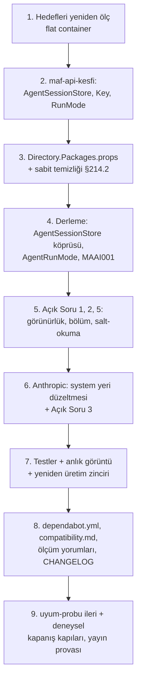

# Faz 214 — Çalışma Anı Bağımlılıkları ve MAF 1.25

> **Durum:** 📋 Planlandı (2026-10-16)
> **Plan onayı:** onaylanmadı — plan metni ve Açık Sorular 1-5 onay bekler. Kapsam kararı verildi: **UR-009 B** (küçült → yükselt → modernize et), farukatasoy, 2026-10-16 ([`YAYIN-HAZIRLIK.md`](YAYIN-HAZIRLIK.md) §7). Uygulama onaydan önce başlamaz.
> **Kaynak:** [ADAYLAR.md](ADAYLAR.md) · **F-557** (üç fazın birincisi: çalışma anı; [Faz 215](215-TEST-VE-DERLEME-ARACLARI.md) test ve derleme araçları, [Faz 216](216-NPM-BAGIMLILIKLARI.md) npm)
> **Genellik:** Her tüketici. Sevk edilen 20 paketin bağımlılık grafiği beş MAF minor sürümü geride (`1.20` → `1.25`); tüketici daha yeni MAF'ı kendi projesine alınca Tracon'un ikilisi `TypeLoadException` ile kırılır (A-59, ölçüldü). İş tüketici kodunda kalamaz. İkinci kanıt: ilk ilke (1.0 bu grafiği dondurur) ve bağımlılık botu PR'larının beş haftadır kırmızı kapanması (A-62).
> **Karşı görüş:** "Yükseltme kendi başına değer üretmez; ön sürüm Hosting her minor'da kırar, freeze'e yakın yükseltmek risk alır." **Cevap:** Freeze'den sonra yükseltme daha pahalıdır: zorunlu tip değişikliği (`AgentSessionStore` taşındı) 1.x içinde major ister. Deneme yükseltmesi (izole worktree, 2026-10-16) derlemeyi 6 dosyada yeşile çevirdi; kırılmalar bilinir ve aşağıda tek tek planlıdır. **Bu faz davranış değiştirmez:** upstream'in getirdiği davranış farkı ya korunur (eski davranış açıkça istenir) ya da Açık Soru olarak karara bağlanır.
> **Önkoşul:** [Faz 212](arsiv/fazlar/212-HTTP-DTO-DARALTMA.md), [Faz 213](arsiv/fazlar/213-TESISAT-ARAYUZLERI-VE-UYE-HIJYENI.md) (kapandı). Faz 215 ve 216 bu fazdan **sonra** gelir; üçü de `Directory.Packages.props`, `dependabot.yml` ve `CHANGELOG.md` değiştirir, paralel koşmaz.
> **Paketler:** `Tracon.AspNetCore`, `.Core`, `.Anthropic`, `.Google`, `.Azure`, `.OpenAI`, `.Sqlite`, `.SqlServer` (+ `Directory.Packages.props`, `.github/dependabot.yml`)
> **Yeni paket:** Yok · **Migration:** Yok
> **Public API:** **Değişiyor.** `TraconAgentSessionStore`'un taban tipi ve üç override'ı upstream yüzünden zorunlu değişir; Açık Soru 1'in önerisiyle tip `internal` olur (küçülür). `PublicAPI.Shipped.txt` bugün **0** satırdır (`find src -name PublicAPI.Shipped.txt -exec cat {} + | grep -vcE '^\s*$|^#'` → `0`); değişiklik `1.0.0`'dan önce bedavadır.
> **Tüketici yüzeyi:** site: `reference/compatibility.md:134-148` (test edilen sürümler: `1.20.0`/`10.9.0` → `1.25.0`/`10.11.0`) · sevk edilen: `src/Tracon.Anthropic/README.md` (thinking satırları, Açık Soru 3'e bağlı), `TraconAgentSessionStore` XML'i, `CHANGELOG.md` `[Unreleased]`
> **Manuel test alanı:** [`manuel-test/01-KURULUM-VE-PAKETLEME.md`](manuel-test/01-KURULUM-VE-PAKETLEME.md) (paketlenmiş tüketici) · `06-SAGLAYICI-DIGER.md` (Anthropic) · `08-OPENAI-UYUMLU-UCLAR.md` (Responses oturumu) · `18-MCP-VE-A2A.md` (A2A)

---

## Bu Faza Başlarken

> `faz-baslangic` skill'ini uygula. Aşağıdaki liste o skill'in 2. adımıdır —
> **tamamını değil, yalnız işaret edilen bölümleri oku.**

1. Bu doküman
2. Kararlar — dosyanın tamamını **okuma**, yalnız bu kalemleri grep'le:
   ```bash
   grep -n "K-008\|K-026\|K-872\|K-211\|K-197\|K-448\|K-543\|K-1013\|K-1014" docs/KARARLAR.md
   ```
   **K-008** (ön sürüm MAF yalnız `Tracon.AspNetCore`) · **K-026** (oturum yaşam döngüsü `AgentSessionManager`'da) · **K-872** (ön sürüm upstream tam sürümle sabitlenir) · **K-211** (Azure SDK'sı CPM altında çalışma anında sessiz kırılır) · **K-197**, **K-448** (CVE sabitleri) · **K-543** (bot grupları ve `ignore`) · **K-1013/K-1014** (seam tanımı; DI'ın kurduğu tipin kurucusu)
3. [Faz 213](arsiv/fazlar/213-TESISAT-ARAYUZLERI-VE-UYE-HIJYENI.md) — yalnız devir notu (`awk '/## Sonraki Faza Devir Notu/,0' …`): başlangıç sayıları ve `TraconAgentSessionStore`'un kurucu tabanındaki gerekçeli girişi
4. Alan hafızası: [`hafiza/paketleme-ve-dagitim.md`](hafiza/paketleme-ve-dagitim.md) (NU1605/NU1903, CPM) · [`hafiza/cekirdek-calistirma.md`](hafiza/cekirdek-calistirma.md) (oturum) · [`hafiza/http-uc-guvenlik-ve-sozlesme.md`](hafiza/http-uc-guvenlik-ve-sozlesme.md) (anlık görüntü farkı okunur)
5. Deneme yükseltmesinin farkı (yalnız referans, uygulanmaz): `git -C .claude/worktrees/agent-aa02ba7797a9e3efd diff` — worktree silindiyse plan bu dokümandadır
6. MAF tipleri için önce `maf-api-kesfi` — `AgentSessionStore`, `AgentSessionStoreKey`, `AgentRunMode` 1.25 imzaları

---

## Amaç

Sevk edilen paketlerin çalışma anı grafiğini en yeni sürümlere taşı; upstream'in zorladığı tip değişikliğini 1.0'dan önce yap; artık gereksiz CVE sabitlerini kaldır; botun bu kümeyi bir arada yükseltmesini sağla.

- **F-557 (1/3)** — MAF `1.25`, MEAI `10.11`, OpenAI `2.14`, platform `10.0.13`, sağlayıcı SDK'ları; `TraconAgentSessionStore`; Anthropic davranış farkları; CVE sabitleri; bot grupları (A-62).

### Bugün ne çalışmıyor — doğrulanmış kanıt

| Kanıt | Gözlem |
|---|---|
| `Directory.Packages.props:19` | `MicrosoftAgentsAIVersion` `1.20.0`; nuget.org `1.25.0` (2026-10-16, flat container). Hosting ailesi `[1.20.0-preview.260831.1]`; son `1.25.0-preview.261014.1`, kararlısı yok |
| `uyum-probu.cs -- ileri --tracon 1.0.0-preview.4` | Tüm upstream en yeni: **1 eksik tip** (`Microsoft.Agents.AI.Hosting.AgentSessionStore`) + **1 eksik üye** (`AgentRunMode.DisallowBackground`). Yalnız GA upstream: 0 eksik |
| [`src/Tracon.AspNetCore/Sessions/TraconAgentSessionStore.cs:30`](../src/Tracon.AspNetCore/Sessions/TraconAgentSessionStore.cs) | `public sealed class TraconAgentSessionStore : AgentSessionStore`; XML (`:23-26`) tüketiciye "bu örneği `IsolationKeyScopedAgentSessionStore` ile sar" der. `docs-site`'ta bu iki adı anan izlenen sayfa yok |
| `.github/dependabot.yml` | MAF, MEAI ve `Microsoft.*` platform ayrı gruplarda; `OpenAI` hiçbir grupta değil. MEAI 10.10+ `Microsoft.Extensions.*` 10.0.12+ ister; ayrı PR'lar `restore`'da kırmızıdır (A-62; PR #20…#37 birleştirilmeden kapandı) |
| `docs-site/src/content/docs/reference/compatibility.md:134-148` | Test edilen sürümleri `1.20.0` / `10.9.0` diye yazar |
| `src` | `1.20.0` veya "measured on 1.20" geçen 10 yorum; deneme 21 "ölçüldü" yorumu saydı — her biri yeniden ölçülür ya da tarihlenir |

> Kanıtlar 2026-10-16'da doğrulandı (HEAD `9aaa6544`). Deneme yükseltmesi aynı gün izole worktree'de koşuldu; sonuçları §214.2-214.6'dadır.

---

## 214.1 — Hedef sürümler

| Küme | Bugün | Hedef | Not |
|---|---|---|---|
| MAF GA | `1.20.0` | `1.25.0` | `.Abstractions`, `.Harness`, `.OpenAI`, `.Workflows` |
| MAF Hosting | `[1.20.0-preview.260831.1]` | `[1.25.0-preview.261014.1]` | `.Hosting`, `.Hosting.A2A`, `.Hosting.AspNetCore`; `.Hosting.OpenAI` `[1.25.0-alpha.261014.1]`; K-872 tam sürüm |
| A2A | `[1.0.0-preview2]` | `[1.0.0-preview3]` | Hosting.A2A 1.25 ister |
| MEAI | `10.9.0` | `10.11.0` | beş paket |
| OpenAI SDK | `2.12.0` | `2.14.0` | MEAI 10.11 ister |
| Platform | `10.0.11` / `10.0.10` | `10.0.13` | `MicrosoftExtensionsVersion`, ASP.NET Core test/OpenApi, `Microsoft.Data.Sqlite` |
| Sağlayıcılar | Anthropic `12.39.0`, Google.GenAI `1.16.0`, Azure.Core `1.61.0` | `12.58.0`, `1.26.1`, `1.63.0` | `Azure.Identity` `1.21.0` zaten son; `Azure.AI.OpenAI` `2.1.0` son kararlı (F-558) |
| Veri | SqlClient `7.0.2`, Tokenizers `2.0.0` | `7.1.1`, `2.0.1` | — |

Hedefler uygulamanın ilk adımında **yeniden ölçülür** (flat container); daha yeni bir sürüm çıktıysa o alınır ve fark bu dokümana yazılır.

## 214.2 — CVE ve ölü sabitler

Deneme her sabiti kaldırıp yeniden `restore` etti (NU1903 aranarak):

| Sabit | Durum | İş |
|---|---|---|
| `Microsoft.Bcl.Memory` (K-448) | O200kBase 2.0.1 kendi `net8.0` grubunu taşır; paket grafikten çıkar | **Kaldır** (`PackageVersion` + Core'daki doğrudan referans) |
| `SQLitePCLRaw.*` `2.1.12` (K-197) | Data.Sqlite 10.0.13 `>= 2.1.13` ister; sabit NU1605 üretir; 2.1.13 açıksız | **Kaldır**; K-197'nin yeniden açılma koşulu oluştu |
| `Microsoft.OpenApi` `2.11.0` | AspNetCore.OpenApi 10.0.13 `[2.12.2, 3.0.0)` ister; sabit NU1605; 2.12.2 açıksız | **Kaldır** (3.x yalnız ASP.NET Core 11 ile — Faz 215) |
| `System.Security.Cryptography.Pkcs` ×3 | SqlClient 7.1.1 hâlâ açıklı 8.0.1/9.0.18 çeker | **Kalır**; yorumdaki ölçüm tarihi güncellenir |
| `OpenTelemetry.Api`, `.Extensions.Hosting` | Hiçbir `csproj` almıyor (K-055: exporter yok) | **Kaldır** |

Kanıt komutu: `dotnet restore Tracon.slnx` + `dotnet list Tracon.slnx package --vulnerable --include-transitive` → açık yok.

## 214.3 — `AgentSessionStore` 1.25'te: zorunlu değişiklik

Ölçüldü (MAF 1.25 metadata, 2026-10-16):

- Tip `Microsoft.Agents.AI.AgentSessionStore` oldu ve **GA** `Microsoft.Agents.AI.Abstractions` paketine taşındı; **`[Experimental("MAAI001")]`** taşır.
- Soyut üyeler `SaveSessionAsync(AIAgent, AgentSessionStoreKey, AgentSession, ct)` ve `GetSessionAsync(AIAgent, AgentSessionStoreKey, ct) → ValueTask<AgentSession?>` ("asla oluşturmaz"). Sanal: `GetOrCreateSessionAsync`, `GetService`. `DeleteSessionAsync` **kalktı**. `AgentSessionStoreKey(sessionId, partitions?)` da MAAI001.
- Çok kiracılı yalıtım artık kimlik önekiyle değil **`isolation` bölümüyle** (partition) yapılır.

Sonuçlar:

1. UR-005 A Tracon'un kendi deneysel katmanını reddetti: deneysel bir tabandan türeyen public tip 1.x'e donamaz. **Açık Soru 1** (öneri: `internal` + DI kaydı).
2. Köprü yalnız `key.SessionId`'yi okursa `IsolationKeyScopedAgentSessionStore` ile saran tüketicinin kiracıları **sessizce birleşir**. Bu bir güvenlik sınırıdır. **Açık Soru 2** (öneri: `isolation` bölümünü Tracon'un yalıtım anahtarına eşle, başka bölümü reddet).
3. Köprünün `GetSessionAsync`'i bugün oluştur-ya-da-getir yapar; yeni sözleşme "asla oluşturmaz" der. **Açık Soru 5** (öneri: `AgentSessionManager`'a `internal` salt-okuma yolu).
4. `AgentRunMode.DisallowBackground` kalktı → `AgentRunMode.ReturnMessage` (aynı `"message"` değeri). A2A 1.25 `AllowBackgroundResponses`'u artık `false` yapmaz, boş bırakır; yanıtın *mesaj* mı *görev* mi olduğunu bugün hiçbir test sınamaz → yeni test.
5. K-026 ve K-008'in "tip ön sürüm Hosting'de olduğu için AspNetCore'da" gerekçesi düşer (taban artık GA pakette). Tip yine AspNetCore'da kalabilir; gerekçe yeniden yazılır, yeni `K-*` kapanışta.

> **Doğrulanmadı — `maf-api-kesfi` ile ölçülmeli:** `IsolationKeyScopedAgentSessionStore`'un 1.25'te hangi bölüm adını yazdığı ve `AgentSessionStoreKey.Partitions`'ın tam tipi.

## 214.4 — Anthropic SDK 12.58: iki davranış farkı

| Fark | Sınıf | İş |
|---|---|---|
| `AsIChatClient` varsayılanı `AnthropicThinkingMode.Adaptive`; `ReasoningEffort` artık `thinking:{type:adaptive}` + `output_config.effort` gönderir. 3 test kırmızı (`ReasoningEffort_alone_becomes_an_enabled_thinking_budget`, `AnthropicRequestSettingsTests.cs:160`) | Upstream davranışı | **Açık Soru 3** (öneri: bu fazda bugünkü davranışı açıkça iste — `Extended`; uyarlanabilir thinking'e geçiş F-558'in modernleşme kararıdır) |
| Adaptör artık yalnız **baştaki** system mesajlarını üst düzey `system`'e taşır; Tracon önbellek işaretli talimatı kullanıcı turundan **sonra** ekler, bu yüzden talimat konuşma içinde `role:system` olarak gider ve önbellek kırılma noktası yanlış yerde kalır. 2 birim (`System_placement_*`, `:77,:97`) + 1 fonksiyonel (`AnthropicRequestSettingsEndpointTests…one_hour_cache`) kırmızı | **Tracon kusuru** (upstream açığa çıkardı) | Talimat bloğunu ilk system olmayan mesajdan **önce** ekle; üç test bunun kapısıdır |

## 214.5 — OpenAPI anlık görüntüsü

ASP.NET Core OpenApi 10.0.13 + Microsoft.OpenApi 2.12.2 dört şemaya `"examples":[null]` ekler (`LoopSettings`, `SubAgentSettings`, iki `headerConfigurationKeys`; +12 satır; fark `scratchpad/openapi-snapshot-drift.patch`'te). **Açık Soru 4** (öneri: kabul et, yeniden üretim zincirini koş).

## 214.6 — Bot grupları (A-62)

MAF, MEAI, OpenAI, A2A ve `Microsoft.Extensions.*`/`Microsoft.AspNetCore.*`/`Microsoft.Bcl.*`/`Microsoft.Data.*` **tek grupta** (`agent-stack`) yükselir; çünkü MEAI belli bir `Microsoft.Extensions.*` alt sınırı ister ve MAF belli bir MEAI ister. Ölçüt: bir sonraki bot PR'ı `restore`'u geçer. `OpenAI` bugün hiçbir grupta değildir. Kural gerekçesi K-543'ün yeniden açılma koşuludur ("gruplama bir sürüm hattı kısıtını artık korumuyorsa").

## 214.7 — Sıra



---

## Planlanan Public API

> Taslak. Gerçekleşen bölüm kapanışta doldurulur.

```csharp
// Açık Soru 1 = A ile:
internal sealed class TraconAgentSessionStore : Microsoft.Agents.AI.AgentSessionStore   // MAAI001 bastırması gerekçeli
{
    public override ValueTask<AgentSession?> GetSessionAsync(AIAgent agent, AgentSessionStoreKey key, CancellationToken ct);   // oluşturmaz
    public override ValueTask SaveSessionAsync(AIAgent agent, AgentSessionStoreKey key, AgentSession session, CancellationToken ct);
    public override ValueTask<AgentSession> GetOrCreateSessionAsync(AIAgent agent, AgentSessionStoreKey key, CancellationToken ct);
}
// MapTracon: services.TryAddSingleton<AgentSessionStore>(p => new TraconAgentSessionStore(...)) — tüketici kendi kaydıyla sarar (K4).
```

`PublicAPI.Unshipped.txt`: `TraconAgentSessionStore`'un 6 satırı gider; `public-constructor-baseline.txt`'teki gerekçeli girişi silinir (K-1014).

### HTTP `endpoint`'leri

Değişmez. Anlık görüntü farkı: Açık Soru 4.

### Arayüz payı

Yok.

---

## Planlanan Dosya Listesi

```
Directory.Packages.props · .github/dependabot.yml · CHANGELOG.md
src/Tracon.AspNetCore/Sessions/TraconAgentSessionStore.cs
src/Tracon.AspNetCore/TraconEndpointRouteBuilderExtensions.cs        (ResolveSessionStore, DI kaydı)
src/Tracon.AspNetCore/OpenAICompat/OpenAIResponsesEndpoints.cs        (üç çağrı: AgentSessionStoreKey)
src/Tracon.AspNetCore/A2A/TraconA2ABuilderExtensions.cs               (AgentRunMode.ReturnMessage)
src/Tracon.Core/Sessions/AgentSessionManager.cs                       (internal salt-okuma)
src/Tracon.Core/Tracon.Core.csproj                                    (Bcl.Memory referansı kalkar)
src/Tracon.Anthropic/**                                               (system yeri; thinking modu)
src/Tracon.AspNetCore/PublicAPI.Unshipped.txt
tests/Tracon.Core.UnitTests/Architecture/public-constructor-baseline.txt
tests/Tracon.AspNetCore.FunctionalTests/{SessionStoreIsolationTests,A2ARunModeTests}.cs   (yeni)
docs/openapi/tracon.json · packages/tracon-client/src/schema.ts · src/Tracon.Client/Generated/*
docs-site/src/content/docs/reference/compatibility.md · src/Tracon.Anthropic/README.md
```

---

## Hata Modları ve Testler

| Ne bozulabilir | Seviye | Test |
|---|---|---|
| İki yalıtım anahtarı aynı oturumu görür (bölüm okunmaz) | Fonksiyonel (kiracı sınırı) | `SessionStoreIsolationTests` (yeni): `IsolationKeyScopedAgentSessionStore` ile sarılı köprüde A'nın oturumu B'ye görünmez; bilinmeyen bölüm reddedilir |
| `GetSessionAsync` oturum oluşturur (sözleşme ihlali) | Birim | köprü testi: yok olan anahtar `null` döner, depo yazılmaz |
| Responses/A2A oturumu kaydedilmez ya da yüklenmez | Fonksiyonel | mevcut `OpenAIResponses*Tests`, `A2AEndpointTests` |
| A2A yanıtı mesaj yerine görev döner | Fonksiyonel | `A2ARunModeTests` (yeni) |
| Anthropic talimatı konuşma içine düşer, önbellek noktası kayar | Birim + Fonksiyonel | `System_placement_*` (3) + `AnthropicRequestSettingsEndpointTests` |
| Anthropic thinking davranışı sessizce değişir | Birim | `ReasoningEffort_alone_becomes_an_enabled_thinking_budget` (Açık Soru 3'ün seçimine göre) |
| Azure SDK OpenAI 2.14 ile çalışma anında kırılır (K-211) | Fonksiyonel | deneme: chat/akış/embedding çalışır, `AddDataSource` K-211'deki gibi `MissingMethodException` (değişmez); `Tracon.Azure.UnitTests` istek yolunu koşmaz → istek yolu testi eklenir |
| Kaldırılan sabit açığı geri getirir | Paket | `dotnet list package --vulnerable --include-transitive` + `restore` NU1903 yok |
| Paketlenmiş tüketici yeni grafikte kırılır | Paket | `kapi.py yayin --kuru` (altı dış sample + AOT smoke + net8 tüketici) |
| Upstream'in yeni sürümüyle ileri uyum | Paket (ikili) | `uyum-probu.cs -- ileri` (tüm en yeni) → 0 eksik |
| Deneysel tip public imzaya sızar | Paket (ikili) | `uyum-probu.cs -- deneysel` → yalnız `AddLoopEvaluator` ×4 (F-560) kalır |
| `WorkflowResponseOwnershipTests.A_client_that_goes_away…` kırmızı | Fonksiyonel | denemede bir kez düştü, izole üç kez geçti: **taban sürümde** izole koşulur (`kusur-giderme` Adım 2) |

Beş soru — **başka kiracı**: §214.3 madde 2 (yukarıdaki ilk satır). **İptal**: köprü `CancellationToken`'ı `AgentSessionManager`'a geçirir (mevcut). **Eşzamanlılık**: değişmez (`AgentSessionManager` sözleşmesi). **Boş girdi**: boş `SessionId` `ArgumentException`. **Alt sistem hatası**: oturum deposu hatası bugünkü gibi yükselir.

---

## Manuel Kabul Case'leri

| # | Ön koşul | Adımlar | Beklenen sonuç |
|---|---|---|---|
| 1 | Temiz makine, paketlenmiş 20 paket | `dotnet new tracon-api` + `restore` + `build` | NU1605/NU1903 yok; MAF `1.25.0` grafikte |
| 2 | `samples/Tracon.Api`, Anthropic anahtarı | `ReasoningEffort=Medium` ile `run` | İstek gövdesi Açık Soru 3'ün seçimine uyar (log/istek kaydı) |
| 3 | Aynı host | Uzun talimatlı agent ile iki tur | İkinci turda önbellek okuma token'ı > 0 (system yeri doğru) |
| 4 | `POST /tracon/v1/responses` `previous_response_id` ile | İki çağrı | Oturum sürer |
| 5 | A2A istemcisi | `message/send` | Yanıt mesajdır, görev değil |
| 6 | Tüketici `IsolationKeyScopedAgentSessionStore` kaydeder | İki kiracı aynı `conversation` kimliğiyle | Oturumlar ayrı |

---

## Açık Sorular

| # | Soru | Seçenekler | Öneri |
|---|---|---|---|
| 1 | `TraconAgentSessionStore` görünürlüğü (taban artık `[Experimental]`) | A: `internal` + `TryAddSingleton<AgentSessionStore>`; tüketici DI'dan sarar · B: public kalır, deneysel taban 1.x'e donar · C: public, Tracon'un kendi tabanı | **A** — UR-005 A deneysel tipi dondurmaz; K3 (MAF tipi doğrudan) ve K4 korunur |
| 2 | Bölüm (partition) anlamı | A: `isolation` → Tracon yalıtım anahtarı; diğer bölüm reddedilir (fail-closed) · B: bölümleri yok say | **A** — B kiracıları birleştirir |
| 3 | Anthropic thinking | A: bu fazda bugünkü davranışı açıkça iste (`Extended` + bütçe) · B: SDK'nın `Adaptive` varsayılanını kabul et, README ve rehberi düzelt | **A** — yükseltme fazı davranış değiştirmez; `Adaptive` F-558'de karara bağlanır (eski modeller reddedebilir) |
| 4 | `"examples":[null]` (4 şema) | A: kabul et, zinciri yeniden üret · B: dönüştürücüyle sil | **A** — upstream çıktısı; kod eklemez |
| 5 | `GetSessionAsync` "oluşturmaz" sözleşmesi | A: `AgentSessionManager`'a `internal` salt-okuma yolu · B: bugünkü oluştur-ya-da-getir kalsın | **A** — MAF içi çağıranlar `GetOrCreate` kullanır; sözleşme ihlali sessiz hata doğurur |

---

## Bitiş Ölçütleri (DoD)

- [ ] `Directory.Packages.props` §214.1 hedeflerinde; `restore` NU1605/NU1903 yok; `dotnet list … --vulnerable --include-transitive` açık yok
- [ ] §214.2'deki dört sabit grubu kaldırıldı; `Pkcs` gerekçesi yeni tarihle duruyor
- [ ] `uyum-probu.cs -- ileri --tracon <bu fazın provası>` tüm upstream en yeniye karşı **0 eksik**; negatif kontrol (eski MAF) eksik raporluyor
- [ ] `uyum-probu.cs -- deneysel`: public maruziyet yalnız `AddLoopEvaluator` ×4
- [ ] `SessionStoreIsolationTests` ve `A2ARunModeTests` yeşil; köprü `GetSessionAsync` oluşturmuyor
- [ ] Anthropic `System_placement_*` ve fonksiyonel önbellek testi yeşil; thinking testi Açık Soru 3'ün seçimini kanıtlıyor
- [ ] Anlık görüntü yenilendi; `schema.ts` ve `Tracon.Client` zinciri koşuldu; fark yalnız Açık Soru 4'ün satırları
- [ ] `dependabot.yml`: tek `agent-stack` grubu; `compatibility.md` `1.25.0`/`10.11.0`; `src`'deki ölçüm yorumları yeniden ölçüldü ya da tarihlendi
- [ ] `CHANGELOG.md` `[Unreleased]`: Changed (bağımlılıklar, `TraconAgentSessionStore` adıyla), Fixed (Anthropic system yeri); `kapi.py yayin --kuru` yeşil
- [ ] Dört doğrulama kapısı sıfır uyarı: `python3 scripts/kapi.py kapanis --taban <faz öncesi commit>`
- [ ] `samples/Tracon.Api` ile gerçek `run` yapıldı, çıktı belgeye yazıldı
- [ ] `secret` taraması boş döndü
- [ ] Manuel kabul case'leri ilgili dört dosyaya eklendi; otomatikleştirilebilenler koşuldu
- [ ] `faz-denetim` koşuldu; 🔴 bulgu kalmadı
- [ ] Yeni `K-*`: `TraconAgentSessionStore` görünürlüğü ve bölüm anlamı; K-026/K-008 gerekçe notu; K-197 ve K-448 kapanış notu

### Doğrulama komutları

```bash
dotnet restore Tracon.slnx && dotnet list Tracon.slnx package --vulnerable --include-transitive
dotnet run .agents/skills/nuget-danismani/scripts/uyum-probu.cs -- deneysel
python3 scripts/kapi.py test --proje Tracon.Anthropic.UnitTests --sinif "*AnthropicRequestSettingsTests*" --tfm net10.0
python3 scripts/kapi.py yayin --kuru --surum 1.0.0-preview.5.214
```

---

## Riskler

| Risk | Önlem |
|------|-------|
| Köprü bölümü yanlış okur, kiracılar birleşir | Açık Soru 2 + `SessionStoreIsolationTests`; fail-closed |
| Hosting ön sürümü bu fazla 1.0 arasında yine kırar | K-872 tam sabit; `uyum-probu ileri` her yayından önce |
| Anthropic farkı başka bir yolda (araç çağrısı, akış) da değişti | Sağlayıcının tüm birim testleri + manuel case 2-3 |
| Azure.AI.OpenAI 2.1.0 yeni OpenAI'yla başka bir yolda kırılır (K-211) | İstek yolu testi; asıl çözüm F-558 (düz `OpenAI` + `/openai/v1/`) |
| Deneme worktree'si silinir | Plan bu dokümanda bağımsızdır; fark yalnız referans |
| Kırmızı bir fonksiyonel testin sebebi bilinmez | Taban sürümde izole koşum (`kusur-giderme` Adım 2) |

---

<!-- ============================================================
     AŞAĞISI KAPANIŞTA DOLDURULUR — `faz-tamamlama` skill'i.
     Plan anında boş kalır. Başlıkları SİLME.
     ============================================================ -->

## Plandan Sapmalar

> Kapanışta doldurulur. Plan ile gerçek arasındaki fark **gizlenmez** — sonraki oturumun en değerli bilgisidir.

## Bu Fazda Verilen Kararlar

> Kapanışta doldurulur. Dört kategoriden birine giren karar (AGENTS.md) ayrıca `docs/KARARLAR.md`'ye K-NNN ve kategori etiketiyle girer; plan numara rezerve etmez.

## Gerçekleşen Public API

> Kapanışta doldurulur.

## Dosya Listesi (gerçekleşen)

> Kapanışta doldurulur.

## Süreç Ölçümü

> Kapanışta doldurulur. **Tablo olarak** — onay kutusu DEĞİL.

| Metrik | Değer |
|---|---|
| Plan revizyonu sayısı | |
| Düzeltme turu sayısı | |
| 🔴 bulgu: gerçek / gürültü / araştırılacak | |
| Fazın ürettiği regresyon | |
| Faz kapandıktan sonra bulunan kusur | |

## Denetim Bulguları

> Kapanışta doldurulur — `faz-denetim` çıktısı. Bulgu yoksa "🔴 ve 🟡 yok" yazılır.

## Sonraki Faza Devir Notu

> Kapanışta doldurulur: devralınan sözleşmeler, bilinen tuzaklar (🚨), yarım kalan işler, sıradaki faz.
