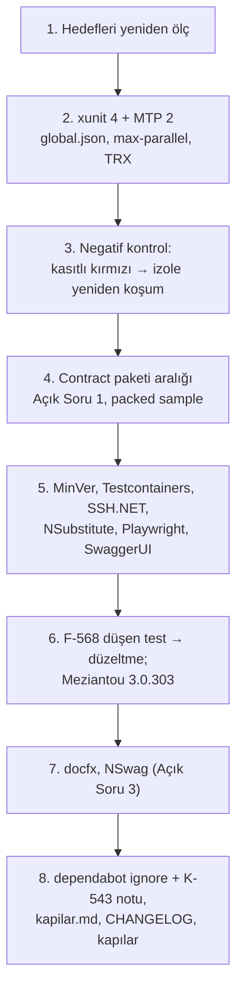

# Faz 215 — Test ve Derleme Araçları

> **Durum:** 📋 Planlandı (2026-10-16)
> **Plan onayı:** onaylanmadı — plan metni ve Açık Sorular 1-3 onay bekler. Kapsam kararı: **UR-009 B**, farukatasoy, 2026-10-16. Uygulama onaydan önce başlamaz.
> **Kaynak:** [ADAYLAR.md](ADAYLAR.md) · **F-557** (üç fazın ikincisi), **F-568** (analyzer yükseltmesinin bulduğu yapılandırma kusuru)
> **Genellik:** Tüketiciye iki yoldan dokunur: sevk edilen `Tracon.Testing.Contracts.Xunit` `xunit.v3`'e bağlıdır (A-70) ve `Tracon.Client` NSwag ile üretilir. Geri kalanı geliştirme aparatıdır (`PrivateAssets=all`), ama kapanış kapısı ve CI ona dayanır. İkinci kanıt: K-543'ün beş `ignore` kaleminden ikisinin gerekçesi artık yok (deneme, 2026-10-16).
> **Karşı görüş:** "Araç yükseltmesi ürün değeri üretmez; MTP 2 test koşum hattını değiştirir ve kapanış kapısını kırabilir." **Cevap:** Doğru, bu yüzden faz ayrıdır ve ölçütü kapının kendisidir: kapı aynı testleri koşar, düşen testi aynı yolla yeniden koşar ve TRX'i aynı yere yükler. Deneme bu üçünün **sessizce** bozulduğunu gösterdi (§215.1); düzeltme kanıtlanmadan faz bitmez. Analyzer yükseltmesi bir gerçek kusur buldu (F-568) — bu da değerdir.
> **Önkoşul:** [Faz 214](214-CALISMA-ANI-BAGIMLILIKLARI-VE-MAF-125.md) — `Directory.Packages.props`, `dependabot.yml`, `CHANGELOG.md` ortak; paralel koşmaz.
> **Paketler:** `Tracon.Testing.Contracts.Xunit` (sevk edilen bağımlılık aralığı), `Tracon.Client` (NSwag üretimi, Açık Soru 3), `Tracon.Core` (F-568), analyzer'ların dokunduğu kaynaklar
> **Yeni paket:** Yok · **Migration:** Yok
> **Public API:** Büyümüyor. `Tracon.Client` üretilen yüzeyi NSwag 14.7.1 ile değişebilir (Açık Soru 3; ApiCompat ölçer). `PublicAPI.Shipped.txt` bugün **0** satır.
> **Tüketici yüzeyi:** site: `guides/testing.md` (contract paketinin xunit sürüm aralığı) · `reference/compatibility.md` · sevk edilen: `src/Tracon.Testing.Contracts.Xunit/README.md`, `CHANGELOG.md` `[Unreleased]` (F-568 davranış değişikliği)
> **Manuel test alanı:** [`manuel-test/36-GELISTIRME-KAPILARI.md`](manuel-test/36-GELISTIRME-KAPILARI.md) (kapı hattı) · [`manuel-test/24-TEST-PAKETI-VE-SABLON.md`](manuel-test/24-TEST-PAKETI-VE-SABLON.md) (contract paketi)

---

## Bu Faza Başlarken

1. Bu doküman
2. Kararlar — `grep -n "K-543\|K-349\|K-605\|K-197\|K-855" docs/KARARLAR.md`: **K-543** (bot `ignore` listesi ve gerekçeleri) · **K-349** (üretecin Roslyn'i en eski desteklenen SDK'nınkidir) · **K-605** (contract paketi) · **K-197** (SQLitePCLRaw) · **K-855** (net8/net9 2026-11-10'dan sonra düşer)
3. [Faz 214](214-CALISMA-ANI-BAGIMLILIKLARI-VE-MAF-125.md) devir notu (kapanınca)
4. Alan hafızası: [`hafiza/test-kosum-tuzaklari.md`](hafiza/test-kosum-tuzaklari.md) (MTP, `-maxcpucount`, öksüz düğüm) · [`hafiza/nswag-istemci-uretimi.md`](hafiza/nswag-istemci-uretimi.md) (yeniden üretim zinciri) · [`hafiza/build-ve-analyzer.md`](hafiza/build-ve-analyzer.md)
5. [`.agents/ortak/kapilar.md`](../.agents/ortak/kapilar.md) — kapı komut yüzeyi (bu faz onu değiştirir)

---

## Amaç

Test, derleme ve üretim araçlarını en yeni sürüme taşı; kapanış kapısının ve CI'ın aynı şeyi koştuğunu yeniden kanıtla; artık geçersiz `ignore` gerekçelerini K-543'ten çıkar.

- **F-557 (2/3)** — xunit.v3 4 + Microsoft.Testing.Platform 2, MinVer 8, analyzer'lar, test altyapısı, docfx, NSwag.
- **F-568** — Meziantou 3.0.303'ün `MA0060`'ı: yardımcı model bağlamasında okunamayan sayı sessizce `0` olur.

### Bugün ne çalışmıyor — doğrulanmış kanıt

| Kanıt | Gözlem |
|---|---|
| [`TraconServiceCollectionExtensions.Binding.Models.cs:279-281`](../src/Tracon.Core/TraconServiceCollectionExtensions.Binding.Models.cs) | `Tracon:UtilityModel:Temperature = "abc"` → `TryParse` sonucu yok sayılır, değer boş olmadığı için `0` atanır (`:288-290`). preview.4'ün "okunamayan yapılandırma değeri başlangıcı durdurur" kuralı bu yolu kaçırdı (**F-568**) |
| `.github/dependabot.yml` `ignore` | Beş major: `Microsoft.CodeAnalysis.CSharp > 4.8.0`, `TrxReport >= 2`, `xunit.v3 >= 4`, `Microsoft.OpenApi >= 3`, `SQLitePCLRaw.* >= 3` (K-543) |
| `.github/workflows/ci.yml:293,299` · [`scripts/kapi.py:1059`](../scripts/kapi.py) | `dotnet test … -maxcpucount:N -- --report-trx` |
| [`scripts/kapi.py:1080-1089`](../scripts/kapi.py) `failed_tests_from_trx` | TRX'i `artifacts/bin/*/release*/TestResults/` altında arar · `ci.yml:355` aynı glob'u yükler |
| `bench/capacity/Tracon.Capacity.Acceptance/Tracon.Capacity.Acceptance.csproj:49` | `xunit.v3` `3.2.0` CPM dışında sabit |
| `.config/dotnet-tools.json` | docfx `2.78.5` (son `2.81.0`), nswag `14.2.0` (son `14.7.1`) |

> Kanıtlar 2026-10-16'da doğrulandı (HEAD `9aaa6544`). Deneme yükseltmesi aynı gün izole worktree'de koşuldu (§215.1-215.5).

---

## 215.1 — xunit.v3 4 ve Microsoft.Testing.Platform 2

Deneme: `xunit.v3*` `3.2.2` → `4.0.2`, `TrxReport` `1.9.1` → `2.5.1`. Tüm çözüm 0 uyarıyla derlendi; Core 4125/4125 (net10.0 ve net8.0), Contracts.Xunit 14/14 ×3 TFM, Testing 32/32, AspNetCore.FunctionalTests 2124/2124. Ama üç yer **değişmek zorunda**:

| Değişiklik | Neden | Yer |
|---|---|---|
| `global.json`'a `"test": {"runner": "Microsoft.Testing.Platform"}` | Olmadan her `dotnet test` "VSTest target is no longer supported" ile düşer | `global.json` |
| `-maxcpucount:N` → `--max-parallel-test-modules N`, `--` ayırıcısı kalkar | MTP modunda `-maxcpucount` çıkış kodu 5 verir: **sıfır test koşar** | `ci.yml:293,299` · `kapi.py:1059` · `kapi_test.py` (deneme 3 satır saydı) |
| TRX artık `<cwd>/TestResults/`'a yazılır | `failed_tests_from_trx` ve CI yüklemesi **sessizce boş** kalır: düşen test izole yeniden koşulmaz, CI rapor yüklemez | `--results-directory … --results-directory-layout per-module` + `kapi.py:1080` ayrıştırması + `ci.yml:355` |

🚨 İkinci ve üçüncü satır, kapının "yeşil" demesine rağmen hiçbir şey koşmamasının ya da düşen testi raporlamamasının yoludur. Negatif kontrol zorunlu: kasıtlı düşen bir testle `kapi.py kapanis` kırmızı olur **ve** "izole de DÜŞTÜ" satırını basar; CI'da TRX yüklenir.

**Sevk edilen contract paketi (A-70).** Yeni nuspec `xunit.v3.extensibility.core` ve `.assert`'i `>= 4.0.2` ister. 3.2.2'de kalan tüketici uyarı-hata altında dört `NU1608` alır. Ters yön çalışır: 3.2.2 ile derlenen preview.4 paketi 4.0.2 + TrxReport 2.5.1 üzerinde koştu (FileRunStore sample 129/129). **Açık Soru 1.**

## 215.2 — Kalan araçlar

| Küme | Hedef | Deneme sonucu | İş |
|---|---|---|---|
| MinVer | `7.0.0` → `8.0.0` | Sürüm, nuspec ve dosya listesi HEAD ile aynı (`1.0.0-preview.4.7`); tek kırıcı değişiklik (#1245) bu repoda kullanılmıyor | Yükselt |
| NSubstitute, Playwright, SwaggerUI | `6.2.0`, `1.63.0`, `10.3.0` | Restore ve derleme temiz (Playwright yalnız derlendi) | Yükselt; CI'daki `playwright install` sürümü ölç |
| Testcontainers | `4.13.0` → `4.16.0` | `SSH.NET` `2026.0.0`'ı doğrudan çeker (açıksız) | Yükselt; `SSH.NET` sabitini ve iki `csproj` referansını kaldır |
| Shouldly, BenchmarkDotNet, BannedApi/PublicApi analyzer'ları | — | Zaten son kararlı | — |
| Meziantou.Analyzer | `3.0.138` → `3.0.303` | **8 yeni hata** | §215.3 |
| docfx (yerel araç) | `2.78.5` → `2.81.0` | Ölçülmedi | Yükselt; site `npm run check` yeşil kalmalı |
| NSwag (yerel araç) | `14.2.0` → `14.7.1` | Yeniden üretilmedi | **Açık Soru 3** |
| `bench/…Acceptance.csproj` | `xunit.v3 3.2.0` CPM dışı | — | CPM'e al |

**Değişmeyenler (gerekçeli):**

| Paket | Neden | K-543 `ignore` |
|---|---|---|
| `Microsoft.OpenApi` 3.x | AspNetCore.OpenApi 10.0.13 `[2.12.2, 3.0.0)` ister; 3.x yalnız ASP.NET Core 11 RC ile; 10.0.10 + 3.10.2 üretecin kodunda `CS0200` | Kalır; gerekçe "3.x yalnız ASP.NET Core 11 ile" |
| `SQLitePCLRaw.*` 3.x | Derlenir, testler geçer; ama `Tracon.Sqlite` nuspec'i her tüketicinin SQLite yığınını Microsoft'un yalnız Data.Sqlite 11 ile eşlediği major'a taşır | Kalır; gerekçe "Data.Sqlite 11'i izler" |
| `Microsoft.CodeAnalysis.CSharp` | K-349: üreteç en eski desteklenen SDK'nın derleyicisinde yüklenir. Ölçüldü: SDK 10.0.100 → Roslyn `5.0.0`, 10.0.402 → `5.9.0`, 9.0.306 → `4.14.0` | Kalır; **F-569**: Faz 193 net8/net9'u düşürünce `5.0.0`'a (5.9.0 değil) |

## 215.3 — Meziantou 3.0.303 ve F-568

| Bulgu | Yer | İş |
|---|---|---|
| `MA0060` **gerçek kusur (F-568)** | `Binding.Models.cs:279-281` | `kusur-giderme` protokolü: önce düşen test (`"abc"` → başlangıç durur, hata anahtarı adlandırır), sonra düzeltme; davranış preview.4 kuralına hizalanır. Sınıf taraması: `grep -rn "\.TryParse(" src | grep -v "if\|is\|=>"` |
| `MA0060` | `McpServer/McpTaskRunProvisioning.cs:84` | Ucuz düzeltme |
| `MA0054` (bilinçli) | `Internal/ExplainedEnumConverter.cs:81` | Gerekçeli bastırma (iç istisna bilerek atılır) |
| `MA0054` ×3 | `tests/Shared/Infrastructure/ProcessRunner.cs:80`, `StreamKeepAliveTests.cs:197`, `TemplateRunTests.cs:63` | Ucuz düzeltme |

## 215.4 — Sıra



---

## Planlanan Public API

Yok. `Tracon.Client` farkı Açık Soru 3'ün seçimine bağlıdır.

### HTTP `endpoint`'leri

Değişmez.

### Arayüz payı

Yok.

---

## Planlanan Dosya Listesi

```
global.json · Directory.Packages.props · .config/dotnet-tools.json · .github/dependabot.yml
.github/workflows/ci.yml                         (max-parallel-test-modules, TRX yolu)
scripts/kapi.py · scripts/kapi_test.py           (test komutu, failed_tests_from_trx)
.agents/ortak/kapilar.md                         (komut yüzeyi)
src/Tracon.Testing.Contracts.Xunit/Tracon.Testing.Contracts.Xunit.csproj   (Açık Soru 1)
src/Tracon.Core/TraconServiceCollectionExtensions.Binding.Models.cs        (F-568)
src/Tracon.AspNetCore/{McpServer/McpTaskRunProvisioning.cs,Internal/ExplainedEnumConverter.cs}
tests/** (MA0054 ×3, Testcontainers/SSH.NET referansları) · bench/capacity/**/…Acceptance.csproj
src/Tracon.Client/Generated/* (Açık Soru 3) · CHANGELOG.md
```

---

## Hata Modları ve Testler

| Ne bozulabilir | Seviye | Test |
|---|---|---|
| Kapı sıfır test koşar ama yeşil der | Kapı | `kapi_test.py` (komut satırı) + negatif kontrol: test sayısı > 0 iddiası |
| Düşen test izole yeniden koşulmaz (TRX bulunmaz) | Kapı | `kapi_test.py` `failed_tests_from_trx` vakası + kasıtlı kırmızı koşum |
| CI TRX yüklemez | CI | ilk CI koşumunda artifact listesi okunur |
| Contract paketi tüketiciyi xunit 4'e zorlar | Paket | `release_extension_samples.verify` + Açık Soru 1'in nuspec iddiası |
| `UtilityModel` sayı alanı sessizce `0` | Birim + Fonksiyonel | F-568 düşen testi (bağlayıcı) + başlangıç testi |
| MinVer sürümü kayar | Paket | `kapi.py yayin --kuru`'nun sürüm iddiası |
| NSwag üretimi `Tracon.Client` public yüzeyini değiştirir | Paket | `kapi.py yayin` ApiCompat (`breaking_changes.py`) + `nswag_postprocess_client_test.py` |
| SSH.NET sabiti kalkınca açık döner | Paket | `dotnet list … --vulnerable --include-transitive` |

Beş soru: yeni çalışma anı kod yolu yalnız F-568'dir — **boş girdi**: boş değer bugünkü gibi `null`; **aşırı girdi**: okunamayan değer başlangıcı durdurur. Diğer dördü uygulanmaz (yapılandırma bağlaması başlangıçta bir kez koşar).

---

## Manuel Kabul Case'leri

| # | Ön koşul | Adımlar | Beklenen sonuç |
|---|---|---|---|
| 1 | Temiz ağaç | Bir testi kasıtlı kır, `python3 scripts/kapi.py kapanis --taban HEAD` | Kırmızı; "izole de DÜŞTÜ" satırı; TRX `--results-directory` altında |
| 2 | Aynı | `python3 scripts/kapi.py test --proje Tracon.Testing.UnitTests --sinif "*"` | Test sayısı > 0 |
| 3 | `Tracon:UtilityModel:Temperature=abc` | Host'u başlat | Başlangıç durur, hata anahtarı adlandırır |
| 4 | xunit.v3 3.2.2 kullanan dış tüketici | Contract paketini `PackageReference` ile al | Açık Soru 1'in seçimine göre: NU1608 yok (A) ya da belgelenmiş alt sınır (B) |

---

## Açık Sorular

| # | Soru | Seçenekler | Öneri |
|---|---|---|---|
| 1 | Contract paketinin xunit alt sınırı (A-70) | A: repo testleri 4.x'te; sevk edilen paket `VersionOverride` ile `>= 3.2.2` kalır · B: paket `>= 4.0.2` ister | **A** — ters yön ölçüldü ve çalışıyor; tüketiciyi zorlamak bedava değil. 4.x'e geçiş 1.x minor'unda ekleyici değildir, bu yüzden karar freeze'den önce yazılır |
| 2 | Meziantou'nun `MA0054` bilinçli vakası | A: gerekçeli `#pragma` · B: kuralı dosyada kapat | **A** — repo deseni (gerekçe koda yazılır) |
| 3 | NSwag `14.2.0` → `14.7.1` | A: bu fazda; yeniden üret, `Tracon.Client` farkı yalnız başlık/biçimse kabul, public tip değişirse **dur** ve ayrı karar · B: freeze sonrası istisna olarak bırak | **A** — `Tracon.Client`'ın üretilen yüzeyi de 1.0'da donar; değişecekse şimdi |

---

## Bitiş Ölçütleri (DoD)

- [ ] `Directory.Packages.props` ve `.config/dotnet-tools.json` §215.2 hedeflerinde; `restore` NU1605/NU1608/NU1903 yok
- [ ] `global.json` MTP koşucusunu adlandırır; `ci.yml` ve `kapi.py` `--max-parallel-test-modules` kullanır
- [ ] Negatif kontrol kayda geçti: kasıtlı kırmızı test kapıyı kırar, izole yeniden koşulur, TRX doğru yerdedir (manuel case 1)
- [ ] Contract paketinin nuspec aralığı Açık Soru 1'in seçimini taşır; `release_extension_samples` yeşil
- [ ] F-568: düşen test önce kırmızıydı; düzeltme sonrası yeşil; sınıf taraması sonucu yazıldı
- [ ] Meziantou 3.0.303 ile sıfır uyarı
- [ ] `SSH.NET` sabiti yok; `dotnet list … --vulnerable --include-transitive` açık yok
- [ ] `dependabot.yml`: xunit ve TrxReport `ignore`'u kalktı; OpenApi, SQLitePCLRaw ve CodeAnalysis gerekçeleri yeni metinle; K-543 notu
- [ ] Açık Soru 3'ün seçimi uygulandı; `Tracon.Client` farkı okundu
- [ ] `.agents/ortak/kapilar.md` ve `hafiza/test-kosum-tuzaklari.md` yeni komut yüzeyini yazar
- [ ] Dört doğrulama kapısı sıfır uyarı: `python3 scripts/kapi.py kapanis --taban <faz öncesi commit>`
- [ ] `samples/Tracon.Api` ile gerçek `run` yapıldı, çıktı belgeye yazıldı
- [ ] `secret` taraması boş döndü
- [ ] Manuel kabul case'leri `36-GELISTIRME-KAPILARI.md` ve `24-TEST-PAKETI-VE-SABLON.md` içine eklendi; otomatikleştirilebilenler koşuldu
- [ ] `faz-denetim` koşuldu; 🔴 bulgu kalmadı
- [ ] İlk CI koşumunda test sayısı ve TRX yüklemesi okundu (push bakımcı onayıyla)

---

## Riskler

| Risk | Önlem |
|------|-------|
| MTP 2 kapıyı sessizce boşaltır | Negatif kontrol; test sayısı iddiası |
| Windows CI bacağı farklı davranır | İlk CI koşumu iki bacakta okunur |
| NSwag çıktısı post-processor regex'lerini kırar | `nswag_postprocess_client_test.py`; Açık Soru 3'ün durma kuralı |
| F-568 düzeltmesi bugün çalışan bir yapılandırmayı durdurur | Yalnız okunamayan değer durur; CHANGELOG'da davranış değişikliği olarak anılır |
| Roslyn 5.0.0'a geçiş unutulur | F-569 tetik kalemi (Faz 193 kapanınca) |

---

<!-- ============================================================
     AŞAĞISI KAPANIŞTA DOLDURULUR — `faz-tamamlama` skill'i.
     Plan anında boş kalır. Başlıkları SİLME.
     ============================================================ -->

## Plandan Sapmalar

> Kapanışta doldurulur. Plan ile gerçek arasındaki fark **gizlenmez** — sonraki oturumun en değerli bilgisidir.

## Bu Fazda Verilen Kararlar

> Kapanışta doldurulur. Dört kategoriden birine giren karar (AGENTS.md) ayrıca `docs/KARARLAR.md`'ye K-NNN ve kategori etiketiyle girer; plan numara rezerve etmez.

## Gerçekleşen Public API

> Kapanışta doldurulur.

## Dosya Listesi (gerçekleşen)

> Kapanışta doldurulur.

## Süreç Ölçümü

> Kapanışta doldurulur. **Tablo olarak** — onay kutusu DEĞİL.

| Metrik | Değer |
|---|---|
| Plan revizyonu sayısı | |
| Düzeltme turu sayısı | |
| 🔴 bulgu: gerçek / gürültü / araştırılacak | |
| Fazın ürettiği regresyon | |
| Faz kapandıktan sonra bulunan kusur | |

## Denetim Bulguları

> Kapanışta doldurulur — `faz-denetim` çıktısı. Bulgu yoksa "🔴 ve 🟡 yok" yazılır.

## Sonraki Faza Devir Notu

> Kapanışta doldurulur: devralınan sözleşmeler, bilinen tuzaklar (🚨), yarım kalan işler, sıradaki faz.
