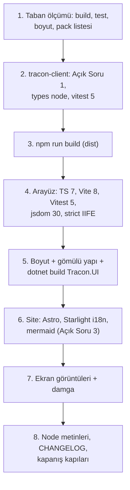

# Faz 216 — npm Bağımlılıkları: Arayüz, TypeScript İstemcisi ve Site

> **Durum:** 📋 Planlandı (2026-10-16)
> **Plan onayı:** onaylanmadı — plan metni ve Açık Sorular 1-3 onay bekler. Kapsam kararı: **UR-009 B**, farukatasoy, 2026-10-16. Uygulama onaydan önce başlamaz.
> **Kaynak:** [ADAYLAR.md](ADAYLAR.md) · **F-557** (üç fazın üçüncüsü)
> **Genellik:** İki sevk edilen yapıta dokunur: `Tracon.UI.dll`'e gömülen arayüz (her `UseUI()` tüketicisi) ve npm'deki `@tracon/client`. Site tüketiciye dönük belgedir. İş tüketici kodunda kalamaz. İkinci kanıt: Node 20'nin destek sonu (Nisan 2026) ve sürüm gerilemesi — dört major geride (TypeScript, Vite, Vitest, jsdom).
> **Karşı görüş:** "Ön uç araçlarının major'ı ürüne değer katmaz; paket boyutu ve tarayıcı davranışı kayabilir." **Cevap:** Deneme (izole worktree, 2026-10-16) üç paketi dört küçük düzeltmeyle yeşile çevirdi; arayüz paketi 211.9 → 215.4 KB (bütçe 250 KB), `@tracon/client` paketi aynı 23 dosyayı, `.js`/`.d.ts` **baytı baytına aynı** çıkarır. Değişen her şey ölçülü ve aşağıdadır. Üç yerde "en yeni" bilerek seçilmez (Açık Sorular).
> **Önkoşul:** [Faz 215](arsiv/fazlar/215-TEST-VE-DERLEME-ARACLARI.md) — `CHANGELOG.md` ve CI ortak; paralel koşmaz. (Teknik bağımlılık yok; sıra yalnız birleştirme çakışmasını önler.)
> **Paketler:** `Tracon.UI` (gömülü varlıklar), `@tracon/client` (npm), `docs-site`
> **Yeni paket:** Yok · **Migration:** Yok
> **Public API:** Büyümüyor. `@tracon/client`'ın yayımlanan dosyaları aynı kalır (Açık Soru 1 = A ile).
> **Tüketici yüzeyi:** site: `getting-started/` ve kurulum sayfalarındaki Node alt sınırı; konsol ekran görüntüleri (damga yenilenir) · sevk edilen: `Tracon.UI.Frontend.targets:282,295` hata metni (Node sürümü), `README.md:328`, `CONTRIBUTING.md:18`
> **Manuel test alanı:** [`manuel-test/09-ARAYUZ-GENEL.md`](manuel-test/09-ARAYUZ-GENEL.md) · [`manuel-test/35-TYPESCRIPT-ISTEMCISI.md`](manuel-test/35-TYPESCRIPT-ISTEMCISI.md) · [`manuel-test/32-DOKUMAN-KALITESI.md`](manuel-test/32-DOKUMAN-KALITESI.md)

---

## Bu Faza Başlarken

1. Bu doküman
2. Kararlar — `grep -n "K-228\|K-543" docs/KARARLAR.md`: **K-228** (yerelleştirme; eksik anahtar derleme hatasıdır) · **K-543** (bot grupları)
3. Alan hafızası: [`hafiza/frontend.md`](hafiza/frontend.md) (bütçe, gömme, damga) · [`hafiza/frontend-test-altyapisi.md`](hafiza/frontend-test-altyapisi.md) · [`hafiza/nswag-istemci-uretimi.md`](hafiza/nswag-istemci-uretimi.md) (satır 60-62: `@tracon/client` `dist/` önce derlenir) · [`hafiza/site-yayin-ve-tema.md`](hafiza/site-yayin-ve-tema.md)
4. `MEMORY.md` — senkronizasyon kopyaları ve `tracon-frontend.stamp` (varlık değişince damga silinir)

---

## Amaç

Üç npm paketini en yeni sürüme taşı; gömülü arayüzün ve npm istemcisinin içeriğini ve boyutunu ölç; "en yeni"nin bilerek seçilmediği üç yeri gerekçesiyle yaz.

- **F-557 (3/3)** — `src/Tracon.UI/frontend`, `packages/tracon-client`, `docs-site`.

### Bugün ne çalışmıyor — doğrulanmış kanıt

| Kanıt | Gözlem |
|---|---|
| `npm outdated` (2026-10-16) | Arayüz: `typescript 5.9.3→7.0.2`, `vite 7.3.6→8.3.4`, `vitest 3.2.7→5.0.5`, `jsdom 27.4.0→30.1.3`, `@vitejs/plugin-react 5.2.0→6.1.2`, `react 19.2.8→19.3.1`. İstemci: `typescript→7.0.2`, `vitest→5.0.5`. Site: `astro 7.2.2→7.4.0`, `@astrojs/starlight 0.41.7→0.42.6`, `mermaid 11.16.1→12.2.0` |
| [`src/Tracon.UI/Tracon.UI.Frontend.targets:282`](../src/Tracon.UI/Tracon.UI.Frontend.targets) ve `:295` | Hata metni "Install Node.js 20.19+" der; jsdom 30 Node `^22.22.2` ister |
| `.github/workflows/ci.yml:112,402,546,781` | `node-version: '22'` (en yeni 22.x'e çözülür; yeni alt sınırları karşılar) |

> Kanıtlar 2026-10-16'da doğrulandı (HEAD `9aaa6544`). Deneme yükseltmesi aynı gün izole worktree'de koşuldu; fark `scratchpad/probe-npm.patch` (10 dosya, kilit dosyaları dahil) yalnız referanstır. **Deneme tabanı `1ae92822`'dir** (Faz 212 ve 213'ten önce; ajan worktree'si oturum başındaki commit'ten açıldı). Derleme hatası listeleri ve test sayıları bu yüzden uygulamanın ilk adımında HEAD üzerinde yeniden ölçülür.

---

## 216.1 — Arayüz (`src/Tracon.UI/frontend`)

| İş | Deneme sonucu |
|---|---|
| TypeScript 7 (yerel derleyici) | `tsc --noEmit` 0 hata (`tsconfig` zaten `types` taşır) |
| Vite 8 (Rolldown) + `@vitejs/plugin-react` 6 + Vitest 5 | Yapılandırma değişmez; 418/418 test; bütçe kapısı ve `THIRD-PARTY-NOTICES` denetimi geçer |
| 🚨 Gömülü IIFE `"use strict"`'ini kaybetti | `vite.embed.config.ts:30`'a `rolldownOptions: { output: { strict: true } }` |
| jsdom 30 | Node `^22.22.2` ister; Node 20.19.4'te 35 test dosyasının hepsi "Failed to start forks worker" ile düşer → **Açık Soru 2** |
| React 19.3.1 | +8,7 KB gzip (React 19.2.8 ile yeniden derlenerek ölçüldü) |

Boyut (bütçe kapısı, gzip -9, JS): **211,9 → 215,4 KB / 250**. CSS +1,7 KB ham (Lightning CSS `oklch`'yi çevirir, üç `-webkit-` öneki ekler; **görsel olarak doğrulanmadı** → manuel case 1). Gömülü yapı aynı: `index.html`, `assets/index-<8>.{js,css}.br`, `embed/embed.js.br`, `THIRD-PARTY-NOTICES.txt`; `EmbeddedUiAssetCatalog` `assets/` öneki ve `.br`'yi anahtar alır. E2E testleri yalnız `embed/embed.js`'i adıyla anar (`ToolTests.cs:71,111`).

`workflow-editor.test.tsx:314` yükseltmeden **önce** bir kez düştü, sonra dört kez geçti: kırılgan test adayı (`kusur-giderme` Adım 2 ile ayrılır, gerekirse F-NN).

## 216.2 — TypeScript istemcisi (`packages/tracon-client`)

🚨 `openapi-typescript` 7.13.0 (en yenisi) `typescript ^5.x` eş bağımlılığı ister ve derleyici API'sini çağırır. TypeScript 7'nin `typescript` paketi derleyici API'si **taşımaz**: `npm run generate` ve `schema-drift.test.ts` `createKeywordTypeNode` hatasıyla düşer; `overrides` eş çakışmasını (ERESOLVE) çözmez. → **Açık Soru 1**.

TypeScript 7'de derleme için `tsconfig.json`'a `"types": ["node"]` gerekir (yoksa `src/client.ts:14`, `src/sse.ts:185-241` TS2304/TS7017). Vitest 5 ile 41/41 test; `npm run generate` sonrası `src/schema.ts` farkı yok; `npm pack --dry-run` aynı 23 dosya, `.js`/`.d.ts` baytı baytına aynı.

## 216.3 — Site (`docs-site`)

| İş | Deneme sonucu |
|---|---|
| Astro 7.4 + Starlight 0.42 | Yeni uyarı: `collection "i18n" does not exist or is empty` → `src/content.config.ts`'e `i18n` koleksiyonu + `src/content/i18n/en.json` (`{}`) |
| mermaid 12 | `astro-mermaid 2.1.0` eşi `^10||^11`; `npm install` uyarır, **`npm ci` ERESOLVE ile düşer** (CI kırılır). `overrides` ile çalışır ve diyagramlar çizilir; ama elkjs 1,46 MB (449 KB gzip) tembel parça ekler, hiçbir diyagram ELK kullanmaz → **Açık Soru 3** |
| Konsol ekran görüntüsü damgası | `.ui-source.sha256` arayüzün `package.json`'ını ve kilidini özetler: **her** arayüz bağımlılığı değişince ekran görüntüleri (`DocumentationScreenshotTests`) ve `refresh-console-screenshot-stamp.mjs` yeniden koşulur |
| `astro preview` | Artık arka planda koşar (`astro preview stop`); `manuel-test/32-…:43` ve `01-…:2899` ön planda anlatır → metin düzeltilir |

## 216.4 — Node alt sınırı

Açık Soru 2 = A ise "Node.js 20.19+" şu yerlerde "22.22+" olur: `Tracon.UI.Frontend.targets:282,295` · `CONTRIBUTING.md:18` · `README.md:328` · `.agents/ortak/kapilar.md:81` · `ci.yml:107` yorumu · `docs/manuel-test/00-INDEKS.md:46` · `01-KURULUM-VE-PAKETLEME.md:114,393` · `35-TYPESCRIPT-ISTEMCISI.md:43`. Kesin liste: `grep -rn "20\.19" --include='*.md' --include='*.targets' --include='*.yml' .`. `@tracon/client`'ın `engines` alanı (`>=20`) çalışma anı içindir ve değişmez (yayımlanan paket Node 20'de çalışır).

## 216.5 — Sıra



---

## Planlanan Public API

Yok.

### HTTP `endpoint`'leri

Değişmez.

### Arayüz payı

**215,4 KB / 250 KB gzip** (denemede ölçülen; uygulamada yeniden ölçülür ve buraya yazılır). React 19.3 payı +8,7 KB; Vite 8'in kendi kazancı −4,7 KB.

---

## Planlanan Dosya Listesi

```
src/Tracon.UI/frontend/{package.json,package-lock.json,vite.embed.config.ts}
packages/tracon-client/{package.json,package-lock.json,tsconfig.json}
docs-site/{package.json,package-lock.json,src/content.config.ts,src/content/i18n/en.json}
docs-site/**/console-screenshots (yeniden üretilir) · .ui-source.sha256
src/Tracon.UI/Tracon.UI.Frontend.targets · README.md · CONTRIBUTING.md · .agents/ortak/kapilar.md
.github/workflows/ci.yml (yorum) · docs/manuel-test/{00-INDEKS,01-KURULUM-VE-PAKETLEME,32-DOKUMAN-KALITESI,35-TYPESCRIPT-ISTEMCISI}.md
CHANGELOG.md
```

---

## Hata Modları ve Testler

| Ne bozulabilir | Seviye | Test |
|---|---|---|
| Gömülü IIFE katı modu kaybeder | Birim (derleme çıktısı) | çıktıda `"use strict"` iddiası (yeni, `vite.embed` testi) |
| Bütçe aşılır | Kapı | arayüz bütçe kapısı (postbuild) |
| Gömülü varlık adı/yapısı kayar, `UseUI()` 404 döner | E2E | `Tracon.Ui.E2ETests` (tam derleme ile; `-p:TraconFrontendEnabled=false` UI uçlarını bağlamaz — Faz 213 devir notu) |
| `@tracon/client` yayımlanan dosyaları değişir | Paket | `npm pack --dry-run` dosya listesi + `.js`/`.d.ts` karşılaştırması |
| `schema.ts` üretimi bozulur | Birim | `schema-drift.test.ts` |
| CI'da `npm ci` düşer (eş çakışması) | CI | yerelde `npm ci` (temiz `node_modules`) üç pakette |
| Site diyagramları çizilmez | E2E (site) | `npm run check` + manuel case 3 |
| Lightning CSS görsel fark yaratır | Manuel | manuel case 1 (iki temada) |

Beş soru: çalışma anı kodu değişmez (yalnız derleme aracı); uygulanmaz.

---

## Manuel Kabul Case'leri

| # | Ön koşul | Adımlar | Beklenen sonuç |
|---|---|---|---|
| 1 | `samples/Tracon.Api` tam derleme | Arayüzü açık ve koyu temada gez (agent listesi, playground, workflow düzenleyici) | Görsel fark yok; konsolda hata yok 👤 |
| 2 | Gömülebilir sohbet sayfası | `embed/embed.js` ile sohbet | Çalışır; tarayıcı konsolunda katı mod ihlali yok |
| 3 | Site yerel önizleme | `/concepts/runs/` | Akış ve durum diyagramları çizilir |
| 4 | Temiz makine, Node 20 | `dotnet build src/Tracon.UI` | Açık Soru 2'nin seçimine uygun açık hata metni |

---

## Açık Sorular

| # | Soru | Seçenekler | Öneri |
|---|---|---|---|
| 1 | `@tracon/client` TypeScript 7 | A: bu pakette TypeScript 5.9 kalır (`openapi-typescript` TS 7'yi desteklediğinde geçilir); arayüz TS 7'ye geçer · B: iki derleyici: `typescript@5` üretici için + `tsgo` takma adı derleme için | **A** — B'de iki paket de `tsc` adlı bin taşır ve `.bin/tsc`'nin hangisine bağlanacağını npm belgelemez; denemede tutarlı çıktı ama garanti değil |
| 2 | Node alt sınırı | A: 22.22+ (jsdom 30) · B: jsdom 27'de kal, Node 20.19+ korunur | **A** — Node 20'nin desteği Nisan 2026'da bitti; CI zaten 22 |
| 3 | mermaid | A: `11.17.2` (aralık içi en yeni; eş uyumu, ELK parçası yok) · B: `12.2.0` + `overrides` | **A** — `astro-mermaid` 12'yi destekleyince geçilir; bot bunu görür. "En yeni" kuralının gerekçeli istisnası |

---

## Bitiş Ölçütleri (DoD)

- [ ] Üç pakette `npm ci` (temiz) + `build` + `test` (+ `typecheck`) yeşil
- [ ] Arayüz bütçe kapısı yeşil; ölçülen değer "Arayüz payı" bölümüne yazıldı
- [ ] Gömülü IIFE `"use strict"` taşır (test); `Tracon.Ui.E2ETests` tam derlemeyle yeşil
- [ ] `@tracon/client`: `npm pack --dry-run` listesi aynı; `schema-drift.test.ts` yeşil
- [ ] Site `npm run check` yeşil; i18n uyarısı yok; ekran görüntüleri ve damga yenilendi
- [ ] Node metinleri Açık Soru 2'nin seçimine göre güncellendi (`grep -rn "20\.19"` boş ya da gerekçeli)
- [ ] `dependabot.yml` npm grupları seçilen istisnaları (TypeScript 7 istemcide, mermaid 12) `ignore` ile ve gerekçeyle taşır
- [ ] Dört doğrulama kapısı sıfır uyarı: `python3 scripts/kapi.py kapanis --taban <faz öncesi commit>`
- [ ] `samples/Tracon.Api` ile gerçek `run` yapıldı, çıktı belgeye yazıldı
- [ ] `secret` taraması boş döndü
- [ ] Manuel kabul case'leri `09`, `35`, `32` dosyalarına eklendi; otomatikleştirilebilenler koşuldu
- [ ] `faz-denetim` koşuldu; 🔴 bulgu kalmadı

---

## Riskler

| Risk | Önlem |
|------|-------|
| TypeScript 7 ile istemcinin `.d.ts` çıktısı kayar | Açık Soru 1 = A (istemci TS 5.9'da kalır) |
| Rolldown başka bir çıktı farkı üretir | Gömülü yapı ve katı mod testi; E2E |
| CI'daki Node 22 sürümü 22.22'den eski | `setup-node` en yeni 22.x'e çözülür; ilk CI koşumunda sürüm okunur |
| Ekran görüntüsü yenileme makineye bağlı fark üretir | `hafiza/site-yayin-ve-tema.md` tarifi; fark görsel olarak okunur |

---

<!-- ============================================================
     AŞAĞISI KAPANIŞTA DOLDURULUR — `faz-tamamlama` skill'i.
     Plan anında boş kalır. Başlıkları SİLME.
     ============================================================ -->

## Plandan Sapmalar

> Kapanışta doldurulur. Plan ile gerçek arasındaki fark **gizlenmez** — sonraki oturumun en değerli bilgisidir.

## Bu Fazda Verilen Kararlar

> Kapanışta doldurulur. Dört kategoriden birine giren karar (AGENTS.md) ayrıca `docs/KARARLAR.md`'ye K-NNN ve kategori etiketiyle girer; plan numara rezerve etmez.

## Gerçekleşen Public API

> Kapanışta doldurulur.

## Dosya Listesi (gerçekleşen)

> Kapanışta doldurulur.

## Süreç Ölçümü

> Kapanışta doldurulur. **Tablo olarak** — onay kutusu DEĞİL.

| Metrik | Değer |
|---|---|
| Plan revizyonu sayısı | |
| Düzeltme turu sayısı | |
| 🔴 bulgu: gerçek / gürültü / araştırılacak | |
| Fazın ürettiği regresyon | |
| Faz kapandıktan sonra bulunan kusur | |

## Denetim Bulguları

> Kapanışta doldurulur — `faz-denetim` çıktısı. Bulgu yoksa "🔴 ve 🟡 yok" yazılır.

## Sonraki Faza Devir Notu

> Kapanışta doldurulur: devralınan sözleşmeler, bilinen tuzaklar (🚨), yarım kalan işler, sıradaki faz.
