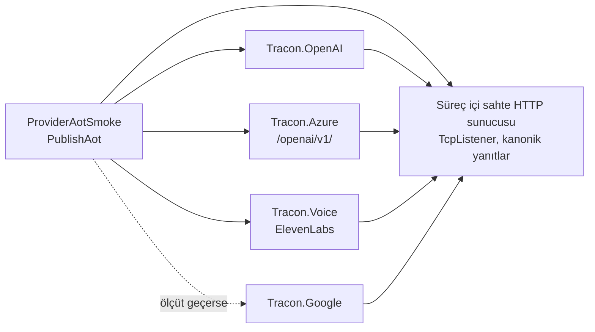

# Faz 217 — Sağlayıcı Modernleşmesi ve AOT Vaadinin Kanıtı

> **Durum:** ✅ Tamamlandı (2026-10-17)
> **Plan onayı:** onaylandı — farukatasoy, 2026-10-17, "onaylıyorum". Açık Sorular 1–5 ayrıca yanıtlanmadı; uygulama planın önerisini izler (Açık Soru 1 canlı ölçümden sonra kapanır). Planlamada verilen kararlar (farukatasoy, 2026-10-17): Anthropic AOT vaadi **geri çekilir** · AOT vaadinin ölçütü **smoke + sıfır uyarı** · Azure **düz `OpenAI` istemcisi + `/openai/v1/`** · canlı doğrulama **yalnız Anthropic** (Azure canlı case'i 👤 bekler).
> **Kaynak:** [ADAYLAR.md](ADAYLAR.md) · **F-558**
> **Genellik:** Sağlayıcı paketini Native AOT ile yayımlayan **her** tüketici (Anthropic bugün ilk istekte çöker — ölçüldü) ve Azure OpenAI kullanan **her** tüketici (kararlı `Azure.AI.OpenAI` 2024-12'den beri sürüm almadı; 1.0 bu bağımlılığı dondurur). İş tüketici kodunda kalamaz: vaat ve bağımlılık paketin kendisindedir. İkinci kanıt: freeze yolu ölçüt 3 ([`YAYIN-HAZIRLIK.md`](YAYIN-HAZIRLIK.md) §2) ve 2026-10-16 denetimi A-83.
> **Karşı görüş:** "Çalışan bir adaptörü yeniden yazmak risktir; Azure kullanıcısı v1 yolunu desteklemeyen bir kaynakta kalabilir." Cevap: değişiklik yalnız iç istemciyi değiştirir, public API aynı kalır. Ölçülen kırık (`AddDataSource`, K-211) ve 62 AOT uyarısı eski adaptördedir. Bedel (istek yolu değişir) sürüm notunda adıyla yazılır. 1.0'dan sonra aynı değişiklik daha pahalıdır.
> **Önkoşul:** [Faz 214](arsiv/fazlar/214-CALISMA-ANI-BAGIMLILIKLARI-VE-MAF-125.md) · [215](arsiv/fazlar/215-TEST-VE-DERLEME-ARACLARI.md) · [216](arsiv/fazlar/216-NPM-BAGIMLILIKLARI.md) — bağımlılıklar en yeni sürümde (kapandı)
> **Paketler:** `Tracon.Azure`, `Tracon.Anthropic`, `Tracon.Google`, `Tracon.Voice` (+ `Directory.Packages.props`, `scripts/release_extension_samples.py`, yeni örnek `samples/Tracon.Samples.ProviderAotSmoke`)
> **Yeni paket:** Yok — bir paket **kalkar** (`Azure.AI.OpenAI`) · **Migration:** Yok
> **Public API:** Büyümüyor. `wc -l src/Tracon.{Azure,Anthropic,Google,Voice}/PublicAPI.Shipped.txt` → toplam 4 satır (yalnız `#nullable enable` başlıkları); `AzureOpenAIProviderOptions` aynı kalır
> **Tüketici yüzeyi:** site: `reference/compatibility.md` (AOT sütunu, `:83-86`), `packages.md` (§ *Trimming and native AOT*, `:159-160`), `guides/model-providers.md` (§ *Azure OpenAI uses deployments*, `:298`), `reference/changelog` (üretilir)
> · sevk edilen: `src/Tracon.Azure/README.md` (`:55` istek yolu, `:109-119` SDK anlatısı), `src/Tracon.Anthropic/README.md` (`:39` AOT cümlesi, `:107-109` `ReasoningEffort` satırı — Açık Soru 1), `src/Tracon.Google/README.md` (`:64`), `CHANGELOG.md` `[Unreleased]`
> **Manuel test alanı:** `docs/manuel-test/06-SAGLAYICI-DIGER.md` (`MT-PROV-091…`) · `docs/manuel-test/19-COK-MODLULUK-VE-SES.md` (`MT-MM-141…`) · `docs/manuel-test/01-KURULUM-VE-PAKETLEME.md` (`MT-PKG-167…`)

---

## Bu Faza Başlarken

> `faz-baslangic` skill'ini uygula. Aşağıdaki liste o skill'in 2. adımıdır —
> **tamamını değil, yalnız işaret edilen bölümleri oku.**

1. Bu doküman
2. Kararlar — dosyanın tamamını **okuma**, yalnız bu kalemleri grep'le:
   ```bash
   grep -n "^| \*\*K-006 \|^| \*\*K-007 \|^| \*\*K-210 \|^| \*\*K-211 \|^| \*\*K-212 \|^| \*\*K-216 \|^| \*\*K-1017 " docs/KARARLAR.md
   ```
   **K-006** (AOT uyumu katman bazlıdır; verilemeyen vaat verilmez) · **K-007** (geçişli sabitleme kapalı; yeni paket gerekçe ister) · **K-210** (ad `azure-openai`; kimlik fabrikası tüketiciden gelir, `Azure.Identity` alınmaz) · **K-211** (`AzureChatExtensions` çalışma anında kırık; `SupportedSettings` boş) · **K-212** (Foundry ertelendi — bu faz onu **açmaz**) · **K-216** (`Tracon.Voice` ham `HttpClient` kullanır) · **K-1017** (`Tracon.Anthropic` `Extended` thinking sabiti; `Adaptive`'e geçiş bu fazın kararı)
3. [`arsiv/fazlar/214-CALISMA-ANI-BAGIMLILIKLARI-VE-MAF-125.md`](arsiv/fazlar/214-CALISMA-ANI-BAGIMLILIKLARI-VE-MAF-125.md) — yalnız devir notu:
   ```bash
   awk '/## Sonraki Faza Devir Notu

**Sıradaki iş:** freeze ölçüt 4 (UR-012 👤 — hangi yeni yetenekler girer), sonra F-560 (upstream deneysel tip: `AddLoopEvaluator` ×4, `AgentFileStoreContract`), F-559 (1.x evrim kuralları), Faz 193 (en erken 2026-11-10), ardından temiz pencere ve `1.0.0-rc.1` ([`YAYIN-HAZIRLIK.md`](YAYIN-HAZIRLIK.md) § 2).

**Devralınan sözleşmeler:**
- Sağlayıcı/ses paketi "Native AOT: Yes" için `ProviderAotSmoke`'ta `PackageReference` + gerçek çağrı ister; tablodaki her "Yes" satırı listede ya da gerekçeli muaf olmalı (`release_extension_samples.py`).
- `Tracon.Azure` v1 ucuna konuşur; Entra yalnız HTTPS (sohbet ve sağlık); anahtar `Bearer`.
- Anthropic `ReasoningEffort` uyarlanabilirdir; eski model `enabled` + bütçe ile seçilir.
- ElevenLabs sözleşmesi `Fixtures/elevenlabs-operations.json` beyanıdır; yeni alan/uç eklenince önce test kırmızı olur, sonra `python3 scripts/elevenlabs-kayma.py`.

**🚨 Tuzaklar:**
- **`OpenAIClient(AuthenticationPolicy, …)` deneysel.** OpenAI yükseltmesinde önce `AzureOpenAIChatClientFactory.CreateClient`'ı derle; kırılma yalnız Entra yolunda ve çalışma anında olur.
- **`CreateChatClient(binding)` ham istemcidir** — elle prob yazarken `ChatOptions` alanlarını kendin ver, yoksa ayar gitmez ve prob yanlış yeşil verir.
- **Örnekler çözümde değil:** `kapi.py yayin --kuru` temiz ağaç ister. Commit atmadan koşmak için geçici worktree tekniği `hafiza/tedarik-zinciri.md`'dedir.
- **Sevk edilen `///` yorumuna `K-NNN` yazma** (`ShippedDocumentationSelfContainmentTests` kırar); kararı `//` yorumuna yaz.
- **Yeni izlenmeyen dosyaya hafızadan yol verirsen** `dokuman-bakim.py` "bayat kod yolu" der; `git add -N` yeter.
- Hafıza dosyaları 16.000 B tavanındadır; Azure'un eski anlatısı `arsiv/HAFIZA-GECMISI.md`'ye taşındı.

**Yarım kalan / 👤:**
- Anthropic .NET SDK deposuna AOT issue'su; bağlantı K-1019'a yazılır.
- Azure OpenAI v1 ucu gerçek kaynakta ölçülmedi: `MT-PROV-091` (anahtar, Entra, sağlık, görsel, yanlış deployment durumu).
- Site yayını (`./scripts/site-deploy.sh`) koşulmadı: `compatibility.md`, `packages.md`, `model-providers.md` ve CHANGELOG canlıda bir önceki durumu söylüyor.
- Anthropic anahtarının döndürülmesi (sohbette göründü).
- Aday kalemleri: **F-574** (smoke Entra/STT/diyalog/görsel), **F-575** (AOT düz yazı sayım kapısı), **F-576** (beyan tipleri + betik testi).

## Amaç

Sağlayıcı paketleri bugün iki şeyi vaat eder ve ikisini de kanıtlamaz: Native
AOT uyumu ve güncel resmî SDK. Bu faz her vaadi bir smoke'a bağlar ve
kanıtlanamayan vaadi geri çeker. Azure adaptörünü 2024'te duran
`Azure.AI.OpenAI`'dan düz `OpenAI` istemcisine taşır. ElevenLabs'ın elle yazılan
yedi operasyonunu yayımlanan OpenAPI belgesine bağlar.

- **F-558** — entegrasyon modernleşme denetiminin (A-83) dört işi: Azure → düz
  `OpenAI` + `/openai/v1/` · Anthropic/Google/Azure/Voice için AOT vaadinin
  kanıtı · ElevenLabs kayma testi + K-216 notu · Anthropic `Adaptive` thinking
  kararı.

### Bugün ne çalışmıyor — doğrulanmış kanıt

| Kanıt | Gözlem |
|---|---|
| Planlama probu (aşağıda) | **Native AOT ile yayımlanan tüketicide `Tracon.Anthropic` ilk istekte çöker:** `TypeInitializationException` → `InvalidOperationException: Reflection-based serialization has been disabled`. Kaynak: Anthropic SDK'sının MEAI adaptörü `Microsoft.Extensions.AI.AnthropicClientExtensions..cctor` (IL2026/IL3050) |
| Aynı prob | Yayın, Anthropic SDK'sından 2.869 farklı IL uyarısı, `Azure.AI.OpenAI`'dan 62, Google tarafında 3 (`Google.GenAI`) + 1 (`Google.Apis`) + 99 (`Newtonsoft.Json`, `Google.Apis.Auth` üzerinden) verir. Tracon'un kendi kodundan **0** |
| Aynı prob | Google ve Azure istek yolu ağa kadar çalıştı (`Connection refused`); yanıt ayrıştırma ölçülmedi |
| [`compatibility.md:83-86`](../docs-site/src/content/docs/reference/compatibility.md) · [`packages.md:159-160`](../docs-site/src/content/docs/packages.md) | Anthropic, Google, Azure ve Voice için "Native AOT: Yes" der |
| [`Tracon.Anthropic/README.md:39`](../src/Tracon.Anthropic/README.md) · [`Tracon.Google/README.md:64`](../src/Tracon.Google/README.md) | "AOT compatible (`IsAotCompatible=true`, zero warnings)" — bu, paketin **kendi** derlemesidir; tüketicinin yayınını ölçmez |
| [`release_extension_samples.py:32`](../scripts/release_extension_samples.py) | Tek AOT smoke `Tracon.Samples.ExtensionAotSmoke`'tur; hiçbir sağlayıcı paketine referans vermez |
| [`Directory.Packages.props:157`](../Directory.Packages.props) | `Azure.AI.OpenAI` `2.1.0`. nuget.org (2026-10-16): kararlı hat `2.0.0`, `2.1.0` (2024-12-06); en yeni `2.9.0-beta.1` (2026-03-13) — ön sürüm `Tracon.AspNetCore` dışına giremez (K-008) |
| [`AzureOpenAIChatClientFactory.cs:128`](../src/Tracon.Azure/AzureOpenAIChatClientFactory.cs) · `:159` · `:191` · `:205` · `:215` | `AzureOpenAIClient` ve `AzureOpenAIClientOptions` kurulur; sohbet `GetChatClient(deployment).AsIChatClient()`, görsel `GetImageClient(...)` |
| [`AzureOpenAIModelProvider.cs:135`](../src/Tracon.Azure/AzureOpenAIModelProvider.cs) | Kiracı kimlik bilgisi yolu aynı `CreateClient`'ı egress guard ile çağırır |
| [`AzureOpenAIProviderHealthCheck.cs:46`](../src/Tracon.Azure/AzureOpenAIProviderHealthCheck.cs) · `:110` | Sağlık denetimi `openai/models?api-version=2024-10-21` çağırır |
| K-211 notu (2026-10-16) | `AddDataSource` OpenAI 2.14.0'a karşı hâlâ `MissingMethodException` atar |
| `dump-api.sh` (OpenAI 2.14.0, Azure.Core 1.63.0, System.ClientModel 1.16.0) | `OpenAIClient(AuthenticationPolicy, OpenAIClientOptions)` var · `BearerTokenPolicy(AuthenticationTokenProvider, string scope)` var · **`Azure.Core.TokenCredential : AuthenticationTokenProvider`** → `AzureOpenAIProviderOptions.CredentialFactory` (`Func<TokenCredential>`) değişmeden çalışır |
| [`AzureOpenAIProviderOptions.cs:88-103`](../src/Tracon.Azure/AzureOpenAIProviderOptions.cs) | `Audience` zaten bir token `scope`'udur (`https://cognitiveservices.azure.com/.default`) → `BearerTokenPolicy`'nin ikinci argümanına doğrudan gider |
| [`Tracon.Voice.csproj:13-15`](../src/Tracon.Voice/Tracon.Voice.csproj) | Yorum "only three HTTP endpoints" der |
| [`ElevenLabsSpeechClient.cs:344`](../src/Tracon.Voice/Internal/ElevenLabsSpeechClient.cs) · `:403` · `:524-526` · `:566` | Gerçek yüzey **yedi** operasyon: `GET v2/voices` · `POST v1/speech-to-text` · `POST v1/text-to-speech/{voice_id}` (+ `/stream`, `/with-timestamps`) · `POST v1/text-to-dialogue` (+ `/with-timestamps`) |
| `https://api.elevenlabs.io/openapi.json` (2026-10-16) | OpenAPI 3.1.0, 418 operasyon; yedi yolun yedisi de var |
| [`AnthropicChatClientFactory.cs:33-42`](../src/Tracon.Anthropic/AnthropicChatClientFactory.cs) · `:137` | `ExtendedThinking` sabiti SDK'nın `Adaptive` varsayılanını kapatır (K-1017) |
| [`Tracon.Anthropic/README.md:103-109`](../src/Tracon.Anthropic/README.md) | "Current models reject a thinking budget … with `400`" ve "`ModelBinding.ReasoningEffort` becomes a thinking budget" — iki cümle birlikte okununca `ReasoningEffort` güncel modelde `400` üretir (**ölçülmedi** — Açık Soru 1) |

> Kanıtlar 2026-10-16/17 tarihinde doğrulandı.

**Prob (yeniden üretmek için).** Repo dışında bir `net10.0` konsol;
`PublishAot=true`, `TrimmerSingleWarn=false`; `Tracon.Anthropic`, `.Google`,
`.Azure` için `ProjectReference`. Program üç sağlayıcıyı `127.0.0.1:9`'a
yönlendirir, `IModelProvider.CreateChatClient(...)` ile istemci kurar ve
`GetResponseAsync` çağırır. `dotnet publish -c Release -r osx-arm64`, sonra
çıktıyı koş. Uyarıları kök ad alanına göre say:
`grep -oE "warning IL[0-9]+: [^ (:]+" publish.log | sort -u`.

---

## 217.1 — AOT vaadinin ölçütü ve sağlayıcı smoke'u

**Kural (planlamada karar verildi):** bir paket "Native AOT: Yes" der, ancak
iki koşul birlikte sağlanırsa:

1. Paketi `PackageReference` ile alan bir AOT tüketicisi, paketin gerçek
   çağrı yolunu (istek **ve** yanıt, akışlı ve akışsız) sahte bir sunucuya
   karşı koşar ve başarılı çıkar.
2. O tüketicinin `dotnet publish` çıktısı **sıfır** IL2xxx/IL3xxx uyarısı verir.
   Kök `Directory.Build.props` `TreatWarningsAsErrors=true` taşır; örnek bu
   ayarı devralır, yani uyarı yayını zaten kırar. `TrimmerSingleWarn=false`
   örnekte açıkça yazılır — aksi hâlde bir derleme tek IL2104 satırına iner ve
   uyarının kaynağı görünmez.

**Yeni örnek:** `samples/Tracon.Samples.ProviderAotSmoke`. Mevcut
`ExtensionAotSmoke`'u büyütmek yerine ayrı proje: o smoke meta paketin
grafiğini ölçer, bu smoke sağlayıcı paketlerini. Birinin kırılması ötekinin
kanıtını bozmaz.



- Sahte sunucu süreç içinde `TcpListener` ile koşar (Kestrel AOT örneğine
  `Tracon.AspNetCore` grafiği sokar). Her sağlayıcı için bir akışsız + bir
  akışlı sohbet yanıtı; Voice için TTS ses baytı ve `v2/voices` listesi.
- Program her çağrının **yanıt metnini** doğrular ve başarısızlıkta sıfır
  olmayan kodla çıkar (mevcut smoke deseni).
- `release_extension_samples.py`: `AOT_PROJECT` tek ad olmaktan çıkar,
  `AOT_PROJECTS` demeti olur; ikisi de aynı izole `NUGET_PACKAGES` ve aynı
  RID ile yayımlanır ve koşulur.
- **Kapı (yeni):** `compatibility.md` tablosunda "Native AOT = Yes" diyen her
  **sağlayıcı/ses** paketi (`Tracon.OpenAI`, `.Anthropic`, `.Google`, `.Azure`,
  `.Voice`) `ProviderAotSmoke.csproj`'da `PackageReference` olarak bulunur;
  bulunmayan "Yes" kırmızıdır. Kapı `validate_sample_inventory` deseninde
  `release_extension_samples.py` içindedir. `Abstractions`/`Core` mevcut
  smoke'ta; `PostgreSql` kapsam dışıdır (canlı veritabanı ister — *Riskler*).

**Paket başına beklenen sonuç:**

| Paket | Beklenen | Sonuç ölçütü tutmazsa |
|---|---|---|
| `Tracon.OpenAI` | Geçer (Tracon'un AOT referans sağlayıcısı; ölçülmeli) | 🔴 — vaat K-006'dan beri var; kusur olarak `kusur-giderme` |
| `Tracon.Azure` | 217.2'den sonra geçer: 62 uyarının hepsi `Azure.AI.OpenAI`'dandı | Vaat geri çekilir |
| `Tracon.Voice` | Geçer (ham `HttpClient` + source-generated JSON; ölçülmeli) | Vaat geri çekilir |
| `Tracon.Google` | **Geçmez** (bugün 103 uyarı) | Vaat geri çekilir; Açık Soru 3 |
| `Tracon.Anthropic` | Smoke'a **girmez** — vaat geri çekildi (217.3) | — |

## 217.2 — Azure: düz `OpenAI` istemcisi ve `/openai/v1/`

`Azure.AI.OpenAI` kalkar; `Tracon.Azure` `OpenAI` + `Azure.Core` +
`Microsoft.Extensions.AI.OpenAI` ile kalır. `Azure.Core` public API'de
(`TokenCredential`) olduğu için kalır (K-210).

| Bugün | Yarın |
|---|---|
| `new AzureOpenAIClient(endpoint, key, AzureOpenAIClientOptions)` | `new OpenAIClient(new ApiKeyCredential(key), new OpenAIClientOptions { Endpoint = <endpoint>/openai/v1/ })` |
| `new AzureOpenAIClient(endpoint, TokenCredential, …)` + `Audience` | `new OpenAIClient(new BearerTokenPolicy(credential, scope), options)`; `scope` = `Audience` ?? `https://cognitiveservices.azure.com/.default` |
| `POST /openai/deployments/{d}/chat/completions?api-version=…`, başlık `api-key` | `POST /openai/v1/chat/completions`, gövdede `"model": "<deployment>"`, başlık `Authorization: Bearer <key>` |
| `GetImageClient(deployment)` | Aynı çağrı, `OpenAIClient` üzerinde (v1 görsel yolu **ölçülmeli**) |
| Sağlık: `GET openai/models?api-version=2024-10-21` | `GET openai/v1/models`; `ApiVersion` sabiti kalkar |
| Kiracı kimlik bilgisi: `CreateClient(options, guard)` | Aynı imza; `OpenAIClientOptions.Transport` egress guard'ın `HttpClient`'ını taşır (bugünkü `AzureOpenAIChatClientFactory.cs:168` deseni) |

- **Uç birleştirme.** Tüketici bugün `https://<kaynak>.openai.azure.com/`
  verir. Kod sona `openai/v1/` ekler; tüketici zaten `/openai/v1` ile biten
  bir adres verirse ikinci kez eklenmez. İki biçim de birim testinde.
- **`SupportedSettings` boş kalır** (K-211). Düz istemci `AddDataSource`
  kırığını ortadan kaldırır ama Azure'a özgü ayar açmak bu fazın işi değildir;
  liste boş olduğu için sonra eklemek kırıcı değildir.
- **`api-key` mi `Bearer` mı.** Microsoft'un v1 örnekleri anahtarı
  `ApiKeyCredential` ile `OpenAIClient`'a verir (istemci `Authorization: Bearer`
  yazar). **Canlı Azure kaynağı yok** — wire testi başlığı sınar, kabulü
  `MT-PROV-091` 👤 sınar.
- **Sürüm notu (`Changed`):** "`Tracon.Azure` now calls the Azure OpenAI v1
  API (`/openai/v1/`) through the OpenAI client; `Azure.AI.OpenAI` is no longer
  a dependency. Resources must support the v1 API." Bu bir davranış
  değişikliğidir, public tip değişmez — kırıcı kapısı (K-604) tip
  görmeyeceği için not elle yazılır.
- `Directory.Packages.props` `:136-157` yorumu ve `Tracon.Azure.csproj`
  yorumu yeni gerçeğe göre yeniden yazılır. `dependabot.yml` `Azure.AI.OpenAI`'ı anmaz
  (2026-10-17, `grep`); değişiklik gerekmez.

## 217.3 — Anthropic: AOT vaadi geri çekilir

- `compatibility.md:83` → `No`; açıklama: "The Anthropic SDK's
  `IChatClient` adapter uses reflection-based JSON; a Native AOT app fails on
  the first request." `packages.md:159-160` paket sayısı ve listesi; "why not"
  tablosuna satır. `Tracon.Anthropic/README.md:39` aynı cümle.
- `Tracon.Anthropic.csproj` **`TraconAotCompatible=true` kalır** (Açık Soru 2):
  bayrak paketin **kendi** IL'inin analizcisidir ve Tracon kodu temizdir.
  Vaat ile analizci iki ayrı şeydir; MIMARI §9 bunu bir cümleyle söyler.
- Upstream'e issue açılır 👤 (Anthropic .NET SDK deposu). Bağlantı, kararın
  yeniden açılma ölçütüne yazılır: "SDK adaptörü source-generated JSON'a
  geçince `ProviderAotSmoke`'a eklenir ve vaat döner".
- `K-*` (kategori: `public-api`): "AOT vaadi = smoke + sıfır uyarı;
  Anthropic (ve ölçüme göre Google) vaadi geri çekildi". K-006'nın yeniden
  açılma sütununa not.

## 217.4 — Anthropic: `ReasoningEffort`'un thinking biçimi

K-1017 bugünkü davranışı (`Extended` = `thinking.type=enabled` + bütçe) bir
bağımlılık yükseltmesi isteği değiştirmesin diye sabitledi. Karar bu fazındır.
README iki cümlesi birlikte, `ReasoningEffort` alan bir binding'in güncel
modelde `400` aldığını ima eder. Canlı anahtarla **önce ölçülür**, sonra
Açık Soru 1 kapanır.

Ölçüm (👤 anahtar `dotnet user-secrets set "Tracon:Providers:Anthropic:ApiKey" …`
ile verilir; **hiçbir dosyaya yazılmaz**, K-059):

| Model (katalogdan) | `ReasoningEffort=medium`, `Extended` | Aynı, `Adaptive` |
|---|---|---|
| Katalogdaki her model (`grep -rhoE '"claude-[a-z0-9.-]+"' src/Tracon.Anthropic`) | HTTP durum + yanıt | HTTP durum + yanıt |

Sonuç tablosu fazın *Plandan Sapmalar* bölümüne girer.

## 217.5 — ElevenLabs kayma testi ve K-216

- **Anlık görüntü:** `tests/Tracon.Voice.UnitTests/Fixtures/elevenlabs-operations.json`
  — yedi operasyonun yalnız Tracon'un kullandığı kısmı: yöntem, yol, sorgu
  parametreleri, istek gövdesindeki alan adları ve tipleri, Tracon'un okuduğu
  yanıt alanları. Belgenin tamamı commit edilmez (418 operasyon).
- **Test:** `ElevenLabsOperationDriftTests` iki yönü sınar: (a) Tracon'un
  kurduğu her yol ve yöntem anlık görüntüde var; (b) Tracon'un ElevenLabs
  JSON bağlamındaki (source-generated) her özellik adı ilgili şemada var.
  Kaynak tarafı elle bir liste **değildir** — yollar `ElevenLabsSpeechClient`'ın
  `BuildUri` çağrılarından, alanlar `JsonSerializerContext` tip bilgisinden
  okunur; aksi hâlde test kendini sınar.
- **Tazeleme betiği:** `scripts/elevenlabs-kayma.py` canlı belgeyi indirir,
  aynı alt kümeyi çıkarır ve anlık görüntüyle karşılaştırır. `--yaz` anlık
  görüntüyü yeniler. CI'da koşmaz (Açık Soru 4); `nuget-danismani` Adım 0.2'nin
  dış olgu okumasına bir satır eklenir.
- **K-216 notu:** yeniden değerlendirme **KEEP** — tetik sağlandı (3 → 7
  operasyon), ama resmî .NET SDK yok; `ElevenLabs-DotNet` 3.7.2 yalnız
  `net8.0` ve `IsTrimmable` yok; tryAGI 1.0.8 yalnız `net10.0` (A-83,
  2026-10-16). Not K-211'in notu gibi yeniden açılma sütununa eklenir.
- `Tracon.Voice.csproj:13-15` yorumu: "seven operations in four groups".

---

## Planlanan Public API

Değişmez. `AzureOpenAIProviderOptions` (`Endpoint`, `ApiKey`,
`CredentialFactory`, `Audience`, `DefaultDeployment`, `Timeout`, `Models`)
aynı anlamla kalır; yalnız `Audience`'ın XML'i "token scope for the bearer
policy" diye netleşir. `AzureOpenAIChatClientFactory` `internal`'dır; `FromClient`
parametresi `AzureOpenAIClient` → `OpenAIClient` olur.

Bugün eklemek bedava / sonradan kırıcı: yok — fazın public yüzeye bir şey
eklemesi beklenmez. Eklenirse bu bölüm kapanışta düzeltilir.

### HTTP `endpoint`'leri

Yok.

### Arayüz payı

Yok.

---

## Planlanan Dosya Listesi

```
src/Tracon.Azure/
├── Tracon.Azure.csproj                      # Azure.AI.OpenAI kalkar, yorum yeniden
├── AzureOpenAIChatClientFactory.cs          # OpenAIClient + BearerTokenPolicy + v1 ucu
├── AzureOpenAIModelProvider.cs              # FromClient tipi
├── AzureOpenAIProviderHealthCheck.cs        # openai/v1/models, ApiVersion kalkar
├── AzureOpenAIProviderNames.cs              # AzureChatExtensions yorumu
├── AzureOpenAIProviderOptions.cs            # Audience XML
└── README.md
src/Tracon.Anthropic/
├── AnthropicChatClientFactory.cs            # yalnız Açık Soru 1 B ise
└── README.md                                # AOT cümlesi, ReasoningEffort satırı
src/Tracon.Google/README.md                  # Açık Soru 3'e göre
src/Tracon.Voice/Tracon.Voice.csproj         # yorum
samples/Tracon.Samples.ProviderAotSmoke/     # YENİ
├── Tracon.Samples.ProviderAotSmoke.csproj
├── Program.cs
└── FakeProviderServer.cs
scripts/
├── release_extension_samples.py             # AOT_PROJECTS + vaat kapısı
├── release_extension_samples_test.py
└── elevenlabs-kayma.py                      # YENİ
tests/Tracon.Azure.UnitTests/                # wire testleri v1 yoluna
tests/Tracon.Voice.UnitTests/
├── ElevenLabsOperationDriftTests.cs         # YENİ
└── Fixtures/elevenlabs-operations.json      # YENİ
Directory.Packages.props                     # Azure.AI.OpenAI satırı ve yorumu
docs-site/src/content/docs/reference/compatibility.md
docs-site/src/content/docs/packages.md
docs-site/src/content/docs/guides/model-providers.md
docs/MIMARI.md                               # §9 bir cümle
CHANGELOG.md
```

---

## Hata Modları ve Testler

> Seviye kuralı: [`.agents/ortak/test-seviyeleri.md`](../.agents/ortak/test-seviyeleri.md).
> Paket sınırını geçen davranış (AOT, tüketici yayını) birim testiyle
> kanıtlanamaz.

| Ne bozulabilir | Seviye | Test |
|---|---|---|
| AOT vaadi veren paket tüketici yayınında uyarı verir ya da çalışırken çöker | Paket (6. seviye, `kapi.py yayin`) | `ProviderAotSmoke` |
| Biri site tablosuna "Yes" yazar, smoke'a eklemez | Kapı | `release_extension_samples.py` vaat kapısı + `release_extension_samples_test.py` (negatif kontrol: "Yes" satırı eklenince kırmızı) |
| Azure isteği eski yola gider ya da `model` alanı deployment taşımaz | Wire (sahte sunucu) | `AzureOpenAIChatRequestWireTests` — yol `/openai/v1/chat/completions`, gövde `"model":"<deployment>"`, başlık `Authorization: Bearer` |
| Uç `/openai/v1` ile bitiyorsa çift ek | Birim | `AzureOpenAIChatClientFactoryTests` — iki biçim |
| Entra yolu `Audience`'ı scope olarak göndermez | Wire | sahte `TokenCredential` istenen `scope`'u kaydeder; `null` → genel bulut değeri |
| `CredentialFactory` `null` döner / anahtar boş | Birim | mevcut iki hata mesajı korunur |
| Kiracı uç geçersiz kılması egress guard'ı atlar | Fonksiyonel | `AzureOpenAIModelProviderCredentialTests` — guard'ın `HttpClient`'ı kullanılır (yasak adres reddedilir) |
| Akışlı yanıt v1'de okunmaz | Wire | `A_streamed_chat_call_reads_the_deltas` yeni yolda |
| Sağlık denetimi eski uca gider | Wire | `AzureOpenAIProviderHealthCheckWireTests` — `GET /openai/v1/models` |
| Görsel üretimi v1'de farklı yol ister | Wire | yeni case; canlı yol `MT-PROV-091` 👤 |
| `secret` (API anahtarı, bearer token) hata metnine ya da loga sızar | Birim | `tests/Tracon.Azure.UnitTests/SecretLeakTests` yeni istemciyle |
| İptal: v1 istemcisi `CancellationToken`'ı taşımaz | Wire | sahte sunucu yanıtı geciktirir; iptal `OperationCanceledException` |
| Eşzamanlılık: paylaşılan `OpenAIClient` aynı anda birçok deployment'a çağrı | Sözleşme | `ModelProviderContract` (mevcut, Azure türetir) |
| ElevenLabs bir alanı yeniden adlandırır | Birim (anlık görüntüye karşı) + betik | `ElevenLabsOperationDriftTests` · `elevenlabs-kayma.py` |
| Kayma testi kendini sınar (kaynak listesi elle) | İnceleme | `faz-denetim` bu satırı özel olarak sorar |
| `ReasoningEffort` güncel Anthropic modelinde `400` alır | Manuel (canlı) | `MT-PROV-092` |
| Başka kiracı | — | Bu faz kiracı sınırına yeni yol açmaz; mevcut `ModelProviderCredentialContract` korunur |

---

## Manuel Kabul Case'leri

| # | Ön koşul | Adımlar | Beklenen sonuç |
|---|---|---|---|
| `MT-PROV-091` 👤 | v1 destekleyen bir Azure OpenAI kaynağı | `samples/Tracon.Api`, `Tracon:Providers:AzureOpenAI:{Endpoint,ApiKey}` user-secrets; `azure-openai` agent'ını koş; sonra aynısını `CredentialFactory` (Entra) ile | İki yolda da yanıt; `GET /tracon/api/models/health/azure-openai` sağlıklı |
| `MT-PROV-092` | Anthropic anahtarı user-secrets'ta | Katalogdaki her modelde `ReasoningEffort=medium` binding'i koş, `Extended` ve `Adaptive` | 217.4 tablosu dolar; seçilen mod hiçbir katalog modelinde `400` vermez |
| `MT-PROV-093` | Anthropic anahtarı | Akışlı run, araç çağrısı ve önbellek ayarıyla (`anthropic.promptCaching`) | Davranış Faz 214 kapanışıyla aynı (regresyon yok) |
| `MT-PKG-167` | Temiz ağaç | `python3 scripts/kapi.py yayin --kuru --surum <sürüm>` | `ProviderAotSmoke` yayımlanır, sıfır uyarı, çıkış 0 |
| `MT-PKG-168` | Aynı | `compatibility.md`'de Anthropic'i "Yes" yap, provayı koş | Vaat kapısı Anthropic'i adıyla basar, kırmızı |
| `MT-MM-141` | ElevenLabs anahtarı yok | `python3 scripts/elevenlabs-kayma.py` | Canlı belge ile anlık görüntü arasında fark yok; çıkış 0 |

---

## Açık Sorular

| # | Soru | Seçenekler | Öneri |
|---|---|---|---|
| 1 | `ModelBinding.ReasoningEffort` Anthropic'te hangi thinking biçimine dönsün? | A: `Extended` kalır (bugün) · B: `Adaptive` (SDK varsayılanı) — `ExtendedThinking` sabiti kalkar · C: modele göre seç | **217.4 ölçümünden sonra.** Katalogdaki güncel modeller bütçeyi `400` ile reddederse **B**: eski modeller `anthropic.thinking.mode=enabled` ile hâlâ seçilebilir. C, model adına dayalı bir tablo bakımı açar |
| 2 | `Tracon.Anthropic` `TraconAotCompatible=true` kalsın mı? | A: kalır — bayrak paketin kendi IL'inin analizcisi · B: `false` — vaat ile bayrak aynı şeyi söylesin | **A.** `false` Tracon kodundaki gelecek bir AOT kusurunu görünmez yapar. MIMARI §9 farkı yazar |
| 3 | Google smoke'u geçmezse ne olur? | A: vaat geri çekilir (karar verilen ölçüt) · B: uyarı yalnız `Google.Apis.Auth` kimlik yolundan geliyorsa o yol dışlanır ve vaat API anahtarı yoluna daraltılır | **A.** B, ölçütün "sıfır uyarı" koşulunu yoldan yola böler; tüketici hangi yolda olduğunu bilmez |
| 4 | ElevenLabs tazeleme betiği CI'da koşsun mu? | A: hayır — elle ve `nuget-danismani` turunda · B: haftalık zamanlanmış iş | **A.** Dış ağa bağlı bir iş CI'ı ElevenLabs kesintisiyle kırar; tetik `nuget-danismani` Adım 0.2'dedir |
| 5 | Azure v1 yolu anahtarı `Bearer` mi `api-key` başlığıyla mı göndersin? | A: `ApiKeyCredential` (`Bearer`, Microsoft örneği) · B: özel `PipelinePolicy` ile `api-key` | **A** — `MT-PROV-091` 👤 aksini gösterirse B |

**Kapanış kararları:** 1 = **B** (canlı ölçümle, *Plandan Sapmalar* 7) · 2 = A · 3 = A (Google de düştü) · 4 = A · 5 = A (sohbet ve sağlık `Bearer`).

---

## Bitiş Ölçütleri (DoD)

- [x] `Directory.Packages.props` ve `src/` içinde `Azure.AI.OpenAI` yalnız tarihsel yorum olarak geçer (paket başvurusu 0) — ✅
- [x] `AzureOpenAIChatRequestWireTests`: `POST /openai/v1/chat/completions`, `Authorization: Bearer`, gövdede `model`; akışlı, Entra (kapsam + HTTPS reddi), uç biçimleri, iptal, görsel yolu yeşil — ✅ (Azure.UnitTests 157/157, üç çerçeve)
- [x] `ProviderAotSmoke` `kapi.py yayin --kuru --surum 1.0.0-preview.5.217` içinde (temiz worktree) yayımlandı ve koştu; sıfır IL uyarısı; `provider AOT smoke passed: openai azure-openai voice`; `✅ 6 exact-version packed sample, 2 Native AOT smoke ve net8.0 tüketici smoke` — ✅
- [x] Vaat kapısı: site "Yes" kümesi = smoke referansları ∪ gerekçeli muaflar; `release_extension_samples_test.py` 24 test, negatifler kırmızı; gerçek ağaç yeşil (`MT-PKG-168`) — ✅. Negatif kontrol 2: Anthropic smoke'a eklenince yayın 3.388 hatayla düştü
- [x] `compatibility.md`, `packages.md`, kök README, Anthropic/Google/Azure/Voice README'leri ve MIMARI §9 ölçülen sonucu söyler; Anthropic "No", Google "No" — ✅
- [x] `ElevenLabsOperationDriftTests` yeşil (3 test; Voice.UnitTests 198/198); beyanda bir alan adı değişince kırmızı (negatif kontrol koşuldu) — ✅
- [x] `elevenlabs-kayma.py` canlı belgeye karşı fark yok: `✅ 7 operasyon, 105 beyan canlı belgede geçerli (OpenAPI 3.1.0, 320 yol)`; negatif kontrol `voice_settings.stability_renamed` → çıkış 1 — ✅
- [x] Açık Soru 1 217.4 ölçümüyle kapandı (B); sonuç tablosu *Plandan Sapmalar* 7 ve `MT-PROV-092` — ✅
- [x] K-216, K-006, K-211, K-1017 notları; yeni K-1019 (AOT vaadi), K-1020 (Azure v1), K-1021 (Anthropic `ReasoningEffort`) — ✅
- [x] `CHANGELOG.md` `[Unreleased]`: Azure v1 (+ sağlık, görsel, Entra HTTPS), Anthropic thinking biçimi, Anthropic/Google AOT vaadi — ✅
- [ ] Anthropic SDK deposuna issue açıldı 👤; bağlantı karara yazıldı — **devredildi** (`YAYIN-HAZIRLIK.md` § 3.2)
- [x] Dört doğrulama kapısı sıfır uyarı verir: `kapi.py kapanis --taban ac5ab062` — build ✅ · tam test 23.472 (38 modül, 0 başarısız, 19 atlandı — sağlayıcı sözleşmelerinin "ayar yok" atlamaları) ✅ · pack ✅ · format ✅ · site (`npm run check`) ✅. Dördüncü koşum; önceki üçünün kırmızıları: shipped-doc kapısı (`K-211` XML'de), `llms-full.txt` bayatlığı, fonksiyonel sağlık testi (http→https), faz durumu/arşiv kuralı
- [x] `samples/Tracon.Api` ile gerçek `run` — Anthropic canlı (`claude-haiku-5-5`): sağlık `Healthy`; `claude-support` akışlı run `Completed`, `functionCall → functionResult → text` ("Order ORD-1001 has shipped…"); önbellekli uzun talimat agent'ı iki turda `cachedInputTokens` 24.321/24.332 — ✅ (Azure: kaynak yok, `MT-PROV-091` 👤)
- [x] `secret` taraması boş döndü (`kapi.py tarama` ✅); Anthropic anahtarı yalnız süreç ortam değişkeniyle verildi, hiçbir dosyada ve günlükte yok (`grep -rn "sk-ant-usr"` 0) — ✅
- [x] Manuel kabul case'leri eklendi (`MT-PKG-167/168`, `MT-PROV-091…093`, `MT-MM-141`); koşulanlar: 092 ✅ canlı, 093 ✅ örnek uygulama, `MT-MM-141` ✅ betik; 167/168 ➜ CI (yayın provası + betik testleri koştu); 091 ⏭ Azure kimliği yok — ✅
- [x] `faz-denetim` koşuldu; 2 🔴 bulundu, ikisi kapandı — ✅
- [x] `docs-site/` güncellendi; `npm run check` (build + içerik + bağlantı + SEO + ağırlık) temiz — ✅

### Doğrulama komutları

```bash
# Azure SDK'sı tamamen kalktı mı
grep -rn "Azure.AI.OpenAI" src Directory.Packages.props

# AOT smoke ve vaat kapısı
python3 scripts/kapi.py yayin --kuru --surum 1.0.0-preview.5

# ElevenLabs canlı kayma
python3 scripts/elevenlabs-kayma.py
```

---

## Riskler

| Risk | Önlem |
|------|-------|
| Bazı Azure kaynakları v1 API'yi desteklemez; tüketicinin çalışan kurulumu bozulur | Sürüm notunda adıyla; `README` gereksinimi söyler. Canlı doğrulama `MT-PROV-091` 👤 — kaynak olmadan yalnız wire kanıtı var. Preview hattındayız (`versioning.md`: davranış değişikliği notla serbest) |
| v1 görsel yolu chat yolundan farklı davranır | Wire testi + `MT-PROV-091`; ölçülemezse görsel yolu için ayrı bulgu açılır, chat değişikliği bekletilmez |
| Google vaadi geri çekilince bir tüketici AOT yayınında kalır | Vaat bugün de doğru değildir (103 uyarı); geri çekmek gerçeği söyler. Sürüm notu |
| Sahte sunucu gerçek SDK'nın ayrıştırdığı alanları eksik verir ve smoke yanlış yeşil olur | Kanonik yanıtlar her sağlayıcının mevcut wire testlerindeki gövdelerden alınır (aynı kaynak) |
| `PostgreSql` "Yes" der ama hiçbir AOT smoke'u onu çağırmaz | Kapsam dışı — vaat kapısı sağlayıcı/ses paketleriyle sınırlı. Yeni bulgu olarak `YAYIN-HAZIRLIK.md` §3.6'ya yazılır |
| Kullanıcının sohbete yapıştırdığı Anthropic anahtarı sohbet kaydındadır | Anahtar dosyaya yazılmaz; faz başlamadan **döndürülmesi** (rotate) önerilir 👤 |

---

<!-- ============================================================
     AŞAĞISI KAPANIŞTA DOLDURULUR — `faz-tamamlama` skill'i.
     Plan anında boş kalır. Başlıkları SİLME.
     ============================================================ -->

## Plandan Sapmalar

1. **Entra yolu deneysel bir kurucuya bağlıdır** (planda yoktu). `OpenAIClient(AuthenticationPolicy, OpenAIClientOptions)` OpenAI 2.14'te `[Experimental("OPENAI001")]` işaretli; Microsoft'un v1 rehberinin yolu odur. Kullanıcıya soruldu, **gerekçeli pragma** seçildi (K-1020). Bastırma `AzureOpenAIChatClientFactory.CreateClient`'ta tek `return`'dedir; anahtar yolu kararlı kurucuyu kullanır. Risk: tüketici `OpenAI`'ı test edilen sürümün üstüne çekerse yalnız Entra yolu çalışma anında kırılabilir.
2. **`BearerTokenPolicy` düz HTTP'ye token göndermez** (planda yoktu). Sonuçları: (a) Entra wire testi loopback sunucuyla yazılamadı; `CreateClient`'a `transport` parametresi (test dikişi, `egressGuard`'ı ezer) eklendi ve test HTTPS adresli kayıt tutan `HttpMessageHandler` kullanır; (b) bu bir **güvenlik iyileştirmesi** olarak CHANGELOG'a yazıldı; (c) denetim 🔴2: sağlık denetimi aynı token'ı düz HTTP'ye gönderiyordu — düzeltildi (denetim "Unhealthy" döner, token istemez).
3. **Sağlık denetimi anahtar başlığı:** plan `GET /openai/v1/models`'i yazıyordu ve başlığı değiştirmiyordu. Denetim 🟡6: sohbet `Authorization: Bearer`, sağlık `api-key` gönderiyordu. Sağlık sohbetle **aynı başlığa** çekildi (`Bearer`); Açık Soru 5 (A) böylece iki çağrıda da uygulandı. Canlı doğrulama `MT-PROV-091` 👤.
4. **Uç birleştirme:** `V1Endpoint` `AbsoluteUri` yerine `GetLeftPart(Path)` kullanır (sorgu/parça taşıyan adres, denetim 🟢8) ve sağlık denetimine de uygulanır (denetim 🔴1: `…/openai/v1` adresi `…/openai/v1/openai/v1/models` oluyordu).
5. **ElevenLabs: "anlık görüntü" yerine "beyan".** Plan, canlı belgeden çıkarılan bir anlık görüntü ve `--yaz` bayrağı öngörüyordu. Uygulanan: Tracon'un bağımlılığını beyan eden `Fixtures/elevenlabs-operations.json` (yedi operasyon, sorgu parametreleri, alan yolları); birim testi beyanı **kodla** eşitler (istemci sürülür, DTO metadata'sı yürünür, kaynak `v1/…` sabitleri taranır); betik beyanı **canlı belgeyle** karşılaştırır, belge indirmez/yazmaz. Beyan alan **adlarını** tutar, tipleri değil (F-576). Betik macOS python.org kurulumunda `CERTIFICATE_VERIFY_FAILED` verdi; doğrulama kapatılmadı, `--dosya` + `curl` yolu eklendi.
6. **Google:** plan "geçmez (103 uyarı)" diyordu; ölçüldü: 102 farklı uyarı (99 `Newtonsoft.Json` ← `Google.Apis.Auth`, 2 `Google.GenAI`, 1 `Google.Apis`). Vaat geri çekildi (Açık Soru 3 = A). Akışlı Gemini yolu sahte sunucuda `Incomplete JSON segment` verdi; ölçüt zaten uyarıdan düştüğü için yorumlanmadı.
7. **Anthropic `ReasoningEffort` (Açık Soru 1 = B)** — canlı ölçüm (SDK 12.58.0, 2026-10-17; HTTP durumu):

   | Model | Bütçeli (`enabled`) | Uyarlanabilir `medium` | Uyarlanabilir `xhigh` |
   |---|---|---|---|
   | `claude-opus-5-5` · `sonnet-5-5` · `haiku-5-5` · `fable-5-1` · `sonnet-5` · `opus-5` | `400` | `200` | `200` |
   | `claude-haiku-4-5-20251001` | `200` | `400` | `400` |
   | `claude-sonnet-4-5` | `404` (kimlik yok) | `404` | `404` |

   🚨 İlk prob yanlıştı: `CreateChatClient(binding)` ham istemcidir ve `ReasoningEffort`'u `ChatOptions`'a koymaz; ilk tablo "bütçeli biçim kabul edilir" gösterdi çünkü ayar hiç gitmedi. İstek gövdesi yakalanınca (`max_tokens` 4096, `thinking` yok) fark edildi, `ChatOptions.Reasoning` ile yeniden ölçüldü. Sonuç: Faz 214'ün `Extended` sabiti `ReasoningEffort`'u her güncel modelde kullanılamaz kılıyordu (K-1021).
8. **AOT kapısı planın ötesine geçti:** plan yalnız "Yes diyen sağlayıcı smoke'ta mı" diyordu. Uygulama ayrıca tablodaki **her** "Yes" satırını ya `PROVIDER_AOT_PACKAGES` ya da gerekçeli `AOT_PROOF_ELSEWHERE`'de ister (denetim 🟡4b). `packages.md`/README düz yazı sayımı kapısız kaldı (F-575).
9. **Smoke kapsamı:** Anthropic ve Google dışında; Azure için yalnız API anahtarı yolu, Voice için TTS + ses listesi koşar. Entra, görsel, STT ve diyalog çağrılmaz (F-574); Azure ve Voice README'leri vaadi bu kapsamla yazar. Google rotası (kullanılmayan) örnekten silindi.
10. **Kapsam dışı iş aynı çalışma ağacında:** `docs/YAYIN-HAZIRLIK.md` sadeleştirmesi (838 → ~190 satır), `nuget-danismani` skill bölüm atıfları ve `docs/193-…` satırı bu fazın değil, oturumun ilk kullanıcı isteğidir (denetim 🟡7). Commit edilirken ayrı olmalıdır.
11. **Eklenen testler planda sayılmayanlar:** `V1Endpoint` kenar durumları, BYOK + egress guard (`AzureOpenAIModelProviderCredentialTests`, provider DI'dan gelir), görsel v1 wire testi, sağlık Bearer/HTTPS testleri. Silinenler: `Sovereign_cloud_audience_can_be_given_to_the_client` ve `A_failed_call_does_not_put_the_key_in_the_error` (iddia etmiyorlardı).
12. **Gerçek Anthropic anahtarı sohbette verildi.** Yalnız süreç ortam değişkeniyle kullanıldı, hiçbir dosyaya yazılmadı; kullanıcıya **döndürülmesi** (rotate) söylendi.

## Bu Fazda Verilen Kararlar

- **K-1019** — Sağlayıcı/ses paketi "Native AOT: Yes" vaadini yalnız tüketici yayınında kanıtlayarak verir; `Anthropic` ve `Google` vaadi geri çekildi *(kullanıcı kararı)*.
- **K-1020** — `Tracon.Azure` v1 ucuna düz `OpenAI` istemcisiyle gider; `Azure.AI.OpenAI` kalktı; Entra yalnız HTTPS ve deneysel kurucu tek çağrıda pragma'lı *(kullanıcı kararı)*.
- **K-1021** — Anthropic `ReasoningEffort` uyarlanabilir düşünmedir; K-1017'nin `Extended` sabiti kalktı.
- Kategori dışı (yalnız burada): ElevenLabs sözleşmesi bir **beyan** dosyasıdır ve kayma denetimi CI'da değil elle koşar (ağ bağımlılığı CI'ı sağlayıcı kesintisiyle kırardı); sağlık denetimi sohbetle aynı anahtar başlığını kullanır; `transport` parametresi yalnız test içindir.
- K-006, K-211, K-216, K-1017 satırlarına not düşüldü (yeniden açılma sütunu).

## Gerçekleşen Public API

**Değişmedi.** `PublicAPI.Shipped.txt` toplam 4 satır (başlıklar); hiçbir `PublicAPI.Unshipped.txt` değişmedi. `UseAzureOpenAI` (3 aşırı yükleme), `AzureOpenAIProviderOptions` ve sağlayıcı adı aynı.

İç (`internal`) değişenler:

```csharp
// Tracon.Azure
internal sealed class AzureOpenAIChatClientFactory
{
    public static OpenAIClient CreateClient(AzureOpenAIProviderOptions options,
        EgressSocketGuard? egressGuard = null, PipelineTransport? transport = null);   // was AzureOpenAIClient
    public static AzureOpenAIChatClientFactory FromClient(OpenAIClient client, string? defaultDeployment = null, ILoggerFactory? loggerFactory = null);
    internal static Uri V1Endpoint(Uri resourceEndpoint);                               // new
}
internal sealed class AzureOpenAIProviderHealthCheck
{
    internal ValueTask AuthorizeAsync(HttpRequestMessage request, CancellationToken cancellationToken);  // was private
    // ApiVersion constant removed; DefaultAudience kept
}
```

`Tracon.Anthropic`: `AnthropicChatClientFactory.ExtendedThinking` sabiti kalktı (`AsIChatClient(model, maxTokens)` SDK varsayılanı). Davranış değişiklikleri CHANGELOG `[Unreleased]` → `Changed`'dadır.

## Dosya Listesi (gerçekleşen)

```
src/Tracon.Azure/            AzureOpenAIChatClientFactory.cs · AzureOpenAIProviderHealthCheck.cs · AzureOpenAIProviderNames.cs
                             AzureOpenAIProviderOptions.cs (değişmedi) · Tracon.Azure.csproj · README.md
src/Tracon.Anthropic/        AnthropicChatClientFactory.cs · README.md
src/Tracon.Google/README.md · src/Tracon.Voice/{README.md,Tracon.Voice.csproj} · src/Tracon.Core/Models/ProviderCredentialClientCache.cs (yorum)
samples/Tracon.Samples.ProviderAotSmoke/   Tracon.Samples.ProviderAotSmoke.csproj · Program.cs · FakeProviderServer.cs        (yeni)
scripts/                     release_extension_samples.py · release_extension_samples_test.py · elevenlabs-kayma.py (yeni)
tests/Tracon.Azure.UnitTests/   AzureOpenAIChatRequestWireTests · AzureOpenAIChatClientFactoryTests · AzureOpenAIModelProviderCredentialTests
                                AzureOpenAIProviderHealthCheckTests · AzureOpenAIProviderHealthCheckWireTests
tests/Tracon.Anthropic.UnitTests/AnthropicRequestSettingsTests.cs
tests/Tracon.Voice.UnitTests/   ElevenLabsOperationDriftTests.cs · Fixtures/elevenlabs-operations.json (yeni) · Tracon.Voice.UnitTests.csproj
Directory.Packages.props · CHANGELOG.md · README.md
docs-site/src/content/docs/{reference/compatibility.md,packages.md,guides/model-providers.md} · docs-site/public/llms-full.txt (üretilen)
docs/{KARARLAR.md,MIMARI.md,ADAYLAR.md,YAYIN-HAZIRLIK.md} · docs/hafiza/{openai-saglayici,ses-ve-konusma,tedarik-zinciri}.md · docs/arsiv/HAFIZA-GECMISI.md
docs/manuel-test/{00-INDEKS,01-KURULUM-VE-PAKETLEME,06-SAGLAYICI-DIGER,19-COK-MODLULUK-VE-SES}.md
```

Testler: `AzureOpenAIChatRequestWireTests` (12 case: v1 yolu/Bearer/model, akış, uç biçimleri ×3, gateway öneki, iptal, Entra kapsamı ×2, Entra düz HTTP reddi, görsel), `AzureOpenAIProviderHealthCheck*Tests` (Bearer, çift `/openai/v1`, Entra HTTPS, Entra kapsamı ×2), `AzureOpenAIModelProviderCredentialTests` (+ egress guard), `AnthropicRequestSettingsTests` (+ adaptive eşlemesi ×4, `enabled` kaçış kapısı), `ElevenLabsOperationDriftTests` (3), `release_extension_samples_test.py` (+7). Sayılar: Azure.UnitTests 157, Anthropic.UnitTests 156, Voice.UnitTests 198; tam koşum 23.472 test, 38 modül.

**Site gerekçesi (`concepts/` değişmedi):** `src/Tracon.Core` içindeki tek değişiklik `ProviderCredentialClientCache.cs`'te bir `///` yorumunda istemci tipi adıdır (`AzureOpenAIClient` → `OpenAIClient`); Core davranışı ve kavram sayfaları etkilenmez. Etkilenen kullanıcı yüzeyleri güncellendi: `reference/compatibility.md`, `packages.md`, `guides/model-providers.md`, kök `README.md`, paket README'leri, `CHANGELOG.md`.

## Süreç Ölçümü

| Metrik | Değer |
|---|---|
| Plan revizyonu sayısı | 1 (onaydan sonra plan yeniden yazılmadı; sapmalar *Plandan Sapmalar*'da) |
| Düzeltme turu sayısı | 3 (iç döngü: shipped-doc kapısı; denetim sonrası kod turu; kapı yeniden koşumu) |
| 🔴 bulgu: gerçek / gürültü / araştırılacak | 2 / 0 / 0 |
| Fazın ürettiği regresyon | 2, ikisi de faz içinde yakalandı ve kapandı: sağlık denetimi çift `/openai/v1` ve sağlık denetimi Entra token'ını düz HTTP'ye gönderiyordu (denetim 🔴1, 🔴2) |
| Faz kapandıktan sonra bulunan kusur | ölçülmedi (kapanış anı) |

## Denetim Bulguları

Bağımsız denetçi (`faz-denetcisi`, salt-okunur) iki 🔴, beş 🟡 ve altı 🟢 üretti.

| # | Bulgu | Seviye | Triyaj | Sonuç |
|---|---|---|---|---|
| 1 | Sağlık denetimi `…/openai/v1` adresini ikiye katlıyor | 🔴 | gerçek | düzeltildi (`BuildModelsEndpoint` `V1Endpoint` kullanır; 2 yeni test) |
| 2 | Sağlık denetimi Entra token'ını düz HTTP'ye gönderiyor; "yalnız HTTPS" iddiası yalnız sohbet için doğruydu | 🔴 | gerçek | düzeltildi (Unhealthy, token istenmez; 3 yeni test; eski test bu davranışı sabitliyordu) |
| 3 | BYOK + v1 + egress guard ve görsel yolu testsiz | 🟡 | gerçek | düzeltildi (`A_tenant_endpoint_is_checked_by_the_egress_guard`, `An_image_call_goes_to_the_v1_images_path…`) |
| 4 | AOT vaadi iki katmanda iddia: smoke Entra/STT/diyalog/görseli koşmaz; kapı yalnız tabloyu okur, liste elle | 🟡 | gerçek | kısmen düzeltildi (her "Yes" satırı listede ya da gerekçeli muaf; Azure README'si vaadi "API anahtarı" ile daraltır); kalan F-574, F-575 |
| 5 | `hafiza/openai-saglayici.md` bayat `Extended` cümlesi; `K-*` kayıtları ve kapanış bölümleri eksik | 🟡 | gerçek | düzeltildi (bu kapanış) |
| 6 | Sağlık `api-key`, sohbet `Bearer` — aynı anahtar için iki biçim | 🟡 | gerçek | düzeltildi (sağlık `Bearer`); canlı doğrulama `MT-PROV-091` 👤 |
| 7 | `YAYIN-HAZIRLIK.md` yeniden yazımı fazın diff'ine karışmış | 🟡 | gürültü (kapsam dışı iş) | gerekçelendi (*Plandan Sapmalar* 10); commit ayrı olmalı |
| 8 | `V1Endpoint` sorgu/parça taşıyan adres | 🟢 | gerçek | düzeltildi (`GetLeftPart(Path)`, test) |
| 9 | `transport` parametresi sessizce `egressGuard`'ı ezer | 🟢 | gerçek | belgelendi (XML `<param>`, *Plandan Sapmalar* 2) |
| 10 | Beyan yalnız alan adı tutar; `elevenlabs-kayma.py` testsiz | 🟢 | gerçek | F-576 |
| 11 | Zayıf testler (`Sovereign_cloud…`, `A_failed_call…`) | 🟢 | gerçek | silindi / wire testi kapsamı |
| 12 | `FakeProviderServer`'da kullanılmayan Gemini rotası | 🟢 | gerçek | silindi |
| 13 | `OPENAI001` pragma'sı tek çağrıda; tüketici OpenAI'ı yükseltirse Entra yolu kırılabilir | 🟢 | gerçek | kabul edildi, belgelendi (K-1020) |

Denetçi derleme ve test koşmadı (salt-okunur); C# sonuçlarını kapı doğruladı.

## Sonraki Faza Devir Notu

> Kapanışta doldurulur: devralınan sözleşmeler, bilinen tuzaklar (🚨), yarım
> kalan işler, sıradaki faz.
