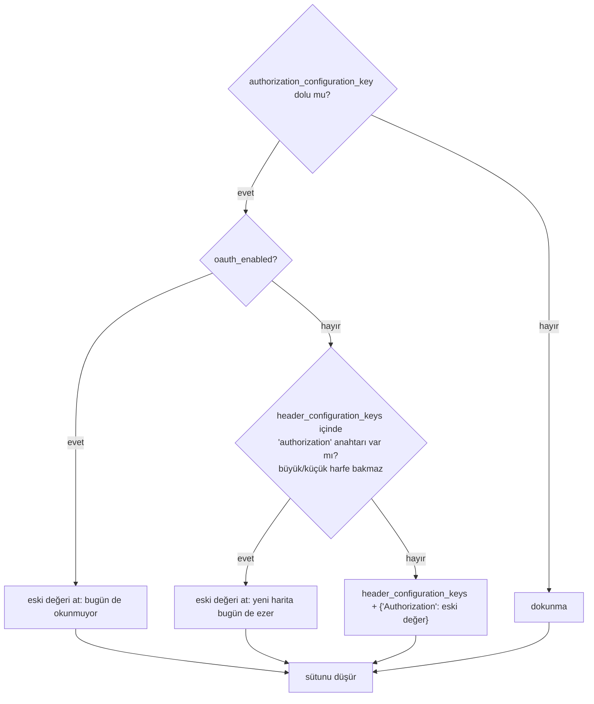

# Faz 218 — `AuthorizationConfigurationKey` Alanını Kaldırma

> **Durum:** ✅ Tamamlandı (2026-10-17)
> **Plan onayı:** kullanıcı "faza başla ve bitir, commit atabilirsin" dedi (2026-10-17). Dört Açık Soru ayrıca sorulmadı: planın önerileri (hepsi **A**) uygulandı — bkz. *Plandan Sapmalar* 1. Planlamada verilen kararlar (farukatasoy, 2026-10-17): eski alanı gönderen istek **`400` ile reddedilir** ve yerine geçen alanı adıyla söyler · veri **aynı migration'da taşınır ve sütun düşürülür** · iş freeze'den (`1.0.0-rc.1`) önce yapılır (UR-012 = A).
> **Kaynak:** [ADAYLAR.md](ADAYLAR.md) · **F-290**
> **Genellik:** MCP sunucusu kaydeden **her** tüketici: HTTP (`PUT /api/mcp-servers/{name}`), konsol formu ve kodla (`McpServerDefinition`) kayıt. İş tüketici kodunda kalamaz: alan, sütun ve form Tracon'dadır. İkinci kanıt: kaldırma 1.0'a duyuruldu (K-869, `CHANGELOG`, XML, `production.md`) ve UR-012 kırıcı kalemleri freeze'den önce ister.
> **Karşı görüş:** "`[Obsolete]` alan zararsızdır; kaldırmak veri taşıma ve kırıcı değişiklik getirir." Cevap: freeze'den sonra kaldırmak bir major ister. `[Obsolete]` üye 1.x boyunca donar ve iki yol, iki çakışma kuralı ve on bir `CS0618` bastırması kalıcı olur. Preview'da kaldırma kırıcı ama serbesttir; sürüm notunda adıyla yazılır.
> **Önkoşul:** Yok ([Faz 190](arsiv/fazlar/190-KIMLIK-BASLIKLARI-ANAHTAR-REFERANSI.md) `headerConfigurationKeys`'i ve `[Obsolete]`'u getirdi; kapandı)
> **Paketler:** `Tracon.Abstractions`, `.AspNetCore`, `.Mcp`, `.Sql.Shared` (kaynak paylaşımı), `.PostgreSql`, `.SqlServer`, `.Sqlite`, `.Testing.Contracts.Xunit`, `.Client` (üretilen), `.UI`, `@tracon/client` (üretilen)
> **Yeni paket:** Yok · **Migration:** gerekli — üç sağlayıcı; numara uygulama anında alınır (bugün son: PostgreSQL `0061`, SQL Server `0049`, SQLite `0048`)
> **Public API:** **küçülüyor** — iki public üye kalkar (`McpServerDefinition.AuthorizationConfigurationKey`, `McpServerRequest.AuthorizationConfigurationKey`); HTTP şemasından bir alan kalkar. `PublicAPI.Shipped.txt` boş: preview'da kırıcı değişiklik serbest, sürüm notunda adıyla (K-604 kapısı tipi görür)
> **Tüketici yüzeyi:** site: `guides/production.md` (`:404`, `:471-476` kaldırma paragrafı), `getting-started/security.md:229`, `reference/configuration.md:653`, MCP rehberi (`guides/external-agents.md` ya da MCP sayfası — uygulamada `grep -rn "authorizationConfigurationKey" docs-site/src/content/docs` ile), `http-api/` ve `api/` (üretilir), `reference/changelog` (üretilir)
> · sevk edilen: XML (`McpServerDefinition`, `McpServerRequest`), `src/Tracon.Mcp/README.md`, `CHANGELOG.md` `Removed`, `tracon.json` (OpenAPI), `Tracon.Client`, `@tracon/client`
> **Manuel test alanı:** `docs/manuel-test/18-MCP-VE-A2A.md` (`MT-MCP-086…`; mevcut `MT-MCP-005`, `012`, `048` yeniden yazılır)

---

## Bu Faza Başlarken

> `faz-baslangic` skill'ini uygula. Aşağıdaki liste o skill'in 2. adımıdır.

1. Bu doküman
2. Kararlar — yalnız bu kalemleri grep'le:
   ```bash
   grep -n "^| \*\*K-059 \|^| \*\*K-869 \|^| \*\*K-870 \|^| \*\*K-178 \|^| \*\*K-604 " docs/KARARLAR.md
   ```
   **K-059** (`secret` yazılmaz; kayıtta yalnız anahtarın adı) · **K-869** (alan `[Obsolete]`, `1.0.0`'da kalkar; iki alandan ya da OAuth ile `Authorization` `400`) · **K-870** (`PUT`'ta yok/`null` harita saklı değeri korur, `{}` temizler) · **K-178** (migration numaraları sağlayıcı başına bağımsız) · **K-604** (kırıcı değişiklik kapısı)
3. [`arsiv/fazlar/190-KIMLIK-BASLIKLARI-ANAHTAR-REFERANSI.md`](arsiv/fazlar/190-KIMLIK-BASLIKLARI-ANAHTAR-REFERANSI.md) — yalnız devir notu:
   ```bash
   awk '/## Sonraki Faza Devir Notu/,0' docs/arsiv/fazlar/190-KIMLIK-BASLIKLARI-ANAHTAR-REFERANSI.md
   ```
4. Alan hafızası: [`hafiza/sql-migration.md`](hafiza/sql-migration.md) (migration kuralları) · [`hafiza/sqlite.md`](hafiza/sqlite.md) (`DROP COLUMN`, `json_each` gölgeleme tuzağı) · [`hafiza/sql-server-tuzaklari.md`](hafiza/sql-server-tuzaklari.md) (`OPENJSON`) · [`hafiza/mcp-a2a-sunucu.md`](hafiza/mcp-a2a-sunucu.md) · [`hafiza/nswag-istemci-uretimi.md`](hafiza/nswag-istemci-uretimi.md) (istemci yeniden üretimi) · [`hafiza/frontend.md`](hafiza/frontend.md)
5. Emsal migration'lar (sütun düşürme): PostgreSQL `0043_job_handler_key.sql`, SQL Server `0030_job_handler_key.sql`, SQLite `0030_job_handler_key.sql`; JSON sütunu: PostgreSQL `0054_header_configuration_keys.sql` ve eşleri

---

## Amaç

Faz 190 MCP sunucusunun `Authorization` başlığını yeni `headerConfigurationKeys`
haritasına taşıdı ve eski `AuthorizationConfigurationKey` alanını `[Obsolete]`
yaptı. Bu faz eski alanı her katmandan kaldırır: saklı veri yeni haritaya
taşınır, sütun düşer, public üyeler ve HTTP alanı kalkar, form yeni alanı yazar.
Freeze'den sonra 1.x tek bir kimlik yolu taşır.

- **F-290** — veri taşıma + sütun düşürme (üç sağlayıcı) · public üye ve HTTP alanını kaldırma · eski alanı gönderen isteğe `400` · konsol formunun geçişi · istemcilerin, sözleşme paketinin ve belgelerin güncellenmesi.

### Bugün ne var — doğrulanmış kanıt

| Kanıt | Gözlem |
|---|---|
| [`McpServerDefinition.cs:82-83`](../src/Tracon.Abstractions/Mcp/McpServerDefinition.cs) | `[Obsolete(ObsoleteMessages.AuthorizationConfigurationKey)] public string? AuthorizationConfigurationKey` |
| [`GovernanceContracts.cs:48-49`](../src/Tracon.AspNetCore/Contracts/GovernanceContracts.cs) | `McpServerRequest` aynı alanı public taşır |
| `ObsoleteMessages.cs:24-28` (dosya bu fazda silindi) | `internal static class`; mesaj "removed in 1.0.0" der |
| [`GovernanceEndpoints.cs:310-312`](../src/Tracon.AspNetCore/Endpoints/GovernanceEndpoints.cs) · `:942-953` · `:1133-1140` | Kayıt alanı saklar; iki alanda `Authorization` → `400`; eski alan anahtar alanı kuralından geçer |
| [`McpHeaderBuilder.cs:53-56`](../src/Tracon.Mcp/Internal/McpHeaderBuilder.cs) · `:60-66` · `:182-215` | **Öncelik:** `HeaderConfigurationKeys` içindeki bir başlık eski değeri **her zaman** ezer (`headers.Remove(header)` → `:66`); OAuth açıkken eski alan hiç okunmaz (`:196-206`); iki alan da çalışma anında `keySpace.Require`'dan geçer (`:55`, `:214`) |
| [`McpConnection.cs:121-133`](../src/Tracon.Mcp/Internal/McpConnection.cs) | Bağlantı parmak izi eski alanı içerir; alan kalkınca her bağlantı yükseltmeden sonra **bir kez** yeniden kurulur |
| [`SqlApprovalAndMcpStores.cs:201-205`](../src/Tracon.Sql.Shared/Stores/SqlApprovalAndMcpStores.cs) · `:296-297` | Paylaşılan SQL deposu sütunu yazar ve okur (`GetNullableString(reader, 6)` — **okuma sırası sütun indeksine bağlıdır**) |
| `PostgresQueries.cs:1012-1024` · `SqlServerQueries.cs:1144-1174` · `SqliteQueries.cs:998` · `SqlQueriesBase.cs:1160` | Üç sağlayıcının sorgu metni sütunu anar |
| PostgreSQL `0002_observability.sql:119` · SQL Server `0001_initial.sql:390` · SQLite `0001_initial.sql:295` | Sütun tanımı (`text` / `nvarchar(200)` / `TEXT`); `header_configuration_keys` JSON (PostgreSQL `jsonb`, SQL Server `nvarchar` + `ISJSON`, SQLite `TEXT` + `json_valid`) |
| [`ToolApprovalRuleStoreContract.cs:289-290`](../src/Tracon.Testing.Contracts.Xunit/Contracts/ToolApprovalRuleStoreContract.cs) · `:353-354` | **Sevk edilen** sözleşme paketi eski alanı gidiş-dönüş sınar |
| [`mcp.tsx:41`](../src/Tracon.UI/frontend/src/screens/mcp.tsx) · `:65-66` · `:378-384` · `:425-427` | Form eski alanı yazar; OAuth açılınca temizler; özet eski alanı okur. Form yalnız **ekler** (`full-replace-editors.test.tsx` `CREATE_ONLY`) |
| `locales/{en,tr}/operations.ts` `mcp.authKey`, `mcp.authKeyHint` | Alanın etiketi ve ipucu |
| `git grep -n "pragma warning disable CS0618"` | 11 blok: 7 `src`, 2 sevk edilen sözleşme, 2 test |
| Testler | `GovernanceEndpointTests`, `EgressGuardTests:160`, `TenantScopedConfigurationKeyTests`, `CredentialHeaderSaveTests`, `McpHeaderBuilderTests:154`, `ConfigurationKeyGuardTests`, `AuditSecretFilterTests`, `ObsoleteMessagesTests`, `UsageAnalyzerTests:154,214` (`TRC0201` örneği alanı kullanır), `TemplateAgentsFileTests:602` |
| Site | `production.md:404`, `:471-476`; `security.md:229`; `configuration.md:653` |

> Kanıtlar 2026-10-17 tarihinde doğrulandı.

---

## 218.1 — Veri taşıma ve sütun düşürme (üç sağlayıcı)

Kural koddan türetilir ve **bugünkü çalışma anı davranışını birebir korur**
(`McpHeaderBuilder.cs:60-66`, `:196-206`). Her `mcp_servers` satırı için:



| Sağlayıcı | Birleştirme | Anahtar araması | Sütun düşürme |
|---|---|---|---|
| PostgreSQL | `header_configuration_keys \|\| jsonb_build_object('Authorization', authorization_configuration_key)` | `EXISTS (SELECT 1 FROM jsonb_object_keys(header_configuration_keys) k WHERE lower(k) = 'authorization')` | `ALTER TABLE … DROP COLUMN IF EXISTS` (emsal `0043`) |
| SQL Server | `JSON_MODIFY(header_configuration_keys, '$.Authorization', authorization_configuration_key)` | `EXISTS (SELECT 1 FROM OPENJSON(header_configuration_keys) WHERE LOWER([key]) = 'authorization')` | `IF COL_LENGTH(…) IS NOT NULL ALTER TABLE … DROP COLUMN` (emsal `0030`) |
| SQLite | `json_set(header_configuration_keys, '$.Authorization', authorization_configuration_key)` | `EXISTS (SELECT 1 FROM json_each(header_configuration_keys) WHERE lower(key) = 'authorization')` | `ALTER TABLE … DROP COLUMN` (3.35+, emsal `0030`) |

- 🚨 SQLite `json_each`'in kendi sütunları (`key`, `value`, `id`) dış tabloyu gölgeler (`hafiza/sqlite.md`); alias'la yaz.
- Anahtar alanı kuralı değişmez: taşınan değer çalışma anında `keySpace.Require`'dan yine geçer (`:55`), yani taşıma güvenliği gevşetmez. Kurala aykırı eski bir satır bugün bağlantıda istisna verir; taşındıktan sonra da aynısını verir.
- Sütun **aynı migration'da** düşer (planlamada karar). Geri dönüş yoktur: migration'dan sonra `preview.4`'e dönen bir uygulama bu tabloyu okuyamaz. Sürüm notunda yazılır.
- Paylaşılan SQL okuyucusu sütunu **sıra indeksiyle** okur (`GetNullableString(reader, 6)`); sütun kalkınca sonraki indeksler kayar. Üç sağlayıcının `SELECT` listesi ve okuyucu birlikte değişir.

## 218.2 — Public üyeleri ve HTTP alanını kaldırma

- `McpServerDefinition.AuthorizationConfigurationKey` ve `McpServerRequest.AuthorizationConfigurationKey` kalkar; `ObsoleteMessages.AuthorizationConfigurationKey` sabiti kalkar (sınıf `internal`).
- `McpHeaderBuilder.AddLegacyAuthorization`, `McpConnection.ComputeFingerprint`'teki eski parça, `GovernanceEndpoints`'teki üç eski dal ve SQL deposunun iki satırı kalkar. 11 `CS0618` bastırmasının hepsi kalkar (`git grep -n "pragma warning disable CS0618"` → 0 hedeflenir; başka bir `[Obsolete]` üye kalırsa sayı onu gösterir).
- Sevk edilen `ToolApprovalRuleStoreContract`'ın iki eski case'i kalkar; `Authorization`'ı `headerConfigurationKeys` ile gidiş-dönüş sınayan case kalır (yoksa eklenir).
- `UsageAnalyzerTests` `TRC0201` örneği başka bir `*ConfigurationKey` üyesine geçer (analizör genel üye adına bakar; davranış değişmez — uygulamada ölçülür).
- OpenAPI (`tracon.json`), `Tracon.Client` ve `@tracon/client` yeniden üretilir; kırılma `CHANGELOG [Unreleased]` → `Removed` (tip adlarıyla; K-604 kapısı).

## 218.3 — Eski alanı gönderen istek `400` alır

System.Text.Json bilinmeyen alanı varsayılan olarak sessizce atar; eski bir
istemcinin kimlik başlığı böylece kaybolur ve MCP çağrısı `401` alır.
Planlamada karar: `PUT /api/mcp-servers/{name}` gövdesi
`authorizationConfigurationKey` taşırsa (değeri boş olsa da) `400` döner:

```
title: "Removed field"
detail: "'authorizationConfigurationKey' was removed in 1.0. Use headerConfigurationKeys[\"Authorization\"]."
```

Uygulama yolu Açık Soru 1'dedir. Kural yalnız bu alan içindir; başka bilinmeyen
alanlar bugünkü gibi yok sayılır.

## 218.4 — Konsol formu

- Form `authorizationConfigurationKey` yerine `headerConfigurationKeys: { Authorization: <anahtar> }` gönderir; alan boşsa haritayı **hiç göndermez** (K-870: yok → saklı değer korunur).
- OAuth açılınca form bu girdiyi temizler (bugünkü `:425-427` davranışı).
- `credentialSummary` yalnız haritayı okur.
- Etiket ve ipucu (`mcp.authKey`, `mcp.authKeyHint`) korunur; `en.ts` ve `tr.ts` değişmezse çeviri işi yoktur.
- Arayüz payı: değişiklik birkaç satırdır; bundle gzip KB **ölçülmeli** (bütçe 250 KB).

## 218.5 — Belgeler

- `production.md:471-476` "deprecated" paragrafı "removed in this release" anlatısına döner. `:404` ve `security.md:229` tablolarından eski alan çıkar. `configuration.md:653` cümlesi düzelir.
- `src/Tracon.Mcp/README.md` ve XML; `CHANGELOG` `Removed` + "Upgrading" bölümüne migration notu ve "sütun düşer, geri dönüş yok" cümlesi.
- MIMARI veya hafıza: yalnız davranış değişirse.

---

## Planlanan Public API

> Kalkan üyeler. Eklenen public üye yok.

```csharp
// Tracon.Abstractions — kalkar
public string? McpServerDefinition.AuthorizationConfigurationKey { get; init; }

// Tracon.AspNetCore — kalkar
public string? McpServerRequest.AuthorizationConfigurationKey { get; init; }
```

### HTTP `endpoint`'leri

| Metot | Yol | Değişiklik |
|---|---|---|
| `PUT` | `/api/mcp-servers/{name}` | İstek şemasından `authorizationConfigurationKey` kalkar; alanı taşıyan gövde `400` |
| `GET` | `/api/mcp-servers` · `/{name}` | Yanıt şemasından alan kalkar |

### Arayüz payı

`mcp.tsx` birkaç satır; ölçülmeli.

---

## Planlanan Dosya Listesi

```
src/Tracon.Abstractions/Mcp/McpServerDefinition.cs · ObsoleteMessages.cs · PublicAPI.Unshipped.txt
src/Tracon.AspNetCore/Contracts/GovernanceContracts.cs · Endpoints/GovernanceEndpoints.cs · PublicAPI.Unshipped.txt · tracon.json (üretilen)
src/Tracon.Mcp/Internal/McpHeaderBuilder.cs · Internal/McpConnection.cs · README.md
src/Tracon.Sql.Shared/Stores/SqlApprovalAndMcpStores.cs · Internal/SqlQueriesBase.cs
src/Tracon.PostgreSql/Internal/PostgresQueries.cs · Migrations/00NN_remove_authorization_configuration_key.sql
src/Tracon.SqlServer/Internal/SqlServerQueries.cs · Migrations/00NN_remove_authorization_configuration_key.sql
src/Tracon.Sqlite/Internal/SqliteQueries.cs · Migrations/00NN_remove_authorization_configuration_key.sql
src/Tracon.Testing.Contracts.Xunit/Contracts/ToolApprovalRuleStoreContract.cs
src/Tracon.Client/Generated/* (üretilen) · src/Tracon.UI/frontend/src/screens/mcp.tsx · @tracon/client schema (üretilen)
tests/… (aşağıdaki tablo) · docs-site/… · CHANGELOG.md · docs/manuel-test/18-MCP-VE-A2A.md
```

---

## Hata Modları ve Testler

| Ne bozulabilir | Seviye | Test |
|---|---|---|
| Eski değer yeni haritaya taşınmaz (bağlantı kimliksiz kalır) | Depo — üç sağlayıcı | migration testi: eski şemaya satır yaz, migration'ı koş, `HeaderConfigurationKeys["Authorization"]` = eski değer (her sağlayıcının entegrasyon projesi; emsal: migration testleri `hafiza/sql-migration.md`) |
| Yeni haritada `authorization` (her harf biçimi) varken eski değer üstüne yazılır | Depo — üç sağlayıcı | aynı test, `"authorization"` ve `"AUTHORIZATION"` case'leri: harita değişmez |
| OAuth açık satırda eski değer taşınır (bugün okunmuyordu, taşınınca da gönderilmez ama kayıt `400` kuralına aykırı olur) | Depo — üç sağlayıcı | OAuth case'i: harita değişmez |
| Haritadaki başka anahtarlar kaybolur | Depo — üç sağlayıcı | iki başlıklı harita + eski değer → üç anahtar |
| Boş/`NULL` eski değer haritaya boş `Authorization` ekler | Depo — üç sağlayıcı | `''` ve `NULL` case'leri: harita değişmez |
| Okuyucu sütun indeksi kayar, başka alan yanlış okunur | Sözleşme | `ToolApprovalRuleStoreContract` (MCP sunucu gidiş-dönüşü, bütün alanlar) — dört koşumda |
| Eski alanı gönderen istek sessizce kabul edilir | Fonksiyonel (HTTP) | `GovernanceEndpointTests`: gövdede alan → `400`, mesaj yerine geçeni adıyla söyler; değer `""` iken de `400`; alan yoksa kayıt çalışır |
| Başka bilinmeyen alan da reddedilmeye başlar | Fonksiyonel (HTTP) | gövdede rastgele bilinmeyen alan → `200` (bugünkü davranış) |
| Taşınan anahtar başka kiracının anahtar alanına kayar | Fonksiyonel | `TenantScopedConfigurationKeyTests`: taşınmış satır çalışma anında aynı `keySpace` kuralından geçer |
| Bağlantı parmak izi değişince bağlantı her istekte yeniden kurulur | Birim | `McpConnection` parmak izi kararlı (aynı tanım → aynı iz) |
| Form yeni alanı göndermez ya da boşken `{}` gönderip saklı başlıkları siler | Arayüz (Vitest) + E2E | `mcp.tsx` testi: dolu → `headerConfigurationKeys.Authorization`, boş → alan yok; `McpTests` E2E kayıt akışı |
| OpenAPI/istemci eski alanı taşır | Sözleşme | `OpenApiSnapshotTests` + istemci üretim kapısı |
| `secret` (anahtar adı değil değer) bir yere sızar | Birim | `AuditSecretFilterTests` güncellenir; yeni değer sızıntısı yok |
| Paketlenmiş tüketicide sözleşme kırılır | Paket | `kapi.py yayin --kuru` (sevk edilen sözleşme değişti — `faz-tamamlama` Adım 1 kuralı) |

Beş soru: iptal (migration transaction içinde; yarıda kalan migration journal'a yazılmaz) · eşzamanlılık (göç kilidi, mevcut) · boş/aşırı girdi (`''`, `NULL`, 200 karakter `nvarchar(200)`) · başka kiracı (satır kendi kiracısında taşınır; kiracılar arası birleştirme yok) · alt sistem hatası (migration düşerse uygulama açılmaz; bugünkü davranış).

---

## Manuel Kabul Case'leri

| # | Ön koşul | Adımlar | Beklenen sonuç |
|---|---|---|---|
| `MT-MCP-086` | Faz 217 sürümüyle (`preview.4` şeması) eski alanlı bir MCP sunucusu kayıtlı (SQLite, PostgreSQL) | Yeni sürümle başlat (migration koşar), `GET /api/mcp-servers/{ad}` | `headerConfigurationKeys.Authorization` eski anahtar adı; `authorizationConfigurationKey` yanıtta yok; MCP aracı çalışır |
| `MT-MCP-087` | Aynı | Haritasında zaten `authorization` olan bir satır | Harita değişmez; eski değer atılır |
| `MT-MCP-088` | Örnek uygulama | `PUT /api/mcp-servers/x` gövdesinde `authorizationConfigurationKey` | `400`, `detail` yerine geçeni adıyla söyler |
| `MT-MCP-089` 👤 | Konsol | MCP formunda anahtar adı girip kaydet; sonra OAuth'u açıp kapat | Kayıt `headerConfigurationKeys.Authorization` taşır; OAuth açılınca alan temizlenir |
| `MT-MCP-005`, `012`, `048` | — | Yeniden yazılır: eski alan yerine `headerConfigurationKeys["Authorization"]` | Aynı davranış, yeni alanla |

---

## Açık Sorular

| # | Soru | Seçenekler | Öneri |
|---|---|---|---|
| 1 | `400` kuralı nasıl uygulanır? | A: `PUT` uç filtresi gövdeyi tamponlar ve yalnız bu alan adını arar · B: `McpServerRequest` üzerinde `[JsonExtensionData]` ile bilinmeyen alanları toplayıp adı kontrol etmek · C: `[JsonUnmappedMemberHandling(Disallow)]` | **A.** B OpenAPI şemasına `additionalProperties` ekleyebilir (ölçülmeli); C her bilinmeyen alanı reddeder, karar bunu istemedi |
| 2 | Kural ne kadar yaşar? | A: kalıcı (1.x boyunca) · B: bir sürüm sonra kalkar | **A.** Eski istemci 1.x boyunca sessiz kimlik kaybı yaşamasın; bedel tek bir filtre |
| 3 | Taşıma, sağlayıcının eski kayıtlarında anahtar alanı kuralına aykırı bir değeri de taşısın mı? | A: taşı (çalışma anı bugünkü gibi reddeder) · B: taşıma, at ve uyar | **A.** Bugünkü davranışı korur; atmak sessiz veri kaybıdır |
| 4 | `TRC0201` analizör örneği hangi üyeye geçsin? | A: `OAuthClientSecretConfigurationKey` · B: `HeaderConfigurationKeys` sözlüğü (zaten ayrı testte) | **A** — tekil üye case'i kalır |

---

## Bitiş Ölçütleri (DoD)

- [x] `git grep -n "AuthorizationConfigurationKey\|authorization_configuration_key\|authorizationConfigurationKey" -- src tests samples`: yalnız eski (`0001`, `0002`) ve yeni migration dosyaları, üç migration testi, `400` kuralının metni (`GovernanceEndpoints`, `RemovedFieldFilter`), `CredentialHeaderSaveTests` `400` case'leri, `mcp.test.tsx` yokluk iddiası, `Tracon.Mcp/README.md` ve üretilen istemcinin PUT açıklaması. `samples/` boş.
- [x] Üç sağlayıcının migration testi (`RemoveAuthorizationConfigurationKeyMigrationTests`): taşıma, `authorization`/`AUTHORIZATION` çakışması, OAuth, boş/`NULL`, başka anahtarlar korunur, kaçışlı değer, başka kiracı — gerçek PostgreSQL ve SQL Server (Testcontainers) ve SQLite'a karşı yeşil. SQLite'ta migration bozulunca (OAuth koşulu silinip anahtar eşlemesi bozuldu) test kırıldı (mutasyon kanıtı).
- [x] `McpServerStoreContract` dört koşumda yeşil: bellek içi, SQLite, PostgreSQL, SQL Server (14/14). Denetim 🟡1 sonrası yan yana iki `bool`un konumunu değiştiren mutasyon sözleşme testini kırdı.
- [x] `PUT` eski alanla `400` (mesaj `headerConfigurationKeys["Authorization"]`'ı anar); bilinmeyen başka alan `200`; yetkisiz anahtar `403` (kural yetkiden sonra).
- [x] `git grep -n "pragma warning disable CS0618" -- src tests samples` → **0**; `git grep "\[Obsolete" -- src` boş.
- [x] OpenAPI, `Tracon.Client` (`TraconApiClient.g.cs`) ve `@tracon/client` (`schema.ts`) yeniden üretildi; `CHANGELOG [Unreleased]` `Removed` + "Upgrading from 1.0.0-preview.4" (sütun düşer, geri dönüş yok).
- [x] Konsol formu yeni alanı yazar; Vitest (`mcp.test.tsx` 5 case + round-trip envanteri) ve E2E (`McpTests`) yeşil. **Bundle: 215,4 KB gzip** (bütçe 250 KB; `kapi.py kapanis` derlemesinde ölçüldü, `postbuild` zorlar).
- [x] Dört doğrulama kapısı sıfır uyarı: `kapi.py kapanis` (aşağıda).
- [x] `kapi.py yayin --kuru` (sevk edilen sözleşme değişti; aşağıda).
- [x] `samples/Tracon.Api` ile gerçek `run`: eski şemadan yükseltilmiş SQLite veritabanında MCP aracı çağrısı — *Örnek Uygulama Koşumu*.
- [x] `secret` taraması boş: `kapi.py tarama` temiz; veritabanı dökümünde ve günlüklerde `Bearer` değeri 0 kez.
- [x] Manuel kabul case'leri eklendi (`MT-MCP-086`…`089`; `005`, `007`, `012`, `048`, `056`, `057`, `073` yeniden yazıldı); `086`…`088` koşuldu.
- [x] `faz-denetim` koşuldu; 🔴 yok (*Denetim Bulguları*).
- [x] `docs-site/` güncellendi; `npm run check` (içerik · derleme · bağlantı · ağırlık) temiz. `guides/production` 58.639 B (tavan 59.000 B): payı 361 B — bir sonraki ekleme tavana çarpar.
- [x] `en.ts` ve `tr.ts` eksiksiz: etiket ve ipucu (`mcp.authKey`, `mcp.authKeyHint`) metni değişmedi.

### Doğrulama komutları

```bash
# eski alan kaldı mı
git grep -n "AuthorizationConfigurationKey\|authorization_configuration_key\|authorizationConfigurationKey" -- src tests samples

# eski alanla kayıt
curl -s -o /dev/null -w "%{http_code}\n" -X PUT "$APU/api/mcp-servers/x" -H "$APB" \
  -H "content-type: application/json" \
  -d '{"endpoint":"https://example.test/mcp","transport":"StreamableHttp","authorizationConfigurationKey":"Tracon:McpSecrets:X"}'
```

---

## Riskler

| Risk | Önlem |
|------|-------|
| Sütun düşer; geri dönüş yok | Sürüm notu ve "Upgrading" bölümü; manuel `MT-MCP-086` eski şemadan yükseltir |
| Okuyucu indeks kayması başka alanı bozar | Sözleşme testi bütün alanları gidiş-dönüş sınar; üç sağlayıcıda |
| Üçüncü taraf `IMcpServerStore` eski alanı okuyordu | Derleme hatası (alan kalktı); `CHANGELOG` `Removed`'da tip ve üye adıyla |
| Yükseltmeden sonra her MCP bağlantısı bir kez yeniden kurulur (parmak izi değişir) | Beklenen; sürüm notunda bir cümle |
| SQL Server `JSON_MODIFY` büyük/küçük harf ayrımı yapan JSON yolunda mevcut `"authorization"` anahtarını görmeyip ikinci bir anahtar ekler | Anahtar araması `OPENJSON` + `LOWER([key])` ile yapılır ve birleştirme yalnız anahtar yoksa koşar (tablo) |

---

<!-- ============================================================
     AŞAĞISI KAPANIŞTA DOLDURULUR — `faz-tamamlama` skill'i.
     Plan anında boş kalır. Başlıkları SİLME.
     ============================================================ -->

## Plandan Sapmalar

1. **Dört Açık Soru ayrıca sorulmadı.** Kullanıcı "faza başla ve bitir, commit atabilirsin" dedi; planın önerileri uygulandı: (1) **A** — `PUT` uç filtresi; (2) **A** — kural 1.x boyunca kalıcı; (3) **A** — kurala aykırı eski değer de taşınır; (4) **A** — `TRC0201` örneği `OAuthClientSecretConfigurationKey`'e geçti. 2 ve 3 geri alması pahalı kararlardır ve K-1022 / K-1023'e yazıldı; itiraz varsa yeniden açılır.
2. **Filtre genel bir parçadır, tek alana kilitli değil.** `RemovedFieldFilter(alan, yerine geçen)` iki parametre alır ve `Internal/` altındadır; kuralın kapsamı yine yalnız `authorizationConfigurationKey`'tir (tek takım yeri `GovernanceEndpoints`). Gövde zaten `RequestBodyBinding` ile elle okunduğu için filtre `EnableBuffering` + üst düzey ad taraması + başa sarma yapar; JSON olmayan gövde olduğu gibi geçer.
3. **`ObsoleteMessages.cs` dosyası silindi** (plan: "sabit kalkar, sınıf `internal`"). Sabit son üyeydi; boş bir sınıf bırakmak ölü koddu. `ObsoleteMessagesTests`'in birinci testi (`DiagnosticId` yasağı) kaldı; ikincisi (alanın mesajını ve `UrlFormat` yokluğunu sabitleyen) alanla birlikte gitti. Ders `hafiza/analyzer-tanilari.md`'de güncellendi.
4. **Sevk edilen sözleşmeye bir case eklendi** (`McpServerStoreContract.Every_field_of_a_server_survives_a_round_trip`; `PublicAPI.Unshipped.txt` satırı). Plan "Authorization'ı haritayla gidiş-dönüş sınayan case kalır (yoksa eklenir)" diyordu; `Saved_server_is_read_back` bunu üstlendi ve ek olarak **sütun sırası kaymasını** (plan, hata modları tablosu satır 7) yakalayan, her alanı farklı değerle dolduran bir case yazıldı. Üçüncü taraf `IMcpServerStore` yazarı için yeni bir koşuldur: `CHANGELOG`'da adıyla.
5. **Migration numaraları:** PostgreSQL `0062`, SQL Server `0050`, SQLite `0049`. SQL Server dosyası `COL_LENGTH` korumalı `EXEC` ile koşar (K-475 sınıfı) ve dosya yeniden koşulabilir; PostgreSQL ve SQLite tek işlemde atomiktir ve yeniden koşulabilir değildir (emsal `0043`/`0030` ile aynı).
6. **Taşıma kuralı bağlantı koduyla bir uç durumda ayrışır.** Eski `McpHeaderBuilder`, anahtarı çözemezse (boş değer) düz `Authorization` başlığını **bırakırdı**; haritadaki girdi artık düz başlığı her zaman siler (`headers.Remove`). Yani: eski anahtar adı dolu + yapılandırmada değeri yok + saklı düz `headers`'ta `Authorization` — bu üçlü satırda göçten sonra düz başlık gönderilmez. Düz `Authorization` zaten Faz 190'dan beri kaydedilemez (`400`); satır ancak Faz 190 öncesinden kalmış olabilir. Ölçülmedi, kod okumasıdır; kabul edildi ve burada kayıtlı.
7. **Sentetik ek testler (planda sayılmayan):** `McpHeaderBuilderTests.A_keyed_authorization_is_resolved_like_any_other_credential_header` ve `The_fingerprint_is_stable_for_the_same_definition`; `mcp.test.tsx` (üç case); `McpTests` E2E anahtarı doldurur ve listede okur.
8. **Tüketici yüzeyi envanteri (`tuketici-dokuman-senkronu`).** (1) `docs-site/` elle yazılan: `guides/production.md` ("Upgrading: credential headers" — kaldırma, göç, geri dönüşsüzlük, `400`), `getting-started/security.md` ve `reference/configuration.md` (alan tabloları), `ui.md` (MCP formu), `concepts/tools.md` (koruma 4), `getting-started/persistence.md` (tek yönlü migration uyarısı). Üretilenler (`api/`, `http-api/`, `reference/changelog`) koddan ve `CHANGELOG`'dan gelir. (2) Sevk edilen metin: `McpServerDefinition`/`McpServerRequest` `///`, `TraconMcpSecurityOptions` `///`, `src/Tracon.Mcp/README.md`, `tracon.json`, `GovernanceEndpoints` açıklamaları, `Tracon.Client` ve `@tracon/client` yeniden üretildi. (3) `capabilities.md`: yeni yetenek ya da paket yok, değişiklik yok. `packages.md`: `Tracon.Mcp` satırı paketi anlatır ve değişmedi; tetikleyen `src/Tracon.Mcp/README.md` değişikliği kaldırılan alanın tek cümlesidir — gerekçe bu, `--site-gerekce-yazildi` yalnız bu kural için kullanıldı.
9. **Denetim sonrası eklenenler (planda yoktu).** (a) Konsol formu, **aynı adla** kaydedilen bir sunucunun saklı `headerConfigurationKeys` girdilerini taşır (`buildServerRequest(form, existing)`): sunucu dolu haritayı tam değiştirir ve form ada göre kaydeder; yalnız `Authorization` gönderilseydi `X-Api-Key` gibi başka kimlik başlıkları sessizce silinir ve sonraki çağrı `401` alırdı (denetim 🟡2). Başka harf biçimindeki `authorization` girdisi çıkarılır (sunucu ikisini yinelenmiş sayıp `400` verirdi). `CREATE_ONLY` gerekçesi buna göre yazıldı. (b) `Every_field_of_a_server_survives_a_round_trip` yan yana iki `bool`u (`Enabled`, `RequiresApproval`) farklı değerle doldurur (denetim 🟡1: ikisi `false` iken konum değişimi geçerdi). (c) `The_removed_field_does_not_pre_empt_the_scope_check`: kapsamı olmayan anahtar `403` alır (denetim 🟢2).
10. **Yükseltme koşumu iki derlemeyle yapıldı** (eski sürüm `git worktree`, aynı SQLite dosyası). Sahte bir MCP sunucusu ve sahte bir OpenAI uyumlu sunucu elle yazıldı; repoda değiller (*Örnek Uygulama Koşumu*).

## Bu Fazda Verilen Kararlar

- **K-1022** — `AuthorizationConfigurationKey` kalktı; `PUT /api/mcp-servers/{name}` eski alanı `400` (`Removed field`) ile reddeder, kural 1.x boyunca kalır *(kullanıcı kararı: `400`; kalıcılık planın önerisi)*.
- **K-1023** — Migration anahtar adını `Authorization` haritasına taşır ve sütunu aynı migration'da düşürür; geri dönüş yoktur *(kullanıcı kararı)*.
- K-869'un yeniden-açılma hücresi "Yapıldı" oldu.
- Kategori dışı (yalnız burada): `RemovedFieldFilter` ikinci bir kaldırılan alan için hazır parçadır ama yeni bir "kaldırılan alan" politikası değildir; konsol formu alanı `authorizationKey` adıyla **form-only** tutar ve istekte `buildServerRequest` ile dönüştürür.

## Gerçekleşen Public API

> Yalnız kalanlar ve eklenenler; kalkan üyeler *Planlanan Public API*'dedir ve `PublicAPI.Unshipped.txt`'ten silindi.

```csharp
// Tracon.Abstractions — kalktı
// public string? McpServerDefinition.AuthorizationConfigurationKey { get; init; }

// Tracon.AspNetCore — kalktı
// public string? McpServerRequest.AuthorizationConfigurationKey { get; init; }

// Tracon.Testing.Contracts.Xunit — eklendi (sevk edilen sözleşme)
public Task McpServerStoreContract.Every_field_of_a_server_survives_a_round_trip();
```

HTTP: `PUT /api/mcp-servers/{name}` istek şemasından, `GET /api/mcp-servers` yanıt şemasından `authorizationConfigurationKey` kalktı. Yeni davranış: eski alanı taşıyan gövde `400`. `Tracon.Client` ve `@tracon/client` yeniden üretildi (dört satır ekleme / yirmi altı silme `TraconApiClient.g.cs`, yirmi altı satırlık `schema.ts`).

## Dosya Listesi (gerçekleşen)

```
src/Tracon.Abstractions/Mcp/McpServerDefinition.cs · ObsoleteMessages.cs (SİLİNDİ) · Options/TraconMcpSecurityOptions.cs (doc) · PublicAPI.Unshipped.txt
src/Tracon.AspNetCore/Contracts/GovernanceContracts.cs · Endpoints/GovernanceEndpoints.cs · Internal/RemovedFieldFilter.cs (YENİ) · PublicAPI.Unshipped.txt
src/Tracon.Core/Audit/AuditSecretFilter.cs (doc)
src/Tracon.Mcp/Internal/McpHeaderBuilder.cs · Internal/McpConnection.cs · README.md
src/Tracon.Sql.Shared/Stores/SqlApprovalAndMcpStores.cs · Internal/SqlQueriesBase.cs
src/Tracon.PostgreSql/Internal/PostgresQueries.cs · Migrations/0062_remove_authorization_configuration_key.sql (YENİ)
src/Tracon.SqlServer/Internal/SqlServerQueries.cs · Migrations/0050_remove_authorization_configuration_key.sql (YENİ)
src/Tracon.Sqlite/Internal/SqliteQueries.cs · Migrations/0049_remove_authorization_configuration_key.sql (YENİ)
src/Tracon.Testing.Contracts.Xunit/Contracts/ToolApprovalRuleStoreContract.cs · PublicAPI.Unshipped.txt
src/Tracon.Client/Generated/TraconApiClient.g.cs · packages/tracon-client/src/schema.ts · docs/openapi/tracon.json
src/Tracon.UI/frontend/src/screens/mcp.tsx · mcp.test.tsx (YENİ)
tests/Tracon.AspNetCore.FunctionalTests/{CredentialHeaderSave,EgressGuard,GovernanceEndpoint,TenantScopedConfigurationKey}Tests.cs
tests/Tracon.Core.UnitTests/{Architecture/ObsoleteMessagesTests,Audit/AuditSecretFilterTests,Egress/ConfigurationKeyGuardTests}.cs
tests/Tracon.Generators.UnitTests/UsageAnalyzerTests.cs · tests/Tracon.Package.Tests/TemplateAgentsFileTests.cs · tests/Tracon.Mcp.UnitTests/McpHeaderBuilderTests.cs
tests/Tracon.{PostgreSql,SqlServer,Sqlite}.IntegrationTests/RemoveAuthorizationConfigurationKeyMigrationTests.cs (YENİ ×3)
tests/Tracon.Sql.Shared.UnitTests/Baselines/sql-text-baseline.{postgres,sqlite,sqlserver}.txt · tests/Tracon.Ui.E2ETests/Ui/McpTests.cs
scripts/applied-migrations.json · CHANGELOG.md
docs-site/src/content/docs/{guides/production,getting-started/security,reference/configuration}.md · docs-site/public/{llms-full.txt,screenshots/.ui-source.sha256}
docs/manuel-test/{18-MCP-VE-A2A,13-KIRACI-VE-GUVENLIK,29-AGENT-DESTEGI,00-INDEKS}.md · docs/KARARLAR.md · docs/hafiza/{analyzer-tanilari,mcp-a2a-sunucu,sql-migration}.md
```

## Örnek Uygulama Koşumu

`samples/Tracon.Api`, `ASPNETCORE_ENVIRONMENT=Production` (`user-secrets` yüklenmez), SQLite, 2026-10-17. Eski sürüm `git worktree` ile derlendi (`41314feb`); aynı `.db` dosyası yeni derlemeyle açıldı. `Authorization` başlığını `Bearer <değer>` ile eşleşmeyen her isteğe `401` yapan elle yazılmış bir MCP sunucusu ve araç çağrısı yapan sahte bir OpenAI uyumlu sunucu kullanıldı; ikisi de repoda değildir.

| Adım | Gerçek çıktı |
|---|---|
| Eski derleme: `PUT /api/mcp-servers/stub-218` gövdesi `authorizationConfigurationKey: "Tracon:McpSecrets:Stub"` | `HTTP 200`; yanıt `"authorizationConfigurationKey":"Tracon:McpSecrets:Stub"`; `refresh` → `{"toolCount":1}` (anahtar bağlantıda çözüldü) |
| `sqlite3` ile eski şemaya iki satır: `map-wins` (haritada `authorization`) ve `oauth-row` (`oauth_enabled = 1`) | ledger `48` |
| Yeni derleme aynı dosyayla açıldı | günlük `Tracon applied 1 migration(s)`; ledger `49 \| 0049_remove_authorization_configuration_key`; `pragma_table_info` `authorization_configuration_key` yok |
| `GET /api/mcp-servers` | `map-wins {"authorization": "Tracon:McpSecrets:MapWins"}` · `oauth-row {}` · `stub-218 {"Authorization": "Tracon:McpSecrets:Stub"}`; üçünde de `authorizationConfigurationKey` yok |
| `POST /api/mcp-servers/refresh` | `{"toolCount":2}`; araçlar `map-wins_whoami`, `stub-218_whoami`; yakalayıcı `tools/list authorization=present match=True` ×2 |
| Agent `auth-probe-218` (`toolNames: ["stub-218_whoami"]`) `POST /api/agents/auth-probe-218/run` | olay akışında `functionCall stub-218_whoami` → `functionResult` **`Authorization seen: Bearer stub-218-value`**; yakalayıcı günlüğü `tools/call authorization=present match=True` |
| `PUT /api/mcp-servers/x` + `authorizationConfigurationKey` | `HTTP 400`, `title` `Removed field`, `detail` `'authorizationConfigurationKey' was removed in 1.0. Use headerConfigurationKeys["Authorization"].` |
| Aynı alan boş değerle · başka bilinmeyen alan · yeni alanla kayıt · belirteçsiz aynı istek | `400` · `200` · `200` (yanıtta `headerConfigurationKeys`) · `401` |
| `secret` taraması | `sqlite3 .dump` içinde `stub-218-value` **0** kez; iki uygulama günlüğünde **0** kez (K-059) |

## Süreç Ölçümü

| Metrik | Değer |
|---|---|
| Plan revizyonu sayısı | 0 (onaydan sonra plan yeniden yazılmadı; sapmalar *Plandan Sapmalar*'da) |
| Düzeltme turu sayısı | 3 (iç döngü: ilk derlemede analizör hataları `RS0016` · `MA0002` · `CA2012` ve paylaşılan tipi boş bırakan testler; tam test koşumunda sevk edilen metindeki 🚨; denetim sonrası kod turu) |
| 🔴 bulgu: gerçek / gürültü / araştırılacak | 0 / 0 / 0 (🟡 4, 🟢 2) |
| Fazın ürettiği regresyon | 2, ikisi de faz içinde yakalandı: form aynı adlı sunucunun diğer kimlik başlıklarını siliyordu (denetim 🟡2) ve sevk edilen `///` metnine 🚨 girmişti (`ShippedDocumentationSelfContainmentTests` kırmızı) |
| Faz kapandıktan sonra bulunan kusur | ölçülmedi (kapanış anı) |

## Denetim Bulguları

Bağımsız denetçi (`faz-denetcisi`, salt-okunur; 13 dk, 76 araç çağrısı) **🔴 vermedi**; dört 🟡 ve iki 🟢 üretti. Triyaj (yalnız 🔴'lara uygulanır) gerekmedi.

| # | Bulgu | Seviye | Sonuç |
|---|---|---|---|
| 1 | Yeni sözleşme testinde `Enabled` ve `RequiresApproval` ikisi `false`; okuyucuda konumları değişse test geçerdi | 🟡 | düzeltildi (`Enabled = true`); mutasyon (konum değişimi) testi kırdı |
| 2 | Form dolu anahtarla yalnız `{Authorization}` gönderiyor; sunucu haritayı tam değiştirir, aynı adlı sunucunun `X-Api-Key` girdisi silinir | 🟡 | düzeltildi (form saklı haritayı taşır; 2 Vitest case'i; `MT-MCP-089` adım 4; `CREATE_ONLY` metni) |
| 3 | Plan dışı iki sapma (sevk edilen sözleşmeye case, `ObsoleteMessages` sınıfının tümü) ile yeni dosya faz dokümanında yok | 🟡 | zaten yazılıydı (*Plandan Sapmalar* 2, 3, 4 ve *Dosya Listesi*); denetçi bölümü doldurulurken okudu |
| 4 | Üretilen `KARARLAR-INDEKS.md`, `KARARLAR-INDEKS-ARSIV.md`, `YOL-HARITASI.md` bayat | 🟡 | düzeltildi (`dokuman-bakim.py` bu kapanışta) |
| 5 | `RemovedFieldFilter` gövdeyi UTF-8 ve varsayılan `JsonDocument` ayarlarıyla okur; `charset=utf-16` ya da özel `JsonOptions`'ta alan yine düşebilir (ölçülmedi) | 🟢 | F-577 |
| 6 | "Filtre yetkiden sonra koşar" iddiasının testi yok; hafıza notu "ara katman" diyordu (gerçekte grup düzeyindeki `TraconEndpointFilter`) | 🟢 | düzeltildi (`The_removed_field_does_not_pre_empt_the_scope_check`; hafıza sözcüğü) |

Denetçi `kapi.py yayin --kuru`'yu çalıştırmadı (tam test koşumuyla çakışma riski); kanıtı bu kapanışta ana oturum üretti.

## Sonraki Faza Devir Notu

**Sıradaki iş:** F-559 (1.x evrim kuralları ve kapıları, freeze sırası 5) — henüz faz dokümanı yok; `faz-planlama` ile plana dönüşür ([`ADAYLAR.md`](ADAYLAR.md)). F-560 upstream MAF GA'sına bağlıdır (UR-013). `docs/193-NET8-NET9-DUSURME.md` 2026-11-10 sonrasını bekler. **Site yayını bakımcı onayı bekler** (`scripts/site-deploy.sh`, `faz-tamamlama` Adım 10): bu oturumda yayınlanmadı.

Devralınan sözleşmeler:

- `McpServerDefinition.HeaderConfigurationKeys` tek kimlik yoludur. `Authorization` da buradadır (`headerConfigurationKeys["Authorization"]`); OAuth açıkken haritada `Authorization` `400`'dür. Hiçbir public `[Obsolete]` üye kalmadı.
- `RemovedFieldFilter(alan, yerine geçen)` bir uca `.AddEndpointFilter(...)` ile takılır; kaldırılan sonraki istek alanı için tek satırdır. Yetkiden sonra koşar, yalnız üst düzey adlara bakar, büyük/küçük harfe duyarsızdır.
- `McpServerStoreContract.Every_field_of_a_server_survives_a_round_trip`: üçüncü taraf `IMcpServerStore` her alanı gidiş-dönüşte korumalıdır. Okuyucu sütunları **konumla** okur.
- Konsol formu (`mcp.tsx`) `authorizationKey` form-only alanını `buildServerRequest` ile `headerConfigurationKeys.Authorization`'a çevirir; boş alan harita göndermez, aynı adlı sunucunun saklı anahtarlarını taşır.

🚨 Tuzaklar:

- **Migration geri alınamaz:** `preview.4` yapısı artık bu tabloyu okuyamaz. Yeni bir sütun düşürme migration'ı aynı kalıbı izler: veri taşı + düşür aynı dosyada, SQL Server'da `COL_LENGTH` korumalı `EXEC`, SQLite'ta `DROP COLUMN` (tablo yeniden kurma değil, K-666). Ayrıntı: `hafiza/sql-migration.md`.
- **Bir sütunu düşürmek sıra indeksiyle okuyan her okuyucuyu kaydırır;** derleyici görmez. Sözleşme testi her alanı farklı değerle doldurmalı ve yan yana aynı tipli alanlar farklı olmalı (denetim 🟡1).
- **Sevk edilen `///` metnine 🚨 / `K-NNN` girmez** — `ShippedDocumentationSelfContainmentTests` tam koşumda kırar, `ic-dongu` onu seçmeyebilir. Uygulama yorumu (`//`) meşrudur.
- **MCP SDK `2.2.0` önce `server/discover` dener** (chunked gövde); elle yazılmış sahte MCP sunucusu `-32601` ile yanıt vermeli (`hafiza/mcp-a2a-sunucu.md`).
- `guides/production` sayfası ağırlık tavanının 361 B altında (59.000 B); oraya yeni bölüm eklemek tavanı kırar — ölçümsüz yükseltme yasak, içeriği `reference/` altına taşı.
- Yük altında `JobWorkerLeaseContractTests.A_cancelled_job_whose_handler_throws_stays_cancelled` bir koşumda 30 sn zaman aşımı verdi (aynı anda denetçi, site derlemesi ve başka oturumlar koşuyordu); yalnız koşunca 3/3 geçti. Fazla ilgisiz; tekrarlarsa `kusur-giderme`.

Açık iş: `MT-MCP-089` 👤 tarayıcıdan form tıklaması koşulmadı (Vitest + E2E ile kapsandı); `MT-MCP-086`…`088` yalnız SQLite ve örnek uygulamada elle koşuldu — PostgreSQL ve SQL Server göçü testlerde.

## Kapanış Kapısı

> Kapanışta `kapi.py kapanis` sonucu buraya yazılır.
