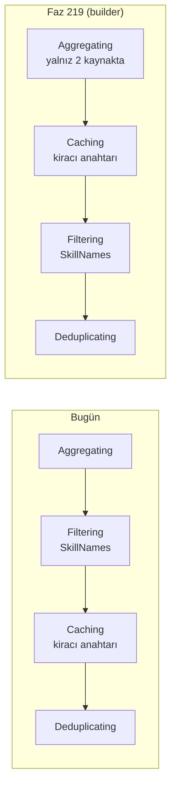

# Faz 219 — Tek Skill Zinciri (`AgentSkillsProviderBuilder`)

> **Durum:** ✅ Tamamlandı (2026-10-19)
> **Kademe:** tam — güvenlik/kiracı sınırı: zincir kiracı anahtarlı önbelleği taşır (`CacheIsolationKeySelector`); harness yolu çalışma dizini skill taramasını kapatan ayarı taşır (K-892). İkisinin anlamı değişmez, kod ikisine de dokunur
> **Plan onayı:** Bakımcı, 2026-10-19 (sohbette: tasarım A — iki agent tipinde tek zincir; kademe tam)
> **Kaynak:** [ADAYLAR.md](ADAYLAR.md) · **F-578** — MAF kapsama matrisi R-06 (`claudedocs/maf-1.25.0-yetenek-matrisi.md` §6)
> **Genellik:** skill kullanan her tüketici (düz agent ve harness agent). Yeni yetenek değildir; iki kalemin yapısal ön koşuludur: C-14 (MCP skill'leri — `AgentMcpSkillsSource` `internal`, tek giriş builder uzantısı `UseMcpSkills`) ve C-08 (skill onay anahtarları — harness bugün `AgentSkillsProviderOptions` alamaz). İş tüketici kodunda kalamaz: zincir `internal` derleyici adımıdır
> **Karşı görüş:** "Çalışan bir zinciri MAF'ın sırasına çevirmek davranış riski taşır; tüketici bugün yeni bir şey görmez." Cevap: risk hata modu tablosundaki fonksiyonel testlerle kapanır. Kazanç bugün görünmez ama C-14 ve C-08 bu kapı olmadan harness agent'ına giremez. Bugün iki yol aynı zinciri iki yerden besler; tek zincir bu ayrışmayı kapatır
> **Önkoşul:** Yok
> **Paketler:** `Tracon.Core`
> **Yeni paket:** Yok · **Migration:** Yok
> **Public API:** Büyümüyor. Değişen tipler `internal` (`AgentDefinitionCompiler` gövdesi). `wc -l src/*/PublicAPI.Shipped.txt` → her dosya 0 satır (2026-10-19)
> **Tüketici yüzeyi:** site: Yok — `capabilities.md:46` ve `HarnessSettings.DisableAgentSkillsProvider` XML dokümanı doğru kalır · sevk edilen: Yok; harness provider sırası farkı (219.3) ölçülürse `CHANGELOG.md` `Changed` satırı
> **Manuel test alanı:** [`docs/manuel-test/14-SKILL-VE-SCRIPT.md`](manuel-test/14-SKILL-VE-SCRIPT.md) — yeni case yok; DoD'deki gerçek `run` yeterli

---

## Bu Faza Başlarken

> `faz-baslangic` skill'ini uygula. Aşağıdaki liste o skill'in 2. adımıdır —
> **tamamını değil, yalnız işaret edilen bölümleri oku.**

1. Bu doküman
2. Kararlar — dosyanın tamamını **okuma**, yalnız bu kalemleri grep'le:
   ```bash
   grep -n "K-087 —\|K-892 —\|K-981 —\|K-062 —" docs/KARARLAR.md
   ```
   **K-087** (veritabanı kaynağı önce gelir; ad çakışmasında ilk kayıt kalır) ·
   **K-892** (harness skill'i yalnız `SkillNames` doluysa açar; çalışma dizini taranmaz) ·
   **K-981** (katalog ve doğrulayıcı disk skill'ini MAF dosya kaynağından okur) ·
   **K-062** (harness dosya erişimi kapalı)
3. Önceki fazdan devir — Yok. Faz 218 skill zincirine dokunmadı
4. Alan hafızası (bu faz bir alana dokunuyor):
   [`hafiza/agent-derleme-ve-onbellek.md`](hafiza/agent-derleme-ve-onbellek.md) satır 118 (iki skill kaynak kümesinin ayrışması, F-481)
5. MAF imzaları — bu doküman 2026-10-19'da ölçtü (§219.4). Uygulama başlarken
   `maf-api-kesfi` ile `AgentSkillsProviderBuilder` ve `HarnessAgentOptions`'ı
   yeniden dök; pin değiştiyse ölçümü tazele

---

## Amaç

Skill kaynağı zinciri bugün elle iki yerden kurulur ve iki ayrı biçimde tüketilir:
düz agent zinciri bir `AgentSkillsProvider`'a sarar, harness agent'ı aynı zinciri
**kaynak** olarak MAF'a verir ve provider'ı MAF kurar. Faz bitince zinciri tek
bir yer, MAF'ın `AgentSkillsProviderBuilder`'ı kurar; iki agent tipi aynı
provider'ı aynı yoldan alır. Görünen davranış değişmez.

- **F-578** — skill zincirini `AgentSkillsProviderBuilder`'a taşı; harness'ta MAF'ın yerleşik skill provider'ını her zaman kapat ve Tracon'un provider'ını `AIContextProviders` ile ver

### Bugün ne durumda — doğrulanmış kanıt

| Kanıt | Gözlem |
|---|---|
| [`AgentDefinitionCompiler.Skills.cs:11-12`](../src/Tracon.Core/Compilation/AgentDefinitionCompiler.Skills.cs) | Düz agent: `new AgentSkillsProvider(CreateSkillsSource(definition), new AgentSkillsProviderOptions(), _loggerFactory, ownsSource: true)` |
| [`AgentDefinitionCompiler.Skills.cs:14-37`](../src/Tracon.Core/Compilation/AgentDefinitionCompiler.Skills.cs) | Elle zincir: Aggregating → Filtering (`SkillNames`) → Caching (`CacheIsolationKeySelector = _ => _skills.TenantId`) → Deduplicating |
| [`AgentDefinitionCompiler.Skills.cs:47-60`](../src/Tracon.Core/Compilation/AgentDefinitionCompiler.Skills.cs) | İç kaynaklar: önce `TraconSkillsSource` (veritabanı), sonra varsa disk kaynağı (`SkillScriptSupport.CreateFileSource`) — K-087 sırası |
| [`AgentDefinitionCompiler.Agents.cs:31-34`](../src/Tracon.Core/Compilation/AgentDefinitionCompiler.Agents.cs) | Düz agent provider listesi: skills → background agents → compaction → memory → MCP resources |
| [`AgentDefinitionCompiler.Agents.cs:262-274`](../src/Tracon.Core/Compilation/AgentDefinitionCompiler.Agents.cs) | Harness: `DisableAgentSkillsProvider = harness.DisableAgentSkillsProvider \|\| definition.SkillNames.Count == 0` — kaynak yoksa MAF çalışma dizinini tarar (K-892) |
| [`AgentDefinitionCompiler.Agents.cs:293-307`](../src/Tracon.Core/Compilation/AgentDefinitionCompiler.Agents.cs) | Harness: skill adı varsa ve `HarnessSettings.DisableAgentSkillsProvider` açıksa `TraconCompilationException`; yoksa `options.AgentSkillsSource = CreateSkillsSource(definition)` |
| [`AgentDefinitionCompiler.Agents.cs:377-392`](../src/Tracon.Core/Compilation/AgentDefinitionCompiler.Agents.cs) | Harness `AIContextProviders`: text search → MCP resources |
| `Microsoft.Agents.AI.Harness` 1.25.0 `BuildContextProviders` (decompile) | Sıra: Todo → AgentMode → FileMemory → FileAccess → **AgentSkills** → BackgroundAgents → `AIContextProviders`. Skill provider'ı `new AgentSkillsProvider(source, options: null, loggerFactory, ownsSource: false)` ile kurulur; harness'ta başka skill mantığı yoktur |
| [`HarnessDefaultsTests.cs:41`](../tests/Tracon.AspNetCore.FunctionalTests/HarnessDefaultsTests.cs) | Skill adı olmayan harness agent'ı çalışma dizinini okumaz — yalnız bu kol test edilir; skill adı **olan** kol test edilmez |

> Kanıtlar 2026-10-19 tarihinde doğrulandı.

---

## 219.1 — Tek zincir

`CreateSkillsProvider(definition)` zinciri builder ile kurar. `CreateSkillsSource`
ve `CreateInnerSources` kalkar. Taslak (imza değil, çağrı sırası):

```csharp
new AgentSkillsProviderBuilder()
    .UseLoggerFactory(_loggerFactory)          // ILoggerFactory? — builder null kabul eder (decompile)
    .UseSource(new TraconSkillsSource(_skills, definition, _scripts))   // K-087: veritabanı önce
    .UseSource(fileSource)                     // yalnız _scripts?.CreateFileSource() doluysa
    .UseFilter((skill, _) => definition.SkillNames.Contains(skill.Frontmatter.Name, StringComparer.Ordinal))
    .UseCachingOptions(o => o.CacheIsolationKeySelector = _ => _skills.TenantId)
    .Build();
```

`_skills is null` kontrolü ve mesajı aynen kalır.



## 219.2 — Harness provider'ı Tracon verir

- `HarnessAgentOptions.DisableAgentSkillsProvider` **her zaman `true`** olur.
  MAF'ın yerleşik provider'ı hiç kurulmaz; çalışma dizini taraması yapısal
  olarak imkânsızlaşır (bugün koşula bağlıdır).
- `HarnessAgentOptions.AgentSkillsSource` atanmaz.
- `SkillNames` doluysa Tracon'un provider'ı `harnessProviders` listesinin
  **başına** eklenir (`AIContextProviders`).
- `HarnessSettings.DisableAgentSkillsProvider` açık ve `SkillNames` doluysa
  bugünkü `TraconCompilationException` aynen atılır (K1).
- `AgentDefinitionCompiler.Agents.cs:262-270` yorumu yeni gerçeği yazar.

## 219.3 — Davranış eşdeğerliği (ölçülen farklar)

| Konu | Bugün | Faz 219 | Görünür mü |
|---|---|---|---|
| Kaynak sırası, ad çakışması (K-087) | veritabanı → disk; Dedup ilk kaydı tutar | aynı (`UseSource` sırası korunur, Dedup en dışta) | Hayır |
| Kiracı önbellek anahtarı | `_skills.TenantId` | aynı | Hayır |
| Önbellek ↔ süzgeç | süzgeç önbelleğin altında | önbellek süzgecin altında: önbellek süzülmemiş listeyi tutar, süzgeç her çağrıda koşar | Hayır — sonuç aynı. `FilteringAgentSkillsSource` her çağrıda dışlanan skill başına Debug log yazar (bugün önbellek dolarken bir kez) |
| Tek kaynak | her zaman Aggregating | tek kaynakta Aggregating yok | Hayır |
| `RefreshInterval` | atanmaz → önbellek provider ömrü boyunca tazelenmez | aynı. Disk skill düzenlemesi yine sonraki `run`'a ulaşır (`An_edit_to_a_disk_skill_reaches_the_next_run_of_an_agent_already_compiled`) | Hayır |
| `AgentSkillsProviderOptions` | düz: `new()`; harness: MAF `null` geçer | ikisinde de builder varsayılanı (`null`) | Hayır |
| `ownsSource` | düz `true`, harness `false` | ikisinde de `true` | Hayır — `CompiledAgentCache` provider'ları dispose etmez (`grep Dispose` boş, 2026-10-19) |
| Harness provider sırası | … FileAccess → **Skills** → BackgroundAgents → TextSearch → McpResources | … FileAccess → BackgroundAgents → **Skills** → TextSearch → McpResources | Ölçülmeli: yalnız skill + alt agent birlikteyken; talimat ve tool sırası değişebilir (Açık Soru 1) |

## 219.4 — Ölçülen MAF imzaları (2026-10-19, MAF 1.25.0)

- `AgentSkillsProviderBuilder` `sealed`, deneysel değil (derleme probu). Üyeler: `UseSource(AgentSkillsSource)`, `UseSource(Func<ILoggerFactory, AgentSkillsSource>)`, `UseFilter(Func<AgentSkill, AgentSkillsSourceContext, bool>)`, `UseCachingOptions(Action<CachingAgentSkillsSourceOptions>)`, `DisableCaching()`, `UseOptions(Action<AgentSkillsProviderOptions>)`, `UseLoggerFactory(ILoggerFactory)`, `Build() → AgentSkillsProvider`.
- `Build()` sırası (decompile): kaynaklar (1 ise kendisi, değilse Aggregating) → Caching (kapatılmadıysa) → Filtering (süzgeç varsa) → Deduplicating → `new AgentSkillsProvider(source, _options, _loggerFactory, ownsSource: true)`.
- `CachingAgentSkillsSourceOptions`: `CacheIsolationKeySelector : Func<AgentSkillsSourceContext, string?>`, `RefreshInterval : TimeSpan?`.
- `HarnessAgentOptions.AgentSkillsSource : AgentSkillsSource?`, `DisableAgentSkillsProvider : bool`.
- `Microsoft.Agents.AI.Mcp` 1.25.0-alpha: `AgentMcpSkillsSource` `internal`; `AgentSkillsProviderBuilderMcpExtensions.UseMcpSkills(builder, McpClient, AgentMcpSkillsSourceOptions?)` public. C-14 için tek giriş budur.

---

## Planlanan Public API

Yok. Değişiklik `internal` derleyici gövdesindedir.

### HTTP `endpoint`'leri

Yok.

### Arayüz payı

Yok.

---

## Planlanan Dosya Listesi

```
src/Tracon.Core/Compilation/
├── AgentDefinitionCompiler.Skills.cs     (zincir builder ile; CreateSkillsSource/CreateInnerSources kalkar)
└── AgentDefinitionCompiler.Agents.cs     (harness: DisableAgentSkillsProvider = true, AgentSkillsSource yok, provider AIContextProviders başında)
tests/Tracon.AspNetCore.FunctionalTests/
├── HarnessDefaultsTests.cs               (yeni kollar, aşağıda)
└── SkillChainTenantIsolationTests.cs     (yeni)
tests/Tracon.Core.UnitTests/Compilation/
└── SkillChainTests.cs                    (yeni; kiracı anahtarı + tek load_skill, düz ve harness için Theory)
```

**Test kurulum notu (2026-10-19, ilk deneme).** Birim testi tek derlenmiş agent
altında ortam kiracısını değiştirir. `Tracon.Core.UnitTests.Fakes.FixedTenantContext(string)`
salt okunurdur (CS0200); `Catalog/BuiltInAgentSourceContractTests.cs:100`'deki
ayarlanabilir eş ad çakışması yüzünden seçilmez — test dosyası kendi
`MutableTenantContext`'ini tanımlar. Kurulum: `new AgentSkillCatalog([], new InMemoryAgentSkillStore(), tenant, Options.Create(new TraconOptions()))`
(bkz. `CompileCachedAsyncTests.cs:55`) · `new AgentDefinitionCompiler(TestData.Providers(new FakeModelProvider(client)), TestData.Registry(), skills: skills)`
· istem metni `FakeChatClient.LastRequest` + `LastOptions.Instructions`. Skill
açıklamasının istemde göründüğü ilk koşumda doğrulanır. Test önce bugünkü kodda
koşulur (yeşil beklenir — regresyon kilidi); sonra `UseCachingOptions` satırı
geçici olarak çıkarılıp **kırmızı** olduğu görülür (testin anahtarı gerçekten
ölçtüğünün kanıtı).

---

## Hata Modları ve Testler

> Mutlu yoldan değil, **ne bozulabilir**den türetilir. Seviyeyi plan seçer.
> Sınır geçen davranış (DI · HTTP · kiracı · akış · depo · paket) birim
> testiyle kanıtlanamaz — [`.agents/ortak/test-seviyeleri.md`](../.agents/ortak/test-seviyeleri.md).

| Ne bozulabilir | Seviye | Test |
|---|---|---|
| Skill adı **olan** harness agent'ı çalışma dizinindeki `SKILL.md`'yi de görür (MAF yerleşik provider'ı açık kalır) | Fonksiyonel | `HarnessDefaultsTests.A_harness_agent_that_names_a_skill_still_does_not_read_skills_from_the_working_directory` — çalışma dizininde sonda skill, tanımda veritabanı skill'i; istekte sondanın adı yok, tanımınki var |
| Harness isteğinde iki `load_skill` tool'u (yerleşik + Tracon provider'ı birlikte) | Fonksiyonel | aynı sınıf: istekte `AgentSkillsProvider.LoadSkillToolName` **tam bir kez** |
| Harness'ta skill + alt agent birlikteyken biri düşer (sıra değişikliği) | Fonksiyonel | `HarnessDefaultsTests.A_harness_agent_with_a_skill_and_a_child_agent_offers_both_tool_sets` |
| `HarnessSettings.DisableAgentSkillsProvider` + `SkillNames` artık sessizce geçer | Birim | `AgentDefinitionCompilerTests` — `TraconCompilationException` ve mesaj aynı (mevcut test varsa adı uygulamada yazılır) |
| İki kiracı aynı adlı agent ve aynı adlı, farklı talimatlı skill taşır; biri ötekinin talimatını görür | Fonksiyonel (çok kiracılı host) | `SkillChainTenantIsolationTests.Each_tenant_sees_its_own_skill_instructions` |
| Kiracı anahtarı builder'a taşınırken düşer (aynı provider iki kiracı bağlamında tek önbellek girdisi kullanır) | Birim | `SkillChainTests.One_compiled_agent_lists_each_tenants_own_skill` — aynı derlenmiş provider, iki `ITenantContext` değeri → iki ayrı skill listesi. Bu, `CompiledAgentCache` kiracı anahtarından bağımsız savunma katmanını kanıtlar |
| Disk ve veritabanında aynı adlı skill: disk kazanır (K-087 sırası bozulur) | Fonksiyonel | mevcut test varsa o (`grep -rn "shadow\|gölge" tests/`); yoksa `SkillScriptExecutorRoutingTests`'e yeni kol |
| Tanım yalnız X'i adlandırır, diskte X ve Y var: model Y'yi görür (süzgeç önbelleğin üstüne çıkınca kayar) | Fonksiyonel | `SkillScriptExecutorRoutingTests.An_agent_that_names_a_disk_skill_runs_its_file_script_from_an_HTTP_run` + istekte Y yok iddiası |
| Disk skill düzenlemesi derlenmiş agent'a ulaşmaz | Fonksiyonel (mevcut) | `SkillScriptExecutorRoutingTests.An_edit_to_a_disk_skill_reaches_the_next_run_of_an_agent_already_compiled` yeşil kalır |
| Düz agent skill davranışı değişir | Fonksiyonel (mevcut) | `SkillScript*Tests`, `HarnessDefaultsTests` tamamı yeşil |

Beş soru:

- **İptal:** yeni kod yolu yok; `CachingAgentSkillsSource` kapısı `WaitAsync(ct)` ile bugünkü gibi iptal edilir.
- **Eşzamanlılık:** önbellek girdisi başına tek kapı (MAF); eşzamanlı ilk çağrılar tek okuma yapar — bugünkü sınıf.
- **Boş/aşırı girdi:** `SkillNames` boşsa iki yolda da provider kurulmaz; harness'ta yerleşik provider de kapalıdır (mevcut test + yeni kol).
- **Başka kiracının kaydı:** iki satır yukarıda (fonksiyonel + birim).
- **Alt sistem hatası:** skill `store`'u `GetSkillsAsync`'te hata verirse davranış bugünküyle aynıdır (zincir hatayı geçirir). Yeni kod yolu yok; test eklenmez.

---

## Manuel Kabul Case'leri

Kabul case'i yok. Davranış eşdeğerdir ve kodla tekrarlanır; gerçek model kanıtı
DoD'deki `samples/Tracon.Api` `run`'ıdır.

---

## Açık Sorular

| # | Soru | Seçenekler | Öneri |
|---|---|---|---|
| 1 | Harness'ta skill ve alt agent provider'larının sırası değişir. Kabul mü? | A: kabul et; skill + alt agent testindeki isteğin talimat sırası ölçülür ve `CHANGELOG.md` `Changed` satırına yazılır · B: harness'ta da Tracon `CreateBackgroundAgentsProvider`'ı kurar ve sırayı korur (kapsam büyür: `BackgroundAgentsProviderOptions` eşlemesi) | **A** — sıra yalnız ikisi birlikteyken değişir ve düz agent'ın sırası (skills → background) zaten budur |

**Karar (1):** A uygulandı. Bu, planın önerisidir; sorunun bakımcıya ayrıca sorulduğu sohbette yoktur — uygulayan oturum önerilen seçeneği ölçüp uyguladı ve `CHANGELOG.md` `Changed` satırına yazdı (2026-10-19). Bakımcı B ister ya da sırayı korumak isterse kapsam büyür (`BackgroundAgentsProviderOptions` eşlemesi).

---

## Bitiş Ölçütleri (DoD)

- [x] `grep -rnE "new (Aggregating|Filtering|Caching|Deduplicating)AgentSkillsSource" src/` boş döner
- [x] `grep -n "AgentSkillsSource =" src/Tracon.Core/Compilation/` boş; harness `DisableAgentSkillsProvider = true` sabit atanır
- [x] Hata modu tablosundaki yeni testler uygulamadan sonra yeşil. Not: bu bir refaktördür; yeni kolların çoğu bugün de geçer ve **regresyon kilidi**dir. Kırmızıdan başlaması beklenen kol yoktur; her kol taban commit'te bir kez koşulur ve sonucu Plandan Sapmalar'a yazılır
- [x] Dört doğrulama kapısı sıfır uyarı verir: `python3 scripts/kapi.py kapanis --taban <faz öncesi commit>`
- `samples/Tracon.Api` ile gerçek `run` — **kısmen tutuldu.** Düz agent `load_skill` onayından sonra `done` verdi ve yanıt `PHASE219_SKILL_LOADED` oldu. Harness agent aynı onayı istedi ve skill'i yükledi (`functionResult` talimatı taşıdı), sonra onay devamında MEAI `InvalidOperationException` ile düştü: bu hata taban commit'te de var ve skill'siz harness agent'ta da çıkıyor (**F-582**). Harness'ta `done` ile biten uçtan uca koşum fazın dışındaki bu kusura bağlı; çıktı "Plandan Sapmalar" bölümünde
- [x] `secret` taraması boş döndü
- [x] Kabul case'i yok; gerisi otomatik testte
- [x] `faz-denetim` koşuldu; 🔴 bulgu kalmadı
- [x] Matris: §6 R-06 satırı ve §5.3 `AgentSkillsProviderBuilder` satırı "✅ Faz 219"; §5.3 `AgentSkillsProvider` satırına "harness artık seçenek alabilir (C-08)" notu

### Doğrulama komutları

```bash
# zincir tek yerden kuruluyor mu
grep -rnE "new (Aggregating|Filtering|Caching|Deduplicating)AgentSkillsSource" src/
# harness yerleşik provider'ı her zaman kapalı mı
grep -n "DisableAgentSkillsProvider" src/Tracon.Core/Compilation/AgentDefinitionCompiler.Agents.cs
```

---

## Riskler

| Risk | Önlem |
|------|-------|
| MAF builder'ın iç sırası sonraki sürümde değişir; Tracon'un davranışı ona bağlanır | Testler sırayı değil sonucu kanıtlar: kiracı izolasyonu, süzgeç, K-087 gölgeleme. Pin yükseltmesinde `maf-api-kesfi` iki dökümü bu üç testi koşturur |
| Harness'ta `AIContextProviders`'a eklenen `AgentSkillsProvider` MAF'ın başka bir yerinde tip adıyla aranıyordur | Ölçüldü: harness'ta skill'e özgü başka mantık yok (decompile, 2026-10-19). Fonksiyonel "tek `load_skill`" testi bunu ayrıca kilitler |
| Süzgeç her çağrıda koşar; Debug log hacmi artar | Yalnız Debug düzeyi; ölçülür ve gerekirse Plandan Sapmalar'a yazılır |

---

<!-- ============================================================
     AŞAĞISI ÇALIŞIRKEN DOLAR — doküman kapanışta silinir (`faz-kapat`).
     Kalıcı kısım `faz-tamamlama` Adım 5'te yerine taşınır. Başlıkları SİLME.
     ============================================================ -->

## Plandan Sapmalar

> Çalışırken dolar. Plan ile gerçek arasındaki fark **gizlenmez**. Kapanışta
> kapanış commit mesajına taşınır.

- **Taban koşumu.** Yeni testlerin hepsi taban commit'te (`d1081361`) bir kez koşuldu ve
  **yeşil** çıktı: `SkillChainTests` (4), `HarnessDefaultsTests` (13, ikisi yeni),
  `SkillChainTenantIsolationTests` (2), `SkillScriptExecutorRoutingTests` (15, ikisi yeni).
  Hepsi regresyon kilididir. Kiracı testinin gerçekten ölçtüğünün kanıtı: `UseCachingOptions`
  satırı çıkarılınca `One_compiled_agent_lists_each_tenants_own_skill` iki koşulda da **kırmızı**
  (`second` iddiası düştü); satır geri konuldu.
- **Kiracı fonksiyonel testi skill açıklamasını ölçer, talimatı değil.** Plan "talimat" diyordu.
  `load_skill` çağrısı MAF onayına bağlıdır (`ApprovalRequiredAIFunction`); talimatı okumak her
  kiracı için kalıcı onay kuralı ister. Skill listesi (ad + açıklama) istemde zaten kiracının
  metnini taşır ve aynı zincirden geçer; test onu okur.
- **Süzgeç testi (`Y` görünmez) ve K-087 gölge testi yeni yazıldı.** Plan "mevcut test varsa o"
  diyordu. `grep -rni "shadow\|gölge" tests/` yalnız `SkillScriptContentPinTests`'te (grant
  pini; ilgisiz) buldu. İki yeni kol `SkillScriptExecutorRoutingTests`'e girdi.
- **`UseLoggerFactory` koşullu çağrılır.** Builder parametresi `ILoggerFactory` (null
  kabul etmez işaretli) ve `_loggerFactory` nullable; çağrı `is not null` kapısının arkasında.
- **K1 istisnası sırası korundu.** Harness'ta `DisableAgentSkillsProvider` + `SkillNames` istisnası
  provider kurulmadan **önce** atılır; provider eski `AgentSkillsSource` atamasıyla aynı noktada
  kurulur ve listeye sonra eklenir. Kataloğun kayıtsız olması hatası böylece diğer çakışma
  denetimlerine göre eski sırada kalır.
- **Provider sırası farkı ölçüldü (Açık Soru 1, seçenek A).** Skill + alt agent birlikteyken
  taban: tool'lar `… load_skill, read_skill_resource, run_skill_script, background_agents_*`,
  talimat bölümleri Todo → Mode → `<available_skills>` → `## BackgroundAgents`. Sonra:
  `… background_agents_*, load_skill, …`; talimat `## BackgroundAgents` → `<available_skills>`.
  `CHANGELOG.md` `Changed` satırına yazıldı. Tek başına skill ya da tek başına alt agent'ta fark yok.
- **Gerçek `run` (DoD):** `samples/Tracon.Api`, izole SQLite dosyası, `openai/gpt-5.4-mini`,
  veritabanı skill'i `phase219-probe`. Düz agent: `load_skill` onayı → yanıt
  `PHASE219_SKILL_LOADED`, `done`. Harness agent: aynı onay isteği çıktı ve skill yüklendi
  (kalıcı kuralla `functionResult` talimatı taşıdı); **ardından hata**: MEAI
  `FunctionInvokingChatClient.ProcessFunctionApprovalResponses` "ToolApprovalRequestContent found
  … no matching ToolApprovalResponseContent". 🚨 **Fazdan bağımsız, taban commit'te de aynı**
  (stash + yeniden derleme ile iki yolda — kalıcı kural ve oturumda onay — ölçüldü). Bulgu
  `ADAYLAR.md`'ye gider (kapanışta).
- **`main` CI'ı faza başlarken kırmızıydı** (`faz-baslangic` Adım 0): `Paketle` adımı
  `NU1102 Tracon.Sqlite 1.0.0-preview.5 nuget.org'da yok` (etiket `v1.0.0-preview.5` var, etiket
  CI'ı `WorkflowResponseOwnershipTests` kırılganlığıyla düştü ve yayın atlandı); Windows ayağında
  `ERR_NO_BUFFER_SPACE` (Playwright) ve `Tracon.Cli.FunctionalTests` "Canceled". Faz koduyla ilgisiz.
  Yeniden koşum yayın yapacağı için kullanıcıya bırakıldı.
- **Taban ölçümü `git stash` ile yapıldı.** `.agents/ortak/kurtarma.md` taban ölçümü için `git worktree` önerir. İki koşumda stash geri alındı (`git stash list` boş) ve denetçi aynı sonucu bağımsız ölçtü; yöntem kurala uymuyor, sonuç etkilenmedi.
- **Kapanış koşumunun ilk tam testi 1 kırmızı verdi, ikincisi temiz.** `kapanis`: 23634 testten 1'i düştü (`JobWorkerLeaseContractTests.A_cancelled_job_whose_handler_throws_stays_cancelled(maxAttempts: 1)`, 30 sn zaman aşımı, `Scheduling` — faza dokunmayan alan); izole koşumda geçti (kaynak çekişmesi sınıfı). Tam paket tekrar koşuldu: 23634 test, 0 kırmızı, 19 atlanan (mevcut koşul atlamaları).
- **Mimari kapısı XML dokümanında faz/karar numarası reddetti.** `ShippedDocumentationSelfContainmentTests`
  `AgentDefinitionCompiler.Skills.cs` `///` satırlarındaki `(F-578)` ve `(K-087)` için kırmızı verdi;
  numaralar `///` satırlarından çıkarıldı.

## Bu Fazda Verilen Kararlar

> Çalışırken dolar. Dört kategoriden birine giren karar (AGENTS.md)
> `docs/KARARLAR.md`'ye K-NNN ve kategori etiketiyle girer; girmeyen karar
> kapanışta commit mesajına taşınır (`faz-tamamlama` Adım 8). Plan numara rezerve
> etmez.

## Süreç Ölçümü

> Kapanışta doldurulur. **Tablo olarak** — onay kutusu DEĞİL: `faz-kapat`
> işaretsiz kutuda durur. `faz-kapat` bu tabloyu `docs/FAZ-DEFTERI.md`'ye taşır;
> eşik **167**'den itibaren boş bir değer hücresinde kapanışı durdurur.
> `ölçülmedi` **geçerli bir değerdir** — kapı bir sayı değil, bir **karar** arar.
> Kapı bölümün VARLIĞINI denetler, doğruluğunu denetlemez (K-766).

| Metrik | Değer |
|---|---|
| Plan revizyonu sayısı | 0 |
| Düzeltme turu sayısı | 2 |
| 🔴 bulgu: gerçek / gürültü / araştırılacak | 0 / 0 / 0 |
| Fazın ürettiği regresyon | 0 commit edilmiş |
| Faz kapandıktan sonra bulunan kusur | ölçülmedi (kapanış anı) |

## Denetim Bulguları

> `faz-denetim` çıktısı. Her satır: bulgu · seviye (🔴/🟡/🟢) · sonuç
> (düzeltildi / gerekçelendi / F-NN olarak devredildi). 🟢 kapanışta
> `ADAYLAR.md`'ye gider.

- **🔴: yok.**
- **🟡 `MIMARI.md:353` diyagram etiketi, `hafiza/maf-harness-ve-loop.md:21` ve `MAF-GENISLEME-NOKTALARI.md:421` harness'ın hâlâ `AgentSkillsSource` aldığını anlatıyordu; `AgentDefinitionCompilerTests` yorumu bayattı** — düzeltildi (üçü de koda göre yazıldı).
- **🟡 Açık Soru 1 için karar izi yoktu** — gerekçelendi: "Açık Sorular" altına `Karar (1)` satırı yazıldı; seçenek A plan önerisidir, bakımcı onayı sohbette ayrıca alınmadı.
- **🟢 F-582 kapsamı `load_skill`'den geniş** — denetçi skill'siz harness agent'ta `RequiresApproval` kod tool'uyla taban commit'te aynı hatayı üretti. `ADAYLAR.md` F-582 güncellendi (devredildi).
- **🟢 `Each_tenant_sees_its_own_skill_instructions` adı açıklamayı değil talimatı iddia ediyordu; işlevsel test zincirin önbellek anahtarına duyarsız** (`CompiledAgentCache` kiracıyı zaten ayırır; yalnız birim test anahtarı ölçer) — test `Each_tenant_is_offered_its_own_skill` diye adlandırıldı ve sınıf notu sınırı yazıyor.
