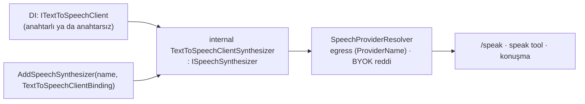

# Faz 220 — MEAI Ses İstemcisi Köprüsü ve OpenAI Sesi

> **Durum:** 📋 Planlandı (2026-10-19)
> **Kademe:** tam — güvenlik/kiracı sınırı: köprü kiracı egress politikasının (K-930) ve BYOK reddinin içinden geçer; egress'in eşleştiği `ProviderName` sürecin kendisinden gelmelidir
> **Plan onayı:** Bakımcı, 2026-10-19 (sohbette: genel köprü + `Tracon.OpenAI` kısayolu · eksikler kayıt seçeneğiyle beyan · tam kademe)
> **Kaynak:** [ADAYLAR.md](ADAYLAR.md) · **F-579** — MAF kapsama matrisi R-01 (`claudedocs/maf-1.25.0-yetenek-matrisi.md` §6)
> **Genellik:** ses kullanan her tüketici. Bugün yalnız ElevenLabs yerleşiktir; MEAI'nin `ISpeechToTextClient`/`ITextToSpeechClient` sağlayıcıları (OpenAI dahil) bağlanamaz (matris §5.13, K0). İkinci kanıt: `docs-site` ses rehberi "Use your own speech provider" bölümünde tüketiciden Tracon arayüzünü elle uygulamasını ister; MEAI istemcisi olan tüketici bu işi iki kez yapar. İş tüketici kodunda kalabilir ama tüketici MEAI001'i kendi kodunda bastırmak ve kiracı kurallarını bilmek zorunda kalır
> **Karşı görüş:** "Ses çekirdek iş değil; tüketici kendi adaptörünü yazabilir (F-296 dersi)." Cevap: köprü medya yardımcısı değildir, kontrol düzlemidir. Kiracı egress'i, BYOK reddi, karakter sınırı ve maliyet Tracon'un çözümleyicisinde uygulanır; elle yazılan adaptör bunları atlayabilir. Kapsam yalnız bağlamadır: yeni ses yeteneği (akışlı STT, hizalama, diyalog) eklenmez
> **Önkoşul:** Yok. Faz 219 ile bağımsızdır
> **Paketler:** `Tracon.Core`, `Tracon.OpenAI`
> **Yeni paket:** Yok — MEAI.OpenAI `Tracon.OpenAI`'de zaten referanslıdır · **Migration:** Yok
> **Public API:** Büyüyor — yalnız ekleme. `1.0.0` GA'dan (K-603) önce ucuz; `wc -l src/*/PublicAPI.Shipped.txt` → her dosya 0 satır (2026-10-19). 🚨 Public imzaya upstream deneysel tip **girmez** (`YAYIN-HAZIRLIK.md` ölçüt 5): hiçbir yeni public üye `ISpeechToTextClient`, `ITextToSpeechClient` ya da onların seçenek/yanıt tiplerini anmaz
> **Tüketici yüzeyi:** site: `guides/voice.md` (yeni bölümler: "Use any Microsoft.Extensions.AI speech client", "OpenAI speech"; "Use your own speech provider" bölümünden bağlantı), `capabilities.md` ses satırı · sevk edilen: `src/Tracon.OpenAI/README.md`, `CHANGELOG.md` `Added`, yeni public üyelerin XML `<example>`'ı
> **Manuel test alanı:** [`docs/manuel-test/19-COK-MODLULUK-VE-SES.md`](manuel-test/19-COK-MODLULUK-VE-SES.md) — bir `🤖` case (gerçek OpenAI TTS + STT)

---

## Bu Faza Başlarken

> `faz-baslangic` skill'ini uygula. Aşağıdaki liste o skill'in 2. adımıdır —
> **tamamını değil, yalnız işaret edilen bölümleri oku.**

1. Bu doküman
2. Kararlar — dosyanın tamamını **okuma**, yalnız bu kalemleri grep'le:
   ```bash
   grep -n "K-215 —\|K-930 —\|K-952 —\|K-502 —\|K-059 —\|K-1019 —" docs/KARARLAR.md
   ```
   **K-215** (ses sözleşmeleri `Abstractions`'ta; ElevenLabs bir uygulamadır) ·
   **K-930** (her konuşma çağrısı çözümleyicide egress ve kiracı anahtarından geçer; egress kayıt adına değil örneğin `ProviderName`'ine uygulanır) ·
   **K-952** (diyalog ayrı yetenek arayüzüdür; taşımayan motor reddedilir) ·
   **K-502** (akışlı sentez + hizalama istisna ile reddedilir, sessizce yok sayılmaz) ·
   **K-059** (`secret` hiçbir yere yazılmaz) ·
   **K-1019** (`Tracon.OpenAI`'nin "Native AOT: Yes" vaadi sahte sunucuya karşı AOT yayınıyla kanıtlanır)
3. Yayın kuralı: [`YAYIN-HAZIRLIK.md`](YAYIN-HAZIRLIK.md) UR-012 (= B) ve ölçüt 5
4. Önceki fazdan devir — Yok
5. Alan hafızası (bu faz bir alana dokunuyor):
   [`hafiza/ses-ve-konusma.md`](hafiza/ses-ve-konusma.md) (sentez akışı ve hizalama tuzakları)
6. Gerektiğinde, tamamı değil ilgili bölümü:
   [`MIMARI-GUVENLIK.md`](MIMARI-GUVENLIK.md) — kiracı egress ve BYOK bölümü

---

## Amaç

Tracon'un ses sözleşmesi (`ISpeechSynthesizer`, `ISpeechTranscriber`) kalır:
MEAI'nin sözleşmesinden zengindir ve MEAI'ninki deneyseldir. Bu faz iki şey
ekler: (1) DI'daki **her** MEAI ses istemcisini adla bir Tracon sentezleyicisine
veya çözücüsüne bağlayan genel köprü; (2) `Tracon.OpenAI`'de bu köprüyü kullanan
`UseOpenAISpeech(...)` kısayolu. Faz bitince OpenAI TTS/STT ve herhangi bir MEAI
ses sağlayıcısı Tracon'un kiracı, egress, sınır ve maliyet kurallarıyla çalışır.

- **F-579** — MEAI ses istemcisi köprüsü (Core) + OpenAI ses kısayolu (`Tracon.OpenAI`)

### Bugün ne durumda — doğrulanmış kanıt

| Kanıt | Gözlem |
|---|---|
| [`SpeechContracts.cs:36`](../src/Tracon.Abstractions/Voice/SpeechContracts.cs) · `:149` | Tracon sözleşmesi: `ISpeechSynthesizer` (`ProviderName`, `SupportsTenantCredentials`, `MaxCharactersPerRequest` `:69`, sentez, akışlı sentez, `ListVoicesAsync` `:101`) · `ISpeechTranscriber` |
| [`TraconBuilderExtensions.Speech.cs:47`](../src/Tracon.Core/TraconBuilderExtensions.Speech.cs) · `:95` | Tek kayıt yolu: `AddSpeechSynthesizer`/`AddSpeechTranscriber(name, Func<IServiceProvider, ISpeech…>)` — tüketici arayüzü elle uygular |
| [`SpeechProviderResolver.cs:237-270`](../src/Tracon.Core/Voice/SpeechProviderResolver.cs) | `AuthorizeAsync`: egress `ProviderName` ile (`:249`); kiracının bağlaması varsa ve sağlayıcı `SupportsTenantCredentials` demiyorsa `TraconTenantProviderRefusedException` (`:267`) — kurulum anahtarına düşmez |
| [`ImageGeneratorResolver.cs:111`](../src/Tracon.Core/Images/ImageGeneratorResolver.cs) | Emsal: MEAI görsel üreticisi de BYOK almaz ve kiracının kendi anahtarı varsa reddedilir |
| [`OpenAIImageBuilderExtensions.cs:39-53`](../src/Tracon.OpenAI/OpenAIImageBuilderExtensions.cs) | Emsal: `UseOpenAIImages` MEAI001'i paketin içinde bastırır ve anahtarlı `IImageGenerator` kaydeder; public imzada MEAI tipi yok |
| [`OpenAIChatClientFactory.cs:121-124`](../src/Tracon.OpenAI/OpenAIChatClientFactory.cs) | Paylaşılan `OpenAIClient`'tan model başına istemci: `_client.GetImageClient(model).AsIImageGenerator()`. Aynı istemci egress soket korumasını taşır (`CreateClient`, `:139`) |
| [`VoiceEndpoints.cs:172`](../src/Tracon.AspNetCore/Endpoints/VoiceEndpoints.cs) · [`SpeakTool.cs:83`](../src/Tracon.Voice/Tools/SpeakTool.cs) | Çağıranlar `MaxCharactersPerRequest`'i okur; köprü bir değer vermek zorundadır |
| [`ElevenLabsSpeechClient.cs:200`](../src/Tracon.Voice/Internal/ElevenLabsSpeechClient.cs) | K-502 deseni: desteklenmeyen hizalama isteği istisna ile reddedilir |
| [`VoiceBuilderExtensions.cs:98-101`](../src/Tracon.Voice/VoiceBuilderExtensions.cs) | `UseVoice` varsayılan (anahtarsız) sentezleyici ve çözücüyü `TryAdd` ile kaydeder; canlı konuşma varsayılanı okur (`VoiceConversationBuilderExtensions.cs:124`) |

> Kanıtlar 2026-10-19 tarihinde doğrulandı.

### Ölçülen MEAI yüzeyi (2026-10-19, MEAI 10.11.0)

- `ISpeechToTextClient`: `GetTextAsync(Stream, SpeechToTextOptions?, ct)`, `GetStreamingTextAsync(…)`, `GetService`. `ITextToSpeechClient`: `GetAudioAsync(string, TextToSpeechOptions?, ct)`, `GetStreamingAudioAsync(…)`, `GetService`. **İkisi ve seçenek/yanıt tipleri `MEAI001`** (derleme probu).
- `TextToSpeechOptions`: `VoiceId`, `ModelId`, `AudioFormat`, `Language`, `Speed`, `Pitch`, `Volume`, `AdditionalProperties`, `RawRepresentationFactory`. `TextToSpeechResponse`: `Contents` (`DataContent`), `ModelId`, `ResponseId`, `Usage`.
- `SpeechToTextOptions`: `ModelId`, `SpeechLanguage`, `SpeechSampleRate`, `TextLanguage`, `AdditionalProperties`. `SpeechToTextResponse`: `Text`, `Contents`, `StartTime`, `EndTime`, `ModelId`, `ResponseId`, `Usage`.
- Metadata: `GetService<TextToSpeechClientMetadata>()` / `SpeechToTextClientMetadata` → `ProviderName`, `ProviderUri`, `DefaultModelId`.
- DI: `AddSpeechToTextClient`/`AddKeyedSpeechToTextClient`, `AddTextToSpeechClient`/`AddKeyedTextToSpeechClient`.
- MEAI.OpenAI: `AudioClient.AsISpeechToTextClient()`, `AudioClient.AsITextToSpeechClient()` (`OpenAIClientExtensions`).
- 🚨 `LoggingTextToSpeechClient`/`LoggingSpeechToTextClient` seçenekleri Trace düzeyinde JSON'a yazar (decompile): seçeneklere konan her değer log'a gidebilir.

---

## 220.1 — Genel köprü (Core)

Yeni kayıt aşırı yüklemeleri bir **bağlama kaydı** alır; MEAI istemcisini DI'dan
okur (İ5). Adaptörler `internal`'dır ve MEAI001 bastırması tek dosyada toplanır.



**Davranış kuralları:**

| Konu | Kural |
|---|---|
| `ProviderName` | `binding.ProviderName` verilmişse o; değilse istemci metadata'sının `ProviderName`'i. İkisi de yoksa **başlangıçta** `TraconException` (K-930: egress bu ada uygulanır; adsız sağlayıcı egress'i atlayamaz) |
| `SupportsTenantCredentials` | `false`. Kiracının bu `ProviderName` için bağlaması varsa çözümleyici bugünkü gibi reddeder; çağrı kurulum anahtarına düşmez |
| `MaxCharactersPerRequest` | `binding.MaxCharactersPerRequest` — zorunlu, `> 0`; doğrulanmazsa başlangıç hatası |
| `ListVoicesAsync` | `binding.Voices` (statik beyan); beyan yoksa boş liste |
| Hizalama | `SpeechRequest.IncludeTimestamps == true` → `NotSupportedException` (K-502 deseni), iki sentez yolunda da |
| Diyalog | Adaptör `ISpeechDialogueSynthesizer` uygulamaz; K-952 çözümleyicide reddeder |
| İstek eşlemesi | `VoiceId → VoiceId`, `ModelId → ModelId`, `OutputFormat → AudioFormat`, `LanguageCode → Language`, `ProviderSettings → AdditionalProperties` (değerler `JsonElement`) |
| 🚨 `secret` | `SpeechRequest.Credential` **hiçbir seçeneğe yazılmaz** (Logging halkası seçenekleri log'a yazar). `SupportsTenantCredentials = false` olduğu için çözümleyici zaten kimlik bilgisi geçirmez; adaptör yine de alanı okumaz |
| Yanıt eşlemesi | `Contents`'teki `DataContent` baytları → `SpeechAudio.Data`; `MediaType` ilk `DataContent`'ten; `ModelId` yanıttan ya da istekten; `ProviderRequestId = ResponseId`; `CharactersBilled = Text.Length`, `UsageSource = Estimated` (MEAI sağlayıcı karakter sayısı vermez) |
| Akışlı sentez | `GetStreamingAudioAsync` güncellemelerinin `DataContent` baytları sırayla verilir |
| Çözüm | `SpeechTranscriptionOptions.ModelId → ModelId`, `LanguageCode → SpeechLanguage`; `SpeechTranscript.Text = response.Text`, `AudioDuration = EndTime - StartTime` (ikisi de varsa, yoksa `null`), `ModelId` yanıttan |
| Maliyet | Bugünkü yol: `IVoicePricingReader.ForSynthesis(ProviderName, modelId, characters)` / `ForTranscription(…)`. Okuyucu yalnız `UseVoice` ile kayıtlıdır; yoksa maliyet `null` (özel sağlayıcıların bugünkü davranışı) |
| Sağlık | Adaptör `IVoiceHealthCheck` uygulamaz; sağlık ucu bugünkü gibi yalnız varsayılan sağlayıcıyı okur |
| İptal | `CancellationToken` MEAI çağrısına geçer |

## 220.2 — OpenAI kısayolu (`Tracon.OpenAI`)

`UseOpenAISpeech(configure)` paylaşılan `OpenAIClient`'tan (`OpenAIChatClientFactory`)
model başına `AudioClient` alır, `AsITextToSpeechClient()`/`AsISpeechToTextClient()`
ile MEAI istemcisini **iç anahtarla** kaydeder ve 220.1'in bağlamasıyla adlandırır.

- `ProviderName = OpenAIProviderNames.ChatCompletions` (`"openai"`) **açıkça** verilir; metadata'ya güvenilmez. Kiracının `"openai"` egress kuralı sohbet, görsel ve ses için aynıdır.
- `SynthesisModel` ve `TranscriptionModel`'den en az biri zorunludur; verilen taraf kaydedilir.
- `MaxCharactersPerRequest` varsayılanı `4096` (OpenAI belgesine göre; **ölçülmeli**).
- MEAI001 bastırması tek dosyada, gerekçesiyle (`OpenAIImageBuilderExtensions` deseni).
- Egress soket koruması paylaşılan `OpenAIClient` ile gelir; yeni istemci kurulmaz.

---

## Planlanan Public API

> Taslak imzalardır. Gerçekleşen imzalar kapanışta ayrı bir bölüme yazılır.
> UR-012 B: ad ve biçim `rc.1`'e kadar değişebilir; ölçüt en iyi tasarımdır.

```csharp
// Tracon.Core — TraconBuilderExtensions.Speech.cs
public static ITraconBuilder AddSpeechSynthesizer(this ITraconBuilder builder, string name, TextToSpeechClientBinding binding);
public static ITraconBuilder AddSpeechTranscriber(this ITraconBuilder builder, string name, SpeechToTextClientBinding binding);

// Tracon.Core
public sealed record TextToSpeechClientBinding
{
    public object? ServiceKey { get; init; }                      // null → anahtarsız ITextToSpeechClient
    public string? ProviderName { get; init; }                    // null → istemci metadata'sı
    public required int MaxCharactersPerRequest { get; init; }
    public IReadOnlyList<VoiceDescriptor> Voices { get; init; } = [];
}

public sealed record SpeechToTextClientBinding
{
    public object? ServiceKey { get; init; }
    public string? ProviderName { get; init; }
}

// Tracon.OpenAI
public static ITraconBuilder UseOpenAISpeech(this ITraconBuilder builder, Action<OpenAISpeechOptions> configure);

public sealed class OpenAISpeechOptions
{
    public string? SynthesisModel { get; set; }
    public string? TranscriptionModel { get; set; }
    public string SynthesizerName { get; set; } = "openai";
    public string TranscriberName { get; set; } = "openai";
    public int MaxCharactersPerRequest { get; set; } = 4096;
    public IList<VoiceDescriptor> Voices { get; } = [];
}
```

### HTTP `endpoint`'leri

Yok. Mevcut uçlar köprülenmiş adı `provider` alanıyla okur: `POST /api/voice/speak`, `GET /api/voice/voices`, `GET /api/voice/providers`. HTTP'de çözüm (STT) ucu **yoktur**: çözüm `transcribe` tool'u ve canlı konuşma ile yalnız **varsayılan** çözücüyü kullanır (`TranscribeTool.cs`, `GetTranscriberAsync(name: null)`); adlı çözücüye `ISpeechProviderResolver.GetTranscriberAsync(name)` ile kod ulaşır.

### Arayüz payı

Yok.

---

## Planlanan Dosya Listesi

```
src/Tracon.Core/
├── TraconBuilderExtensions.Speech.cs          (iki yeni aşırı yükleme)
└── Voice/
    ├── SpeechClientBindings.cs                (TextToSpeechClientBinding, SpeechToTextClientBinding)
    └── SpeechClientAdapters.cs                (internal; MEAI001 bastırması yalnız burada)
src/Tracon.OpenAI/
├── OpenAISpeechBuilderExtensions.cs           (UseOpenAISpeech; MEAI001 bastırması yalnız burada)
└── OpenAISpeechOptions.cs
tests/Tracon.Core.UnitTests/Voice/
└── SpeechClientAdapterTests.cs
tests/Tracon.AspNetCore.FunctionalTests/
├── SpeechClientBridgeTests.cs
└── Infrastructure/ScriptedOpenAIAudioServer.cs (/v1/audio/speech, /v1/audio/transcriptions)
samples/Tracon.Samples.ProviderAotSmoke/
├── FakeProviderServer.cs                      (iki ses yanıtı)
└── Program.cs                                 (UseOpenAISpeech + sentez + çözüm)
```

---

## Hata Modları ve Testler

> Mutlu yoldan değil, **ne bozulabilir**den türetilir. Seviyeyi plan seçer.
> Sınır geçen davranış (DI · HTTP · kiracı · akış · depo · paket) birim
> testiyle kanıtlanamaz — [`.agents/ortak/test-seviyeleri.md`](../.agents/ortak/test-seviyeleri.md).

| Ne bozulabilir | Seviye | Test |
|---|---|---|
| Egress `"openai"`'yi yasaklayan kiracı köprülenmiş sağlayıcıyla konuşur | Fonksiyonel (kiracı + HTTP) | `SpeechClientBridgeTests.A_tenant_whose_egress_denies_the_provider_cannot_speak_through_the_bridge` → `/speak` reddedilir, sahte sunucuya istek **gitmez** |
| Kendi anahtarı olan kiracının çağrısı kurulum anahtarına düşer | Fonksiyonel (kiracı) | `…A_tenant_with_its_own_key_is_refused_and_the_setup_key_is_not_used` — sahte sunucu istek görmez |
| Metadata'sız ve `ProviderName`'siz istemci egress'i adsız atlar | Fonksiyonel (DI) | `…A_client_without_a_provider_name_stops_the_host` — başlangıç hatası, mesaj kayıt adını anar |
| Anahtarlı istemci kayıtlı değil; hata ilk çağrıda, yanlış yerde çıkar | Fonksiyonel (DI) | `…A_missing_keyed_client_stops_the_host` |
| `MaxCharactersPerRequest <= 0` kabul edilir | Birim | `SpeechClientAdapterTests` — doğrulama hatası |
| Sınırı aşan metin sağlayıcıya gider | Fonksiyonel (HTTP) | `…Speak_rejects_text_above_the_declared_limit` (mevcut `LimitedSynthesizer` deseni) |
| `IncludeTimestamps` sessizce yok sayılır | Birim | iki sentez yolunda `NotSupportedException` |
| `SpeechRequest.Credential` seçeneklere (ve Logging halkasıyla log'a) sızar | Birim | kimlik bilgisi taşıyan istek → yakalanan `TextToSpeechOptions.AdditionalProperties` ve `RawRepresentationFactory` boş |
| İstek alanları yanlış eşlenir (ses, model, biçim, dil, sağlayıcı ayarları) | Birim | yakalayan sahte `ITextToSpeechClient` |
| Akışlı ve akışsız bayt farklı | Birim | iki yolun baytı eşit |
| Çözüm süresi/metni yanlış eşlenir | Birim | `StartTime`/`EndTime` var/yok iki kol |
| Köprülenmiş ada diyalog istenince yerleşik istemciye düşer | Birim | `GetDialogueSynthesizerAsync(name)` → `SpeechCapabilityNotSupportedException` |
| `UseOpenAISpeech` yanlış uca/modele/sese istek atar | Fonksiyonel (paket + HTTP) | `ScriptedOpenAIAudioServer` gövdesi: `model`, `voice`, `input`; çözümde çok parçalı gövde ve `model` |
| `UseOpenAISpeech` AOT'ta trim/AOT uyarısı üretir ya da çalışmaz | Paket (AOT smoke, K-1019) | `samples/Tracon.Samples.ProviderAotSmoke` ses yolunu koşar; sıfır uyarı, `FakeProviderServer`'a gerçek istek |
| Public imzaya deneysel tip girer | Paket | `dotnet run .agents/skills/nuget-danismani/scripts/uyum-probu.cs -- deneysel` — yeni maruziyet 0 |

Beş soru:

- **İptal:** belirteç MEAI çağrısına geçer; birim testinde iptal edilen belirteç `OperationCanceledException` üretir.
- **Eşzamanlılık:** adaptörler durumsuzdur, tekildir; MEAI istemcisinin kendi güvenliği geçerlidir. Test eklenmez.
- **Boş/aşırı girdi:** boş metin bugünkü uç doğrulamasında kalır; sınır aşımı fonksiyonel testte.
- **Başka kiracının kaydı:** egress ve BYOK satırları (fonksiyonel).
- **Alt sistem hatası:** sağlayıcı `5xx` → bugünkü uç hata sınıflaması (`ScriptedOpenAIAudioServer` bir kolda `500` döner; uç `502` sınıfında yanıtlar — mevcut sınıflamaya göre uygulamada doğrulanır).

---

## Manuel Kabul Case'leri

| # | Ön koşul | Adımlar | Beklenen sonuç |
|---|---|---|---|
| 1 `🤖` | `samples/Tracon.Api`'de `UseOpenAISpeech(o => { o.SynthesisModel = "<tts modeli>"; o.TranscriptionModel = "<stt modeli>"; })`; gerçek OpenAI anahtarı user-secrets'ta | `POST /tracon/api/voice/speak` (`provider = "openai"`) ile kısa bir cümle sentezle; çıkan eki `transcribe` tool'u ile bir agent `run`'ında çöz (Açık Soru 1 A ile OpenAI varsayılan çözücüdür; A seçilmezse `GetTranscriberAsync("openai")` çağıran bir `dotnet run` probu) | Ses eki kaydedilir; çözüm metni girdi cümlesini taşır; `ProviderName = "openai"`; `secret` taraması boş |

Case `docs/manuel-test/19-COK-MODLULUK-VE-SES.md`'ye eklenir. Anahtar yoksa case `👤` olarak işaretlenir ve neden yazılır.

---

## Açık Sorular

| # | Soru | Seçenekler | Öneri |
|---|---|---|---|
| 1 | `UseOpenAISpeech` varsayılan (anahtarsız) sentezleyici/çözücü de olsun mu? Canlı konuşma varsayılanı okur | A: `UseAsDefault` seçeneği (varsayılan `false`), `TryAdd` ile — `UseVoice` gibi ilk kayıt kazanır · B: yalnız adlı | **A** — OpenAI'yi tek ses sağlayıcısı yapan host canlı konuşmayı da kullanabilir; `TryAdd` tüketici kaydının kazanma kuralını korur |
| 2 | OpenAI ses yolunda kiracı BYOK'u | A: bu fazda yok (görsel emsali; kendi anahtarı olan kiracı reddedilir) · B: istek başına kimlik bilgisiyle `AudioClient` kur | **A** — B görsel ve ses için ortak bir iştir; kapanışta `ADAYLAR.md`'ye yeni F-ID ile yazılır |
| 3 | OpenAI MEAI adaptörü `TextToSpeechOptions.ModelId`'i dikkate alıyor mu (model başına `AudioClient` mı gerekir)? | ölçülmeli — `ScriptedOpenAIAudioServer` gövdesinde `model` | ölç; dikkate almıyorsa istek başına model alanı adaptörde reddedilir ya da model başına istemci önbelleği kurulur — sapma olarak yazılır |
| 4 | `VoiceId` boşken OpenAI adaptörü hangi sesi seçer? | ölçülmeli | ölç; varsayılan yoksa `OpenAISpeechOptions.DefaultVoice` eklenir |

---

## Bitiş Ölçütleri (DoD)

- [ ] `AddSpeechSynthesizer(name, TextToSpeechClientBinding)` ve `AddSpeechTranscriber(name, SpeechToTextClientBinding)` DI'daki MEAI istemcisini adla çözer; `/api/voice/speak` köprülenmiş adla, çözüm `ISpeechProviderResolver.GetTranscriberAsync(name)` ile çalışır (fonksiyonel test, host DI'ı üzerinden)
- [ ] `UseOpenAISpeech` sahte sunucuya doğru gövdeyi gönderir; `samples/Tracon.Samples.ProviderAotSmoke` ses yolunu da koşar (`FakeProviderServer`'a `/v1/audio/speech` ve `/v1/audio/transcriptions` eklenir), AOT yayını sıfır uyarı (K-1019)
- [ ] Egress ve BYOK fonksiyonel testleri yeşil; reddedilen çağrıda sahte sunucu istek görmez
- [ ] `uyum-probu.cs -- deneysel`: yeni public maruziyet 0; MEAI001 bastırması yalnız iki dosyada (`grep -rln "disable MEAI001" src/Tracon.Core/Voice src/Tracon.OpenAI`)
- [ ] Dört doğrulama kapısı sıfır uyarı verir: `python3 scripts/kapi.py kapanis --taban <faz öncesi commit>`
- [ ] `samples/Tracon.Api` ile gerçek `run`: örnek uygulama `UseOpenAISpeech` ile açılır; `/api/voice/speak` (`provider = "openai"`) çıktısı ve bir çözüm sonucu belgeye yazıldı (anahtar yoksa sahte sunucuyla ve gerekçesiyle)
- [ ] `secret` taraması boş döndü
- [ ] `🤖` case 1 `docs/manuel-test/19-COK-MODLULUK-VE-SES.md` içinde ve koşuldu
- [ ] `faz-denetim` koşuldu; 🔴 bulgu kalmadı
- [ ] `docs-site/` güncellendi (`guides/voice.md`, `capabilities.md`); `npm run build` + `check-links.mjs` temiz; `src/Tracon.OpenAI/README.md` ve `CHANGELOG.md` `Added`
- [ ] Kapanışta K-215 bu fazın kararıyla güncellenir *(kategori: public-api)* — alternatif adıyla: "Tracon arayüzlerini MEAI'ninkilerle değiştirmek (MEAI001; ses listesi, karakter sınırı, istek başına kiracı kimliği, hizalama, faturalı karakter, diyalog yok)"
- [ ] Matris: §6 R-01 ve §5.13 ses satırı "✅ Faz 220"; `MAF-GENISLEME-NOKTALARI.md` § *Hâlâ kullanılmayan* ses satırı "KÖPRÜ — Faz 220"

### Doğrulama komutları

```bash
# public imzada deneysel tip yok
dotnet run .agents/skills/nuget-danismani/scripts/uyum-probu.cs -- deneysel
# MEAI001 bastırması yalnız iki dosyada
grep -rln "disable MEAI001" src/Tracon.Core/Voice src/Tracon.OpenAI
# örnek uygulama: köprülenmiş adla sentez
curl -s -X POST http://localhost:5080/tracon/api/voice/speak -H 'Content-Type: application/json' \
  -d '{"text":"Merhaba","provider":"openai"}'
```

---

## Riskler

| Risk | Önlem |
|------|-------|
| MEAI ses arayüzleri minor sürümde değişir (MEAI001) ve Tracon'un iç adaptörü kırılır | Bastırma iki dosyada; `uyum-probu.cs -- ileri` her MEAI yükseltmesinde koşar; public yüzey etkilenmez |
| OpenAI karakter sınırı ya da varsayılan ses belgedekinden farklıdır | Açık Soru 3–4; sahte sunucu ve `🤖` case ile ölçülür |
| `Text.Length` tahmini fatura ile tutmaz | `UsageSource = Estimated` açıkça yazılır; site "Voice cost has a different unit" bölümü bunu anlatır |
| Tüketici `LoggingTextToSpeechClient`'ı kendi zincirine koyar ve `ProviderSettings` değerleri Trace log'una gider | Rehber `ProviderSettings`'e `secret` konmamasını söyler (K-059); adaptör kimlik bilgisini hiç yazmaz |

---

<!-- ============================================================
     AŞAĞISI ÇALIŞIRKEN DOLAR — doküman kapanışta silinir (`faz-kapat`).
     Kalıcı kısım `faz-tamamlama` Adım 5'te yerine taşınır. Başlıkları SİLME.
     ============================================================ -->

## Plandan Sapmalar

> Çalışırken dolar. Plan ile gerçek arasındaki fark **gizlenmez**. Kapanışta
> kapanış commit mesajına taşınır.

## Bu Fazda Verilen Kararlar

> Çalışırken dolar. Dört kategoriden birine giren karar (AGENTS.md)
> `docs/KARARLAR.md`'ye K-NNN ve kategori etiketiyle girer; girmeyen karar
> kapanışta commit mesajına taşınır (`faz-tamamlama` Adım 8). Plan numara rezerve
> etmez.

## Süreç Ölçümü

> Kapanışta doldurulur. **Tablo olarak** — onay kutusu DEĞİL: `faz-kapat`
> işaretsiz kutuda durur. `faz-kapat` bu tabloyu `docs/FAZ-DEFTERI.md`'ye taşır;
> eşik **167**'den itibaren boş bir değer hücresinde kapanışı durdurur.
> `ölçülmedi` **geçerli bir değerdir** — kapı bir sayı değil, bir **karar** arar.
> Kapı bölümün VARLIĞINI denetler, doğruluğunu denetlemez (K-766).

| Metrik | Değer |
|---|---|
| Plan revizyonu sayısı | |
| Düzeltme turu sayısı | |
| 🔴 bulgu: gerçek / gürültü / araştırılacak | |
| Fazın ürettiği regresyon | |
| Faz kapandıktan sonra bulunan kusur | ölçülmedi (kapanış anı) |

## Denetim Bulguları

> `faz-denetim` çıktısı. Her satır: bulgu · seviye (🔴/🟡/🟢) · sonuç
> (düzeltildi / gerekçelendi / F-NN olarak devredildi). 🟢 kapanışta
> `ADAYLAR.md`'ye gider.
