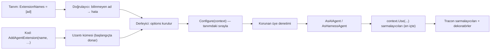

# Faz 222 — Adlı Agent Uzantıları (MAF Seçenek Kancası)

> **Durum:** 📋 Planlandı (2026-10-19)
> **Kademe:** tam — güvenlik/kiracı sınırı: kanca MAF seçenek nesnesine dokunur; K-062 (harness dosya erişimi), K-892 (çalışma dizini taraması, ücretli web araması) ve kiracı geçmişi (`ChatHistoryProvider`) bu nesnedeki üyelerle korunur. Geri dönüşü pahalı karar: `rc.1` öncesi donacak bir public genişleme noktası
> **Plan onayı:** Bakımcı, 2026-10-19 (sohbette: kanca kapsamı "ölçümle en makul seçenek" — §222.2 seçti: C)
> **Kaynak:** [ADAYLAR.md](ADAYLAR.md) · **F-588** — MAF kapsama matrisi G-01 + C-01 ([`MAF-KAPSAMA.md`](MAF-KAPSAMA.md) §7.0, §8)
> **Genellik:** MAF'ın agent seçeneklerine (`EnableMessageInjection`, `RequirePerServiceCallChatHistoryPersistence`, onay bayrakları) veya kendi `AIContextProvider`'ına ihtiyaç duyan her tüketici. Bugün tek yol fabrika agent'ıdır ve 12 model halkasını, BYOK'u, egress'i ve maliyeti kaybeder (matris §7.1). İkinci kanıt: matrisin C-07, C-08, C-13, C-24 kalemleri aynı kapıdan girer. İş tüketici kodunda kalamaz: seçenek nesnesi `internal` derleyici adımında kurulur
> **Karşı görüş:** "Tracon'un seçenek nesnesini koda açmak, derleyicinin koruduğu sınırları tüketiciye bırakır; daraltılmış bir Tracon bağlamı daha güvenlidir." Cevap §222.2: daraltılmış bağlam her MAF sürümünde Tracon'u yeni seçeneği elle açmaya zorlar ve İ1'i (MAF önce) bozar. Seçilen tasarım nesneyi açar, korunan üyeleri sınıflandırılmış bir tabloyla zorlar ve tabloyu bir ratchet testine bağlar. Yeni MAF üyesi sınıflandırılmadan derleme kırmızıdır
> **Önkoşul:** G-07 (kusur-giderme, 2026-10-19) — `RunRecordingAgent` iç agent'a düz `AgentRunOptions` verir; uzantının taktığı MAF tool middleware'i bu olmadan atardı. [Faz 221](221-MAF-KACIS-KAPISI-REHBERI.md) önerilir (rehber bu fazın kapısını "after phase 222" diye anar), zorunlu değildir
> **Paketler:** `Tracon.Abstractions` (tanım alanı), `Tracon.Core` (kayıt, kanca, koruma, doğrulayıcı), `Tracon.AspNetCore` (liste ucu, istek gövdesi), `Tracon.UI` (agent editörü), `Tracon.Client` (üretilen istemci)
> **Yeni paket:** Yok · **Migration:** Yok — tanım `agent_definitions.definition` JSON sütunundadır (`src/Tracon.PostgreSql/Migrations/0001_initial.sql:39`)
> **Public API:** büyüyor — `1.0.0` GA'dan (K-603) önce ucuz. `wc -l src/*/PublicAPI.Shipped.txt` → her dosya 0 satır (2026-10-19). Satır silinmez
> **Tüketici yüzeyi:** site: `concepts/agents.md` (yeni bölüm), `capabilities.md` (yeni satır), `guides/any-maf-feature.md` (Faz 221'in "(c) compile hook" kapısı), `http-api/` (üretilir) · sevk edilen: `AddAgentExtension` XML `<example>`'ları, `src/Tracon.Core/README.md` genişleme tablosu, `CHANGELOG.md` `Added`
> **Manuel test alanı:** [`docs/manuel-test/10-ARAYUZ-AGENT-PLAYGROUND.md`](manuel-test/10-ARAYUZ-AGENT-PLAYGROUND.md) — `🤖` editör case'i

---

## Bu Faza Başlarken

> `faz-baslangic` skill'ini uygula. Aşağıdaki liste o skill'in 2. adımıdır —
> **tamamını değil, yalnız işaret edilen bölümleri oku.**

1. Bu doküman
2. Kararlar — dosyanın tamamını **okuma**, yalnız bu kalemleri grep'le:
   ```bash
   grep -n "K-062 —\|K-892 —\|K-020 —\|K-725 —\|K-218 —" docs/KARARLAR.md
   ```
   **K-062** (harness dosya erişimi kapalı) · **K-892** (harness skill, dosya belleği, web araması yalnız tanım isteyince) · **K-020** (`MAAI001` bastırması tek dosyada) · **K-725** (`AgentDefinitionRequest` her `AgentDefinition` alanını taşır) · **K-218** (tool bağımlılığı kurulum anında alınır; MAF'ın servis sağlayıcısı boştur)
3. Önceki fazdan devir — G-07'nin izi: `docs/hafiza/maf-api.md` son madde (MAF tool middleware'i `AgentRunOptions` alt tipini reddeder)
4. Alan hafızası:
   [`hafiza/agent-derleme-ve-onbellek.md`](hafiza/agent-derleme-ve-onbellek.md) (derleme kimliği, `CompiledAgentCache`) ·
   [`hafiza/frontend-test-altyapisi.md`](hafiza/frontend-test-altyapisi.md) satır 35 (kontrolsüz form alanı sessizce düşer)
5. MAF imzaları — bu doküman 2026-10-19'da ölçtü (§222.2). Uygulama başlarken `maf-api-kesfi` ile `ChatClientAgentOptions` ve `HarnessAgentOptions` üyelerini yeniden dök; pin değiştiyse sınıflandırma tablosunu tazele

---

## Amaç

Tüketici bir MAF seçeneğini ya da kendi `AIContextProvider`'ını Tracon'un derlediği agent'a, halkaları kaybetmeden takabilsin. Kod uzantıyı **adla** kaydeder; tanım (kod ya da veritabanı) onu adla **seçer**. Bu, "kod tanımlar, veri seçer" ilkesidir (İ2; `ToolNames` ve `AddLoopEvaluator(kind, …)` bugün aynı desendir).

- **F-588** — adlı agent uzantısı: kayıt (`AddAgentExtension`), tanım alanı (`AgentDefinition.ExtensionNames`), derleyici kancası, korunan üye zorlaması, doğrulayıcı, liste ucu, konsol seçimi

Kapsam dışı (matris §7.0'da kalır): G-02 (`AddAgent` async overload — özel `IAgentSource` aynı işi yapar, Faz 221 rehberi yazar) · C-01'in `AddChatClientRing` dilimi (model boru hattı yuvası; `ModelProviderRegistry` ayrı tasarım ister).

### Bugün ne çalışmıyor — doğrulanmış kanıt

| Kanıt | Gözlem |
|---|---|
| [`AgentDefinitionCompiler.Agents.cs:20-62`](../src/Tracon.Core/Compilation/AgentDefinitionCompiler.Agents.cs) | Sohbet agent'ının `ChatClientAgentOptions`'ı burada kurulur ve hemen `AsAIAgent`'a gider; araya giren bir seam yok |
| [`AgentDefinitionCompiler.Agents.cs:249-424`](../src/Tracon.Core/Compilation/AgentDefinitionCompiler.Agents.cs) | Harness `HarnessAgentOptions`'ı burada kurulur, `AsHarnessAgent` ile biter (`:424`) |
| [`AgentDefinitionCompiler.cs:631-635`](../src/Tracon.Core/Compilation/AgentDefinitionCompiler.cs) | İki derleme noktası tek gövdeden çağrılır; gövde **senkrondur** ve public `Compile` (`:233`, `:248`, `:298`) de onu kullanır |
| [`AgentDefinitionCompiler.Dependencies.cs:37-44`](../src/Tracon.Core/Compilation/AgentDefinitionCompiler.Dependencies.cs) | Derleme kimliği tanımın kaynak üretimli JSON'unun SHA-256'sıdır → yeni tanım alanı kimliğe kendiliğinden girer |
| [`AgentDefinitionValidator.cs:233-247`](../src/Tracon.Core/Compilation/AgentDefinitionValidator.cs) | Bilinmeyen tool adı doğrulama hatasıdır (`toolNames[i]` yolu); uzantı adı aynı deseni izler |
| [`CatalogEndpoints.cs:58-73`](../src/Tracon.AspNetCore/Endpoints/CatalogEndpoints.cs) | `GET /api/loop-criteria` kodla kayıtlı adları listeler; uzantı listesi aynı deseni izler |
| [`CodeAgentSource.cs:107`](../src/Tracon.Core/Catalog/CodeAgentSource.cs) | Fabrika agent'ı derleyiciden geçmez; MAF seçeneği isteyen tüketicinin bugünkü tek yolu budur ve kaybı matris §7.1'dedir |

> Kanıtlar 2026-10-19 tarihinde doğrulandı.

---

## 222.1 — Kayıt ve seçim



- Uzantı **yalnız kodda** kaydedilir (K2). Tanım yalnız adı taşır.
- Tanımdaki sıra çağrı sırasıdır. Aynı ad iki kez → doğrulama hatası.
- Kanca **senkrondur**: derleme gövdesi senkrondur ve public `Compile` onu paylaşır (kanıt tablosu). Async kurulum isteyen uzantı bağımlılığını kayıt anında alır (K-218'in deseni).
- Kanca derleme önbelleğinin **içinde** koşar: sonuç `(kiracı, ad, tanım kimliği)` başına bir kez kurulur. Parametreli run önbelleği atlar ve kancayı her run'da koşar. Uzantı istek kapsamlı servis yakalamaz; bağlam kök sağlayıcıyı verir.
- Kod agent'ı da `AgentDefinition.ExtensionNames` kullanır. Fabrika agent'ı uzantı almaz (seçenek nesnesini zaten kendisi kurar).

## 222.2 — Kanca kapsamı: seçilen tasarım C (ölçüldü 2026-10-19)

Ölçüm: MAF 1.25 `ChatClientAgentOptions` 17, `HarnessAgentOptions` 36 settable üye taşır. Derleme probu: iki tip de tip düzeyinde deneysel değildir (MAAI001 yalnız üyelerde: harness'ta 11, sohbette 1). `uyum-probu deneysel` tip düzeyini sayar → parametre olarak açılmaları ölçüt 5'i bozmaz.

| Seçenek | Ne verir | Ölçülen bedel | Hüküm |
|---|---|---|---|
| A — korumasız tam nesne | Her MAF seçeneği | Harness'ta `FileAccessStore` K-062'yi, `DisableAgentSkillsProvider`/`AgentSkillsSource` ve `FileMemoryStore` K-892'yi, `ChatHistoryProvider` kiracı geçmişini, `ChatOptions.Tools` tool zincirini (yetki, onay, zaman aşımı) sessizce açar | Ret |
| B — Tracon'un daraltılmış bağlamı | Tracon'un seçtiği alt küme | Her MAF sürümünde yeni seçenek elle açılır; çarpan kaybolur, İ1 bozulur | Ret |
| **C — tam nesne + korunan üye tablosu + ratchet** | Her serbest MAF seçeneği; korunan üye değişirse derleme hatası | Tablo bakımı; yeni MAF üyesi ratchet testini kırar ve sınıflandırma ister | **Seçildi** |

**Korunan üye kuralı:** tanımın ya da Tracon'un güvenlik/kiracı kararlarının belirlediği üye korunur. Kanca onu değiştirirse derleme `TraconCompilationException` ile düşer; mesaj uzantı adını ve üyeyi söyler. Sessizce geri yazılmaz (K1).

| Üye | Sohbet | Harness | Neden |
|---|---|---|---|
| `Id` · `Name` · `Description` | korunur | korunur | katalog kimliği |
| `ChatOptions` (referans) ve içindeki tanım alanları: `Tools` (dizi, referans eşitliği), `Instructions`, `ResponseFormat`, `ModelId`, `Temperature`, `TopP`, `MaxOutputTokens`, `Reasoning` | korunur | korunur | tool zinciri; tanım verisi (C-03 bunları veriyle açar) |
| `ChatHistoryProvider` (referans) | korunur | korunur | kiracı geçmişi, konsol, `/v1/conversations` |
| `AIContextProviders` | Tracon'unkiler sıralı **önek** kalır; sona ekleme serbest | aynı | skill, compaction, bellek, MCP kaynakları |
| `HarnessInstructions` · `MaxContextWindowTokens` · `MaxOutputTokens` · `MaximumIterationsPerRequest` · `DisableCompaction` · `CompactionStrategy` · `DisableTodoProvider` · `DisableAgentModeProvider` · `DisableToolAutoApproval` | — | korunur | tanım verisi (`HarnessSettings`, `Compaction`) |
| `DisableFileMemory` · `FileMemoryStore` · `FileAccessStore` · `FileAccessProviderOptions` · `DisableWebSearch` · `DisableAgentSkillsProvider` · `AgentSkillsSource` | — | korunur | K-062, K-892, F-578 |
| `BackgroundAgents` · `BackgroundAgentsProviderOptions` · `LoopEvaluators` · `LoopAgentOptions` · `DisableOpenTelemetry` · `OpenTelemetrySourceName` | — | korunur | ağaç bütçesi, döngü kaydı, span deposu |
| Geri kalan her üye (bugün: `EnableMessageInjection`, `AllowConcurrentInvocation`, `UseProvidedChatClientAsIs`, `RequirePerServiceCallChatHistoryPersistence`, üç `…ChatHistoryProviderConflict`, `DisableApprovalNotRequiredFunctionBypassing`, `DisableApprovalResponseBinding`, `EnableInvocableFunctionBypassing`, `ToolApprovalAgentOptions`, `AgentModeProviderOptions`) | serbest | serbest | MAF özelliği; tüketicinin seçimi |

**Ratchet:** sınıflandırma kodda tek bir tablodur. Bir test `ChatClientAgentOptions`, `HarnessAgentOptions` ve `ChatOptions`'ın settable üyelerini yansımayla sayar; tabloda olmayan üye testi kırar (G-07'nin `RunOptionsHandoffTests` deseni). Yansıma yalnız testtedir; çalışma anı kodu AOT güvenlidir.

**Bilinen sınır (belgelenir):** uzantının eklediği `AIContextProvider` tool ekleyebilir. O tool Tracon'un tool zincirinden geçmez (yetki, onay, zaman aşımı yok); çağrısı içerikten kaydedilir. Bu, MAF'ın harness provider'larının bugünkü durumudur ve kod tanımlar (K2 korunur). Site bu sınırı açıkça yazar.

## 222.3 — Bağlam ve sarmalayıcı

Uzantı bağlamı tanımı salt okunur verir, iki seçenek nesnesinden birini verir ve derlenen agent'ın **en içine** bir sarmalayıcı eklemeye izin verir (`context.Use(Func<AIAgent, AIAgent>)`). Sarmalayıcı `AIAgentBuilder` ile MAF middleware'i takar; G-07'den sonra tool middleware'i de çalışır. Tracon'un derleme sarmalayıcıları (`UnboundParameterGuard`, yapılandırılmış yanıt doğrulayıcısı) ve dekoratörleri dışta kalır.

## 222.4 — Doğrulama, liste ucu, konsol

- Doğrulayıcı: bilinmeyen ad → hata, yol `extensionNames[i]`; aynı ad iki kez → hata. `POST /api/agents/validate` ve kaydetme aynı kuralı kullanır.
- `GET /api/agent-extensions` (kök düzey; `loop-criteria` ile aynı gerekçe): ad + açıklama. Rol Reader, kapsam `AgentsRead`. Liste hiçbir uzantıyı koşmaz.
- `AgentDefinitionRequest` yeni alanı taşır (K-725). `AgentDescriptor.ExtensionNames` katalogda görünür.
- Konsol agent editörü: tool seçicisinin deseniyle çoklu seçim; boş liste geçerlidir. Kontrolsüz alan düşme tuzağı (`frontend-test-altyapisi.md:35`) için full-replace editör testi genişler. `en.ts` + `tr.ts`.

---

## Planlanan Public API

> Taslak imzalardır. Gerçekleşen imzalar kapanışta ayrı bir bölüme yazılır.

```csharp
// Tracon.Abstractions
public sealed record AgentDefinition
{
    // yeni: kodla kayıtlı uzantıların adları, çağrı sırasıyla
    public IReadOnlyList<string> ExtensionNames { get; init; } = [];
}

public sealed record AgentDescriptor
{
    public IReadOnlyList<string> ExtensionNames { get; init; } = [];
}

// Tracon.Core
public interface IAgentExtension
{
    string Name { get; }
    string? Description { get; }
    void Configure(AgentExtensionContext context);
}

public sealed class AgentExtensionContext
{
    public AgentDefinition Definition { get; }
    public string TenantId { get; }
    public IServiceProvider Services { get; }
    public ChatClientAgentOptions? ChatAgentOptions { get; }   // sohbet agent'ı; harness için null
    public HarnessAgentOptions? HarnessAgentOptions { get; }   // harness agent'ı; sohbet için null
    public void Use(Func<AIAgent, AIAgent> wrap);
}

public static partial class TraconBuilderExtensions
{
    public static ITraconBuilder AddAgentExtension<TExtension>(this ITraconBuilder builder) where TExtension : class, IAgentExtension;
    public static ITraconBuilder AddAgentExtension(this ITraconBuilder builder, IAgentExtension extension);
    public static ITraconBuilder AddAgentExtension(this ITraconBuilder builder, string name, Action<AgentExtensionContext> configure, string? description = null);
}
```

Bugün eklemek bedava / sonradan eklemek kırıcı: `AgentDefinition` ve `AgentDescriptor` `sealed record`'dur; GA'dan sonra alan eklemek kırıcıdır.

### HTTP `endpoint`'leri

| Metot | Yol | Rol | Ne yapar |
|---|---|---|---|
| `GET` | `/api/agent-extensions` | Reader | Kodla kayıtlı uzantıların adını ve açıklamasını listeler |

### Arayüz payı

Agent editörüne bir çoklu seçim alanı. Bundle payı uygulama anında ölçülür ve yazılır (`ls -l src/Tracon.UI/wwwroot/assets/`, gzip KB).

---

## Planlanan Dosya Listesi

```
src/Tracon.Abstractions/Agents/AgentDefinition.cs          (alan)
src/Tracon.Abstractions/Agents/AgentDescriptor.cs          (alan)
src/Tracon.Core/Extensions/IAgentExtension.cs
src/Tracon.Core/Extensions/AgentExtensionContext.cs
src/Tracon.Core/Extensions/AgentExtensionRegistry.cs       (internal; ad → uzantı, başlangıçta donar)
src/Tracon.Core/Extensions/AgentOptionsGuard.cs            (internal; korunan üye tablosu)
src/Tracon.Core/TraconBuilderExtensions.Agents.cs          (üç overload)
src/Tracon.Core/Compilation/AgentDefinitionCompiler.Agents.cs  (iki kanca noktası)
src/Tracon.Core/Compilation/AgentDefinitionValidator.cs    (ad denetimi)
src/Tracon.AspNetCore/Endpoints/CatalogEndpoints.cs        (liste ucu)
src/Tracon.AspNetCore/Contracts/AgentContracts.cs          (AgentDefinitionRequest, K-725)
src/Tracon.UI/frontend/src/screens/agents.tsx · locales/en.ts · locales/tr.ts
src/Tracon.Client/Generated/…                              (yeniden üretilir)
```

---

## Hata Modları ve Testler

| Ne bozulabilir | Seviye | Test sınıfı |
|---|---|---|
| Uzantı sohbet ve harness agent'ında çağrılmaz ya da sırası tanımdan farklı | Fonksiyonel (DI + derleme + HTTP run) | `AgentExtensionRunTests` |
| Uzantının taktığı `AIContextProvider` ve tool middleware'i run'da etkisiz | Fonksiyonel | `AgentExtensionRunTests` |
| Kanca korunan üyeyi değiştirir ve derleme geçer (her tablo satırı) | Birim | `AgentOptionsGuardTests` |
| MAF/MEAI yeni settable üye ekler ve sınıflandırılmadan geçer | Birim (ratchet) | `AgentOptionsGuardTests.Every_member_is_classified` |
| Bilinmeyen ya da çift ad kaydedilir; `validate` yakalamaz | Fonksiyonel (HTTP) | `AgentExtensionValidationTests` |
| Aynı ad iki kez kaydedilir | Birim | `AgentExtensionRegistrationTests` |
| `PUT /api/agents/{name}` alanı düşürür (K-725) | Fonksiyonel | `AgentDefinitionRoundTripTests` (genişler) |
| Konsol editörü alanı kaydetmede düşürür | Vitest | `full-replace-editors.test.tsx` (genişler) |
| Önbellek uzantı listesi değişince eski agent'ı döndürür | Fonksiyonel | `AgentDefinitionCacheInvalidationTests` (genişler) |
| Kanca atar → run değil derleme düşer; hata uzantı adını taşır | Fonksiyonel | `AgentExtensionRunTests` |
| Bir kiracının tanımı başka kiracının agent'ını etkiler | Fonksiyonel | `AgentExtensionRunTests` (iki kiracı) |
| Liste ucu bir uzantıyı koşar | Fonksiyonel | `AgentExtensionValidationTests` |

Beş soru: iptal — kanca senkron, token almaz; derleme iptali bugünkü gibi · eşzamanlılık — kayıt başlangıçta donar; önbellek tek kuruluşu garanti eder (paralel run ile test) · boş/aşırı girdi — boş liste geçerli; ad deseni `RunEventCustomTypes.IsValidType` ile aynı · başka kiracı — tablo satırı · alt sistem hatası — kanca atarsa derleme hatası, sessiz geçiş yok.

---

## Manuel Kabul Case'leri

| # | Ön koşul | Adımlar | Beklenen sonuç |
|---|---|---|---|
| 1 | `samples/Tracon.Api` bir uzantı kaydeder | 🤖 Playwright: konsolda agent'ı aç, uzantıyı seç, kaydet, sayfayı yenile | Seçim kalır; `GET /api/agents/{name}` `extensionNames` döner; run uzantının izini taşır |

---

## Açık Sorular

| # | Soru | Seçenekler | Öneri |
|---|---|---|---|
| 1 | Ad: "extension" mı, daha dar bir ad mı? | A: `AddAgentExtension` / `ExtensionNames` · B: `AddAgentFeature` / `FeatureNames` | A — kapsam MAF seçeneği + provider + sarmalayıcıdır; "feature" MAF'ın kendi seçenek adlarıyla karışır |
| 2 | `ChatOptions.AdditionalProperties` korunur mu? | A: serbest · B: korunur | A — sağlayıcıya özgü ayarlar tanımda `ProviderSettings` ile gelir ve registry'de uygulanır; bu sözlük MAF katmanındadır. Uygulama başında registry'nin bu sözlüğü okuyup okumadığını ölç; okuyorsa B |
| 3 | Kanca harness'ta `AsHarnessAgent`'tan önce mi koşar, `HarnessLoopBoundaryChatClient` kurulduktan sonra mı? | Tek nokta: `options` kurulduktan hemen sonra | Tek nokta; istemci zinciri seçeneklerden bağımsızdır |
| 4 | 🚨 Sohbet agent'ında `RequirePerServiceCallChatHistoryPersistence` serbest mi? Açılırsa MAF geçmişi her model çağrısında yükler ve F-582 sınıfı (cevaplanmış onay isteği Tracon döngüsüne döner) sohbet agent'ında doğar | A: üye korunur · B: serbest; sohbet agent'ı da `HarnessLoopBoundaryChatClient` seam'inden geçer | B — seam üye kapalıyken davranış değiştirmez (yalnız güncelleme kopyası); `HarnessApprovalContinuationTests`'in sohbet + üye açık kolu eklenir. Kaynak: `docs/hafiza/maf-harness-ve-loop.md` F-582 maddesi |

---

## Bitiş Ölçütleri (DoD)

- [ ] Uzantı seçen bir sohbet agent'ı ve bir harness agent'ı `POST /api/agents/{name}/run` ile koşar; uzantının provider'ı modele bağlam ekler ve tool middleware'i tool çağrısını görür
- [ ] Korunan her üyenin değişimi `TraconCompilationException` ile düşer; mesaj uzantı adını ve üyeyi taşır
- [ ] Ratchet testi üç tipin her settable üyesini sınıflandırılmış bulur
- [ ] `POST /api/agents/validate` bilinmeyen adı `extensionNames[i]` yoluyla reddeder; `GET /api/agent-extensions` kayıtlı adları döner
- [ ] Konsolda seçim kaydedilir ve yenilemede kalır
- [ ] `uyum-probu.cs -- deneysel` yeni public maruziyet göstermez
- [ ] Dört doğrulama kapısı sıfır uyarı verir
- [ ] `samples/Tracon.Api` ile gerçek `run` yapıldı, çıktı belgeye yazıldı
- [ ] `secret` taraması boş döndü
- [ ] `🤖` case `docs/manuel-test/10-ARAYUZ-AGENT-PLAYGROUND.md` içinde ve koşuldu; gerisi otomatik testte
- [ ] `faz-denetim` koşuldu; 🔴 bulgu kalmadı
- [ ] `docs-site/` güncellendi; `npm run build` + `check-links.mjs` temiz
- [ ] `en.ts` ve `tr.ts` eksiksiz; bundle payı ölçüldü ve yazıldı

### Doğrulama komutları

```bash
curl -s http://localhost:5081/tracon/api/agent-extensions
curl -s -X POST http://localhost:5081/tracon/api/agents/validate -H 'Content-Type: application/json' \
  -d '{"name":"x","instructions":"…","model":{"provider":"openai","model":"…"},"extensionNames":["missing"]}'
```

---

## Riskler

| Risk | Önlem |
|------|-------|
| Korunan tablo MAF'ın yeni üyesini kaçırır | Ratchet testi; `maf-api-kesfi` dökümü fazın ilk işi |
| Uzantının provider'ı tool zincirini atlayan tool ekler | Bilinen sınır olarak sitede yazılır; K-* kaydı alternatifi (A) adıyla anar |
| Kanca önbellekte kiracıya özgü durum yakalar | Bağlam kiracıyı verir, önbellek anahtarı kiracıyı taşır; iki kiracılı test |
| Konsol editörü alanı düşürür (K-725 sınıfı) | Full-replace editör testi ve round-trip fonksiyonel testi |

---

<!-- ============================================================
     AŞAĞISI ÇALIŞIRKEN DOLAR — doküman kapanışta silinir (`faz-kapat`).
     Kalıcı kısım `faz-tamamlama` Adım 5'te yerine taşınır. Başlıkları SİLME.
     ============================================================ -->

## Plandan Sapmalar

> Çalışırken dolar. Plan ile gerçek arasındaki fark **gizlenmez**. Kapanışta
> kapanış commit mesajına taşınır.

## Bu Fazda Verilen Kararlar

> Çalışırken dolar. Dört kategoriden birine giren karar (AGENTS.md)
> `docs/KARARLAR.md`'ye K-NNN ve kategori etiketiyle girer; girmeyen karar
> kapanışta commit mesajına taşınır (`faz-tamamlama` Adım 8). Plan numara rezerve
> etmez.

## Süreç Ölçümü

| Metrik | Değer |
|---|---|
| Plan revizyonu sayısı | |
| Düzeltme turu sayısı | |
| 🔴 bulgu: gerçek / gürültü / araştırılacak | |
| Fazın ürettiği regresyon | |
| Faz kapandıktan sonra bulunan kusur | ölçülmedi (kapanış anı) |

## Denetim Bulguları

> `faz-denetim` çıktısı. Her satır: bulgu · seviye (🔴/🟡/🟢) · sonuç
> (düzeltildi / gerekçelendi / F-NN olarak devredildi). 🟢 kapanışta
> `ADAYLAR.md`'ye gider.
