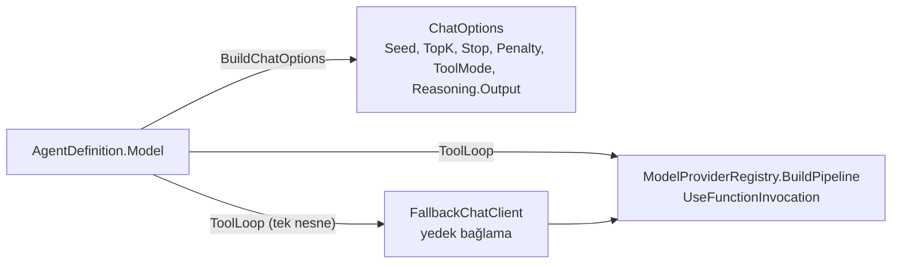

# Faz 225 — Model Örneklemesi ve Tool Döngüsü Tanımda

> **Durum:** ✅ Tamamlandı (2026-10-20)
> **Kademe:** tam — public API'den silinen satır (`ModelBinding.AllowConcurrentToolCalls` → `ModelBinding.ToolLoop`) · kalıcı veri (saklanan tanım yükünün biçimi değişir)
> **Plan onayı:** farukatasoy, 2026-10-20 (şekil: iç içe `ToolLoop`)
> **Kaynak:** [ADAYLAR.md](ADAYLAR.md) · **F-598**
> **Genellik:** İlk ilke: model ayarı tanımın işidir (K-1029, K-1039). Bugün `Seed`, `TopK`, `StopSequences`, `ToolMode`, penalty'ler ve `AllowMultipleToolCalls` yalnız kodla (uzantı) ayarlanır ve tanım sürümüne girmez; `Reasoning.Output` hiçbir yolla ayarlanamaz. Her sağlayıcı tüketicisi etkilenir; iş tüketici kodunda kalamaz çünkü tanım sürümü, deney ve replay modeli tanımdan okur.
> **Karşı görüş:** "Alanların çoğu sağlayıcıya özgüdür; sessiz düşme olur." Cevap: §225.3 destek tablosu her alanı her sağlayıcı yüzeyi için ölçülmüş olarak taşır ve desteklenmeyen alan **derleme hatası** verir (K-208 deseni). Sessiz düşme yoktur.
> **Önkoşul:** Yok (K-1038, K-1039 commit `96eb7843`'te)
> **Paketler:** `Tracon.Abstractions`, `.Core`, `.OpenAI`, `.Anthropic`, `.Google`, `.Sql.Shared`, `.AspNetCore`, `.Client`, `.UI`
> **Yeni paket:** Yok · **Migration:** Yok (tanım JSON yükünde durur; eski anahtar okumada çevrilir)
> **Public API:** büyüyor ve bir satır taşınıyor — `PublicAPI.Shipped.txt` dosyaları boş (`wc -l src/*/PublicAPI.Shipped.txt` toplam 17 satır, 2026-10-20), yani `1.0.0` GA'dan (K-603) önce ucuz
> **Tüketici yüzeyi:** site: `guides/model-providers.md`, `concepts/tools.md` (`AllowConcurrentToolCalls`), `capabilities.md`, `guides/any-maf-feature.md` (korunan üye listesi), `reference/changelog.md` · sevk edilen: `ModelBinding` XML doc, `src/Tracon.Core/README.md` model örneği (varsa)
> **Manuel test alanı:** `docs/manuel-test/10-ARAYUZ-AGENT-PLAYGROUND.md` (konsol model bölümü) — `🤖`

---

## Bu Faza Başlarken

1. Bu doküman
2. Kararlar — yalnız grep:
   ```bash
   grep -n "K-034 —\|K-208 —\|K-553 —\|K-1029 —\|K-1031 —\|K-1035 —\|K-1038 —\|K-1039 —" docs/KARARLAR.md
   ```
   **K-034** (geçersiz `ReasoningEffort` derlemede reddedilir), **K-208** (sağlayıcının desteklemediği ayar sessizce yok sayılmaz), **K-553** (`AllowConcurrentToolCalls` Tracon'un FIC'ine bağlanır), **K-1029** (uzantı koruma tablosu), **K-1031** (yüke sonradan eklenen liste `?` taşır), **K-1038/K-1039** (korunan üye kuralı ve run başına kural aynı tabloyu okur)
3. Ölçüm kaynağı: [`MAF-KAPSAMA.md`](MAF-KAPSAMA.md) §0 #29, #30 ve §8.0 C-03 satırı
4. Alan hafızası: [`hafiza/model-boru-hatti.md`](hafiza/model-boru-hatti.md) (halka sırası, fallback), [`hafiza/agent-derleme-ve-onbellek.md`](hafiza/agent-derleme-ve-onbellek.md) (uzantı ve koruma tablosu notu), [`hafiza/openai-saglayici.md`](hafiza/openai-saglayici.md) (`RawRepresentationFactory` ve sağlayıcı ayarları)
5. Konsol: [`hafiza/frontend.md`](hafiza/frontend.md) — yalnız agent düzenleyicisi bölümü

---

## Amaç

Tanım modelin örneklemesini ve tool döngüsünü veriyle seçer. Ayar tanım sürümüne,
deneye ve replay'e girer. Uzantı aynı ayarı artık değiştiremez; tek kaynak tanımdır.
Bir sağlayıcı yüzeyi alanı desteklemiyorsa derleme durur ve alanı ve sağlayıcıyı
adlandırır.

- **F-598** — `ModelBinding`'e örnekleme alanları, `ReasoningOutput` ve iç içe `ToolLoop`; destek tablosu; koruma tablosunda `Free` → `Protected`.

### Bugün ne çalışmıyor — doğrulanmış kanıt

| Kanıt | Gözlem |
|---|---|
| [`AgentDefinitionCompiler.ChatOptions.cs:148-173`](../src/Tracon.Core/Compilation/AgentDefinitionCompiler.ChatOptions.cs) | `BuildChatOptions` yalnız `Instructions`, `ModelId`, `Temperature`, `TopP`, `MaxOutputTokens`, `Reasoning.Effort`, `ResponseFormat`, `Tools` yazar |
| [`AgentOptionsGuard.cs:76-86`](../src/Tracon.Core/Extensions/AgentOptionsGuard.cs) | `AllowMultipleToolCalls`, `FrequencyPenalty`, `PresencePenalty`, `Seed`, `StopSequences`, `ToolMode`, `TopK` `Free`: yalnız uzantı ayarlar (gerçek host probu 2026-10-20: değerler sağlayıcıya ulaştı) |
| `AgentOptionsGuard.cs` `Reasoning` satırı | `Reasoning.Output` korunur ve tanımda alanı yoktur → probe `400`; OpenAI akıl yürütme özeti K0 (§0 #29) |
| [`OpenAIProviderNames.cs:45`](../src/Tracon.OpenAI/OpenAIProviderNames.cs) | OpenAI `SupportedSettings` boş: `ProviderSettings` ham yol değildir |
| [`ModelProviderRegistry.cs:405-418`](../src/Tracon.Core/Models/ModelProviderRegistry.cs) | FIC yalnız `AllowConcurrentInvocation` ve `MaximumIterationsPerRequest` alır; `MaximumConsecutiveErrorsPerRequest`, `TerminateOnUnknownCalls` sabit |
| [`FallbackChatClient.cs:470-479`](../src/Tracon.Core/Models/FallbackChatClient.cs) | Yedek halkanın bağlaması döngü ayarlarını **tek tek elle** kopyalar (`AllowConcurrentToolCalls`, `ToolLoopIterationLimit`): yeni alan unutulursa yedek halka varsayılanla koşar |
| [`ModelBinding.cs:148`](../src/Tracon.Abstractions/Agents/ModelBinding.cs), `:162` | `AllowConcurrentToolCalls` düz public alan; `ToolLoopIterationLimit` internal |
| [`AgentDefinitionPayload.cs:36`](../src/Tracon.Sql.Shared/Internal/AgentDefinitionPayload.cs) | Yük `ModelBinding`'i olduğu gibi yazar: alanın yeri değişirse eski satır okunurken değer sessizce kaybolur |
| `RunChatOptionsRule.cs` (K-1039) | Run başına seçenek korunan üyeyi reddeder; korunan küme bu fazda büyür, run kuralı otomatik izler |

> Kanıtlar 2026-10-20 tarihinde doğrulandı.

---

## 225.1 — Alanlar

`ModelBinding`'e düz örnekleme alanları (bugünkü `Temperature`/`TopP` deseniyle):

| Alan | Tip | `ChatOptions` | Not |
|---|---|---|---|
| `Seed` | `long?` | `Seed` | |
| `TopK` | `int?` | `TopK` | `> 0` |
| `StopSequences` | `IReadOnlyList<string>?` | `StopSequences` | boş liste = ayarsız; K-1031: yükte `?`, okumada `?? []` değil `null` korunur |
| `FrequencyPenalty` | `float?` | `FrequencyPenalty` | |
| `PresencePenalty` | `float?` | `PresencePenalty` | |
| `ToolMode` | `string?` | `ToolMode` | `"auto"` · `"none"` · `"required"` · `"required:<tool>"`; `<tool>` tanımın `ToolNames`'inde olmalı |
| `AllowMultipleToolCalls` | `bool?` | `AllowMultipleToolCalls` | `AllowConcurrentToolCalls`'tan ayrıdır: biri modelin bir turda birden çok çağrı üretmesi, öbürü Tracon'un onları aynı anda koşması |
| `ReasoningOutput` | `string?` | `Reasoning.Output` | `"none"` · `"summary"` · `"full"`; `ReasoningEffort` ile aynı ayrıştırma ve hata deseni (K-034) |

İç içe döngü ayarları — yeni public `sealed record ToolLoopSettings`, `ModelBinding.ToolLoop`:

| Üye | Tip | FIC üyesi | Not |
|---|---|---|---|
| `AllowConcurrentToolCalls` | `bool` | `AllowConcurrentInvocation` | `ModelBinding.AllowConcurrentToolCalls`'tan taşınır (K-553 anlamı aynı) |
| `MaximumConsecutiveErrors` | `int?` | `MaximumConsecutiveErrorsPerRequest` | `>= 0` |
| `TerminateOnUnknownCalls` | `bool?` | `TerminateOnUnknownCalls` | varsayılan MEAI'nin (`false`) |
| `IterationLimit` (internal) | `int?` | `MaximumIterationsPerRequest` | bugünkü `ModelBinding.ToolLoopIterationLimit` buraya taşınır |

`IncludeDetailedErrors` **eklenmez**: Tracon bilerek kapalı tutar (`ExplainedFailureAIFunction.cs:13`).

## 225.2 — Tek kopya: yedek halka

`FallbackChatClient` yedek bağlamayı `ToolLoop = _primaryBinding.ToolLoop` ile kurar.
Elle alan kopyası biter (K-483 sınıfı: elle tekrarlanan ifadeye terim eklemek).
Örnekleme alanları zaten `ChatOptions` ile her halkaya gider (`SamplingCapabilityCheck`
açıklaması); kopya gerekmez.



## 225.3 — Destek tablosu ve derleme hatası

Ölçüldü (MEAI 10.11, Anthropic 12.58, Google.GenAI 1.26.1 adaptörleri, decompile,
2026-10-20): `✓` adaptör alanı tele yazar, `✗` sessizce düşürür.

| Alan | OpenAI Chat (`openai`) | OpenAI Responses (`openai-responses`) | Anthropic | Google |
|---|---|---|---|---|
| `Seed` | ✓ | ✗ | ✗ | ✓ |
| `TopK` | ✗ | ✗ | ✓ | ✓ |
| `StopSequences` | ✓ | ✗ | ✓ | ✓ |
| `FrequencyPenalty` | ✓ | ✗ | ✗ | ✓ |
| `PresencePenalty` | ✓ | ✗ | ✗ | ✓ |
| `ToolMode` | ✓ | ✓ | ✓ | ✓ |
| `AllowMultipleToolCalls` | ✓ | ✓ | ✓ | ✗ |
| `ReasoningOutput` | **ölçülmeli** | ✓ (`reasoning.summary`) | **ölçülmeli** | ✓ (`includeThoughts`) |

Tasarım: sağlayıcı paketi desteklediği alanları bildirir; derleyici ve doğrulayıcı
**tek kural** okur (`SamplingCapabilityCheck` deseni, iki okuyucu). Kural birincil
bağlamayı **ve her yedek halkayı** denetler. Bildirmeyen üçüncü taraf sağlayıcı
için alan reddedilir (sessiz düşme yok). Bildirimin yeri Açık Soru 1'dedir.
`OpenAICompatible` sağlayıcıları Chat Completions yüzeyini paylaşır; destek satırı
`openai` ile aynıdır.

## 225.4 — Koruma tablosu

`AgentOptionsGuard.Chat`'te `AllowMultipleToolCalls`, `FrequencyPenalty`,
`PresencePenalty`, `Seed`, `StopSequences`, `ToolMode`, `TopK` `Free` → `Protect`.
Sonuç: uzantı bu üyeleri artık değiştiremez (bugünkü K1 yolu kapanır, veri yolu
açılır); K-1039 run kuralı aynı tabloyu okuduğu için run başına seçenek de bu
üyeleri reddeder. `guides/any-maf-feature.md` korunan listesi güncellenir; serbest
örnek `ThrowOnChatHistoryProviderConflict` kalır.

## 225.5 — Eski anahtar: yük, HTTP, yapılandırma

| Yol | Davranış |
|---|---|
| Saklanan yük (`agent_definitions` JSON) | Eski `model.allowConcurrentToolCalls` okumada `model.toolLoop.allowConcurrentToolCalls`'a çevrilir; yeni yazım yalnız yeni yeri yazar. Kapı: yük gidiş-dönüş testi (`AgentDefinitionPayloadRoundTripTests` deseni) eski JSON'la |
| HTTP (`PUT /api/agents/{name}`, `POST /api/agents/validate`) | Eski anahtar `400` alır ve yeni yolu adlandırır (K-1027 deseni: sessiz yok sayma yok). Bugün uç tanınmayan üyeyi **yok sayıyor** (yalnız `WorkflowFunctionSettings.cs:194` `Disallow` kullanır) — eski anahtarın açık denetimi gerekir |
| Yapılandırma (`Tracon:UtilityModel`) | Yardımcı model tool koşturmaz; eski anahtar bağlanmaz. Bilinmeyen anahtar raporu (`UtilityModel` "okunamayan sayılar" listesi deseni) varsa ona eklenir — ölçülmeli |

---

## Planlanan Public API

```csharp
// Tracon.Abstractions
public sealed record ModelBinding
{
    public long? Seed { get; init; }
    public int? TopK { get; init; }
    public IReadOnlyList<string>? StopSequences { get; init; }
    public float? FrequencyPenalty { get; init; }
    public float? PresencePenalty { get; init; }
    public string? ToolMode { get; init; }
    public bool? AllowMultipleToolCalls { get; init; }
    public string? ReasoningOutput { get; init; }
    public ToolLoopSettings ToolLoop { get; init; } = new();
    // AllowConcurrentToolCalls kalkar → ToolLoop.AllowConcurrentToolCalls
    // ToolLoopIterationLimit (internal) kalkar → ToolLoop.IterationLimit (internal)
}

public sealed record ToolLoopSettings
{
    public bool AllowConcurrentToolCalls { get; init; }
    public int? MaximumConsecutiveErrors { get; init; }
    public bool? TerminateOnUnknownCalls { get; init; }
    internal int? IterationLimit { get; init; }
}
```

"Bugün eklemek bedava / sonradan eklemek kırıcı": `ModelBinding` `sealed record`'dur;
GA'dan sonra alan taşımak kırıcıdır. Bugün `Shipped` boş.

### HTTP `endpoint`'leri

Yeni uç yok. `AgentDefinition` sözleşmesi büyür (OpenAPI üretimi, `Tracon.Client`
NSwag, `@tracon/client`). Eski anahtar §225.5.

### Arayüz payı

`screens/agent-editor/sections/model-section.tsx`: örnekleme alt bölümü (kapalı
katlanır), `ToolLoop` alt bölümü, `ReasoningOutput` seçici. `en.ts` + `tr.ts`.
Bundle payı faz başında `npm run build` (`scripts/postbuild.mjs`, 250 KB gzip)
çıktısından ölçülür ve yazılır.

---

## Planlanan Dosya Listesi

```
src/Tracon.Abstractions/Agents/ModelBinding.cs            (alanlar, ToolLoop)
src/Tracon.Abstractions/Agents/ToolLoopSettings.cs        (yeni)
src/Tracon.Abstractions/Models/<destek bildirimi>.cs      (Açık Soru 1)
src/Tracon.Core/Compilation/AgentDefinitionCompiler.ChatOptions.cs
src/Tracon.Core/Compilation/AgentDefinitionValidator.cs
src/Tracon.Core/Compilation/<SamplingSupportCheck>.cs     (SamplingCapabilityCheck deseni)
src/Tracon.Core/Extensions/AgentOptionsGuard.cs
src/Tracon.Core/Models/ModelProviderRegistry.cs
src/Tracon.Core/Models/FallbackChatClient.cs
src/Tracon.OpenAI/ · src/Tracon.Anthropic/ · src/Tracon.Google/   (destek bildirimi)
src/Tracon.Sql.Shared/Internal/AgentDefinitionPayload.cs  (eski anahtar okuma)
src/Tracon.AspNetCore/Contracts/AgentContracts.cs · Endpoints (eski anahtar 400)
src/Tracon.Client/ (üretilir) · src/Tracon.UI/frontend/src/screens/agent-editor/sections/model-section.tsx
```

---

## Hata Modları ve Testler

| Ne bozulabilir | Seviye | Test sınıfı |
|---|---|---|
| Alan `ChatOptions`'a yazılmaz (imza değişti, gövde değişmedi) | Fonksiyonel (gerçek host + `FakeModelProvider.Requests`) | `ModelSamplingFieldsTests` |
| Yedek halka döngü ayarını almaz | Birim + Fonksiyonel | `FallbackChatClientTests` (tek nesne), `FallbackToolSideEffectTests` deseni |
| Desteklenmeyen alan sessizce düşer | Fonksiyonel (`openai-responses` + `Seed` → derleme `400`, yedek halka dahil) | `ModelSamplingSupportTests` |
| Uzantı korunan üyeyi değiştirir | Birim (ratchet otomatik: `Every_protected_row_catches_a_change`) + Fonksiyonel | `AgentOptionsGuardTests`, `AgentExtensionRunTests` |
| Run başına seçenek yeni korunan üyeyi geçirir | Birim | `RunChatOptionsRuleTests` (yeni üyeler satırı) |
| Eski yük okunurken `AllowConcurrentToolCalls` kaybolur | Sözleşme/entegrasyon (üç SQL) | `AgentDefinitionPayloadRoundTripTests` (eski JSON) |
| Eski HTTP anahtarı sessizce yok sayılır | Fonksiyonel | `AgentDefinitionLegacyFieldTests` |
| `ToolMode = "required:<tool>"` tanımda olmayan tool'u adlandırır | Birim (doğrulayıcı yolu) | `AgentDefinitionValidatorTests` |
| Yanıt önbelleği yeni alanları ayırmaz | Birim | `TraconResponseCachingChatClientTests` (anahtar `ChatOptions` JSON'unun tamamını özetler — ölçüldü; testle kilitle) |

Beş soru: iptal (değişmez) · eşzamanlılık (`AllowConcurrentToolCalls` testleri taşınır) ·
boş/aşırı girdi (`StopSequences` boş, `TopK <= 0`, bilinmeyen `ReasoningOutput`) ·
başka kiracı (yok; tanım kiracı kapsamlı) · alt sistem hatası (sağlayıcı `400`'ü
bugünkü normalizasyondan geçer).

---

## Manuel Kabul Case'leri

| # | Ön koşul | Adımlar | Beklenen sonuç |
|---|---|---|---|
| 1 🤖 | Örnek uygulama, gerçek OpenAI | `openai-responses` bağlamalı agent'a `reasoningOutput: "summary"` yaz, run koş | Run olaylarında `ReasoningDelta` görünür |
| 2 🤖 | Aynı | `openai-responses` bağlamaya `seed: 7` yaz, kaydet | `400`; hata alanı ve sağlayıcıyı adlandırır |
| 3 🤖 | Konsol (Playwright) | Model bölümünde `TopK` ve `ToolLoop` ayarla, kaydet, yenile | Değerler kalır; sürüm farkı alanları gösterir |

---

## Açık Sorular

Üçü de uygulamada kapandı (2026-10-20).

| # | Soru | Karar |
|---|---|---|
| 1 | Destek bildirimi nerede durur? | **A** — `IModelProvider`'a dokunmayan opsiyonel `ISamplingSupport` (`SamplingFields` bayrakları). Registry `ModelProviderDescriptor.SupportedSamplingFields` (internal) olarak okur; `SamplingSupportCheck` derleyiciye ve doğrulayıcıya tek kuraldır. Bildirmeyen sağlayıcı hiçbir alanı göndermez |
| 2 | `ReasoningOutput` Chat Completions ve Anthropic'te ne yapar? | Ölçüldü (decompile, MEAI.OpenAI 10.11 / Anthropic 12.58): Chat Completions `Reasoning.Output`'u hiç okumaz → `✗`; Anthropic `AdaptiveThinking(Output)` ile `thinking.display` (`omitted`/`summarized`) yazar → `✓`. Tablo §225.3 bu hâliyle koda girdi |
| 3 | `StopSequences` üst sınırı nerede? | **B** — sağlayıcının `400`'ü. Gerçek OpenAI koşumunda `gpt-5.4-mini` `stop`'u **model düzeyinde** reddetti (`unsupported_parameter`): yüzey göndermesi modelin kabulü demek değildir; bu `SupportsSampling` benzeri bir katalog bayrağı işidir (aday) |

---

## Bitiş Ölçütleri (DoD)

- [x] Sekiz alan ve `ToolLoop` tanımdan sağlayıcı isteğine ulaşır — `ModelSamplingFieldsTests` (HTTP → depo → derleyici → `FakeModelProvider.Requests`, sekiz alan + `reasoningEffort`), `ModelSamplingWireTests` (gerçek SDK gövdesi: OpenAI Chat, Responses, Anthropic), `ToolLoopSettingsEndpointTests` (`MaximumConsecutiveErrors`, `TerminateOnUnknownCalls`; eşzamanlılık `ConcurrentToolInvocationTests`)
- [x] `FallbackChatClient` `ToolLoop`'u tek nesne olarak kopyalar; `grep -n "AllowConcurrentToolCalls =" src/Tracon.Core/Models/FallbackChatClient.cs` boş (`ToolLoopSettingsTests.Every_fallback_link_runs_its_loop_with_the_primarys_whole_settings`: `ShouldBeSameAs`)
- [x] Destek tablosundaki her `✗` derleme `400` verir; yedek halka dahil — `ModelSamplingSupportTests` (yedi sağlayıcı adı × sekiz alan), `SamplingSupportTests` (yedek halka, bildirmeyen sağlayıcı). Tablo telden de doğrulandı (`ModelSamplingWireTests`); Google yalnız decompile'a dayanır (yerel sahte sunucu yok)
- [x] Yedi üye `Protected`; uzantı değiştirirse derleme düşer; run kuralı reddeder (`AgentOptionsGuardTests`, `AgentExtensionCompilationTests`, `RunChatOptionsRuleTests`, `RunChatOptionsTests`); `false` istisnası K-1042
- [x] Eski yük okunur ve değer korunur; eski HTTP anahtarı `400` alır. Yük çevirisi `Tracon.Sql.Shared`'dadır ve metin üzerinde çalışır (dialect'e özgü dal yok); repo SQLite'ı üç sağlayıcının temsilcisi sayar (`AgentDefinitionPayloadRoundTripTests` başlığı), bu yüzden eski-satır testi yalnız `Tracon.Sqlite.IntegrationTests`'te. PostgreSQL ve SQL Server projelerinde ayrı test yok (denetim 🟡5, gerekçeli)
- [x] Dört doğrulama kapısı sıfır uyarı verir — `python3 scripts/kapi.py kapanis --taban 7458209d` çıkış `0`: build, pack, `npm run check`, `dotnet format --verify-no-changes`, tam test `25079 geçti · 19 atlandı · 0 kaldı` (38 modül)
- [x] `samples/Tracon.Api` ile gerçek `run` yapıldı (2026-10-20, yalıtılmış SQLite dosyası, `Npgsql` log satırı `0`, gerçek OpenAI anahtarı): ① `POST /api/agents/validate` `openai-responses` + `seed:7` → `valid:false`, `sampling_field_unsupported`, `model.seed`, `'openai-responses' provider`; `openai` + `seed:7` → `valid:true` ② eski anahtar `model.allowConcurrentToolCalls` → `400 Removed field`, `model.toolLoop.allowConcurrentToolCalls` ③ `reason-demo` (`openai-responses`/`gpt-5.4-mini`, `reasoningOutput: Summary`) run `Completed`, olaylar `RunStarted · ReasoningDelta("**Seeking concise answer**") · MessageDelta · MessageCompleted · RunCompleted`; kontrol agent'ı (`reasoningOutput` yok) `ReasoningDelta` üretmedi ④ `tool-demo` (`openai`, `seed:7`, `toolMode:"required:get_order_status"`, `allowMultipleToolCalls:false`, `toolLoop`) run `Completed`, `get_order_status` bir kez koştu ⑤ aynı agent `stopSequences:["ZZZEND"]` ile `502`: `gpt-5.4-mini` `stop`'u model düzeyinde reddetti (Sapma 8, F-606)
- [x] `secret` taraması boş döndü (`kapi.py tarama`, kapanışın içinde)
- [x] `🤖` case'ler dosyada ve koşuldu: `MT-UIAG-064` yukarıdaki ③'te koşuldu. Kodla tekrarlanan case'ler (seed `400`, konsol) sete girmedi: `ModelSamplingSupportTests`, `AgentDefinitionLegacyFieldTests`, `AgentTests.Request_fields_and_tool_loop_set_in_the_console_are_saved_and_read_back` (E2E, `99/99` yeşil)
- [x] `faz-denetim` koşuldu; 🔴 bulgu kalmadı (aşağıda: 2 gerçek 🔴 kapandı)
- [x] `docs-site/` güncellendi; `npm run check` temiz (kapanışın içinde, içerik · bağlantı · SEO · ağırlık). `docs-site`'ın canlıya yayını bu fazda yapılmadı (bakımcı kararı: deploy ayrı)
- [x] `en.ts` ve `tr.ts` eksiksiz (`i18n.test.ts` yeşil); bundle payı ölçüldü: `215,9 → 218,1 KB` gzip (bütçe 250 KB), brotli gömülü `182,6 → 184,3 KB`

### Doğrulama komutları

```bash
python3 scripts/kapi.py kapanis --taban <faz öncesi commit>
curl -s -X POST http://localhost:5081/tracon/api/agents/validate -H 'Content-Type: application/json' \
  -d '{"name":"x","instructions":"x","model":{"provider":"openai-responses","model":"gpt-5.4-mini","seed":7}}'
```

---

## Riskler

| Risk | Önlem |
|------|-------|
| Bir halka `ToolLoop`'un yeni üyesini okumaz (imza–gövde) | `faz-uygulama` Adım 4: `BuildPipeline`, `FallbackChatClient`, harness `AgentLoopBinding` gövdeleri elle izlenir |
| Uzantı kullanan tüketici kırılır (üye korunur) | Sürüm notu; hata mesajı tanım alanını adlandırır |
| Destek tablosu sağlayıcı SDK yükseltmesinde bayatlar | Destek bildirimi sağlayıcı paketindedir; SDK yükseltmesinde `maf-api-kesfi` § *Dördüncü adım* yeniden ölçer |

---

<!-- ============================================================
     AŞAĞISI ÇALIŞIRKEN DOLAR — doküman kapanışta silinir (`faz-kapat`).
     Kalıcı kısım `faz-tamamlama` Adım 5'te yerine taşınır. Başlıkları SİLME.
     ============================================================ -->

## Plandan Sapmalar

> Çalışırken dolar. Kapanışta kapanış commit mesajına taşınır.

1. **Destek tablosuna beşinci sütun: `azure-openai`.** Plan dört yüzey saydı; `Tracon.Azure` da üçüncü bir `IModelProvider`'dır ve OpenAI Chat Completions istemcisini kurar (`AsIChatClient`). Bildirimi `openai` sütunuyla aynıdır. `FakeModelProvider` (Tracon.Testing, public) ve birim testlerin sahtesi her alanı bildirir.
2. **Açık Sorular 1–3 uygulamada kapandı** (belgenin Açık Sorular bölümü).
3. **Korunan yedi üyeden biri run kuralında tek yönlü açık kaldı (K-1042).** Plan §225.4 "run kuralı otomatik izler" dedi; ilk koşumda `RunChatOptionsRuleTests.A_handoff_steps_options_pass` kırıldı: MAF handoff adımı `AllowMultipleToolCalls = false` yazar. Üyeyi tümden reddetmek handoff workflow'unu yeniden bozardı (K-1039'un onardığı kusur). `false` geçer, `true` ve öteki altı üye reddedilir.
4. **`ModelBinding.ToolLoop` düz `= new()` değil, `init`'te `null` → varsayılan.** Eski satırın okunması planın tarif ettiği gibi çevrimle yapıldı, ama ölçüm kaynak üreteçli okuyucunun anahtar olmayan nesne üyesine `null` attığını gösterdi (`required` üyeli tip; K-1031'in nesne karşılığı). Yeni testle kilitli.
5. **Eski yük çevrimi rollback'i de kapsar.** Plan yalnız okumayı saydı. `RollbackAsync` eski sürümün metnini yeni sürüm olarak yazar; çevrim orada da koşar, yoksa yeni satır eski anahtarla yazılırdı. Okuma yolları tek giriş noktasından geçer (`AgentDefinitionPayload.Read`).
6. **Eski HTTP anahtarı için `RemovedFieldFilter` noktalı yol öğrendi** (`model.allowConcurrentToolCalls`). Üç uç (`POST /api/agents`, `PUT /api/agents/{name}`, `POST /api/agents/validate`) kullanır. İleti kalıbı filtreninkidir ("was removed in 1.0").
7. **`Tracon:UtilityModel` ayrıca değiştirilmedi.** Bağlama yalnız `Temperature`, `MaxOutputTokens`, `TopP` ve `ReasoningEffort` okur; `AllowConcurrentToolCalls` hiç okunmadı, yeni alanlar da okunmaz (yardımcı model tool koşturmaz ve örnekleme alanlarını kullanmaz).
8. **Gerçek OpenAI koşumu planın tablosunu tamamladı:** `gpt-5.4-mini` `stop`'u model düzeyinde reddeder (yüzey gönderir, model kabul etmez). Hata sağlayıcının `400`'üdür; `ModelDescriptor`'a alan başına bayrak eklemek aday (aşağıda).
9. **Beklenmeyen kapı dokunuşları:** `PublicSurfaceBaselineTests` taban 389 → 392 (üç yeni public tip); `SeamContractDocumentationTests` `ISamplingSupport` için üç boyutu istedi (belge eklendi, taban büyümedi); `dokuman-bakim.py` `SURUM_DAMGASI_KAYDI`na üç sağlayıcı dosyası eklendi; `maf-kapsama.py` `CARPI_TABANI` 53 → 52 (`ChatOptions` alanları satırı ✅).

## Bu Fazda Verilen Kararlar

> Çalışırken dolar. Plan numara rezerve etmez.

- **K-1040** — istek alanları tanımdadır; destek `ISamplingSupport` ile bildirilir (public-api).
- **K-1041** — `AllowConcurrentToolCalls` `ToolLoop` altına taşındı; eski yük okumada çevrilir, eski HTTP anahtarı `400` (public-api, kalıcı-veri; kullanıcı kararı: şekil iç içe `ToolLoop`).
- **K-1042** — run seçeneğinde `AllowMultipleToolCalls = false` geçer (K-1039'u daraltır).

## Süreç Ölçümü

| Metrik | Değer |
|---|---|
| Plan revizyonu sayısı | 0 (plan onaylı geldi; üç açık soru ve dokuz sapma uygulamada kapandı, plan metni yeniden yazılmadı) |
| Düzeltme turu sayısı | 3 (kapanış kapısının `docs-site` adımı iki kez düştü: tip sayısı + ekran damgası; denetim iki 🔴 ve beş 🟡 üretti, bir tur) |
| 🔴 bulgu: gerçek / gürültü / araştırılacak | 2 / 0 / 0 |
| Fazın ürettiği regresyon | 1 (Anthropic `AllowMultipleToolCalls` sessiz düşme: kendi sözümüzü bozan tablo hücresi; denetim buldu, aynı fazda kapandı) |
| Faz kapandıktan sonra bulunan kusur | ölçülmedi (kapanış anı) |

## Denetim Bulguları

> `faz-denetim` çıktısı (2026-10-20, taze bağlamlı denetçi, decompile ile doğruladı). Kapanış commit mesajına taşınır.

- 🔴1 **Anthropic `AllowMultipleToolCalls` koşulludur**: adaptör bayrağı yalnız tool mode'dan `tool_choice` kurarken okur; tool mode'suz tanımda `valid:true` ve bayrak telde yok. Kapandı: `AnthropicProviderSettingsChatClient.CarryParallelToolUse` (tool varken ve mode yokken `auto`), `ModelSamplingWireTests` iki test (dekoratör çağrısı silinince düştü).
- 🔴2 **Sürüm karşılaştırma ekranı yeni alanları göstermiyordu** (`agent-detail.tsx`). Kapandı: sekiz alan + `toolLoop` satırı, `agent-detail.test.tsx`.
- 🟡3 stop sequences editörde dokunulmadan değişiyordu → yüklenen liste olduğu gibi gönderilir, satırlar kırpılmaz. 🟡4 `MaximumConsecutiveErrors`/`TerminateOnUnknownCalls` HTTP kanıtı → `ToolLoopSettingsEndpointTests`. 🟡5 yük testi yalnız SQLite → gerekçe DoD'de. 🟡6 manuel case 2/3 → kodla tekrarlandığı için sete girmedi (yeni case kuralı). 🟡7 site `stop` uyarısı → `model-providers.md`; aday F-606.
- 🟢8 `UpgradeLegacyKeys` yorumu yanlıştı (her satır eşleşiyordu) → `toolLoop` adı geçen satır güncel sayılır. 🟢9 Google `Seed` `(int)` daralması · 🟢11 konsol `seed` JS `Number` → F-607. 🟢10 Anthropic `ReasoningOutput` etkileşimi → site cümlesi. 🟢11 UI ipucu "0 turu bitirir" → "run'ı düşürür". 🟢12 public tip tabanı 389 → 392 belgelendi (Sapma 9). 🟢13 ikincil bağlamalar → F-428 metnine eklendi. 🟢14 landing pin'leri → kırpımlara gözle bakıldı (approvals, run-detail, iki tema).
