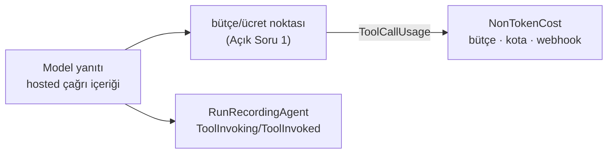

# Faz 226 — Adlı Hosted Tool'lar: Kayıt, Yüzey Doğrulaması, Ücret

> **Durum:** ✅ Tamamlandı (2026-10-21)
> **Kademe:** tam — maliyet ve kota bütünlüğü (yeni ücret terimi bütçeye girer) · run olay sözleşmesi değişir (tanınan hosted çağrı `tracon.content` yerine tool olayı olur) · geri dönüşü pahalı karar
> **Plan onayı:** farukatasoy, 2026-10-20 (seçim: aynı `ToolNames`; kapsam: üç sağlayıcı)
> **Kaynak:** [ADAYLAR.md](ADAYLAR.md) · **F-603**
> **Genellik:** OpenAI Responses, Anthropic ve Google kullanan her tüketici. Sağlayıcının yerleşik tool'u (web search, code interpreter, file search) bugün yalnız uzantı provider'ıyla ve denetimsiz girer; harness web search'ün ücreti bugün hiçbir yerde sayılmaz (K-892). İş tüketici kodunda kalamaz: ücret, bütçe ve yüzey doğrulaması kontrol düzleminindir.
> **Karşı görüş:** "Code interpreter kiracı verisini sağlayıcının konteynerine çıkarır; tanımda adla açmak bir uyum kararıdır." Cevap: veri, modelin zaten gittiği sağlayıcıya gider (egress politikası sağlayıcıyı izinli saymıştır); yeni taraf yoktur. Tool kodda kaydedilir (K2), tanım yalnız adla seçer, varsayılan kapalıdır (K1); site sayfası sınırı yazar.
> **Önkoşul:** Faz 225 (kapandı) — sağlayıcı destek bildirimi desenini kurar (`ISamplingSupport`, istek alanları için); bu faz aynı desenle hosted tool türleri için kardeş bir bildirim ekler. Gerçekleşen imza: aşağıda *Önceki Fazdan Devir*
> **Paketler:** `Tracon.Abstractions`, `.Core`, `.OpenAI`, `.Anthropic`, `.Google`, `.AspNetCore`, `.Client`, `.UI`
> **Yeni paket:** Yok · **Migration:** Yok
> **Public API:** büyüyor — `1.0.0` GA'dan (K-603) önce ucuz
> **Tüketici yüzeyi:** site: yeni `guides/hosted-tools.md`, `concepts/tools.md`, `capabilities.md`, `guides/context-and-memory.md` (harness web search ücreti), `concepts/runs.md` (olay) · sevk edilen: `AddHostedTool` XML `<example>`, `src/Tracon.Core/README.md`
> **Manuel test alanı:** `docs/manuel-test/05-SAGLAYICI-OPENAI.md`, `06-SAGLAYICI-DIGER.md` (sağlayıcı başına tel) ve `12-GOZLEMLENEBILIRLIK-MALIYET.md` (ücret) — `🤖` (gerçek sağlayıcı)

---

## Önceki Fazdan Devir

> Faz 225 (F-598, kapandı 2026-10-20). Tam metin: `git show 44866805:docs/225-MODEL-ORNEKLEME-VE-TOOL-DONGUSU.md`.

**Devraldığı sözleşmeler — gerçekleşen imza (public, `Tracon.Abstractions`):**

```csharp
[Flags] public enum SamplingFields
{ None = 0, Seed, TopK, StopSequences, FrequencyPenalty, PresencePenalty, ToolMode, AllowMultipleToolCalls, ReasoningOutput }

public interface ISamplingSupport { SamplingFields SupportedSamplingFields { get; } }
```

`IModelProvider`'a **dokunulmaz** (kırıcı olurdu); sağlayıcı arayüzü opsiyonel uygular. Bildirmeyen
sağlayıcı hiçbir alanı göndermez. `ModelProviderRegistry.List()` `provider is ISamplingSupport` ile okur
ve `ModelProviderDescriptor.SupportedSamplingFields`'a (**internal**) yazar. Tek kural
`SamplingSupportCheck.Unsupported(registry, binding)`'dir (birincil bağlama + her yedek halka); iki okuyucusu
var: derleyici (`AgentDefinitionCompiler.RequestFields.cs` → `TraconCompilationException`) ve doğrulayıcı
(`AgentDefinitionValidator.OutputLimits.cs` → kod `sampling_field_unsupported`, yol `model.<alan>`).
Desteği bildiren dört dosya: `OpenAIModelProvider` (`ApiSurface`'e göre iki küme), `AnthropicModelProvider`,
`GoogleModelProvider`, `AzureOpenAIModelProvider`; `FakeModelProvider` (Tracon.Testing) hepsini bildirir.

**Bu faz için sonuç:** `SamplingFields` istek alanlarının bayraklarıdır; hosted tool türleri (`web_search`,
`code_interpreter`, `file_search`) ona **bayrak olarak girmez** (ad ve anlam uyumsuz). Öneri: aynı desenle
kardeş `IHostedToolSupport` + `HostedToolKinds` bayrakları, `ModelProviderDescriptor`'a ikinci internal alan,
`SamplingSupportCheck`'in birebir kardeşi. Karar `faz-uygulama` Adım 1'de ölçülüp verilir.

**Bilinen tuzaklar:**

- 🚨 **Tablo telden doğrulanmadıkça bir kopyadır.** Denetim, Anthropic'in `AllowMultipleToolCalls` hücresinin
  koşullu olduğunu (adaptör bayrağı yalnız `tool_choice` kurarken okur) ancak decompile ile buldu; testler sağlayıcı
  sabitlerini aynalıyordu. `ModelSamplingWireTests` deseni: `FakeOpenAiCompatibleServer` artık gövdeleri
  (`ChatCompletionBodies`, `ResponsesBodies`) tutar ve `/v1/responses` sunar; `FakeAnthropicServer.Bodies`.
  Hosted türler için her `✓`/`✗` hücresi aynı yolla gövdeden okunur; Google'ın yerel sahte sunucusu yoktur.
- 🚨 **Bir hücre `✓` iken model reddedebilir** (F-606): `gpt-5.4-mini` `stop`'u `400` ile reddetti. Hosted türde de
  model düzeyi ret beklenir; `ModelDescriptor` bayrağı ayrı bir adaydır.
- Destek **API yüzeyine** bağlıdır, modele değil (`openai` ↔ `openai-responses` aynı modeli taşır). `UseOpenAICompatible`
  iki sağlayıcı adı kaydeder (`{ad}`, `{ad}-responses`); her biri kendi kümesini bildirir.
- `SURUM_DAMGASI_KAYDI` (`scripts/dokuman-bakim.py`): bir sağlayıcı dosyasındaki "SDK X.Y.Z ölçüldü" yorumu kayıt ister.
- Dekoratör bir adaptör davranışına dayanıyorsa (`AnthropicProviderSettingsChatClient`) tel testi onu kilitler.

---

## Bu Faza Başlarken

1. Bu doküman
2. Kararlar — yalnız grep:
   ```bash
   grep -n "K-030 —\|K-059 —\|K-208 —\|K-483 —\|K-892 —\|K-1030 —\|K-1034 —\|K-1039 —" docs/KARARLAR.md
   ```
   **K-030** (`store=false`), **K-059** (`secret` yazılmaz), **K-208** (desteklenmeyen ayar sessiz düşmez), **K-483** (toplama ifadesine terim eklemek), **K-892** (harness web search yalnız tanım isteyince), **K-1030** (provider'ın tool'u tool zincirinden geçmez), **K-1034** (tanınmayan içerik `tracon.content`), **K-1039** (run başına seçenek çalışan tool'u reddeder)
3. Ölçüm kaynağı: [`MAF-KAPSAMA.md`](MAF-KAPSAMA.md) §8.0 C-12 satırı (OpenAI tel probu) ve bu dokümandaki Anthropic/Google tel probu
4. Alan hafızası: [`hafiza/olcum-kota-ve-secenekler.md`](hafiza/olcum-kota-ve-secenekler.md) (maliyet terimi, `Total()`), [`hafiza/model-boru-hatti.md`](hafiza/model-boru-hatti.md) (bütçe halkasının yeri), [`hafiza/run-olay-sozlesmesi.md`](hafiza/run-olay-sozlesmesi.md)
5. Bu dokümandaki *Önceki Fazdan Devir* (Faz 225'in destek bildiriminin gerçekleşen imzası ve tuzakları)

---

## Amaç

Tüketici sağlayıcının yerleşik tool'unu kodda adla kaydeder; tanım onu `ToolNames`
ile seçer. Derleyici bağlamanın (ve her yedek halkanın) o türü desteklediğini denetler;
desteklemeyen yüzey derleme hatası verir. Her hosted çağrı run kaydına tool olayı
olarak girer ve ücreti bütçeye, kotaya ve webhook toplamına girer.

- **F-603** — `AddHostedTool`, yüzey doğrulaması, ücret ve kayıt; web search, code interpreter, file search. Image generation ve hosted MCP kapsam dışı.

### Bugün ne çalışmıyor — doğrulanmış kanıt

| Kanıt | Gözlem |
|---|---|
| [`IToolRegistry.cs:19,35`](../src/Tracon.Abstractions/Tools/IToolRegistry.cs) | Kayıt defteri yalnız `AIFunctionDeclaration` döner; hosted tool (`AITool`) kaydedilemez |
| `AgentOptionsGuard.cs` `Tools` satırı | Uzantı `ChatOptions.Tools`'a hosted tool ekleyemez (`400`); provider yolundan girer ve denetlenmez (gerçek host probu 2026-10-20, §0 #32) |
| [`AgentDefinitionCompiler.Agents.cs:290`](../src/Tracon.Core/Compilation/AgentDefinitionCompiler.Agents.cs) | Tek hosted tool harness web search'tür (`DisableWebSearch = !harness.EnableWebSearch`) |
| [`ContentEventPayload.cs:57-64`](../src/Tracon.Core/Recording/ContentEventPayload.cs) | Hosted çağrı `tracon.content` olur (Faz 223); file search orada yok; ücret yok |
| OpenAI tel probu (2026-10-20) | `store=false` code interpreter, web search, file search'ü engellemez; `UsageDetails.AdditionalCounts` boş; code interpreter içeriğinde `RawRepresentation` yok (konteyner kimliği okunamaz) |
| MEAI `OpenAIChatClient` (decompile) | Chat Completions yalnız `HostedWebSearchTool`'u eşler; hosted code interpreter **sessizce düşer** (tel probu: hata yok, model tool'suz cevapladı) |
| Anthropic tel probu (2026-10-20, `claude-haiku-4-5-20251001`) | Web search ve code execution iki turda çalışır (JSON'dan geçen geçmişle); web search `AdditionalCounts["WebSearchRequests"]=1` raporlar; code execution sayı raporlamaz |
| Google tel probu (2026-10-20, `gemini-3.6-flash`) | Google search ve code execution iki turda çalışır; code execution `AdditionalCounts["ToolUsePromptTokenCount"]` raporlar; arama sayısı yok |
| Adaptör decompile | Anthropic `HostedWebSearchTool` → `WebSearchTool20250305`, `HostedCodeInterpreterTool` → `CodeExecutionTool20250825`; Google `HostedWebSearchTool` → `GoogleSearch`, `HostedCodeInterpreterTool` → code execution, `HostedFileSearchTool` → `Retrieval` (kaynaksız; ölçülmedi) |

> Kanıtlar 2026-10-20 tarihinde doğrulandı.

---

## 226.1 — Kayıt ve seçim

```csharp
builder.AddTracon()
    .AddHostedTool("docs_search", HostedToolKind.FileSearch,
        context => new HostedFileSearchTool { Inputs = [new HostedVectorStoreContent(context.Configuration["VectorStores:Docs"]!)] },
        description: "Searches the product documentation.");
```

- Tool kodda kaydedilir (K2); tanım `ToolNames`'te adıyla seçer (👤 kararı). Ad,
  function tool'ları ve hosted tool'lar arasında tekildir; çakışan kayıt açılışta
  hata verir.
- Hosted tool ayrı bir iç kayıt defterinde durur; `IToolRegistry` sözleşmesi değişmez.
  Derleyicinin `ResolveTools`'u iki defteri de okur.
- `GET /api/tools` hosted tool'u listeler; `ToolDescriptor`'a tür alanı eklenir
  (bugün `RunsOnClient` deseni). Konsol tek seçicide rozetle gösterir.
- Fabrika bağlam alır (kiracı, sağlayıcı adı, servisler): BYOK'ta vector store
  kimliği kiracının hesabındadır. Kimlik `secret` değildir; anahtar yazılmaz (K-059).
- Tür başına en çok bir hosted tool (aynı tür iki kez seçilirse doğrulama hatası):
  tel içeriği kayıt adını taşımaz; türden ada eşleme tektir.
- Harness `EnableWebSearch` (K-892) kalır; ücreti bu fazın yolundan sayılır.

## 226.2 — Yüzey doğrulaması

Hosted türler için destek bildirimi gerekir; Faz 225'inki yalnız istek alanlarını taşır (*Önceki Fazdan Devir*). Ölçülen başlangıç tablosu:

| Tür | `openai` | `openai-responses` | `anthropic` | `google` |
|---|---|---|---|---|
| `web_search` | ✗ (K-892: arama dışı modelde `400`) | ✓ | ✓ | ✓ |
| `code_interpreter` | ✗ (sessiz düşer, ölçüldü) | ✓ | ✓ | ✓ |
| `file_search` | ✗ | ✓ | ✗ | ✗ (`Retrieval` kaynaksız; ölçülmedi) |

Derleyici birincil bağlamayı ve her yedek halkayı denetler (`SamplingCapabilityCheck`
deseni). Desteklemeyen halka derleme hatası verir ve türü ve sağlayıcıyı adlandırır.

## 226.3 — Ücret

- Yapılandırma: `Tracon:Pricing:HostedTools:<provider>:<kind>` → `PerCall` (ondalık).
  Fiyat koda yazılmaz (bugünkü `Images`, `Voice` deseni).
- Birim: çağrı içeriği sayısı (`WebSearchToolCallContent`, `CodeInterpreterToolCallContent`,
  file search için ham tipi `FileSearchCallResponseItem` olan taban `ToolCallContent`).
  Code interpreter konteyner başına faturalanır ama konteyner kimliği içerikte yok
  (ölçüldü) → çağrı başına fiyat **tahmindir** (`IsEstimated = true`). Anthropic'in
  `WebSearchRequests` sayısı çapraz denetim için okunur (Açık Soru 2).
- Ücret yeni bir toplama terimi açmaz: tool dışı maliyet yolundan girer
  (`ToolCallUsage` → `RunRecord.NonTokenCost`; bütçe, kota ve `run.completed`
  webhook'u onu zaten sayar). K-483: `Total()` değişmez.
- Bütçe hosted ücreti **sonraki model turundan önce** görmelidir (bütçe tavanı olan
  kiracı). Rapor noktası Açık Soru 1'dedir.

## 226.4 — Kayıt

Kayıtlı türün çağrısı `ToolInvoking`/`ToolInvoked` olur; araç adı kayıt adıdır, yük
çağrı kimliği ve `ToolCallUsage` taşır. Kayıtsız ya da bilinmeyen hosted içerik
bugünkü gibi `tracon.content` kalır (K-1034). File search `ContentEventPayload`'a
eklenir. Atıf (`CitationAnnotation`, web search'te ölçüldü) bu fazda değil, F-595'tedir.



## 226.5 — Kapsam dışı

- **Image generation:** görsel geçmişe bayt olarak girer (tel probu: bir görselde 1,5 MB);
  Tracon `generate_image` ek kimliği döner. Sunulmaz.
- **Hosted MCP:** F-604 (ayrı güvenlik soruları).
- **Hosted tool için tool zinciri:** yetki, onay, zaman aşımı yoktur; tool sağlayıcıda
  koşar. `RequiredPermission` hosted kayıtta yoktur; site sınırı yazar.

---

## Planlanan Public API

```csharp
// Tracon.Abstractions
public enum HostedToolKind { WebSearch, CodeInterpreter, FileSearch }

public sealed class HostedToolContext
{
    public required string TenantId { get; init; }
    public required string Provider { get; init; }
    public required IServiceProvider Services { get; init; }
}

// Tracon.Core
public static ITraconBuilder AddHostedTool(
    this ITraconBuilder builder,
    string name,
    HostedToolKind kind,
    Func<HostedToolContext, AITool> factory,
    string? description = null);

// Tracon.Core — TraconPricingOptions
public IDictionary<string, IDictionary<string, HostedToolPriceOverride>> HostedTools { get; }
public sealed class HostedToolPriceOverride { public decimal? PerCall { get; set; } }
```

`ToolDescriptor`'a hosted tür alanı (ad faz başında `RunsOnClient` ile birlikte seçilir).
Destek bildirimi hosted türler için kardeş bir arayüzle genişler (Faz 225 devri). **Doğrulanmadı — `maf-api-kesfi`
ile ölçülmeli:** `HostedFileSearchTool.Inputs`/`HostedVectorStoreContent` (tel probunda
kullanıldı, imza dökümü alınmadı).

### HTTP `endpoint`'leri

Yeni uç yok. `GET /api/tools` yanıtı büyür (OpenAPI, `Tracon.Client`, `@tracon/client`).

### Arayüz payı

`screens/agent-editor/sections/tools-section.tsx` rozet ve yüzey uyarısı; run
ekranında hosted çağrı satırı. Bundle payı faz başında ölçülür.

---

## Planlanan Dosya Listesi

```
src/Tracon.Abstractions/Tools/HostedToolKind.cs, HostedToolContext.cs, ToolDescriptor.cs
src/Tracon.Core/Tools/HostedToolRegistry.cs            (iç)
src/Tracon.Core/TraconBuilderExtensions.Tools.cs        (AddHostedTool)
src/Tracon.Core/Compilation/AgentDefinitionCompiler.ChatOptions.cs (ResolveTools)
src/Tracon.Core/Compilation/AgentDefinitionValidator.cs (tür başına tek, yüzey)
src/Tracon.Core/Recording/ContentEventPayload.cs, RunRecordingAgent.Persistence.cs
src/Tracon.Core/Recording/<HostedToolUsage>.cs          (Açık Soru 1)
src/Tracon.Core/TraconOptions.cs                        (HostedTools fiyatı)
src/Tracon.OpenAI/ · src/Tracon.Anthropic/ · src/Tracon.Google/  (destek bildirimi)
src/Tracon.AspNetCore/Endpoints/CatalogEndpoints.cs
src/Tracon.UI/frontend/src/screens/agent-editor/sections/tools-section.tsx
```

---

## Hata Modları ve Testler

| Ne bozulabilir | Seviye | Test sınıfı |
|---|---|---|
| Hosted tool modele ulaşmaz / yanlış tür eşlenir | Fonksiyonel (`FakeModelProvider.Requests`) | `HostedToolSelectionTests` |
| Desteklemeyen yüzey sessizce düşürür (birincil ya da yedek) | Fonksiyonel | `HostedToolSurfaceTests` |
| Ad function tool'uyla çakışır | Birim (kayıt) + Fonksiyonel (açılış) | `HostedToolRegistrationTests` |
| Ücret iki kez sayılır ya da hiç sayılmaz (K-483) | Fonksiyonel (bütçe + kota + webhook toplamı) | `HostedToolCostTests` |
| Bütçe tavanı hosted ücretten sonra bir tur daha koşturur | Fonksiyonel | `HostedToolBudgetTests` |
| Başka kiracının vector store kimliği kullanılır | Fonksiyonel (iki kiracı, BYOK) | `HostedToolTenantTests` |
| Kayıtlı çağrı `tracon.content` kalır / kayıtsız içerik kaybolur | Fonksiyonel | `HostedToolRecordingTests` |
| Harness web search ücreti sayılmaz | Fonksiyonel | `HarnessWebSearchCostTests` |

Beş soru: iptal (hosted çağrı sağlayıcıda; iptal yalnız sonraki turu durdurur — testte
belgelenir) · eşzamanlılık (bütçe ayrımı mevcut halkada) · boş/aşırı girdi (fiyat yok →
ücret `0` ve uyarı mı, hata mı: Açık Soru 3) · başka kiracı (fabrika bağlamı) · alt
sistem hatası (fiyat yapılandırması okunamaz → run durmaz, loglanır).

---

## Manuel Kabul Case'leri

| # | Ön koşul | Adımlar | Beklenen sonuç |
|---|---|---|---|
| 1 🤖 | Örnek uygulama, gerçek OpenAI, `openai-responses` | `web_search` ve `code_interpreter` kayıtlı agent'ı koş | Run kaydında iki tool olayı; `NonTokenCost` fiyat × çağrı |
| 2 🤖 | Gerçek Anthropic | Aynı agent `anthropic` bağlamayla | İki tur çalışır; web search ücreti `WebSearchRequests` ile tutar |
| 3 🤖 | Gerçek Google | Aynı agent `google` bağlamayla | İki tur çalışır |
| 4 🤖 | `openai` (Chat Completions) bağlama | `code_interpreter` seçili tanımı kaydet | `400`; tür ve sağlayıcı adlandırılır |

---

## Açık Sorular

| # | Soru | Seçenekler | Öneri |
|---|---|---|---|
| 1 | Ücret nerede raporlanır? | A: döngü içi halka (bütçe halkasının yanında; her model yanıtında içerik sayar) · B: `RunRecordingAgent` (yanıt sonunda) | A: bütçe ücreti sonraki turdan önce görür; B tur içi tavanı kaçırır |
| 2 | Anthropic `WebSearchRequests` ile içerik sayısı ayrışırsa hangisi? | A: sağlayıcı sayısı · B: içerik sayısı | A (sağlayıcının faturası); ayrışma loglanır |
| 3 | Fiyatı yapılandırılmamış hosted tür | A: ücret `0`, run uyarısı · B: derleme hatası | A: model fiyatı yokken bugünkü davranışla aynı |
| 4 | Google `file_search` (`Retrieval`) | ölçülmeli | Faz başında tel probu; çalışmıyorsa `✗` kalır |

---

## Bitiş Ölçütleri (DoD)

- [x] `AddHostedTool` ile kaydedilen üç tür, `ToolNames` ile seçilince modele ulaşır — `HostedToolRunTests` (modele giden tool nesneleri), `HostedToolWireTests` (gerçek istek gövdesi)
- [x] Destek tablosundaki her `✗` derleme `400` verir; yedek halka dahil — `HostedToolSupportTableTests` (doğrulama raporu ölçülen tabloyla uyuşur; yedek halka ayrı case)
- [x] Hosted çağrı run kaydında tool olayıdır; ücret `NonTokenCost`'a, bütçeye, kotaya ve webhook'a bir kez girer — `HostedToolRunTests`, `HostedToolUsageChatClientTests` (idempotent `callId`, akışta varışta bütçeye)
- [x] Harness web search ücreti sayılır — kayıtsız hosted çağrı da toplama girer (`A_call_of_a_tool_nobody_registered_counts_toward_the_total_and_has_no_record`)
- [x] Dört doğrulama kapısı sıfır uyarı verir — `kapi.py kapanis --taban cd35c934` yeşil: build, `dotnet format --verify-no-changes`, `docs-site` `npm run check`, 25 488 test geçti / 0 düştü / 19 atlandı (38 modül)
- [x] `samples/Tracon.Api` ile gerçek `run` (OpenAI Responses) yapıldı, çıktı belgeye yazıldı — MT-OAI-097 koşum notu (2026-10-21): `Completed`, iki tool olay çifti, `0.04` USD, `isEstimated: true`, `unsummedItemCount: 0`; akışlı koşu tek çift, `0.01`
- [x] `secret` taraması boş döndü — `kapi.py tarama` (kapanış kapısının içinde) temiz; örnek uygulamanın anahtarları yalnız `dotnet user-secrets`'tan okundu, dosyaya yazılmadı
- [x] `🤖` case'ler koşuldu (üç sağlayıcı) — MT-OAI-097 (OpenAI), MT-PROV-094 (Anthropic), MT-PROV-095 (Google)
- [x] `faz-denetim` koşuldu; 🔴 bulgu kalmadı — bağımsız denetçi: 1 🔴 (gerçek, kapandı), 7 🟡 (kapandı), 4 🟢; aşağıda *Denetim Bulguları*
- [x] `docs-site/` güncellendi (`tuketici-dokuman-senkronu`); `npm run check` temiz — yeni `guides/hosted-tools.md` + beş mevcut sayfa; bağlantı, SEO, içerik ve ağırlık kapıları geçti; konsol ekran görüntüleri yeniden üretildi
- [x] `en.ts` ve `tr.ts` eksiksiz; bundle payı ölçüldü ve yazıldı — çevrilmemiş etiket kalmadı (`i18n.test.ts` izin listesinden iki kayıt çıkarıldı). Bundle payı: konsol JS gzip `224 287 B → 224 758 B` (**+471 B**), toplam `219,5 KiB` / `250 KiB` bütçe (aynı `vite build`, faz öncesi `HEAD` ile karşılaştırıldı)

---

## Riskler

| Risk | Önlem |
|------|-------|
| Sağlayıcı fiyat birimi değişir (konteyner, istem başına arama) | Fiyat yapılandırmadadır; birim tahmini `IsEstimated` taşır |
| Kayıt olay tipinin değişmesi tüketici panosunu bozar | Sürüm notu; kayıtsız içerik `tracon.content` kalır |
| Code interpreter çıktısı (dosya) geçmişe büyük içerik koyar | Ölçülmeli: tel probunda çıktı boştu (`include` istenmedi); dosya çıktısı istenirse ek yoluna gider |

---

<!-- ============================================================
     AŞAĞISI ÇALIŞIRKEN DOLAR — doküman kapanışta silinir (`faz-kapat`).
     Kalıcı kısım `faz-tamamlama` Adım 5'te yerine taşınır. Başlıkları SİLME.
     ============================================================ -->

## Plandan Sapmalar

> Çalışırken dolar. Kapanışta kapanış commit mesajına taşınır.

1. **226.1 örneği `context.Configuration` kullanıyordu; `HostedToolContext`'in böyle bir üyesi yok.** API bloğu üç alan
   söyler (`TenantId`, `Provider`, `Services`) ve tip öyle yazıldı. Örnek `context.Services.GetRequiredService<IConfiguration>()`
   ile düzeltildi (XML `<example>`, site, örnek uygulama).
2. **Dosya arama içeriği plandan farklı çıktı (tel + decompile, MEAI.OpenAI 10.11).** Plan "ham tipi `FileSearchCallResponseItem` olan taban
   `ToolCallContent`" diyordu. Gerçek: taban `ToolCallContent`'ın ham temsili **null**; ham öğeyi AYNI mesajda/güncellemede gelen taban
   `ToolResultContent` taşır. Tanıma bu yüzden çifttir (`HostedToolContent.FileSearchCallIds`); `ContentEventPayload` yalnız dosya arama
   **sonucunu** adlandırır. İlk tel testi bunu buldu (3 tür beklendi, 2 geldi).
3. **Açık Soru 3: fiyatsız tür `0` değil `null`.** Plan "ücret `0`, run uyarısı" önerdi. `0` bilinmeyeni bedava gösterirdi (K-482); kalem listelenir,
   run `UnsummedItemCount` sayar, halka başına bir uyarı yazar. "Model fiyatı yokken bugünkü davranış" ile aynıdır.
4. **Açık Soru 2: tamponlu yanıtta sağlayıcı sayısı kazanır; akışta yalnız artış.** Tamponlu yanıtta sayı çağrılardan önce bilinir (faturalanmayan arama
   ücretsiz listelenir, fazla fatura fark olarak eklenir). Akışta çağrılar sayıdan ÖNCE gelir, bütçe sayacı bir tutarı geri almaz
   (`NonTokenCostAccumulator`): büyükse fark eklenir, küçükse fark loglanır.
5. **Açık Soru 4: Google `file_search` ölçülmedi, `✗` kalır.** `Retrieval` kaynak ister ve Tracon bir kaynak adlandıramaz; anahtarla ölçülecek bir korpus yoktu.
6. **Plan dışı: akışta bir çağrı çok içeriktir.** Gerçek akışlı OpenAI koşusu çift `ToolInvoking` gösterdi (web araması başlangıç + bitiş, kod yorumlayıcı parça başına
   aynı kimlikle). Halka yanıt başına bir kez sayar, kaydedici `HostedCallLedger.TryClaimWrite` ile bir kez yazar. Birim ve fonksiyonel testler yakalamadı.
7. **Plan dışı: replay.** `ReplayTools`/`NoTools` hosted adları `ToolNames`'ten düşürür; dönüştürücü yalnız `AIFunction`'a ulaşır, yoksa replay arar ve tekrar faturalardı.
8. **Plan dışı: kural kapıları.** Harness `EnableWebSearch` + kayıtlı web arama (`hosted_tool_conflict`), `ToolMode = required:<hosted>`
   (`hosted_tool_not_callable`), tür başına birden çok tool (`duplicate_hosted_tool_kind`). Konsol `required:` listesinden hosted'ı çıkarır.
9. **Plan dışı public API.** `ToolUsageUnits.Calls` (Tracon'un kendi aracı bu birimi bildirir; birimi tüketici de okur) · `HostedToolKinds` bayrakları ve `IHostedToolSupport` (planın "kardeş
   bildirim"i; adlar burada seçildi) · `FakeModelProvider.SupportedHostedTools` (`Tracon.Testing`, hepsini bildirir).
10. **Önbellek anahtarları (plan dışı):** fabrikanın ürettiği (vector store kimliği, `AdditionalProperties`, kod yorumlayıcı girdi baytları) `HostedToolDescription` ile
    hem derlenmiş-agent anahtarına hem yanıt-önbelleği anahtarına girer; bedeli fabrikanın her run'da çalışmasıdır. Kiracı kimliği tek başına yetmez: kiracı
    store'unu değiştirir, tanım değişmez (F-304/F-305 sınıfı). Karşılaştırılamayan değer (sağlayıcı SDK nesnesi) agent'ı her run'da yeniden derletir ve yanıt önbelleğini kapatır.
11. **Denetim sonrası (plan dışı):** .NET istemcinin nullable enum özellikleri boş sınıf üretiyordu (`HostedKind` ve sekiz eski özellik) — üretici hattı düzeltildi,
    istemci testi eklendi (K-1044 kapsamı değil, kusur sınıfı); otomatik run devamı hosted çağrıda durmaz; `ConditionalWeakTable` kaydı atomik; konsol rozetleri çevrildi.
12. **Manuel set:** plandaki dört case'ten dördüncüsü (Chat Completions `400`) otomatik teste gitti (`HostedToolSupportTableTests`) ve sete girmedi; üçü `🤖` olarak eklendi
    (`MT-OAI-097`, `MT-PROV-094`, `095`) ve koşuldu. `12-GOZLEMLENEBILIRLIK-MALIYET` değişmedi: ücretin kota/webhook/bütçe yolları fonksiyonel testle kapalı.

## Bu Fazda Verilen Kararlar

> Çalışırken dolar. Plan numara rezerve etmez.

- **K-1044** hosted tool kodda kaydedilir, tanım adla seçer; tool zinciri yoktur; tür başına bir tane (public-api, güvenlik).
- **K-1045** sağlayıcı `IHostedToolSupport` ile bildirir; bildirmeyen tür derleme hatasıdır (public-api).
- **K-1046** kayıtlı hosted çağrı `ToolInvoking`/`ToolInvoked`; kayıtsız `tracon.content` (public-api, geri-dönüşü-pahalı).
- **K-1047** ücret iç döngü halkasında, yanıt önbelleğinin içinde; fiyatsız tür `null` (geri-dönüşü-pahalı).
- Açık Sorular (plan önerileri, kullanıcı itirazı yok): **1** A (döngü içi halka) · **2** A, kısmen (sapma 4) · **3** `null` (sapma 3) · **4** `✗` kalır (sapma 5).
- Kategori dışı: `ToolUsageUnits.Calls` public sabit; kural kapıları (sapma 8); konsolun `required:` listesi hosted'ı dışlar.

## Süreç Ölçümü

| Metrik | Değer |
|---|---|
| Plan revizyonu sayısı | 12 (Plandan Sapmalar maddeleri) |
| Düzeltme turu sayısı | 3 denetim sonrası (denetim bulguları · agent map bütçesi · kapanış kapısı içerik denetimi: README tip sayısı ve konsol ekran damgası); denetim öncesi turlar sayılmadı |
| 🔴 bulgu: gerçek / gürültü / araştırılacak | 1 / 0 / 0 |
| Fazın ürettiği regresyon | 0. Hiçbir şey denetimden önce commit edilmedi; 🔴 bulgu üreticinin eski kusurunu yeni `HostedKind` alanı üzerinden açığa çıkardı |
| Faz kapandıktan sonra bulunan kusur | ölçülmedi (kapanış anı) |

## Denetim Bulguları

> `faz-denetim` çıktısı. Bağımsız denetçi, çalışma ağacı üzerinde: **1 🔴 · 7 🟡 · 4 🟢**.

**🔴 .NET istemci, hosted tool'lu host'ta çöküyordu (gerçek, kapandı).** `ToolDescriptor.HostedKind` enum yerine boş bir sınıf olarak
üretilmişti; `TraconListToolsAsync` ilk hosted tool'da `JsonException` atardı. Kök neden üretici hattıdır: nullable enum
(`oneOf [null, $ref]` + bileşende `null`) boş sınıf veriyordu ve sekiz eski özellik de etkilenmişti (`RunComparisonSide.ErrorClass`, `RunError.Class`,
`EvalCase.SourceKind`, `VoiceSession.EndReason` ve diğerleri). `scripts/nswag-prepare-document.py` `strip_null_from_enums` ekledi. Kapılar:
`HostedToolClientTests` (gerçek host) ve `nswag_prepare_document_test.py`. İstemcinin public tipleri değişti
(`WorkflowDefinition.Kind`, `WorkflowSaveRequest.Kind`, `RunErrorStatistics.Class` artık nullable değil); `CHANGELOG.md` "Fixed".

**🟡 (hepsi kapandı):** yanıt önbelleği tool'u yalnız adıyla anahtarlıyordu (iki vector store aynı cevabı paylaşırdı → anahtar artık telde olanı
hash'ler) · önbellek isabeti hosted çağrıyı `tracon.content` yazar ve ücret yazmaz (belgelendi, testlendi) · otomatik run devamı hosted çağrıda durmaz ·
`ConditionalWeakTable` kaydı atomik (eşzamanlılık testi) · Anthropic `WebSearchRequests` sayısı tamponlu yanıtta önce okunur, akışta yalnız artış eklenir ·
eksik testler yazıldı (iptal, okunamayan fiyat, yazamayan store, yedek halka ücreti, akışlı bütçe) · konsol rozetleri çevrildi.

**🟢:** üçü yerinde düzeltildi (`Describe` metni, hata mesajındaki tool listesi, yanlış yerdeki özet yorumu). Biri faz dışı kaldı:
harness web search'ün replay'de yeniden çalışması → `F-610` (`docs/ADAYLAR.md`).
