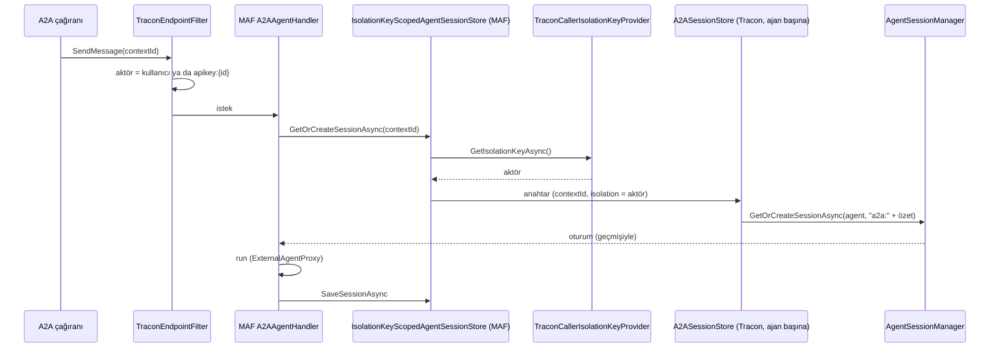

# Faz 229 — A2A Çok Tur ve Çağıran İzolasyonu

> **Durum:** 📋 Planlandı (2026-10-21)
> **Kademe:** tam — güvenlik/kiracı sınırı (kiracı içinde çağıranlar arası konuşma izolasyonu) · geri dönüşü pahalı karar (kalıcı oturum kimliği biçimi)
> **Plan onayı:** farukatasoy, 2026-10-21 (seçim: izolasyon anahtarı çağıran kimliği; çok tur varsayılan açık)
> **Kaynak:** [ADAYLAR.md](ADAYLAR.md) · **F-614** (yargı alanları: [`kesif/2026-10-21-maf-dalga-4.md`](kesif/2026-10-21-maf-dalga-4.md) §4)
> **Genellik:** A2A ile Tracon agent'ı çağıran her dış agent. İkinci kanıt ekosistem standardıdır: A2A'da `contextId` konuşma kimliğidir ve geçmişi sunucu saklar (MAF tartışması microsoft/agent-framework#7252, 2026-10-21'de bakıldı). Tüketici kodunda kalamaz: A2A barındırması ve oturum deposu Tracon'undur.
> **Karşı görüş:** "A2A çağıranları çoğunlukla tek atımlık görev gönderir; çok turun değeri ölçülmedi." Cevap: Tracon yanıtta `contextId`'yi geri yazar, ama geçmişi tutmaz; çağıran bir konuşma sürdürdüğünü sanır. Tek atımlık çağıran etkilenmez: yeni `contextId` yeni oturumdur. Bedel: aynı `contextId`'yi kullanan çağıran artık geçmiş token'ını da öder (belgelenir).
> **Önkoşul:** Yok
> **Paketler:** `Tracon.AspNetCore` (yalnız)
> **Yeni paket:** Yok · **Migration:** Yok
> **Public API:** Büyümüyor (yeni tipler `internal`; `TraconA2AOptions`'a üye eklenmez). `wc -l src/*/PublicAPI.Shipped.txt` toplamı 17 satır (2026-10-21)
> **Tüketici yüzeyi:** site: `guides/external-agents.md` (2026-10-21'de eklenen "single turn" paragrafı ve kontrol listesi maddesi **geri alınır**, çok tur ve izolasyon anlatılır), `capabilities.md` A2A satırı ("each message is a single turn" kalkar) · sevk edilen: `UseA2A` ve `MapTraconA2A` XML belgesi, `src/Tracon.AspNetCore/README.md` A2A bölümü varsa
> **Manuel test alanı:** `docs/manuel-test/18-MCP-VE-A2A.md` — `🤖`

---

## Bu Faza Başlarken

> `faz-baslangic` skill'ini uygula. Aşağıdaki liste o skill'in 2. adımıdır —
> **tamamını değil, yalnız işaret edilen bölümleri oku.**

1. Bu doküman
2. Kararlar — yalnız grep:
   ```bash
   grep -n "K-008 —\|K-283 —\|K-337 —\|K-688 —\|K-691 —\|K-1016 —" docs/KARARLAR.md
   ```
   **K-008** (ön sürüm MAF yalnız `Tracon.AspNetCore`), **K-283** (görünmeyen oturum yok sayılır), **K-337** (dış çağrı her zaman yeni kök run açar), **K-688** ve **K-691** (oturum sahipliği; run başlatan yüzeyde `403`), **K-1016** (`TraconAgentSessionStore` köprüsü ve `isolation` bölümü)
3. Önceki fazdan devir: yok. Ölçüm [`MAF-KAPSAMA.md`](MAF-KAPSAMA.md) §0 #35 ve §8.2 C-15 (a)'dadır
4. Alan hafızası: [`hafiza/mcp-a2a-sunucu.md`](hafiza/mcp-a2a-sunucu.md) (A2A kaydı ve uç tuzakları), [`hafiza/maf-oturum.md`](hafiza/maf-oturum.md) (oturum durumu)
5. Gerektiğinde: [`MIMARI-GUVENLIK.md`](MIMARI-GUVENLIK.md) kiracı ve dış yüzey bölümü

---

## Amaç

Bir A2A çağıranı aynı `contextId` ile ikinci mesaj gönderdiğinde agent önceki
turu görür. Konuşma çağıranın kimliğine bağlıdır: aynı kiracıdaki başka bir
çağıran aynı `contextId`'yi gönderse bile o konuşmaya erişemez.

- **F-614** — A2A için anahtarlı oturum deposu, çağıran kimliğinden izolasyon anahtarı, oturum sahipliği eşliği, belge.

### Bugün ne çalışmıyor — doğrulanmış kanıt

| Kanıt | Gözlem |
|---|---|
| Probe (gerçek host, `TraconTestHost` + `FakeModelProvider`, 2026-10-21) | Aynı `contextId` ile ikinci mesajda modelin gördüğü tek mesaj `user:second turn`; yanıt `contextId`'yi geri yazar |
| MAF `Microsoft.Agents.AI.Hosting.A2A` 1.25 decompile, `A2AServerServiceCollectionExtensions` | Oturum deposu `GetKeyedService<AgentSessionStore>(agent.Name)`; yoksa `NoopAgentSessionStore`. İzolasyon sağlayıcısı `GetService<AgentIsolationKeyProvider>()`; sağlayıcı varsa sarmalayıcı `Strict = true` |
| MAF `A2AAgentHandler` decompile | Oturum `GetOrCreateSessionAsync(contextId)`; `contextId` yoksa yeni GUID |
| [`TraconA2ABuilderExtensions.cs:56-72`](../src/Tracon.AspNetCore/A2A/TraconA2ABuilderExtensions.cs) | Her ad için yalnız `ExternalAgentProxy` anahtarlı kaydedilir (`:60`); `AgentSessionStore` kaydı yok |
| `grep -rn "AgentIsolationKeyProvider" src/` | 0 |
| [`TraconAgentSessionStore.cs:97-112`](../src/Tracon.AspNetCore/Sessions/TraconAgentSessionStore.cs) | `isolation` bölümünü `kaçışlı-anahtar::kimlik` biçimine katlar; başka bölümü reddeder |
| [`TraconEndpointRouteBuilderExtensions.cs:449-451`](../src/Tracon.AspNetCore/TraconEndpointRouteBuilderExtensions.cs) | Tüketicinin `AgentSessionStore` kaydı kazanır, yoksa `TraconAgentSessionStore` |
| [`TraconA2AExtensions.cs:140`](../src/Tracon.AspNetCore/A2A/TraconA2AExtensions.cs) | A2A grubu `ExternalInvoke` anahtarını **zorunlu** ister |
| [`TraconEndpointFilter.cs:226-247`](../src/Tracon.AspNetCore/Security/TraconEndpointFilter.cs) | Denetim aktörü: kimliği doğrulanmış kullanıcı, yoksa API anahtarı (`apikey:{id}`) |
| [`AgentSessionManager.cs:495-519`](../src/Tracon.Core/Sessions/AgentSessionManager.cs) | Sahiplik açık ve `RequireAuthenticatedOwner` iken atıf kimliği yoksa oturum açılmaz (`TraconSessionOwnerRequiredException`) |
| SQL şeması: SQL Server `0001_initial.sql:103` `id nvarchar(200)` birincil anahtar; PostgreSQL `:73` ve SQLite `:88` `text` birincil anahtar | Oturum kimliği **kiracıdan bağımsız** birincil anahtardır; SQL Server 200 karakterle sınırlıdır |
| `grep` (oturum kimliği uzunluk doğrulaması) | Tracon'da yok |

> Kanıtlar 2026-10-21 tarihinde doğrulandı.

---

## 229.1 — Akış



## 229.2 — İzolasyon anahtarı (karar: çağıran kimliği)

`TraconCallerIsolationKeyProvider : AgentIsolationKeyProvider` (`internal`,
`Tracon.AspNetCore`) şu sırayla okur:

1. `IAuditActorResolver.Resolve()` — kimliği doğrulanmış kullanıcı ya da API
   anahtarı aktörü (`TraconEndpointFilter` ayarlar).
2. Boşsa `ApiKeyRequestContext.Get(httpContext)` → `apikey:{id}`. Gerekçe:
   tüketici `Tracon:Audit:ActorClaimType` ayarladıysa API anahtarı aktöründe o
   claim yoktur ve 1. adım `null` döner.
3. İkisi de yoksa `null` → MAF'ın sıkı sarmalayıcısı isteği reddeder. A2A
   anahtarı zorunlu olduğu için bu dal bugün ulaşılmazdır; kapı olarak kalır.

Kayıt `TryAddSingleton<AgentIsolationKeyProvider, …>` (K4: tüketicinin kaydı
kazanır). Sağlayıcı `IHttpContextAccessor` ister; `UseA2A` onu `TryAdd` ile
kaydeder. **Doğrulanmadı — `maf-api-kesfi` ile ölçülmeli:**
`AgentIsolationKeyProvider` üzerinde `[Experimental]` olmadığı decompile'da
görüldü; sınıf `internal` kalacağı için public imzaya girmez.

## 229.3 — Oturum kimliği ve ajan başına depo

`A2ASessionStore : AgentSessionStore` (`internal`), her açık ajan adı için
`AddKeyedSingleton<AgentSessionStore>(agentName, …)` ile kaydedilir. Tüketici
aynı ad için kendi anahtarlı deposunu kaydettiyse o kazanır (`TryAdd` eşi:
anahtarlı kayıt önceden varsa eklenmez). Tüketicinin anahtarsız deposu için
Açık Soru 4.

Kimlik biçimi:

```
a2a:<SHA-256 hex( tenantId \u001F agentName \u001F isolationKey \u001F contextId )>
```

68 karakter, sabit. Gerekçeler:

| Sorun | Okunur birleşik kimlik (`kaçışlı-aktör::contextId`) | Özet |
|---|---|---|
| SQL Server `nvarchar(200)` | `contextId` ve aktör uzunluğuna bağlı; aşınca yazma hatası | Sabit 68 |
| Aynı `contextId` iki farklı açık ajanda | Aynı kimlik → `RestoreSessionAsync` başka ajanın durumunu okumaya çalışır | Ajan özetin içinde |
| Oturum kimliği kiracıdan bağımsız birincil anahtardır | Başka kiracıda aynı kullanıcı ve `contextId` → çakışma hatası | Kiracı özetin içinde |
| Yerel oturum kimliğiyle çakışma | `::` içeren yerel kimlik aynı satıra düşebilir | `a2a:` öneki + özet |
| Okunabilirlik (konsol oturum listesi) | Okunur | Okunmaz; liste ajan adını ve sahibi gösterir |

Ayırıcı `U+001F`'tir; MEMORY "görünmez karakter" dersi gereği test anahtarın
hex dökümünü doğrular. Depo `AgentSessionStoreKey`'in `isolation` dışındaki
bölümünü reddeder (K-1016 kuralı). Okuma ve yazma `AgentSessionManager`'a gider:
kiracı sınırı, durum sürümü ve sahiplik oradaki kuralla aynıdır.

🚨 Bu biçim **kalıcı veridir**: değişirse eski A2A konuşmaları yetim kalır. Biçim
faz içinde bir K kaydı alır (`kalıcı-veri`, alternatif: okunur birleşik kimlik).

## 229.4 — Oturum sahipliği eşliği

Bugün A2A oturum yazmadığı için sahiplik kuralı A2A'da hiç çalışmaz. Bu fazla
yazar. Kural öbür run yüzeyleriyle aynıdır (K-691):

- Sahiplik kapalı: davranış 229.1.
- Sahiplik açık, atıf kimliği var: oturum o kimliğe ait olur; başka kimlik aynı
  oturuma ulaşamaz (izolasyon zaten ayırır; sahiplik ikinci kapıdır).
- Sahiplik açık, `RequireAuthenticatedOwner = true`, atıf kimliği yok: çağrı
  **reddedilir** — bkz. Açık Soru 1.

## 229.5 — Belge

- `guides/external-agents.md`: 2026-10-21 "single turn" paragrafı kalkar. Yerine:
  `contextId` konuşmayı sürdürür; konuşma çağıranın kimliğine (kullanıcı ya da
  API anahtarı) bağlıdır; başka bir anahtar aynı `contextId` ile yeni konuşma
  açar; geçmiş token'ı ödenir; sahiplik açıkken atıf kimliği gerekir.
- `capabilities.md` A2A satırı düzeltilir.
- `MAF-KAPSAMA.md` §5.9 A2A satırı ve §8.2 C-15 (a) "✅ Faz 229" olur.

---

## Planlanan Public API

Büyümüyor. Yeni tipler `internal`:

```csharp
// Tracon.AspNetCore (internal)
internal sealed class TraconCallerIsolationKeyProvider : AgentIsolationKeyProvider
{
    public override ValueTask<string?> GetIsolationKeyAsync(CancellationToken cancellationToken = default);
}

internal sealed class A2ASessionStore : AgentSessionStore
{
    // GetSessionAsync / GetOrCreateSessionAsync / SaveSessionAsync → AgentSessionManager
}
```

### HTTP `endpoint`'leri

Yeni uç yok. `MapTraconA2A` uçlarının davranışı değişir (çok tur). Uç açıklaması
(`WithDescription`) "single message" yerine konuşmayı anlatır.

### Arayüz payı

Yok.

---

## Planlanan Dosya Listesi

```
src/Tracon.AspNetCore/A2A/
├── TraconA2ABuilderExtensions.cs        (değişir: anahtarlı depo + sağlayıcı kaydı)
├── TraconA2AExtensions.cs               (değişir: uç açıklaması)
├── A2ASessionStore.cs                   (yeni)
└── TraconCallerIsolationKeyProvider.cs  (yeni)
tests/Tracon.AspNetCore.FunctionalTests/
└── A2AConversationTests.cs              (yeni)
docs-site/src/content/docs/guides/external-agents.md
docs-site/src/content/docs/capabilities.md
docs/manuel-test/18-MCP-VE-A2A.md
```

---

## Hata Modları ve Testler

| Ne bozulabilir | Seviye | Test |
|---|---|---|
| İkinci mesaj ilk turu görmez (bugünkü kusur) | Fonksiyonel (önce kırmızı) | `A2AConversationTests` — `FakeModelProvider.Requests[^1]` ilk turu içerir |
| Başka API anahtarı aynı `contextId` ile konuşmayı görür | Fonksiyonel | iki anahtar, aynı kiracı: ikinci anahtarın model isteği ilk turu içermez; hata yok, varlık sızmaz |
| Aynı `contextId` iki açık ajanda birbirinin durumunu okur | Fonksiyonel | iki ajan, aynı anahtar ve `contextId`: iki ayrı oturum, hata yok |
| Kimlik uzun aktör/`contextId` ile SQL Server sınırını aşar | Birim + Fonksiyonel | birim: kimlik 68 karakter, ayırıcı `U+001F` (hex dökümü); fonksiyonel: 4 KB `contextId` ile run tamamlanır |
| Kiracı B aynı kullanıcı ve `contextId` ile çakışma alır | Fonksiyonel | iki kiracı, aynı kullanıcı kimliği ve `contextId`: iki oturum |
| `Tracon:Audit:ActorClaimType` ayarlıyken API anahtarı aktörü boş kalır ve çağrı reddedilir | Fonksiyonel | ayar açık, yalnız API anahtarı: çağrı tamamlanır (2. adım) |
| Tüketicinin `AgentSessionStore` ya da `AgentIsolationKeyProvider` kaydı ezilir | Fonksiyonel | tüketici kaydı kazanır (K4) |
| Sahiplik açık, atıf yok, `RequireAuthenticatedOwner`: model çağrıldıktan sonra yazma düşer | Fonksiyonel | ret model çağrısından **önce**; `FakeModelProvider.Requests` boş; run satırı yok ya da `Failed` (Açık Soru 1) |
| Depo yazamazsa A2A yanıtı kaybolur | Fonksiyonel | depo `SaveSessionAsync` atar: MAF davranışı ölçülür ve belgelenir (`executionFailed` dalı) |
| İptal: çağıran bağlantıyı keser | Fonksiyonel | oturum yarım tur yazmaz; sonraki mesaj tutarlı geçmiş görür |
| Eşzamanlılık: aynı `contextId` ile iki eşzamanlı mesaj | Fonksiyonel | biri `TraconSessionConflictException` sınıfına düşer ya da sıraya girer — ölçülür, belgelenir |
| Boşaltma (drain) ve parametreli agent reddi bozulur | Fonksiyonel (mevcut) | `A2AEndpointTests` yeşil kalır |

Beş soru: iptal ✓ · eşzamanlılık ✓ · boş/aşırı girdi (`contextId` yok → MAF yeni GUID; 4 KB `contextId`) ✓ · başka kiracı ✓ · alt sistem hatası (depo) ✓.

---

## Manuel Kabul Case'leri

| # | Ön koşul | Adımlar | Beklenen sonuç |
|---|---|---|---|
| 1 `🤖` | `samples/Tracon.Api`, SQLite, gerçek OpenAI, `summarizer` A2A'ya açık, iki `ExternalInvoke` anahtarı | Anahtar 1: "Benim adım Ada" (`contextId` X) → "Adım ne?" (`contextId` X) | İkinci yanıt "Ada" der |
| 2 `🤖` | aynı | Anahtar 2: "Adım ne?" (`contextId` X) | Yanıt adı bilmez; hata yok |
| 3 `🤖` | aynı | Konsol → Oturumlar | A2A oturumları ajan adıyla listelenir; kimlik `a2a:` önekli |

---

## Açık Sorular

| # | Soru | Seçenekler | Öneri |
|---|---|---|---|
| 1 | Sahiplik açık, `RequireAuthenticatedOwner = true` ve A2A çağrısında atıf kimliği yokken ne olur? Bugün A2A çalışır (oturum yazılmadığı için) | A: reddet (`session_owner_required`, model çağrısından önce); sürüm notu · B: o çağrı için oturumu yazma (tek tur) | **A.** B sessiz davranış farkıdır; ret öbür run yüzeyleriyle aynıdır (K-691). Sürüm notu kırılmayı adıyla anar |
| 2 | Yerel run uçlarında oturum kimliği uzunluğu doğrulanıyor mu? (SQL Server `nvarchar(200)`) | Ölç: 201 karakterlik `sessionId` ile `POST /api/agents/{name}/run` SQL Server'da | Faz içinde ölç; `500` ise `kusur-giderme` kaydı (sınıf taraması), bu fazın kapsamı değil |
| 3 | A2A oturumu saklama hedefine (`retention`) girer mi? | A: evet, öbür oturumlar gibi · B: ayrı hedef | **A**; ölç ve belgele |
| 4 | Tüketici **anahtarsız** bir `AgentSessionStore` kaydettiyse (bugün `/v1/responses` için kazanır) A2A onu kullanır mı? | A: evet; tüketici deposu `isolation` bölümünü ve uzunluğu kendisi işler · B: hayır; A2A her zaman `A2ASessionStore` | **A** (K4: tüketicinin kaydı kazanır). Sıra: adla anahtarlı tüketici deposu → anahtarsız tüketici deposu → `A2ASessionStore`. Belgede yazılır |

---

## Bitiş Ölçütleri (DoD)

- [ ] Aynı `contextId` ile ikinci A2A mesajında model ilk turu görür (`A2AConversationTests`, önce kırmızı)
- [ ] Başka API anahtarı aynı `contextId` ile ilk turu görmez; iki ajan ve iki kiracı ayrı oturum alır
- [ ] Oturum kimliği 68 karakter, `a2a:` önekli; ayırıcı hex dökümüyle doğrulandı
- [ ] Tüketicinin `AgentSessionStore` ve `AgentIsolationKeyProvider` kaydı kazanır
- [ ] Açık Soru 1 kararı uygulandı ve testte
- [ ] Site: "single turn" notu kalktı; çok tur ve izolasyon anlatıldı; `npm run check` temiz
- [ ] Dört doğrulama kapısı sıfır uyarı verir
- [ ] `samples/Tracon.Api` ile gerçek A2A konuşması (case 1–2) yapıldı, çıktı belgeye yazıldı
- [ ] `secret` taraması boş döndü
- [ ] `🤖` case'ler `docs/manuel-test/18-MCP-VE-A2A.md` içinde ve koşuldu; gerisi otomatik testte
- [ ] `faz-denetim` koşuldu; 🔴 bulgu kalmadı

### Doğrulama komutları

```bash
python3 scripts/kapi.py test --proje Tracon.AspNetCore.FunctionalTests --sinif A2AConversationTests A2AEndpointTests A2ARunModeTests
python3 scripts/kapi.py kapanis --taban <faz öncesi commit>
```

---

## Riskler

| Risk | Önlem |
|------|-------|
| İzolasyonsuz depo eklenir (yalnız 229.3 uygulanır, 229.2 unutulur) | Sağlayıcı ve depo aynı `UseA2A` dalında kaydedilir; "başka anahtar" testi ilk yazılan testlerdendir |
| Özet biçimi sonradan değişir, konuşmalar yetim kalır | K kaydı (`kalıcı-veri`); biçim tek yardımcıda, birim testi sabitler |
| `AsyncLocal` aktör MAF handler'ına akmaz | `TraconEndpointFilter` `next` çağrısından önce ayarlar; fonksiyonel test aktörü doğrular (birim testi kanıtlamaz) |
| MAF anahtarlı depoyu `IsolationKeyScopedAgentSessionStore` ile sarmaz (`GetService` dalı) | Fonksiyonel test anahtarın `isolation` bölümüyle geldiğini doğrular |

---

<!-- ============================================================
     AŞAĞISI ÇALIŞIRKEN DOLAR — doküman kapanışta silinir (`faz-kapat`).
     Kalıcı kısım `faz-tamamlama` Adım 5'te yerine taşınır. Başlıkları SİLME.
     ============================================================ -->

## Plandan Sapmalar

> Çalışırken dolar.

## Bu Fazda Verilen Kararlar

> Çalışırken dolar. Beklenen: oturum kimliği biçimi (`kalıcı-veri`), Açık Soru 1 (`güvenlik`).

## Süreç Ölçümü

> Kapanışta doldurulur.

| Metrik | Değer |
|---|---|
| Plan revizyonu sayısı | |
| Düzeltme turu sayısı | |
| 🔴 bulgu: gerçek / gürültü / araştırılacak | |
| Fazın ürettiği regresyon | |
| Faz kapandıktan sonra bulunan kusur | ölçülmedi (kapanış anı) |

## Denetim Bulguları

> `faz-denetim` çıktısı.
