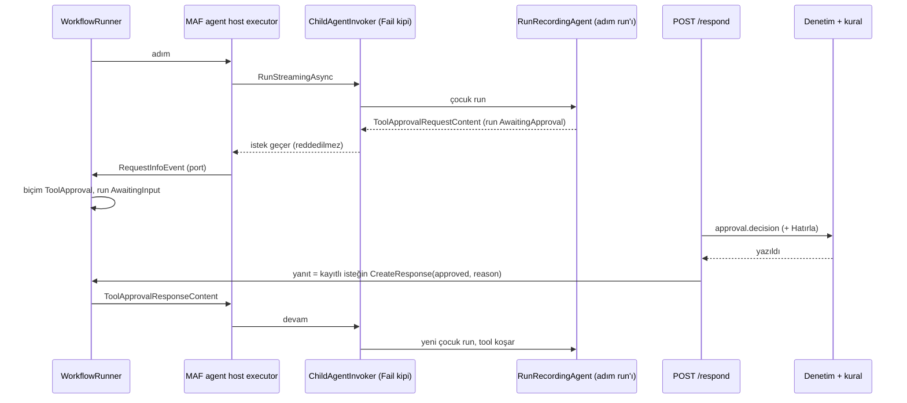

# Faz 230 — Workflow Adımında Tool Onayı

> **Durum:** 🔨 Uygulandı, denetimde (2026-10-21)
> **Kademe:** tam — güvenlik sınırı (onay kararı, denetim izi, "Hatırla" kuralı) · public API (`WorkflowRequestForm.ToolApproval`, `WorkflowRespondRequest.Remember`) · geri dönüşü pahalı karar (K-103'ün workflow kapsamı, K-1051)
> **Plan onayı:** farukatasoy, 2026-10-21 (seçim: karar workflow `/respond` ucundan; K-1051)
> **Kaynak:** [ADAYLAR.md](ADAYLAR.md) · **F-615** (yargı alanları: [`kesif/2026-10-21-maf-dalga-4.md`](kesif/2026-10-21-maf-dalga-4.md) §4)
> **Genellik:** Saklanan ya da kod workflow'u kullanan her tüketici. Bugün onay isteyen tool'u olan agent workflow'da çalışamaz; tek yol otomatik onay kuralıdır, yani insan onayı workflow'da yoktur. İlk ilkeden türer: MAF Workflows onay isteğini kendisi workflow dış isteğine çevirir ve Tracon'un dış istek deposu hazırdır. Tüketici kodunda kalamaz: ret Tracon'un `ChildAgentInvoker`'ındadır.
> **Karşı görüş:** Aday "ciddi bir karşı gerekçe bulunamadı" der. Planın eklediği tek çekince: devam turu bugün ölçülmemiş bir yoldan geçer (229'a benzemez; 230.6). Faz o yolu ilk iş olarak ölçer; yol çalışmazsa durur ve K-1051 yeniden açılır.
> **Önkoşul:** Yok (Faz 229'dan bağımsız)
> **Paketler:** `Tracon.Abstractions`, `.Core`, `.Workflows`, `.AspNetCore`, `.Client`, `.UI`
> **Yeni paket:** Yok · **Migration:** Yok — biçim olay yükünde ad olarak durur; `workflow_requests` biçim sütunu taşımaz (`0061_workflow_requests.sql`, 2026-10-21)
> **Public API:** büyüyor — `1.0.0` GA'dan (K-603) önce ucuz. `wc -l src/*/PublicAPI.Shipped.txt` toplamı 17 satır (2026-10-21)
> **Tüketici yüzeyi:** site: `concepts/workflows.md` (`:40-48` "when a tool asks for approval" ret paragrafı), `concepts/workflow-requests.md` (yeni biçim), `concepts/tools.md` onay bölümü (workflow cümlesi) · sevk edilen: `WorkflowRequestForm` ve `WorkflowRespondRequest` XML belgesi, OpenAPI açıklaması (`/respond`), `@tracon/client` tipleri, `capabilities.md` workflow satırı
> **Manuel test alanı:** `docs/manuel-test/15-WORKFLOWS.md` — `🤖`

---

## Bu Faza Başlarken

> `faz-baslangic` skill'ini uygula. Aşağıdaki liste o skill'in 2. adımıdır —
> **tamamını değil, yalnız işaret edilen bölümleri oku.**

1. Bu doküman
2. Kararlar — yalnız grep:
   ```bash
   grep -n "K-1051 —\|K-103 —\|K-089 —\|K-372 —\|K-541 —\|K-1003 —\|K-1039 —" docs/KARARLAR.md
   ```
   **K-1051** (workflow adımında onay reddedilmez — bu fazın kararı), **K-103** (alt agent ağacında ret sürer), **K-089** (denetim izine yazılamayan karar uygulanmaz), **K-372** (`pending_approvals`'a yalnız kuyruk yolu yazar), **K-541** (bekleyen kayıt görünür olmadan terminal durum yayınlanmaz), **K-1003** (istek süresi dolunca kapanış), **K-1039** (handoff seçeneği iç taşıyıcıyla iletilir)
3. Önceki fazdan devir: yok. Ölçüm [`MAF-KAPSAMA.md`](MAF-KAPSAMA.md) §0 #38 ve §8.2 C-18 (a)'dadır
4. Alan hafızası: [`hafiza/workflows.md`](hafiza/workflows.md), [`hafiza/workflow-cevaplari.md`](hafiza/workflow-cevaplari.md) (`/respond` ve tek cevap), [`hafiza/tool-onay-ve-yetkilendirme.md`](hafiza/tool-onay-ve-yetkilendirme.md), [`hafiza/maf-api.md`](hafiza/maf-api.md); konsol için [`hafiza/frontend.md`](hafiza/frontend.md) ve [`hafiza/frontend-yerellestirme.md`](hafiza/frontend-yerellestirme.md)
5. MAF tipleri: `maf-api-kesfi` — `ExternalRequest.TryGetDataAs<T>`, `ExternalRequest.CreateResponse`, `ToolApprovalRequestContent.CreateResponse`, `AIAgentHostExecutor` ve `HandoffAgentExecutor` onay yolu

---

## Amaç

Bir workflow adımındaki agent onay isteyen bir tool çağırdığında workflow
durur ve bir insanın kararını bekler. Karar workflow'un `/respond` ucundan
verilir, denetim izine yazılır, isteğe bağlı "Hatırla" kuralı kaydedilir ve
workflow kaldığı yerden sürer. Alt agent ağacındaki ret (K-103) değişmez.

- **F-615** — `ChildAgentInvoker` workflow kipinde onayı reddetmez; adım run'ı `AwaitingApproval` kapanır; yeni `ToolApproval` istek biçimi; yanıtı kayıtlı istek kurar; denetim ve kural; konsol formu; belge.

### Bugün ne çalışmıyor — doğrulanmış kanıt

| Kanıt | Gözlem |
|---|---|
| [`WorkflowAgentCache.cs:168`](../src/Tracon.Workflows/Internal/WorkflowAgentCache.cs) | Workflow adımı `ChildAgentInvoker`'ı `ChildRefusalMode.Fail` ile kurar (kipin tek kullanıcısı) |
| [`ChildAgentInvoker.cs:252`](../src/Tracon.Core/Graph/ChildAgentInvoker.cs), `:367`, `:699-709` | Yanıtta `ToolApprovalRequestContent` varsa akışsız ve akışlı yol reddeder: *"A workflow step cannot wait for a tool approval"* |
| [`RunRecordingAgent.cs:264`](../src/Tracon.Core/Recording/RunRecordingAgent.cs), `:505` | `Depth > 0` run onay isteğiyle biterse `Failed` kapanır (K-103) |
| MAF Workflows 1.25 decompile: `AIContentExternalHandler`, `AIAgentHostOptions.InterceptUserInputRequests` (varsayılan `false`), `HandoffAgentExecutor` (`intercepted: false`) | Beş desen onay isteğini varsayılan olarak bir port üzerinden **workflow dış isteğine** çevirir. `ForwardIncomingMessages` belgesi: iletilen cevap "çağıranın verdiği tool ayrıntısını değil, tamamlanan çağrıyı" kullanır |
| [`WorkflowRequestDescriptor.cs:261-280`](../src/Tracon.Workflows/Internal/WorkflowRequestDescriptor.cs) | Biçimler `PlanReview`, `Boolean`, `Text`, `Json`; onay biçimi yok. Onay isteği bugün `Json` biçimine düşerdi |
| [`WorkflowResponseFactory.cs:128`](../src/Tracon.Workflows/Internal/WorkflowResponseFactory.cs) | `Json` biçiminde yanıt istemcinin JSON'undan port tipine (`ToolApprovalResponseContent`) seri çözülür: tool çağrısı istemciden gelir, denetim satırı yazılmaz. Bugün ulaşılması için kod workflow'una sarmalanmamış agent bağlanmalıdır |
| [`ToolApprovalResolver.cs:52`](../src/Tracon.AspNetCore/Internal/ToolApprovalResolver.cs), `:108`, `:187` | Ajan yolunda karar sunucudaki bekleyen istekle eşlenir, `approval.decision` denetim satırı karardan **önce** yazılır (yazılamazsa uygulanmaz), "Hatırla" kural yazar |
| [`WorkflowPendingRequest.cs:100`](../src/Tracon.Abstractions/Workflows/WorkflowPendingRequest.cs), `:125` | `WorkflowRequestForm` ve `WorkflowRespondRequest` public; `Remember` alanı yok |
| [`workflow-detail.tsx:651`](../src/Tracon.UI/frontend/src/screens/workflow-detail.tsx) | Konsol biçime göre form çizer; onay formu yok. Site `concepts/workflow-requests.md:18`: istekler Onaylar ekranının *Workflow requests* panelinde görünür |
| Testler: `WorkflowAgentStepRecordingTests.cs:96`, `ChildAgentInvokerTests.cs:312` | Bugünkü reddi sabitler; bu faz onları **bilerek** değiştirir |
| Probe (gerçek host, 2026-10-21; [`MAF-KAPSAMA.md`](MAF-KAPSAMA.md) §0 #37) | Katalog agent'ına **girdide** onay isteği + cevabı verilince run `InvalidOperationException` ile düşer (*"ToolApprovalRequestContent found … that have no matching ToolApprovalResponseContent"*). İstek oturum geçmişindeyken (yerel devam yolu) sorun yok. Workflow devam yolunun hangi biçimi kullandığı **ölçülmedi** (230.6) |

> Kanıtlar 2026-10-21 tarihinde doğrulandı.

---

## 230.1 — Akış



## 230.2 — `ChildAgentInvoker` ve adım run'ı

- `ChildRefusalMode.Fail` kipinde onay isteği **reddedilmez**: yanıt ve akış
  güncellemesi olduğu gibi döner. `ToolResult` kipi (alt agent ağacı) değişmez
  (K-103).
- Adım run'ının kaydı: çocuk kapsamına `internal` bir bayrak (`AgentRunScope`,
  örn. "onay workflow'u askıya alır") eklenir; `RunRecordingAgent` `Depth > 0`
  iken bayrak varsa `Failed` yerine kök run'ın `AwaitingApproval` dalını
  kullanır. `pending_approvals` satırı **yazılmaz** (K-372: karar workflow
  isteğinden verilir). Kapanış yükü (`BuildAwaitingApprovalPayload`) aynıdır.
- 🚨 İç içe durum: adım agent'ının kendi alt agent'ı onay isterse ret sürer
  (`ToolResult` kipi). Test bunu sabitler.

## 230.3 — `ToolApproval` istek biçimi ve yanıt

- `WorkflowRequestForm.ToolApproval` (yeni üye, sona). `FormFor` istek tipi
  `ToolApprovalRequestContent` ise bu biçimi seçer — kod workflow'unda
  sarmalanmamış agent için de (bugünkü `Json` yolu kapanır).
- İstem: tool adı + `IToolApprovalPresenter` sunumu (ajan yolundaki
  `ResolvePresentationsAsync` ile aynı kaynak). Ham argüman yazılmaz; sunum yoksa
  yalnız tool adı.
- Cevap: `approved` zorunlu; `text` = gerekçe (isteğe bağlı); yeni
  `WorkflowRespondRequest.Remember` (`bool?`), yalnız `approved: true` ile.
  `Json` alanı bu biçimde **reddedilir** (`400`).
- Yanıt **kayıtlı istekten** kurulur: `TryGetDataAs<ToolApprovalRequestContent>`
  → `CreateResponse(approved, reason)` → `ExternalRequest.CreateResponse(…)`.
  İstemci tool çağrısı gönderemez. **Doğrulanmadı — `maf-api-kesfi`:** iki
  `CreateResponse` imzası ve checkpoint'ten dönen istekte `TryGetDataAs`.
- Denetim ve kural: `ToolApprovalResolver`'ın denetim (`:108`) ve "Hatırla"
  (`:187`) parçaları tek bir `internal` yardımcıya çıkarılır; ajan yolu ve
  `/respond` aynı yardımcıyı çağırır. Denetim satırı yanıt uygulanmadan önce
  yazılır; yazılamazsa `/respond` hata döner ve workflow beklemede kalır (K-089).
  Kural kapsamı: ajan adı + tool (ajan yoluyla aynı).
- Yetki: `/respond` bugün Operator + `RunsWrite`; ajan onay ucu
  (`/api/approvals/{id}/decide`) aynı. Değişmez.

## 230.4 — Desenler

| Desen | Onay yolu (MAF 1.25 decompile) | Ölçülecek |
|---|---|---|
| Sequential, Concurrent, GroupChat, Magentic | `AIAgentHostExecutor`, port | Concurrent'ta iki eşzamanlı istek ayrı ayrı cevaplanır |
| Handoff | `HandoffAgentExecutor`, `intercepted: false` | K-1039 taşıyıcısıyla birlikte devam |
| Kod workflow'u (`GetWorkflowAgentStep`) | aynı sarmalayıcı | saklanan workflow ile aynı davranış |

## 230.5 — Süre dolumu

İstek süresi dolunca workflow run'ı K-1003 ile kapanır. Adım run'ı
`AwaitingApproval`'da kalırsa yanıltır → Açık Soru 1.

## 230.6 — 🚨 İlk iş: devam yolu probu

Kod yazmadan önce geçici bir fonksiyonel probe koşulur (kalıcı değildir):

1. `ChildAgentInvoker`'ın reddi yerel olarak kaldırılmış hâlde Sequential bir
   workflow onay isteğiyle durur mu, `RequestInfoEvent` gelir mi?
2. Cevap verilince tool **bir kez** koşar mı? Yoksa §0 #37'deki
   `InvalidOperationException` mı gelir?
3. Aynısı checkpoint'ten, süreç yeniden başladıktan sonra (yeni host, aynı SQLite).
4. İstek ve yanıt checkpoint JSON'una yazılabiliyor mu
   (`ToolApprovalRequestContent` ve `FunctionCallContent` argümanları)?

Biri başarısızsa faz durur, ölçüm `MAF-KAPSAMA.md` §0'a yazılır ve K-1051'in
yeniden açılma koşulu ("onay isteği checkpoint'ten sürdürülemezse") kullanıcıya
götürülür.

---

## Planlanan Public API

> Taslak imzalardır. Gerçekleşen imzalar kapanışta ayrı bir bölüme yazılır.

```csharp
// Tracon.Abstractions
public enum WorkflowRequestForm
{
    Json = 0, Text = 1, Boolean = 2, PlanReview = 3,
    /// <summary>A tool call waiting for approval. Answer with approved, an optional reason in text, and remember.</summary>
    ToolApproval = 4,
}

public sealed record WorkflowRespondRequest
{
    // mevcut üyeler …
    /// <summary>Gets whether an approval is remembered as a rule for this agent and tool. Only with approved; only for ToolApproval.</summary>
    public bool? Remember { get; init; }
}
```

`WorkflowRespondHttpRequest` (`Tracon.AspNetCore` sözleşmesi) aynı alanı alır;
`Tracon.Client` ve `@tracon/client` yeniden üretilir. Bugün eklemek bedava,
GA'dan sonra enum üyesi eklemek tüketicinin `switch`'ini kırar (sürüm kararı).

### HTTP `endpoint`'leri

| Metot | Yol | Rol | Ne yapar |
|---|---|---|---|
| `POST` | `/api/workflows/runs/{runId}/respond` | Operator (`RunsWrite`) | Değişir: `ToolApproval` biçimini kabul eder; denetim ve kural yazar |

### Arayüz payı

`workflow-detail.tsx` onay formu (onayla/reddet, gerekçe, Hatırla) ve
`locales/en.ts` + `tr.ts` anahtarları. Bugünkü paket `index-*.js.br` 184.251 B
(Brotli, 2026-10-21); bütçe kuralı 250 KB gzip. Pay uygulamada ölçülür.

---

## Planlanan Dosya Listesi

```
src/Tracon.Abstractions/Workflows/WorkflowPendingRequest.cs   (enum üyesi, Remember)
src/Tracon.Core/Graph/ChildAgentInvoker.cs                    (Fail kipinde geçir)
src/Tracon.Core/Recording/TraconRunContext.cs                 (internal kapsam bayrağı)
src/Tracon.Core/Recording/RunRecordingAgent.cs                (Depth > 0 + bayrak → AwaitingApproval)
src/Tracon.Workflows/Internal/WorkflowRequestDescriptor.cs    (FormFor, istem)
src/Tracon.Workflows/Internal/WorkflowResponseFactory.cs      (ToolApproval Create/Check)
src/Tracon.AspNetCore/Internal/ToolApprovalResolver.cs        (denetim ve kural yardımcıya)
src/Tracon.AspNetCore/Internal/ToolApprovalDecisionRecorder.cs (yeni, internal)
src/Tracon.AspNetCore/Endpoints/WorkflowEndpoints.cs          (/respond)
src/Tracon.AspNetCore/Contracts/WorkflowContracts.cs          (remember)
src/Tracon.Client/…, src/Tracon.UI/frontend/src/screens/workflow-detail.tsx, locales/en.ts, locales/tr.ts
tests/Tracon.AspNetCore.FunctionalTests/WorkflowToolApprovalTests.cs (yeni)
tests/Tracon.Core.UnitTests/Graph/ChildAgentInvokerTests.cs   (değişir)
tests/Tracon.AspNetCore.FunctionalTests/WorkflowAgentStepRecordingTests.cs (değişir)
docs-site/src/content/docs/concepts/{workflows,workflow-requests,tools}.md
docs/manuel-test/15-WORKFLOWS.md
```

---

## Hata Modları ve Testler

| Ne bozulabilir | Seviye | Test |
|---|---|---|
| Onay isteyen adım workflow'u `Failed` yapar (bugünkü davranış) | Fonksiyonel (önce kırmızı) | `WorkflowToolApprovalTests` — run `AwaitingInput`, istek biçimi `ToolApproval` |
| Onaylanınca tool koşmaz ya da iki kez koşar | Fonksiyonel | sayaç tam 1; ret verilince 0 ve workflow sürer |
| Süreç yeniden başladıktan sonra cevap tool'u koşturmaz | Fonksiyonel | iki host, aynı SQLite (230.6 probunun kalıcı hâli) |
| İstemci tool çağrısı gönderip başka argümanla koşturur | Fonksiyonel | `json` alanlı cevap `400`; argüman kayıtlı istekten gelir |
| Denetim yazılamazken karar uygulanır | Fonksiyonel | atan `IAuditLog`: `/respond` hata, workflow beklemede, tool koşmaz (K-089) |
| "Hatırla" kural yazmaz ya da yanlış kapsamla yazar | Fonksiyonel | ikinci workflow run'ı onaysız geçer; kural ajan + tool kapsamlı |
| Alt agent ağacında ret kalkar (K-103 sızar) | Birim + Fonksiyonel | `ToolResult` kipi reddeder; adım agent'ının alt agent'ı onay isterse adım sonucu ret metnidir |
| Adım run'ı `Failed` ya da `Completed` görünür | Fonksiyonel | adım run'ı `AwaitingApproval`; devam yeni çocuk run'dır |
| `pending_approvals` satırı yazılır (çift karar yolu) | Fonksiyonel | satır yok (K-372) |
| Concurrent desende iki istek birbirini ezer | Fonksiyonel | iki ayrı istek, ayrı cevap, iki tool koşar |
| Handoff deseninde devam kaybolur | Fonksiyonel | handoff sonrası adımda onay ve devam |
| Başka kiracının isteğine cevap | Fonksiyonel (mevcut kapı) | `404`, varlık sızmaz |
| Aynı isteğe iki eşzamanlı cevap | Fonksiyonel | tek cevap kuralı (`hafiza/workflow-cevaplari.md`); ikincisi `409` |
| İptal: workflow beklerken iptal edilir | Fonksiyonel | run `Canceled`; adım run'ı Açık Soru 1 kararına göre kapanır |
| Süre dolumu | Fonksiyonel | K-1003 kapanışı; adım run'ı Açık Soru 1 |
| Konsol formu yanlış alan gönderir | E2E (Playwright) | onayla/reddet/Hatırla; `en.ts` + `tr.ts` |

Beş soru: iptal ✓ · eşzamanlılık ✓ · boş/aşırı girdi (`approved` yok → `400`; `remember` + `approved: false` → `400`) ✓ · başka kiracı ✓ · alt sistem hatası (denetim, checkpoint) ✓.

---

## Manuel Kabul Case'leri

| # | Ön koşul | Adımlar | Beklenen sonuç |
|---|---|---|---|
| 1 `🤖` | `samples/Tracon.Api`, SQLite, gerçek OpenAI; onay isteyen tool'u olan agent'la Sequential workflow | Konsoldan çalıştır → Onaylar → *Workflow requests* → onayla | Workflow tamamlanır; denetim izinde `approval.decision` |
| 2 `🤖` | aynı | Reddet, gerekçe yaz | Agent ret metnini görür, workflow sürer |
| 3 `🤖` | aynı | Onayla + Hatırla; workflow'u yeniden çalıştır | İkinci run onay istemez |

---

## Açık Sorular

| # | Soru | Seçenekler | Öneri |
|---|---|---|---|
| 1 | Workflow isteği süre dolumu ya da iptalle kapanınca `AwaitingApproval` kalan adım run'ı ne olur? | A: workflow run'ının kapanışıyla aynı terminal duruma kapanır · B: K-014 ilkesiyle olduğu gibi kalır | **A**; mevcut kapanış yolunda (K-1003) ölç. B listede sonsuza kadar bekleyen onay gösterir |
| 2 | Konsolun Onaylar ekranı workflow onayını ajan onaylarıyla aynı listede mi gösterir? | A: mevcut *Workflow requests* panelinde, onay biçimiyle · B: ajan onay listesine karışık | **A** (kullanıcı kararı: tek sürdürme yolu `/respond`) |

---

## Bitiş Ölçütleri (DoD)

- [ ] 230.6 probu koşuldu; sonucu "Plandan Sapmalar"a yazıldı
- [ ] Onay isteyen adım workflow'u `AwaitingInput`'a alır; istek biçimi `ToolApproval` (`WorkflowToolApprovalTests`, önce kırmızı)
- [ ] Onay → tool bir kez koşar; ret → koşmaz, workflow sürer; süreç yeniden başladıktan sonra da
- [ ] Yanıt kayıtlı istekten kurulur; `json` alanlı cevap `400`
- [ ] Denetim satırı karardan önce; yazılamazsa karar uygulanmaz
- [ ] "Hatırla" kuralı ajan yoluyla aynı yardımcıdan yazılır
- [ ] Alt agent ağacında ret sürer (K-103)
- [ ] Site: `concepts/workflows.md` ret cümlesi düzeldi, `workflow-requests.md` yeni biçim; `npm run check` temiz
- [ ] `en.ts` ve `tr.ts` eksiksiz; bundle payı ölçüldü ve yazıldı
- [ ] Dört doğrulama kapısı sıfır uyarı verir
- [ ] `samples/Tracon.Api` ile gerçek workflow run'ı (case 1) yapıldı, çıktı belgeye yazıldı
- [ ] `secret` taraması boş döndü
- [ ] `🤖` case'ler `docs/manuel-test/15-WORKFLOWS.md` içinde ve koşuldu; gerisi otomatik testte
- [ ] `faz-denetim` koşuldu; 🔴 bulgu kalmadı

### Doğrulama komutları

```bash
python3 scripts/kapi.py test --proje Tracon.AspNetCore.FunctionalTests --sinif WorkflowToolApprovalTests WorkflowAgentStepRecordingTests WorkflowHandoffTests
python3 scripts/kapi.py test --proje Tracon.Core.UnitTests --sinif ChildAgentInvokerTests
python3 scripts/kapi.py kapanis --taban <faz öncesi commit>
```

---

## Riskler

| Risk | Önlem |
|------|-------|
| Devam yolu §0 #37'deki `InvalidOperationException` sınıfına düşer | 230.6 probu ilk iş; başarısızsa faz durur |
| `Json` biçimindeki eski yol açık kalır (kod workflow'u) | `FormFor` tip eşleşmesi tüm workflow'lara uygulanır; test sarmalanmamış agent'la da koşar |
| Denetim/kural kodu ikinci kez kopyalanır | Tek yardımcı; ajan yolu ve `/respond` aynı yöntemi çağırır (MEMORY: elle tekrarlanan ifade sınıfı) |
| Yüzey belgeyi ve konsolu atlar | `tuketici-dokuman-senkronu` kapanışta koşar |

---

<!-- ============================================================
     AŞAĞISI ÇALIŞIRKEN DOLAR — doküman kapanışta silinir (`faz-kapat`).
     Kalıcı kısım `faz-tamamlama` Adım 5'te yerine taşınır. Başlıkları SİLME.
     ============================================================ -->

## Plandan Sapmalar

> Çalışırken dolar.

1. **🚨 Plan "kod workflow'u (`GetWorkflowAgentStep`) aynı sarmalayıcı" diyordu; değil.** `GetWorkflowAgentStep` ve karma zincirin (`Nodes`) agent düğümü MAF'ın host executor'ı değil Tracon'un `WorkflowAgentStepExecutor`'ıdır (`FunctionExecutor`): `agent.RunAsync` çağırır ve onay içeriğini düşürür; run `Completed` biter. `AddPortHandler` internal, düz executor istek yayınlayamaz. 230.6 probu bunu ilk testin `Completed` dönmesiyle gösterdi. Karar: onayı yalnız MAF'ın host ettiği düğüm bekler (beş desen, `agentNames` biçimi, `GetWorkflowAgent`); fonksiyon adımı reddi sürdürür (`hostsApproval`, K-1055). Fonksiyon adımı için bekletme grafı değiştirir ve bekleyen run'ların checkpoint'ini bozar → F-625. **Kullanıcıya sorulacak:** kapsam bu hâliyle kabul mü?
2. **Bayrak `AgentRunScope`'a değil `TraconRunOptions`'a eklendi** (`SuspendsWorkflowOnApproval`, internal): çocuk kapsamı `PrepareRun`'da options'tan kurulur; kapsama oradan kopyalanır. `RunRecordingAgent` `WaitsForApproval(scope)` / `FailsOnApproval(scope)` yardımcılarını kullanır.
3. **Ajan adı executor kimliğinden okunamaz.** Plan "araç + ajan adı" diyordu; MAF kimlikte adı yeniden yazar (`approval-agent` → `approval_agent`). E2E tireli adla çıkardı: kural eşleşmeyecekti. Ad `WorkflowAgentCache.NameOf(identity)` ile çözülür (K-1057); çözülemeyen istek hatırlanamaz (400).
4. **İstek yükü tool bilgisini taşır** (`toolName`, `agentName`, `toolArgumentsHash`; `WorkflowToolApprovalFacts`, Core): `/respond` Tracon.Workflows'a erişemez, audit ve kural için gereken veri olayda durur. Ham argüman yazılmaz.
5. **`remember` cevap özetine girer** (`WorkflowAnswerDigest`, yalnız `true` iken): `SingleAnswer`'da `remember` farkı tekrar sayılmasın diye. Eski özetler değişmez. Planda yoktu.
6. **Açık Soru 1 → A uygulandı:** süresi dolan cevapsız istekte bekleyen adım run'ı workflow'la birlikte `Failed` kapanır (K-1058); cevaplanan adım `AwaitingApproval` kalır (K-014). Plandaki "iptal" satırı geçersiz: `POST /api/runs/{id}/cancel` yalnız `Queued`/`Running` run'ı iptal eder, `AwaitingInput` run'ı iptal edilemez.
7. **Denetim yardımcısı** `ToolApprovalDecisionRecorder` `ToolApprovalResolver`'ın denetim ve kural kodunu taşır; mimari testler (`AuditWritePolicyTests`, `AuditContentPolicyTests`) kayıt yerini yeni dosyaya çevirdi. Yeni fail-closed çağrı yeri doğmadı (10 kalır); yüzey sayısı üç oldu (docs-site governance sayfası güncellendi).
8. **Test altyapısı:** `ToolApprovalWorkflowHost` (iki workflow, yardımcılar), `WorkflowToolApprovalPatternTests` (Concurrent, Handoff, alt agent, süre dolumu). GroupChat ve Magentic **ölçülmedi**.
9. **Paket payı:** `index-*.js.br` 184.251 → 186.6 KB (+2.35 KB Brotli); gzip 220.8 KB (bütçe 250).

## Bu Fazda Verilen Kararlar

> Çalışırken dolar. Beklenen: `ToolApproval` biçimi ve yanıtın kayıtlı istekten kurulması (`güvenlik`, `public-api`), Açık Soru 1.

- **K-1055** — onayı yalnız host düğümü bekler; fonksiyon adımı reddi sürdürür (güvenlik). Plandan sapma 1; kullanıcı onayı bekler.
- **K-1056** — cevap yalnız karar taşır, `data` reddedilir (güvenlik, public-api).
- **K-1057** — kural ve denetim tek recorder'dan; ajan adı kimlikten çözülür (güvenlik).
- **K-1058** — Açık Soru 1: cevaplanmayan istekte bekleyen adım workflow'la `Failed` kapanır (kalıcı-veri).
- Kategori dışı: sunum metni 500 karakterle sınırlı (yük kesilirse tool bilgisi prompt'tan önce kalsın); `remember: false` ile `null` aynı sayılır (özet ve kural); `Remember` işi kuyruk yükünde (`WorkflowRunJobRequest`) taşınmaz — kural HTTP kapısında yazılır, işçi yalnız kararı uygular.

## Süreç Ölçümü

> Kapanışta doldurulur.

| Metrik | Değer |
|---|---|
| Plan revizyonu sayısı | |
| Düzeltme turu sayısı | |
| 🔴 bulgu: gerçek / gürültü / araştırılacak | |
| Fazın ürettiği regresyon | |
| Faz kapandıktan sonra bulunan kusur | ölçülmedi (kapanış anı) |

## Denetim Bulguları

> `faz-denetim` çıktısı.
