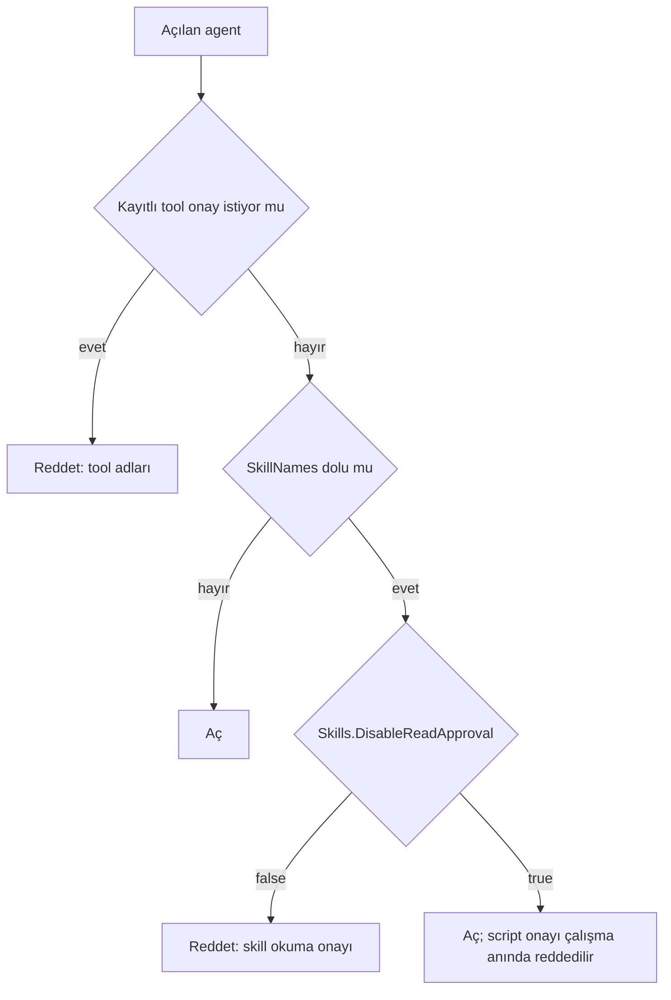

# Faz 231 — Skill Okuma Onayı Tanımda ve Dış Yüzey Kapısı

> **Durum:** 📋 Planlandı (2026-10-21)
> **Kademe:** tam — güvenlik sınırı (tool onayı; A2A/MCP dış yüzey kapısı)
> **Plan onayı:** farukatasoy, 2026-10-21 (seçim: okuma onayı varsayılan açık kalır, tanım kapatabilir; `run_skill_script` hep onaylı)
> **Kaynak:** [ADAYLAR.md](ADAYLAR.md) · **F-626** (ölçüm: [`MAF-KAPSAMA.md`](MAF-KAPSAMA.md) §0 #45, #50; §8.4 K5-1)
> **Genellik:** Skill'li agent'ı dışa açan (A2A, MCP) ya da oturumsuz koşturan (zamanlanmış iş, tetik, oturumsuz run ucu) her tüketici. Bugün böyle bir agent ilk `load_skill` çağrısında düşer; tüketici kodunda kalamaz, çünkü skill provider'ını ve onay seçeneğini Tracon kurar ve korur. İkinci kanıt: MAF 1.25 skill tool'larının üçünü de varsayılan olarak onaya sarar; skill kullanan her Tracon kurulumu bu varsayılanı alır.
> **Karşı görüş:** "Skill talimatı yüklemek zararsız; onayı tümden kaldırın." Cevap: varsayılanı değiştirmek bugünkü davranışı ve manuel seti değiştirir ve bir güvenlik varsayılanını gevşetir (bakımcı seçimi). Tanım okuma onayını **bilerek** kapatır; script onayı hiç kapanmaz.
> **Önkoşul:** Yok
> **Paketler:** `Tracon.Abstractions`, `Tracon.Core`, `Tracon.Sql.Shared`, `Tracon.AspNetCore`, `Tracon.UI`, `Tracon.Client` (üretilir)
> **Yeni paket:** Yok · **Migration:** Yok (tanım JSON yükü olarak saklanır; yeni üye eksikse varsayılan okunur)
> **Public API:** büyüyor — yeni `SkillSettings` tipi, `AgentDefinition.Skills`, `AgentDescriptor.Skills`. `1.0.0` GA'dan (K-603) önce ucuz; `PublicAPI.Shipped.txt` toplamı 17 satır (2026-10-21, `cat src/*/PublicAPI.Shipped.txt | wc -l`)
> **Tüketici yüzeyi:** site: `concepts/tools.md` ve `concepts/agents.md` (skill bölümü; uygulayan oturum `grep -rln -i "skillNames" docs-site/src/content/docs` ile doğrular), `guides/external-agents.md` (dış yüzey kapısı paragrafı), `concepts/workflows.md` (skill onayı workflow isteği olur) · sevk edilen: `SkillSettings` XML belgesi, `AgentDefinition.Skills` `<example>`, `capabilities.md` skill satırı varsa
> **Manuel test alanı:** `docs/manuel-test/14-SKILL-VE-SCRIPT.md` ve `18-MCP-VE-A2A.md` — `🤖`

---

## Bu Faza Başlarken

> `faz-baslangic` skill'ini uygula. Aşağıdaki liste o skill'in 2. adımıdır —
> **tamamını değil, yalnız işaret edilen bölümleri oku.**

1. Bu doküman
2. Kararlar — yalnız grep:
   ```bash
   grep -n "K-1029 —\|K-1030 —\|K-1051 —\|K-1060 —\|K-977 —" docs/KARARLAR.md
   ```
   **K-1029** (uzantı korunan seçeneği değiştiremez; skill-scan seçenekleri korunur), **K-1030** (uzantıyı kod kaydeder, tanım adla seçer; uzantının provider'ı denetlenmez), **K-1051** ve **K-1060** (workflow adımı tool onayını bekler), **K-977** (oturumsuz onay run'ı `Failed` kapanır)
3. Önceki fazdan devir: yok. Ölçüm [`MAF-KAPSAMA.md`](MAF-KAPSAMA.md) §0 #45 ve #50'dedir
4. Alan hafızası: [`hafiza/mcp-a2a-sunucu.md`](hafiza/mcp-a2a-sunucu.md) (dış yüzey onay kapısı, 2026-10-21 notu), [`hafiza/agent-derleme-ve-onbellek.md`](hafiza/agent-derleme-ve-onbellek.md) (skill zinciri tek yerde kurulur, F-578)
5. Gerektiğinde: [`MIMARI-GUVENLIK.md`](MIMARI-GUVENLIK.md) dış yüzey bölümü

---

## Amaç

Bir tanım, skill okuma tool'larının (`load_skill`, `read_skill_resource`) onayını
kapatabilir. Script tool'u (`run_skill_script`) her zaman onay ister. Dış yüzey
kapısı (A2A, MCP) skill'li agent'ın etkin onay durumunu okur: okuma onayı açık
olan skill'li agent'ı açılışta reddeder; kapalı olanı açar.

- **F-626** — tanım alanı, derleyici bağlantısı, dış yüzey kapısının skill üyesi, belge.

### Bugün ne çalışmıyor — doğrulanmış kanıt

| Kanıt | Gözlem |
|---|---|
| Probe (gerçek host, `TraconTestHost` + `FakeModelProvider`, 2026-10-21) | Skill'li agent A2A'ya açıldı. Host açıldı. Model `load_skill` çağırdı; run `Failed` (`The run requested a tool approval, but an externally-invoked agent cannot respond to an approval request.`), A2A yanıtı `-32603`. Modele sunulan tool'lar: `load_skill,read_skill_resource,run_skill_script` |
| MAF 1.25 `AgentSkillsProvider` decompile (satır 377-391) | Üç tool da `!(_options?.Disable…Approval ?? false)` ise `ApprovalRequiredAIFunction` ile sarılır |
| `maf-api-kesfi` dökümü (2026-10-21) | `AgentSkillsProviderBuilder.UseOptions(Action<AgentSkillsProviderOptions>)` vardır. `AgentSkillsProviderOptions`: `DisableLoadSkillApproval`, `DisableReadSkillResourceApproval`, `DisableRunSkillScriptApproval`, `IncludeDetailedErrors`, `SkillsInstructionPrompt` |
| [`AgentDefinitionCompiler.Skills.cs:43-60`](../src/Tracon.Core/Compilation/AgentDefinitionCompiler.Skills.cs) | Builder `UseOptions` çağırmaz → MAF varsayılanı: üç tool da onaylı |
| [`ExternalSurfaceGuard.cs:196-220`](../src/Tracon.AspNetCore/Security/ExternalSurfaceGuard.cs) | Kapı yalnız tool kayıt defterini (`toolRegistry.List()`) ve `descriptor.ToolNames`'i okur; `SkillNames`'e bakmaz |
| [`A2AApprovalGuardFilter.cs:62`](../src/Tracon.AspNetCore/A2A/A2AApprovalGuardFilter.cs), [`McpApprovalGuardFilter.cs:94`](../src/Tracon.AspNetCore/McpServer/McpApprovalGuardFilter.cs) | İki çağıran; ikisi de aynı kapıyı kullanır |
| [`AgentDescriptor.cs:38`](../src/Tracon.Abstractions/Agents/AgentDescriptor.cs) | `SkillNames` descriptor'da var; onay ayarı yok |
| [`SessionlessApprovalRun.cs:35-42`](../src/Tracon.Core/Scheduling/SessionlessApprovalRun.cs) | Oturumsuz run onayda durursa `approval_unanswerable` ile `Failed` kapanır — skill'li agent'ın oturumsuz koşumu da ilk `load_skill`'de düşer (okuma; ölçülmedi) |
| [`RunReplayService.cs:435`](../src/Tracon.Core/Replay/RunReplayService.cs) | `LiveTools` dışındaki replay kipinde `SkillNames` boşaltılır — replay bu fazdan etkilenmez |

> Kanıtlar 2026-10-21 tarihinde doğrulandı.

---

## 231.1 — Tanım alanı

`AgentDefinition`'a `Skills` (`SkillSettings?`) eklenir. Tek üye:
`DisableReadApproval` (`bool`, varsayılan `false`).

- `false` (varsayılan): bugünkü davranış. Üç skill tool'u onay ister.
- `true`: `load_skill` ve `read_skill_resource` onaysız çalışır.
  `run_skill_script` onaylı kalır. Bunu kapatan bir üye **yoktur**: script
  süreç içinde ya da sandbox'ta kod koşturur (`SandboxedSkillScriptRunner`,
  MT-CORE-061 kuralı).
- `Skills` dolu ama `SkillNames` boşsa doğrulayıcı **uyarı** verir (hata değil).

Ad, Tracon'un `Disable*` deseni ve MAF'ın kendi üye adlarıyla uyumludur
(`HarnessSettings.DisableToolAutoApproval`, MAF `DisableLoadSkillApproval`).

## 231.2 — Derleyici

`CreateSkillsProvider` builder'a `UseOptions` ekler:

```csharp
.UseOptions(options =>
{
    var disable = definition.Skills is { DisableReadApproval: true };
    options.DisableLoadSkillApproval = disable;
    options.DisableReadSkillResourceApproval = disable;
    // DisableRunSkillScriptApproval is never set.
})
```

Düz agent ve harness agent aynı provider'ı alır (Faz 219, F-578). Bu yüzden
tek yerde yazılır. Uzantı (K-1029) bu seçenekleri değiştiremez: skill provider'ı
Tracon kurar ve `AgentOptionsGuard` harness'ın skill üyelerini korur. Uygulayan
oturum yeni üçü için korunan satır gerekip gerekmediğini ölçer: uzantı
`AgentSkillsProviderOptions`'a ulaşabiliyor mu (Açık Soru 1).

## 231.3 — Descriptor ve dış yüzey kapısı

`AgentDescriptor`'a `Skills` (`SkillSettings?`) eklenir. Projeksiyon üç yerde
yazılır — **imza-gövde listesi** (`faz-uygulama` Adım 4):

| Yer | Ne |
|---|---|
| `AgentDescriptorProjection.cs:40` | `Skills = definition.Skills` |
| `CodeAgentSource.cs:98` | `Skills = registration.Definition?.Skills` |
| `CompositeAgentCatalog.cs:421` | kopya sırasında `Skills` taşınır |

`EnsureNoApprovalRequiredTools` kuralı:



Ret mesajı agent'ı, sebebi ve çareyi söyler: "set `Skills.DisableReadApproval`
on the definition, or remove the skills". Script tool'u kapıda sayılmaz: her
skill'li agent'a sunulur (probe) ve sayılırsa her skill'li agent reddedilir.
Model bir script çağırırsa çalışma anı reddi (`approval_unanswerable`) geçerlidir;
site bunu yazar.

## 231.4 — HTTP, istemci, konsol

- `AgentDefinitionRequest` (`AgentContracts.cs:14`) `Skills` alır ve eşler (`:110` civarı).
- `AgentDefinitionPayload` (`Tracon.Sql.Shared/Internal/AgentDefinitionPayload.cs`) yeni üyeyi yazar ve okur; eski satırda üye yoksa `null` okunur (CHANGELOG'daki "stored definition written before a list member existed" dersi).
- `TraconCoreJsonContext` ve `TraconJsonContext` yeni tipi kaynak üretimiyle bilir (AOT).
- OpenAPI ve `Tracon.Client` / `@tracon/client` yeniden üretilir.
- Konsol: `agent-editor/sections/skills-section.tsx`'e tek onay kutusu. Metin `en.ts` + `tr.ts`.

---

## Planlanan Public API

> Taslak imzalardır. Gerçekleşen imzalar kapanışta ayrı bir bölüme yazılır.

```csharp
// Tracon.Abstractions
namespace Tracon;

/// <summary>Skill settings of an agent definition.</summary>
public sealed record SkillSettings
{
    /// <summary>
    /// Whether load_skill and read_skill_resource run without asking for approval.
    /// run_skill_script always asks.
    /// </summary>
    public bool DisableReadApproval { get; init; }
}

public sealed record AgentDefinition
{
    public SkillSettings? Skills { get; init; }   // new
}

public sealed record AgentDescriptor
{
    public SkillSettings? Skills { get; init; }   // new
}
```

Bugün eklemek bedava; GA'dan sonra `sealed record`'a üye eklemek kırıcıdır.

### HTTP `endpoint`'leri

Yeni uç yok. `POST/PUT /api/agents` ve `POST /api/agents/validate` gövdesi
`skills` alanını alır; `GET /api/agents/{name}` döner.

### Arayüz payı

Tek onay kutusu ve iki dil anahtarı. Pay ölçülmeli (bugün ana JS brotli 184,6 KB, 2026-10-21; bütçe 250 KB gzip).

---

## Planlanan Dosya Listesi

```
src/Tracon.Abstractions/Agents/
├── SkillSettings.cs                         (yeni)
├── AgentDefinition.cs                       (Skills)
└── AgentDescriptor.cs                       (Skills)
src/Tracon.Core/
├── Compilation/AgentDefinitionCompiler.Skills.cs   (UseOptions)
├── Catalog/AgentDescriptorProjection.cs            (Skills)
├── Catalog/CodeAgentSource.cs                      (Skills)
├── Catalog/CompositeAgentCatalog.cs                (Skills)
├── Compilation/AgentDefinitionValidator*.cs        (uyarı: Skills var, SkillNames yok)
└── TraconCoreJsonContext.cs                        (SkillSettings)
src/Tracon.Sql.Shared/Internal/
├── AgentDefinitionPayload.cs                (Skills)
└── TraconJsonContext.cs                     (gerekirse)
src/Tracon.AspNetCore/
├── Contracts/AgentContracts.cs              (Skills)
└── Security/ExternalSurfaceGuard.cs         (skill kuralı)
src/Tracon.UI/frontend/src/
├── screens/agent-editor/sections/skills-section.tsx
└── locales/en.ts, tr.ts
```

---

## Hata Modları ve Testler

| Ne bozulabilir | Seviye | Test sınıfı |
|---|---|---|
| `DisableReadApproval = true` iken `load_skill` yine onay ister | Fonksiyonel (gerçek derleyici + FIC) | `SkillReadApprovalTests` |
| `DisableReadApproval = true` iken `run_skill_script` onaysız koşar | Fonksiyonel | `SkillReadApprovalTests` |
| Harness agent ayarı almaz (yalnız düz agent alır) | Fonksiyonel, iki agent tipi | `SkillReadApprovalTests` (Theory) |
| Okuma onayı açık skill'li agent A2A/MCP'ye açılır | Fonksiyonel (host açılışı + ilk istek) | `A2AEndpointTests`, `McpServerEndpointTests` |
| Okuma onayı kapalı skill'li agent dışa açılır ve `load_skill` çalışır | Fonksiyonel (A2A mesajı → `Completed`) | `SkillExposureTests` |
| Descriptor projeksiyonu bir kaynakta `Skills`'i düşürür (kod agent'ı, DB agent'ı) | Fonksiyonel, iki kaynak | `SkillExposureTests` |
| Eski bir tanım satırı (üye yok) okunamaz | Depo sözleşmesi (bellek + üç SQL) | mevcut tanım deposu sözleşmesine case |
| Oturumsuz run'da (`POST /api/agents/{name}/run`, `sessionId` yok) skill'li agent düşer / düşmez | Fonksiyonel | `SkillReadApprovalTests` |
| Workflow adımında okuma onayı açıkken `ToolApproval` isteği doğar; kapalıyken doğmaz | Fonksiyonel | `WorkflowToolApprovalPatternTests`'e case |
| Konsol kutusu alanı yazmaz / okumaz | Vitest + E2E | `skills-section.test.tsx`, mevcut agent editor E2E |
| Uzantı skill seçeneklerini değiştirir | Fonksiyonel | `AgentExtensionRunTests`'e case (Açık Soru 1'in sonucuna göre) |

Beş soru: **iptal** — yeni kod yolu yok, seçenek derleme anında yazılır ·
**eşzamanlılık** — derlenmiş agent önbelleği tanımla anahtarlıdır; ayar değişince
yeni derleme · **boş/aşırı girdi** — `Skills` null → varsayılan · **başka kiracı** —
ayar tanımdadır, tanım kiracıya bağlıdır · **alt sistem hatası** — yok.

---

## Manuel Kabul Case'leri

| # | Ön koşul | Adımlar | Beklenen sonuç |
|---|---|---|---|
| 1 `🤖` | Örnek uygulama, gerçek model; bir skill ve onu kullanan agent; agent A2A'ya açık | (a) `skills` yok → host açılışı; (b) `skills.disableReadApproval: true` → A2A mesajı "use the skill" | (a) ilk istek açılış reddi, mesaj skill okuma onayını anar; (b) `Completed`, yanıt skill talimatını izler |
| 2 `🤖` | Aynı agent, konsol | Agent editöründe kutuyu işaretle, kaydet, `GET /api/agents/{name}` | `skills.disableReadApproval: true` döner |

---

## Açık Sorular

| # | Soru | Seçenekler | Öneri |
|---|---|---|---|
| 1 | Uzantı `AgentSkillsProviderOptions`'a ulaşabiliyor mu? | A: ulaşamıyor (provider Tracon'un) → satır gerekmez · B: ulaşıyor → üç üye `Protected` | Önce ölç; B çıkarsa korunur (K-1029 ilkesi) |
| 2 | Kapı, skill'lerinde script olan agent'ı da reddetsin mi? | A: hayır, çalışma anı reddi yeter · B: script'li skill'i olan agent reddedilir (katalogdan okunur, DB verisi değişebilir) | A: kapı başlangıç denetimidir; DB skill'i sonradan değişir, çalışma anı reddi asıl sınırdır |
| 3 | `run_skill_script` için ayrı bir onay ayarı istenir mi? | A: hayır (bu faz) · B: `DisableScriptApproval` | A: script kod koşturur; açmak ayrı karar ister |

---

## Bitiş Ölçütleri (DoD)

- [ ] `skills.disableReadApproval: true` tanımlı agent'ta `load_skill` onaysız koşar; `run_skill_script` onay ister (fonksiyonel test)
- [ ] Okuma onayı açık skill'li agent A2A ve MCP'de açılışta reddedilir; mesaj skill'i ve çareyi anar
- [ ] Okuma onayı kapalı skill'li agent A2A'da `load_skill` ile `Completed` olur
- [ ] Dört doğrulama kapısı sıfır uyarı verir
- [ ] `samples/Tracon.Api` ile gerçek `run` yapıldı, çıktı belgeye yazıldı
- [ ] `secret` taraması boş döndü
- [ ] `🤖` case'ler `docs/manuel-test/14-SKILL-VE-SCRIPT.md` / `18-MCP-VE-A2A.md` içinde ve koşuldu
- [ ] `faz-denetim` koşuldu; 🔴 bulgu kalmadı
- [ ] `docs-site/` güncellendi; `npm run check` temiz
- [ ] `en.ts` ve `tr.ts` eksiksiz; bundle payı ölçüldü ve yazıldı
- [ ] F-626 `ADAYLAR.md`'de yok; `MAF-KAPSAMA.md` §0 #50 ve §8.4 K5-1 "kapandı" der

### Doğrulama komutları

```bash
# Tanım alanı yazılır ve okunur
curl -s -X PUT "$BASE/api/agents/skilled" -H "content-type: application/json" \
  -d '{"name":"skilled","model":{"provider":"openai","model":"gpt-5.4-mini"},"skillNames":["house-skill"],"skills":{"disableReadApproval":true}}'
curl -s "$BASE/api/agents/skilled" | python3 -c "import json,sys; print(json.load(sys.stdin)['skills'])"
```

---

## Riskler

| Risk | Önlem |
|------|-------|
| Bir tüketici okuma onayını kapatır ve skill içeriği modele beklenmeyen talimat taşır | Skill'i kiracı yöneticisi yazar (rol); site skill içeriğinin istem enjeksiyonu yüzeyi olduğunu yazar |
| Descriptor'a üye eklemek bir projeksiyonu atlar | İmza-gövde listesi (231.3) ve iki kaynaklı fonksiyonel test |
| MAF bir sonraki sürümde seçenek adlarını değiştirir | `UseOptions` derleme anında kırılır; sürüm yükseltme dökümü (`maf-kapsama.py fark`) yakalar |

---

<!-- ============================================================
     AŞAĞISI ÇALIŞIRKEN DOLAR — doküman kapanışta silinir (`faz-kapat`).
     Kalıcı kısım `faz-tamamlama` Adım 5'te yerine taşınır. Başlıkları SİLME.
     ============================================================ -->

## Plandan Sapmalar

> Çalışırken dolar. Plan ile gerçek arasındaki fark **gizlenmez**. Kapanışta
> kapanış commit mesajına taşınır.

## Bu Fazda Verilen Kararlar

> Çalışırken dolar. Dört kategoriden birine giren karar (AGENTS.md)
> `docs/KARARLAR.md`'ye K-NNN ve kategori etiketiyle girer; girmeyen karar
> kapanışta commit mesajına taşınır (`faz-tamamlama` Adım 8). Plan numara rezerve
> etmez.

## Süreç Ölçümü

> Kapanışta doldurulur. **Tablo olarak** — onay kutusu DEĞİL: `faz-kapat`
> işaretsiz kutuda durur. `faz-kapat` bu tabloyu `docs/FAZ-DEFTERI.md`'ye taşır;
> eşik **167**'den itibaren boş bir değer hücresinde kapanışı durdurur.
> `ölçülmedi` **geçerli bir değerdir** — kapı bir sayı değil, bir **karar** arar.
> Kapı bölümün VARLIĞINI denetler, doğruluğunu denetlemez (K-766).

| Metrik | Değer |
|---|---|
| Plan revizyonu sayısı | |
| Düzeltme turu sayısı | |
| 🔴 bulgu: gerçek / gürültü / araştırılacak | |
| Fazın ürettiği regresyon | |
| Faz kapandıktan sonra bulunan kusur | ölçülmedi (kapanış anı) |

## Denetim Bulguları

> `faz-denetim` çıktısı. Her satır: bulgu · seviye (🔴/🟡/🟢) · sonuç
> (düzeltildi / gerekçelendi / F-NN olarak devredildi). 🟢 kapanışta
> `ADAYLAR.md`'ye gider.
