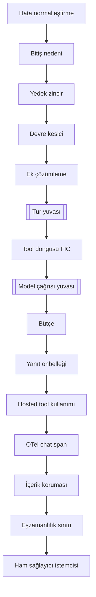

# Faz 232 — Adlı Model Halkası Yuvası

> **Durum:** ✅ Tamamlandı (2026-10-22)
> **Kademe:** tam — geri dönüşü pahalı karar (`rc.1`'de donacak public seam: model istemcisi zincirine tüketici halkası) · güvenlik sınırı (halkanın Tracon'un içerik koruması, bütçe ve önbellek halkalarına göre yeri)
> **Plan onayı:** farukatasoy, 2026-10-21 (seçim: agent uzantısı kancası; tanım `ExtensionNames` ile seçer)
> **Kaynak:** [ADAYLAR.md](ADAYLAR.md) · **F-594** (ölçüm: [`MAF-KAPSAMA.md`](MAF-KAPSAMA.md) §8 C-01, §0 #26–#27, #31; §8.4)
> **Genellik:** Tracon'un model zincirine kendi `IChatClient` halkasını koymak isteyen her tüketici: MAF `MessageInjectingChatClient` (steering, F-600), Purview'un tur başına denetimi (`ChatClientBuilder.WithPurview`, F-633), MEAI `UseLogging`/`UseChatReducer`, kendi `DelegatingChatClient`'ı. Bugün tek yol fabrika agent'ıdır ve o yol 12 model halkasını, BYOK'u, egress'i ve maliyeti kaybeder (`guides/any-maf-feature.md`). İkinci kanıt: iki ayrı MAF özelliği (steering, Purview) yalnız döngü içi halka ile doğru çalışır (§0 #26, §8.3 C-20).
> **Karşı görüş:** "Tüketici halkası Tracon'un korumalarını atlar." Cevap: halka yalnız iki sabit yuvaya girer. İçerik koruması, bütçe, önbellek, eşzamanlılık sınırı ve span döngü içinde halkanın **altında** kalır; devre, yedek zincir, bitiş nedeni ve hata normalleştirme **üstünde** kalır. Halka içeriği değiştirebilir ama içerik korumasının denetiminden kaçamaz.
> **Önkoşul:** Yok (Faz 222'nin `AddAgentExtension` kapısı kapalı)
> **Paketler:** `Tracon.Core` (yalnız; `Tracon.Abstractions` değişmez)
> **Yeni paket:** Yok · **Migration:** Yok
> **Public API:** büyüyor — `ChatClientSlot` enum'u ve `AgentExtensionContext.UseChatClient`. `1.0.0` GA'dan (K-603) önce ucuz; `PublicAPI.Shipped.txt` toplamı 17 satır (2026-10-21)
> **Tüketici yüzeyi:** site: `guides/any-maf-feature.md` (uzantı kapısı satırı, "What you cannot win back today" listesi), `concepts/agents.md` uzantı bölümü varsa · sevk edilen: `UseChatClient` ve `ChatClientSlot` XML belgesi ve `<example>`, `samples/Tracon.Samples.MafFeatures` (rehberin her kod bloğu oradan alıntıdır)
> **Manuel test alanı:** kabul case'i yok — davranış koda bağlıdır ve fonksiyonel testle tekrarlanır; örnek `samples/Tracon.Samples.MafFeatures` testleriyle koşar

---

## Bu Faza Başlarken

> `faz-baslangic` skill'ini uygula. Aşağıdaki liste o skill'in 2. adımıdır —
> **tamamını değil, yalnız işaret edilen bölümleri oku.**

1. Bu doküman
2. Kararlar — yalnız grep:
   ```bash
   grep -n "K-320 —\|K-1029 —\|K-1030 —\|K-1035 —\|K-1038 —\|K-466 —" docs/KARARLAR.md
   ```
   **K-320** (model zincirinin tamamını `ModelProviderRegistry` kurar; sağlayıcı ham istemci döner), **K-1029** ve **K-1030** (uzantı kapısı), **K-1035** ve **K-1038** (MAF'ın döngü içi seçenekleri korunur), **K-466** (eşzamanlı derleme yolu kiracıya kördür)
3. Önceki fazdan devir: yok
4. Alan hafızası: [`hafiza/model-boru-hatti.md`](hafiza/model-boru-hatti.md) (halka sırası), [`hafiza/agent-derleme-ve-onbellek.md`](hafiza/agent-derleme-ve-onbellek.md) (derleme ve önbellek anahtarı), [`hafiza/genisleme-noktalari-ve-denetim.md`](hafiza/genisleme-noktalari-ve-denetim.md)
5. Gerektiğinde: [`MIMARI.md`](MIMARI.md) model boru hattı bölümü

---

## Amaç

Bir agent uzantısı, derlenen agent'ın model zincirine kendi `IChatClient`
halkasını koyar. İki yuva vardır: **model çağrısı** (tool döngüsünün içinde, her
model çağrısını görür) ve **tur** (döngünün dışında, agent turu başına bir
çağrı görür). Tanım halkayı bugünkü `ExtensionNames` ile seçer. Agent tüm Tracon
halkalarını, kiracı anahtarını, egress'i ve maliyeti korur.

- **F-594** — yuva, derleme sırası, yedek zincire taşıma, belge ve örnek.

### Bugün ne çalışmıyor — doğrulanmış kanıt

| Kanıt | Gözlem |
|---|---|
| [`AgentExtensionContext.cs:78`](../src/Tracon.Core/Extensions/AgentExtensionContext.cs) | Uzantı yalnız agent'ı sarar (`Use(Func<AIAgent, AIAgent>)`) ve seçenek nesnesini değiştirir; `IChatClient`'a ulaşmaz |
| [`AgentDefinitionCompiler.cs:436-437`](../src/Tracon.Core/Compilation/AgentDefinitionCompiler.cs) | Model istemcisi ve ikincil istemciler, uzantılar koşmadan **önce** kurulur |
| [`AgentDefinitionCompiler.Agents.cs:63-69`](../src/Tracon.Core/Compilation/AgentDefinitionCompiler.Agents.cs), `:454-461` | Uzantı (`_agentExtensions.Configure`) seçenekler hazır olunca koşar; istemci parametre olarak zaten gelmiştir |
| [`ModelProviderRegistry.cs:364-566`](../src/Tracon.Core/Models/ModelProviderRegistry.cs) | Zincir: ham istemci → hata etiketi → eşzamanlılık sınırı → içerik koruması → **FIC** → bütçe → önbellek → hosted tool kullanımı → OTel → (FIC dışı) ek çözümleme → devre → yedek zincir → bitiş nedeni → normalleştirme |
| [`ModelProviderRegistry.cs:200`](../src/Tracon.Core/Models/ModelProviderRegistry.cs), `:551` | Yedek zincir halkası (`FallbackChatClient`) bağlantının istemcisini `resolveFallback` ile **ayrıca** kurar |
| [`AgentOptionsGuard.cs:135`, `:145-146`](../src/Tracon.Core/Extensions/AgentOptionsGuard.cs) | `UseProvidedChatClientAsIs`, `EnableMessageInjection`, `RequirePerServiceCallChatHistoryPersistence` korunur: MAF'ın döngü içi katmanları Tracon'da döngünün üstüne düşer (K-1038) |
| `grep -rn "UseChatClient\|ChatClientSlot" src/` | 0 |
| `ModelProviderRegistry` `public sealed` (`:34`); `IModelProviderRegistry` public (`Tracon.Abstractions/Models/IModelProviderRegistry.cs:11`) | Tüketici kendi registry'sini kaydedebilir (`TryAdd`) |

> Kanıtlar 2026-10-21 tarihinde doğrulandı.

---

## 232.1 — İki yuva



| Yuva | Yer | Ne görür | Kullanım |
|---|---|---|---|
| `ChatClientSlot.ModelCall` | FIC'in hemen altında, bütçenin üstünde | Döngünün her model çağrısı; tool sonucu modele giderken | MAF `MessageInjectingChatClient`, Purview tur denetimi, çağrı başına kayıt |
| `ChatClientSlot.Turn` | Ek çözümlemenin altında, FIC'in üstünde | Agent turu başına bir çağrı; döngü içeride koşar | Tur başına kısaltma, `UseChatReducer`, tur başına kayıt |

Sonuçlar (sıradan türer, ayrıca test edilir):

- İçerik koruması halkanın **çıktısını** denetler; halka korumayı atlayamaz.
- Bütçe, halkanın gönderdiği isteği sayar. Halka kendi yanıtını döndürür ve içeri çağırmazsa (Purview engeli) bütçe ve span yoktur.
- Önbellek anahtarı halkanın değiştirdiği istekten kurulur.
- Devre ve yedek zincir halkanın hatasını görür; normalleştirme onu güvenli metne çevirir.

## 232.2 — Kapı ve imza

`AgentExtensionContext`'e tek üye eklenir:

```csharp
public void UseChatClient(ChatClientSlot slot, Func<IChatClient, IChatClient> ring);
```

- Tanım halkayı uzantı adıyla seçer (`ExtensionNames`, K-1030). Yeni tanım alanı yoktur.
- Aynı yuvada birden çok halka: **ilk eklenen en içtedir** — `Use` ile aynı kural (Açık Soru 2).
- Halka denetlenmez (`Use` gibi). Belge bunu söyler.
- Halka fabrikası derleme anında koşar. Derlenmiş agent önbelleklenir; parametreli ve kiracı anahtarlı agent her run'da derlenir (`IAgentExtension` belgesi). Fabrika ucuz ve durumsuz olmalıdır.

## 232.3 — Derleme sırası

Bugün istemci uzantıdan önce kurulur (`AgentDefinitionCompiler.cs:436`). Yeni sıra:

1. İkincil istemciler (özetleme, döngü yargıcı) — halkasız, bugünkü gibi.
2. Seçenek nesnesi (sağlayıcılar dahil) — istemciye bağlı değildir.
3. Uzantılar koşar → sarmalayıcılar **ve** halkalar toplanır.
4. Ana istemci halkalarla kurulur.
5. `AsAIAgent` / `AsHarnessAgent`.

Uygulayan oturum ilk iş olarak 2. adımın istemciye gerçekten bağlı olmadığını
**ölçer** (`grep` ile seçenek kurulumunda `chatClient` kullanımı). Bağlıysa bu bir
sapmadır ve dokümana yazılır.

Eşzamanlı derleme yolu (`AgentDefinitionCompiler.cs:342`, K-466) aynı sırayı alır.

## 232.4 — Registry ve yedek zincir

- `ModelProviderRegistry`'ye `internal` aşırı yükleme: `CreateChatClientAsync(ModelBinding, ChatClientRings, CancellationToken)` ve eşzamanlı eşi. `BuildPipeline` halkaları iki yuvaya koyar.
- `resolveFallback` halkaları kapatır: yedek bağlantının istemcisi **aynı halkaları** alır. Purview gibi bir uyum halkası yedek modelde de çalışmalıdır.
- `IModelProviderRegistry` değişmez. Tüketici kendi registry'sini kaydettiyse ve tanım halka isteyen bir uzantı seçtiyse derleme `TraconCompilationException` ile durur; mesaj uzantıyı ve sebebi anar. Sessizce halkasız kurmak yasaktır.
- Özetleme ve döngü yargıcı istemcileri halka almaz (Açık Soru 1).

---

## Planlanan Public API

> Taslak imzalardır. Gerçekleşen imzalar kapanışta ayrı bir bölüme yazılır.

```csharp
// Tracon.Core
namespace Tracon;

/// <summary>Where an extension's chat client ring sits in an agent's model pipeline.</summary>
public enum ChatClientSlot
{
    /// <summary>Inside the tool-call loop, above Tracon's budget, cache and content guard: sees every model call.</summary>
    ModelCall,

    /// <summary>Outside the tool-call loop, below attachment resolution: sees one call per agent turn.</summary>
    Turn,
}

public sealed class AgentExtensionContext
{
    /// <summary>Adds a ring to the agent's model pipeline in the given slot.</summary>
    public void UseChatClient(ChatClientSlot slot, Func<IChatClient, IChatClient> ring);   // new
}
```

`IChatClient` MEAI'nin kararlı tipidir; deneysel tip public imzaya girmez
(`YAYIN-HAZIRLIK.md` ölçüt 5).

### HTTP `endpoint`'leri

Yok. `GET /api/agent-extensions` bugünkü gibi ad ve açıklama döner.

### Arayüz payı

Yok.

---

## Planlanan Dosya Listesi

```
src/Tracon.Core/
├── Extensions/
│   ├── ChatClientSlot.cs                    (yeni)
│   ├── ChatClientRings.cs                   (yeni, internal: yuva başına sıralı liste)
│   ├── AgentExtensionContext.cs             (UseChatClient)
│   └── AgentExtensionRegistry.cs            (halkaları toplar, hata mesajı uzantıyı anar)
├── Compilation/
│   ├── AgentDefinitionCompiler.cs           (derleme sırası, iki yol)
│   ├── AgentDefinitionCompiler.Agents.cs    (sohbet ve harness)
│   └── AgentDefinitionCompiler.ChatOptions.cs
└── Models/ModelProviderRegistry.cs          (internal aşırı yükleme, yuvalar, yedek zincir)
samples/Tracon.Samples.MafFeatures/          (halka örneği + testi)
docs-site/src/content/docs/guides/any-maf-feature.md
```

---

## Hata Modları ve Testler

| Ne bozulabilir | Seviye | Test sınıfı |
|---|---|---|
| `ModelCall` halkası döngünün yalnız ilk çağrısını görür (döngü dışına düşmüş) | Fonksiyonel (gerçek derleyici, iki tool turu) | `ChatClientRingTests` |
| `Turn` halkası her döngü çağrısını görür (döngü içine düşmüş) | Fonksiyonel | `ChatClientRingTests` |
| Halka içerik korumasının üstüne düşer ve korumayı atlar (koruma halkanın çıktısını görmez) | Fonksiyonel (kayıtlı `IContentGuard`) | `ChatClientRingTests` |
| Bütçe halkanın değiştirdiği isteği değil özgün isteği sayar | Fonksiyonel | `ChatClientRingTests` |
| Yedek bağlantının istemcisinde halka yoktur | Fonksiyonel (birincil hata → yedek) | `ChatClientRingFallbackTests` |
| Kiracı anahtarlı (BYOK) agent'ta halka kaybolur ya da başka kiracının halkası çalışır | Fonksiyonel, iki kiracı | `ChatClientRingTenantTests` |
| Harness agent halkayı almaz | Fonksiyonel (Theory: sohbet + harness) | `ChatClientRingTests` |
| İki uzantının halka sırası belgeyle uyuşmaz | Birim (`AgentExtensionRegistry`) + fonksiyonel | `ChatClientRingOrderTests` |
| Tüketicinin kendi registry'sinde halka sessizce düşer | Fonksiyonel | `ChatClientRingTests` (derleme hatası, uzantı adı) |
| Halka fabrikası atar → derleme hatası uzantıyı anmaz | Fonksiyonel | `ChatClientRingTests` |
| Halka iptali (`CancellationToken`) yutmaz/iletmez | Fonksiyonel (`HangingModelProvider`) | `ChatClientRingTests` |
| Özetleme istemcisi halka alır (karar: almaz) | Fonksiyonel (compaction açık) | `ChatClientRingTests` |
| Örnek ve rehber kodu ayrışır | Örnek testleri (`kapi.py yayin`) | `Tracon.Samples.MafFeatures.Tests` |

Beş soru: **iptal** — halka token'ı alır; `HangingModelProvider` ile sınanır ·
**eşzamanlılık** — derleme önbelleği iki eşzamanlı derlemeyi kabul eder (belgeli); halka durumsuz olmalı ·
**boş/aşırı girdi** — `null` halka `ArgumentNullException`; halka sayısı sınırsız ·
**başka kiracı** — BYOK testi · **alt sistem hatası** — halka hatası devre ve normalleştirmeden geçer.

---

## Manuel Kabul Case'leri

Kabul case'i yok. Davranış kod kaydına bağlıdır; fonksiyonel testler ve örnek
testleri tekrarlar. DoD'nin gerçek `run` satırı örnek uygulamada bir kayıt
halkasıyla koşulur.

---

## Açık Sorular

| # | Soru | Seçenekler | Öneri |
|---|---|---|---|
| 1 | Özetleme (compaction) istemcisi halka alsın mı? | A: hayır · B: evet, yuva başına | A: özetleme ayrı bir bağlama ve amaçtır; `MessageInjectingChatClient` özetlemeye mesaj sokmamalıdır. Bedel: uyum halkası özetleme çağrısını görmez — site yazar. Talep çıkarsa `ChatClientRingPurpose` eklenir |
| 2 | Aynı yuvada ilk eklenen en içte mi en dışta mı? | A: en içte (`Use` ile aynı) · B: en dışta (`ChatClientBuilder` ile aynı) | A: Tracon'un tek uzantı kapısında tek kural |
| 3 | Halka fabrikası yedek bağlantının `ModelBinding`'ini görsün mü? | A: hayır (`Func<IChatClient, IChatClient>`) · B: evet (`Func<IChatClient, ModelBinding, IChatClient>`) | A ile başla; ölçülen bir ihtiyaç çıkarsa B. `rc.1`'den önce karar verilmeli — imza sonra kırıcıdır |
| 4 | `EnableMessageInjection` bu fazda serbest kalsın mı? | A: hayır, F-600 ayrı (HTTP ucu, rol, olay) · B: evet | A: bu faz yalnız yuvadır; F-600 yuvayı kullanır |

---

## Bitiş Ölçütleri (DoD)

- [x] `UseChatClient(ChatClientSlot.ModelCall, …)` ile kurulan halka iki tool turlu bir run'da iki model çağrısını görür; `Turn` halkası bir çağrı görür (fonksiyonel test) — `ChatClientRingTests` (sohbet + harness)
- [x] İçerik koruması, bütçe ve OTel halkanın altında; devre ve yedek zincir üstünde (sıra testi) — `ChatClientRingOrderTests` (koruma, bütçe, önbellek, `chat` span), `ChatClientRingFallbackTests` (devre, yedek); koruma System mesajını denetlemez (sapma 7)
- [x] Yedek bağlantı aynı halkayı alır — async yol fonksiyonel, eşzamanlı yol birim testi
- [x] Tüketici registry'sinde halka isteyen uzantı derlemeyi uzantı adıyla durdurur
- [x] `samples/Tracon.Samples.MafFeatures` halka örneği ve testi yeşil; rehberin kod bloğu örnekten alıntıdır — `Tracon.Samples.MafFeatures.Tests` 8/8, bu fazın paketlerine (`1.0.0-preview.5.54`) karşı, izole `NUGET_PACKAGES` ile. `kapi.py yayin --kuru` bu faza ulaşmadan taban restore'unda durdu: `v1.0.0-preview.5` etiketi var, paketleri nuget.org'da yok (faz dışı yayın sorunu, kullanıcı isteğiyle bakılmadı). Aynı koşumda `Tracon.Samples.CustomAgentSource.Tests` 5 case düştü: JSON'dan okunan tanımda `ExtensionNames` `null`, `AgentExtensionRegistry.Configure` NRE; satır Faz 222'den beri değişmedi
- [x] Dört doğrulama kapısı sıfır uyarı verir — `kapi.py kapanis --taban 99a25b77`
- [x] `samples/Tracon.Api` ile gerçek `run` yapıldı (kayıt halkasıyla), çıktı belgeye yazıldı
- [x] `secret` taraması boş döndü — `kapi.py tarama` (15 işaretli sentetik credential atlandı)
- [x] Kabul case'i yok (gerekçe yukarıda)
- [x] `faz-denetim` koşuldu; 🔴 bulgu kalmadı — iki 🔴 gerçek, ikisi düzeltildi
- [x] `docs-site/` güncellendi; `npm run check` temiz
- [x] F-594 `ADAYLAR.md`'de yok; F-600 ve F-633 metni yuvayı Faz 232 diye anar; `MAF-KAPSAMA.md` §8 C-01 "kapandı" der

### Gerçek run (2026-10-21)

`samples/Tracon.Api`, dört boş ortam değişkeniyle (`Npgsql` satırı: 0), yerel echo modeli:

```text
GET  /tracon/api/agent-extensions
  [{"name":"house-style",...},{"name":"model-call-logging","description":"Writes one log line for every model call, inside the tool-call loop."}]
POST /tracon/api/agents/house-style-demo/run {"message":"What is the house style?"}
  event: update ... "Echo [instructions: Answer the question.\nHOUSE-STYLE: ..."
  GET /tracon/api/runs/01a16034-… → Completed house-style-demo echo-instructions-1
log:
  info: Tracon.Api.ModelCallLoggingExtension[1458130754]
        Model call of agent house-style-demo: last message role user, 1 messages.
POST /tracon/api/agents/validate {"extensionNames":["model-call-logging"],...} → {"valid":true,...}
```

Echo modeli tool çağırmaz; döngü içi iki çağrı fonksiyonel testte ve örnek testinde ölçülür.

### Doğrulama komutları

```bash
python3 scripts/kapi.py test --proje Tracon.AspNetCore.FunctionalTests --sinif "*ChatClientRing*"
```

---

## Riskler

| Risk | Önlem |
|------|-------|
| Derleme sırasını değiştirmek bir seçeneğin istemciye bağlılığını kırar | 232.3'ün ilk ölçümü; mevcut derleme testleri tam koşar |
| Halka Tracon'un korumasını içerikle atlatmaya çalışır | Koruma halkanın altındadır; sıra testi bunu sabitler |
| Kiracı anahtarlı agent her run'da derlenir ve halka fabrikası pahalıdır | Belge "ucuz ve durumsuz" der; ölçüm gerekirse F-ID |
| İmza `rc.1`'de donar ve sonra genişletmek kırıcıdır | Açık Soru 3 bu fazda kapanır |

---

<!-- ============================================================
     AŞAĞISI ÇALIŞIRKEN DOLAR — doküman kapanışta silinir (`faz-kapat`).
     Kalıcı kısım `faz-tamamlama` Adım 5'te yerine taşınır. Başlıkları SİLME.
     ============================================================ -->

## Plandan Sapmalar

> Çalışırken dolar. Plan ile gerçek arasındaki fark **gizlenmez**. Kapanışta
> kapanış commit mesajına taşınır.

1. **232.3 ölçümü — sapma yok.** `grep -n "chatClient" src/Tracon.Core/Compilation/AgentDefinitionCompiler*.cs`:
   istemci seçenek kurulumunda kullanılmıyor, yalnız `AsAIAgent` / `AsHarnessAgent`
   çağrısında. 2. adım istemciye bağlı değil.
2. **232.4 — registry yüzeyi iki adımlı oldu.** Plan `CreateChatClientAsync(ModelBinding, ChatClientRings, …)`
   aşırı yüklemesini istiyordu; bu yüklemeyi uzantılardan sonra çağırmak egress ve kiracı
   anahtarı okumasını uzantı kodundan sonraya iterdi ve `BuildAgent`'ı async yapardı (K-874).
   Uygulanan: `ModelProviderRegistry.PrepareChatClient(Async)` sağlayıcıyı, egress'i ve kiracı
   anahtarını uzantılardan **önce** çözer ve `PendingChatClient` döner; `BuildChatClient`
   zinciri uzantılardan sonra halkalarla senkron kurar. Reddedilen sağlayıcı hiçbir uzantı
   kodu koşmadan reddedilir. Bedel: `BuildPipeline` hataları (yanıt önbelleği var ama
   `IDistributedCache` yok, sağlayıcı kurulum hatası, kiracı anahtarını desteklemeyen sağlayıcı)
   uzantılardan sonra gelir; tip ve mesaj aynı.
3. **232.1 — "devre ve yedek zincir halkanın hatasını görür; normalleştirme onu güvenli metne
   çevirir" iddiası yalnız sağlayıcı hatası için doğru.** Ölçüldü: halkanın **kendi** istisnası
   `ForeignProviderInvocationException` etiketi taşımaz; devre saymaz (F-354), normalleştirme
   maskelemez, yedek zincir başka modele geçmez. Halkanın altından geçen sağlayıcı hatası
   etiketli kalır: devre sayar, yedek geçer, mesaj maskelenir. Karar: `context.Use`
   sarmalayıcısıyla aynı kural (host kodu); XML belgesi ve site yazar. Kapı:
   `ChatClientRingFallbackTests` (üç case).
4. **Planda olmayan koruma: `Turn` halkası tool döngüsünü gizleyemez.** MAF sohbet agent'ı
   istemcide `FunctionInvokingChatClient` bulamazsa kendi döngüsünü ekler; K-1035'in
   `AllowConcurrentInvocation` okuması da aynı aramaya dayanır. `GetService`'i ileri vermeyen
   bir `Turn` halkası derlemeyi uzantıyı anarak durdurur. Kapı:
   `ChatClientRingTests.A_Turn_ring_that_hides_the_tool_loop_fails_the_compilation_naming_the_extension`.
5. **Bütçe testi run `Usage`'ını değil bütçeyi ölçer.** İlk taslak `run.Usage`'ı okudu ve
   düştü (10 ≠ 20): run kullanımı agent'a ulaşan güncellemelerden okunur, halkanın attığı
   ilk yanıtın kullanımı oraya ulaşmaz. Bütçe ise halkanın altında her çağrıyı sayar; test
   `MaxTotalTokens = 15` ile ikinci çağrının reddini ölçer.
6. **`samples/Tracon.Api`'ye `ModelCallLoggingExtension` eklendi** (DoD'nin gerçek run satırı
   için); `house-style-demo` onu seçer.
7. **"Karşı görüş" ve 232.1 "içerik koruması halkanın çıktısını denetler" iddiası daraldı**
   (denetim 🔴1). Koruma her agent'ta `ChatRole.System` mesajını ve `ChatOptions.Instructions`'ı
   atlar (`ContentGuardMessageMasker.cs:144`); halka korumanın üstünde olduğu için yanıtı
   çıktı denetiminden sonra görür ve değiştirebilir. Halka korumadan kaçamaz ama yalnız
   kullanıcı, asistan ve tool mesajları için. Belge (`ChatClientSlot`, `UseChatClient`, site)
   bunu söyler; kapı `The_content_guard_does_not_inspect_a_system_message_that_a_ring_adds`.
   Korumanın davranışı değişmedi (kullanıcı kararı, 2026-10-22).

## Bu Fazda Verilen Kararlar

> Çalışırken dolar. Dört kategoriden birine giren karar (AGENTS.md)
> `docs/KARARLAR.md`'ye K-NNN ve kategori etiketiyle girer; girmeyen karar
> kapanışta commit mesajına taşınır (`faz-tamamlama` Adım 8). Plan numara rezerve
> etmez.

- **Açık Soru 1 → A:** özetleyici ve döngü yargıcı halka almaz (kapı: `ChatClientRingTests.The_compaction_summarizer_gets_no_ring`).
- **Açık Soru 2 → A:** aynı yuvada ilk eklenen en içte, uzantılar arasında tanımın sırasıyla (kapı: `ChatClientRingOrderTests`, birim).
- **Açık Soru 3 → A:** fabrika `Func<IChatClient, IChatClient>`. B sonradan **ek** bir aşırı yükleme olarak gelebilir (lambda parametre sayısı farklı, belirsizlik yok); bu yüzden `rc.1` öncesi zorunlu karar değildir.
- **Açık Soru 4 → A:** `EnableMessageInjection` korunur; F-600 yuvayı kullanır.
- K-1062 (public-api) ve K-1063 (güvenlik) — `docs/KARARLAR.md`.

## Süreç Ölçümü

> Kapanışta doldurulur. **Tablo olarak** — onay kutusu DEĞİL: `faz-kapat`
> işaretsiz kutuda durur. `faz-kapat` bu tabloyu `docs/FAZ-DEFTERI.md`'ye taşır;
> eşik **167**'den itibaren boş bir değer hücresinde kapanışı durdurur.
> `ölçülmedi` **geçerli bir değerdir** — kapı bir sayı değil, bir **karar** arar.
> Kapı bölümün VARLIĞINI denetler, doğruluğunu denetlemez (K-766).

| Metrik | Değer |
|---|---|
| Plan revizyonu sayısı | 0 (plan değişmedi; 7 sapma kaydı) |
| Düzeltme turu sayısı | 1 (denetim: 2 🔴 + 1 🟡) |
| 🔴 bulgu: gerçek / gürültü / araştırılacak | 2 / 0 / 0 |
| Fazın ürettiği regresyon | 3, hepsi commit'ten önce kapıda yakalandı: public tip tabanı, sevk edilen doküman tabanı, derlenmeyen XML `<example>` |
| Faz kapandıktan sonra bulunan kusur | ölçülmedi (kapanış anı) |

## Denetim Bulguları

> `faz-denetim` çıktısı. Her satır: bulgu · seviye (🔴/🟡/🟢) · sonuç
> (düzeltildi / gerekçelendi / F-NN olarak devredildi). 🟢 kapanışta
> `ADAYLAR.md`'ye gider.

Denetim 2026-10-21, `faz-denetcisi`, taban `99a25b77`, çalışma ağacı. Triyaj: kullanıcı, 2026-10-22.

| # | Bulgu | Seviye | Triyaj | Sonuç |
|---|---|---|---|---|
| 1 | Belge "koruma halkanın gönderdiği her şeyi denetler" diyor; koruma System mesajını ve `Instructions`'ı denetlemez, halka yanıtı çıktı denetiminden sonra değiştirebilir | 🔴 | gerçek | Düzeltildi: metin daraldı (`ChatClientSlot`, `UseChatClient`, `any-maf-feature.md`); sınır testi `ChatClientRingOrderTests.The_content_guard_does_not_inspect_a_system_message_that_a_ring_adds`; sapma 7 |
| 2 | DoD 2'nin OTel ve devre kısmı için sıra testi yok; "halkanın kendi hatası devreye sayılmaz" testsiz | 🔴 | gerçek | Düzeltildi: `ChatClientRingOrderTests.Each_call_that_a_ModelCall_ring_sends_gets_its_own_chat_span` (2 / 0 span) ve `ChatClientRingFallbackTests.Only_a_provider_failure_that_passed_up_through_a_ring_opens_the_circuit` (eşik 1). Mutasyon: OTel'i halkanın üstüne, `Turn`'ü devrenin üstüne taşımak üç case'i düşürdü |
| 3 | Eşzamanlı derleme yolunda yedek bağlantının halkayı aldığını kanıtlayan test yok | 🟡 | — | Düzeltildi: birim `ChatClientRingOrderTests.The_synchronous_compile_path_gives_a_fallback_link_the_same_rings`; mutasyon (`Build(ChatClientRings.Empty)`) düşürdü |
| 4 | `FallbackChatClient._fallbackClients` kilitsiz `Dictionary`; derlenmiş agent eşzamanlı run'lar arasında paylaşılır, halka fabrikası da bu yoldan koşar | 🟢 | — | F-641 olarak devredildi (faz öncesi kusur, repro yok) |
