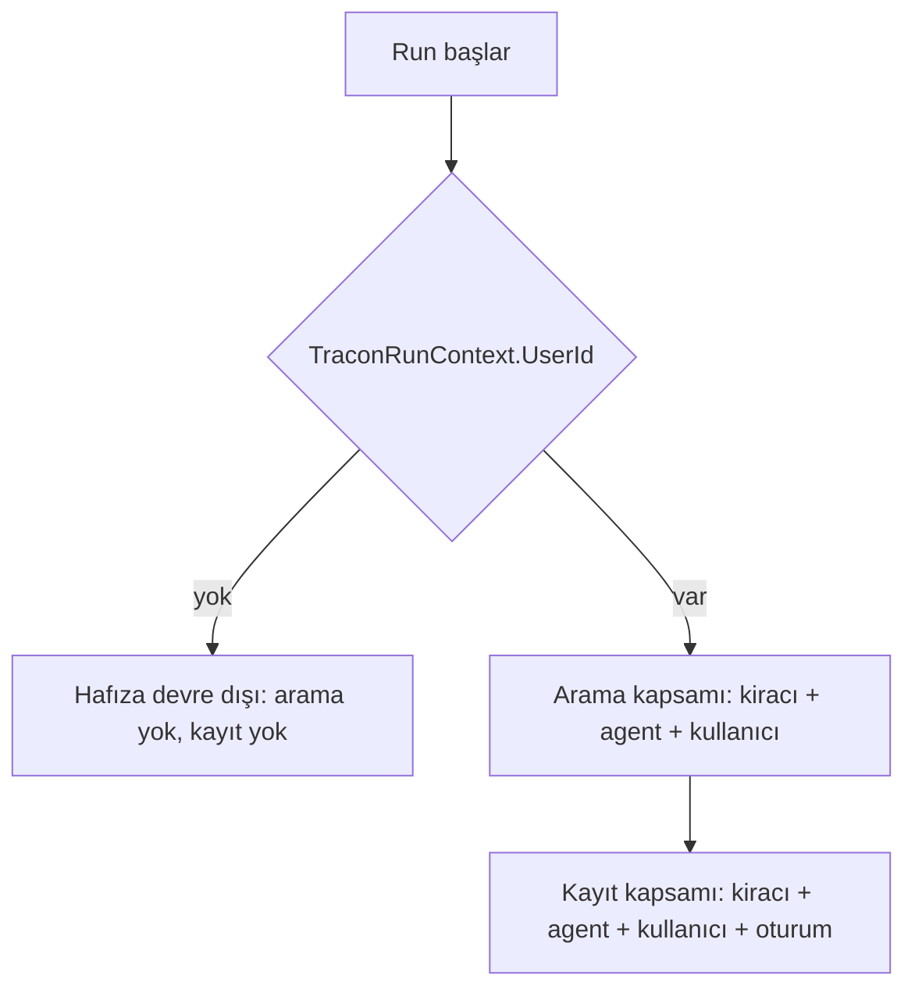

# Faz 233 — Konuşma Hafızası

> **Durum:** 📋 Planlandı (2026-10-21)
> **Kademe:** tam — güvenlik/kiracı sınırı (hafıza kaydının kiracı, agent ve kullanıcı süzgeci) · kalıcı veri (tüketicinin vektör deposuna yazılan türetilmiş kayıt; veri sahibi silme ve saklama süresi) · geri dönüşü pahalı karar (kayıt alanlarının anlamı)
> **Plan onayı:** farukatasoy, 2026-10-21 (seçim: kapsam kiracı + agent + kullanıcı; anonim run'da kapalı; K-105/K-342 yeniden açıldı)
> **Kaynak:** [ADAYLAR.md](ADAYLAR.md) · **F-627** (ölçüm: [`MAF-KAPSAMA.md`](MAF-KAPSAMA.md) §0 #42, §8.3 C-24, §8.4 K5-2)
> **Genellik:** Bir kullanıcıyı oturumlar arasında hatırlaması gereken her agent (destek, kişisel asistan, satış). MAF bunu `ChatHistoryMemoryProvider` ile verir; Tracon'da bugün K0'dır. Tüketici kodunda kalamaz: sağlayıcı tanımdan derlenen agent'a ancak Tracon bağlayabilir, kiracı ve kullanıcı süzgecini ve silmeyi ancak Tracon uygulayabilir. İkinci kanıt: ekosistemde uzun dönem hafıza yaygın bir agent yeteneğidir (MAF, Foundry Memory, Mem0); Tracon'un farkı yönetimdir (kapsam, silme, kayıt).
> **Karşı görüş:** "K-105 ve K-342 bunu iki kez reddetti; AOT'u bozar." Cevap: K-342'nin ölçümü Tracon'un kendi `VectorStore`'unu yazmasına aitti (`GetCollection<TKey,TRecord>` `[RequiresDynamicCode]`). MAF sağlayıcısı `GetDynamicCollection` kullanır (işaretsiz) ve Native AOT yayın probu 0 uyarı verdi (§0 #42). `VectorStore` tüketicinin DI kaydıdır; bağlayıcının AOT duruşu tüketicinindir. Karar bakımcı tarafından yeniden açıldı (2026-10-21).
> **Önkoşul:** Yok (sıra: Faz 231 ve 232'den sonra; teknik bağ yok)
> **Paketler:** `Tracon.Abstractions`, `Tracon.Core`, `Tracon.Sql.Shared` (silme ve saklama kancası), `Tracon.AspNetCore` (sözleşme), `Tracon.UI`, `Tracon.Client` (üretilir)
> **Yeni paket:** Yok — `Microsoft.Extensions.VectorData.Abstractions` 10.10.0 bugün MAF 1.25 üzerinden grafiktedir. Test için bellek içi bağlayıcı **ölçülmeli** (Açık Soru 3) · **Migration:** Yok (kayıtlar tüketicinin vektör deposundadır)
> **Public API:** büyüyor — `MemorySettings`'e üç üye, `ConversationMemorySearch` enum'u, `TraconConversationMemoryOptions`, `UseConversationMemory` uzantısı. `1.0.0` GA'dan (K-603) önce ucuz; `PublicAPI.Shipped.txt` toplamı 17 satır (2026-10-21)
> **Tüketici yüzeyi:** site: `guides/context-and-memory.md` ("It is not MAF's `ChatHistoryMemoryProvider`" paragrafı yeniden yazılır), `guides/knowledge.md` (ayrım cümlesi), `concepts/sessions.md` veya veri sahibi silme sayfası (hafıza da silinir) · sevk edilen: `MemorySettings` XML belgesi (bugün "deliberately absent" der), `UseConversationMemory` `<example>`, `src/Tracon.Core/README.md` hafıza bölümü varsa
> **Manuel test alanı:** `docs/manuel-test/02-CEKIRDEK-VE-KATALOG.md` (hafıza) ve gizlilik alanı — `🤖`

---

## Bu Faza Başlarken

> `faz-baslangic` skill'ini uygula. Aşağıdaki liste o skill'in 2. adımıdır —
> **tamamını değil, yalnız işaret edilen bölümleri oku.**

1. Bu doküman
2. Kararlar — yalnız grep:
   ```bash
   grep -n "K-105 —\|K-342 —\|K-110 —\|K-114 —\|K-059 —" docs/KARARLAR.md
   ```
   **K-105** ve **K-342** (hafıza iki kez ertelendi; 2026-10-21'de yeniden açıldı), **K-110** ve **K-114** (dosya deposu; kalıcı depo agent adını run'ın ambient kapsamından **okur** — sağlayıcı kapsamı için aynı okuma deseni), **K-059** (`secret` yazılmaz)
3. Önceki fazdan devir: aşağıdaki "Önceki Fazdan Devir (Faz 232)" bölümü — teknik bağ yok, yalnız derleme sırası değişti
4. Alan hafızası: [`hafiza/maf-api.md`](hafiza/maf-api.md) (`AIContextProvider`), [`hafiza/maf-oturum.md`](hafiza/maf-oturum.md) (sağlayıcı oturum durumu), [`hafiza/cekirdek-calistirma.md`](hafiza/cekirdek-calistirma.md) (`TraconRunContext`, `AsyncLocal` okuma kuralı)
5. Gerektiğinde: [`MIMARI-GUVENLIK.md`](MIMARI-GUVENLIK.md) kiracı ve gizlilik bölümü

---

## Önceki Fazdan Devir (Faz 232)

Faz 232 teknik bağ bırakmadı. Derleyiciye dokunacağın için bilmen gereken üç şey:

- **Ana model istemcisi uzantılardan SONRA kurulur.** `CompileAsync` istemci değil
  `PendingChatClient` alır (`PrepareChatClientAsync`: sağlayıcı + egress + kiracı anahtarı
  önce çözülür). `CompileChatAgent`/`CompileHarnessAgent` içinde sıra: seçenek nesnesi (hafıza
  sağlayıcıları dahil) → `_agentExtensions.Configure` → `BuildChatClient(definition, pending, rings)`
  → `AsAIAgent`/`AsHarnessAgent`. Yeni bir sağlayıcı seçenek nesnesine istemciye bakmadan girer.
- **`AgentExtensionRegistry.Configure` artık `ExtensionConfiguration(Wrappers, Rings)` döner.**
- 🚨 **Yan kanal istemcisi halka almaz.** Hafıza sağlayıcısı kendi model ya da embedding çağrısını
  yaparsa o çağrı uzantının `ChatClientSlot` halkasından geçmez (özetleyici ve yargıçla aynı kural, K-1063).

## Amaç

Bir tanım konuşma hafızasını açar. Agent, aynı kullanıcının bu agent'la geçmiş
oturumlarındaki ilgili mesajları bulur ve modele bağlam olarak verir. Kayıt
tüketicinin kaydettiği `VectorStore`'a yazılır. Kapsam kiracı + agent +
kullanıcıdır. Kimliği olmayan run'da hafıza kapalıdır. Veri sahibi silme ve
oturum silme hafıza kayıtlarını da siler.

- **F-627** — tanım alanları, kurulum seçenekleri, kapsamlı sağlayıcı, silme ve saklama kancası, konsol, belge.

### Bugün ne çalışmıyor — doğrulanmış kanıt

| Kanıt | Gözlem |
|---|---|
| [`MemorySettings.cs:1-13`](../src/Tracon.Abstractions/Agents/MemorySettings.cs) | XML belgesi: "`ChatHistoryMemoryProvider` … is deliberately absent here" |
| [`AgentDefinitionCompiler.Memory.cs:25-50`](../src/Tracon.Core/Compilation/AgentDefinitionCompiler.Memory.cs) | `CreateMemoryProviders` dosya belleği, todo ve metin aramasını kurar; konuşma hafızası yok |
| `docs-site/src/content/docs/guides/context-and-memory.md:173-176` | Site "It is not MAF's `ChatHistoryMemoryProvider`" der |
| `maf-api-kesfi` dökümü (2026-10-21) | `ChatHistoryMemoryProvider(VectorStore, string collectionName, int vectorDimensions, Func<AgentSession?, State> stateInitializer, ChatHistoryMemoryProviderOptions?, ILoggerFactory?)`; seçenekler: `SearchTime` (`BeforeAIInvoke` varsayılan · `OnDemandFunctionCalling`), `MaxResults` (varsayılan 3), `ContextPrompt`, `FunctionToolName`, `Redactor`, `EnableSensitiveTelemetryData`, üç mesaj süzgeci; kapsam: `ApplicationId`, `AgentId`, `UserId`, `SessionId` |
| MAF 1.25 decompile `ChatHistoryMemoryProvider.cs:219-261` | Koleksiyon `GetDynamicCollection` ile açılır; alanlar `Key` (Guid), `Role`, `MessageId`, `AuthorName`, `ApplicationId`, `AgentId`, `UserId`, `SessionId` (indeksli), `Content` (tam metin), `CreatedAt`, `ContentEmbedding` (`string`, boyutlu) → gömme vektör deposunun kendi üreticisiyle yapılır |
| MAF 1.25 decompile `:427-451` | Arama süzgeci kapsamın dolu alanlarını `==` ile birleştirir |
| Native AOT yayın probu (osx-arm64, 2026-10-21) | `ChatHistoryMemoryProvider` + `ChatClientAgent` yolu: 0 uyarı; MEVD 10.10 `GetDynamicCollection` işaretsiz, `GetCollection<TKey,TRecord>` `[RequiresDynamicCode]` |
| [`TraconRunContext.cs:64-93`](../src/Tracon.Core/Recording/TraconRunContext.cs) | `AgentName`, `TenantId`, `SessionId`, `UserId` run bağlamındadır |
| [`IDataSubjectStore.cs`](../src/Tracon.Abstractions/Privacy/IDataSubjectStore.cs), [`DataSubjectScope.cs:13-23`](../src/Tracon.Abstractions/Privacy/DataSubjectScope.cs) | Silme kapsamı oturum, run ve konuşma kimlikleridir; dış içerik (ek baytları) silme commit'ten önce silinir (`SqlDataSubjectStore.cs:17-35`, `:110-154`) |
| [`VectorSearchToolFactory.cs:33,52`](../src/Tracon.Core/Knowledge/VectorSearchToolFactory.cs) | Tracon tüketicinin `IEmbeddingGenerator`'ını DI'dan alır — İ5 emsali |

> Kanıtlar 2026-10-21 tarihinde doğrulandı.

---

## 233.1 — Kurulum ve tanım

İki anahtar vardır (K1: ikisi de varsayılan kapalı):

1. **Kurulum** — `builder.UseConversationMemory(o => o.VectorDimensions = 1536)`. Tüketici `VectorStore`'u kendisi kaydeder (bağlayıcı paketi + gömme üreticisi deposun içinde). `CollectionName` varsayılanı `tracon_conversation_memory`.
2. **Tanım** — `Memory.EnableConversationMemory = true`. İsteğe bağlı: `ConversationMemorySearch` (`BeforeEachTurn` varsayılan · `OnDemand`), `ConversationMemoryMaxResults`.

Tanım açık ama kurulum yoksa ya da DI'da `VectorStore` yoksa derleme durur ve
eksik kaydı adıyla söyler (yanıt önbelleği emsali, `ModelProviderRegistry.cs`
`IDistributedCache` mesajı).

## 233.2 — Kapsam ve anonim run



| MAF alanı | Tracon değeri |
|---|---|
| `ApplicationId` | kiracı kimliği |
| `AgentId` | agent adı |
| `UserId` | run'ın kullanıcısı |
| `SessionId` | **yalnız kayıtta**: oturum kimliği (silme bunu kullanır). Aramada boş: kullanıcı oturumlar arasında hatırlanır |

MAF sağlayıcısı `sealed`'dır. Tracon onu bir **kapsam sarmalayıcısıyla** sarar
(`AIContextProvider`'ın public `InvokingAsync`/`InvokedAsync`'i):

- Kullanıcı yoksa iç sağlayıcıyı çağırmaz.
- Oturum durumundaki kullanıcı ile run'ın kullanıcısı farklıysa iç sağlayıcıyı çağırmaz ve uyarı loglar. Oturum sahipliği kapalıyken iki kullanıcı aynı `sessionId`'yi kullanabilir; bu kural birinin içeriğinin ötekinin hafızasına yazılmasını önler.
- `StateKeys` içteki sağlayıcının anahtarlarını aynen verir.

**Doğrulanmadı — `maf-api-kesfi` ile ölçülmeli:** `MessageAIContextProvider`'ın
iki `InvokingAsync`'inden (biri `AIContext`, biri mesaj listesi döner) hangisinin
agent tarafından çağrıldığı; sarmalayıcı doğru olanı geçmelidir.

## 233.3 — Silme, oturum silme ve saklama süresi

Hafıza kaydı oturum içeriğinin **türetilmiş kopyasıdır**. Oturum giderse kopya da gider.

| Olay | Davranış |
|---|---|
| Veri sahibi silme (`IDataSubjectStore.EraseAsync`) | SQL silmeleri koştuktan sonra, commit'ten **önce**, kapsamın her `SessionId`'si için hafıza kayıtları silinir (ek baytları emsali). Hata → geri alma, denetim satırı yazılmaz |
| Önizleme (`PreviewAsync`) | `conversation_memory` hedefi sayılır |
| Dışa aktarma (`ExportAsync`) | Açık Soru 2 |
| `DELETE /api/sessions/{id}` ve saklama süresinin sildiği oturum | Aynı oturum kimliğiyle hafıza kayıtları silinir |

Kanca Sql.Shared'e bir `internal` arayüzle girer (ör. `ISubjectContentEraser`;
ad uygulamada seçilir). Hafıza kapalıysa kanca boştur.

**Doğrulanmadı — ölçülmeli:** MEVD 10.10 dinamik koleksiyonunda süzgeçle okuma
(`GetAsync(filter, top, …)`) ve anahtarla silme (`DeleteAsync(keys)`) imzaları;
sayfalı silme döngüsünün sonu.

## 233.4 — Kayıt, maliyet, konsol

- Hafızanın kendisi model çağrısı yapmaz. Gömme çağrısını tüketicinin vektör deposu yapar; Tracon onun kullanımını ve maliyetini görmez (F-595 ile aynı sınır). Site bunu yazar.
- `OnDemand` kipinde sağlayıcı bir arama tool'u ekler (`FunctionToolName`). Tool adı Tracon'un tool ad kuralına uyar mı, çakışır mı — ölçülmeli (F-608 sınıfı).
- Konsol: `context-section.tsx`'e kutu + arama kipi seçimi; `en.ts` + `tr.ts`.
- Dosya belleği ve metin aramasıyla birlikte açılabilir; birbirinden bağımsızdır.

---

## Planlanan Public API

> Taslak imzalardır. Gerçekleşen imzalar kapanışta ayrı bir bölüme yazılır.

```csharp
// Tracon.Abstractions
public sealed record MemorySettings
{
    public bool EnableConversationMemory { get; init; }                          // new
    public ConversationMemorySearch ConversationMemorySearch { get; init; }       // new
    public int? ConversationMemoryMaxResults { get; init; }                      // new
}

public enum ConversationMemorySearch
{
    /// <summary>Searches before every agent turn and adds what it finds as context.</summary>
    BeforeEachTurn,

    /// <summary>Offers the model a search tool.</summary>
    OnDemand,
}

// Tracon.Core
public sealed class TraconConversationMemoryOptions
{
    public string CollectionName { get; set; } = "tracon_conversation_memory";
    public int VectorDimensions { get; set; }   // required; 0 fails validation
}

public static class TraconBuilderConversationMemoryExtensions
{
    public static ITraconBuilder UseConversationMemory(
        this ITraconBuilder builder,
        Action<TraconConversationMemoryOptions> configure);
}
```

Public imzada MEVD tipi yoktur; `VectorStore` yalnız DI'dan okunur (İ5).

### HTTP `endpoint`'leri

Yeni uç yok. Tanım gövdesi `memory.enableConversationMemory`, `memory.conversationMemorySearch`, `memory.conversationMemoryMaxResults` alır.

### Arayüz payı

Bir kutu ve bir seçim. Pay ölçülmeli (ana JS brotli 184,6 KB, 2026-10-21; bütçe 250 KB gzip).

---

## Planlanan Dosya Listesi

```
src/Tracon.Abstractions/Agents/
├── MemorySettings.cs                         (üç üye, XML belgesi yeniden yazılır)
└── ConversationMemorySearch.cs               (yeni)
src/Tracon.Core/
├── Memory/
│   ├── TraconConversationMemoryOptions.cs    (yeni)
│   ├── ConversationMemoryScopeProvider.cs    (yeni, internal: kapsam sarmalayıcısı)
│   └── ConversationMemoryEraser.cs           (yeni, internal: oturum kimliğiyle sil)
├── Compilation/AgentDefinitionCompiler.Memory.cs   (sağlayıcıyı ekler)
├── TraconBuilderConversationMemoryExtensions.cs    (yeni)
└── TraconCoreJsonContext.cs                        (yeni enum)
src/Tracon.Sql.Shared/
├── Stores/SqlDataSubjectStore.cs             (kanca: önizleme, silme)
└── Stores/<oturum silme ve saklama yolu>     (kanca)
src/Tracon.AspNetCore/Contracts/AgentContracts.cs  (gerekirse)
src/Tracon.UI/frontend/src/screens/agent-editor/sections/context-section.tsx, locales
samples/Tracon.Api                            (gerçek run için bağlayıcı kaydı — Açık Soru 3)
```

---

## Hata Modları ve Testler

| Ne bozulabilir | Seviye | Test sınıfı |
|---|---|---|
| Kullanıcı A'nın hafızası kullanıcı B'nin run'ına girer | Fonksiyonel, iki kullanıcı aynı agent | `ConversationMemoryScopeTests` |
| Kiracı X'in hafızası kiracı Y'ye girer | Fonksiyonel, iki kiracı | `ConversationMemoryScopeTests` |
| Agent P'nin hafızası agent Q'ya girer | Fonksiyonel | `ConversationMemoryScopeTests` |
| Anonim run hafıza yazar ya da okur | Fonksiyonel (kimliksiz istek) | `ConversationMemoryScopeTests` |
| Sahiplik kapalıyken iki kullanıcı aynı oturumu kullanır, B'nin mesajı A'nın hafızasına yazılır | Fonksiyonel | `ConversationMemoryScopeTests` |
| Oturum 2'de oturum 1'in mesajı bulunmaz (oturumlar arası hatırlama çalışmaz) | Fonksiyonel | `ConversationMemoryRecallTests` |
| Veri sahibi silme hafızayı silmez ya da hafıza silme hatasında SQL silmesi commit olur | Fonksiyonel (SQLite) + depo sözleşmesi | `ConversationMemoryErasureTests` |
| Oturum silme ve saklama süresi hafızayı bırakır | Fonksiyonel | `ConversationMemoryErasureTests` |
| Tanım açık, kurulum ya da `VectorStore` yok → sessizce kapalı çalışır | Fonksiyonel (derleme hatası, eksik kayıt adı) | `ConversationMemoryCompileTests` |
| `OnDemand` tool adı başka tool'la çakışır | Fonksiyonel | `ConversationMemoryCompileTests` |
| Alt agent ve workflow adımı run'ında `UserId` akmaz ve hafıza beklenmedik kapanır | Fonksiyonel — önce ölç | `ConversationMemoryScopeTests` |
| Vektör deposu hata verir → run durur | Fonksiyonel (atan sahte depo) | `ConversationMemoryFailureTests` — karar: Açık Soru 4 |
| AOT kırılır | Yayın probu / AOT smoke | `ProviderAotSmoke` ya da yeni smoke satırı |
| İptal: arama iptali iletmez | Fonksiyonel | `ConversationMemoryFailureTests` |

Beş soru: **iptal** — arama ve yazma token'ı alır · **eşzamanlılık** — aynı kullanıcının iki eşzamanlı run'ı iki kayıt yazar (kabul) · **boş/aşırı girdi** — boş mesaj saklanmaz (MAF davranışı; ölçülmeli), `MaxResults` sınırı doğrulanır · **başka kiracı** — testte · **alt sistem hatası** — Açık Soru 4.

---

## Manuel Kabul Case'leri

| # | Ön koşul | Adımlar | Beklenen sonuç |
|---|---|---|---|
| 1 `🤖` | Örnek uygulama, gerçek model, gerçek bağlayıcı (Açık Soru 3), kimlikli kullanıcı | Oturum 1: "My favourite colour is teal." · Oturum 2 (yeni `sessionId`): "What is my favourite colour?" | Oturum 2'nin yanıtı "teal" der |
| 2 `🤖` | Aynı, ikinci kullanıcı | Kullanıcı B, oturum 3: "What is my favourite colour?" | Yanıt bilmez |
| 3 `🤖` | Aynı | Kullanıcı A için veri sahibi silme; sonra oturum 4: aynı soru | Önizleme `conversation_memory` sayar; silmeden sonra yanıt bilmez |

---

## Açık Sorular

| # | Soru | Seçenekler | Öneri |
|---|---|---|---|
| 1 | `OnDemand` kipindeki arama tool'u Tracon'un tool zincirinden geçsin mi? | A: hayır (yalnız okuma, kapsamlı) · B: evet | A: tool yalnız kendi kapsamını okur; F-608 ad kuralı uygulanır |
| 2 | Dışa aktarma (`ExportAsync`) hafıza kayıtlarını taşısın mı? | A: evet · B: hayır (türetilmiş kopya) | A: kullanıcı kendi hakkında tutulanı görmelidir |
| 3 | Test ve örnek için hangi bağlayıcı? | A: bellek içi MEVD bağlayıcısı (paket adı ve sürüm ölçülmeli) · B: pgvector (yerelde `pgvector/pgvector:pg18` imajı var) · C: testte en küçük `VectorStore` sahtesi | Test: A ya da C; örnek uygulamanın gerçek run'ı: B |
| 4 | Vektör deposu hata verirse run ne yapar? | A: arama hatası loglanır, run hafızasız sürer ("gözlemlenebilirlik işlevi bozmaz" emsali) · B: run düşer | A; yazma hatası da loglanır |
| 5 | Kayıtta `AuthorName` ve araç mesajları saklansın mı? | A: MAF varsayılanı · B: yalnız kullanıcı ve asistan metni (mesaj süzgeci) | B: tool sonuçları büyüktür ve gizli veri taşıyabilir |

---

## Bitiş Ölçütleri (DoD)

- [ ] Kullanıcı A'nın oturum 1'deki bilgisi oturum 2'de bulunur; kullanıcı B, başka agent ve başka kiracı bulmaz (fonksiyonel)
- [ ] Anonim run hafıza okumaz ve yazmaz
- [ ] Veri sahibi silme, oturum silme ve saklama süresi hafıza kayıtlarını siler; hafıza silme hatası SQL silmesini geri alır
- [ ] Tanım açık, kurulum eksik → derleme hatası eksik kaydı adıyla söyler
- [ ] AOT smoke ya da yayın probu 0 uyarı
- [ ] Dört doğrulama kapısı sıfır uyarı verir
- [ ] `samples/Tracon.Api` ile gerçek `run` yapıldı, çıktı belgeye yazıldı
- [ ] `secret` taraması boş döndü
- [ ] `🤖` case'ler `docs/manuel-test/` içinde ve koşuldu
- [ ] `faz-denetim` koşuldu; 🔴 bulgu kalmadı
- [ ] `docs-site/` güncellendi; `npm run check` temiz
- [ ] `en.ts` ve `tr.ts` eksiksiz; bundle payı ölçüldü ve yazıldı
- [ ] K-105/K-342'nin yerini alan karar `KARARLAR.md`'de; `MAF-KAPSAMA.md` §5.2 satırı ve §8.4 K5-2 güncel

### Doğrulama komutları

```bash
python3 scripts/kapi.py test --proje Tracon.AspNetCore.FunctionalTests --sinif "*ConversationMemory*"
```

---

## Riskler

| Risk | Önlem |
|------|-------|
| Bağlayıcının süzgeç çevirisi bir alanı yok sayar ve kapsam sızar | Kapsam testleri gerçek bir bağlayıcıyla da koşar (Açık Soru 3 B); site, bağlayıcının indeksli alan süzgecini desteklemesi gerektiğini yazar |
| Hafıza kişisel veri biriktirir | Varsayılan kapalı; silme, oturum silme ve saklama süresi kapsar; mesaj süzgeci (Açık Soru 5) |
| Gömme maliyeti görünmez | Site yazar; F-595 ile izlenir |
| Oturum durumu ilk kullanıcıyla dondurulur | 233.2 kullanıcı eşitliği kuralı ve testi |

---

<!-- ============================================================
     AŞAĞISI ÇALIŞIRKEN DOLAR — doküman kapanışta silinir (`faz-kapat`).
     Kalıcı kısım `faz-tamamlama` Adım 5'te yerine taşınır. Başlıkları SİLME.
     ============================================================ -->

## Plandan Sapmalar

> Çalışırken dolar. Plan ile gerçek arasındaki fark **gizlenmez**. Kapanışta
> kapanış commit mesajına taşınır.

1. **Kapsam sarmalayıcısı oturum durumunu hiç kullanmaz** (233.2). Plan: oturumdaki kullanıcı ile run'ın kullanıcısı farklıysa iç sağlayıcıyı çağırma; `StateKeys` içtekini versin. Gerçek: MAF `State` kapsamı ilk çağrıda `StateBag`'e yazar ve dondurur; kullanıcı eşitliği kuralı bu yüzden yetmezdi. Sarmalayıcı içe `session: null` verir, kapsamı `TraconRunContext`'ten her çağrıda kurar, `StateKeys` boştur (K-1066). Kullanıcı eşitliği kuralı gerekmedi.
2. **Hangi `InvokingAsync`** (233.2 "Doğrulanmadı"): ölçüldü. `ChatClientAgent` `AIContextProvider.InvokingAsync(AIContext)` çağırır; `MessageAIContextProvider` aşırı yükü çağrılmaz. Sarmalayıcı `AIContextProvider`'dan türer.
3. **Silme kancasının adı ve yeri:** `ISubjectContentEraser` (`Tracon.Abstractions/Privacy`, `internal`; `Count`/`Erase`/`WriteExport`). Plan yalnız `SqlDataSubjectStore` ve "oturum silme" diyordu; kanca dört yerde: `SqlDataSubjectStore`, `SqlRetentionStore` (`sessions` hedefi, silme ve arşiv kipi), `AgentSessionManager.DeleteSessionAsync` ve — planda yok — `NullDataSubjectStore` (bellek içi oturum + vektör deposu da silinmeli). `DeleteArchivedKeysAsync` artık anahtar listesi alır.
4. **Test bağlayıcısı (Açık Soru 3):** plan A (bellek içi bağlayıcı) ya da C (sahte). Gerçek: ikisi de. Sahte `tests/Shared/VectorStore/InMemoryVectorStore.cs` süzgeci ÇALIŞTIRIR; gerçek bağlayıcı `CommunityToolkit.VectorData.InMemory` 1.0.1 (`ConversationMemoryConnectorTests`). 🚨 **Ölçüm: `Microsoft.SemanticKernel.Connectors.*` hattı (11 paket, 1.74-preview) MEVD 10.10 ile ÇALIŞMAZ** — hepsi `VectorSearchOptions.OldFilter` çağırır, üye 10.7'de kalktı, NuGet uyarı vermez. İlk gerçek `run`da bulundu (arama `MissingMethodException`, MAF yutar, yanıt hafızasız). Örnek uygulama ve testler `CommunityToolkit.VectorData.*` 1.0.1 kullanır (`hafiza/konusma-hafizasi.md`).
5. **Örnek uygulama koşumu** (`faz-tamamlama` Adım 2'nin "dört boş ortam değişkeni" kuralı bu faz için uygulanamadı): gerçek `run` pgvector'lü PostgreSQL ve OpenAI anahtarı ister, bu yüzden uygulama `user-secrets`'taki paylaşılan yerel veritabanına bağlandı. `AutoApplyMigrations` **bir bekleyen eski migration** uyguladı (`eval_cases.expected_tool_calls`, bu fazın değil). Fazın kendi migration'ı yoktur. Koşumdan sonra `tracon_conversation_memory` tablosu silindi ve kullanılan oturumlar API ile temizlendi.
6. **Manuel case 3 (veri sahibi silme) örnek uygulamada koşulmadı:** örnekte `IDataSubjectResolver` yoktur ve `MT-DVR-006` örnekte `409` bekler. Gerçek depoda `DELETE /api/sessions/{id}` koşuldu; veri sahibi silme otomatik testlerde (`ConversationMemoryTests`, `SubjectContentEraserTests`, `ConversationMemoryEraserTests`).
7. **Native AOT kanıtı** `Tracon.Samples.ExtensionAotSmoke`'a eklendi (plan: "smoke ya da yayın probu"). Bağlayıcı olarak sahte çift bağlandı: `CommunityToolkit.VectorData.InMemory` kendisi `IL2104`/`IL3053` verir. Çift, taban `GetCollection<TKey,TRecord>`'ın `RequiresDynamicCode`/`RequiresUnreferencedCode` işaretini taşımak zorunda kaldı.
8. **Alt agent ve workflow adımı** (hata modları "önce ölç"): ikisi de `UserId` taşır (ölçüldü). Alt agent kök oturumu taşır. 🚨 Workflow adımı hafıza YAZAR, ama workflow'un oturum kimliğiyle: o kimliğin `sessions` satırı yoktur, bu yüzden oturum silme ve saklama süresi kayda ulaşmaz (F-643 adayı; site ve `hafiza/konusma-hafizasi.md` söyler). Planın "hafıza beklenmedik kapanır" korkusu gerçekleşmedi; tersi doğdu.
9. **Plan dosya listesine eklenenler:** `ConversationMemorySchema.cs`, `TraconConversationMemoryOptionsValidator.cs`, `AgentDefinitionValidator.ConversationMemory.cs` (`ConversationMemoryMaxResults` 1–20, hata ve uyarı), `Abstractions.csproj` IVT (`Tracon.Sqlite.IntegrationTests`), `Directory.Packages.props` (`CommunityToolkit.VectorData.*`).
10. **Plan dışı public API yok.** `MaxConversationMemoryResults` ve `DefaultCollectionName` önce public yazıldı, denetimden önce `internal`/gömülü yapıldı.
11. **Tanımlardaki koleksiyon null kusuru** (kullanıcının oturum ortasında verdiği `CustomAgentSource` işi, faz dışı): ayrı commit `1c2d7a3e`, K-1064. Bu faz o commit'in üstündedir; `kapi.py kapanis --taban 1c2d7a3e`.

## Bu Fazda Verilen Kararlar

> Çalışırken dolar. Dört kategoriden birine giren karar (AGENTS.md)
> `docs/KARARLAR.md`'ye K-NNN ve kategori etiketiyle girer; girmeyen karar
> kapanışta commit mesajına taşınır (`faz-tamamlama` Adım 8). Plan numara rezerve
> etmez.

- **K-1065** (public-api, güvenlik) — konuşma hafızası Core'da, kapsam kiracı + agent + kullanıcı. K-105 ve K-342'nin yerini aldı.
- **K-1066** (güvenlik) — kapsam her çağrıda run'dan, MAF sağlayıcısına oturum verilmez.
- **K-1067** (kalıcı-veri) — kopya oturumla birlikte silinir; önce kopya, sonra satır.
- Açık Sorular, plan önerileriyle kapandı: (1) `OnDemand` tool'u Tracon zincirinden geçmez, yalnız kendi kapsamını okur; (2) dışa aktarma hafızayı taşır; (3) bkz. Sapma 4; (4) depo hatası aramayı ve yazmayı sessiz bırakır, run sürer (MAF sağlayıcısının kendi davranışı, günlüğe düşer); (5) yalnız `External` kullanıcı mesajı ve asistan metni saklanır. Kategori dışı kararlar (commit mesajına gider): `ConversationMemoryMaxResults` üst sınırı 20; arama kapsamı oturumsuz; dışa aktarma alanları `content`, `role`, `agent`, `sessionId`, `createdAt`.

## Örnek Uygulama Koşumu — gerçek çıktı

> 2026-10-22, `samples/Tracon.Api` (Development, `user-secrets`), gerçek `gpt-5.4-mini`, gerçek PostgreSQL 18 + pgvector (`ap-pg`), `CommunityToolkit.VectorData.PgVector` 1.0.1, kimlik `X-Demo-User`. `UseConversationMemory(o => o.VectorDimensions = 1536)`; `memory-assistant` agent'ı.

| Adım | Girdi | Gerçek yanıt |
|---|---|---|
| ada · oturum 1 | `My favourite colour is teal.` | `Your favourite colour is teal.` |
| ada · **yeni** oturum 2 | `What is my favourite colour?` | `Your favourite colour is teal.` |
| grace · oturum 3 | aynı soru | `I don’t have that in memory.` |
| ada'nın dört oturumu `DELETE /api/sessions/{id}` | — | `204` ×4; tabloda yalnız grace'in satırları kaldı |
| ada · oturum 4 (silmeden sonra) | aynı soru | `I don’t know yet.` |
| `OnDemand` agent (API'yle oluşturuldu), ada · oturum 2 | `What is my dog called?` | akışta `search_conversation_memory` çağrısı; `Your dog is called Rex.` |
| `OnDemand`, grace | aynı soru | tool çağrıldı; `I don’t have that information in memory.` |

Tablodaki satırlar (`SELECT "ApplicationId","AgentId","UserId","SessionId","Role" …`): kiracı `default`, agent `memory-assistant`, yalnız `user` ve `assistant` rolü (tool mesajı yok). Koşum sonunda satır sayısı 0, tablo silindi, agent ve oturumlar API ile silindi.

🚨 **İlk koşum başarısız göründü:** `Microsoft.SemanticKernel.Connectors.PgVector` 1.74.0-preview ile ada'nın ikinci oturumu `I don't have that stored in memory` dedi; günlükte `MissingMethodException: VectorSearchOptions'1.get_OldFilter()`. Birim ve fonksiyonel testlerin hiçbiri bunu görmezdi (sahte depo). Sebep ve sınıf taraması: Sapma 4 ve `hafiza/konusma-hafizasi.md`.

**Native AOT:** `Tracon.Samples.ExtensionAotSmoke` (`osx-arm64`) 0 yayın uyarısı; ikinci oturumda arama 2 kayıt döndürdü ve Contoso modelinin yankısı `teal` içerdi (`conversation-memory AOT host smoke passed`, çıkış 0).

**Arayüz payı:** ana JS 221,7 KB gzip (bütçe 250 KB); gömülü varlık 187,2 KB brotli (plan günü 184,6 KB: +2,6 KB).

## Süreç Ölçümü

> Kapanışta doldurulur. **Tablo olarak** — onay kutusu DEĞİL: `faz-kapat`
> işaretsiz kutuda durur. `faz-kapat` bu tabloyu `docs/FAZ-DEFTERI.md`'ye taşır;
> eşik **167**'den itibaren boş bir değer hücresinde kapanışı durdurur.
> `ölçülmedi` **geçerli bir değerdir** — kapı bir sayı değil, bir **karar** arar.
> Kapı bölümün VARLIĞINI denetler, doğruluğunu denetlemez (K-766).

| Metrik | Değer |
|---|---|
| Plan revizyonu sayısı | |
| Düzeltme turu sayısı | |
| 🔴 bulgu: gerçek / gürültü / araştırılacak | |
| Fazın ürettiği regresyon | |
| Faz kapandıktan sonra bulunan kusur | ölçülmedi (kapanış anı) |

## Denetim Bulguları

> `faz-denetim` çıktısı. Her satır: bulgu · seviye (🔴/🟡/🟢) · sonuç
> (düzeltildi / gerekçelendi / F-NN olarak devredildi). 🟢 kapanışta
> `ADAYLAR.md`'ye gider.
