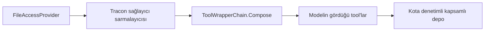

# Faz 234 — Oturum Çalışma Alanı (Dosya Erişimi)

> **Durum:** 📋 Planlandı (2026-10-21)
> **Kademe:** tam — güvenlik sınırı (K-062 yeniden açılır: agent'a dosya yazma ve silme tool'ları) · kalıcı veri (kota; oturum silmede alanın silinmesi) · geri dönüşü pahalı karar (alanın yol biçimi)
> **Plan onayı:** farukatasoy, 2026-10-21 (seçim: alan oturum başına; K-062'nin iki şartı: kota ve Tracon tool zinciri)
> **Kaynak:** [ADAYLAR.md](ADAYLAR.md) · **F-628** (ölçüm: [`MAF-KAPSAMA.md`](MAF-KAPSAMA.md) §0 #41, §8.3 C-13 (a), §8.4 K5-3)
> **Genellik:** Bir konuşma içinde dosya üreten ve düzenleyen her agent: belge taslağı, kod düzenleme, rapor birleştirme, kodlama agent'ı. MAF bunu `FileAccessProvider` ile verir (`file_access_*` sekiz tool); Tracon'da tanımla K0'dır. Tüketici kodunda kalamaz: deponun kiracı, agent ve oturum öneki, kota ve tool zinciri Tracon'undur. İkinci kanıt: MAF harness'ı dosya erişimini bir seçenek olarak taşır (`HarnessAgentOptions.FileAccessStore`) ve ekosistemde kodlama agent'ları çalışma alanı ister.
> **Karşı görüş:** "K-062 dosya sistemi riski yüzünden kapattı." Cevap: depo bir dosya sistemi değildir; Tracon'un SQL deposudur (`agent_files`). K-062'nin yeniden açılma koşulu "kaynak sınırı, denetim izi ve ayrı bir yetki politikası"dır: bu faz kotayı (kaynak sınırı) ve dosya tool'larının Tracon tool zincirinden geçmesini (yetki, doğrulama, zaman aşımı, kayıt) şart koşar; yazma ve silme her zaman onay ister.
> **Önkoşul:** Faz 231 — dış yüzey kapısının sağlayıcı tool'u kuralı ve `DisableReadApproval` adı oradan gelir · Faz 233 veri sahibi silme kancasını kurduysa bu faz onu kullanır, kurmadıysa kurar
> **Paketler:** `Tracon.Abstractions`, `Tracon.Core`, `Tracon.Sql.Shared`, `Tracon.PostgreSql`, `Tracon.SqlServer`, `Tracon.Sqlite` (kullanım sorgusu), `Tracon.AspNetCore`, `Tracon.UI`, `Tracon.Client` (üretilir)
> **Yeni paket:** Yok · **Migration:** ölçülmeli — kota sorgusu `agent_files` üzerinde önek taraması yapar; mevcut benzersiz kısıt `(tenant_id, agent_name, path)` yetmezse indeks migration'ı gerekir (numara uygulama anında alınır)
> **Public API:** büyüyor — `WorkspaceSettings`, `AgentDefinition.Workspace`, `AgentDescriptor.Workspace`, `TraconWorkspaceOptions`. `1.0.0` GA'dan (K-603) önce ucuz; `PublicAPI.Shipped.txt` toplamı 17 satır (2026-10-21)
> **Tüketici yüzeyi:** site: `guides/context-and-memory.md` (yeni "Session workspace" bölümü), `guides/any-maf-feature.md` ("What you cannot win back today" dosya deposu maddesi), `guides/external-agents.md` (dış yüzey kuralı), veri sahibi silme sayfası · sevk edilen: `WorkspaceSettings` ve `TraconWorkspaceOptions` XML belgesi, `<example>`
> **Manuel test alanı:** `docs/manuel-test/02-CEKIRDEK-VE-KATALOG.md` (bellek ve dosya) — `🤖`

---

## Bu Faza Başlarken

> `faz-baslangic` skill'ini uygula. Aşağıdaki liste o skill'in 2. adımıdır —
> **tamamını değil, yalnız işaret edilen bölümleri oku.**

1. Bu doküman
2. Kararlar — yalnız grep:
   ```bash
   grep -n "K-062 —\|K-110 —\|K-114 —\|K-1029 —\|K-1030 —\|K-1052 —" docs/KARARLAR.md
   ```
   **K-062** (harness dosya erişimi kapalı; 2026-10-21'de yeniden açıldı), **K-110** ve **K-114** (dosya deposu; kalıcı depo agent adını ambient kapsamdan okur), **K-1029** (`FileAccessStore` ve `FileAccessProviderOptions` korunur), **K-1030** (uzantının provider'ı denetlenmez — bu faz Tracon'un kendi provider'ını denetler), **K-1052** (oturum kimliğinden SHA-256 ile kısa anahtar emsali)
3. Önceki fazdan devir: Faz 231'in dış yüzey kuralı (kapanış devri bu dokümana yazılır)
4. Alan hafızası: [`hafiza/agent-derleme-ve-onbellek.md`](hafiza/agent-derleme-ve-onbellek.md), [`hafiza/tool-onay-ve-yetkilendirme.md`](hafiza/tool-onay-ve-yetkilendirme.md), [`hafiza/cekirdek-calistirma.md`](hafiza/cekirdek-calistirma.md) (`TraconRunContext`), [`hafiza/sql-saglayicilari.md`](hafiza/sql-saglayicilari.md)
5. Gerektiğinde: [`MIMARI-GUVENLIK.md`](MIMARI-GUVENLIK.md) tool sınırı bölümü

---

## Önceki Fazdan Devir (Faz 231)

**Devraldığı sözleşmeler.** `SkillSettings.DisableReadApproval` (`bool`, varsayılan `false`) · `AgentDefinition.Skills`,
`AgentDefinitionRequest.Skills` ve `AgentDescriptor.Skills` (`SkillSettings?`) · kapı:
`ExternalSurfaceGuard.EnsureNoApprovalRequiredTools(descriptors, exposedAgents, exposeAll, toolRegistry, protocol)`.
Kapının erken dönüşü kalktı; her açılan descriptor için sırayla (1) kayıtlı tool'un onayı, (2) `SkillNames.Count > 0`
ve `Skills is not { DisableReadApproval: true }` → `InvalidOperationException` (agent, protokol ve çare adıyla).
`Workspace` kuralı bu döngüye üçüncü blok olarak girer ve **descriptor'dan** okur: `AgentDescriptor.Workspace` eklenir ve
elle yazılan **iki** projeksiyon (`AgentDescriptorProjection.FromDefinition`, `CodeAgentSource.ListAsync`) onu taşır;
`CompositeAgentCatalog.Freeze` `with` kullandığı için kendiliğinden taşır.

**Davranış sözleşmeleri.** `SkillReadApprovalTests` (Core.UnitTests): derlenmiş agent'ın model tool listesinde
`tool.GetService<ApprovalRequiredAIFunction>()` onayı gösterir; düz ve harness agent × bayrak. `SkillExposureTests`
(FunctionalTests): A2A, oturumsuz run (`409 approval_unanswerable`), kod ve veritabanı kaynağı. Kapı ve projeksiyon
testleri iki mutasyonla kırmızı doğrulandı: aynı yöntemi kullan.

**Bilinen tuzaklar.**
- 🚨 Kapı katalogu host açılırken **bir kez** okur. Açıldıktan sonra HTTP ile kaydedilen veritabanı agent'ı denetlenmez;
  kapıyı veritabanı agent'ıyla sınamak iki host ister (birincisi geçici SQLite dosyasına yazar, ikincisi aynı dosyada açılır).
- 🚨 Descriptor projeksiyonunun bir yerde alanı düşürmesi kapıyı **kapalı** hatayla bozar: güvenli agent reddedilir.
- `PUT /api/agents/{ad}` yeni agent oluşturmaz (`404`); `POST /api/agents` gerekir.
- XML `<summary>` içindeki `<see cref="Tip.Üye"/>` OpenAPI açıklamasına `IReadOnlyList<string> AgentDefinition.SkillNames`
  gibi tür adıyla sızar; `<c>` kullan.
- Yeni public kayıt tipi `PublicAPI.Unshipped.txt` satırlarını elle ister (`RS0016`; `<Clone>$`, `Equals`, operatörler dahil).
- Arayüz: `full-replace-editors.test.tsx` `Complete<…Request>` yeni alanı zorlar; `anySettingOn` genel bir koşuldur, yeni
  ayar bloğu için ayrı liste yazma. Ekran görüntüsü üretimi 44 PNG'nin hepsini yeniden yazar (başlıktaki sürüm soneki
  değişir); panel hiçbir görüntüde yoksa PNG'leri `git checkout` ile geri al, yalnız `.ui-source.sha256` damgasını yenile.
- Üretim zinciri: OpenAPI anlık görüntüsü → `packages/tracon-client` `generate` + `build` → NSwag zinciri
  (`docs/hafiza/nswag-istemci-uretimi.md`).

---

## Amaç

Bir tanım oturum çalışma alanını açar. Agent, o konuşmaya ait bir dosya alanında
dosya listeler, okur, arar, yazar, değiştirir ve siler. Her oturumun alanı
ayrıdır; agent'ın dosya belleğinden de ayrıdır. Dosya tool'ları Tracon'un tool
zincirinden geçer. Yazma ve silme her zaman onay ister. Kurulum, dosya ve alan
boyutunu sınırlar. Oturum silinince alan da silinir.

- **F-628** — tanım alanı, kapsamlı depo, kota, yönetilen tool'lar, dış yüzey kuralı, silme, konsol, belge.

### Bugün ne çalışmıyor — doğrulanmış kanıt

| Kanıt | Gözlem |
|---|---|
| `maf-api-kesfi` dökümü (2026-10-21) | `FileAccessProvider(AgentFileStore, FileAccessProviderOptions?)` (`MAAI001`, çekirdek `Microsoft.Agents.AI`); seçenekler `DisableReadOnlyToolApproval`, `DisableWriteToolApproval`, `DisableWriteTools`, `Instructions`. `AgentFileStore` üyeleri: `ReadAsync`, `WriteAsync`, `DeleteAsync`, `FileExistsAsync`, `CreateDirectoryAsync`, `ListChildrenAsync`, `SearchAsync` |
| MAF 1.25 decompile `FileAccessProvider.cs:81-102`, `:493-552` | Sekiz tool: `file_access_{read,read_lines,ls,grep,write,delete,replace,replace_lines}`; okuma ve yazma grupları ayrı `ApprovalRequiredAIFunction` ile sarılır |
| [`AgentOptionsGuard.cs:111-116`, `:181-182`](../src/Tracon.Core/Extensions/AgentOptionsGuard.cs) | `FileAccessStore` ve `FileAccessProviderOptions` korunur (K-062) |
| [`AgentDefinitionCompiler.Memory.cs:131-154`](../src/Tracon.Core/Compilation/AgentDefinitionCompiler.Memory.cs) | Dosya belleği `TenantPrefixingAgentFileStore(_fileStore, tenantId, definition.Name)` ile `/{kiracı}/{agent}/` köküne bağlanır |
| [`TraconServiceCollectionExtensions.Registration.Core.cs:294`](../src/Tracon.Core/TraconServiceCollectionExtensions.Registration.Core.cs) | Varsayılan depo `InMemoryAgentFileStore`'dur: kiracı ve agent öneki yoktur |
| [`SqlAgentFileStore.cs:51-101`, `:328-330`](../src/Tracon.Sql.Shared/Stores/SqlAgentFileStore.cs) | SQL deposu her sorguda `tenant_id` ve run'ın ambient `AgentName`'ini kullanır; run dışında atar |
| `0006_attachments.sql:44-53` (PostgreSQL) | `agent_files(tenant_id, agent_name, path, content, …)`, benzersiz `(tenant_id, agent_name, path)`; boyut sütunu ve kota yok |
| `grep -rn "Quota\|MaxFile" src/Tracon.Sql.Shared/Stores/SqlAgentFileStore.cs` | 0 — depo boyutu sınırsız |
| [`ToolWrapperChain.cs:62-128`](../src/Tracon.Core/Tools/ToolWrapperChain.cs) | Tek zincir: açıklanan hata → yetki → doğrulama → zaman aşımı → onay → kısaltma; kayıt defteri ve MCP tool'ları buradan geçer, sağlayıcının eklediği tool geçmez |

> Kanıtlar 2026-10-21 tarihinde doğrulandı.

---

## 234.1 — Tanım ve kurulum

- `AgentDefinition.Workspace` (`WorkspaceSettings?`): `Enabled`, `ReadOnly` (yazma tool'ları hiç sunulmaz), `DisableReadApproval` (okuma tool'ları onaysız; Faz 231 adı).
- Yazma onayını kapatan bir üye **yoktur**. "Hatırla" kuralı tool başına çalışır.
- `TraconWorkspaceOptions` (`Tracon:Workspace`): `MaxFileBytes`, `MaxSessionBytes`, `MaxTenantBytes`. Varsayılan değerler uygulamada seçilir ve gerekçesi yazılır (öneri: 256 KB, 5 MB, 500 MB — ölçülmedi). `IValidateOptions` + `ValidateOnStart`.
- Varsayılan kapalıdır (K1). Tanım açık olsa da depo bellek içiyse çok kiracılı kurulumda derleme uyarı loglar: bellek içi depo yeniden başlatmada boşalır.

## 234.2 — Kapsamlı depo

Yol biçimi: `/{kiracı}/~workspace/{agent}/{oturumAnahtarı}/…`

- `oturumAnahtarı` = SHA-256 (kiracı, agent, oturum; uzunluk önekli) onaltılık özetin ilk 32 karakteri (K-1052 emsali). Oturum kimliği yolda okunur biçimde durmaz.
- Kök, dosya belleği kökünün (`/{kiracı}/{agent}/`) **altında değildir**: metin araması ve dosya belleği alanı görmez; alan dosya belleğini görmez. **Doğrulanmadı — ölçülmeli:** agent adı kuralı `~` ile başlayan adı reddediyor mu (kuralın yeri bu planda bulunamadı). Reddetmiyorsa `~workspace` ayrılmış ad olarak doğrulayıcıya eklenir; aksi hâlde `~workspace` adlı bir agent'ın belleği alanlarla çakışır.
- Oturum ve kullanıcı her çağrıda run bağlamından okunur (`TraconRunContext.Current`). **Oturumu olmayan run'da** sağlayıcı tool sunmaz.
- SQL deposu `agent_name` sütununu run'ın agent'ından zaten yazar; yol öneki ikinci sınırdır.

## 234.3 — Yönetilen tool'lar



- Tracon `FileAccessProvider`'ı kendisi kurar ve bir sarmalayıcıyla verir. Sarmalayıcı iç sağlayıcının `InvokingAsync`'inden dönen her `AIFunction`'ı `ToolWrapperChain.Compose`'dan geçirir: yetki işleyicisi, argüman doğrulayıcı, zaman aşımı, onay işareti (MAF sarmalı korunur ve kayıt bayrağı MAF-KAPSAMA §0 #45 düzeltmesiyle okunur), kısaltma, açıklanan hata.
- Etki sınıfı: okuma tool'ları `Read`, yazma ve değiştirme `Write`, silme `Destructive`.
- Harness agent: `HarnessAgentOptions.FileAccessStore` **atanmaz** (korunur, K-1029); Tracon'un sarmalanmış sağlayıcısı `AIContextProviders`'a girer — skill zincirinin emsali (Faz 219). **Doğrulanmadı — ölçülmeli:** `FileAccessStore` atanmadıkça harness kendi dosya sağlayıcısını kurmaz.

## 234.4 — Kota

- Yazma ve değiştirme öncesi: dosya boyutu ≤ `MaxFileBytes`; oturum alanı toplamı ve kiracı alanı toplamı (yazımdan sonraki değer) sınırın altında.
- Aşım tool hatası olarak modele döner ("workspace quota reached"); run sürer.
- Kullanım bir `internal` kapasite arayüzünden okunur (SQL: `SUM(LENGTH(content))` önekle; bellek içi: hesap). Sorgu maliyeti ve indeks gereği **ölçülmeli** (Migration satırı).
- Eşzamanlı iki yazım sınırı birlikte aşabilir. Kabul edilir ve belgelenir (sınır yumuşaktır); ölçüm gerekirse F-ID.

## 234.5 — Dış yüzey ve silme

- Faz 231'in kapısına yeni kural: `Workspace.Enabled` ve (`ReadOnly` değil **ya da** `DisableReadApproval` değil) → açılışta ret. Salt okuma + okuma onayı kapalı alan açılabilir.
- Oturum silme, veri sahibi silme ve saklama süresi, oturum anahtarından üretilen önekle alanı siler (Faz 233'ün kancası; yoksa bu faz kurar). Silme hatası SQL silmesini geri alır.

---

## Planlanan Public API

> Taslak imzalardır. Gerçekleşen imzalar kapanışta ayrı bir bölüme yazılır.

```csharp
// Tracon.Abstractions
public sealed record WorkspaceSettings
{
    public bool Enabled { get; init; }
    public bool ReadOnly { get; init; }
    public bool DisableReadApproval { get; init; }
}

public sealed record AgentDefinition { public WorkspaceSettings? Workspace { get; init; } }   // new
public sealed record AgentDescriptor { public WorkspaceSettings? Workspace { get; init; } }   // new

// Tracon.Core
public sealed class TraconWorkspaceOptions
{
    public long MaxFileBytes { get; set; }
    public long MaxSessionBytes { get; set; }
    public long MaxTenantBytes { get; set; }
}
```

`FileAccessProvider` ve `AgentFileStore` (`MAAI001`) public imzaya girmez; içte kullanılır (İ5, D-01 = C).

### HTTP `endpoint`'leri

Yeni uç yok. Tanım gövdesi `workspace` alır. Alanı listeleyen bir yönetim ucu bu fazın kapsamında değildir (Açık Soru 2).

### Arayüz payı

Üç kutu. Pay ölçülmeli (ana JS brotli 184,6 KB, 2026-10-21; bütçe 250 KB gzip).

---

## Planlanan Dosya Listesi

```
src/Tracon.Abstractions/Agents/
├── WorkspaceSettings.cs                      (yeni)
├── AgentDefinition.cs, AgentDescriptor.cs    (Workspace)
src/Tracon.Core/
├── Workspace/
│   ├── TraconWorkspaceOptions.cs             (yeni)
│   ├── SessionWorkspaceFileStore.cs          (yeni, internal: önek + kota)
│   ├── GovernedToolsContextProvider.cs       (yeni, internal: tool'ları zincirden geçirir)
│   └── IAgentFileStoreUsage.cs               (yeni, internal)
├── Compilation/AgentDefinitionCompiler.Memory.cs / .Agents.cs   (sağlayıcı, iki agent tipi)
├── Catalog/AgentDescriptorProjection.cs, CodeAgentSource.cs, CompositeAgentCatalog.cs
└── TraconCoreJsonContext.cs
src/Tracon.Sql.Shared/
├── Stores/SqlAgentFileStore.cs               (IAgentFileStoreUsage)
├── Internal/SqlQueriesBase.cs                (kullanım ve önek silme sorgusu)
├── Internal/AgentDefinitionPayload.cs        (Workspace)
└── Stores/SqlDataSubjectStore.cs             (silme kancası)
src/Tracon.{PostgreSql,SqlServer,Sqlite}/Migrations*/  (gerekirse indeks — ölçülmeli)
src/Tracon.AspNetCore/
├── Contracts/AgentContracts.cs               (Workspace)
└── Security/ExternalSurfaceGuard.cs          (alan kuralı)
src/Tracon.UI/frontend/src/screens/agent-editor/sections/context-section.tsx, locales
```

---

## Hata Modları ve Testler

| Ne bozulabilir | Seviye | Test sınıfı |
|---|---|---|
| Oturum 1'in dosyası oturum 2'de görünür | Fonksiyonel (iki oturum) | `SessionWorkspaceTests` |
| Kiracı X'in dosyası kiracı Y'de görünür | Depo sözleşmesi (bellek + üç SQL) + fonksiyonel | `AgentFileStoreContract`'a case, `SessionWorkspaceTests` |
| Alan dosya belleğini görür ya da bellek alanı görür (metin araması) | Fonksiyonel | `SessionWorkspaceTests` |
| Yazma tool'u onaysız koşar | Fonksiyonel | `SessionWorkspaceApprovalTests` |
| `ReadOnly`'de yazma tool'u sunulur | Fonksiyonel (modele giden tool listesi) | `SessionWorkspaceApprovalTests` |
| Dosya tool'u yetki işleyicisini, zaman aşımını, kısaltmayı atlar | Fonksiyonel (reddeden `IToolAuthorizationHandler`, `HangingModelProvider` değil asılı tool) | `SessionWorkspaceGovernanceTests` |
| Kota aşılır (dosya, oturum, kiracı) | Fonksiyonel + depo sözleşmesi (kullanım sorgusu) | `SessionWorkspaceQuotaTests` |
| Oturumsuz run'da tool sunulur | Fonksiyonel | `SessionWorkspaceTests` |
| Oturum silme, veri sahibi silme, saklama süresi alanı bırakır | Fonksiyonel (SQLite) | `SessionWorkspaceErasureTests` |
| Dış yüzey kapısı yazılabilir alanı açar | Fonksiyonel (A2A, MCP) | `A2AEndpointTests`, `McpServerEndpointTests` |
| Harness agent alanı almaz ya da harness'ın kendi dosya sağlayıcısı da kurulur (çift tool) | Fonksiyonel (Theory) | `SessionWorkspaceTests` |
| Uzun yol, `..`, kök dışı yol depodan kaçar | Fonksiyonel + birim (önek normalleştirme) | `SessionWorkspaceTests` |
| İptal: yazım iptali iletmez | Fonksiyonel | `SessionWorkspaceGovernanceTests` |

Beş soru: **iptal** — tool zinciri zaman aşımı ve token · **eşzamanlılık** — kota yumuşak (234.4) · **boş/aşırı girdi** — boş içerik, sınır üstü içerik, `..` · **başka kiracı** — sözleşme · **alt sistem hatası** — depo atar → tool hatası, run sürer.

---

## Manuel Kabul Case'leri

| # | Ön koşul | Adımlar | Beklenen sonuç |
|---|---|---|---|
| 1 `🤖` | Örnek uygulama (SQLite), gerçek model, `workspace.enabled: true` | Oturum 1: "Create notes.md with three bullet points"; onay; "Show notes.md" | Yazma onay ister; onaydan sonra okuma içeriği gösterir |
| 2 `🤖` | Aynı | Oturum 2: "List my files" | Liste boş |
| 3 `🤖` | Aynı | `DELETE /api/sessions/{oturum1}`; `agent_files` satırları sayılır | Alan satırları silinmiş |

---

## Açık Sorular

| # | Soru | Seçenekler | Öneri |
|---|---|---|---|
| 1 | Kota varsayılanları | A: 256 KB / 5 MB / 500 MB · B: daha küçük | Uygulamada bir ölçümle gerekçelendir (örnek dosya boyutu, SQL satır boyutu) |
| 2 | Alanı okuyan bir yönetim ucu (`GET /api/sessions/{id}/workspace`) | A: bu faz değil · B: bu faz | A: kapsamı küçük tut; talep çıkarsa F-ID |
| 3 | Oturum anahtarı uzunluğu | A: 32 onaltılık karakter · B: tam 64 | A: yol uzunluğu SQL Server'da sınırlıdır; çakışma olasılığı ihmal edilir — uygulamada ölçülür |
| 4 | Bellek içi depo + çok kiracı | A: uyarı loglanır · B: derleme reddeder | A: test ve geliştirme kurulumları bellek içidir |

---

## Bitiş Ölçütleri (DoD)

- [ ] İki oturum birbirinin dosyasını görmez; alan dosya belleğini görmez ve tersi (fonksiyonel)
- [ ] Yazma ve silme onay ister; `ReadOnly` yazma tool'u sunmaz; tool'lar yetki işleyicisinden ve zaman aşımından geçer
- [ ] Dosya, oturum ve kiracı kotası aşımı modele hata olarak döner; run sürer
- [ ] Oturum silme, veri sahibi silme ve saklama süresi alanı siler
- [ ] Yazılabilir alanlı agent A2A/MCP'de açılışta reddedilir
- [ ] Dört doğrulama kapısı sıfır uyarı verir
- [ ] `samples/Tracon.Api` ile gerçek `run` yapıldı, çıktı belgeye yazıldı
- [ ] `secret` taraması boş döndü
- [ ] `🤖` case'ler `docs/manuel-test/` içinde ve koşuldu
- [ ] `faz-denetim` koşuldu; 🔴 bulgu kalmadı
- [ ] `docs-site/` güncellendi; `npm run check` temiz
- [ ] `en.ts` ve `tr.ts` eksiksiz; bundle payı ölçüldü ve yazıldı
- [ ] K-062'nin yerini alan karar `KARARLAR.md`'de; `MAF-KAPSAMA.md` §5.2 `FileAccessProvider` satırı ve §8.4 K5-3 güncel

### Doğrulama komutları

```bash
python3 scripts/kapi.py test --proje Tracon.AspNetCore.FunctionalTests --sinif "*SessionWorkspace*"
```

---

## Riskler

| Risk | Önlem |
|------|-------|
| Model yazma tool'uyla zararlı içerik saklar ve sonra okur | İçerik koruması model çağrılarını denetler; yazma onaylıdır; kota sınırlar |
| Kota sorgusu yük altında yavaştır | Ölçüm; gerekirse indeks migration'ı ya da sayaç |
| Harness kendi dosya sağlayıcısını da kurar (çift `file_access_*`) | 234.3'ün ölçümü ve Theory testi |
| Yol biçimi sonradan değişirse eski alanlar okunamaz | Yol biçimi bu fazda kalıcı karardır (K-*) |

---

<!-- ============================================================
     AŞAĞISI ÇALIŞIRKEN DOLAR — doküman kapanışta silinir (`faz-kapat`).
     Kalıcı kısım `faz-tamamlama` Adım 5'te yerine taşınır. Başlıkları SİLME.
     ============================================================ -->

## Plandan Sapmalar

> Çalışırken dolar. Plan ile gerçek arasındaki fark **gizlenmez**. Kapanışta
> kapanış commit mesajına taşınır.

1. **Yol biçimi (234.2).** Plan `…/~workspace/{agent}/{anahtar}/…` ve anahtarı (kiracı, agent, oturum) üstünden yazıyordu. Gerçek: `{kiracı}/~workspace/{anahtar}/{agent}/…`, anahtar = SHA-256(kiracı, oturum). Sebep: oturum silme, veri sahibi silme ve saklama süresi `ISubjectContentEraser`'a `(kiracı, oturum kimlikleri)` verir; agent'ı bilmez. Planın biçimiyle silme hiçbir dizini bulamazdı (yapısal iddia, `faz-uygulama` Adım 1). Bir oturumun her şeyi artık tek dizindir (K-1068).
2. **`IAgentFileStoreUsage` → `IAgentFileTree`** (`Tracon.Abstractions`, `internal`): plan yalnız ölçümü söylüyordu; silme ve okuma (dışa aktarma) da gerekti, hepsi agent'sız ve run'sız. SQL depoları uygular (tek sorgu); öteki depolar `GenericAgentFileTree` ile dosya dosya gezilir. Plan `Core/Workspace/IAgentFileStoreUsage.cs` diyordu; arayüz SQL katmanından görülmek için Abstractions'tadır (`ISubjectContentEraser` emsali).
3. **Migration ölçüldü ve gerekti (234.4, Migration satırı).** PostgreSQL 18, 200 000 satır: oturum boyutu 14,1 ms, oturum silme 13,9 ms (tüm tablo taranır); indeksle 0,5 ve 0,03 ms. Sorgular her kurulumun saklama yoluna girdiği için indeks şarttır: PostgreSQL 0064 (`text_pattern_ops`), SQL Server 0052, SQLite 0051. SQLite indeks adı dosya boyunca tekildir (`{schema}` öneki zorunlu; `MigrationRunnerTests.Two_prefixes_in_one_file…` yakaladı).
4. **Sarmalayıcının adı ve onay (234.3).** Plan `GovernedToolsContextProvider` ve "MAF sarmalı korunur" diyordu. Gerçek: `SessionWorkspaceProvider` (tool'ları `ProvideAIContextAsync`'te sarar) + `WorkspaceToolGovernance` (zincir bağımlılıkları). MAF'ın onay sarmalı **kapatılır** ve onayı Tracon kurar (`TraconToolRegistration.RequiresApproval`): sıra her tool'unki gibi olur, kayıt bayrağı sorunu (MAF-KAPSAMA §0 #45) doğmaz.
5. **Kullanıcı kapsamda yok (234.2).** Plan "oturum ve kullanıcı her çağrıda run bağlamından okunur" diyordu. Gerçek: yalnız oturum. Oturum sahipliği kapalıyken aynı oturum kimliğini kullanan iki kullanıcı zaten aynı konuşma geçmişini paylaşır; silme de kullanıcıyı bilmez.
6. **🚨 Veri sahibi silmede kopyalar SQL işleminden ÖNCE silinir (K-1070).** Plan "Faz 233'ün kancasını kullan" diyordu. Ölçüm: eraser `agent_files`'a ikinci bir bağlantıdan yazar; `SqlDataSubjectStore` işlemi satır silmelerinden sonra açık tutarken SQLite'ın tek yazar kilidine çarpar. `AttachmentByteLifecycleTests.Erasure_deletes_the_external_bytes` 31 sn'de kırmızı oldu. Faz 233'ün sırası (satırlar → kopya → denetim → commit) değişti. Kapı: `SessionWorkspaceFilesTests` (SQLite), eski sıraya mutasyonla kırmızı.
7. **Eraser her kurulumda kayıtlı.** Plan bunu söylemiyordu. DB'deki bir tanım alanı her an açabilir; kayıt koşulsuz. Etki: veri sahibi silme çıktısına `session_workspace` anahtarı girer ve `sessions` saklama hedefi her kurulumda "oku → kopyayı sil → anahtarla sil" yolunu kullanır (indeksle ucuz).
8. **Plan dışı kurallar** (çalışırken bulundu): agent adı `/` taşıyamaz (alanı olan agent); `~workspace…` adlı agent dosya belleği alamaz (kökü tüm alanlar olurdu); agent'ın tool'u `file_access_*` adı taşıyamaz (MAF: ad eşleşen tool otomatik onaylanır); `RunContinuationJobHandler` alanı olan agent'ı reddeder (tool'lar oynatma sarmalayıcısından geçmez, F-647); replay oturumsuzdur, alansızdır.
9. **MAF ölçümleri.** (a) Harness `FileAccessProvider`'ı yalnız `FileAccessStore` atanınca kurar (1.25 decompile) → Doğrulanmadı satırı kapandı, çift tool yok. (b) MAF `StorePaths` yolu temizler ama SQL deposu aramada tam saklı yolu (`/kiracı/…`) döndürür ve MAF `grep` tool'u aranan dizini önüne kendisi ekler: depo adları dizine göre göreliler (aksi hâlde model kiracıyı ve oturum anahtarını görürdü). (c) MAF varsayılan talimatı "dosyalar oturumlar ve agent'lar arasında paylaşılır" der; yanlıştır, Tracon kendi talimatını verir.
10. **Birim.** Kota "deponun tuttuğu bayt"tır: PostgreSQL ve SQLite UTF-8, SQL Server UTF-16 (`DATALENGTH`, gerçek SQL Server 2022'de ölçüldü: 11 karakter → 22 bayt). Dosya sınırı her zaman UTF-8'dir (F-648).
11. **Test altyapısı.** `Tracon.SqlServer.IntegrationTests` Abstractions'a `InternalsVisibleTo` aldı (gerçek SQL Server kapsayıcısında `IAgentFileTree` sınanır). Plan test adları: `SessionWorkspaceQuotaTests` ve `SessionWorkspaceGovernanceTests` fonksiyonel sınıfı tek `SessionWorkspaceGovernanceTests`'te toplandı (kota onay akışıyla sınanır); depo sözleşmesine case yerine `SessionWorkspaceFilesTests` ×3 (SQLite, PostgreSQL, SQL Server) yazıldı.
12. **Açık Sorular.** (1) Varsayılanlar 256 KiB / 5 MiB / 500 MiB kaldı; ölçüm sorgu maliyetidir (PostgreSQL: oturum 0,5 ms, kiracı 20 000 dosyada 7,2 ms). (2) A: yönetim ucu bu faz değil (F-649). (3) A: 32 onaltılık karakter; yol kalan karakter sayısını tool hatasında söyler. (4) A: bellek içi depo + çok kiracı derlemede uyarı loglar (`SessionWorkspaceTests`, iki test); tek kiracıda sessiz.
13. **Denetimden gelen değişiklikler (kod).** (a) Oturum anahtarı bayt sırasından bağımsız: `BinaryPrimitives.WriteInt32LittleEndian` (`BitConverter` makineye bağlıydı; değer değişmedi, test aynı değeri sabitliyor). (b) **Kota satır maliyetini sayar**: her dosya içeriğine ek olarak sabit 1 KiB sayılır (`TraconWorkspaceOptions.FileOverheadBytes`, `internal`, test sıfırlar). Önce boş içerikli yazım `added = 0` olduğundan ölçüm hiç koşmuyordu ve "hatırla" kuralı varken model `file_access_write(<400 karakterlik yol>, "")` döngüsüyle sınırsız satır üretebilirdi; artık 5 MiB'lik oturum en çok ~5 000 dosya tutar. Plan "üç sınır" diyordu; dördüncü bir public ayar eklenmedi (`FileOverheadBytes` ayarlanamaz). (c) Bilinmeyen `file_access_*` adı `Write` sayılır (MAF yeni bir yazma tool'u eklerse okuma onayı kapalıyken onaysız koşmaz). (d) `~workspace` ayrılmış ad denetimi büyük/küçük harfe duyarsız (SQL Server harmanı `~Workspace`'i aynı `agent_name` yapar).
14. **Denetimin gördüğü ve kabul edilen risk: eraser her kurulumda kayıtlı.** Alan hiç açılmamış kurulumda bile oturum silme ve saklama süresi host'un `AgentFileStore`'una dokunur. SQL depoları tek sorguyla cevaplar (kaydedilmemiş dizin = 0). Elle yazılmış bir depo dosya dosya gezilir; MAF'ın `FileSystemAgentFileStore`'u olmayan dizini boş döndürür (decompile), ama **çalıştırma kapsamı isteyen bir sarmalayıcı** (SQL deposunu saran) run dışında atar ve `DELETE /api/sessions/{id}` düşer. Bilerek sessiz sıfır yapılmadı: başarısız bir silmeyi "silindi" diye denetime yazmak daha kötüdür (`A_store_that_cannot_list_outside_a_run_fails_the_erasure…`). Çare: depoyu run dışında listeleyebilir yap ya da sarmalayıcıyı kaldır. Site söyler.
15. **K-1070'in bedeli.** Kopyalar işlemden önce silindiği için denetim ya da commit düşerse kopya gitmiştir, satırlar yerindedir; tekrar çağrı kalanı bitirir ama denetim izi ilk denemede silinen sayıyı yazmaz (K-1070 gerekçesinde). Kapı: `SubjectContentEraserTests.A_failure_after_the_copy_is_gone_leaves_every_row_in_place…`.
16. **Capabilities haritası bütçesi.** `Tracon.AgentMap.md` 11 264 B'ın 6 B altındaydı. Yeni satır (`Workspace: AgentDefinition.Workspace`, 39 B) için iki satırın harita metni kısaldı; site tablosunun başka bir cümlesi değişmedi: `Harness loop` `AddLoopEvaluator(kind, evaluator or factory)` → `AddLoopEvaluator()`, `Parameterized instructions` sondaki `parameters` alanı düştü. Satır adı `Session workspace` değil `Workspace` (8 B). Bütçe yükseltilmedi (üreteç yorumu: ikinci kez yükseltme yok).

## Bu Fazda Verilen Kararlar

> Çalışırken dolar. Dört kategoriden birine giren karar (AGENTS.md)
> `docs/KARARLAR.md`'ye K-NNN ve kategori etiketiyle girer; girmeyen karar
> kapanışta commit mesajına taşınır (`faz-tamamlama` Adım 8). Plan numara rezerve
> etmez.

- **K-1068** (kalıcı-veri, geri-dönüşü-pahalı) — yol biçimi `{kiracı}/~workspace/{anahtar}/{agent}/…`, anahtar SHA-256(kiracı, oturum) ilk 32 hex.
- **K-1069** (güvenlik, public-api) — alan oturum başınadır; tool'lar Tracon zincirinden geçer; yazma ve silme hep onay ister; kota; dış yüzey kapısı. K-062'nin yerini alır.
- **K-1070** (kalıcı-veri) — veri sahibi silmede kopyalar SQL işleminden önce silinir; K-1067'nin sırasını değiştirir.
- Kategori dışı (commit mesajına gider): kota birimi deponun tuttuğu bayttır; kullanıcı kapsamda değildir; eraser koşulsuz kayıtlıdır; migration adları 0064 · 0052 · 0051.

## Örnek Uygulama Koşumu — gerçek çıktı

> 2026-10-22, `samples/Tracon.Api` (Development, `user-secrets` yalnız OpenAI anahtarı için; PostgreSQL ve SQL Server dizeleri boş verildi), gerçek `gpt-5.4-mini`, SQLite boş dosya, `workspace-drafter` agent'ı (`Enabled`, `DisableReadApproval`). Günlükte uyarı ve hata yok; `Npgsql` satırı 0.

| Adım | Girdi | Gerçek sonuç |
|---|---|---|
| 1 · `ws-s1`, `Prefer: respond-async` | `Create a file notes.md with exactly three short bullet points about tea…` | `202`; run `AwaitingApproval`; bekleyen onay `file_access_write`; `agent_files` **boş** |
| 1 · karar | `POST /api/approvals/{id}/decide {"approved":true}` | `200 Approved`; devam run'ı `Completed`; tek satır: `/default/~workspace/7388dd2f57804d0e6b5ba6dc13b858c0/workspace-drafter/notes.md` (237 bayt) |
| 1b · `ws-s1` senkron | `Show me the content of notes.md.` | tool çağrısı `file_access_read` (onay istenmedi); yanıt: üç madde (`Tea can be enjoyed hot or iced.` …) |
| 2 · `ws-s2` senkron | `List my files.` | tool çağrısı `file_access_ls`; yanıt: `Your workspace is empty.` |
| 3 · `DELETE /api/sessions/ws-s1` | — | `204`; `agent_files` **boş** |

Anahtar `7388dd2f…` bağımsız bir Python uygulamasıyla aynı (SHA-256, 4 bayt LE uzunluklu parçalar). Paket: ana JS 222,3 KB gzip (bütçe 250; Faz 233'te 221,7), gömülü varlık 187,6 KB brotli (+0,4).

**Gerçek motorlar.** `SessionWorkspaceFilesTests`: SQLite, PostgreSQL 18 ve SQL Server 2022 (Testcontainers) üçünde 11'er test yeşil; migration'lar koşucuyla uygulandı. `MigrationRunnerTests` SQLite indeks adını yakaladı. Not: SQL Server'da `COUNT(*)` `int` döner; test yardımcısı `COUNT_BIG` kullanır.

## Süreç Ölçümü

> Kapanışta doldurulur. **Tablo olarak** — onay kutusu DEĞİL: `faz-kapat`
> işaretsiz kutuda durur. `faz-kapat` bu tabloyu `docs/FAZ-DEFTERI.md`'ye taşır;
> eşik **167**'den itibaren boş bir değer hücresinde kapanışı durdurur.
> `ölçülmedi` **geçerli bir değerdir** — kapı bir sayı değil, bir **karar** arar.
> Kapı bölümün VARLIĞINI denetler, doğruluğunu denetlemez (K-766).

| Metrik | Değer |
|---|---|
| Plan revizyonu sayısı | |
| Düzeltme turu sayısı | |
| 🔴 bulgu: gerçek / gürültü / araştırılacak | |
| Fazın ürettiği regresyon | |
| Faz kapandıktan sonra bulunan kusur | ölçülmedi (kapanış anı) |

## Denetim Bulguları

> `faz-denetim` çıktısı. Her satır: bulgu · seviye (🔴/🟡/🟢) · sonuç
> (düzeltildi / gerekçelendi / F-NN olarak devredildi). 🟢 kapanışta
> `ADAYLAR.md`'ye gider.

| Bulgu | Seviye | Sonuç |
|---|---|---|
| 🔴 yok | — | `faz-denetcisi` (taze bağlam): kiracı/oturum/agent izolasyonu, `LIKE` kaçışı, önek çakışması, boş dizin, onay atlama yolu, dış yüzey kuralı ve migration'lar temiz; oturum anahtarı Python ile yeniden hesaplandı |
| Oturum anahtarı makinenin bayt sırasına bağlı (`BitConverter`) | 🟡 | düzeltildi: `BinaryPrimitives…LittleEndian` (Sapma 13a); değer aynı, test sabitler |
| Kota boş içerikli yazımı saymıyor; satır yükü sınırsız | 🟡 | düzeltildi: dosya başına 1 KiB satır maliyeti (Sapma 13b); 3 birim + 3 fonksiyonel test |
| Eraser her kurulumda kayıtlı; run kapsamlı depo oturum silmeyi düşürür | 🟡 | gerekçelendi: bilerek sessiz sıfır yok (Sapma 14); eraser testi + site notu |
| `SessionWorkspaceFileStore` gerçek SQL deposuyla birleşik testte yok | 🟡 | düzeltildi: `SessionWorkspaceFilesTests` ×3'e iki oturum / iki kiracı / `ls` / `grep` testi; SQLite, PostgreSQL 18 ve SQL Server 2022'de yeşil |
| "…past the session limit…" testi dosya sınırını sınıyordu | 🟡 | düzeltildi: ad düzeldi; gerçek oturum ve kiracı sınırı testleri eklendi |
| K-1070'in hata yolu testsiz; test adı yanlış | 🟡 | düzeltildi: test eklendi, iki ad düzeldi; bedel K-1070'e yazıldı (Sapma 15) |
| `capabilities.md`'de kapsam dışı üç hücre kısaldı | 🟡 | düzeltildi ve daraltıldı: `Tools.DefaultMaxOutputBytes` geri geldi; iki kısaltma bütçe yüzünden kaldı (Sapma 16) |
| `///` içinde karar numarası · `~workspace` harf duyarlı · bilinmeyen tool `Read` · `DUMP` artığı · site "önek" cümlesi | 🟢 | düzeltildi (Sapma 13c, 13d; site metni sekiz adı söyler) |
| `RecordToolPayloads` yazılan içeriği run kaydında tutar; site söylemiyordu | 🟢 | site notu eklendi |
| SQL Server 0052 indeks planı ölçülmedi · kota varsayılanları ölçümsüz · dal (branch) alanı taşımaz | 🟢 | F-654 · F-655 · F-653 |
| SQL Server büyük/küçük harfsiz oturum kimliği ile anahtar uyuşmazlığı · satırı olmayan oturumda yazılan dosya yetim kalır | KR-05 (repro yok) | F-651 · F-652 |
