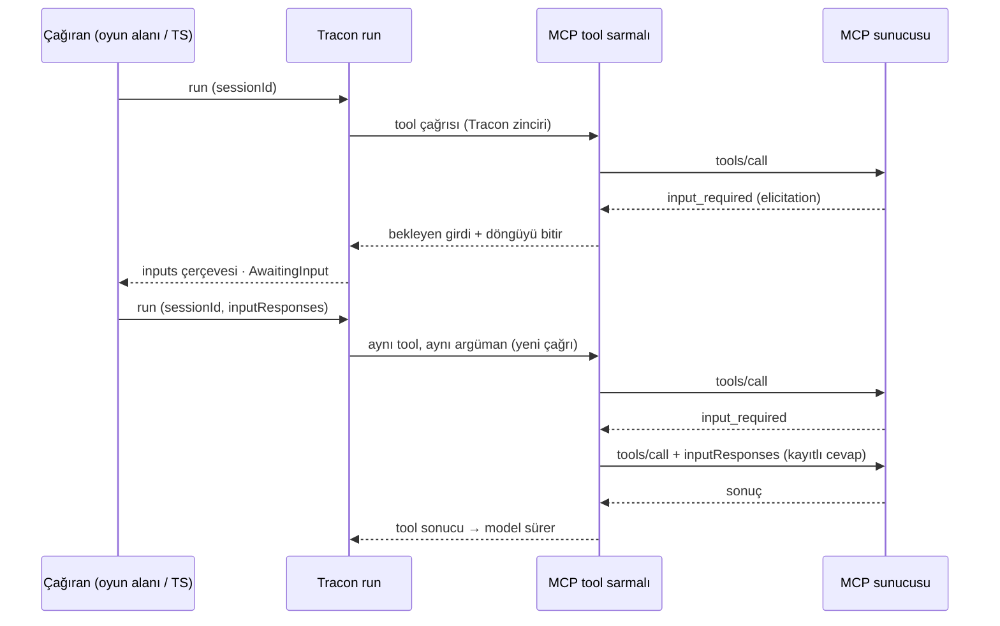

# Faz 235 — MCP Elicitation: Askıya Alınan Tool Çağrısı

> **Durum:** ✅ Tamamlandı (2026-10-23)
> **Kademe:** tam — public API (run isteğine yeni alan, akışa yeni çerçeve, `RunStatus.AwaitingInput`'un anlamı agent run'ına genişler) · güvenlik sınırı (üçüncü taraf sunucu kullanıcıdan veri ister; cevap oturum sahibine ve kiracıya bağlı olmalı) · geri dönüşü pahalı karar (devam modeli: tool çağrısı baştan yeniden yapılır)
> **Plan onayı:** Tasarım seçimi onaylandı — farukatasoy, 2026-10-22: run askıya alınır ve cevaptan sonra tool baştan çağrılır; run bağlamı görünmeyen istek `decline` alır. Planın tamamı: uygulama istendi — farukatasoy, 2026-10-23 ("fazı geliştir, commit atabilirsin"); onay kapısı bu emirle açıldı
> **Kaynak:** [ADAYLAR.md](ADAYLAR.md) · **F-617** (ölçüm: [`MAF-KAPSAMA.md`](MAF-KAPSAMA.md) §0 #40, §8.2 C-14 b; [`kesif/2026-10-21-maf-dalga-4.md`](kesif/2026-10-21-maf-dalga-4.md))
> **Genellik:** MCP sunucusu bağlayan her kiracı. Elicitation MCP spec'inin çekirdek istemci yeteneğidir (ekosistem standardı = ikinci kanıt). Tüketici kodunda kalamaz: MCP bağlantısını, tool zincirini ve run askısını Tracon kurar.
> **Karşı görüş:** "Elicitation kullanan sunucu sayısı ölçülmedi; çoğu sunucu tool parametresiyle yetinir." Cevap: faz iki yarıdır. (1) Yeteneği bildirmek ve run'a bağlanamayan isteğe açık `decline` dönmek ucuzdur ve bugünkü sessiz düşmeyi kapatır. (2) Askı yolu yeni tablo istemez: bekleyen istek oturum geçmişinde durur, devam onay ve istemci tool'unun "sonraki turun girdisi" desenini izler. (2) beklenenden pahalı çıkarsa faz (1) ile kapanır ve (2) F-ID olur — bu sapma gizlenmez.
> **Önkoşul:** Yok
> **Paketler:** `Tracon.Mcp` (istemci yeteneği, handler, tool kapsamı) · `Tracon.Core` (run durumu, kayıt) · `Tracon.AspNetCore` (sözleşme, devam çözücüsü, akış çerçevesi) · `Tracon.UI` (oyun alanı formu) · `Tracon.Client` (üretilir)
> **Yeni paket:** Yok — `ModelContextProtocol.Core` 2.3.0 zaten referanslı · **Migration:** Yok (bekleyen istek oturum geçmişindedir; kuyruk yolu kapsam dışıdır, §235.7)
> **Public API:** büyüyor — `AgentRunRequest.InputResponses`, `ToolInputResponse`, `ToolInputAction`; `RunStatus.AwaitingInput` belgesi. `1.0.0` GA'dan (K-603) önce ucuz: `PublicAPI.Shipped.txt` toplamı 17 satır (2026-10-22). `AgentRunRequest` bir `sealed record`'dur: bugün alan eklemek bedava, GA'dan sonra eklemek kırıcı değildir ama sözleşme büyür
> **Tüketici yüzeyi:** site: `concepts/tools.md` (MCP bölümü: elicitation), `guides/client-side-tools.md` (aynı "sonraki turun girdisi" deseni), `concepts/runs.md` (`AwaitingInput` artık agent run'ında), `troubleshooting.md` (`decline` durumları) · sevk edilen: `AgentRunRequest.InputResponses` XML `<example>`, `src/Tracon.Mcp/README.md`, `capabilities.md` satırı
> **Manuel test alanı:** [`docs/manuel-test/18-MCP-VE-A2A.md`](manuel-test/18-MCP-VE-A2A.md) ve [`10-ARAYUZ-AGENT-PLAYGROUND.md`](manuel-test/10-ARAYUZ-AGENT-PLAYGROUND.md) — `🤖`

---

## Bu Faza Başlarken

> `faz-baslangic` skill'ini uygula. Aşağıdaki liste o skill'in 2. adımıdır —
> **tamamını değil, yalnız işaret edilen bölümleri oku.**

1. Bu doküman
2. Kararlar — yalnız grep:
   ```bash
   grep -n "K-103 —\|K-089 —\|K-370 —\|K-059 —\|K-1039 —\|K-1051 —" docs/KARARLAR.md
   ```
   **K-103** (onay gereken çağrıda run biter, karar sonraki turun girdisidir; alt agent onay isteyemez), **K-089** ve **K-370** (denetim satırı mutasyondan önce ve hatayı yutmadan yazılır; yazılamazsa karar uygulanmaz), **K-059** (`secret` yazılmaz), **K-1039** (run başına `ChatOptions` kuralı; sentetik devam çağrısı bu kuraldan geçer), **K-1051** (K-103 yalnız workflow adımı için açıldı)
3. Önceki fazdan devir: Faz 234 teknik bağ bırakmadı
4. Alan hafızası: [`hafiza/mcp-a2a-sunucu.md`](hafiza/mcp-a2a-sunucu.md) (MCP bağlantısı, kiracı anahtarı), [`hafiza/cekirdek-calistirma.md`](hafiza/cekirdek-calistirma.md) (`TraconRunContext`, `AsyncLocal` yazım kuralı), [`hafiza/run-olay-sozlesmesi.md`](hafiza/run-olay-sozlesmesi.md) (yeni olay ve akış çerçevesi), [`hafiza/frontend.md`](hafiza/frontend.md) (oyun alanı)
5. Gerektiğinde: [`MIMARI-GUVENLIK.md`](MIMARI-GUVENLIK.md) kiracı ve oturum sahipliği bölümü

---

## Amaç

Bir MCP sunucusu tool çağrısının ortasında kullanıcıdan bilgi ya da onay isteyebilir (elicitation). Tracon bugün bu yeteneği bildirmez; isteyen sunucunun tool'u düşer ya da kendi başına bir yol seçer. Bu faz yeteneği bildirir ve isteği Tracon'un askı modeline bağlar: run biter, istek kullanıcıya gider, cevap sonraki turun girdisi olur ve Tracon tool'u baştan çağırır. Run'a bağlanamayan istek (alt agent, cevap kanalı olmayan yüzey, eski sunucunun doğrudan isteği) açık `decline` alır. Kazanan: MCP sunucusu bağlayan kiracı ve onun son kullanıcısı.

- **F-617** — MCP elicitation, MRTR ile askıya alınan tool çağrısı; eski sunucuya açık ret

### Bugün ne çalışmıyor — doğrulanmış kanıt

| Kanıt | Gözlem |
|---|---|
| [`McpConnection.cs:174`](../src/Tracon.Mcp/Internal/McpConnection.cs) | Tool bağlantısı `clientOptions: null` ile kurulur → elicitation yeteneği bildirilmez |
| [`McpShortLivedConnection.cs:63`](../src/Tracon.Mcp/Internal/McpShortLivedConnection.cs), [`McpOAuthAuthorizationCoordinator.cs:236`](../src/Tracon.Mcp/McpOAuthAuthorizationCoordinator.cs) | Kısa ömürlü bağlantılar da `null` ile kurulur. Bunlar tool çağırmaz (istem, kaynak, OAuth); bu fazda değişmez |
| [`McpConnection.cs:605`](../src/Tracon.Mcp/Internal/McpConnection.cs) | MCP tool'u `tool.WithName(qualified)` ile kaydedilir; çağrı Tracon tool zincirinden geçer |
| SDK 2.3.0 decompile: `McpClientImpl.SendRequestAsync` | MRTR döngüsü SDK'nın içindedir: `resultType: "input_required"` gelince `ElicitationHandler`'ı **aynı async akışta** çağırır ve isteği `inputResponses` + `requestState` ile en çok 10 kez yeniden gönderir. `requestState` dışarı verilmez |
| SDK 2.3.0 decompile: `McpClientImpl` kurucu | `ElicitationHandler` atanınca yetenek kendiliğinden bildirilir (`Form`; `Url` bildirilmez). Eski (doğrudan `elicitation/create`) istek aynı handler'ı **alma döngüsünden** çağırır |
| [`AgentContracts.cs:360`](../src/Tracon.AspNetCore/Contracts/AgentContracts.cs), [`:380`](../src/Tracon.AspNetCore/Contracts/AgentContracts.cs) | `Approvals` ve `ToolResults` "sonraki turun girdisi" desenini taşır; elicitation cevabı için alan yok |
| [`ToolApprovalResolver.cs:52`](../src/Tracon.AspNetCore/Internal/ToolApprovalResolver.cs), [`:130`](../src/Tracon.AspNetCore/Internal/ToolApprovalResolver.cs) | Bekleyen onay oturum geçmişinden toplanır; ayrı tablo yok (eşzamanlı yol). Devam çözücüsü bu deseni izler |
| [`AgentEndpoints.cs:1337`](../src/Tracon.AspNetCore/Endpoints/AgentEndpoints.cs), [`:1831`](../src/Tracon.AspNetCore/Endpoints/AgentEndpoints.cs) | Bekleyen onay akışta `done`'dan önce `approvals` çerçevesiyle duyurulur; bekleyen girdi için eşi yok |
| [`RunStatus.cs:49`](../src/Tracon.Abstractions/Runs/RunStatus.cs) | `AwaitingInput` "yalnız workflow satırında görülür" der |

> Kanıtlar 2026-10-22 tarihinde doğrulandı (`grep` + `ilspycmd` ile MCP Core 2.3.0).



---

## 235.1 — İstemci yeteneği

- Tool bağlantısı ([`McpConnection.cs:174`](../src/Tracon.Mcp/Internal/McpConnection.cs)) `McpClientOptions { Handlers = { ElicitationHandler = … } }` ile kurulur. Yetenek `Form` olarak kendiliğinden bildirilir. `Url` bildirilmez: dış tarayıcı açan mod bu fazda yoktur (§235.7).
- Kısa ömürlü bağlantılar `null` kalır: tool çağırmazlar.
- 🚨 **Bağlantı kurulurken `ExecutionContext` akışı kesilir** (`using (ExecutionContext.SuppressFlow())`, `McpClient.CreateAsync` çevresinde). Gerekçe: SDK'nın alma döngüsü kurulduğu andaki `ExecutionContext`'i yakalar. Bağlantı bir run içinde kurulursa eski sunucunun doğrudan isteği o run'ın kapsamını görür; bağlantı `(kiracı, sunucu)` başına paylaşıldığı için başka bir run'ın isteği yanlış run'a bağlanır. Bugün bağlantı `McpToolCatalog.RefreshAsync` içinde açılır (arka plan ya da yönetim isteği). **Doğrulanmadı — ilk iş olarak ölçülmeli:** run içinden bağlantı açan bir yol var mı; `SuppressFlow` SDK'nın alma döngüsüne gerçekten ulaşıyor mu.
- Protokol sürümü SDK varsayılanıdır. **Doğrulanmadı — ölçülmeli:** SDK 2.3 varsayılan olarak MRTR'li sürümü (2026-07-28) önerir mi; eski sürüm anlaşan sunucuda yol doğrudan istektir ve `decline` alır (§235.3).

## 235.2 — Tool çağrısı kapsamı

MCP tool'u kayıtta bir iç sarmalayıcıyla sarılır (`McpElicitingTool : DelegatingAIFunction`, [`McpConnection.cs:605`](../src/Tracon.Mcp/Internal/McpConnection.cs)). Sarmalayıcının `InvokeCoreAsync` **gövdesi**:

1. Bir `McpToolCallScope` açar (`AsyncLocal`): kiracı, run kimliği, derinlik, oturum var mı, yüzey cevap alabilir mi, devam için verilen cevaplar, `Active = true`.
2. İç tool'u çağırır.
3. `finally` içinde kapsamı kapatır (`Active = false`, önceki değere döner).

🚨 Kapsam **çağıranın gövdesinde** açılır, yardımcı async metotta değil (AGENTS.md kuralı; `hafiza/cekirdek-calistirma.md`). Yazım aşağı doğru akar: SDK handler'ı MRTR yolunda aynı akıştadır ve kapsamı görür. Yukarı akış gerekmez.

"Yüzey cevap alabilir mi" bilgisi run seçeneğinden gelir: yönetim API'sinin run uçları bunu açar; öteki yüzeyler açmaz. İmza önerisi: `TraconRunOptions` üzerinde `internal` bir bayrak (`AcceptsToolInput`), onay duyurusunun kancası (`BeforePendingApprovalIsPublished`) gibi. **Doğrulanmadı — ölçülmeli:** bayrak `Tracon.Mcp`'den nasıl okunur (`TraconRunContext` üzerinden mi, `AgentRunScope` alanı mı).

## 235.3 — Handler kararı

Handler her istekte aşağıdaki sırayla karar verir. İlk eşleşen satır kazanır.

| Durum | Karar | Kayıt |
|---|---|---|
| Kapsam yok ya da `Active = false` (eski sunucunun doğrudan isteği, ya da run dışı) | `decline` | log (uyarı): sunucu adı, kiracı |
| İstek `Url` modunda | `decline` | log |
| Derinlik > 0 (alt agent) | `decline` (K-103 sınıfı: alt agent insan cevabı isteyemez) | çocuk run'a olay |
| Oturum yok ya da yüzey cevap alamaz (A2A, MCP sunucusu, OpenAI uyumlu uçlar, kuyruk) | `decline` | run olayı |
| Kapsamda bu çağrı için bir devam cevabı var | Cevabı döndür (`accept`/`decline`/`cancel` + içerik) ve cevabı tüketilmiş say | run olayı |
| Öteki her durum | `McpInputPendingException` fırlat (istek parametreleriyle) | §235.4 |

`decline` her zaman açık bir cevaptır; sunucu ne yapacağını kendisi seçer. Sessiz düşme yoktur.

Bir devam çağrısında sunucu **ikinci** bir elicitation isterse (cevap tüketilmişken) run yeniden askıya alınır. Sonsuz döngüye karşı sınır: bir tool çağrısı için en çok N askı (öneri 5; Açık Soru 2).

## 235.4 — Askı

Sarmalayıcı `McpInputPendingException`'ı yakalar ve:

1. İsteğe bir kimlik verir (`requestId`, GUID v7).
2. Tool sonucu olarak yapılandırılmış bir yük döndürür: `{"status":"input_required","requestId","server","tool","message","requestedSchema"}`. Bu yük oturum geçmişine normal `FunctionResultContent` olarak girer; özel `AIContent` tipi gerekmez (serileştirme kaydı yok).
3. Döngüyü bitirir: `FunctionInvokingChatClient.CurrentContext.Terminate = true`. **Doğrulanmadı — ölçülmeli:** Tracon tool zincirinin sarmalları (yetki, zaman aşımı, denetim) arasından `CurrentContext` görülür mü; `Terminate` aynı turdaki öteki paralel tool çağrılarını nasıl etkiler (MEAI 10.11 decompile).

Run kaydı ([`RunRecordingAgent.Completion.cs:45`](../src/Tracon.Core/Recording/RunRecordingAgent.Completion.cs) deseni) üretilen mesajlarda bu yükü bulur ve kök run'ı `AwaitingInput` ile kapatır. Onay ve girdi aynı turda birlikte beklerse durum `AwaitingApproval` kalır; girdi duyurusu yine gider (Açık Soru 3).

Akış `done`'dan önce bir `inputs` çerçevesi gönderir ([`AgentEndpoints.cs:1337`](../src/Tracon.AspNetCore/Endpoints/AgentEndpoints.cs) `approvals` çerçevesinin eşi): `requestId`, tool adı, sunucu adı, `message`, `requestedSchema`. Akışsız (`Idempotency-Key`) yanıt aynı bilgiyi gövdede taşır. Çerçeve adı ve olay adı `hafiza/run-olay-sozlesmesi.md` kuralına göre uygulamada seçilir.

`RunStatus.AwaitingInput` belgesi genişler: "workflow satırında ve MCP elicitation bekleyen kök agent run'ında görülür". Değer aynıdır (`4`); veritabanı değişmez.

## 235.5 — Devam

`AgentRunRequest.InputResponses` yeni bir liste alır. Kural `Approvals` ve `ToolResults` ile aynıdır: yalnız `SessionId` verilince işlenir; oturumsuz istekte `400`.

Devam çözücüsü (`ToolInputResolver`, `Tracon.AspNetCore/Internal`, [`ToolApprovalResolver.cs`](../src/Tracon.AspNetCore/Internal/ToolApprovalResolver.cs)'nın kardeşi):

1. Oturum geçmişini okur; cevabı olmayan `input_required` yüklerini toplar.
2. Her cevabı `requestId` ile eşler. Eşleşmeyen kimlik **`400`** alır (onaydaki "yok say ve logla" davranışından farklı: yanlış kimlikle tool'u yeniden çağırmak yan etki üretir). Açık Soru 4.
3. `accept` içeriğini `requestedSchema`'ya göre doğrular. MCP elicitation şeması düzdür: `string`, `number`, `integer`, `boolean`, `enum`, `required`. Uymayan içerik `400`.
4. Denetim satırını **önce** yazar (K-089, K-370 deseni; yazılamazsa devam yok). Satır alan adlarını taşır, **değerleri taşımaz** (değer kişisel veri ya da `secret` olabilir; K-059 ruhu).
5. Tool'u aynı ad ve aynı argümanla yeniden çağırtır; cevabı run kapsamına koyar (§235.3 "devam cevabı").

**Yeniden çağırma mekanizması** — iki seçenek, uygulayan oturum ilk adımda ölçer:

| | A (öneri) | B |
|---|---|---|
| Nasıl | Sentetik `ToolApprovalResponseContent(approved: true)` + yeni `FunctionCallContent(yeni callId, ad, argüman)`; FIC onaylı çağrı yolunda tool'u Tracon zinciriyle çağırır | Tracon tool'u FIC dışında zincirden çağırır; `FunctionCall` + `FunctionResult` çiftini girdi mesajına ekler |
| Artı | Zincir, kayıt ve sağlayıcı mesaj sırası FIC'in kendi yolundan gelir | FIC iç davranışına bağlı değil |
| Ölçülecek | MEAI 10.11 FIC, geçmişte eşleşen `ToolApprovalRequestContent` olmadan yanıtı kabul eder mi; onay kuralı ve denetim bu çağrıyı "operatör onayı" sanar mı | Zincirin FIC dışından çağrılabilir bir giriş noktası var mı |

İlk çağrı zaten zincirden geçmiş ve (gerekiyorsa) onaylanmıştır. Yeniden çağrı **yeni bir onay istemez**; denetim satırı onu "girdi devamı" olarak ayırır.

🚨 Yeniden çağrı sunucuda tool'u baştan koşturur. MRTR sunucusu buna göre tasarlanmıştır (her MRTR turu özgün isteği yeniden gönderir). Eski sunucu bu yola hiç girmez (§235.3, `decline`). Site sayfası bunu yazar.

## 235.6 — Konsol ve TS istemcisi

- Oyun alanı `inputs` çerçevesini bir form kartı olarak gösterir: alanlar `requestedSchema`'dan üretilir (düz şema; iç içe nesne yok). Düğmeler: Gönder (`accept`), Reddet (`decline`), Vazgeç (`cancel`). Kart sunucu adını ve "bu bilgi `<sunucu>` sunucusuna gider" uyarısını gösterir.
- Gönderim yeni bir run isteğidir: aynı `sessionId`, `inputResponses`.
- Yeni metinler `locales/en.ts` + `tr.ts` (K-228).
- TS istemcisi NSwag ile yeniden üretilir.
- **Arayüz payı:** ölçülmeli. Bugün: `index-*.js.br` 185.716 B (brotli, 2026-10-22). Gzip payı build sonrası yazılır; bütçe 250 KB gzip.

## 235.7 — Kapsam dışı (bilerek)

| Konu | Neden | Kapanışta |
|---|---|---|
| Kuyruk yolu (`Prefer: respond-async`) | Bekleyen isteğin posta kutusu (`pending_approvals` eşi) migration ister | `decline` + run olayı; F-ID |
| OpenAI uyumlu uçlar, A2A, MCP sunucusu | Telde elicitation cevabı yok | `decline`; dış yüzey için F-619 ile birlikte düşünülür |
| `Url` modu | Dış tarayıcı açar; ayrı güven modeli | bildirilmez |
| Webhook (`input.pending`) | Kuyruk yolu yokken tüketicisi yok | F-ID ile kuyruk yoluna bağlanır |
| AG-UI kesintisi | AG-UI ucu Faz 236'dır | Faz 236 bu yükü `InterruptRequestContent`'e eşleyebilir |

---

## Planlanan Public API

> Taslak imzalardır. Gerçekleşen imzalar kapanışta ayrı bir bölüme yazılır.

```csharp
// Tracon.AspNetCore — Contracts
public sealed record AgentRunRequest
{
    // … mevcut alanlar …

    /// <summary>Answers to tool input requests (MCP elicitation) of the previous turn.</summary>
    public IReadOnlyList<ToolInputResponse> InputResponses { get; init; } = [];
}

/// <summary>The answer to one pending tool input request.</summary>
public sealed record ToolInputResponse
{
    public required string RequestId { get; init; }
    public required ToolInputAction Action { get; init; }

    /// <summary>The field values; only with <see cref="ToolInputAction.Accept"/>.</summary>
    public IReadOnlyDictionary<string, JsonElement>? Content { get; init; }
}

[JsonConverter(typeof(JsonStringEnumConverter<ToolInputAction>))]
public enum ToolInputAction { Accept, Decline, Cancel }
```

Ad genel tutulur (`ToolInput…`, `McpElicitation…` değil): F-658 (MCP task'ın `input-required`'ı) ve Faz 236 (AG-UI kesintisi) aynı sözleşmeyi kullanabilir.

`Tracon.Mcp` public yüzeyi büyümez: sarmalayıcı, kapsam, istisna ve handler `internal`'dır.

### HTTP `endpoint`'leri

Yeni uç yok. Değişen:

| Metot | Yol | Rol | Ne değişir |
|---|---|---|---|
| `POST` | `/api/agents/{name}/run` | mevcut | `inputResponses` alanı; akışa `inputs` çerçevesi; `AwaitingInput` |

### Arayüz payı

Oyun alanı form kartı. Gzip payı ölçülmeli (§235.6).

---

## Planlanan Dosya Listesi

```
src/Tracon.Mcp/Internal/
├── McpConnection.cs                 (değişir: istemci seçenekleri, SuppressFlow, sarmalı kayıt)
├── McpElicitingTool.cs              (yeni: DelegatingAIFunction, kapsam, askı)
├── McpToolCallScope.cs              (yeni: AsyncLocal kapsam)
├── McpElicitationHandler.cs         (yeni: §235.3 karar tablosu)
└── McpInputPendingException.cs      (yeni)
src/Tracon.Core/Recording/
└── RunRecordingAgent.Completion.cs  (değişir: AwaitingInput)
src/Tracon.Abstractions/Runs/
└── RunStatus.cs                     (değişir: belge)
src/Tracon.AspNetCore/
├── Contracts/AgentContracts.cs      (değişir: InputResponses, ToolInputResponse, ToolInputAction)
├── Internal/ToolInputResolver.cs    (yeni)
└── Endpoints/AgentEndpoints.cs      (değişir: inputs çerçevesi, devam)
src/Tracon.UI/frontend/src/          (oyun alanı form kartı, en.ts, tr.ts)
src/Tracon.Client/Generated/         (üretilir)
tests/Tracon.AspNetCore.FunctionalTests/
├── Infrastructure/LookupMcpServer.cs (değişir ya da kardeşi: elicitation isteyen tool)
└── McpElicitationTests.cs           (yeni)
```

---

## Hata Modları ve Testler

> Seviye kuralı: MCP bağlantısı, HTTP, oturum ve kiracı sınır geçer → fonksiyonel. Gerçek MCP sunucusu süreç içinde koşar (`LookupMcpServer` deseni; SDK sunucu tarafı `InputRequiredException` ile MRTR döner — decompile, ölçülmeli).

| Ne bozulabilir | Seviye | Test sınıfı |
|---|---|---|
| Yetenek bildirilmez; sunucu elicitation istemez | Fonksiyonel | `McpElicitationTests` |
| MRTR isteği run'ı askıya almaz, tool düşer | Fonksiyonel | `McpElicitationTests` |
| Devam cevabı tool'a ulaşmaz ya da yanlış çağrıya gider | Fonksiyonel | `McpElicitationTests` |
| Paylaşılan bağlantıda iki eşzamanlı run'ın istekleri karışır | Fonksiyonel (iki paralel run, aynı kiracı ve sunucu) | `McpElicitationConcurrencyTests` |
| Eski sunucunun doğrudan isteği yanlış run'a bağlanır | Fonksiyonel (eski protokol sürümü anlaşan sunucu) | `McpElicitationLegacyTests` |
| Başka kiracının ya da başka kullanıcının oturumuna cevap verilir | Fonksiyonel (oturum sahipliği açık) | `McpElicitationTenantTests` |
| Alt agent askıya alınır (K-103 ihlali) | Fonksiyonel | `McpElicitationTests` |
| Cevap şemaya uymaz ya da bilinmeyen `requestId` → tool yeniden koşar | Fonksiyonel (`400`) | `McpElicitationTests` |
| Denetim satırı yazılamaz, devam yine uygulanır | Fonksiyonel (arızalı denetim deposu) | `McpElicitationTests` |
| Denetim satırına cevap değerleri girer | Fonksiyonel | `McpElicitationTests` |
| İptal: askıdaki çağrı iptal edilince kapsam açık kalır | Birim (sarmalayıcı) + fonksiyonel | `McpElicitingToolTests` |
| Sunucu her devamda yeni elicitation ister (sonsuz askı) | Fonksiyonel | `McpElicitationTests` |
| Run `AwaitingInput` yerine `Completed` yazılır | Fonksiyonel | `McpElicitationTests` |
| Akış `inputs` çerçevesini `done`'dan sonra gönderir | Fonksiyonel | `McpElicitationTests` |
| Oyun alanı formu şemadan yanlış alan üretir | E2E (Playwright) | mevcut oyun alanı E2E sınıfı |

Beş soru: **iptal** (askı sırasında ve devamda) · **eşzamanlılık** (paylaşılan bağlantı) · **boş/aşırı girdi** (boş içerik, şemada olmayan alan, çok büyük metin — üst sınır Açık Soru 5) · **başka kiracı** (oturum sahipliği) · **alt sistem hatası** (denetim deposu, sunucu bağlantısı devamda kopar).

---

## Manuel Kabul Case'leri

| # | Ön koşul | Adımlar | Beklenen sonuç |
|---|---|---|---|
| 1 🤖 | `samples/Tracon.Api` + elicitation isteyen yerel MCP sunucusu | Oyun alanında tool'u tetikleyen soru sor | Form kartı görünür; run `AwaitingInput` |
| 2 🤖 | Case 1 | Formu doldur, Gönder | Tool sonucu gelir; model cevabı sürer; denetim satırında değer yok |
| 3 🤖 | Case 1 | Reddet | Sunucu `decline` alır; model bunu söyler |
| 4 🤖 | Aynı sunucu, A2A ya da `/v1/chat/completions` üzerinden | Aynı soruyu sor | Run askıya alınmaz; sunucu `decline` alır; run olayı görünür |

---

## Açık Sorular

| # | Soru | Seçenekler | Öneri |
|---|---|---|---|
| 1 | Yeniden çağırma mekanizması | A: sentetik onay yanıtı · B: FIC dışı çağrı | A; ilk adımda ölç, düşerse B (§235.5) |
| 2 | Bir tool çağrısı için askı sınırı | 3 · 5 · yapılandırılabilir | 5, sabit; aşılınca tool hata sonucu döner |
| 3 | Onay ve girdi aynı turda | Durum `AwaitingApproval` · yeni durum | `AwaitingApproval`; iki çerçeve de gider |
| 4 | Bilinmeyen `requestId` | `400` · yok say | `400` (yan etki riski) |
| 5 | Cevap içeriğinin üst sınırı | Sınır yok · alan başına ve toplam sınır | Toplam 64 KB, alan başına 8 KB; aşım `400` |
| 6 | Askı ve devam webhook'u | Bu fazda · kuyruk yoluyla birlikte | Kuyruk yoluyla birlikte (F-ID) |

---

## Bitiş Ölçütleri (DoD)

- [x] Elicitation isteyen sunucuya bağlanan tool bağlantısı yeteneği bildirir (fonksiyonel test) — `McpConnection.cs` `ElicitationHandler` atanır, SDK `Form` yeteneğini kendiliğinden bildirir; kanıt: sunucu `InputRequiredException` fırlatabilir yalnız istemci yeteneği varsa → `McpElicitationTests.A_tool_that_asks_suspends_the_run_and_the_answer_runs_the_tool_again`
- [x] Yönetim API'sinde MRTR isteği run'ı `AwaitingInput` ile bitirir; akış `done`'dan önce `inputs` çerçevesi gönderir — aynı test (`RunStatusesAsync` → `["AwaitingInput"]`, `inputs` sırası `done`'dan önce); tamponlu yanıt gövdesi `inputs`: `The_buffered_response_carries_the_request_in_its_body`
- [x] `inputResponses` ile devam tool'u yeniden çağırır ve sonuç modele ulaşır — aynı test: `server.Seen == ["asked","asked","accept:Ada"]`, metin `hello Ada`; onay isteyen sunucuda: `An_approval_required_server_asks_for_approval_once_and_for_input_once`; SQLite oturum deposunda: `The_request_survives_a_session_store_that_serializes_the_session`
- [x] Alt agent, cevap kanalı olmayan yüzey, oturumsuz run ve eski sunucu `decline` alır; hiçbiri sessiz düşmez — `A_child_agent_cannot_ask_the_user` (`child_run`) · `An_openai_compatible_call_declines` · `A_run_without_a_session_declines…` (`no_session` + olay) · `A_server_on_the_older_protocol_gets_a_decline_for_its_direct_request`; her `reason` için `McpElicitationHandlerTests`. A2A ve MCP sunucusu yüzeyi `AcceptsToolInput` bayrağını kurmaz (tek yazım yeri `AgentEndpoints.cs`, grep ile doğrulandı); ayrı bir A2A/MCP-sunucusu testi yazılmadı — **sapma 7**
- [x] Başka kullanıcının oturumuna cevap `403` alır (oturum sahipliği açıkken) — `An_answer_from_another_user_is_refused`
- [x] Denetim satırı cevaptan önce yazılır; değer taşımaz — `The_answer_is_audited_by_field_name_and_never_by_value` · `An_answer_that_cannot_be_audited_is_not_applied` (yazılamazsa tool yeniden çağrılmaz, aynı cevap depo dönünce uygulanır). Kümeye eklenmesi **sapma 4**
- [x] Dört doğrulama kapısı sıfır uyarı verir — kapanış koşumu (aşağıda, **Kapanış koşumu**)
- [x] `samples/Tracon.Api` ile gerçek `run` yapıldı, çıktı belgeye yazıldı — aşağıda **Örnek uygulama koşumu**
- [x] `secret` taraması boş döndü — `python3 scripts/kapi.py tarama` (kapanış koşumunun ilk adımı)
- [x] `🤖` case'ler `docs/manuel-test/18-MCP-VE-A2A.md` içinde ve koşuldu; gerisi otomatik testte — `MT-MCP-093`, `MT-MCP-094` koşuldu (örnek uygulama, gerçek OpenAI). Plan `10-ARAYUZ-AGENT-PLAYGROUND.md`'ye de case istiyordu: oyun alanı formu **kodla tekrarlanır** (Playwright `PlaygroundTests.Playground_asks_for_the_fields…` + Vitest), bu yüzden sete **girmedi** (`manuel-case.md`: kodla tekrarlanan davranış sete girmez) — **sapma 8**
- [x] `faz-denetim` koşuldu; 🔴 bulgu kalmadı — aşağıda **Denetim Bulguları**
- [x] `docs-site/` güncellendi (§ başlık *Tüketici yüzeyi*); `npm run build` + `check-links.mjs` temiz — `concepts/tools.md` (yeni § *A server asks the user for input*) · `concepts/runs.md` · `concepts/governance.md` (fail-closed küme 8) · `guides/client-side-tools.md` · `troubleshooting.md` · `ui.md` · `packages.md` · `capabilities.md`; `npm run check` yeşil (içerik, bağlantı, SEO, ağırlık)
- [x] `en.ts` ve `tr.ts` eksiksiz; bundle payı ölçüldü ve yazıldı — 11 anahtar iki dilde; `index-*.js.br` 185.716 B → **187.281 B** (+1.565 B, +%0,8); gzip **224,1 KB** (bütçe 250 KB)
- [x] `MAF-KAPSAMA.md` §5.14 istemci yetenekleri satırı ve §8.2 C-14 (b) güncellendi — Elicitation satırı ❌ → ✅ (satır ikiye bölündü, özet 144 → 145); C-14 (b) ✅ kapandı

### Doğrulama komutları

```bash
python3 scripts/kapi.py kapanis --taban <faz öncesi commit>
python3 scripts/kapi.py test --proje Tracon.AspNetCore.FunctionalTests --sinif McpElicitation
```

---

## Riskler

| Risk | Önlem |
|------|-------|
| Sunucu tool'u baştan koşunca yan etki tekrarlanır | Yalnız MRTR yolu askıya alınır (tasarımı yeniden koşmaya dayanır); eski yol `decline`. Site sayfası yazar |
| Paylaşılan bağlantıda kapsam karışır | Kapsam çağrının gövdesinde açılır; bağlantı `SuppressFlow` ile kurulur; eşzamanlılık testi |
| Üçüncü taraf sunucu kullanıcıdan hassas veri ister | Form kartı sunucu adını ve hedefi gösterir; denetim değer yazmaz; `Url` modu yok |
| SDK MRTR döngüsü bir sonraki sürümde değişir | Davranış fonksiyonel testte sabitlenir; SDK yükseltmesinde `maf-api-kesfi` farkı |
| FIC `Terminate` Tracon zinciri içinden görülmez | §235.4 ilk ölçüm; görülmezse sarmalayıcı zincirin en içine taşınır |

---

<!-- ============================================================
     AŞAĞISI ÇALIŞIRKEN DOLAR — doküman kapanışta silinir (`faz-kapat`).
     Kalıcı kısım `faz-tamamlama` Adım 5'te yerine taşınır. Başlıkları SİLME.
     ============================================================ -->

## Plandan Sapmalar

> Çalışırken dolar. Kapanışta kapanış commit mesajına taşınır.

## Bu Fazda Verilen Kararlar

> Çalışırken dolar. Aday kategoriler: `public-api` (`ToolInputResponse` sözleşmesi, `AwaitingInput`'un agent run'ına genişlemesi) · `güvenlik` (run bağlamı görünmeyen isteğe `decline`; denetimde değer yok) · `geri-dönüşü-pahalı` (devam = baştan yeniden çağrı). Plan numara rezerve etmez.

## Süreç Ölçümü

> Kapanışta doldurulur.

| Metrik | Değer |
|---|---|
| Plan revizyonu sayısı | |
| Düzeltme turu sayısı | |
| 🔴 bulgu: gerçek / gürültü / araştırılacak | |
| Fazın ürettiği regresyon | |
| Faz kapandıktan sonra bulunan kusur | ölçülmedi (kapanış anı) |

## Denetim Bulguları

> `faz-denetim` çıktısı. Her satır: bulgu · seviye (🔴/🟡/🟢) · sonuç.
