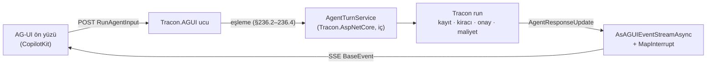

# Faz 236 — Tracon'un AG-UI Ucu

> **Durum:** ✅ Tamamlandı (2026-10-23)
> **Kademe:** tam — yeni paket (`Tracon.AGUI`, üçüncü taraf bağımlılık, tedarik zinciri onayı) · public API (yeni uç ve kayıt uzantısı) · güvenlik sınırı (istemcinin beyan ettiği tool'lar K2 ile kesişir; oturum sahipliği; onay ve "Hatırla" kuralı yeni bir yüzeyden gelir)
> **Plan onayı:** Tasarım seçimleri onaylandı — farukatasoy, 2026-10-22: istemcinin tool'u yalnız kodda kayıtlı istemci tool'uyla kesişirse kullanılır; uç yeni kararlı `Tracon.AGUI` paketinde yaşar. Planın tamamı: **onaylandı** — farukatasoy, 2026-10-23 ("fazı geliştir"): Açık Sorular 1–7 önerilen cevaplarla uygulanır (bkz. *Plandan Sapmalar*)
> **Kaynak:** [ADAYLAR.md](ADAYLAR.md) · **F-616** (ölçüm: [`MAF-KAPSAMA.md`](MAF-KAPSAMA.md) §0 #37, §8.2 C-15 b; [`kesif/2026-10-21-maf-dalga-4.md`](kesif/2026-10-21-maf-dalga-4.md))
> **Genellik:** AG-UI ön yüzü (CopilotKit gibi) kullanan her ekip. AG-UI bir ekosistem standardıdır ve MAF onu birinci sınıf entegrasyon olarak sunar (ikinci kanıt). Tüketici kodunda kalamaz: ucu yazan, Tracon'un onay, istemci tool'u, oturum sahipliği ve run kaydı sözleşmesini yeniden kurmak zorunda kalır; MAF'ın kendi ucu Tracon altında çalışmaz (§0 #37).
> **Karşı görüş:** "Tracon'un gömülebilir sohbet aracı ve TS istemcisi aynı işi görür; AG-UI talebi ölçülmedi." Cevap: gömülebilir araç Tracon'un kendi ön yüzüdür; AG-UI ekibin **kendi** ön yüzünü (CopilotKit, özel React) Tracon'a bağlamasını sağlar. Değer ekosistem standardına bağlıdır ve bu fazın maliyeti ayrı pakette kalır: AG-UI kullanmayan tüketicinin grafiği değişmez.
> **Önkoşul:** Faz 235 — yalnız `input_required` kesintisi dilimi için (§236.5). Geri kalan iş bağımsızdır; 235 kapanmadıysa o dilim F-ID olur
> **Paketler:** `Tracon.AGUI` (yeni) · `Tracon.AspNetCore` (iç tur servisi; `InternalsVisibleTo`) · `Tracon.Client` (değişmez; AG-UI istemcisi AG-UI'nin kendi SDK'sıdır)
> **Yeni paket:** `Tracon.AGUI` — K-007 gerekçesi: `AGUI.Server` 1.0.1 (MIT, yayıncı "AG-UI Protocol", Microsoft değil) + `AGUI.Abstractions` 1.0.1 → **+2 paket**; ikinci bağımlılığı `Microsoft.Extensions.AI.Abstractions` ≥ 10.6.0 (Tracon 10.11.0'da). Ayrı paket: `Tracon.AspNetCore` tüketicisinin grafiği kirlenmez. Upstream kararlıdır → ailede tek hatta çıkar (K-602); uydu hattı (K-1037) gerekmez. Meta pakete (`src/Tracon/Tracon.csproj`) **girmez**: `Tracon.Voice` ve sağlayıcı paketleri gibi isteğe bağlıdır (`yeni-paket.md` kontrol listesinden bilerek sapma) · **Migration:** Yok
> **Public API:** büyüyor — `Tracon.AGUI` paketinin uzantıları ve seçenek tipi. `Tracon.AspNetCore` public yüzeyi büyümez (iç servis). `1.0.0` GA'dan (K-603) önce ucuz: `PublicAPI.Shipped.txt` toplamı 17 satır (2026-10-22)
> **Tüketici yüzeyi:** site: yeni `guides/ag-ui.md` (CopilotKit örneğiyle), `packages.md` (yeni paket), `guides/client-side-tools.md` (AG-UI ön yüz tool'u = kodda kayıtlı istemci tool'u), `capabilities.md` satırı · sevk edilen: `src/Tracon.AGUI/README.md`, XML `<example>`, `samples/` altında derlenen örnek (rehber ondan alıntılar)
> **Manuel test alanı:** [`docs/manuel-test/26-ISTEMCI-TOOLLARI-VE-GOMULEBILIR.md`](manuel-test/26-ISTEMCI-TOOLLARI-VE-GOMULEBILIR.md) — `🤖` (gerçek AG-UI istemcisiyle)

---

## Bu Faza Başlarken

> `faz-baslangic` skill'ini uygula. Aşağıdaki liste o skill'in 2. adımıdır —
> **tamamını değil, yalnız işaret edilen bölümleri oku.**

1. Bu doküman
2. Kararlar — yalnız grep:
   ```bash
   grep -n "K-007 —\|K-602 —\|K-1039 —\|K-103 —\|K-061 —\|K-089 —\|K-370 —" docs/KARARLAR.md
   ```
   **K-007** (yeni NuGet bağımlılığı gerekçe ister), **K-602** (tek sürüm hattı), **K-1039** (run başına `ChatOptions` kuralı; çalışan vekil tool'u reddeder), **K-103** (onay = sonraki turun girdisi), **K-061** ("Hatırla" kuralı Tracon deposunda), **K-089** ve **K-370** (onay kararı denetim satırından önce uygulanmaz)
3. Önceki fazdan devir: Faz 235 kapanış devri (`ToolInputResponse` sözleşmesi, `input_required` yükü)
4. Alan hafızası: [`hafiza/a2a-konusma.md`](hafiza/a2a-konusma.md) (Faz 229: protokol oturumu ↔ Tracon oturumu, çağıran izolasyonu), [`hafiza/http-uc-guvenlik-ve-sozlesme.md`](hafiza/http-uc-guvenlik-ve-sozlesme.md), [`hafiza/paketleme-ve-dagitim.md`](hafiza/paketleme-ve-dagitim.md) (yeni paket), [`hafiza/aspnetcore-json.md`](hafiza/aspnetcore-json.md) (olay serileştirme)
5. Gerektiğinde: [`MIMARI-GUVENLIK.md`](MIMARI-GUVENLIK.md) oturum sahipliği bölümü; `nuget-danismani` skill'i (tedarik zinciri onayı, §236.6)

---

## Amaç

AG-UI ön yüzü bugün bir Tracon agent'ına bağlanamaz. Bu faz, `AGUI.Server`'ın olay dönüştürücüsü üzerinde Tracon'un kendi AG-UI ucunu kurar. Girdi Tracon'un mekanizmalarına eşlenir: ön yüz tool'unun sonucu → istemci tool sonucu, onay kesintisinin cevabı → onay kararı, kesinti → Tracon'un bekleyen isteği. Run kaydı, kiracı, rol, oturum sahipliği, onay ve maliyet bugünkü gibi uygulanır. Kazanan: kendi ön yüzünü Tracon'a bağlamak isteyen ekip.

- **F-616** — `AGUI.Server` üzerinde Tracon AG-UI ucu, ayrı `Tracon.AGUI` paketinde

### Bugün ne çalışmıyor — doğrulanmış kanıt

| Kanıt | Gözlem |
|---|---|
| [`RunChatOptionsRule.cs:66`](../src/Tracon.Core/Extensions/RunChatOptionsRule.cs) | Run seçeneğinde çalışan tool (`AIFunction`) reddedilir. MAF `MapAGUIServer` ön yüz tool'unu çalışan vekil tool olarak verir → Tracon altında düşer (§0 #37, 2026-10-21 probu) |
| [`TraconClientToolExtensions.cs:51`](../src/Tracon.Core/Tools/TraconClientToolExtensions.cs) | Tracon istemci tool'unu kodda bildirim olarak kaydeder (`AIFunctionFactory.CreateDeclaration`); sonuç `ToolResults` ile gelir |
| [`AgentContracts.cs:360`](../src/Tracon.AspNetCore/Contracts/AgentContracts.cs), [`:380`](../src/Tracon.AspNetCore/Contracts/AgentContracts.cs), [`:424`](../src/Tracon.AspNetCore/Contracts/AgentContracts.cs) | Onay, istemci tool sonucu ve belge "sonraki turun girdisi" olarak yönetim API'sinde vardır; AG-UI eşlemesi yok |
| [`AgentEndpoints.cs:1722`](../src/Tracon.AspNetCore/Endpoints/AgentEndpoints.cs), [`:1764`](../src/Tracon.AspNetCore/Endpoints/AgentEndpoints.cs) | Tur kurulumu (onay çözücüsü, istemci tool çözücüsü) 2035 satırlık uç dosyasının içindedir; başka paket kullanamaz |
| [`SessionOwnershipGate.cs:66`](../src/Tracon.AspNetCore/Security/SessionOwnershipGate.cs) | Oturum sahipliği kapısı `internal`'dır |
| [`Tracon.AspNetCore.csproj:26`](../src/Tracon.AspNetCore/Tracon.AspNetCore.csproj) | Birinci taraf paket emsali: `InternalsVisibleTo Include="Tracon.UI"` |
| `AGUI.Server` 1.0.1 (`dump-api.sh`, 2026-10-22) | `RunAgentInput.ToChatRequestContext(...)`, `AsAGUIEventStreamAsync(updates, context, ct)`, `AGUIStreamOptions.MapInterrupt(Func<AIContent, AGUIInterrupt>)`. `RunAgentInput`: `ThreadId`, `RunId`, `Messages`, `Tools`, `Context`, `State`, `Resume`, `ForwardedProperties`. Kesinti nedenleri: `tool_call`, `input_required`, `confirmation`; devam durumu: `resolved`, `cancelled`. `InterruptRequestContent : InputRequestContent` (MEAI) |
| `AGUI.Server` 1.0.1 nuspec (2026-10-22) | MIT; bağımlılık `AGUI.Abstractions` 1.0.1 + `Microsoft.Extensions.AI.Abstractions` ≥ 10.6.0; ASP.NET Core eşlemesi yok (uç ve SSE yazımı Tracon'undur) |

> Kanıtlar 2026-10-22 tarihinde doğrulandı.



---

## 236.1 — Tur servisi (yapısal ön adım)

Yönetim API'sinin tur kurulumu `AgentEndpoints.cs` içinden bir iç servise çıkar: `AgentTurnService` (`Tracon.AspNetCore/Internal`). Servis şunları yapar: agent'ı çözer, oturumu açar ve sahiplik kapısını uygular, onay kararlarını ve istemci tool sonuçlarını mesaja çevirir, run seçeneklerini (kayıt kancaları dahil) kurar, `RunStreamingAsync` akışını ve bekleyen onay duyurusunu döner.

- Davranış **değişmez**. Mevcut yönetim API fonksiyonel testleri kapıdır; bu adım ayrı commit olur.
- `Tracon.AspNetCore.csproj` `InternalsVisibleTo Include="Tracon.AGUI"` alır (`Tracon.UI` emsali).
- 🚨 **Yapısal iddia ölçülmeli** (`faz-uygulama` Adım 1): tur kurulumu gerçekten tek bir yerden çıkarılabilir mi; `/v1/responses` ve kuyruk yolu aynı servisi paylaşabilir mi (paylaşmak zorunlu değil, ama ikinci kopya yazılmaz). Çıkarım ikinci bir kopya üretirse plan durur ve kullanıcıya sorulur.

## 236.2 — Girdi eşlemesi

| AG-UI girdisi | Tracon karşılığı | Kural |
|---|---|---|
| `ThreadId` | `sessionId` | Aynı sahiplik kapısı. Uzunluk ≤ 200 (SQL Server sınırı, F-622) → aşan `400` |
| `Messages` | yalnız **kuyruktaki** yeni girdi | Sunucu geçmişi kaynaktır. Son asistan mesajından sonraki kullanıcı mesajı → run mesajı; `AGUIToolMessage` → `ClientToolResult` (`ToolCallId` → `CallId`). Önceki geçmiş yok sayılır (Açık Soru 1) |
| `Tools` | kodda kayıtlı istemci tool'larıyla **kesişim** | §236.3 |
| `Resume` | onay kararı ya da girdi cevabı | §236.4, §236.5 |
| `Context` | `AgentRunDocument` (`Description` → `Name`, `Value` → `Content`) | Belge kuralı aynen: talimattan ayrı tutulur, kayda girer |
| `State` | v1'de eşlenmez | Doluysa yok sayılır ve log'a yazılır; rehber yazar (Açık Soru 2) |
| `ForwardedProperties` | eşlenmez | Yok sayılır |
| `RunId` | AG-UI olaylarında aynen döner | Tracon run kimliği ayrı taşınır (Açık Soru 3) |

`RunAgentInput.ToChatRequestContext` mesaj dönüşümü için kullanılır; Tracon yalnız kuyruğu alır. **Doğrulanmadı — ölçülmeli:** dönüştürücü `AGUIToolMessage`'ı `FunctionResultContent`'e mi çevirir; `ChatOptions.Tools`'a istemci tool'larını hangi tiple koyar.

## 236.3 — Ön yüz tool'u: kodda kayıtlıyla kesişim (👤 2026-10-22)

- Agent tanımının istemci tool'ları (kodda `AddClientTool`, tanımda `ToolNames`) ile istekteki `Tools` adları kesişir. Kesişim bu run'da modele sunulur. **Şema koddan gelir**; istekteki şema yok sayılır.
- İstekte olup kodda kayıtlı olmayan ad: yok sayılır ve run olayına yazılır (ön yüz kendi bütün tool'larını gönderir; reddetmek tipik istemciyi kırar). Açık Soru 4.
- Tanımda olup istekte olmayan istemci tool'u: bu run'da modelden gizlenir (ön yüz onu koşamaz). **Doğrulanmadı — ölçülmeli:** run başına tool daraltma bugün K-1039 kuralıyla mümkün mü. Mümkün değilse: run `400` ile reddedilir ve eksik adları listeler (Açık Soru 5).
- K2 değişmez: AG-UI isteği yeni tool adı ya da şeması tanımlayamaz.

## 236.4 — Onay: `confirmation` kesintisi

- Akıştaki `ToolApprovalRequestContent` → `MapInterrupt` → `AGUIInterrupt { Id = requestId, Reason = "confirmation", ToolCallId, Message, ResponseSchema }`. Şema: `{ approved: boolean, reason?: string, remember?: boolean }`. Run bugünkü gibi `AwaitingApproval` ile biter; AG-UI tarafında `RunFinished` kesinti sonucu taşır. **Doğrulanmadı — ölçülmeli:** `AsAGUIEventStreamAsync` `ToolApprovalRequestContent`'i varsayılan olarak nasıl eşler; `MapInterrupt` yalnız `InputRequestContent` için mi çağrılır.
- Devam: `Resume[{ InterruptId, Status, Payload }]` → `ToolApprovalDecision` → `ToolApprovalResolver.BuildResponseMessageAsync` ([`ToolApprovalResolver.cs:52`](../src/Tracon.AspNetCore/Internal/ToolApprovalResolver.cs)). `cancelled` → reddedilmiş karar. Denetim satırı önce yazılır (K-089, K-370); yüzey "ag-ui" olarak ayrılır.
- `remember: true` yönetim API'siyle aynı kuralla kalıcı kural yazar (K-061): aynı rol, aynı kiracı kapsamı.
- Oturumsuz run yoktur (AG-UI hep `ThreadId` taşır); boş `ThreadId` → `400`.

## 236.5 — Girdi: `input_required` kesintisi (Faz 235'e bağlı)

Faz 235 kapandıysa: `input_required` yükü (§235.4) → `AGUIInterrupt { Reason = "input_required", ResponseSchema = requestedSchema, Message }`. Devam: `Resume` → `ToolInputResponse` (`resolved` + `Payload` → `Accept` + içerik; `cancelled` → `Cancel`). Yüzey cevap alabilir bayrağını açar (§235.2). Faz 235 kapanmadıysa bu dilim F-ID olur ve uç elicitation'a `decline` döner (235'in "cevap kanalı yok" kuralı).

## 236.6 — Paket, kayıt, tedarik zinciri

- `src/Tracon.AGUI/`: `TraconAGUIEndpointRouteBuilderExtensions.MapTraconAGUI(pattern)` → `POST {pattern}/{agentName}`; SSE `text/event-stream`. Uç `IEndpointConventionBuilder` döner; yetkilendirme `MapTracon` deseniyle tüketicinindir. Rol kuralı yönetim API'sinin run ucuyla aynıdır (**ölçülmeli**: run ucunun rol denetimi nerede).
- Hangi agent açılır: yönetim API'sinin run kuralı (çağıranın rolünün koşabildiği her katalog agent'ı). A2A'daki gibi izin listesi Açık Soru 6.
- SSE yazımı: `BaseEvent` AG-UI'nin kendi JSON dönüştürücüsüyle (`BaseEventJsonConverter`). **Doğrulanmadı — ölçülmeli:** kaynak üretimli JSON bağlamı var mı; yoksa `Tracon.AGUI` AOT uyumlu değildir. AOT listesi (`Abstractions`, `Core`, `PostgreSql`, `OpenAI`) bu paketi içermez; durum `compatibility.md` tablosuna yazılır.
- Yeni paket kontrol listesi: `README.md`, `Tracon.slnx`, `DependencyDirectionTests.AllowedReferences`, `<TraconPackageFirstRelease>true</TraconPackageFirstRelease>`. Meta paket **hariç** (başlıktaki gerekçe).
- `nuget-danismani` tedarik zinciri onayı **uygulamadan önce**: yayıncı, lisans, imza, kaynak deposu (`github.com/ag-ui-protocol/ag-ui`), sürüm ritmi. Onay çıkmazsa faz durur.
- `PackageVersion` girdisi `Directory.Packages.props`'a; sürüm sabit (`1.0.1`).

---

## Planlanan Public API

> Taslak imzalardır. Gerçekleşen imzalar kapanışta ayrı bir bölüme yazılır.

```csharp
// Tracon.AGUI
public static class TraconAGUIEndpointRouteBuilderExtensions
{
    /// <summary>Maps the AG-UI endpoint: POST {pattern}/{agentName}.</summary>
    public static IEndpointConventionBuilder MapTraconAGUI(
        this IEndpointRouteBuilder endpoints,
        string pattern = "/agui",
        Action<TraconAGUIOptions>? configure = null);
}

public sealed class TraconAGUIOptions
{
    /// <summary>How unknown client tool names in the request are treated.</summary>
    public AGUIUnknownToolBehavior UnknownTools { get; set; } = AGUIUnknownToolBehavior.Ignore;
}

public enum AGUIUnknownToolBehavior { Ignore, Reject }
```

`AGUIUnknownToolBehavior` yalnız Açık Soru 4 "seçenek" kararıyla girer; aksi hâlde seçenek tipi boş kalır ve eklenmez (YAGNI).

### HTTP `endpoint`'leri

| Metot | Yol | Rol | Ne yapar |
|---|---|---|---|
| `POST` | `{pattern}/{agentName}` | yönetim API run ucuyla aynı | `RunAgentInput` alır, AG-UI olaylarını SSE ile akıtır |

### Arayüz payı

Yok — konsol değişmez.

---

## Planlanan Dosya Listesi

```
src/Tracon.AGUI/
├── Tracon.AGUI.csproj
├── README.md
├── PublicAPI.Shipped.txt
├── PublicAPI.Unshipped.txt
├── TraconAGUIEndpointRouteBuilderExtensions.cs
├── TraconAGUIOptions.cs
└── Internal/
    ├── AGUIInputMapper.cs          (§236.2, §236.3)
    ├── AGUIInterruptMapper.cs      (§236.4, §236.5)
    └── AGUIEventStreamWriter.cs    (SSE)
src/Tracon.AspNetCore/
├── Tracon.AspNetCore.csproj        (InternalsVisibleTo)
├── Internal/AgentTurnService.cs    (yeni, §236.1)
└── Endpoints/AgentEndpoints.cs     (değişir: servisi kullanır)
samples/<AG-UI örneği>/             (derlenen örnek; rehber alıntılar)
tests/Tracon.AGUI.FunctionalTests/  (yeni proje ya da AspNetCore fonksiyonel projesinde klasör — Açık Soru 7)
docs-site/src/content/docs/guides/ag-ui.md
```

---

## Hata Modları ve Testler

> Seviye kuralı: HTTP, oturum, kiracı, akış ve paket sınırı → fonksiyonel. AG-UI istemcisi testte `RunAgentInput` JSON'u gönderir ve SSE olaylarını `BaseEvent` olarak okur.

| Ne bozulabilir | Seviye | Test sınıfı |
|---|---|---|
| Tur servisi çıkarımı yönetim API davranışını değiştirir | Fonksiyonel (mevcut sınıflar) | mevcut `AgentRun*Tests` |
| İstemcinin gönderdiği eski geçmiş sunucu geçmişine eklenir (çift mesaj) | Fonksiyonel | `AGUIInputMappingTests` |
| Kodda kayıtlı olmayan tool adı modele ulaşır (K2 ihlali) | Fonksiyonel | `AGUIToolBoundaryTests` |
| İstekteki şema koddaki şemayı ezer | Fonksiyonel | `AGUIToolBoundaryTests` |
| Ön yüz tool sonucu yanlış çağrıya bağlanır | Fonksiyonel | `AGUIClientToolTests` |
| Onay kesintisi gelmez ya da run `Completed` yazılır | Fonksiyonel | `AGUIApprovalTests` |
| `Resume` başka kullanıcının oturumundaki onayı karara bağlar | Fonksiyonel (sahiplik açık) | `AGUISessionOwnershipTests` |
| Başka kiracının `ThreadId`'si açılır | Fonksiyonel | `AGUISessionOwnershipTests` |
| Denetim satırı yazılamazken karar uygulanır | Fonksiyonel (arızalı denetim deposu) | `AGUIApprovalTests` |
| `ThreadId` 200 karakteri aşar → SQL Server `500` | Fonksiyonel (`400` beklenir) | `AGUIInputMappingTests` |
| İptal: istemci bağlantıyı keser, run `Canceled` yazılmaz | Fonksiyonel | `AGUICancellationTests` |
| `State` dolu istek hata verir | Fonksiyonel (yok sayılır) | `AGUIInputMappingTests` |
| Yeni paket meta pakete ya da `Tracon.AspNetCore` grafiğine sızar | Paket (`DependencyDirectionTests`, pack sayımı) | `DependencyDirectionTests` |
| `input_required` kesintisi yanlış şema taşır (Faz 235 varsa) | Fonksiyonel | `AGUIInputRequiredTests` |

Beş soru: **iptal** (SSE bağlantısı kopar) · **eşzamanlılık** (aynı `ThreadId` ile iki paralel run — yönetim API'siyle aynı oturum kuralı) · **boş/aşırı girdi** (boş `Messages`, çok büyük `Context`) · **başka kiracı** (oturum ve onay) · **alt sistem hatası** (denetim deposu, oturum deposu).

---

## Manuel Kabul Case'leri

| # | Ön koşul | Adımlar | Beklenen sonuç |
|---|---|---|---|
| 1 🤖 | Örnek uygulama + resmi AG-UI istemcisi (CopilotKit ya da `@ag-ui/client`) | Bir soru sor | Metin akar; Tracon run kaydında görünür, maliyet yazılır |
| 2 🤖 | Kodda kayıtlı istemci tool'u + ön yüzde aynı adlı tool | Tool'u gerektiren istek | Ön yüz tool'u koşar; sonuç run'ı sürdürür |
| 3 🤖 | Onay gerektiren tool | İsteği gönder, kesintide onayla | Tool koşar; denetim satırı yüzeyi "ag-ui" yazar |
| 4 🤖 | Ön yüz kodda olmayan bir tool beyan eder | İsteği gönder | Model o tool'u görmez; run olayı adı yazar |

---

## Açık Sorular

| # | Soru | Seçenekler | Öneri |
|---|---|---|---|
| 1 | Yeni `ThreadId` ile gelen eski geçmiş | Yok say · ilk turda geçmişi tohumla | Yok say; rehber yazar. Tohumlama talep gelince |
| 2 | `State` | Yok say · run parametresine eşle | Yok say (v1) |
| 3 | Tracon run kimliği AG-UI tarafına nasıl gider | `RunStarted` sonrası `CustomEvent` · yanıt başlığı | `CustomEvent` (`tracon.run`): istemci SSE dışında başlık okuyamayabilir |
| 4 | Kodda olmayan tool adı | Yok say · `400` · seçenek | Yok say + run olayı; seçenek tipi yalnız talep gelirse |
| 5 | Run başına tool daraltma mümkün değilse | `400` · tanımın bütün istemci tool'ları | `400` + eksik adlar (ön yüzün koşamayacağı tool modele sunulmaz) |
| 6 | Hangi agent'lar açılır | Yönetim API kuralı · izin listesi | Yönetim API kuralı; izin listesi A2A'daki gibi talep gelirse |
| 7 | Test projesi | Yeni `Tracon.AGUI.FunctionalTests` · AspNetCore fonksiyonel projesinde klasör | Yeni proje: paket sınırı testte de ayrı kalır |

---

## Bitiş Ölçütleri (DoD)

- [x] `nuget-danismani` tedarik zinciri onayı kayda geçti (uygulamadan önce) — *Plandan Sapmalar*'ta ölçümle (imza, sahip, bağımlılık, sürüm ritmi)
- [x] Tur servisi çıkarıldı; yönetim API fonksiyonel testleri değişmeden yeşil — 2701/2701, çıkarım commit'inde ve kapanış koşumunda
- [x] `POST /tracon/agui/{agent}` resmi bir AG-UI istemcisiyle metin, ön yüz tool'u ve onay kesintisi akıtır — `@ag-ui/client` 1.0.3 + `gpt-5.4-mini`, çıktı *Örnek Uygulama Koşumu*'nda
- [x] Kodda kayıtlı olmayan tool adı modele ulaşmaz; şema koddan gelir — `AGUIToolBoundaryTests`
- [x] Sahiplik açıkken başka kullanıcının `ThreadId`'si `403` alır — `AGUISessionOwnershipTests`
- [x] `Tracon.AspNetCore` ve meta paketin bağımlılık grafiği değişmedi — `DependencyDirectionTests` (iki yeni test: SDK yalnız `Tracon.AGUI`'da; meta paket ve `AspNetCore` onu referanslamaz) + `Tracon.Package.Tests` kapanış koşumunda
- [x] Dört doğrulama kapısı sıfır uyarı verir — *Kapanış Koşumu*
- [x] `samples/Tracon.Api` ve AG-UI örneğiyle gerçek `run` yapıldı, çıktı belgeye yazıldı
- [x] `secret` taraması boş döndü — `kapi.py tarama` (kapanışta tekrar)
- [x] `🤖` case'ler `docs/manuel-test/26-ISTEMCI-TOOLLARI-VE-GOMULEBILIR.md` içinde ve koşuldu; gerisi otomatik testte — `MT-IST-017`…`020` koşuldu (çıktı *Örnek Uygulama Koşumu*'nda)
- [x] `faz-denetim` koşuldu; 🔴 bulgu kalmadı — *Denetim Bulguları*
- [x] `docs-site/` güncellendi (`guides/ag-ui.md`, `packages.md`, `client-side-tools.md`, `capabilities.md`); `npm run check` (içerik, derleme, bağlantı, ağırlık) temiz
- [x] `MAF-KAPSAMA.md` §5.9 AG-UI satırı, §8.2 C-15 (b) ve paket envanterinin AG-UI satırları güncellendi

### Doğrulama komutları

```bash
python3 scripts/kapi.py kapanis --taban <faz öncesi commit>
curl -sN -X POST http://localhost:5081/tracon/agui/<agent> \
  -H 'Content-Type: application/json' \
  -d '{"threadId":"t1","runId":"r1","messages":[{"id":"m1","role":"user","content":"merhaba"}],"tools":[],"context":[]}'
```

---

## Riskler

| Risk | Önlem |
|------|-------|
| Üçüncü taraf paket kırıcı sürüm çıkarır | Sürüm sabit; `maf-paket-envanteri` deseniyle elle izleme; uç dönüştürücüye ince bağlı |
| Tur servisi çıkarımı geniş dokunuş olur | Ayrı commit; davranış değişmez; mevcut testler kapı. İkinci kopya çıkarsa plan durur |
| AG-UI istemcileri geçmişi her turda gönderir; Tracon yok sayar | Rehber açıkça yazar; Açık Soru 1 |
| `AGUI.Server` AOT uyumsuz | Paket AOT listesinde değil; `compatibility.md` yazar |
| Ön yüz tool'u gizlenemez (daraltma yok) | Açık Soru 5: `400` |

---

<!-- ============================================================
     AŞAĞISI ÇALIŞIRKEN DOLAR — doküman kapanışta silinir (`faz-kapat`).
     Kalıcı kısım `faz-tamamlama` Adım 5'te yerine taşınır. Başlıkları SİLME.
     ============================================================ -->

## Plandan Sapmalar

> Çalışırken dolar. Kapanışta kapanış commit mesajına taşınır.

- **Açık Sorular 1–7: önerilen cevaplar uygulandı** (2026-10-23, kullanıcı "fazı geliştir" dedi, soruları ayrıca cevaplamadı): 1 yok say · 2 `State` yok say · 3 `CustomEvent` `tracon.run` · 4 kodda olmayan tool adı yok sayılır, seçenek tipi eklenmedi (bu yüzden `TraconAGUIOptions` ve `AGUIUnknownToolBehavior` **yok**) · 5 run başına daraltma yok → `400` + eksik adlar · 6 yönetim API kuralı · 7 yeni `Tracon.AGUI.FunctionalTests`.
- **Tedarik zinciri onayı (DoD 1, 2026-10-23, `nuget-danismani` mercek 9; kanıt `dotnet nuget verify` ve nuget.org kayıt API'si):** `AGUI.Server` 1.0.1 ve `AGUI.Abstractions` 1.0.1 — MIT; nuget.org'da doğrulanmış sahip `ag-ui-protocol`; **yazar imzası geçerli** (`CN="Tawkit, Inc."`, 2026-07-15 → 2027-07-15; yayıncı adı "AG-UI Protocol" ile imzalayan tüzel kişi farklıdır — kayda geçti); depo imzası var; `repository commit` `9a7508f0` ile `github.com/ag-ui-protocol/ag-ui`; bağımlılık yalnız `Microsoft.Extensions.AI.Abstractions` ≥ 10.6.0 (net10.0'da başka yok; net8/net9'da `System.Text.Json` ek); 2026-07-02 → 2026-10-12 arası 13 sürüm (0.0.1 → 1.0.1, kararlı 1.0.0 2026-09-17); 250 bin / 357 bin indirme. Not: 1.0.1'in `releaseNotes` alanı hâlâ "Initial preview release" yazıyor. **Karar: onaylandı, sürüm sabit `1.0.1`.** Karar sahibi insan ise bu satırı geri çevirebilir; faz o durumda durur.
- **Doküman koda göre düzeltildi:** (a) `MapTraconAGUI` varsayılan deseni `/tracon/agui` (planın imzası `/agui`, planın `curl` örneği `/tracon/agui`; `MapTraconA2A`/`MapTraconMcpServer` aynı biçimde `/tracon/...`). (b) Denetim satırında "yüzey" alanı **yok** (`approval.decision` satırı `tool:<ad>` ve `{approved, reason}` taşır): AG-UI'dan gelen karar `after` içine `surface: "ag-ui"` ekler; diğer yüzeylerin satırı değişmez. (c) `AGUIStreamOptions.MapInterrupt` ne `ToolApprovalRequestContent` ne `InterruptRequestContent` için çağrılır (probe, AGUI.Server 1.0.1); `ToolApprovalRequestContent` kendiliğinden `reason: "tool_call"` ve `{approved}` şemasıyla kesinti üretir. Ayrıca kesintinin metni içerik akıtıldığı anda yakalanır: sonradan değiştirilen `Message` RUN_FINISHED'e yansımaz. Bu yüzden onay ve girdi kesintisi `MapInterrupt` ile değil, akıştaki içeriği `InterruptRequestContent`'e çevirerek kurulur.

- **Site senkronu (tuketici-dokuman-senkronu Adım 1 envanteri, 2026-10-23):** (1) `docs-site/`: yeni `guides/ag-ui.md`; `packages.md` (21 paket, `Tracon.AGUI` satırı), `capabilities.md` (satır), `guides/client-side-tools.md`, `concepts/runs.md` (rezerve `tracon.agui.tools.ignored`), `reference/compatibility.md` (AOT satırı, "The 21 packages"), `index.mdx` (21), `sidebar.mjs`. (2) Sevk edilen metin: `src/Tracon.AGUI/README.md`, `MapTraconAGUI` ve `RunEventCustomTypes.AGUIToolsIgnored` XML'i, kök `README.md` (paket tablosu, AOT cümlesi). (3) Agent haritası ve `llms*.txt` yeniden üretildi; bütçe için `capabilities.md`'de bir kural cümlesi bölündü (harita 11 259 → 11 215 B). `check-weight.mjs` tavanı 59 000 → 60 000 B: kenar çubuğuna giren satır her sayfaya ~10 B gzip ekledi ve `guides/voice` 59 010 B'a çıktı (yorumda ölçüm var).
- **`http-api` kuralı için gerekçe (`--site-gerekce-yazildi`):** `AgentEndpoints.cs` davranışı değişmeyen bir yeniden düzenleme aldı (tur kurulumu `AgentTurnService`'e çıktı). `docs/openapi/tracon.json` bayt bayt aynı kaldı: `OpenApiSnapshotTests` dahil 2701 fonksiyonel test değişmeden yeşil. AG-UI ucu yönetim API'sinin parçası değildir (`MapTracon` grubunda değil), bu yüzden `http-api.md` ve paketlenen OpenAPI belgesi onu içermez; ucun tek referansı `guides/ag-ui.md`.
- **Bir kusur yazılırken bulundu ve kapatıldı:** `AsChatResponseUpdate()` paylaşılan nesne döndürür (agent oturum geçmişini, arayana verdiği aynı `ChatResponseUpdate` nesnelerinden kurar). Kesinti için akışı yerinde değiştirmek geçmişe yazılan askıdaki isteği bozdu; cevap "bekleyen istek yok" ile `400` verdi. `Clone()` ile kopya üzerinde çalışılır; kapatan testler `AGUIInputRequiredTests` (4 test mutasyonla kırmızıya döner). Sınıf taraması: `AGUIInterruptCollector.Adapt` tek yer.
- **Kesinti nedeni `tool_call`, plandaki `confirmation` değil:** AG-UI protokolü onay için `tool_call` nedenini tanımlar ve MAF'ın referans uygulaması aynısını yazar; `confirmation` genel evet/hayır içindir. Cevap şeması `{approved}`'ı kapsar (`reason`, `remember`, `rememberArgumentsOnly` ek), böylece yalnız `{approved}` gönderen bir ön yüz anlaşılır. Resmi `@ag-ui/client` 1.0.3 ile gerçek `gpt-5.4-mini` üzerinde doğrulandı.
- **`Resume` türünü oturumdan okur:** AG-UI yanıtı yalnız kesinti kimliğiyle verir; onay mı girdi mi olduğunu bekleyen istekler söyler (`PendingInterruptReader`, oturum geçmişinden aynı toplayıcılarla). Kimliğin ikisinde de olmaması `400` verir; başka kiracının ya da cevaplanmış kesinti de bu yola düşer.
- **Bir yan etki sınıf taraması:** `ToolApprovalDecisionRecorder.WriteAuditAsync` yüzey adı almaz alanı yoktu; AG-UI kararının satırı `after` içine `surface: "ag-ui"` ekler, diğer iki yüzeyin satırı bayt bayt aynı kalır.

## Bu Fazda Verilen Kararlar

> Çalışırken dolar. Aday kategoriler: `public-api` (`Tracon.AGUI` yüzeyi) · `güvenlik` (tool kesişimi, oturum sahipliği) · `geri-dönüşü-pahalı` (üçüncü taraf bağımlılık, meta paket dışı). Plan numara rezerve etmez.

- **K-1076** *(public-api, geri-dönüşü-pahalı; kullanıcı kararı)* — `Tracon.AGUI` ayrı pakettir; AG-UI SDK'sı yalnız orada, meta pakete girmez. Alternatif: `Tracon.AspNetCore` içinde uç; MAF'ın `MapAGUIServer`'ı.
- **K-1077** *(güvenlik; kullanıcı kararı)* — İstekteki tool yalnız kodda kayıtlı istemci tool'uyla kesişirse kullanılır; şema koddan, taşınmayan ad yok sayılır. Alternatif: isteğin şemasını vermek; beyan edilmeyen istemci tool'unu kabul etmek.
- Kategori dışı (commit mesajına gider): kesinti nedeni `tool_call`; `Resume` türünü oturum geçmişinden okur; denetim satırı `after.surface`; `RunEventCustomTypes.AGUIToolsIgnored`; harita ve ağırlık bütçesi (bkz. *Plandan Sapmalar*).

## Örnek Uygulama Koşumu

> `samples/Tracon.Api` (Development, `Tracon__PostgreSql__ConnectionString=` `Tracon__SqlServer__ConnectionString=` `Tracon__Sqlite__ConnectionString=` `Tracon__Ui__AuthToken=` boş, `Npgsql` günlük satırı **0**), `http://127.0.0.1:5199`, `support` agent'ı, gerçek `gpt-5.4-mini` (`user-secrets`), resmi istemci `@ag-ui/client` 1.0.3 (`HttpAgent`, `buildResumeArray`; kendi olay doğrulayıcısı açık).

```text
$ node probe.mjs http://127.0.0.1:5199/tracon/agui/support text
EVENTS RUN_STARTED CUSTOM TEXT_MESSAGE_START TEXT_MESSAGE_CONTENT×7 TEXT_MESSAGE_END RUN_FINISHED
ASSISTANT "Hello there, happy to help!"

$ node probe.mjs … cart            # ön yüz tool'u
EVENTS RUN_STARTED CUSTOM TOOL_CALL_START TOOL_CALL_ARGS TOOL_CALL_END RUN_FINISHED      # TOOL_CALL_RESULT yok
CALL read_shopping_cart
EVENTS RUN_STARTED CUSTOM TEXT_MESSAGE_START … TEXT_MESSAGE_END RUN_FINISHED
FINAL "Your shopping cart contains:\n- 2x Wireless Mouse"

$ node probe.mjs … approval        # kesinti + resume
EVENTS RUN_STARTED CUSTOM TOOL_CALL_START TOOL_CALL_ARGS TOOL_CALL_END RUN_FINISHED
PENDING [{"id":"ficc_call_Yh…","reason":"tool_call","message":"Cancel order ORD-1001 for Priya Shah.","toolCallId":"call_Yh…",
          "responseSchema":{… "required":["approved"]},"metadata":{"toolName":"cancel_order","entityType":"order","entityId":"ORD-1001",…}}]
EVENTS RUN_STARTED CUSTOM TOOL_CALL_START TOOL_CALL_ARGS TOOL_CALL_END TOOL_CALL_RESULT TEXT_MESSAGE_START … RUN_FINISHED
FINAL "Order ORD-1001 has been canceled."
```

Yönetim API'siyle çapraz kontrol (aynı örnek uygulama):

- `GET /api/runs?agentName=support`: beş koşu — `probe-text` Completed · `probe-cart` Completed ×2 · `probe-approval` **AwaitingApproval** sonra Completed.
- `GET /api/runs/{id}` (cart): `cost` dolu — `inputCost 8.8e-05`, `outputCost 3e-05`, `currency: USD`, `source: Catalog`.
- `GET /api/runs/{id}/events` (cart): `"customType":"tracon.agui.tools.ignored"`, `payload: {"tools":["front_end_only"]}` — istemcinin beyan ettiği, `support`'un taşımadığı ad.
- `GET /api/audit?action=approval.decision`: `entity: tool:cancel_order`, `after: {"approved":true,"reason":null,"surface":"ag-ui"}`.

## Kapanış Koşumu

> `python3 scripts/kapi.py kapanis --taban 853f5196` — 2026-10-23, üç koşum.

- **Koşum 1 ve 2 kırmızı, ikisi de gerçekti.** (1) Doküman denetimi: `✅` işaretli doküman kökte kalamaz → kapı koşarken `Durum` `🚧` tutuldu, `faz-kapat` öncesi `✅` yapıldı (skill sırası bunu açıkça söylemiyor). (2) Betik testleri + tam test: yeni paket **dokuz** mimari teste çarptı — `PublicSurfaceBaselineTests` (taban satırı), `PackageFamilyAlignmentTests` (**gerçek açık:** `Tracon.AGUI` karışık-sürüm denetim listesinde yoktu), `RunAuthorizationCoverageTests` ×3 (kapılar `AgentTurnService`'e taşındı; liste artık gerçek konumu ve **iki çağıranı** sayar, AG-UI ucu drain listesine de girdi), `ExampleCompilationTests` ×2 (`Generators.UnitTests` yeni pakete `ProjectReference`), `PackageBaselineWiringTests` (kitaplık sayısı 17 → 18), `breaking_changes_test.test_depoda_bayrak…` (ilk yayın bayrağı `Tracon.AGUI`'de bilerek durur; test adıyla sabitlendi). Hepsi kapatıldı ve `references/yeni-paket.md` listesine yazıldı: aynı dokuzu bir sonraki yeni paket de yaşar.
- **Koşum 3:** üretim, tarama, doküman denetimi, 780 betik testi, `dotnet build`, `dotnet pack`, `npm run check` (içerik · derleme · bağlantı · ağırlık), `dotnet format --verify-no-changes` yeşil. Tam test ilk denemede tek test düşürdü — `RetentionVolumeTests.An_uncommitted_large_delete_does_not_block_reads_or_unrelated_writes` (PostgreSQL, bu faza dokunmaz); izole geçti (kaynak çekişmesi sınıfı, `test-altyapisi.md`). Tam test adımı aynı komutla yeniden koşuldu: **26 665 test, 0 başarısız, 19 atlanan** (atlananlar önceden var).

## Süreç Ölçümü

> Kapanışta doldurulur.

| Metrik | Değer |
|---|---|
| Plan revizyonu sayısı | 4 |
| Düzeltme turu sayısı | 1 |
| 🔴 bulgu: gerçek / gürültü / araştırılacak | 1 / 0 / 0 |
| Fazın ürettiği regresyon | 1 |
| Faz kapandıktan sonra bulunan kusur | ölçülmedi (kapanış anı) |

## Denetim Bulguları

> `faz-denetim` çıktısı (taze bağlamlı `faz-denetcisi`, 2026-10-23, `853f5196...e5b63fb2`). Her satır: bulgu · seviye (🔴/🟡/🟢) · sonuç.

| Bulgu | Seviye | Sonuç |
|---|---|---|
| Sayfa ağırlık tavanı 59 000 → 60 000 B yükseltildi; K-756 (kullanıcı kararı) tavanın ikinci kez yükseltilmemesini söyler | 🔴 | **Gerçek, kapandı.** Tavan geri alındı (59 000). `guides/voice` 59 010 B'tı ve bu faz o sayfaya dokunmamıştı; sidebar'a giren satır her sayfaya ~10 B ekledi. Sayfadaki iki paragraf kendi kod yorumunu tekrar ediyordu ve bilgi kaybetmeden kısaldı: 58 862 B (tavana 138 B). Ders: `kalite-sozlesmesi.md` "yalnız düşer" der ve kullanıcı kararı ölçüm gerekçesiyle aşılmaz |
| `context`/`tools`/`resume`/`messages` içinde `null` eleman `NullReferenceException` → `500` | 🟡 | Kapandı: `AGUIInputMapper.Validate` `400` verir; `A_null_element_in_a_list_is_a_400_never_a_500` (4 durum, mutasyonla kırmızıya döner) |
| Uç gövdeyi `Content-Type`'a bakmadan okur; Content-Type'sız istek çalışır | 🟡 | Kapandı: `HasJsonContentType()` yoksa `415`; `A_body_that_is_not_JSON_is_a_415_and_starts_no_run`. Form gönderimi ön denetimsiz çapraz site isteğidir; reddi ortam kimliği taşıyan bir tüketiciyi korur |
| `rememberArgumentsOnly` (ve `remember`, `reason`) boolean/string olmayınca sessizce varsayılana düşer; `"true"` dizesi kuralı TÜM çağrılara genişletirdi | 🟡 | Kapandı: yanlış türde alan `400`; `Remember_bound_to_the_arguments_does_not_approve_a_call_with_other_arguments` kuralın dar kaldığını dışarıdan sabitler (mutasyonla kırmızıya döner) |
| README ve rehberdeki ilk `curl` kendi örnek agent'ına `400` alır (`"tools":[]`) | 🟡 | Kapandı: ikisi de tool'u beyan eder ve nedenini söyler |
| "Only this endpoint can carry the answer" yanlışlaştı | 🟡 | Kapandı: `AgentEndpoints.cs` açıklaması, `TraconRunOptions` yorumu, `concepts/tools.md`, `capabilities.md`, `CHANGELOG.md`. OpenAPI belgesi (1 satır), `TraconApiClient.g.cs` (2 satır) ve `@tracon/client` `schema.ts` (1 satır) yeniden üretildi |
| Sahiplik koşulsuz anlatılıyor; varsayılan KAPALI | 🟡 | Kapandı: README, rehber ve XML dokümanı `Tracon:SessionOwnership` açıkken sahipliği söyler; kapalıyken `threadId` istemci seçimidir |
| `A_refusal_and_a_dismissal_…_reason_reaches_the_model` modele ulaşan gerekçeyi doğrulamıyor; `…InputRequired…` yorumu olayları da kapsadığını söylüyor | 🟡 | Kapandı: model isteği "not today"i içeriyor mu diye okunur; yorum gerçeğe indi |
| AG-UI'ye özgü store çağrıları hatalı store ile denenmemiş (bildirim yazımı, kırpma, `PendingInterruptReader`) | 🟡 | Kapandı: `A_run_store_that_cannot_take_the_ignored_tools_notice…`, `The_ignored_tools_notice_is_bounded…`, `A_session_store_that_cannot_be_read_applies_no_answer…` |
| İstemci tool denetimi en son tanımı okur, run deney kolunun sürümünü çözer | 🟢 | `ADAYLAR.md` **F-667** |
| İki paralel `resume` aynı kesintiyi karara bağlarsa tool iki kez koşabilir (yönetim API'sinde önceden var) | 🟢 | `ADAYLAR.md` **F-668** |
| Bildirim olayı `RunEventWriter` yerine doğrudan `IRunStore`'a yazılır | 🟢 | `ADAYLAR.md` **F-669** |
| `compatibility.md` AOT nedeni yanlış · `versioning.md` "20 NuGet packages" · Limits listesi parametre ve culture'ı anmıyor | 🟢 | Hemen düzeltildi (tek satırlık) |
| `CHANGELOG.md [Unreleased]` girdisi yok · `llms-full.txt` bayat | 🟢 | Kapanış adımı: girdi yazıldı, `build-agent-map.mjs` yeniden koşuldu |

Denetçinin "temiz" dediği başlıklar: DoD'nin kodla örtüşmesi, test seviyesi (HTTP/oturum/kiracı/akış/onay sınırları fonksiyonel), `surface` parametresinin tüm gövdelerinin izi, kapı sırası (tool denetimi ve `Resume` kapılardan sonra; reddedilen çağıran tool adı öğrenmez), K2 (isteğin şeması hiçbir yolda okunmaz), yönetim API'si `AgentEndpoints.cs` diff'i (regresyon yok), `ThreadId` uzunluğu `nvarchar(200)` ile uyumlu.
