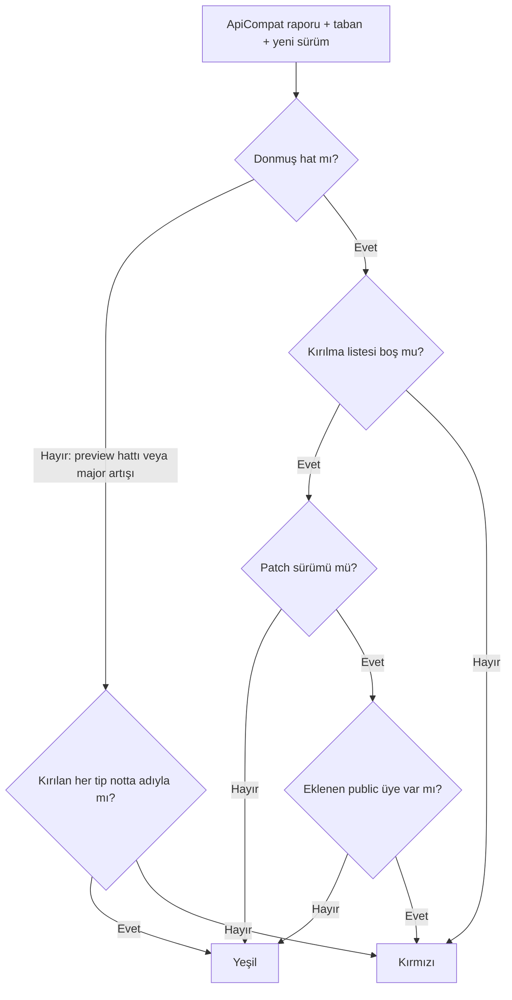

# Faz 237 — .NET Yüzeyinin 1.x Evrim Kuralları ve Donmuş Hat Kapısı

> **Durum:** 📋 Planlandı (2026-10-23)
> **Kademe:** tam — geri dönüşü pahalı karar: 1.x evrim kuralı `rc.1`'den sonra değiştirilemez; kırılma kapısının davranışı değişir
> **Plan onayı:** Bakımcı, 2026-10-23 (engelleyici kararlar sohbette alındı: F-559 iki faza bölünür — bu faz .NET yüzeyi, Faz 238 .NET dışı yüzeyler; contract paketine minor sürümde yalnız **belgelenmiş davranışı** ölçen test girer)
> **Kaynak:** [ADAYLAR.md](ADAYLAR.md) · **F-559** (A-76 dilimi; A-67 ve A-68 dilimi Faz 238'dedir)
> **Genellik:** `1.0.0`'dan sonra Tracon'a bağımlı olan **her** tüketici sınıfı: seam uygulayan, `Tracon.Testing.Contracts.Xunit` koşan, yalnız paket yükselten. İş tüketici kodunda kalamaz: söz Tracon'undur. İkinci kanıt bir ekosistem standardıdır: SemVer 2.0 ve .NET kütüphane kırılma kuralları (`dotnet/runtime` breaking-change rules); A-76 dış denetim bulgusu
> **Karşı görüş:** "ApiCompat kırılmayı zaten yakalıyor; yazılı kural fazladır." Cevap: ApiCompat bugün preview hattında yalnız **"notta adıyla an"** kuralıyla çalışır (K-864) ve kırılmayı reddetmez. Ayrıca bir contract testinin eklenmesini kırılma saymaz; bir `required` üyenin ya da enum değerinin değişimini görüp görmediği ölçülmedi. Kural yazılmazsa `rc.1`'den sonraki her tartışma tahminle kapanır (A-76)
> **Önkoşul:** Faz 213 — hangi arayüzün seam olduğu (K-1013) — kapandı (2026-10-16). **Sonraki:** Faz 238 bu fazın donmuş hat kararını (§237.2) yeniden kullanır
> **Paketler:** kod paketi değişmez. Değişen: `scripts/` (yayın provası), `tests/Tracon.Core.UnitTests/Architecture/` (yalnız §237.3 ölçümü gerektirirse), `src/Tracon.Testing.Contracts.Xunit/README.md`
> **Yeni paket:** Yok · **Migration:** Yok
> **Public API:** Büyümüyor. Bu faz kural ve kapı yazar, tip yüzeyine dokunmaz. Ölçüm: `wc -l src/*/PublicAPI.Shipped.txt` = **18** satır (dolum `1.0.0` GA'dadır, K-603); `Unshipped` = **8356** satır
> **Tüketici yüzeyi:** site: `reference/versioning.md` (yeni bölüm: *What 1.x promises for the .NET API*), `llms-full.txt` (üretilir) · sevk edilen: `src/Tracon.Testing.Contracts.Xunit/README.md` (contract testi büyüme kuralı), `CHANGELOG.md` (yalnız sürüm notu biçimi değişirse)
> **Manuel test alanı:** `docs/manuel-test/01-KURULUM-VE-PAKETLEME.md` — `🤖` yayın provası case'leri

---

## Bu Faza Başlarken

> `faz-baslangic` skill'ini uygula. Aşağıdaki liste o skill'in 2. adımıdır —
> **tamamını değil, yalnız işaret edilen bölümleri oku.**

1. Bu doküman
2. Kararlar — dosyanın tamamını **okuma**, yalnız bu kalemleri grep'le:
   ```bash
   grep -n "K-602 —\|K-603 —\|K-864 —\|K-865 —\|K-1013 —\|K-1014 —\|K-566 —" docs/KARARLAR.md
   ```
   **K-602** (tek sürüm hattı; preview'da kırılma serbest), **K-603** (`Shipped`
   dolumu GA'da), **K-864** (yayın provası son etikete karşı ApiCompat koşar,
   kırılan tip notta adıyla geçmeli), **K-865** (strict mode), **K-1013** (seam
   tanımı), **K-1014** (yalnız küçülen taban deseni), **K-566** (`Tracon.Client`
   ve `Tracon.Cli` PublicAPI takibinin dışında)
3. Önceki fazdan devir: yok. Bu faz bağımsızdır
4. Alan hafızası (üç alan):
   [`hafiza/yayin-turu.md`](hafiza/yayin-turu.md) (taban etiketi `git describe` ile
   çözülür; düşen etiket tabanı bozar; sürüm notundaki çitli blok span eşleşmesini
   kaydırır) ·
   [`hafiza/yayin-ve-surumleme.md`](hafiza/yayin-ve-surumleme.md) ·
   [`hafiza/genisleme-noktalari-ve-denetim.md`](hafiza/genisleme-noktalari-ve-denetim.md)
   (seam tanımı, `ITraconBuilder`'a üye eklenmez — K-867)
5. Yayın defteri: [`YAYIN-HAZIRLIK.md`](YAYIN-HAZIRLIK.md) §2 ölçüt 5 ve §3.6 son
   madde. A-76'nın tam metni:
   `git show 96d3929328cc738d5f3de84274348cd27093c7b9:docs/YAYIN-HAZIRLIK.md | grep -n "A-76"`

---

## Amaç

Tracon `rc.1`'de yüzeyini dondurur (YAYIN-HAZIRLIK §2). O andan sonra her
değişiklik bir SemVer sınıfına girer. Bugün o sınıfı söyleyen yazılı bir kural
yoktur, kapı da kırılmayı reddetmez. Bu faz .NET yüzeyinin 1.x kuralını yazar ve
yayın provasını kurala bağlar: donmuş hatta kırıcı değişiklik **kırmızıdır**, sürüm
notu onu kurtaramaz.

- **F-559 (A-76)** — arayüz, enum, `required` üye, kayıt/opsiyonel parametre,
  abstract sınıf ve contract testi için 1.x kuralı · donmuş hat kapısı · contract
  testi eklemelerinin listesi

### Bugün ne çalışmıyor — doğrulanmış kanıt

| Kanıt | Gözlem |
|---|---|
| [`reference/versioning.md`](../docs-site/src/content/docs/reference/versioning.md) | "interface" 0, "enum" 0 eşleşme; bölümler sürüm notu, paket kimliği, sabitleme, kalıcı durum ve yükseltme penceresidir. 1.x evrim kuralı yok |
| [`breaking_changes.py:537`](../scripts/breaking_changes.py) `check` | Kırılan her tip notta adıyla geçerse prova **yeşildir**. Sürüm hattına bakmaz: `1.0.0` → `1.1.0` arasında da aynı kural geçerli olur |
| [`src/Directory.Build.props:94-98`](../src/Directory.Build.props) | `EnableStrictModeForBaselineValidation` kapalıdır, çünkü preview yüzeyi büyür. Patch sürümünde de eklenen üye geçer |
| `grep -rhoE "public required " src --include='*.cs' \| wc -l` | **851** public `required` üye (A-76: 833). Mevcut bir tipe yeni `required` üye eklemek kaynak düzeyinde kırıcıdır (CS9035). ApiCompat'ın bunu görüp görmediği **ölçülmedi** |
| `grep -rhoE "public enum \w+" src --include='*.cs' \| wc -l` | **153** public enum. Değer ekleme, silme ve yeniden numaralama için kural yok |
| `src/Tracon.Testing.Contracts.Xunit` | **696** public test metodu, **0** `virtual`. Tüketici yeni bir testi atlayamaz; minor yükseltme tüketicinin CI'ını kırmızı yapabilir. Prova eklenen testi listelemez |
| `grep -rhoE "public (partial )?interface I\w+" src --include='*.cs' \| wc -l` | **84** public arayüz. `SeamContractDocumentationTests` bütün public arayüzleri seam sayar (K-1013) |
| `SourceKind2` (A-76'nın `Tracon.Client` iddiası) | **Kanıt düştü:** `src/Tracon.Client/Generated/` içinde numaralı çakışma adı **0**. Bu kalem Faz 238'in OpenAPI kapısına bir gerileme denetimi olarak geçer |

> Kanıtlar 2026-10-23 tarihinde doğrulandı.

---

## 237.1 — Kural metni (`reference/versioning.md`)

Yeni bölüm: **What 1.x promises for the .NET API**. Metin İngilizcedir (site).
Kural tablo hâlinde yazılır; her satır bir değişiklik türü × SemVer sınıfıdır.

| Değişiklik | Patch | Minor | Major |
|---|---|---|---|
| Yeni public tip | ✗ | ✓ | ✓ |
| Mevcut tipe yeni public üye (opsiyonel, varsayılanı belgeli) | ✗ | ✓ | ✓ |
| Public arayüze üye — **yalnız varsayılan gövdeyle** (default interface member) | ✗ | ✓ | ✓ |
| Public arayüze gövdesiz üye | ✗ | ✗ | ✓ |
| Abstract sınıfa abstract üye | ✗ | ✗ | ✓ |
| Mevcut tipe yeni `required` üye | ✗ | ✗ | ✓ |
| Mevcut `required` üyenin opsiyonel olması | ✗ | ✓ | ✓ |
| Kayda (`record`) yeni konumsal parametre · metoda yeni opsiyonel parametre | ✗ | ✗ (yeni overload ✓) | ✓ |
| Enum'a yeni değer | ✗ | ✓ | ✓ |
| Enum değerini silmek ya da sayısını değiştirmek | ✗ | ✗ | ✓ |
| Contract paketine **belgelenmiş davranışı** ölçen yeni test | ✓ (kusur) | ✓ | ✓ |
| Contract paketine **yeni davranış** isteyen test | ✗ | ✗ | ✓ |
| XML'de belgelenen davranışın değişmesi | ✗ | ✗ | ✓ |

Üç tamamlayıcı cümle bölüme girer:

- **Enum tüketicisi bilinmeyen değeri işler.** `switch` bir `default` dalı taşır.
  Tracon yeni değeri minor sürümde ekler.
- **Arayüz kuralı tek kuraldır.** "Çağrılır, uygulanmaz" arayüzler
  (`IToolRegistry`, `IWorkflowRunner` — K-1013) de aynı kurala tabidir. Kapı
  ayrım yapmaz, bu yüzden kural da ayrım yapmaz.
- **Contract testi:** "belgelenmiş davranış" = testin ölçtüğü davranış, testin
  eklendiği sürümden önce XML dokümanında ya da sitede yazılıdır. Sürüm notu yeni
  testi tam adıyla anar.

`.NET dışı` yüzeyler (HTTP, yapılandırma, telemetri, hata kodu, CLI) bu bölümün
**dışındadır**; Faz 238 aynı sayfaya kendi bölümünü ekler. Bu faz bölümün sonuna
"HTTP and other surfaces: see below" cümlesini **yazmaz** — Faz 238 yazar.

## 237.2 — Donmuş hat kapısı (`breaking_changes.py`)

**Donmuş hat:** taban sürümü `1.0.0-rc.1` veya üstü **ve** yeni sürümün major
değeri tabanınkiyle aynı. Kural:



- Hat kararı **tek fonksiyondadır** (`release_line(baseline, version)` taslak
  adı). Faz 238 aynı fonksiyonu HTTP ve ad kümesi kapısında kullanır. İki kopya
  yazılmaz.
- `compare_versions` (`breaking_changes.py:107`) ön sürüm etiketlerini zaten
  sıralar. `preview.5` < `rc.1` sıralaması SemVer'in sözlük sırasıdır; birim
  testi bunu sabitler.
- Patch kuralı (eklenen üye kırmızıdır) için iki yol vardır. Uygulama ilk ölçümde
  seçer (Açık Soru 2): `EnableStrictModeForBaselineValidation` yalnız donmuş
  hattın patch sürümünde `true` olur, **ya da** kapı eklenen satırı
  `PublicAPI.*.txt` farkından okur.
- Prova her koşumda **hat satırını** yazar:
  `Hat: preview (K-602 — kırılma notta adıyla)` ya da
  `Hat: donmuş 1.x (kırılma reddedilir)`. Bakımcı hangi kuralın koştuğunu çıktıdan
  görür.

## 237.3 — ApiCompat'ın neyi gördüğünü ölç, görmediğine kapı kur

Kural tablosunun her "✗" hücresi bir kapıya bağlanır. ApiCompat birçoğunu zaten
görür, ama hangilerini gördüğü **ölçülmedi**. Uygulamanın **ilk işi** bir
yoklamadır.

**Yoklama:** geçici bir dalda, bir pakette (`Tracon.Abstractions`) aşağıdaki
değişikliklerin her biri **ayrı ayrı** yapılır. Sonra
`python3 scripts/kapi.py yayin --kuru --surum <taban+1>` koşulur ve ApiCompat
raporu okunur.

| Değişiklik | Beklenen tanı | Sonuç |
|---|---|---|
| Arayüze gövdesiz üye | CP0006 (beklenti) | **Doğrulanmadı — ölçülmeli** |
| Arayüze varsayılan gövdeli üye | tanı yok | **Doğrulanmadı — ölçülmeli** |
| Abstract sınıfa abstract üye | CP0005 (beklenti) | **Doğrulanmadı — ölçülmeli** |
| Mevcut tipe `required` üye | bilinmiyor | **Doğrulanmadı — ölçülmeli** |
| Enum değerinin sayısını değiştirmek | bilinmiyor | **Doğrulanmadı — ölçülmeli** |
| Enum değerini silmek | CP0002 (beklenti) | **Doğrulanmadı — ölçülmeli** |
| Metoda opsiyonel parametre | CP0002 (beklenti) | **Doğrulanmadı — ölçülmeli** |

Sonuç tablosu bu dokümanın *Plandan Sapmalar* bölümüne yazılır. ApiCompat'ın
**görmediği** her satır için bir **anlık görüntü** kurulur:

- `required` üye görünmezse: `docs/sozlesme/required-uyeler.txt` (`Tip.Üye`,
  sıralı). Bir test dosyayı koddan üretir ve kod ile dosya ayrışınca kırmızı olur
  (`OpenApiSnapshotTests` deseni, yenileme ortam değişkeni ile). Yayın provası
  dosyayı **son etiketteki** sürümüyle karşılaştırır: tabanda var olan bir tipe
  eklenen satır kırılmadır.
- Enum değeri görünmezse: `docs/sozlesme/enum-degerleri.txt` (`Tip.Üye=sayı`).
  Silinen ya da değişen satır kırılmadır; eklenen satır kırılma değildir.

Dosya yeri bakımcı kararıdır (2026-10-23): bütün sözleşme anlık görüntüleri
`docs/sozlesme/` altında durur, `docs/openapi/tracon.json`'ın yanında.

Anlık görüntü + son etiketle karşılaştırma **genel bir mekanizmadır**. Faz 238
aynı mekanizmayı telemetri, yapılandırma, hata kodu ve CLI için kullanır. Bu faz
mekanizmayı yazarsa Faz 238 onu kullanır. Bu faz yazmazsa (ApiCompat her şeyi
görürse), mekanizmayı Faz 238 yazar.

## 237.4 — Contract testi eklemelerinin listesi

Bakımcı kararı (2026-10-23): yeni contract testi minor sürüme ancak belgelenmiş
davranışı ölçüyorsa girer ve sürüm notu onu adıyla anar.

- Kapı `src/Tracon.Testing.Contracts.Xunit/PublicAPI.*.txt` dosyasının bugünkü
  hâlini **son etiketteki** hâliyle karşılaştırır
  (`git show v<taban>:<yol>`). İki dosya birleşimi okunur, çünkü GA dolumu
  satırları `Unshipped`'den `Shipped`'e taşır (K-603).
- Eklenen her test metodu (contract sınıfında, `Task`/`void` dönen public metot)
  sürüm notunda code span olarak geçmelidir. Geçmeyen kırmızıdır.
- **Kapı preview hattında da koşar** (Açık Soru 1, öneri A). Gerekçe: GA gününe
  kadar hiç koşmayan bir kapının ilk gerçek koşumu GA günü olur.
- "Belgelenmiş davranış" şartını kapı **denetlemez**; bu bir insan yargısıdır.
  Kapı yalnız listeyi görünür yapar. `faz-denetim` ve yayın sırası listeyi okur.
- `README.md` (contract paketi) kuralı ve tüketicinin ne yapacağını yazar: yeni
  test kırmızıysa uygulama kusurludur ya da belge yanlıştır; ikisi de issue'dur.

---

## Planlanan Public API

Yok. Bu faz tip yüzeyine dokunmaz. Kapı ve kural metni değişir.

### HTTP `endpoint`'leri

Yok.

### Arayüz payı

Yok.

---

## Planlanan Dosya Listesi

```
scripts/
├── breaking_changes.py          # release_line, donmuş hat kuralı, contract testi listesi
├── breaking_changes_test.py     # hat tablosu, contract eklemesi, patch kuralı
└── kapi.py                      # yayin: hat satırı, contract listesi çağrısı
docs-site/src/content/docs/reference/
└── versioning.md                # yeni bölüm (§237.1)
src/Tracon.Testing.Contracts.Xunit/
└── README.md                    # büyüme kuralı (§237.4)
tests/Tracon.Core.UnitTests/Architecture/      # yalnız §237.3 yoklaması gerektirirse
├── RequiredMemberSnapshotTests.cs
└── EnumValueSnapshotTests.cs
docs/sozlesme/                                  # yalnız §237.3 yoklaması gerektirirse
├── required-uyeler.txt
└── enum-degerleri.txt
docs/hafiza/yayin-ve-surumleme.md               # kapanışta: donmuş hat ve yoklama sonucu
```

---

## Hata Modları ve Testler

| Ne bozulabilir | Seviye | Test |
|---|---|---|
| Donmuş hatta notta adıyla geçen kırılma yeşil geçer | Birim (Python) | `breaking_changes_test.py` — taban `1.0.0`, sürüm `1.1.0`, bir CP0006 + not → **kırmızı** |
| Major artışında (`1.4.0` → `2.0.0`) kırılma reddedilir (aşırı sıkı) | Birim | aynı dosya — not varsa yeşil |
| Preview hattının bugünkü davranışı değişir (gerileme) | Birim | `1.0.0-preview.5` → `1.0.0-preview.6`: bugünkü sonuçlar aynen |
| `rc.1` → `rc.2` kırılmayı geçirir | Birim | taban `1.0.0-rc.1` → kırmızı |
| `preview.5` → `rc.1` donmuş sayılır (aşırı sıkı) | Birim | taban preview → preview kuralı |
| Patch sürümünde eklenen üye geçer | Birim + yoklama | `1.0.0` → `1.0.1`, eklenen satır → kırmızı. Seçilen yol (Açık Soru 2) ayrı bir kırılmayla kırmızı görülür |
| Contract testi eklemesi notta yokken yeşil geçer | Birim | iki `PublicAPI` fixture'ı, eklenen metot, not yok → kırmızı |
| GA dolumu (`Unshipped` → `Shipped`) bütün testleri "eklendi" sayar | Birim | satır yalnız dosya değiştirdi → liste boş |
| Taban etiketinde `PublicAPI` dosyası yok (ilk sürüm paketi) | Birim | `TraconPackageFirstRelease` emsali: liste boş, hata yok |
| Anlık görüntü testi kod ile dosya ayrışınca yeşil kalır (yalnız §237.3 gerektirirse) | Birim (.NET) | yalıtılmış kırılma: bir `required` üye ekle → kırmızı; dosyayı yenile → yeşil |
| Kural metni kapının davranışıyla çelişir | Denetim | `faz-denetim` kural tablosunun her "✗" hücresini bir kapıya ya da yoklama satırına eşler |

Beş soru: **iptal** — yok (betik) · **eşzamanlılık** — yok · **boş/aşırı
girdi** — boş rapor, boş not, ilk sürüm paketi (yukarıda) · **başka kiracı** —
yok · **alt sistem hatası** — `git show` tabanı bulamazsa kapı `BaselineError`
ile kırmızı olur, yeşil **olmaz** (birim testi).

---

## Manuel Kabul Case'leri

| # | Ön koşul | Adımlar | Beklenen sonuç |
|---|---|---|---|
| 1 `🤖` | Temiz ağaç, ağ var | `python3 scripts/kapi.py yayin --kuru --surum 1.0.0-preview.6` | Çıktıda `Hat: preview (K-602 …)` satırı; `v1.0.0-preview.5`'ten beri eklenen contract testlerinin listesi; liste notta yoksa kırmızı ve eksik adlar |
| 2 `🤖` | §237.3 yoklama dalı | Yoklama tablosunun her satırı ayrı koşulur | Tablo dolar; her "görülmedi" satırının anlık görüntü testi yalıtılmış kırılmada kırmızıdır |
| 3 `🤖` | Fixture rapor dizini | `python3 scripts/breaking_changes.py --rapor-dizini <fixture> --taban 1.0.0 --surum 1.1.0` | `Hat: donmuş 1.x` ve kırmızı; aynı fixture `--surum 2.0.0` ile yeşil |

---

## Açık Sorular

| # | Soru | Seçenekler | Öneri |
|---|---|---|---|
| 1 | Contract testi listesi preview hattında da koşsun mu? | A: her sürümde · B: yalnız donmuş hatta | **A** — GA günü ilk kez koşan kapı yanlış alarm ya da sessiz geçiş üretir; bir sonraki preview notu `v1.0.0-preview.5`'ten beri eklenen testleri anar |
| 2 | Patch kuralı nasıl uygulanır? | A: donmuş hatta patch'te `EnableStrictModeForBaselineValidation=true` · B: kapı `PublicAPI` farkından eklenen satırı okur | **A**, eğer yoklama strict mode'un yalnız eklemeyi yakaladığını gösterirse (SDK'nın kendi kuralı). Yoksa B |

---

## Bitiş Ölçütleri (DoD)

- [ ] `reference/versioning.md` §237.1 tablosunu ve üç tamamlayıcı cümleyi taşır; `npm run build` + `check-links.mjs` temiz
- [ ] §237.3 yoklama tablosu dolu; ApiCompat'ın görmediği her satırın kapısı var ve yalıtılmış kırılmada kırmızı görüldü
- [ ] `breaking_changes_test.py` hat tablosunun yedi satırını (Hata Modları) kanıtlar; `python3 -m unittest discover -s scripts -p "breaking_changes_test.py"` yeşil
- [ ] `kapi.py yayin --kuru` çıktısı hat satırını ve contract eklemesi listesini yazar (Manuel 1)
- [ ] Contract paketi `README.md`'si büyüme kuralını yazar
- [ ] Dört doğrulama kapısı sıfır uyarı verir
- [ ] `samples/Tracon.Api` ile gerçek `run` yapıldı, çıktı belgeye yazıldı (kod yolu değişmez; açılış + bir `run` ile gerileme olmadığı gösterilir)
- [ ] `secret` taraması boş döndü
- [ ] `🤖` case'ler `docs/manuel-test/01-KURULUM-VE-PAKETLEME.md` içinde ve koşuldu; gerisi otomatik testte
- [ ] `faz-denetim` koşuldu; 🔴 bulgu kalmadı
- [ ] `YAYIN-HAZIRLIK.md` §2 ölçüt 5: F-559 satırı "A-76 ✅ Faz 237 · A-67/A-68 Faz 238" olur

### Doğrulama komutları

```bash
python3 -m unittest discover -s scripts -p "breaking_changes_test.py"
python3 scripts/kapi.py yayin --kuru --surum 1.0.0-preview.6
grep -n "What 1.x promises" docs-site/src/content/docs/reference/versioning.md
```

---

## Riskler

| Risk | Önlem |
|------|-------|
| Taban etiketinin (`v1.0.0-preview.5`) paketleri nuget.org'da yoksa prova `restore`'da düşer ve yoklama koşamaz | `hafiza/yayin-turu.md` tuzağı. Önce `git describe --tags --abbrev=0` ve nuget.org flat container kontrolü. Yoksa yoklama yerel olarak paketlenmiş bir taban ile koşar; bu sapma dokümana yazılır |
| Yoklama dalı `main`'e sızar | Dal `git worktree` ile ayrı dizinde açılır; kapanışta silinir; `git log main` yoklama commit'i taşımaz |
| Kural tablosu ApiCompat'tan sıkıdır ve kapısız satır kalır | DoD satır 2: kapısız "✗" hücresi kalamaz. Kalırsa ya kapı yazılır ya da hücre kural metninden çıkarılır, gerekçesiyle |
| Contract testi listesi preview notlarını şişirir | Liste yalnız **eklenen** metotları sayar. İlk koşumda sayı ölçülür ve buraya yazılır |

---

<!-- ============================================================
     AŞAĞISI ÇALIŞIRKEN DOLAR — doküman kapanışta silinir (`faz-kapat`).
     Kalıcı kısım `faz-tamamlama` Adım 5'te yerine taşınır. Başlıkları SİLME.
     ============================================================ -->

## Plandan Sapmalar

> Çalışırken dolar. Plan ile gerçek arasındaki fark **gizlenmez**. Kapanışta
> kapanış commit mesajına taşınır. §237.3 yoklama sonucu buraya yazılır.

## Bu Fazda Verilen Kararlar

> Çalışırken dolar. Dört kategoriden birine giren karar (AGENTS.md)
> `docs/KARARLAR.md`'ye K-NNN ve kategori etiketiyle girer; girmeyen karar
> kapanışta commit mesajına taşınır (`faz-tamamlama` Adım 8). Plan numara rezerve
> etmez. Beklenen kayıt: 1.x evrim kuralı *(kategori: public-api,
> geri-dönüşü-pahalı)* — reddedilen alternatifler: contract testi "yalnız major'da"
> ve "serbest" (bakımcı, 2026-10-23).

## Süreç Ölçümü

> Kapanışta doldurulur. **Tablo olarak** — onay kutusu DEĞİL: `faz-kapat`
> işaretsiz kutuda durur. `faz-kapat` bu tabloyu `docs/FAZ-DEFTERI.md`'ye taşır;
> eşik **167**'den itibaren boş bir değer hücresinde kapanışı durdurur.
> `ölçülmedi` **geçerli bir değerdir** — kapı bir sayı değil, bir **karar** arar.
> Kapı bölümün VARLIĞINI denetler, doğruluğunu denetlemez (K-766).

| Metrik | Değer |
|---|---|
| Plan revizyonu sayısı | |
| Düzeltme turu sayısı | |
| 🔴 bulgu: gerçek / gürültü / araştırılacak | |
| Fazın ürettiği regresyon | |
| Faz kapandıktan sonra bulunan kusur | ölçülmedi (kapanış anı) |

## Denetim Bulguları

> `faz-denetim` çıktısı. Her satır: bulgu · seviye (🔴/🟡/🟢) · sonuç
> (düzeltildi / gerekçelendi / F-NN olarak devredildi). 🟢 kapanışta
> `ADAYLAR.md`'ye gider.
