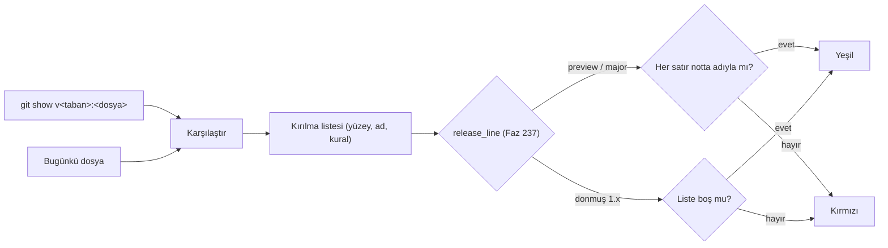

# Faz 238 — .NET Dışı Yüzeylerin 1.x Kuralları, Sözleşme Anlık Görüntüleri ve Kiracı Metrik Etiketi

> **Durum:** 📋 Planlandı (2026-10-23)
> **Kademe:** tam — geri dönüşü pahalı karar: HTTP, telemetri, yapılandırma, hata kodu ve CLI adları `rc.1`'de donar; varsayılan davranış değişir (`tracon.tenant.id` metrikten düşer)
> **Plan onayı:** Bakımcı, 2026-10-23 (engelleyici kararlar sohbette alındı: HTTP kırılma kapısı kendi Python betiğidir — `oasdiff` değil; `IncludeTenantTag` varsayılanı `false`; kota göstergeleri kiracı etiketini korur; hata kodları merkezi kataloğa taşınır; anlık görüntüler `docs/sozlesme/` altında durur)
> **Kaynak:** [ADAYLAR.md](ADAYLAR.md) · **F-559** (A-67 ve A-68 dilimi; A-76 dilimi Faz 237'dedir)
> **Genellik:** HTTP istemcisi (`Tracon.Client`, `@tracon/client`, kendi istemcisini yazan), OTel dashboard'u ve alarmı kuran, yapılandırma dosyası taşıyan, CLI'yı CI'da koşan **her** tüketici. İş tüketici kodunda kalamaz: ad Tracon'undur. İkinci kanıt bir ekosistem standardıdır: SemVer kapsamı yalnız .NET API değildir; OpenTelemetry anlamsal kuralları metrikte sınırsız kardinaliteli özniteliği varsayılan olarak önermez
> **Karşı görüş:** (1) "`OpenApiSnapshotTests` HTTP'yi zaten kilitliyor." Cevap: o test kod ile anlık görüntünün **ayrışmasını** yakalar, iki sürüm arasındaki kırılmayı yakalamaz. Anlık görüntü yenilenir ve kırılma geçer (A-67). (2) "Kiracı etiketi çok kiracılı kurulum için değerlidir." Cevap: etiket kaybolmaz, isteğe bağlı olur. Span'ler kiracıyı taşımaya devam eder; kota göstergeleri etiketi korur
> **Önkoşul:** Faz 237 — donmuş hat kararı (`release_line`, §237.2) ve (yazılırsa) anlık görüntü mekanizması (§237.3). Faz 237 kapanmadan bu faz başlamaz
> **Paketler:** `Tracon.Abstractions` (hata kodu kataloğu), `Tracon.Core` (`IncludeTenantTag`, metrikler, katalog kullanımı), `Tracon.AspNetCore` (ProblemDetails tipleri kataloğa geçer) · `scripts/` · testler
> **Yeni paket:** Yok · **Migration:** Yok — hata kodu **değerleri** değişmez, yalnız tanımlandıkları yer değişir. Kalıcı run kayıtlarındaki dizeler aynı kalır
> **Public API:** büyüyor — `TraconObservabilityOptions.IncludeTenantTag` ve hata kodu kataloğu (`Tracon.Abstractions`). `1.0.0` GA'dan (K-603) önce ucuz: `wc -l src/*/PublicAPI.Shipped.txt` = 18 satır. Exception sınıflarındaki mevcut `*ErrorType` sabitleri katalog sabitine bağlanır, silinmez (Açık Soru 1)
> **Tüketici yüzeyi:** site: `reference/versioning.md` (yeni bölüm: *What 1.x promises for HTTP, telemetry, configuration, error codes and the CLI*), `guides/observability.md` (öznitelik tablosu, `IncludeTenantTag`), `reference/configuration.md` (yeni anahtar), `llms-full.txt` (üretilir) · sevk edilen: `CHANGELOG.md` `[Unreleased]` (kiracı etiketinin düşmesi — kırıcı), `src/Tracon.Core/README.md` (gözlemlenebilirlik paragrafı varsa)
> **Manuel test alanı:** `docs/manuel-test/12-GOZLEMLENEBILIRLIK-MALIYET.md` (kiracı etiketi) · `docs/manuel-test/01-KURULUM-VE-PAKETLEME.md` (yayın provası)

---

## Bu Faza Başlarken

> `faz-baslangic` skill'ini uygula. Aşağıdaki liste o skill'in 2. adımıdır —
> **tamamını değil, yalnız işaret edilen bölümleri oku.**

1. Bu doküman
2. Kararlar — dosyanın tamamını **okuma**, yalnız bu kalemleri grep'le:
   ```bash
   grep -n "K-146 —\|K-232 —\|K-276 —\|K-566 —\|K-864 —\|K-993 —\|K-1012 —" docs/KARARLAR.md
   ```
   **K-146** (`tracon.agent.version` etiketi varsayılan açık; `experiment_id`
   asla etiket olmaz — `IncludeTenantTag` bu deseni izler), **K-232** (sunucu
   yanıtı çevrilmez), **K-276** (`tracon.json`'ı `Tracon.AspNetCore.FunctionalTests`
   üretir), **K-566** (`Tracon.Client`/`Tracon.Cli` PublicAPI takibi dışında —
   HTTP kapısı istemciyi de korur), **K-864** (son etikete karşı kırılma kapısı),
   **K-993** (okunamayan yapılandırma açılışta hata verir), **K-1012** (HTTP DTO'su
   `internal`)
3. Önceki fazdan devir: aşağıdaki **Önceki Fazdan Devir (Faz 237)** bölümü. Faz 237 anlık görüntü mekanizmasını
   yalnız `required` üyeler için yazdı; ad kümeleri ve OpenAPI karşılaştırması bu fazındır (§238.2, §238.4)
4. Alan hafızası (dört alan):
   [`hafiza/yayin-turu.md`](hafiza/yayin-turu.md) (taban etiketi, sürüm notu span eşleşmesi) ·
   [`hafiza/nswag-istemci-uretimi.md`](hafiza/nswag-istemci-uretimi.md) (istemci adları) ·
   [`hafiza/run-olay-sozlesmesi.md`](hafiza/run-olay-sozlesmesi.md) (SSE olay adları) ·
   [`hafiza/secenek-baglama-ve-gizlilik.md`](hafiza/secenek-baglama-ve-gizlilik.md) (bağlayıcı deseni, K-993)
5. A-67 ve A-68'in tam metni:
   `git show 96d3929328cc738d5f3de84274348cd27093c7b9:docs/YAYIN-HAZIRLIK.md | grep -n "A-67\|A-68"`

---

## Önceki Fazdan Devir (Faz 237)

Faz 237 kapandı (2026-10-24). Bu faz şunları hazır bulur:

- **Hat kararı:** `scripts/breaking_changes.py` → `release_line(baseline, version) -> ReleaseLine(kind, major, patch)`;
  `kind` ∈ `preview` · `major` · `frozen`, `describe()` hat satırını verir. `version=None` yalnız taban `1.0.0-rc.1`
  altındayken geçerlidir (aksi `ValueError`). Donmuş hatta **yama** = tabanla aynı major.minor (`rc.1` → `rc.2` ve
  `rc.1` → GA dahil). İkinci bir hat fonksiyonu yazılmaz.
- **Kapı akışı:** `breaking_changes.check(…, repo=<kök>)` hat satırını **ilk** yazar, sonra ApiCompat raporunu, sonra
  `surface_delta(repo, taban)` (PublicAPI farkı · `required` anlık görüntüsü · contract testleri) okur.
  `kapi.py` `_check_breaking_changes`'ten çağırır. Bu fazın `sozlesme_kirilma.py` çağrısı o çağrıdan **sonra** gelir.
- **Anlık görüntü deseni:** `docs/sozlesme/required-uyeler.txt` (`#` ile başlayan satırlar yorumdur) · üreten test
  `RequiredMemberSnapshotTests` (`Tracon.Core.UnitTests`, yenileme `TRACON_REQUIRED_MEMBERS_REFRESH=1`) · okuyucu
  `required_member_additions` (`git show v<taban>:<yol>`). Taban etiketinde dosya yoksa **not yazar, hata vermez**;
  taban etiketi git'te yoksa `BaselineError`, kapı kırmızıdır. Bu fazın dosyaları aynı davranışı izler.
- **ApiCompat'ın görmedikleri:** `python3 scripts/apicompat_yoklama.py` (17 varyant) — yalnız `required` görünmez; enum,
  arayüz, abstract, opsiyonel parametre ve konumsal record parametresi görünür. Kural tablosu:
  `docs-site/src/content/docs/reference/versioning.md` § *What 1.x promises for the .NET API*. Bu faz aynı sayfaya kendi
  bölümünü ekler; Faz 237 "başka yüzeyler için aşağıya bak" cümlesini **yazmadı**.
- **🚨 Taban `v1.0.0-preview.5`'in paketleri nuget.org'da yoktu** (2026-10-24, flat container `preview.1…4` listeler):
  `kapi.py yayin --kuru` restore'da düşer. Gerçek tam prova bu yüzden Faz 237'de koşmadı; `MT-PKG-169` ☐.
- **Yama kuralı `Tracon.Client`/`Tracon.Cli`'ye bakmaz:** ikisi `PublicAPI` taşımaz (K-566); yamada büyüyen istemci yüzeyini
  bu fazın OpenAPI karşılaştırması tutar (yamada eklenen uç ya da alan kırmızıdır).
- **Contract testi kapısı:** `v1.0.0-preview.5`'ten beri 4 test `CHANGELOG.md` `[Unreleased]`'da `Sınıf.Metot` olarak adlandırıldı.
  Bu fazın yeni `Tracon.Testing.Contracts.Xunit` testi varsa aynı biçimde anılmalıdır.

---

## Amaç

Faz 237 .NET API'nin 1.x sözünü yazar. Ama tüketicinin bağımlı olduğu yüzeyin
yarısı .NET dışıdır: HTTP uçları ve SSE olay adları, OTel adları, yapılandırma
anahtarları, hata kodları ve CLI. Bunlar için kural yoktur. Kapı da yalnız
kod ile anlık görüntünün ayrışmasını görür (A-67). Bu faz her yüzeyin 1.x
kuralını yazar, her yüzeyi bir anlık görüntüye bağlar ve yayın provasını anlık
görüntünün son etiketteki hâliyle karşılaştırır. Ayrıca GA'da donacak bir
varsayılanı düzeltir: kiracı metrik etiketi isteğe bağlı olur (A-68).

- **F-559 (A-67)** — HTTP, SSE, telemetri, yapılandırma, hata kodu ve CLI için 1.x kuralı · anlık görüntüler · sürümden sürüme kapı · hata kodu kataloğu
- **F-559 (A-68)** — `IncludeTenantTag` (varsayılan `false`)

### Bugün ne çalışmıyor — doğrulanmış kanıt

| Kanıt | Gözlem |
|---|---|
| [`OpenApiSnapshotTests.cs:10-21`](../tests/Tracon.AspNetCore.FunctionalTests/OpenApiSnapshotTests.cs) | `docs/openapi/tracon.json` ile kodu karşılaştırır; `TRACON_OPENAPI_REFRESH=1` dosyayı yeniler. Önceki sürümle karşılaştırma yok |
| [`breaking_changes.py`](../scripts/breaking_changes.py) | Yalnız library paketlerinin ApiCompat raporunu okur (K-864). HTTP, telemetri, yapılandırma ve CLI'ya bakmaz |
| [`reference/versioning.md`](../docs-site/src/content/docs/reference/versioning.md) | "HTTP" 2, "telemetry/metric" 0, "error code" 0 eşleşme; bu yüzeyler için 1.x kuralı yok |
| [`TraconMetrics.cs:219`](../src/Tracon.Core/Diagnostics/TraconMetrics.cs) ve `:271`, `:288`, `:304`, `:338`, `:366`, `:389`, `:421` | `tracon.tenant.id` sekiz kayıt metodunda **koşulsuz** etikettir: `RecordRun`, `RecordCost`, `RecordJudgeCost`, `RecordJudgeScore`, `RecordModelCacheLookup`, `RecordAuditWriteFailure`, `RecordRunRecordingFailure`, `RecordJob` |
| [`TraconOptions.cs:584`](../src/Tracon.Core/TraconOptions.cs) | `TraconObservabilityOptions` yalnız `IncludeAgentVersionTag`'ı taşır (varsayılan `true`, K-146). Kiracı için seçenek yok |
| [`QuotaUsageObserver.cs:200`](../src/Tracon.Core/Quotas/QuotaUsageObserver.cs) | Kota göstergesi kiracıyı etiketler; gösterge kendi seçeneğiyle açılır |
| [`RunRecordingAgent.Lifecycle.cs:109`](../src/Tracon.Core/Recording/RunRecordingAgent.Lifecycle.cs) · [`WorkflowRunner.cs:853`](../src/Tracon.Workflows/Internal/WorkflowRunner.cs) | Span kiracıyı etiketler. **Bu faz span'e dokunmaz** |
| [`guides/observability.md:94`](../docs-site/src/content/docs/guides/observability.md) | "`tracon.tenant.id` — Every signal in a multi-tenant setup"; `:59` metrik adlarını "Stable" ilan eder |
| [`RunEndpoints.cs:1310`](../src/Tracon.AspNetCore/Endpoints/RunEndpoints.cs) `EventName` | 34 `RunEventType` → SSE olay adı eşlemesi. Ad kümesi hiçbir anlık görüntüde yok |
| [`TraconDiagnostics.cs`](../src/Tracon.Core/Diagnostics/TraconDiagnostics.cs) | 57 public `const string` (kaynak, meter, span, enstrüman ve öznitelik adları). Enstrümanlar `TraconMetrics.cs:68-133`'te kurulur; kota ve iş kuyruğu göstergeleri başka dosyalardadır |
| Hata kodları | Tek kaynak yok. 15 kod `TraconException.cs` alt sınıflarında public sabittir (`:68`…`:778`), 2 kod iş sinyallerindedir (`JobAttemptSignals.cs:44`, `JobRetryException.cs:24`), 4 kod `JobErrorCodes`'tadır. `internal` sabitler (`ProviderFailureNormalizer.cs:12-13`, `SessionlessApprovalRun.cs:42`, `WorkflowRecovery.cs:88`) ve düz dizeler (`InMemoryRunStore.Lifecycle.cs:195` `"orphaned"`, `Tracon.AspNetCore` ProblemDetails tipleri) dağınıktır |
| `src/Tracon.Cli/Program.cs:10,78` | `--help` kullanım metni tek yerdedir; 7 komut (`Commands/`), 19 `--seçenek` dizesi. Çıkış kodu sabiti yok (`return 1`) |
| `src/Tracon.Client/Generated/` | Numaralı çakışma adı (A-76'nın `SourceKind2`'si) **0** — bugün temiz, gerileme kapısı yok |

> Kanıtlar 2026-10-23 tarihinde doğrulandı.

---

## 238.1 — Kural metni (`reference/versioning.md`)

Yeni bölüm, Faz 237'nin bölümünden sonra gelir. Tablo yapısı aynıdır: değişiklik
türü × patch/minor/major.

| Yüzey | Minor'da serbest | Yalnız major'da |
|---|---|---|
| **HTTP** | yeni uç · yanıta yeni alan · istekte yeni **opsiyonel** alan/parametre · yanıt enum'una yeni değer · yeni hata kodu | uç/metot silmek · yanıt alanını silmek ya da tipini değiştirmek · istekte yeni **zorunlu** alan/parametre · opsiyoneli zorunlu yapmak · istek enum'undan değer silmek · 2xx durum kodunu değiştirmek · rolü sıkılaştırmak |
| **SSE** | yeni olay adı · olay yüküne yeni alan | olay adını silmek/değiştirmek · yük alanını silmek |
| **Telemetri** | yeni kaynak, enstrüman, öznitelik · enstrümana yeni **varsayılan kapalı** öznitelik | ad, birim ya da enstrüman türü değişikliği · özniteliği silmek · varsayılan açık/kapalı durumunu çevirmek |
| **Yapılandırma** | yeni anahtar (varsayılanı belgeli) | anahtarı silmek ya da yeniden adlandırmak — yeniden adlandırılan anahtarın eski adı 1.x boyunca okunur ve bir uyarı loglanır · varsayılan değeri davranış değiştirecek biçimde değiştirmek |
| **Hata kodu** | yeni kod | kodu silmek, yeniden adlandırmak ya da anlamını değiştirmek |
| **CLI** | yeni komut, seçenek, çıkış kodu | komut/seçenek silmek · çıkış kodunun anlamını değiştirmek |

Üç tamamlayıcı cümle bölüme girer:

- **İstemci bilinmeyeni işler:** yanıt enum değeri, SSE olay adı ve hata kodu
  minor sürümde büyür. TypeScript istemcisinde `switch` bir `default` dalı taşır.
- **Rol sıkılaştırması OpenAPI'de görünmez.** Kapı onu görmez; kural yazılıdır ve
  denetim bakar.
- **İnsan okur metin sözleşme değildir:** ProblemDetails `detail`, log mesajı,
  CLI'nın insan çıktısı. Makine okur alan (`type`, kod, olay adı) sözleşmedir.

## 238.2 — Sözleşme anlık görüntüleri (`docs/sozlesme/`)

Her yüzey sıralı, satır başına bir ad taşıyan bir dosya alır. Bir test dosyayı
koddan üretir. Kod ile dosya ayrışınca test kırmızıdır ve `TRACON_SOZLESME_REFRESH=1`
dosyayı yeniler (`OpenApiSnapshotTests` deseni). Faz 237 mekanizmayı yazdıysa bu
faz onu kullanır.

| Dosya | Kaynak | Üreten test (taslak ad) |
|---|---|---|
| `docs/openapi/tracon.json` | **mevcut** (K-276) | `OpenApiSnapshotTests` — değişmez |
| `docs/sozlesme/sse-olaylari.txt` | `RunEndpoints.EventName` × her `RunEventType` değeri | `SseEventNameSnapshotTests` (`Tracon.AspNetCore.FunctionalTests`) |
| `docs/sozlesme/telemetri.txt` | `TraconDiagnostics` sabitleri (yansıma) **ve** `Tracon` meter'ının yayımladığı enstrümanlar (`MeterListener`, DI ile kurulmuş host) | `TelemetryNameSnapshotTests` — iki kaynak birbirini doğrular: enstrüman adı sabitler kümesinde değilse kırmızı |
| `docs/sozlesme/yapilandirma.txt` | `Tracon` bölümüne bağlanan seçenek tiplerinin özellik ağacı (`Tracon:Observability:IncludeAgentVersionTag`); sözlük/liste anahtarı `*` ile | `ConfigurationKeySnapshotTests` — **kaynak ölçülmeli:** bütün `Bind`/`Configure<T>(section)` noktaları uygulamanın ilk işinde sayılır ve kümenin eksiksiz olduğu gösterilir |
| `docs/sozlesme/hata-kodlari.txt` | §238.3 kataloğu (yansıma) | `ErrorTypeSnapshotTests` |
| `docs/sozlesme/cli.txt` | `tracon --help` ve her komutun yardım metni: komut ve seçenek adları | `CliSurfaceSnapshotTests` (`Tracon.Cli.FunctionalTests`) — **ölçülmeli:** yardım metni her seçeneği listeliyor mu? Listelemiyorsa önce yardım metni düzeltilir |

**İstemci adı gerilemesi:** `Tracon.Client.UnitTests` içinde bir test,
`src/Tracon.Client/Generated/*.cs` içinde rakamla biten tip adı olmadığını
denetler (NSwag çakışma adı, A-76). Bugün 0'dır; test bu değeri sabitler.

## 238.3 — Hata kodu kataloğu

Bakımcı kararı (2026-10-23): kodlar tek bir katalogda toplanır ve bir mimari test
katalog dışında düz dize bırakmaz.

**Plan anı ölçümü seçilen seçeneği bir noktada düzeltir.** Seçenek metni
"`internal` katalog" diyordu. Ama 21 kod bugün **public** sabittir ve tüketici
onlarla eşleşir (`ex.ErrorType == ToolTimeoutException...`). `internal` bir katalog
bu sabitleri tüketiciden alır. Bu yüzden plan kataloğu **public** yazar:

- `Tracon.Abstractions` içinde `public static class TraconErrorTypes` (taslak ad):
  her makine okur hata kodu bir `const string`. Bu katalog run hata tipini, iş hata
  kodunu ve HTTP ProblemDetails `type` değerini taşır. Değerler **değişmez**; kalıcı
  run kayıtları aynı dizeyi taşımaya devam eder (migration yok).
- Exception sınıflarındaki mevcut public sabitler katalog sabitine bağlanır
  (`public const string ErrorType = TraconErrorTypes.ToolTimeout;`). Dize tek yerde
  yazılır. Silmek ya da tutmak Açık Soru 1'dir.
- `internal` sabitler ve düz dizeler kataloğa taşınır.
- **Mimari test** (`ErrorTypeLiteralTests`): `src/` içinde hata kodu yazım
  noktalarında (`ErrorType = "`, ProblemDetails `type:`, run hatası `Type = "`)
  katalog dosyası dışında düz dize kalmaz. Tarama deseninin gürültüsü ölçüldü:
  Anthropic `thinking` tipi (`"enabled"`, `"adaptive"`), OpenAI canlı aktarım tipi
  (`"webrtc"`) ve kayıt içerik türleri (`"data"`, `"uri"`, `"error"`,
  `"unrecognized"`) hata kodu **değildir**. Test bunları yol + desen ile dışarıda
  bırakır, ad ile değil.

## 238.4 — Sürümden sürüme kapı (`scripts/sozlesme_kirilma.py`)

Bakımcı kararı (2026-10-23): kendi Python betiği. Yeni bağımlılık eklenmez, kapı
yerelde ve çevrimdışı koşar.



- **Taban** `breaking_changes.resolve_baseline()`'dan gelir (`git describe`).
  Taban etiketinde dosya yoksa (ilk sürüm) o yüzey için liste boştur.
- **Ad kümeleri** (`.txt`): silinen ya da değişen satır kırılmadır; eklenen satır
  değildir.
- **OpenAPI** (`tracon.json`): betik `$ref`'i çözer ve §238.1 tablosunun HTTP
  satırını uygular. **Tanımadığı bir şema değişikliğinde kırmızı olur**
  (`tanınmayan değişiklik: <yol>`), sessizce geçmez. Kural kümesi betiğin başında
  tek bir tabloda durur; her kuralın bir birim testi vardır.
- `kapi.py yayin` bu betiği `breaking_changes.check`'ten sonra çağırır. Çıktı her
  yüzey için tek satır yazar: `HTTP: 0 kırılma · SSE: 0 · telemetri: 1 (notta) …`.
- Kapı preview hattında da koşar: kırılma notta adıyla geçmelidir (K-864 deseni).
  İlk koşum `v1.0.0-preview.5`'e karşıdır ve bu fazın kiracı etiketi değişikliği
  telemetri satırında görünür. Not onu anar (`CHANGELOG [Unreleased]`).

## 238.5 — Kiracı metrik etiketi (A-68)

Bakımcı kararı (2026-10-23): seçenek, varsayılan **kapalı**; kota göstergeleri
istisnadır.

- `TraconObservabilityOptions.IncludeTenantTag` (`bool`, varsayılan `false`).
  Bağlama anahtarı `Tracon:Observability:IncludeTenantTag`, `IncludeAgentVersionTag`'ın
  bağlayıcısının yanına eklenir (`TraconServiceCollectionExtensions.Binding.Core.cs:428`).
  Okunamayan değer açılışta hata verir (K-993).
- **Karar tek yerde verilir.** `TraconMetrics` `internal`'dır ve zaten
  `IOptionsMonitor<TraconOptions>` alır (`TraconMetrics.cs:54`). Sekiz kayıt
  metodu etiketi ancak seçenek açıksa ekler. Çağıranlar değişmez. Gerekçe:
  `IncludeAgentVersionTag` kararı çağıranda verilir (`RunRecordingAgentDecorator.cs:147`),
  ama sekiz metot × çağıranlar için bu imza-gövde riskidir. Uygulama
  `grep -rn "RecordCost\|RecordJob\|RecordRun(" src` ile çağıranları sayar ve
  hiçbirinin değişmediğini gösterir.
- **Kota göstergeleri** (`QuotaUsageObserver.cs:200`) kiracıyı **her zaman**
  etiketler. Kural metni ve `observability.md` istisnayı adıyla yazar.
- **Span'ler değişmez.** İz verisi toplanmaz; kardinalite riski taşımaz.
- `guides/observability.md:94` satırı üç duruma ayrılır: span (her zaman),
  metrik (`IncludeTenantTag` açıkken), kota göstergesi (her zaman).
  `reference/configuration.md` yeni anahtarı listeler.
- `CHANGELOG.md [Unreleased]` kırıcı değişikliği yazar: "`tracon.tenant.id` is no
  longer on metrics by default; set `Tracon:Observability:IncludeTenantTag=true`".

---

## Planlanan Public API

> Taslak imzalardır. Gerçekleşen imzalar kapanışta ayrı bir bölüme yazılır.

```csharp
// Tracon.Core
public sealed class TraconObservabilityOptions
{
    /// <summary>Adds tracon.tenant.id to run, cost, judge, cache, audit, recording and job metrics.
    /// Off by default: the tag multiplies series by tenant count. Spans and quota gauges always carry it.</summary>
    public bool IncludeTenantTag { get; set; }   // default false
}

// Tracon.Abstractions
public static class TraconErrorTypes
{
    public const string ToolTimeout = "tool_timeout";
    public const string ChildRunTimeout = "child_run_timeout";
    // … bütün makine okur hata kodları (§238.3); değerler bugünküyle aynı
}
```

**Bugün eklemek bedava / sonradan eklemek:** `IncludeTenantTag` GA'dan sonra da
ekleyici olurdu, ama **varsayılanı** GA'dan sonra çevirmek kırıcıdır (§238.1
telemetri satırı). `TraconErrorTypes` GA'dan sonra da ekleyici olurdu, ama
exception sabitlerini ona bağlamak kaynak düzeyinde ancak bugün serbesttir.

### HTTP `endpoint`'leri

Yeni uç yok. ProblemDetails `type` **değerleri** değişmez; yalnız tanımlandıkları
yer değişir. `tracon.json` farkı boş olmalıdır.

### Arayüz payı

Yok.

---

## Planlanan Dosya Listesi

```
src/Tracon.Abstractions/
└── TraconErrorTypes.cs                   # yeni katalog
src/Tracon.Abstractions/TraconException.cs           # sabitler kataloğa bağlanır
src/Tracon.Abstractions/Scheduling/{JobErrorCodes,JobAttemptSignals,JobRetryException}.cs
src/Tracon.Core/
├── TraconOptions.cs                      # IncludeTenantTag
├── TraconServiceCollectionExtensions.Binding.Core.cs
├── Diagnostics/TraconMetrics.cs          # sekiz metot, koşullu etiket
└── (düz dize ve internal sabit taşıyan dosyalar — §238.3)
src/Tracon.AspNetCore/Endpoints/*.cs      # ProblemDetails type → katalog
scripts/
├── sozlesme_kirilma.py                   # ad kümesi + OpenAPI karşılaştırması
├── sozlesme_kirilma_test.py
└── kapi.py                               # yayin: çağrı ve yüzey satırları
docs/sozlesme/
├── sse-olaylari.txt · telemetri.txt · yapilandirma.txt · hata-kodlari.txt · cli.txt
tests/
├── Tracon.AspNetCore.FunctionalTests/SseEventNameSnapshotTests.cs
├── Tracon.Core.UnitTests/Architecture/{TelemetryNameSnapshotTests,ConfigurationKeySnapshotTests,ErrorTypeSnapshotTests,ErrorTypeLiteralTests}.cs
├── Tracon.Core.UnitTests/Diagnostics/TenantTagOptionTests.cs   # veya fonksiyonel (aşağıda)
├── Tracon.Cli.FunctionalTests/CliSurfaceSnapshotTests.cs
└── Tracon.Client.UnitTests/GeneratedNameCollisionTests.cs
docs-site/src/content/docs/{reference/versioning.md,reference/configuration.md,guides/observability.md}
CHANGELOG.md
```

---

## Hata Modları ve Testler

| Ne bozulabilir | Seviye | Test |
|---|---|---|
| `IncludeTenantTag=false` iken bir metrik kiracıyı yine etiketler | Fonksiyonel (DI + seçenek bağlama + `MeterListener`) | `TenantTagOptionTests` — sekiz enstrümanın hepsi; `appsettings` anahtarı ile kurulan host |
| `true` iken etiket kaybolur | Fonksiyonel | aynı sınıf |
| Kota göstergesi etiketi kaybeder | Fonksiyonel | aynı sınıf, kota göstergesi açık |
| Span kiracıyı kaybeder | Fonksiyonel | `ActivityListener` ile `tracon.run` span'i |
| `IncludeTenantTag: "evet"` sessizce `false` olur | Fonksiyonel | açılış hatası (K-993) |
| Bir enstrüman `TraconDiagnostics` dışında bir adla kurulur | Birim (.NET) | `TelemetryNameSnapshotTests` — `MeterListener` kümesi ⊆ sabitler |
| Anlık görüntü testi ayrışmada yeşil kalır | Birim/Fonksiyonel | her anlık görüntü testi **ayrı, yalıtılmış** bir kırılmada kırmızı görülür (K-642 tuzağı) |
| Hata kodu dizesi değişir (kalıcı kayıt ile uyumsuzluk) | Birim | `ErrorTypeSnapshotTests` + `git diff` boş: `hata-kodlari.txt`'nin ilk sürümü bugünkü dizeleri taşır |
| Katalog dışında yeni düz kod dizesi | Birim (mimari) | `ErrorTypeLiteralTests` — yalıtılmış kırılma: bir uca `type: "x_y"` ekle → kırmızı |
| Gürültü dizeleri (`"webrtc"`, `"adaptive"`) yanlış alarm verir | Birim (mimari) | aynı sınıf, gürültü dosyaları yeşil |
| OpenAPI: silinen uç, silinen yanıt alanı, yeni zorunlu istek alanı, tip değişimi, istek enum değeri silme | Birim (Python) | `sozlesme_kirilma_test.py` — kural başına fixture çifti |
| OpenAPI: tanınmayan değişiklik sessizce geçer | Birim (Python) | bilinmeyen anahtar değişimi → kırmızı |
| OpenAPI: yalnız ekleme kırılma sayılır (aşırı sıkı) | Birim (Python) | yeni uç, yeni opsiyonel alan → liste boş |
| Ad kümesi: eklenen satır kırılma sayılır | Birim (Python) | fixture |
| Donmuş hatta notta adı geçen kırılma yeşil geçer | Birim (Python) | `release_line` (Faz 237) ile taban `1.0.0` → kırmızı |
| Taban etiketinde `docs/sozlesme/` yok (bugünkü durum) | Birim (Python) | liste boş, uyarı satırı; hata yok |
| İstemcide numaralı çakışma adı döner | Birim | `GeneratedNameCollisionTests` |

Beş soru: **iptal** — yok · **eşzamanlılık** — `TraconMetrics` seçeneği her
kayıtta `IOptionsMonitor.CurrentValue`'dan okur; değişen seçenek bir sonraki
kayıtta etkilidir (birim testi) · **boş/aşırı girdi** — boş anlık görüntü, taban
yok (yukarıda) · **başka kiracı** — etiket kapalıyken kiracılar arası seri
birleşir; bu istenen davranıştır ve belgelenir · **alt sistem hatası** — `git show`
tabanı okuyamazsa kapı kırmızıdır, yeşil olmaz.

---

## Manuel Kabul Case'leri

| # | Ön koşul | Adımlar | Beklenen sonuç |
|---|---|---|---|
| 1 `🤖` | `samples/Tracon.Api` + bir metrik dışa aktarıcı (örneğin `dotnet-counters`; örnekte hangisinin kurulu olduğu ölçülmeli) | İki `run`: önce varsayılan, sonra `Tracon__Observability__IncludeTenantTag=true` | Birinci koşumda `tracon.runs` serisi `tracon.tenant.id` taşımaz, ikincide taşır; span'de iki koşumda da vardır |
| 2 `🤖` | Temiz ağaç, ağ var | `python3 scripts/kapi.py yayin --kuru --surum 1.0.0-preview.6` | Yüzey satırları yazılır. Taban `v1.0.0-preview.5`'te `docs/sozlesme/` yoktur: ad kümeleri "taban yok", HTTP karşılaştırması koşar. Not eksikse kırmızı |
| 3 `🤖` | Fixture: taban dosyalarında bir SSE adı ve bir yanıt alanı silinmiş | `python3 scripts/sozlesme_kirilma.py --taban 1.0.0 --surum 1.1.0 …` | `Hat: donmuş 1.x`, iki kırılma, kırmızı |

---

## Açık Sorular

| # | Soru | Seçenekler | Öneri |
|---|---|---|---|
| 1 | Exception sınıflarındaki public `*ErrorType` sabitleri kalsın mı? | A: kalır, katalog sabitine bağlanır (kırılma yok) · B: silinir, tek giriş katalog olur (kırıcı, notta adıyla) | **A** — `catch (ToolTimeoutException e) when …` kullanımında sabit tipin yanında okunur; dize yine tek yerdedir |
| 2 | Kataloğun yeri doğru mu? | A: `Tracon.Abstractions` (public) · B: `Tracon.AspNetCore` (yalnız HTTP) | **A** — run hata tipi ve iş kodu `Abstractions`'ta yaşıyor; HTTP tipleri de aynı istemciye görünür. **Plan onayında teyit:** bakımcının seçtiği seçenek "`internal` katalog" diyordu; ölçüm 21 public sabit gösterdi (§238.3) |
| 3 | Yapılandırma anahtarı kümesinin kaynağı | A: seçenek tipi özellik ağacı (yansıma) · B: bağlayıcı dosyalarından kaynak taraması | **A**, eğer ilk ölçüm her `Bind`/`Configure<T>` noktasının bir seçenek tipine gittiğini gösterirse. Özel bağlayıcılar (K-993) `nameof` ile aynı özelliği okur |
| 4 | Yeniden adlandırılan yapılandırma anahtarının eski adı 1.x'te okunur kuralı bir mekanizma ister mi? | A: bugün yalnız kural; mekanizma ilk yeniden adlandırmada yazılır · B: şimdi bir takma ad tablosu | **A** — bugün yeniden adlandırılan anahtar yok; spekülatif mekanizma yazılmaz |

---

## Bitiş Ölçütleri (DoD)

- [ ] `reference/versioning.md` §238.1 tablosunu ve üç cümleyi taşır; `observability.md` ve `configuration.md` güncel; `npm run build` + `check-links.mjs` temiz
- [ ] `docs/sozlesme/` beş dosyayı taşır; her anlık görüntü testi yalıtılmış kırılmada kırmızı görüldü
- [ ] `TraconErrorTypes` her makine okur kodu taşır; `ErrorTypeLiteralTests` yeşil; `hata-kodlari.txt` dizeleri bugünkü dizelerle **aynı** (`git diff` dize değişikliği göstermez)
- [ ] `TenantTagOptionTests` sekiz enstrüman × iki seçenek değeri + kota göstergesi + span'i kanıtlar
- [ ] `sozlesme_kirilma_test.py` her HTTP kuralı ve ad kümesi kuralı için kırmızı/yeşil çiftini kanıtlar; `python3 -m unittest discover -s scripts -p "sozlesme_kirilma_test.py"` yeşil
- [ ] `kapi.py yayin --kuru` yüzey satırlarını yazar (Manuel 2)
- [ ] `CHANGELOG.md [Unreleased]` kiracı etiketi değişikliğini adıyla yazar
- [ ] Dört doğrulama kapısı sıfır uyarı verir
- [ ] `samples/Tracon.Api` ile gerçek `run` yapıldı, iki seçenek değerinde metrik çıktısı belgeye yazıldı (Manuel 1)
- [ ] `secret` taraması boş döndü
- [ ] `🤖` case'ler `docs/manuel-test/12-GOZLEMLENEBILIRLIK-MALIYET.md` ve `01-KURULUM-VE-PAKETLEME.md` içinde ve koşuldu
- [ ] `faz-denetim` koşuldu; 🔴 bulgu kalmadı
- [ ] `YAYIN-HAZIRLIK.md` §2 ölçüt 5: F-559 ✅ (Faz 237 + 238); §3.6 "SemVer sınıflandırması" maddesi kapanır

### Doğrulama komutları

```bash
python3 -m unittest discover -s scripts -p "sozlesme_kirilma_test.py"
python3 scripts/kapi.py yayin --kuru --surum 1.0.0-preview.6
git diff --stat docs/openapi/tracon.json     # boş olmalı
```

---

## Riskler

| Risk | Önlem |
|------|-------|
| Kendi OpenAPI karşılaştırıcısı bir kırılma türünü kaçırır | Tanınmayan değişiklik kırmızıdır (fail-closed). Kural tablosu betikte tek yerdedir ve §238.1 ile eşlenir; `faz-denetim` iki tabloyu satır satır karşılaştırır |
| Hata kodlarını taşımak bir dizeyi değiştirir ve kalıcı run kayıtlarıyla eşleşme bozulur | `hata-kodlari.txt` taşımadan **önce** bugünkü dizelerle üretilir ve commit edilir; taşıma sonrası `git diff` boş olmalıdır |
| Kiracı etiketinin düşmesi mevcut dashboard'ları sessizce boşaltır | `CHANGELOG` notu + `observability.md` + prova telemetri satırında görünür kırılma |
| Faz 237 anlık görüntü mekanizmasını yazmadıysa bu faz büyür | Mekanizma ad kümesi karşılaştırmasıdır (küçük). Plan iki durumu da kapsar: §238.2 son paragraf |
| Yapılandırma anahtarı kümesi eksik çıkar (yansıma özel bağlayıcıyı görmez) | Açık Soru 3: ilk iş ölçüm; eksik kaynak varsa küme ona genişler |

---

<!-- ============================================================
     AŞAĞISI ÇALIŞIRKEN DOLAR — doküman kapanışta silinir (`faz-kapat`).
     Kalıcı kısım `faz-tamamlama` Adım 5'te yerine taşınır. Başlıkları SİLME.
     ============================================================ -->

## Plandan Sapmalar

> Çalışırken dolar. Plan ile gerçek arasındaki fark **gizlenmez**. Kapanışta
> kapanış commit mesajına taşınır.

## Bu Fazda Verilen Kararlar

> Çalışırken dolar. Dört kategoriden birine giren karar (AGENTS.md)
> `docs/KARARLAR.md`'ye K-NNN ve kategori etiketiyle girer; girmeyen karar
> kapanışta commit mesajına taşınır (`faz-tamamlama` Adım 8). Plan numara rezerve
> etmez. Beklenen kayıtlar: .NET dışı yüzeylerin 1.x kuralı *(public-api,
> geri-dönüşü-pahalı; alternatif: `oasdiff`)* · `IncludeTenantTag` varsayılan
> kapalı *(public-api; alternatifler: varsayılan açık, koşulsuz)* · hata kodu
> kataloğu *(public-api; alternatifler: kaynak taraması, yalnız kural)*.

## Süreç Ölçümü

> Kapanışta doldurulur. **Tablo olarak** — onay kutusu DEĞİL: `faz-kapat`
> işaretsiz kutuda durur. `faz-kapat` bu tabloyu `docs/FAZ-DEFTERI.md`'ye taşır;
> eşik **167**'den itibaren boş bir değer hücresinde kapanışı durdurur.
> `ölçülmedi` **geçerli bir değerdir** — kapı bir sayı değil, bir **karar** arar.
> Kapı bölümün VARLIĞINI denetler, doğruluğunu denetlemez (K-766).

| Metrik | Değer |
|---|---|
| Plan revizyonu sayısı | |
| Düzeltme turu sayısı | |
| 🔴 bulgu: gerçek / gürültü / araştırılacak | |
| Fazın ürettiği regresyon | |
| Faz kapandıktan sonra bulunan kusur | ölçülmedi (kapanış anı) |

## Denetim Bulguları

> `faz-denetim` çıktısı. Her satır: bulgu · seviye (🔴/🟡/🟢) · sonuç
> (düzeltildi / gerekçelendi / F-NN olarak devredildi). 🟢 kapanışta
> `ADAYLAR.md`'ye gider.
