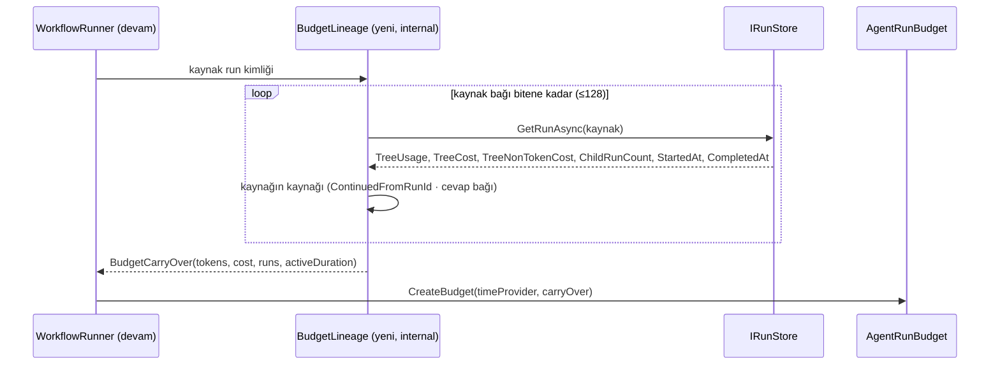

# Faz 239 — Devam Zincirinde Bütçe ve Çalışan Ağaçta Kiracı Kotası

> **Durum:** ✅ Tamamlandı (2026-10-24)
> **Kademe:** tam — kiracı sınırı: kiracı kotası ilk kez çalışan bir ağacın içinde yeni işi durdurur; public sözleşme: yeni ret kimliği
> **Plan onayı:** Bakımcı, 2026-10-23 (engelleyici kararlar sohbette alındı: üç devam yolu da bütçeyi devralır ve sıfırlama yoktur; süre boyutu yalnız aktif yürütme süresini devralır; harcanan bütçe devam başında zincirden okunur — migration yok; kiracı kotası fonksiyon düğümü ve agent adımı başlamadan okunur)
> **Kaynak:** [ADAYLAR.md](ADAYLAR.md) · **F-529**, **F-531**
> **Genellik:** Workflow koşan ve tavan koyan **her** kurulum. F-531: insan onayı döngüsü olan bir workflow, ağaç tavanını her cevapta yeniden alır; tavan bir tavan olmaktan çıkar. F-529: çok kiracılı kurulumda kota bugün yalnız girişte okunur; saatler süren bir workflow kotayı sınırsız geçer. İş tüketici kodunda kalamaz: tüketici devam run'ının bütçesini kuramaz ve düğüm kapısına erişemez. İkinci kanıt ilk ilkedir: K-999 tavanı "yeni işi durdurur" diye tanımlar; devamda ve kotada bu söz bugün tutulmuyor
> **Karşı görüş:** (1) "Operatör resume'u bilinçli bir karardır; tam bütçe almalıdır." Cevap (bakımcı): bütçe mantıksal run başınadır. Daha fazla harcamak isteyen yapılandırmayı yükseltir; reddedilen düğüm açık hatayla yeniden durur. (2) "Düğüm başına kota okuması pahalıdır" (Faz 210 §210.6). Cevap: okuma yalnız kiracının kota tanımı varsa iki depo turudur. Okuma yeni bir işin başında yapılır, sıcak yolda yapılmaz (model çağrısı başına okuma seçilmedi). Maliyet bu fazda ölçülür
> **Önkoşul:** Yok. Faz 237/238 ile dosya çakışması yok. Faz 238 hata kodu kataloğunu kurarsa (§238.3) bu fazın yeni kodu oraya taşınır; sıra fark etmez
> **Paketler:** `Tracon.Abstractions` (`AgentRunBudget` iç seed, yeni ret kimliği), `Tracon.Core` (`QuotaEnforcer`, `TreeAccount`/`TreeQuota`, `ChildAgentInvoker`), `Tracon.Workflows` (`WorkflowRunner`, `WorkflowNodeBudgetGate`)
> **Yeni paket:** Yok · **Migration:** Yok — zincir mevcut sütunlardan okunur (bakımcı kararı)
> **Public API:** büyüyor — yeni ret exception'ı ve hata kodu sabiti; `WorkflowFunctionOptions.StartsWhenBudgetIsSpent` XML'i genişler. `1.0.0` GA'dan (K-603) önce ucuz: `wc -l src/*/PublicAPI.Shipped.txt` = 18 satır
> **Tüketici yüzeyi:** site: `concepts/workflows.md` (bütçe bölümü), `concepts/governance.md` (kota), `guides/production.md`, `guides/reliability.md` (devam), `capabilities.md` satırı, `llms-full.txt` (üretilir) · sevk edilen: `AgentRunBudget` ve `StartsWhenBudgetIsSpent` XML'i, `CHANGELOG.md` `[Unreleased]` (davranış değişikliği: devam run'ı tavanı sıfırdan almaz)
> **Manuel test alanı:** `docs/manuel-test/15-WORKFLOWS.md` · `docs/manuel-test/23-SAKLAMA-ARSIV-KOTA.md`

---

## Bu Faza Başlarken

> `faz-baslangic` skill'ini uygula. Aşağıdaki liste o skill'in 2. adımıdır —
> **tamamını değil, yalnız işaret edilen bölümleri oku.**

1. Bu doküman
2. Kararlar — dosyanın tamamını **okuma**, yalnız bu kalemleri grep'le:
   ```bash
   grep -n "K-483 —\|K-990 —\|K-997 —\|K-999 —\|K-394 —" docs/KARARLAR.md
   ```
   **K-990** (kota girdisi harcayan run başına, kapanırken; tek yazım yolu
   `TreeQuota.RecordAsync`; kimlik `TreeAccount`'tan), **K-999** (fonksiyon
   düğümü maliyet/süre tavanında başlamaz; muafiyet yalnız kodda), **K-997**
   (cevap run'ının satırı ve iddiası), **K-483** (toplama ifadesi tek yerde —
   `RunSpend.Total`), **K-394** (workflow tek run'dır)
3. Önceki fazdan devir: yok. Faz 210'un tam metni gerekirse (bu fazın iki kalemini
   o açtı):
   `git show 88178e3d:docs/210-BUTCE-DUGUM-KAPISI.md | sed -n '162,171p'`
4. Alan hafızası (üç alan):
   [`hafiza/olcum-kota-ve-secenekler.md`](hafiza/olcum-kota-ve-secenekler.md) (K-483 toplama tuzağı) ·
   [`hafiza/workflows.md`](hafiza/workflows.md) ·
   [`hafiza/workflow-cevaplari.md`](hafiza/workflow-cevaplari.md) (cevap run'ı, kaynak bağı)
5. Gerektiğinde: [`MIMARI-GUVENLIK.md`](MIMARI-GUVENLIK.md) kiracı sınırı bölümü

---

## Amaç

K-999 ağaç tavanını "yeni işi durdurur" diye tanımlar. Bu söz iki yerde
tutulmuyor:

- **F-531** — Devam eden run (insan cevabı, operatör resume, kesinti kurtarması)
  **yeni bir run kimliği** ve **sıfır bir bütçe** alır. İnsan onayı döngüsü olan
  bir workflow tavanı her cevapta yeniden alır. Bütçe reddiyle düşen bir run
  resume edilirse reddedilen düğüm başlar.
- **F-529** — Kiracı kotası yalnız HTTP girişinde okunur. Saatler süren bir
  workflow, kota dolduktan sonra da yeni düğüm ve agent adımı başlatır.

İki kalem aynı altyapıyı paylaşır (`AgentRunBudget` + `TreeAccount` +
`TreeQuota` + başlangıç kapıları). Ayrıca birbirine dokunurlar: F-531'in
devraldığı harcama kotaya **zaten** yazılmıştır. F-529'un kapısı onu ikinci kez
saymamalıdır (§239.3).

### Bugün ne çalışmıyor — doğrulanmış kanıt

| Kanıt | Gözlem |
|---|---|
| [`WorkflowRunner.cs:820`](../src/Tracon.Workflows/Internal/WorkflowRunner.cs) | `RunGuardedAsync` her yürütmede `AgentGraph.CreateBudget(_timeProvider)` ile yeni bütçe kurar |
| [`WorkflowRunner.cs:509`](../src/Tracon.Workflows/Internal/WorkflowRunner.cs), `:560` | Resume ve cevap `RunId = request.NewRunId ?? TraconId.NewId()` ile **yeni run** açar; kaynak run'dan yalnız checkpoint okunur |
| [`AgentRunBudget.cs:86`](../src/Tracon.Abstractions/Runs/AgentRunBudget.cs), `:137-144`, `:160-166` | `Deadline` kurucuda `MaxDuration`'dan hesaplanır. `ConsumedTokens`/`ConsumedCost`/`StartedRuns` sıfırdan başlar. Seed girişi yok |
| [`AgentRunBudget.cs:313`](../src/Tracon.Abstractions/Runs/AgentRunBudget.cs) · [`WorkflowNodeBudgetGate.cs:53`](../src/Tracon.Workflows/Internal/WorkflowNodeBudgetGate.cs) | Düğüm kapısı yalnız bellek içi bütçeye bakar; eşzamanlıdır (depo okuması yok) |
| [`ChildAgentInvoker.cs:511`](../src/Tracon.Core/Graph/ChildAgentInvoker.cs) | Agent adımı (ve alt agent çağrısı) yalnız `budget.TryReserveRun()` ile reddedilir; kota okunmaz. Workflow agent adımları bu sarmalayıcıdan geçer (`WorkflowDefinitionCompiler.cs:389`) |
| [`QuotaEnforcer.cs:72`](../src/Tracon.Core/Quotas/QuotaEnforcer.cs) | `CheckAsync` kota tanımlarını, sonra dönem kullanımını okur (iki depo turu; tanım yoksa bir). Çağıranlar yalnız HTTP giriş kapılarıdır (`WorkflowEndpoints.cs:912`, `TriggerEndpoints.cs:345`, `QuotaGate`) |
| [`TreeQuota.cs:21-55`](../src/Tracon.Core/Quotas/TreeQuota.cs) · [`TreeAccount.cs:24`](../src/Tracon.Abstractions/Runs/TreeAccount.cs) | Kota yazımı run kapanırken yapılır (K-990). `TreeAccount` değişmez bir kayıttır; ağacın kotaya ne yazdığını tutmaz. Bu yüzden "sayaç + yazılmamış pay" hesaplanamaz |
| [`WorkflowRunner.cs:2159-2182`](../src/Tracon.Workflows/Internal/WorkflowRunner.cs) `RecordQuotaAsync` | Workflow kökü yalnız kendi payını (`runs: 1`, düğüm tutarı) kapanırken yazar; agent adımları kendi paylarını kendi kapanışlarında yazar |
| Devam bağları (ölçüldü, kod okuması) | Kesinti kurtarması `ContinuedFromRunId` yazar (`WorkflowRecovery.cs:215`, `RunContinuationJobHandler.cs:269`). Cevap run'ı kaynağını `WorkflowResponseLink` olayıyla (`WorkflowRunner.cs:933`) ve `workflow_responses` satırıyla anar. **Operatör resume'u kaynağı hiçbir yere yazmaz** |
| [`WorkflowContinuationChain.cs`](../src/Tracon.Core/Scheduling/WorkflowContinuationChain.cs) | Zinciri yalnız `ContinuedFromRunId` ile ileri yürütür; en çok 128 halka |
| [`RunRecord.cs:128-171`](../src/Tracon.Abstractions/Runs/RunRecord.cs) | Run satırı `TreeUsage`, `TreeCost`, `TreeNonTokenCost`, `ChildRunCount`, `StartedAt`, `CompletedAt` taşır; zincir toplamı bunlardan okunabilir |

> Kanıtlar 2026-10-23 tarihinde doğrulandı.

---

## 239.1 — Devam halkası: her devam kaynağını okunur biçimde anar

Zincirin okunabilmesi için her devam run'ı kaynağını bilmelidir. Bugün üç yol
üç farklı biçimde anar, biri hiç anmaz.

**Uygulamanın ilk işi bir ölçümdür:** `ContinuedFromRunId`'yi okuyan her çağıranı
listele (`grep -rn "ContinuedFromRunId" src/`). Bu çağıranlar
`WorkflowContinuationChain`, `RunReconciliationService`, cevap ucu ve arayüzdür.
Sonra karar kuralı uygulanır:

- **Kural A (öneri):** operatör resume'u `ContinuedFromRunId = request.RunId`
  yazar. Resume anlamca kurtarmayla aynıdır: "bu run'ın checkpoint'inden
  devam et". Cevap run'ı bugünkü bağını (`workflow_responses`) korur.
  **Koşul:** ölçüm, resume'un `ContinuedFromRunId` taşımasının kurtarma
  kararını değiştirmediğini göstermelidir. `WorkflowContinuationChain` "en yeni
  halka uçuştaki iştir" der; elle başlatılan resume da uçuştaki iştir. Bunu bir
  fonksiyonel test kanıtlar.
- **Kural B:** ölçüm A'nın bir çağıranı bozduğunu gösterirse resume, kaynağını
  cevap run'ı gibi bir olayla (`WorkflowResponseLink` deseni) anar.
  `ContinuedFromRunId`'ye dokunulmaz.

Hangi kuralın seçildiği *Plandan Sapmalar*'a yazılır. 🚨 MEMORY: "Bir davranışı
düzeltmek, o davranışa dayanan çağıranı sessizce değiştirir." A seçilirse
kurtarma fonksiyonel testleri **değiştirilmeden** yeşil kalmalıdır.

## 239.2 — Zincirin harcadığını oku ve bütçeyi seed'le (F-531)

Bakımcı kararları: üç yol da devralır, sıfırlama yoktur; süre için yalnız aktif
yürütme süresi sayılır; okuma devam başında zincirden yapılır.



- **Toplama tek yerdedir** (K-483). Maliyet `RunSpend.Total(TreeCost, TreeNonTokenCost)`
  ile toplanır, ikinci bir elle yazılmış toplam yazılmaz. Para birimi uyuşmazlığı
  bugün `RunSpend`'in kuralıyla çözülür; uygulama bütçenin para birimiyle
  `RunSpend` kuralının aynı olduğunu ölçer.
- **Aktif süre** = Σ (`CompletedAt` − `StartedAt`). Kaynak run kapanmıştır
  (`AwaitingInput`, `Failed` ya da `Completed`). Kapanmamış bir kaynak (yarış) süreyi
  `şimdi − StartedAt` sayar ve bir uyarı loglar.
- **Seed:** `TraconAgentGraphOptions.CreateBudget` için `internal` bir aşırı
  yükleme. Tüketiciler ve harcanan sayaçlar seed değerinden başlar. Son tarih
  `şimdi + (MaxDuration − aktif süre)` olur. Kalan süre ≤ 0 ise bütçe süre
  boyutunda **hemen** tükenmiştir: ilk düğüm ya da model çağrısı K-999 kimliğiyle
  reddedilir.
- **Seed miktarı ayrı tutulur** (`AgentRunBudget` içinde `internal` bir alan).
  §239.3 onu kotadan düşer.
- Okuma hatası **güvenli tarafa** düşer: zincir okunamazsa devam run'ı
  başlamaz ve açık bir hatayla kapanır (`Failed`). Sıfır bir bütçeyle sessizce
  koşmaz. Gerekçe: sessiz sıfır, bu fazın kapattığı deliğin kendisidir
  (Açık Soru 2).
- Zincir 128 halkayı aşarsa `WorkflowContinuationChain.MaxLength` emsali uygulanır:
  okuma durur ve devam reddedilir.

## 239.3 — Çalışan ağaçta kiracı kotası (F-529)

Bakımcı kararı: kota, fonksiyon düğümü ve agent adımı **başlamadan** okunur.
Başlamış iş durmaz (K-999 eşi). Çalışan bir agent'ın model çağrıları kotayla
durmaz; onları bütçe sınırlar.

**Tutarlılık: sayaç + ağacın yazılmamış payı.** Faz 210 bu kalemi şu gerekçeyle
dışarıda bırakmıştı: sayaç, koşan workflow'un kendi düğüm tutarını görmez
(§210.6). Bu fazın çözümü şudur:

- `TreeAccount` değişebilir bir **defter** taşır (`Interlocked`). Defter ağacın
  kotaya yazdığı token ve tutarı tutar. Tek yazım yolu `TreeQuota.RecordAsync`
  başarılı yazımdan sonra defteri artırır (K-990'un tek kapısı korunur).
- Ağacın yazılmamış payı = (`budget.Consumed*` − seed) − `defter`. Seed, F-531'in
  devraldığı harcamadır: önceki run'lar onu **kendi kapanışlarında zaten
  yazdı**. Seed düşülmezse kota iki kez sayılır.
- `QuotaEnforcer` için yeni bir `internal` yol: `CheckTreeStartAsync(account,
  unrecordedTokens, unrecordedCost, kind, ct)`. Tanım ve kullanım okuması
  `CheckAsync`'inkiyle aynıdır (tanım yoksa tek tur). Değerlendirmeye yazılmamış
  pay eklenir.
- **Hangi metrik durdurur:**

  | Başlangıç noktası | `Cost` | `Tokens` | `Runs` |
  |---|---|---|---|
  | Fonksiyon düğümü | ✓ | — (düğüm token harcamaz; K-999'un token kuralı) | — |
  | Agent adımı / alt agent çağrısı | ✓ | ✓ | — (alt run `Runs = 0` yazar, K-990) |

- **Kapı yerleri:** `WorkflowNodeBudgetGate.Wrap` (bütçe kapısından **sonra**:
  bütçe reddi önce gelir, çünkü bellek içidir ve ucuzdur) ve
  `ChildAgentInvoker` (`TryReserveRun`'dan **önce**: reddedilen adım bir run
  hakkı tüketmemelidir). İkisi de bugün eşzamanlıdır; kota okuması onları
  asenkron yapar. Uygulama MEMORY'nin yapısal iddia kuralını uygular: iki yerin
  her agent adımını ve her düğüm denemesini gördüğü grep ile ölçülür.
- **Muafiyet:** `WorkflowFunctionOptions.StartsWhenBudgetIsSpent = true` olan
  düğüm kota kapısından da muaftır. Gerekçe: muafiyet "bu düğüm para harcamaz"
  der; bu cümle bütçe için de kota için de doğrudur. XML ve site bunu yazar.
- **Ret kimliği:** yeni hata kodu `tenant_quota_exceeded` (ad taslaktır; HTTP
  giriş kapısının 429 problem tipiyle aynı kökten seçilir — ölçülmeli),
  `RunErrorClass.QuotaExceeded`. Bütçe reddinden (`run_budget_exceeded`) ayrıdır,
  çünkü çare ayrıdır: bütçe yapılandırmadır, kota dönem sonunu bekler. Mesaj
  metriği, dönemi ve limiti adlandırır (`QuotaGate.cs:79-81` alanları).
- **Tekrar denenmez:** `WorkflowNodeRetry` kota reddini bütçe reddi gibi tekrar
  denemez.
- **Depo hatası:** mevcut `TraconQuotaOptions.AllowOnStoreFailure` uygulanır;
  yeni seçenek yoktur.
- **Kota kapalıysa** (`Enabled = false`) ya da kiracının tanımı yoksa: tanım
  okuması tek turdur ve kapı geçer. Kota hiç kayıtlı değilse (`account.Quota is
  null`) depo turu yoktur.

## 239.4 — Maliyet ölçümü

Faz 210 "düğüm başına okuma pahalıdır" dedi ama bir sayı vermedi. Bu faz ölçer:

- Tanımı olmayan kiracı: düğüm başına **bir** depo turu. Tanımı olan kiracı: iki tur.
- Ölçüm: `Tracon.Capacity.Tests` deseninde, 20 düğümlü ve 5 agent adımlı bir
  workflow'un depo turu sayısı ve süresi, kota açık ve kapalı. Sonuç
  dokümana yazılır.
- **Önbellek bu fazda yazılmaz.** Ölçüm bir sorun gösterirse önbellek
  (tanımlar ağaç başına) ayrı bir aday olur. Gerekçe: önbellek, eşzamanlı
  run'ların harcamasını bayat okur; doğruluk önce gelir (Açık Soru 1).

**Ölçüm sonucu (2026-10-24).** `QuotaGateRoundTripTests` (`Tracon.AspNetCore.FunctionalTests`) sayar ve
yerel SQLite dosyasında ölçer; 21 düğümlü ve 1 düğümlü zincirin farkı, kök kapanışı ve giriş kapısı iki tarafta aynı
olduğu için düğüm başına eklenen okumayı verir:

| Kiracı | Düğüm başına depo turu | 21 düğümlü zincirin süresi (medyan, 5 koşu, üç tur) |
|---|---|---|
| Kota kapalı | 0 | 24–30 ms |
| Kota açık, kural yok | 1 (`ListAsync`) | 29–33 ms |
| Kota açık, kural var | 2 (`ListAsync` + `GetUsageAsync`) | 29–30 ms |

Düğüm başına fark 0,1–0,3 ms'dir ve gürültü içindedir. Bir tur sayısı kesindir (test sabitler); süre makineye ve depoya
bağlıdır ve yerel SQLite en ucuz turdur. Önbellek gerekmedi (Açık Soru 1: A).

---

## Planlanan Public API

> Taslak imzalardır. Gerçekleşen imzalar kapanışta ayrı bir bölüme yazılır.

```csharp
// Tracon.Abstractions
/// <summary>A tenant quota period is spent; new work in the run tree does not start.</summary>
public sealed class TraconTenantQuotaExceededException : TraconException
{
    public const string ErrorType = "tenant_quota_exceeded";   // ad taslak
    public QuotaMetric Metric { get; }
    public QuotaPeriod Period { get; }
    public decimal Limit { get; }
}

// AgentRunBudget: yalnız internal üyeler (seed, seed miktarı); public yüzey değişmez.
// WorkflowFunctionOptions.StartsWhenBudgetIsSpent: imza aynı, XML kota kapısını da anar.
```

**Bugün eklemek bedava / sonradan eklemek kırıcı:** yeni exception tipi
GA'dan sonra da ekleyicidir. Ama devam run'ının bütçeyi devralması bir davranış
değişikliğidir. GA'dan sonra bu değişiklik Faz 237 kuralına göre "XML'de
belgelenen davranışın değişmesi" olur, yani major. Bugün `CHANGELOG`'da adıyla
anılır.

### HTTP `endpoint`'leri

Yeni uç yok. Resume ve cevap uçlarının yanıtı değişmez. Kota reddiyle düşen
run `Failed` + yeni hata kodu taşır; run olayları ve SSE `run.failed` bugünkü
çerçeveyle akar.

### Arayüz payı

Yok. Konsol run hatasını hata koduyla gösterir; yeni kod mevcut hata satırında
görünür (ölçülmeli: konsolun bilinmeyen kodu nasıl gösterdiği).

---

## Planlanan Dosya Listesi

```
src/Tracon.Abstractions/Runs/
├── AgentRunBudget.cs                       # internal seed + seed miktarı
├── TreeAccount.cs                          # defter (recorded tokens/cost)
└── TraconTenantQuotaExceededException.cs   # yeni
src/Tracon.Core/
├── TraconOptions.cs                        # CreateBudget(timeProvider, carryOver) internal aşırı yükleme
├── Quotas/QuotaEnforcer.cs                 # CheckTreeStartAsync
├── Quotas/TreeQuota.cs                     # yazımdan sonra defter
├── Graph/ChildAgentInvoker.cs              # kota kapısı, ChildRefusalCause.Quota
└── Scheduling/BudgetLineage.cs             # yeni: zincir toplamı (§239.2)
src/Tracon.Workflows/
├── Internal/WorkflowRunner.cs              # devam: seed; resume: kaynak bağı (§239.1)
├── Internal/WorkflowNodeBudgetGate.cs      # kota kapısı (asenkron)
└── WorkflowFunctionOptions.cs              # XML
tests/
├── Tracon.Workflows.UnitTests/…            # fonksiyonel: devam × bütçe, düğüm × kota
├── Tracon.Core.UnitTests/…                 # BudgetLineage, defter, CheckTreeStartAsync
└── Tracon.Capacity.Tests/…                 # §239.4 ölçümü
```

---

## Hata Modları ve Testler

| Ne bozulabilir | Seviye | Test (taslak ad) |
|---|---|---|
| Cevap run'ı tavanı sıfırdan alır (bugünkü davranış) | Fonksiyonel (runner + depo + cevap yolu) | `ContinuationBudgetTests` — `MaxTotalCost` ilk run'da %80 harcanır, cevap run'ı %30'luk düğümü başlatmaz (taban sürümde kırmızı) |
| Operatör resume'u bütçe reddiyle düşen düğümü başlatır | Fonksiyonel | aynı sınıf: `Failed`/`run_budget_exceeded` → resume → aynı düğüm aynı kimlikle reddedilir |
| Kesinti kurtarması bütçeyi sıfırlar | Fonksiyonel | aynı sınıf, `ResumeInterruptedRuns` yolu |
| İnsan bekleme süresi süre boyutuna sayılır | Fonksiyonel (`FakeTimeProvider`) | 10 dk aktif + 3 gün bekleme, `MaxDuration` 30 dk → devam run'ı koşar, son tarih +20 dk |
| Aktif süre tavanı geçmişse devam run'ı koşar | Fonksiyonel | kalan süre ≤ 0 → ilk düğüm reddedilir |
| Zincir okuma hatası sıfır bütçeyle koşturur | Fonksiyonel (bozulan depo) | devam `Failed`, açık hata; düğüm handler'ı çağrılmaz |
| Resume'un `ContinuedFromRunId` yazması kurtarma kararını değiştirir (§239.1 Kural A) | Fonksiyonel | mevcut kurtarma testleri **değişmeden** yeşil + elle resume edilmiş run'ın kesintisi doğru halkadan kurtarılır |
| Zincir döngüsü (elle yazılmış) sonsuz okur | Birim | `BudgetLineage` 128'de durur |
| Kota dolduktan sonra fonksiyon düğümü başlar | Fonksiyonel | `TreeQuotaGateTests` — kiracı `Cost` kotası dolu, düğüm `Failed`/`tenant_quota_exceeded`, handler çağrılmaz |
| Kota dolduktan sonra agent adımı başlar | Fonksiyonel | aynı sınıf; `TryReserveRun` tüketilmez (`StartedRuns` değişmez) |
| Ağacın kendi düğüm tutarı sayılmaz (Faz 210'un tutarsızlığı) | Fonksiyonel | iki düğüm: birincinin tutarı kotayı doldurur, ikinci reddedilir — sayaçta henüz yazım yokken |
| Devralınan harcama kotada iki kez sayılır | Fonksiyonel | önceki run kotaya yazdı + seed → kapı yalnız yeni harcamayı ekler; sınırın altında koşar |
| Başka kiracının kotası okunur | Sözleşme/Fonksiyonel | iki kiracı; A'nın dolu kotası B'nin düğümünü durdurmaz. Kimlik `TreeAccount.TenantId`'den gelir, ortamdan gelmez (K-990) |
| Kota reddi tekrar denenir | Fonksiyonel | `WorkflowNodeRetry` denemesi 1 kalır |
| Muaf düğüm kota kapısında durur | Fonksiyonel | `StartsWhenBudgetIsSpent = true` → koşar |
| Kota deposu hata verir | Fonksiyonel | `AllowOnStoreFailure` true → koşar + uyarı; false → reddedilir |
| İptal edilen run kota reddi gibi görünür | Fonksiyonel | iptal edilen token `Canceled` kalır (`WorkflowNodeBudgetGate.cs` emsali) |
| Eşzamanlı iki adım aynı yazılmamış payı okur | Birim | defter `Interlocked`; iki iş parçacığında toplam doğru |
| Düğüm başına depo turu beklenenden fazla | Kapasite | §239.4 sayımı: tanımsız kiracıda 1, tanımlıda 2 |

Beş soru: **iptal** — çağıranın iptali reddi yener (yukarıda) ·
**eşzamanlılık** — defter ve paralel adımlar (yukarıda) · **boş/aşırı girdi** —
boş zincir (ilk run: seed sıfır), 128 halka, kalan süre ≤ 0 · **başka kiracı** —
yukarıda; zincir okuması `WorkflowContinuationChain` gibi kiracıyı denetler, başka
kiracının run'ı zincire girmez · **alt sistem hatası** — run deposu (devam
başlamaz), kota deposu (`AllowOnStoreFailure`).

---

## Manuel Kabul Case'leri

| # | Ön koşul | Adımlar | Beklenen sonuç |
|---|---|---|---|
| 1 `🤖` | `samples/Tracon.Api`, insan onaylı bir workflow, `Tracon:AgentGraph:MaxTotalCost` küçük | Run → `AwaitingInput` → cevap | Cevap run'ı devralınan harcamayla başlar; tavanı geçen düğüm `run_budget_exceeded` ile reddedilir. Run listesinde iki run ve hata satırı görünür |
| 2 `🤖` | Kiracıya küçük bir `Cost` kotası, kota açık | Ücretli düğüm zinciri olan workflow | İlk düğümler koşar; kota dolunca sonraki düğüm `tenant_quota_exceeded` ile reddedilir; `quota.threshold` webhook'u bugünkü gibi gelir |
| 3 `🤖` | Case 1'in reddedilen run'ı | `POST …/resume` | Aynı düğüm aynı kimlikle yeniden reddedilir; yapılandırma yükseltilince devam eder |

---

## Açık Sorular

| # | Soru | Seçenekler | Öneri |
|---|---|---|---|
| 1 | Kota okuması önbelleklensin mi? | A: her kapıda okuma · B: ağaç başına tanım önbelleği | **A** — §239.4 ölçümü bir sorun gösterirse B ayrı aday olur |
| 2 | Zincir okunamazsa devam ne yapsın? | A: başlamaz (`Failed`) · B: sıfır bütçeyle koşar + uyarı | **A** — B, kapatılan deliğin kendisidir. `AllowOnStoreFailure` emsali yalnız kota içindir |
| 3 | Ret mesajı kalan zamanı (dönem sonu) yazsın mı? | A: evet, `Retry-After` gibi · B: yalnız metrik/dönem/limit | **B** — dönem sonu kiracının saat dilimine bağlıdır (`ResolveTimeZone`); giriş kapısının alanlarıyla aynı kalır |
| 4 | Tek bir agent run'ında (workflow yok) alt agent çağrısı da kota kapısına girer. Ret tool sonucuna mı döner, run'ı mı düşürür? | A: bütçe reddinin bugünkü yolu (`ChildRefusalCause.Budget` emsali) · B: run düşer | **A** — davranış bütçe reddiyle aynı kalır; ölçülmeli: bugün `ChildRefusal` alt agent çağrısında ne üretiyor |

---

## Bitiş Ölçütleri (DoD)

- [x] `ContinuationBudgetTests` üç devam yolunu (cevap, resume, kurtarma) ve süre kuralını kanıtlar; testler taban sürümde kırmızıdır (kayıt: komut + çıktı — *Denetim Bulguları*)
- [x] `TreeQuotaGateTests` düğüm ve agent adımı kapısını, çift sayım yokluğunu, kiracı yalıtımını ve muafiyeti kanıtlar
- [x] §239.1 kararı (A ya da B) ve ölçümü *Plandan Sapmalar*'da; kurtarma testleri değişmeden yeşil
- [x] §239.4 ölçümü (depo turu sayısı, süre) dokümanda
- [x] `CHANGELOG.md [Unreleased]` devam bütçesi davranışını ve yeni ret kodunu adıyla yazar
- [x] Site sayfaları (Tüketici yüzeyi satırı) güncel; `npm run build` + `check-links.mjs` temiz
- [x] Dört doğrulama kapısı sıfır uyarı verir (`kapi.py kapanis`: restore · build · pack · site · format · 26.881 test, 0 hata)
- [x] `samples/Tracon.Api` ile gerçek `run` yapıldı (Manuel 1–3), çıktı belgeye yazıldı (`MT-WF-187`, `MT-RET-087`, `MT-WF-188`)
- [x] `secret` taraması boş döndü (`kapi.py tarama` temiz)
- [x] `🤖` case'ler `docs/manuel-test/15-WORKFLOWS.md` ve `23-SAKLAMA-ARSIV-KOTA.md` içinde ve koşuldu
- [x] `faz-denetim` koşuldu; 🔴 bulgu kalmadı (tek 🔴 düzeltildi, kapılar yeniden koşuldu)

### Doğrulama komutları

```bash
python3 scripts/kapi.py test --proje Tracon.Workflows.UnitTests --sinif ContinuationBudgetTests
python3 scripts/kapi.py test --proje Tracon.Workflows.UnitTests --sinif TreeQuotaGateTests
python3 scripts/kapi.py test --proje Tracon.Workflows.UnitTests --sinif BudgetLineageTests
python3 scripts/kapi.py test --proje Tracon.AspNetCore.FunctionalTests --sinif "ContinuationBudgetHttpTests"
python3 scripts/kapi.py test --proje Tracon.AspNetCore.FunctionalTests --sinif "WorkflowRecoveryBudgetTests"
python3 scripts/kapi.py test --proje Tracon.AspNetCore.FunctionalTests --sinif "TreeQuotaHostTests"
python3 scripts/kapi.py test --proje Tracon.AspNetCore.FunctionalTests --sinif "QuotaGateRoundTripTests"
grep -rn "ContinuedFromRunId" src/ --include='*.cs'      # §239.1 çağıran listesi
```

---

## Riskler

| Risk | Önlem |
|------|-------|
| Resume'a `ContinuedFromRunId` yazmak kurtarma ya da cevap mantığını sessizce değiştirir | §239.1: önce çağıran listesi; kural B geri dönüş yoludur; mevcut testler değişmeden yeşil kalır |
| Seed düşülmez ve kota iki kez sayılır (K-483 sınıfı) | Yazılmamış pay **tek** bir yardımcıda hesaplanır; çift sayım testi var; `grep -rn "Consumed" src/` ile ikinci hesap aranır |
| Asenkron kapı `ChildAgentInvoker`'ın eşzamanlı yolunu bozar | Yapısal iddia ölçülür (grep); AsyncLocal kuralı: kapı `scope`/`span` açmaz |
| Zincir okuması uzun HITL döngüsünde yavaşlar | En çok 128 okuma, yalnız devam anında. Ölçülür ve yazılır (§239.4'e eklenir) |
| `TreeCost` okuma anında hesaplanıyorsa pahalıdır, kapanışta yazılıyorsa geç harcama eksik kalır | Uygulama ölçer ve yazar: `GetRunAsync` ağaç toplamını nereden alıyor? Eksikse bilinen sınır olarak belgelenir |

---

<!-- ============================================================
     AŞAĞISI ÇALIŞIRKEN DOLAR — doküman kapanışta silinir (`faz-kapat`).
     Kalıcı kısım `faz-tamamlama` Adım 5'te yerine taşınır. Başlıkları SİLME.
     ============================================================ -->

## Plandan Sapmalar

> Çalışırken dolar. Plan ile gerçek arasındaki fark **gizlenmez**. Kapanışta
> kapanış commit mesajına taşınır. §239.1 kararı buraya yazılır.

1. **§239.1 kararı: Kural A, ama yalnız satır bağsızsa.** Ölçüm (`grep -rn "ContinuedFromRunId" src/`): workflow satırının
   bağını okuyanlar `WorkflowContinuationChain` (kurtarma planı ve cevap kapısı), `WorkflowFollowStream.NextRunAsync` ve
   `GET /api/runs?continuedFromRunId=`; `RunReconciliationService` workflow satırını `RunContinuationEligibility` ile baştan
   reddeder, etkilenmez. Mevcut 2.701 fonksiyonel ve 474 birim test **değişmeden** yeşil kaldı. Ama "runner kaynağı
   yazar" biçimi kurtarmayı bozardı: kurtarma devam satırını önceden **son halkaya** bağlar, resume'un checkpoint'i ise
   daha eski bir run'a ait olabilir ve `StartRunAsync`'te YENİ değer kazanır (`COALESCE(EXCLUDED, mevcut)`). Bu yüzden
   runner satırı önce okur; bağ varsa dokunmaz, zinciri o bağdan başlatır (`ReadContinuationAsync`). Kural B kullanılmadı.
   Plan satır 7'nin iki testi: `ContinuationBudgetTests.A_resume_an_operator_started_is_the_work_in_flight_at_the_end_of_the_chain`
   (resume, zincirin son halkasıdır) ve `WorkflowRecoveryBudgetTests.A_queued_resume_that_was_interrupted_is_continued_from_its_own_link_and_carries_the_whole_chain`
   (kuyruklu resume kesilir; devam, resume'a bağlanır ve ikisinin harcamasını taşır). **İstenen yan etki:** cevap kapısı,
   operatör resume edilmiş cevap run'ı için aynı cevabın tekrarında yeni run açmaz, resume'u izler. **Bilinen sınır (F-675):**
   işi hâlâ sahipli bir run'ın resume'u kurtarma planında `Running` halka olur ve `MaxResumeAttempts`'tan yer yer;
   CHANGELOG "işi bitmemiş run'ı resume etme" der.
2. **Cevap run'ının öncülü olaydan okunur, `workflow_responses` satırından değil.** Satır deposu isteğe bağlıdır ve
   birim testteki çıplak runner onu almaz; `WorkflowResponseApplied` olayı işlev-kritiktir ve yük her zaman yazılır
   (`RunEventWriter`). Cevap satırı bağ almaz (K-130 değişmedi).
3. **`BudgetLineage` `Tracon.Workflows/Internal/`'dadır** (plan: `Core/Scheduling/`): `WorkflowResponseLink` Workflows'ta
   internal'dır ve zincir yalnız runner'dan okunur.
4. **Seed miktarı için ayrı alan yok.** `AgentRunBudget.Account` atandığı anda bütçenin tuttuğu tutar defterin temelidir
   (`TreeLedger.Rebase`). Devralınan harcama (F-531) ve yeniden kullanılan bütçe aynı kuralla iki kez sayılmaz.
5. **`RunBudgetChatClient` model maliyetini yalnız `MaxTotalCost` varken fiyatlıyordu.** Plan "bütçe − seed − defter"
   formülünü bütçenin maliyeti her zaman ölçtüğünü varsayarak yazmıştı. Ölçülmeden bırakılsaydı defter (alt run'ların token
   maliyeti dahil) bütçeden büyük kalır, pay sıfıra takılır ve fonksiyon düğümünün tutarı sessizce gizlenirdi. Kota açıkken
   model çağrısı da fiyatlanır (`AgentRunBudget.MeasuresCost`); tüketiciye görünen sonuç: `ConsumedCost` artık `MaxTotalCost`
   olmadan da model maliyetini taşır. CHANGELOG'da yazılı. Kota varsayılan açık ve `QuotaEnforcer` hep kayıtlı olduğundan bu
   **her** kurulumda geçerlidir (denetim 🟡2); fiyat araması ölçüldü: 24 modelli katalogda `Resolve` ≈ 1,2 µs, model çağrısının
   yanında ihmal edilir.
6. **Kesintiyle kapanan satır `NonTokenCost` anlık görüntüsü taşımaz** (plan öngörmedi). `WorkflowRecovery.CloseInterruptedAsync`
   yalnız durumu yazar; düğüm tutarları `non_token_usage` kalemlerindedir. Zincir okuması o satırlar için kalemleri
   `NonTokenCostAccumulator` kuralıyla toplar. Kesintinin kök kota yazımını kaybetmesi (sayaç eksik kalır) bu fazın
   dışındadır ve aday olarak kaydedilir.
7. **`RunEventWriter.CompleteAsync` `CompletedAt`'i `DateTimeOffset.UtcNow` ile yazar**; `StartedAt` runner'ın
   `TimeProvider`'ından gelir. Üretimde aynıdır; sahte saatli testte aktif süre bozulur. Düzeltme kapsam dışı (aday);
   süre testleri satır zamanını elle yazar.
8. **Test yerleri ve komutlar.** Plan `Tracon.Workflows.UnitTests` altında "fonksiyonel" dedi: `ContinuationBudgetTests`
   ve `TreeQuotaGateTests` orada, gerçek runner ve bellek içi depolarla koşar. Sınırı (HTTP, DI, kiracı, depo, job
   handler'ı) geçen davranış için ayrıca `ContinuationBudgetHttpTests`, `WorkflowRecoveryBudgetTests` ve
   `TreeQuotaHostTests` (`Tracon.AspNetCore.FunctionalTests`) eklendi. §239.4 ölçümü `Tracon.Capacity.Tests`'te değil
   `QuotaGateRoundTripTests`'tedir: o proje HTTP sürücüsünü sınar, workflow koşmaz.
9. **Public API.** Yalnız `TraconTenantQuotaExceededException`. `Metric`, `Period` ve `Limit` **nullable**'dır (taslakta
   değildi): `AllowOnStoreFailure = false` iken depo okunamazsa red metriği taşımaz. Plandaki sabit adı `ErrorType` kodda `TenantQuotaExceededErrorType` (taban sınıfın `ErrorType` üyesiyle çakışırdı). Ad `tenant_quota_exceeded` korundu;
   giriş kapısının 429 problem tipi ayrı bir kimlik taşımadığı için kök seçimi serbesttir.
10. **Hata mesajı dönem sonunu söyler** (Açık Soru 3: B önerilmişti). Giriş kapısıyla aynı `Exceeded` metni kullanıldı
    ("The counter resets at …"): ayrı bir metin üretmek iki kural yazmak olurdu. Sapma küçüktür ve metin yalnız bilgi taşır.
11. **Kapanış kapısında iki E2E testi zaman aşımına düştü**, sonra başka testle üçüncü kez: `Playground_stream_arrives_and_tool_card_fills_in`,
    `Runs_button_on_session_page_navigates_to_filtered_list`, ayrı bir koşuda `Playground_voice_mode_opens_microphone_and_shows_transcript`
    (Playwright 30 sn). `src/Tracon.UI` bu fazda değişmedi; iki sınıf yalıtık koşuda üç tur geçti ve test adımı yeniden koşulunca
    26.881 testin hepsi yeşil kaldı. Yük altında (iki test modülü paralel) kırılgan bir zaman aşımı olarak kaydedildi; her turda başka test düşüyor.
12. **Açık sorular:** 1 → A (önbellek yok, ölçüm gerektirmedi) · 2 → A (zincir okunamazsa run `Failed`) · 4 → A (alt agent
    çağrısında ret tool sonucuna döner, `ChildRefusalCause.Quota`).

## Bu Fazda Verilen Kararlar

> Çalışırken dolar. Dört kategoriden birine giren karar (AGENTS.md)
> `docs/KARARLAR.md`'ye K-NNN ve kategori etiketiyle girer; girmeyen karar
> kapanışta commit mesajına taşınır (`faz-tamamlama` Adım 8). Plan numara rezerve
> etmez. Beklenen kayıtlar: devam bütçesi *(public-api; alternatifler: operatör
> resume sıfırdan, sıfırlama bayrağı, sütun ve checkpoint)* · çalışan ağaçta
> kiracı kotası *(güvenlik — kiracı sınırı; alternatifler: yalnız düğüm, her
> model çağrısı)*.

- **K-1079** — devam run'ı bütçeyi zincirden devralır (kategori: public-api, geri-dönüşü-pahalı).
- **K-1080** — kiracı kotası çalışan ağaçta başlamadan okunur (kategori: güvenlik, public-api).
- Karar defterine girmeyen (commit mesajına gider): `AgentRunBudget.MeasuresCost` (kota açıkken model çağrısı fiyatlanır);
  kesinti kapanışının kalemlerden okunması; `TreeAccount.Ledger` temelinin `Account` atamasında alınması.

## Süreç Ölçümü

> Kapanışta doldurulur. **Tablo olarak** — onay kutusu DEĞİL: `faz-kapat`
> işaretsiz kutuda durur. `faz-kapat` bu tabloyu `docs/FAZ-DEFTERI.md`'ye taşır;
> eşik **167**'den itibaren boş bir değer hücresinde kapanışı durdurur.
> `ölçülmedi` **geçerli bir değerdir** — kapı bir sayı değil, bir **karar** arar.
> Kapı bölümün VARLIĞINI denetler, doğruluğunu denetlemez (K-766).

| Metrik | Değer |
|---|---|
| Plan revizyonu sayısı | 0 (11 sapma kayıtlı, plan metni değişmedi) |
| Düzeltme turu sayısı | 1 (denetimden sonra: 1 🔴, 4 🟡) |
| 🔴 bulgu: gerçek / gürültü / araştırılacak | 1 / 0 / 0 |
| Fazın ürettiği regresyon | 0 (mevcut testler değişmeden yeşil) |
| Faz kapandıktan sonra bulunan kusur | ölçülmedi (kapanış anı) |

## Denetim Bulguları

> `faz-denetim` çıktısı. Her satır: bulgu · seviye (🔴/🟡/🟢) · sonuç
> (düzeltildi / gerekçelendi / F-NN olarak devredildi). 🟢 kapanışta
> `ADAYLAR.md`'ye gider.

**Taban sürümde kırmızı kaydı (DoD 1, 2).** Komut: taban commit `59515c65`'in temiz worktree'sine yeni test dosyaları kopyalandı
(`git worktree add --detach … HEAD`), sonra her sınıf `./artifacts/bin/<Proje>/release/<Proje> --filter-class "*<Sınıf>"` ile koşuldu.
Çıktı (yalnız sayılar): `ContinuationBudgetTests` 13 testin **11'i** kırmızı · `TreeQuotaGateTests` 16'nın **9'u** · `ContinuationBudgetHttpTests`
3'ün **2'si** · `WorkflowRecoveryBudgetTests` 2'nin **2'si** · `TreeQuotaHostTests` 4'ün **3'ü** kırmızı. Kırmızı kalmayanlar
tabanda da doğru olan davranışı sabitler (yeni run sıfırdan başlar; kota kapalıyken düğüm başlar). Kapanıştan sonra eklenen testler
(denetim 🔴1, 🟡1) tabanda koşulmadı: bütçe devri tabanda yoktur, `LastOwnWriteAsync` bu fazda doğdu.

1. 🔴 **Başkasının kapattığı satırın aktif süresi kesinti + kurtarma arasındaki beklemeyi sayıyordu** (`CompletedAt` kurtarma anı).
   `MaxDuration = 1 sa` ile 10 dk koşup 2 sa sonra kurtarılan run'ın devamı ilk düğümde `time budget is exhausted (02:10:00/01:00:00)` alırdı.
   **Düzeltildi:** `interrupted` ve `orphaned` satırlar son KENDİ olayına kadar sayılır (`BudgetLineage.LastOwnWriteAsync`).
   Testler: `BudgetLineageTests.The_wait_between_a_crash_and_the_recovery_is_not_active_time` (iki hata tipi) ve üç kenar, `ContinuationBudgetTests.A_continuation_does_not_lose_time_to_the_outage_that_came_before_the_recovery`.
2. 🟡 **Plan satır 7'nin iki testi yoktu** — **düzeltildi**, sapma 1'de (yan etki ve F-675 sınırı yazılı).
3. 🟡 **`MeasuresCost` varsayılan açık, fiyat araması ölçülmemişti** — **ölçüldü** (≈ 1,2 µs), CHANGELOG "her kurulumda" der.
4. 🟡 **DoD 1 taban-kırmızı kaydı dokümanda yoktu** — yukarıda.
5. 🟡 **CHANGELOG bağlantısı çapasızdı** — düzeltildi (`/guides/reliability/#the-ceiling-of-a-workflow-is-the-logical-run`).
6. 🟢 → **F-672** (kesinti kota yazımını kaybeder; sapma 6) · **F-673** (`CompletedAt` sistem saati) · **F-674** (iptalde bağ yazılmaz; çok para biriminde sessiz 0) · **F-675** (resume işin zincirine katılır).
7. 🟢 **Gerekçelendi / düzeltildi:** zamanlama testi yalnız `> 0` iddia eder (sayılar assert edilemez, makineye bağlıdır) · "Try again." mesajı düzeltildi (kuyruk işi yeniden denenmez; mesaj yeniden başlatmayı söyler) · sabit adı sapma 9'da · `MIMARI-GUVENLIK` kısaltmasının eski metni `HAFIZA-GECMISI`'ne taşındı · kiracı ayrımı testi eklendi (`ChildAgentInvokerQuotaTests.The_counter_read_is_the_trees_and_not_the_ambient_callers`) · `concepts/workflows.md` kota reddini zaten `guides/reliability` ve `concepts/governance`'a bağlar (sayfa ağırlık tavanında, 81 B pay).
