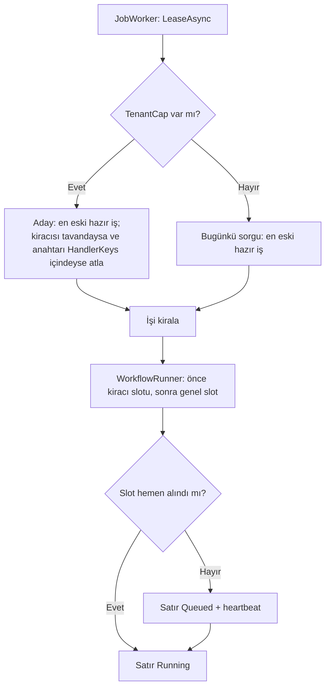

# Faz 240 — Kiracı Başına Workflow Eşzamanlılığı, `Queued` Bekleme ve Adil Kiralama

> **Durum:** 📋 Planlandı (2026-10-23)
> **Kademe:** tam — kiracı sınırı (bir kiracı diğerlerini aç bırakamaz) · migration (kiralama indeksi, üç sağlayıcı) · public API'den değişen satır (`IJobStore.LeaseAsync` imzası) · orphan uzlaştırmasının sözleşmesi değişir
> **Plan onayı:** Bakımcı, 2026-10-23 (engelleyici kararlar sohbette alındı: sınır süreç içinde **ve** kuyruk kiralamasında küme geneli; adalet kuralı "tavan + en eski iş"; slot bekleme süresi `RunTimeout`'a sayılmaya devam eder; bekleyen run `Queued` görünür, sıra numarası yoktur)
> **Kaynak:** [ADAYLAR.md](ADAYLAR.md) · **F-322**
> **Genellik:** Çok kiracılı her kurulum (SaaS). Bugün tek bir kiracının saatlik üretim akışı süreçteki bütün workflow slotlarını ve kuyruğun başını tutar; diğer kiracılar bekler. İş tüketici kodunda kalamaz: slot ve kiralama Tracon'un içindedir. Tüketici girişte bir kabul sınırı koyabilir, ama kuyruğa girmiş işin sırasını değiştiremez. İkinci kanıt ilk ilkedir: Tracon kiracı başına sınırı başka üç yerde zaten verir (`TraconSkillScriptOptions.MaxConcurrentPerTenant`, `VoiceLiveOptions.MaxConcurrentSessionsPerTenant`, `VoiceConversationOptions.MaxConcurrentConnectionsPerTenant`); workflow bu desenin eksik halkasıdır
> **Karşı görüş:** "Tüketici admission katmanında kiracı başına kabul sınırı koyabilir; Tracon sınırı ikinci katman olur." Cevap: admission yalnız **yeni** isteği görür. Kuyruğa girmiş 200 işin kiralama sırasını ve süreçteki slot paylaşımını göremez. Sınır varsayılan **kapalıdır** (K1); kapalıyken bugünkü davranış aynen kalır
> **Önkoşul:** Yok. Faz 239 `WorkflowRunner.cs`'e dokunur (devam bütçesi); iki faz aynı dosyanın farklı bölgelerine dokunur, sıra fark etmez. Sonra uygulanan faz birleşmeyi `git diff` ile denetler
> **Paketler:** `Tracon.Abstractions` (`IJobStore`, `JobLeaseRequest`), `Tracon.Workflows` (`TraconWorkflowOptions`, `WorkflowRunner`), `Tracon.Core` (`JobWorkerBackgroundService`, `InMemoryJobStore`, `InMemoryRunStore`, `RunReconciliationService`), `Tracon.PostgreSql` · `.SqlServer` · `.Sqlite` (kiralama sorgusu, orphan sorgusu, indeks), `Tracon.Testing.Contracts.Xunit` (`JobStoreContract`, `RunStoreContract` case'leri)
> **Yeni paket:** Yok · **Migration:** gerekli — üç sağlayıcıda kiralama indeksi `(tenant_id, handler_key, status)` (ölçülmeli: mevcut `jobs_claim_idx` `(lane, status, scheduled_for)` sayımı karşılıyor mu); numara uygulama anında alınır (K-178)
> **Public API:** değişiyor — `IJobStore.LeaseAsync(owner, leaseDuration, lanes, ct)` → `LeaseAsync(JobLeaseRequest, ct)` (kırıcı; seam uygulayanı etkiler) · `TraconWorkflowOptions.MaxConcurrentRunsPerTenant` (yeni). `1.0.0` GA'dan (K-603) önce ucuz: `wc -l src/*/PublicAPI.Shipped.txt` = 18 satır
> **Tüketici yüzeyi:** site: `concepts/workflows.md` (eşzamanlılık), `guides/production.md` (çok kiracılı ayar), `reference/configuration.md` (yeni anahtar), `concepts/runs.md` (`Queued` workflow için), `capabilities.md` satırı, `llms-full.txt` (üretilir) · sevk edilen: `IJobStore` XML'i, `TraconWorkflowOptions` XML'i, `CHANGELOG.md` `[Unreleased]` (`LeaseAsync` imzası; bekleyen workflow artık `Queued`)
> **Manuel test alanı:** `docs/manuel-test/15-WORKFLOWS.md` · `docs/manuel-test/16-IS-KUYRUGU-VE-ZAMANLAMA.md`

---

## Bu Faza Başlarken

> `faz-baslangic` skill'ini uygula. Aşağıdaki liste o skill'in 2. adımıdır —
> **tamamını değil, yalnız işaret edilen bölümleri oku.**

1. Bu doküman
2. Kararlar — dosyanın tamamını **okuma**, yalnız bu kalemleri grep'le:
   ```bash
   grep -n "K-138 —\|K-178 —\|K-671 —\|K-997 —\|K-998 —" docs/KARARLAR.md
   grep -n "F-325" docs/arsiv/ERTELENEN-ADAYLAR.md
   ```
   **K-178** (migration numarası sağlayıcı başına bağımsız), **K-997** (önce
   satır, sonra kayıt; kuyruklu cevapta `Queued`), **K-998** (`EnqueueAsync`
   sözleşmesi — kiralama sözleşmesinin komşusu), **F-325** (slot bekleyen run'ın
   satırı beklemenin başında açılır ve bugün `Running` görünür)
3. Önceki fazdan devir: yok
4. Alan hafızası (dört alan):
   [`hafiza/workflows.md`](hafiza/workflows.md) ·
   [`hafiza/sql-paylasilan-sorgu-uretimi.md`](hafiza/sql-paylasilan-sorgu-uretimi.md) (üç lehçe) ·
   [`hafiza/sql-migration.md`](hafiza/sql-migration.md) ·
   [`hafiza/test-paralellik-ve-zamanlama.md`](hafiza/test-paralellik-ve-zamanlama.md) (eşzamanlılık testleri)
5. Gerektiğinde: [`MIMARI-GUVENLIK.md`](MIMARI-GUVENLIK.md) kiracı sınırı ·
   `[TenantAgnostic]` bakım yolu (orphan taraması)

---

## Amaç

Çok kiracılı bir kurulumda bir kiracı workflow kapasitesini tek başına
tüketebilir. İki yerde tüketir: süreçteki ortak semafor ve kuyruğun FIFO
kiralaması. Bu faz kiracı başına bir sınır verir. Sınır hem süreçte hem kuyruk
kiralamasında çalışır. Slot bekleyen run da görünür olur: `Queued`.

- **F-322** — `MaxConcurrentRunsPerTenant` (varsayılan kapalı) · `Queued` bekleme ·
  kuyrukta "tavan + en eski iş" kiralaması

### Bugün ne çalışmıyor — doğrulanmış kanıt

| Kanıt | Gözlem |
|---|---|
| [`TraconWorkflowOptions.cs:30-43`](../src/Tracon.Workflows/TraconWorkflowOptions.cs) | `MaxConcurrentRuns = 4`, "shared across all tenants". Bekleme `RunTimeout`'a sayılır; bekleyen run'ın satırı vardır ve `Running` görünür |
| [`WorkflowRunner.cs:171`](../src/Tracon.Workflows/Internal/WorkflowRunner.cs), `:985-995`, `:1077` | Tek `SemaphoreSlim`; `WaitAsync(linked.Token)` kurulumdan sonra, pompadan önce; `Release` `finally`'de |
| [`SqlServerQueries.cs:1380-1396`](../src/Tracon.SqlServer/Internal/SqlServerQueries.cs) · [`PostgresQueries.cs:1217`](../src/Tracon.PostgreSql/Internal/PostgresQueries.cs) · [`SqliteQueries.cs:1202`](../src/Tracon.Sqlite/Internal/SqliteQueries.cs) | `LeaseJob` yalnız `ORDER BY scheduled_for` ile en eski hazır işi alır; kiracıya bakmaz |
| [`IJobStore.cs:65`](../src/Tracon.Abstractions/Scheduling/IJobStore.cs) | `LeaseAsync(string owner, TimeSpan leaseDuration, IReadOnlyList<string>? lanes, CancellationToken)`; tek çağıran `JobWorkerBackgroundService.cs:199` |
| [`JobRecord.cs:12`](../src/Tracon.Abstractions/Scheduling/JobRecord.cs), `:38` | İş `TenantId` ve `Lane` taşır; sayım için veri vardır |
| `0041_job_lanes.sql:44-45` (PostgreSQL) | `jobs_claim_idx (lane, status, scheduled_for)`. Kiracı başına kiralanmış iş sayımı için indeks yok (ölçülmeli: sorgu planı) |
| [`JobHandlerKeys.cs:52`](../src/Tracon.Abstractions/Scheduling/JobHandlerKeys.cs), `:72` | İki workflow iş anahtarı: `tracon.workflow` ve `tracon.workflow-run` (respond-async ile kuyruğa giren run, resume, cevap) |
| [`IRunStore.cs:404-431`](../src/Tracon.Abstractions/Runs/IRunStore.cs) `ClaimOrphanedRunsAsync` | 🚨 Yalnız `Running` satırları kapatır: "`Queued` rows are owned by the job queue and this method DOES NOT TOUCH them". Heartbeat'i eski ya da hiç olmayan `Running` satır orphan sayılır |
| [`IRunStore.cs:85-115`](../src/Tracon.Abstractions/Runs/IRunStore.cs) `StartRunAsync` | UPSERT'tir: kuyruklu run önce `Queued`, sonra `Running` olarak yazılır. `Queued` → `Running` geçişinin deseni vardır |
| Kiracı başına sınır emsalleri | `TraconOptions.cs:475` (`MaxConcurrentPerTenant = 2`, doğrulama `TraconOptionsValidator.cs:327-333`), `VoiceLiveOptions.cs:100` |

> Kanıtlar 2026-10-23 tarihinde doğrulandı.

---

## 240.1 — Süreç içi kiracı sınırı

- `TraconWorkflowOptions.MaxConcurrentRunsPerTenant` (`int?`, varsayılan
  `null` = kapalı, K1). Ayarlıysa 1 ≤ değer ≤ `MaxConcurrentRuns`; aksi açılışta
  hata verir (`TraconOptionsValidator` emsali, `:333`). Bağlama anahtarı
  `Tracon:Workflows:MaxConcurrentRunsPerTenant`; okunamayan değer açılışta hata
  verir (K-993).
- `WorkflowRunner` kiracı başına bir semafor tutar
  (`ConcurrentDictionary<string, SemaphoreSlim>`). **Alma sırası sabittir:**
  önce kiracı slotu, sonra genel slot. Gerekçe: kiracı sınırında bekleyen bir run
  genel slot tutmaz, bu yüzden diğer kiracıları bekletmez. Bırakma ters sırayla
  ve `finally`'de yapılır.
- Semafor sözlüğü sınırsız büyümez: kiracı semaforu boşa çıkınca (sayaç tam)
  sözlükten düşer. Uygulama emsal kodun (`LiveVoice` ya da skill script
  sınırlayıcısı) bunu nasıl yaptığını ölçer ve **aynı** deseni kullanır; yeni
  bir sınırlayıcı yazmaz. Emsalin deseni yoksa ortak bir `internal`
  `TenantSlotLimiter` çıkar ve iki emsal ona taşınmaz (kapsam dışı; aday olur).
- **Bekleme `RunTimeout`'a sayılmaya devam eder** (bakımcı kararı). XML'deki
  cümle korunur ve kiracı sınırını da anar.
- Kiracı kimliği run kapsamından (`_tenantContext.TenantId`) okunur, istekten
  okunmaz. Kuyruk işçisinde kiracı işin kendisinden gelir.

## 240.2 — Bekleyen run `Queued` görünür

Bakımcı kararı: slot bekleyen run'ın satırı `Queued`'dır; slot alınınca
`Running` olur. Sıra numarası yoktur.

- Satır bugün `Running` olarak açılır (F-325). Bu faz satırı slot bekleme
  varsa `Queued` açar, slot alınınca `StartRunAsync` UPSERT'iyle `Running` yapar
  (`IRunStore.cs:85-115` deseni). Slot hemen alınırsa ara yazım yoktur: satır
  doğrudan `Running` açılır (Açık Soru 1).
- 🚨 **Orphan tuzağı.** `ClaimOrphanedRunsAsync` `Queued` satırlara
  **dokunmaz**; onları kuyruğa ait sayar. Süreç içi bekleyen bir `Queued` satırın
  kuyrukta işi yoktur. Süreç çökerse satır sonsuza dek `Queued` kalır. Bugün
  bu satır `Running` olduğu için heartbeat'le korunur; `Queued`'a geçmek bu
  korumayı **sessizce kaldırır** (MEMORY: davranışı düzeltmek çağıranı değiştirir).
  Çözüm:
  - Süreç içi bekleyen run heartbeat yazmaya devam eder
    (`RunHeartbeatWriter.cs:80` hangi run kümesini yazıyor? Uygulama ölçer;
    bekleyen run bugün o kümedeyse değişiklik gerekmez).
  - `ClaimOrphanedRunsAsync` sözleşmesi genişler: **heartbeat'i olan**
    `Queued` satır da orphan adayıdır. Heartbeat'i hiç olmayan `Queued` satır
    kuyruğundur ve dokunulmaz. Ayrım tek sütunla yapılır (heartbeat), yeni
    sütun gerekmez.
  - `RunStoreContract`'a iki case: heartbeat'li eski `Queued` → kapanır;
    heartbeat'siz `Queued` → kalır. Dört depoda koşar.
  - Uzlaştırma, kapanan bekleyen run'ı kurtarma zincirine sokmaz. Bu run hiç
    çalışmadı ve checkpoint'i yoktur. `Failed` + bir neden yazılır (Açık Soru 2).
- Konsol `Queued` workflow run'ını bugünkü kuyruklu agent run'ı gibi gösterir
  (ölçülmeli: workflow run listesi ve run detayı `Queued`'u tanıyor mu).
- İptal: bekleyen run bugün `linked.Token` ile iptal edilebilir. `Queued`
  satırın iptali aynı yoldan geçer ve `Canceled` kapanır (fonksiyonel test).

## 240.3 — Kuyrukta "tavan + en eski iş" kiralaması

Bakımcı kararı: kiralama, tavandaki kiracının workflow işlerini atlar ve
kalanlardan en eski işi alır. Sınır kapalıyken sorgu bugünküyle aynıdır.

- **İmza:** `LeaseAsync(JobLeaseRequest request, CancellationToken)`. İstek
  `Owner`, `LeaseDuration`, `Lanes` ve `TenantCap` taşır. `TenantCap` =
  `{ HandlerKeys, MaxLeasedPerTenant }` ya da `null`. Gerekçe: dört parametreli
  imzaya beşinci parametre eklemek kırıcıdır ve bir sonraki alan için de kırıcı
  olur. Bir `record` minor sürümde büyür (Faz 237 kuralı). Bugün kırmak ucuzdur
  (UR-012 B).
- **Sayım:** aynı kiracının, `TenantCap.HandlerKeys` içindeki, `status IN (1, 2)`
  ve `lease_until >= @now` olan işleri. Sayım tavana ulaşmışsa o kiracının bu
  anahtarlardaki işleri atlanır. Diğer işler (başka anahtar, başka kiracı)
  etkilenmez.
- **İşçi** `TenantCap`'i `TraconWorkflowOptions.MaxConcurrentRunsPerTenant`'tan
  kurar: anahtarlar `tracon.workflow` ve `tracon.workflow-run`. Ayar kapalıysa
  `TenantCap = null`. Bir seçenek iki katmanı besler: süreç içi sınır (her
  replikada) ve kuyruk tavanı (küme geneli). Site bu iki anlamı ayrı cümlelerle
  yazar (Açık Soru 3).
- **Yumuşak tavan:** iki işçi aynı anda kiralarsa ikisi de aynı sayımı görebilir.
  O zaman tavan, eşzamanlı kiralayıcı sayısı kadar aşılır. `SKIP LOCKED` bunu
  engellemez. Kesin tavan sağlayıcıya özgü kilit ister (PostgreSQL advisory lock,
  SQL Server `sp_getapplock`). Plan yumuşak tavanı önerir ve belgeler; süreç içi
  semafor kesin kalır (Açık Soru 4).
- **Üç lehçe** `SqlQueriesBase.LeaseJob` deseniyle yazılır (`SqlQueriesBase.cs:546`).
  SQLite tek yazarlıdır; yarış orada oluşmaz. Uygulama her lehçenin sorgu planını
  okur ve indeks kararını ölçümle verir.
- **`InMemoryJobStore`** aynı kuralı uygular (`InMemoryJobStore.cs:14` "same
  contract" der).
- **`JobStoreContract`** yeni case'ler alır (aşağıda). Dört depoda koşar.



---

## Planlanan Public API

> Taslak imzalardır. Gerçekleşen imzalar kapanışta ayrı bir bölüme yazılır.

```csharp
// Tracon.Abstractions
public sealed record JobLeaseRequest
{
    public required string Owner { get; init; }
    public required TimeSpan LeaseDuration { get; init; }
    public IReadOnlyList<string>? Lanes { get; init; }
    public JobTenantCap? TenantCap { get; init; }
}

public sealed record JobTenantCap(IReadOnlyList<string> HandlerKeys, int MaxLeasedPerTenant);

public interface IJobStore
{
    // Değişir (kırıcı): dört parametreli aşırı yükleme silinir.
    ValueTask<JobRecord?> LeaseAsync(JobLeaseRequest request, CancellationToken cancellationToken = default);
}

// Tracon.Workflows
public sealed class TraconWorkflowOptions
{
    public int? MaxConcurrentRunsPerTenant { get; set; }   // varsayılan null (kapalı)
}
```

**Bugün eklemek bedava / sonradan eklemek kırıcı:** `LeaseAsync` imzası GA'dan
sonra yalnız varsayılan gövdeli yeni bir üyeyle büyüyebilirdi (Faz 237 kuralı).
Bugün tek ve doğru imzaya geçmek ucuzdur. `ClaimOrphanedRunsAsync`'in genişleyen
sözleşmesi bir davranış değişikliğidir; XML ve `CHANGELOG` onu adıyla yazar.

### HTTP `endpoint`'leri

Yeni uç yok. `GET /api/runs` ve workflow run uçları bekleyen workflow run'ını
`Queued` döndürür. `RunStatus.Queued` OpenAPI'de zaten vardır; `tracon.json` farkı
beklenmez (ölçülmeli).

### Arayüz payı

Beklenen pay 0. Konsol `Queued`'u zaten tanıyorsa değişiklik yoktur; tanımıyorsa
rozet eşlemesi gerekir ve pay gzip KB olarak ölçülür
(`ls -l src/Tracon.UI/wwwroot/assets/`).

---

## Planlanan Dosya Listesi

```
src/Tracon.Abstractions/Scheduling/
├── IJobStore.cs                       # LeaseAsync(JobLeaseRequest)
├── JobLeaseRequest.cs                 # yeni (JobTenantCap ile)
src/Tracon.Abstractions/Runs/IRunStore.cs          # ClaimOrphanedRunsAsync XML: heartbeat'li Queued
src/Tracon.Workflows/
├── TraconWorkflowOptions.cs           # MaxConcurrentRunsPerTenant
└── Internal/WorkflowRunner.cs         # kiracı slotu, Queued → Running
src/Tracon.Core/
├── Scheduling/JobWorkerBackgroundService.cs       # JobLeaseRequest + TenantCap
├── Scheduling/InMemoryJobStore.cs
├── Storage/InMemoryRunStore.Lifecycle.cs          # orphan: heartbeat'li Queued
├── TraconOptionsValidator.cs · …Binding.*.cs      # yeni anahtar (Workflows bağlayıcısı nerede ise)
src/Tracon.Sql.Shared/Internal/SqlQueriesBase.cs
src/Tracon.{PostgreSql,SqlServer,Sqlite}/Internal/*Queries.cs   # LeaseJob, orphan sorgusu
src/Tracon.{PostgreSql,SqlServer,Sqlite}/Migrations/NNNN_job_tenant_lease_idx.sql   # ölçüme bağlı
src/Tracon.Testing.Contracts.Xunit/Contracts/{JobStoreContract,RunStoreContract}.cs
tests/…                                 # fonksiyonel ve eşzamanlılık testleri (aşağıda)
```

---

## Hata Modları ve Testler

| Ne bozulabilir | Seviye | Test (taslak ad) |
|---|---|---|
| Kiracı A sınırdayken kiracı B'nin run'ı da bekler | Fonksiyonel (gerçek runner, iki kiracı bağlamı) | `TenantWorkflowConcurrencyTests` — A'nın 3 run'ı, sınır 2; B'nin run'ı hemen `Running` |
| Kiracı sınırında bekleyen run genel slot tutar | Fonksiyonel | aynı sınıf: genel 2, kiracı 1; A'nın ikinci run'ı beklerken B koşar |
| Slot sırası ters alınır ve kilitlenme olur | Eşzamanlılık | 50 run × 3 kiracı, rastgele bitiş; hepsi biter, süre sınırlı |
| Sınır kapalıyken davranış değişir | Fonksiyonel | `MaxConcurrentRunsPerTenant = null` → bugünkü testler değişmeden yeşil |
| Bekleyen run `Running` görünür | Fonksiyonel (HTTP) | `GET /api/runs/{id}` bekleme sırasında `Queued`, slotta `Running` |
| Bekleyen `Queued` satır süreç çökünce sonsuza dek kalır | Sözleşme (`RunStoreContract`) + fonksiyonel | heartbeat'li eski `Queued` → `ClaimOrphanedRunsAsync` kapatır; dört depoda |
| Kuyruğun `Queued` satırı orphan sayılıp kapanır (gerileme) | Sözleşme | heartbeat'siz `Queued` → dokunulmaz; dört depoda |
| Bekleyen run iptal edilemez | Fonksiyonel | `POST …/cancel` → `Canceled`; kiracı slotu sızmaz (sonraki run hemen başlar) |
| Bekleyen run `RunTimeout`'u geçer | Fonksiyonel (`FakeTimeProvider`) | `Canceled`, ayar adı mesajda; slot sızmaz |
| Kiralama tavandaki kiracının işini alır | Sözleşme (`JobStoreContract`) | A'nın 2 kiralanmış işi, tavan 2; sıradaki en eski iş A'nınsa atlanır, B'ninki alınır; dört depoda |
| Tavan başka anahtarlardaki işleri de bloklar | Sözleşme | A tavandayken A'nın `tracon.webhook-delivery` işi kiralanır |
| Süresi dolmuş kira sayıma girer | Sözleşme | `lease_until < now` iş sayılmaz (ve yeniden kiralanabilir) |
| Başka kiracının işi sayıma girer | Sözleşme | kiracı yalıtımı (`TenantIsolationContract` tabanı) |
| `TenantCap = null` iken sorgu değişir | Sözleşme | bugünkü sıralama case'leri değişmeden yeşil |
| İndeks olmadan sayım tabloyu tarar | Ölçüm | sorgu planı (`EXPLAIN`) üç lehçede; sonuç dokümana |
| Yumuşak tavan beklenenden çok aşılır | Entegrasyon (PostgreSQL) | iki işçi eşzamanlı kiralar; aşım ≤ işçi sayısı; ölçülür ve yazılır |
| `MaxConcurrentRunsPerTenant > MaxConcurrentRuns` sessizce kabul edilir | Fonksiyonel | açılış hatası |

Beş soru: **iptal** — bekleyen run ve slot sızıntısı (yukarıda) ·
**eşzamanlılık** — kilitlenme, yumuşak tavan (yukarıda) · **boş/aşırı girdi** —
`null`, 1, `MaxConcurrentRuns`'a eşit, üstü · **başka kiracı** — süreçte ve
kuyrukta yalıtım (yukarıda) · **alt sistem hatası** — run deposu `Queued` →
`Running` yazımında hata verirse run `RunRecording` kuralıyla devam eder ve hata
loglanır (gözlemlenebilirlik işlevselliği bozmaz); kiralama sorgusu hata verirse
işçi bugünkü geri çekilme yolunu izler.

---

## Manuel Kabul Case'leri

| # | Ön koşul | Adımlar | Beklenen sonuç |
|---|---|---|---|
| 1 `🤖` | `samples/Tracon.Api`, iki kiracı, `MaxConcurrentRuns=2`, `MaxConcurrentRunsPerTenant=1`, yavaş bir workflow | A kiracısıyla 3 run, B kiracısıyla 1 run başlat | A'nın ikinci ve üçüncü run'ı `Queued`; B'nin run'ı hemen `Running`; konsol run listesinde `Queued` rozeti |
| 2 `🤖` | Case 1 + `Prefer: respond-async` ile 5 A, 1 B işi kuyrukta | İşçi kiralasın | B'nin işi A'nın kalan işlerinden önce kiralanır; A aynı anda en çok 1 kiralanmış iş taşır |
| 3 `🤖` | Case 1'de A'nın `Queued` run'ı | Süreci öldür, yeniden başlat, uzlaştırma süresini bekle | Satır `Failed` + neden; sonsuza dek `Queued` kalmaz |

---

## Açık Sorular

| # | Soru | Seçenekler | Öneri |
|---|---|---|---|
| 1 | Slot hemen alınırsa satır önce `Queued` yazılsın mı? | A: hayır, doğrudan `Running` · B: her zaman `Queued` → `Running` | **A** — sınır yokken ve slot boşken ek yazım olmaz; bugünkü yol değişmez |
| 2 | Uzlaştırmanın kapattığı, hiç başlamamış `Queued` run'ı kurtarma zincirine girsin mi? | A: hayır, `Failed` + neden · B: `RunContinuation` ile yeniden başlat | **A** — run hiç çalışmadı ve checkpoint'i yok; yeniden başlatma bir kuyruk kararıdır, uzlaştırma kararı değildir |
| 3 | Tek seçenek iki katmanı (süreç ve küme) mı beslesin? | A: tek seçenek · B: ayrı `MaxLeasedWorkflowJobsPerTenant` | **A** — daha az ayar; site iki anlamı ayrı yazar. İkinci sinyal gelirse B ayrı aday olur |
| 4 | Kuyruk tavanı kesin mi olsun? | A: yumuşak (≤ işçi sayısı kadar aşım), belgeli · B: sağlayıcı kilidiyle kesin | **A** — kesin kilit üç lehçede üç ayrı mekanizma ister; süreç içi semafor zaten kesindir |

---

## Bitiş Ölçütleri (DoD)

- [ ] `TenantWorkflowConcurrencyTests` kiracı yalıtımını, slot sırasını, iptali ve süre aşımını kanıtlar
- [ ] `JobStoreContract` ve `RunStoreContract` yeni case'leri dört depoda (bellek içi + üç SQL) yeşil; her case yalıtılmış kırılmada kırmızı görüldü
- [ ] Üç lehçenin sorgu planı ve indeks kararı dokümanda; migration varsa üç sağlayıcıda
- [ ] Bekleyen workflow run'ı HTTP'de ve konsolda `Queued`
- [ ] `CHANGELOG.md [Unreleased]` `LeaseAsync` imzasını, `Queued` beklemeyi ve orphan sözleşmesini adıyla yazar
- [ ] Site sayfaları (Tüketici yüzeyi satırı) güncel; `npm run build` + `check-links.mjs` temiz
- [ ] Dört doğrulama kapısı sıfır uyarı verir
- [ ] `samples/Tracon.Api` ile gerçek `run` yapıldı (Manuel 1–3), çıktı belgeye yazıldı
- [ ] `secret` taraması boş döndü
- [ ] `🤖` case'ler `docs/manuel-test/15-WORKFLOWS.md` ve `16-IS-KUYRUGU-VE-ZAMANLAMA.md` içinde ve koşuldu
- [ ] `faz-denetim` koşuldu; 🔴 bulgu kalmadı

### Doğrulama komutları

```bash
python3 scripts/kapi.py test --proje Tracon.Workflows.UnitTests --sinif TenantWorkflowConcurrencyTests
grep -rn "LeaseAsync(" src/ --include='*.cs'          # tek çağıran: JobWorkerBackgroundService
grep -rn "ClaimOrphanedRunsAsync" src/ --include='*.cs' # çağıranlar: davranış genişledi
```

---

## Riskler

| Risk | Önlem |
|------|-------|
| `ClaimOrphanedRunsAsync` genişlemesi kuyruğun `Queued` satırını kapatır | Ayrım heartbeat sütunudur; sözleşme case'i heartbeat'siz `Queued`'un kaldığını dört depoda kanıtlar |
| `LeaseAsync` imza değişikliği bir çağıranı ya da test sahtesini atlar | `grep -rn "LeaseAsync(" src/ tests/`; derleyici kalanı yakalar |
| Sayım alt sorgusu yoğun kuyrukta yavaştır | Sorgu planı ölçümü; gerekirse indeks migration'ı (üç set) |
| `WorkflowRunner.cs`'e Faz 239 ile çakışan dokunuş | Sonra uygulanan faz birleşmeyi elle izler; iki faz farklı bölgelere dokunur (bütçe kurulumu ↔ slot bekleme) |
| Kiracı semaforu sözlüğü büyür | Boşalan semafor düşer; uzun koşum testi sözlük boyutunu ölçer |

---

<!-- ============================================================
     AŞAĞISI ÇALIŞIRKEN DOLAR — doküman kapanışta silinir (`faz-kapat`).
     Kalıcı kısım `faz-tamamlama` Adım 5'te yerine taşınır. Başlıkları SİLME.
     ============================================================ -->

## Plandan Sapmalar

> Çalışırken dolar. Plan ile gerçek arasındaki fark **gizlenmez**. Kapanışta
> kapanış commit mesajına taşınır.

## Bu Fazda Verilen Kararlar

> Çalışırken dolar. Dört kategoriden birine giren karar (AGENTS.md)
> `docs/KARARLAR.md`'ye K-NNN ve kategori etiketiyle girer; girmeyen karar
> kapanışta commit mesajına taşınır (`faz-tamamlama` Adım 8). Plan numara rezerve
> etmez. Beklenen kayıtlar: kiracı başına workflow sınırı ve adil kiralama
> *(güvenlik — kiracı sınırı, public-api; alternatifler: yalnız süreç içi, yalnız
> kuyruk, en az koşan önce, round-robin tablosu)* · `Queued` bekleme ve orphan
> sözleşmesi *(public-api; alternatif: `Running` kalsın)*.

## Süreç Ölçümü

> Kapanışta doldurulur. **Tablo olarak** — onay kutusu DEĞİL: `faz-kapat`
> işaretsiz kutuda durur. `faz-kapat` bu tabloyu `docs/FAZ-DEFTERI.md`'ye taşır;
> eşik **167**'den itibaren boş bir değer hücresinde kapanışı durdurur.
> `ölçülmedi` **geçerli bir değerdir** — kapı bir sayı değil, bir **karar** arar.
> Kapı bölümün VARLIĞINI denetler, doğruluğunu denetlemez (K-766).

| Metrik | Değer |
|---|---|
| Plan revizyonu sayısı | |
| Düzeltme turu sayısı | |
| 🔴 bulgu: gerçek / gürültü / araştırılacak | |
| Fazın ürettiği regresyon | |
| Faz kapandıktan sonra bulunan kusur | ölçülmedi (kapanış anı) |

## Denetim Bulguları

> `faz-denetim` çıktısı. Her satır: bulgu · seviye (🔴/🟡/🟢) · sonuç
> (düzeltildi / gerekçelendi / F-NN olarak devredildi). 🟢 kapanışta
> `ADAYLAR.md`'ye gider.
