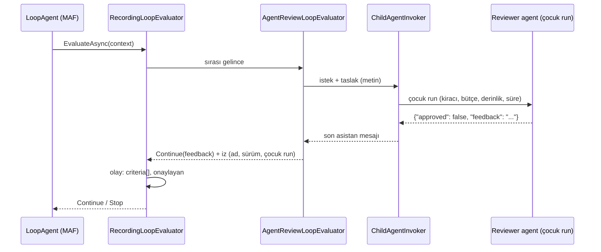

# Faz 242 — Agent Onay Ölçütü (`agentReview`) ve Loop Denetim İzi

> **Durum:** 📋 Planlandı (2026-10-25)
> **Kademe:** tam — güvenlik/kiracı sınırı: ölçüt run'ın içinden yeni bir çocuk run başlatır (kiracı, bütçe, derinlik ve onay reddi kapıları); denetim izi kimin onayladığını kalıcı run olayına yazar
> **Plan onayı:** Bakımcı, 2026-10-25 (sohbette alınan karar: yerleşik `agentReview` türü; reviewer katalogdaki bir agent'tır ve çocuk run olarak koşar; iz iterasyon olayına yazılır)
> **Kaynak:** [ADAYLAR.md](ADAYLAR.md) · **F-411**
> **Genellik:** Loop kullanan her tüketici. Bugün "bir agent taslağı onaylasın" isteyen tüketici kod yazar: `AddLoopEvaluator` ile kendi ölçütünü kaydeder ve çocuk run'ı elle kurar (`samples/Tracon.Api/DraftReviewCriterion.cs:64-89`; derinlik, bütçe ve run seçeneklerini kendisi doldurur). Tanımı arayüzden yöneten kurulum bunu hiç yapamaz. İkinci kanıt iki tanedir. Birincisi ekosistemdir: üretici–denetçi (reflection, critic) deseni agent çerçevelerinin standart desenidir. İkincisi ilk ilkedir: Tracon bir kontrol düzlemidir ve denetim izi "bu cevabı kim onayladı?" sorusunu cevaplamalıdır. Bugünkü iterasyon olayı bu soruyu cevaplamaz (Faz 201 §201.5)
> **Karşı görüş:** (1) "Kod ölçütü zaten var; yerleşik tür gereksiz." Cevap: kod ölçütü kalır. Yerleşik tür tanımdan kurulur (K2: veri yalnız bir agent **adını** taşır, kod taşımaz) ve çocuk run'ı tek yoldan (`ChildAgentInvoker`) açar. Elle kurulan çocuk run'ın kapıları sessizce eksik kalabilir; örnek zaman aşımı ve onay reddi taşımaz. (2) "İz bugünkü olayda yeterli; agent sürümü run satırında var." Cevap: döngüdeki agent'ın sürümü run satırındadır (`RunRecord.AgentVersion`) ve bu faz onu çoğaltmaz. Eksik olan **onaylayanın** kimliğidir: yargıç modeli ya da reviewer agent'ın adı, sürümü ve çocuk run'ı
> **Önkoşul:** Faz 241 — iki faz aynı olayı (`LoopIterationCompleted`) ve aynı evaluator'ı değiştirir. 241 önce kapanırsa bu fazın yeni alanları native akışa da kendiliğinden girer (veri bayt bayt aynıdır)
> **Paketler:** `Tracon.Abstractions` (`LoopCriterion`), `Tracon.Core` (`LoopEvaluatorRegistry`, `RecordingLoopEvaluator`, yeni `AgentReviewLoopEvaluator`, doğrulayıcı), `Tracon.AspNetCore` (katalog açıklaması), `Tracon.UI` (Loop editörü), `samples/Tracon.Api`
> **Yeni paket:** Yok · **Migration:** Yok — tanım JSON yük olarak saklanır; olay yükü JSON'dur
> **Public API:** büyüyor — `LoopCriterion`'a iki alan. `1.0.0` GA'dan (K-603) önce ucuz: `cat src/*/PublicAPI.Shipped.txt | wc -l` = 18 satır (2026-10-25). Olay yükü ve doğrulama kodları ekleyicidir (1.x kuralı: "Add a field to an event payload")
> **Tüketici yüzeyi:** site `concepts/agents.md` (Loop ölçütleri, iterasyon olayı), `ui.md` (Loop editörü), `capabilities.md` satırı · sevk edilen: `LoopCriterion` XML (yerleşik tür tablosu), `docs/sozlesme/dogrulama-kodlari.txt` (üretilir), OpenAPI → iki istemci (üretilir), `CHANGELOG.md` `[Unreleased]` (kırıcı not: `agentReview` adlı bir kod türü artık açılışta reddedilir)
> **Manuel test alanı:** `docs/manuel-test/02-CEKIRDEK-VE-KATALOG.md`

---

## Bu Faza Başlarken

> `faz-baslangic` skill'ini uygula. Aşağıdaki liste o skill'in 2. adımıdır —
> **tamamını değil, yalnız işaret edilen bölümleri oku.**

1. Bu doküman
2. Kararlar — dosyanın tamamını **okuma**, yalnız bu kalemleri grep'le:
   ```bash
   grep -n "K-704 —\|K-884 —\|K-893 —\|K-914 —\|K-915 —\|K-916 —\|K-918 —\|K-1006 —\|K-020 —" docs/KARARLAR.md
   ```
   **K-704** (MAF'a tek composite evaluator), **K-884** (`OnExhausted`/`OnCriterionError`),
   **K-893** (`aiJudge` token'ı run'a girer), **K-914** (kod ölçütü fabrikası),
   **K-915** (`GET /api/loop-criteria`), **K-916** (Loop doğrulaması tek kural
   kümesi, `loop_` kodları), **K-918** (konsol tür değişiminde alan temizliği),
   **K-1006** (cevabı okuyan yüzey son iterasyonu alır), **K-020** (`MAAI001` tek dosyada)
3. Önceki fazdan devir: Faz 241 bu dokümanın sonuna `## Önceki Fazdan Devir`
   bölümünü yazar (kanca adı, çerçeve testi). Faz 201'in §201.5 metni gerekirse
   (arşivdeki sürüm damıtılmıştır; tam plan bu commit'tedir):
   `git show 9d87024b:docs/201-LOOP-DUZENLEME-VE-OLCUT-FABRIKASI.md | awk '/## 201.5/,/## Planlanan/'`
4. Alan hafızası (iki alan):
   [`hafiza/maf-harness-ve-loop.md`](hafiza/maf-harness-ve-loop.md) (kısa devre,
   tavan turu değerlendirilmez, ölçüt son asistan mesajını okur) ·
   [`hafiza/run-olay-sozlesmesi.md`](hafiza/run-olay-sozlesmesi.md) (olay yükü sözleşmesi)
5. Gerektiğinde: [`MIMARI-GUVENLIK.md`](MIMARI-GUVENLIK.md) kiracı sınırı bölümü
   (çocuk run'ın kiracısı)

---

## Amaç

Loop'un yerleşik dört ölçütü bir işaretleyiciye, todo listesine, bir yargıç
modeline ya da arka plan işine bakar. "Başka bir agent bu cevabı onaylasın" ölçütü
yerleşik değildir. Bu iş bugün yalnız kodla yapılır. Ayrıca iterasyon olayı
kararı **kimin** verdiğini yazmaz.

- **F-411** — yerleşik `agentReview` türü: tanım katalogdaki bir reviewer
  agent'ı adla (ve isteğe bağlı sürümle) anar. Reviewer çocuk run olarak koşar
  ve kararını yapılandırılmış bir yanıtla verir. İterasyon olayı her
  değerlendirilen ölçütün kararını ve onaylayanın kimliğini taşır.

### Bugün ne çalışmıyor — doğrulanmış kanıt

| Kanıt | Gözlem |
|---|---|
| [`LoopEvaluatorRegistry.cs:71`](../src/Tracon.Core/Compilation/LoopEvaluatorRegistry.cs), `:93-98`, `:495-516` | Dört yerleşik tür vardır: `completionMarker`, `todoCompletion`, `aiJudge`, `backgroundTaskCompletion`. Agent onayı yoktur |
| [`LoopCriterion.cs:54-90`](../src/Tracon.Abstractions/Agents/LoopCriterion.cs) | Ölçüt yalnız `Marker`, `JudgeCriteria`, `JudgeInstructions`, `Modes` taşır; bir agent adı alanı yoktur |
| [`RecordingLoopEvaluator.cs:337-376`](../src/Tracon.Core/Compilation/RecordingLoopEvaluator.cs) | Olay yükü: `iteration`, `continued`, `continuedBy`, `hasFeedback`, `failedCriterion`, `ceilingReached`, `failsRun`. Yargıç modeli, reviewer kimliği ve sıradaki ölçütün kararı yok |
| [`RecordingLoopEvaluator.cs:149-198`](../src/Tracon.Core/Compilation/RecordingLoopEvaluator.cs) | Composite ilk `Continue`'da durur (K-704). Önceki ölçütlerin `Stop` kararı kaybolur |
| [`samples/Tracon.Api/DraftReviewCriterion.cs:64-89`](../samples/Tracon.Api/DraftReviewCriterion.cs) | Reviewer deseni örnekte koddur: derinlik ve `TryReserveRun` elle denetlenir, `TraconRunOptions` elle doldurulur. Zaman aşımı ve onay reddi yoktur. Aday metni bu sınıfı `src/` altında sanıyordu; sınıf yalnız örnektedir |
| [`ChildAgentInvoker.cs:110-123`](../src/Tracon.Core/Graph/ChildAgentInvoker.cs), `:550` | Çocuk run'ın tek yolu: süre sınırı, sert kesme, sürüm sabiti (`pinnedVersion`), ret modu (`ChildRefusalMode`). Çocuk run kimliğini kendisi üretir ve dışarı vermez |
| [`AgentOptionsGuard.cs:59`](../src/Tracon.Core/Extensions/AgentOptionsGuard.cs) · [`TraconRunOptions.cs:240-251`](../src/Tracon.Abstractions/Runs/TraconRunOptions.cs) | `ResponseFormat` korunan bir üyedir. Alt run'a verilen `ChatOptions` aynı kuralla denetlenir. Ölçüt reviewer'a çağrı anında bir yanıt biçimi **dayatamaz** (§242.2) |
| [`TraconRunContext.cs:108`](../src/Tracon.Core/Recording/TraconRunContext.cs), `:287` | `AgentRunScope.AgentVersion` döngüdeki agent'ın sürümünü, `SideChannelFallback` yan kanal çağrısının gerçek modelini taşır |
| [`LoopEvaluatorRegistry.cs:146`](../src/Tracon.Core/Compilation/LoopEvaluatorRegistry.cs) | Yerleşik adla kaydedilen kod türü açılışta reddedilir. `agentReview` yerleşik olunca bu adla kayıtlı bir kod türü açılışta düşer |
| MAF 1.25 `LoopContext` (`maf-api-kesfi`, 2026-10-25) | `InitialMessages`, `LastResponse`, `Iteration`, `Feedback`, `AdditionalProperties`, `RunOptions`. Reviewer'a giden girdi buradan kurulur |

> Kanıtlar 2026-10-25 tarihinde doğrulandı.

---

## 242.1 — `agentReview` türü



- **Tanım alanları:** `ReviewerAgent` (zorunlu) ve `ReviewerAgentVersion`
  (isteğe bağlı, ≥ 1). Sürüm alanı `WorkflowNodeReference.AgentVersion`
  ile aynı anlamı taşır. Kod agent'ı sürüm tutmaz; ona sürüm vermek hatadır.
- **Çocuk run tek yoldan açılır.** Ölçüt reviewer'ı `ChildAgentInvoker` ile
  koşturur ve ret modu olarak `ChildRefusalMode.Throw` kullanır. Bu yol
  kiracıyı, ağaç bütçesini (`TryReserveRun`), derinliği, süre sınırını, sert
  kesmeyi ve onay reddini zaten uygular. Reddedilen çağrı bir ölçüt hatasıdır.
  Sonucu `OnCriterionError` belirler (K-884). Varsayılanda döngü durur ve son
  taslak döner.
- **Girdi.** Reviewer'a tek bir metin gider. Metnin parçaları:
  `InitialMessages` içindeki son kullanıcı mesajının metni, iterasyon numarası ve
  taslak. Taslak, `LastResponse` içindeki **son asistan mesajıdır**, `Text` değil
  (hafıza: `maf-harness-ve-loop.md`). Ek içerik (görsel, dosya) gitmez; site
  bunu yazar.
- **Karar.** Reviewer'ın son asistan mesajı bir JSON nesnesidir:
  `approved` (boolean, zorunlu) ve `feedback` (string, isteğe bağlı).
  `approved: true` → `Stop`. `approved: false` → `Continue(feedback)`. Geri
  bildirim boşsa sabit bir cümle gider. Geri bildirim modele gider, olaya
  yazılmaz (bugünkü kural: serbest metin kaydedilmez). Reviewer'ın tam cevabı
  kendi çocuk run kaydındadır.
- **Okunamayan karar** (JSON değil, `approved` yok ya da boolean değil) bir
  ölçüt hatasıdır. Olay `failedCriterion: "agentReview"` yazar. Hata mesajı
  cevabı yankılamaz.
- **Maliyet.** Reviewer'ın token'ı ve tutarı kendi çocuk run'ına yazılır.
  Ağaç bütçesi ve kota K-990 kuralıyla sayar. Ölçüt ayrıca bir şey toplamaz.
- **Durum tutulmaz.** Tek ölçüt örneği bütün run'lara ve kiracılara hizmet
  eder. Run'a ait her şey `LoopContext.AdditionalProperties`'tedir (K-914 kuralı).

## 242.2 — Karar sözleşmesi tanımdadır, çağrıda dayatılmaz

`ResponseFormat` korunan bir üyedir (`AgentOptionsGuard.cs:59`). Alt run
seçenekleri de aynı kuralla denetlenir. Bu yüzden ölçüt reviewer'a çağrı anında
bir JSON şeması veremez. Seçilen yol:

- Reviewer agent'ın **kendi tanımı** yanıt biçimini taşır: `ResponseFormat`
  JSON şeması, `approved` (boolean) ve `feedback` (string) alanlarıyla.
  Tracon'un yapısal yanıt doğrulaması ve onarım turu reviewer için de çalışır.
- Doğrulayıcı, döngüdeki agent kaydedilirken reviewer'ı katalogda arar. Reviewer
  saklanan bir agent ise ve şeması bu iki alanı taşımıyorsa bir **uyarı** verir.
  Hata vermez, çünkü reviewer daha sonra değişebilir. Çalışma anındaki kural
  §242.1'dir: okunamayan karar ölçüt hatasıdır.
- **Reddedilen alternatif:** reviewer çağrısına `AgentOptionsGuard` muafiyeti
  vermek. Bu seçenek korunan üye kuralını delerdi. Ayrıca reviewer'ın kendi
  tanımındaki yanıt biçimiyle çakışırdı.

## 242.3 — Denetim izi: iterasyon olayında ölçüt kararları ve onaylayan

Olay yüküne iki ekleyici alan girer. Eski alanlar değişmez.

```json
{
  "iteration": 2,
  "continued": true,
  "continuedBy": "agentReview",
  "hasFeedback": true,
  "failedCriterion": null,
  "ceilingReached": false,
  "failsRun": false,
  "criteria": [
    { "kind": "completionMarker", "decision": "stop" },
    { "kind": "agentReview", "decision": "continue",
      "reviewer": { "agentName": "draft-reviewer", "agentVersion": 3, "runId": "0199…" } }
  ]
}
```

- `criteria`: değerlendirilen her ölçüt, sırayla. Kısa devre (K-704) yüzünden
  liste, kararı veren ya da hata veren ölçütte biter. `decision` değerleri:
  `stop` · `continue` · `failed`.
- `judge` (yalnız `aiJudge` girdisinde): `{ "provider", "model" }`. Değer,
  çağrının **gerçekten** kullandığı modeldir. Yedek model devreye girdiyse
  `SideChannelFallback`'ten okunur (uygulamanın ilk ölçümü: yargıç istemcisi bu
  alanı dolduruyor mu?).
- `reviewer` (yalnız `agentReview` girdisinde): `agentName`, `agentVersion`
  (kod agent'ında `null`), `runId` (çocuk run). `ChildAgentInvoker` çocuk run
  kimliğini bugün dışarı vermez (`:550`). Uygulama `internal` bir dönüş yolu
  ekler; public üye eklenmez.
- **Kod ölçütü** girdisi yalnız `kind` ve `decision` taşır. Kod ölçütünün kendi
  izini yazma yolu bu fazın kapsamı dışındadır (Açık Soru 3).
- Olayın `Text` özeti reviewer'ı adlandırır: `iteration 2 continued by
  'agentReview' (reviewer 'draft-reviewer' v3)`.
- **Döngüdeki agent'ın sürümü yazılmaz.** O değer run satırındadır
  (`RunRecord.AgentVersion`); çoğaltmak iki kaynağı ayrıştırır.

## 242.4 — Doğrulama, katalog ve konsol

- **`FindProblems` (eşzamanlı, katalogsuz; K-916):** `agentReview` için
  `ReviewerAgent` boş → `loop_reviewer_missing`. Reviewer agent'ın kendisiyse
  → `loop_reviewer_self`. `ReviewerAgentVersion < 1` → `loop_reviewer_version_invalid`.
  Kodlar taslaktır; sözleşme dosyası testle üretilir.
- **Doğrulayıcının katalog adımı (asenkron):** reviewer kiracının kataloğunda
  yoksa → `loop_reviewer_not_found` (hata). Sürüm, sürüm tutmayan bir kod agent'ına
  verildiyse → hata. Karar şeması yoksa → `loop_reviewer_verdict_unknown`
  (uyarı, §242.2).
- **Derleyici reviewer'ı geç çözer.** `ChildAgentInvoker` gibi çözüm her çağrıda
  yapılır. Kaydedildikten sonra silinen reviewer çalışma anında ölçüt hatası olur.
- **Döngüsel onay** (A, B'yi; B, A'yı reviewer yapar) statik olarak
  denetlenmez. `AgentDescriptor` Loop ölçütlerini taşımaz. Derinlik sınırı
  döngüyü keser ve ret ölçüt hatası olur (Açık Soru 2).
- **Katalog:** `GET /api/loop-criteria` `agentReview`'u yerleşik türler
  arasında açıklamasıyla listeler (K-915 sırası: yerleşikler sabit sırada).
- **Konsol:** `loop-section.tsx` → `BUILT_IN_LOOP_KINDS`'a `agentReview`;
  reviewer için agent seçici ve sürüm alanı. `withKind` tür değişiminde iki yeni
  alanı da temizler (K-918). Metinler `en.ts` + `tr.ts`. Bundle payı ölçülür
  (bugün 224,1 KB gzip / 250 KB, 2026-10-23 yapıtı).
- **Örnek:** `samples/Tracon.Api` yerleşik türle ikinci bir agent alır:
  `reviewed-writer-builtin`, reviewer `draft-reviewer`. Bunun için
  `draft-reviewer`'ın tanımı §242.2'deki karar şemasını taşımalıdır. Kod
  ölçütlü `reviewed-writer` kod deseninin örneği olarak kalır.

---

## Planlanan Public API

> Taslak imzalardır. Gerçekleşen imzalar kapanışta ayrı bir bölüme yazılır.

```csharp
// Tracon.Abstractions — LoopCriterion (yeni iki üye; XML tablosuna beşinci yerleşik tür)
/// <summary>Gets the reviewer agent. Read by <c>agentReview</c> only, where it is required.</summary>
public string? ReviewerAgent { get; init; }

/// <summary>Gets the reviewer agent's version. Read by <c>agentReview</c> only; <see langword="null"/> runs the current version.</summary>
public int? ReviewerAgentVersion { get; init; }

// Tracon.Core — internal
internal sealed class AgentReviewLoopEvaluator : LoopEvaluator { /* §242.1 */ }
```

**Bugün eklemek bedava / sonradan eklemek kırıcı:** `LoopCriterion` bir
`sealed record`'dur; GA'dan sonra alan eklemek Faz 237 kuralına göre ekleyicidir
ama yerleşik tür listesine eleman eklemek bir davranış değişikliğidir (aynı adlı
kod türü reddedilir). Bugün `CHANGELOG`'da adıyla anılır.

### HTTP `endpoint`'leri

Yeni uç yok. Değişen yüzeyler:

| Yüzey | Değişiklik |
|---|---|
| `PUT/POST /api/agents…` gövdesi | `harness.loop.criteria[].reviewerAgent`, `reviewerAgentVersion` |
| `POST /api/agents/validate` | yeni `loop_reviewer_*` kodları |
| `GET /api/loop-criteria` | yerleşik `agentReview` satırı |
| `GET /api/runs/{id}/events` ve Faz 241 çerçevesi | `loop.iteration-completed` yüküne `criteria` |

### Arayüz payı

Loop editörüne bir agent seçici ve bir sayı alanı. Pay ölçülür ve yazılır.

---

## Planlanan Dosya Listesi

```
src/Tracon.Abstractions/Agents/
└── LoopCriterion.cs                         # iki alan + XML tablo
src/Tracon.Core/Compilation/
├── AgentReviewLoopEvaluator.cs              # yeni (MAAI001 tek dosya kuralı: K-020 komşusu)
├── LoopEvaluatorRegistry.cs                 # tür, FindProblems, BuildCriterion
├── RecordingLoopEvaluator.cs                # criteria[], judge, reviewer, Text
├── AgentDefinitionValidator.Loop.cs         # katalog adımı
└── ValidationCodes.cs                       # loop_reviewer_*
src/Tracon.Core/Graph/
└── ChildAgentInvoker.cs                     # çocuk run kimliği için internal dönüş yolu
src/Tracon.UI/frontend/src/
├── screens/agent-editor/sections/loop-section.tsx
└── locales/en.ts, locales/tr.ts
samples/Tracon.Api/
└── Program.cs                               # reviewed-writer-builtin + draft-reviewer şeması
tests/
├── Tracon.AspNetCore.FunctionalTests/AgentReviewLoopTests.cs
└── Tracon.Core.UnitTests/Compilation/LoopEvaluatorRegistryTests.cs
```

---

## Hata Modları ve Testler

| Ne bozulabilir | Seviye | Test (taslak ad) |
|---|---|---|
| Reviewer onaylamaz, döngü geri bildirimle devam eder; onaylayınca durur | Fonksiyonel (gerçek host, iki `FakeModelProvider` betiği) | `AgentReviewLoopTests` |
| Reviewer çocuk run olarak ağaçta görünmez (`ParentRunId` yok) | Fonksiyonel | `AgentReviewLoopTests` — `GET /api/runs/{id}/tree` |
| Reviewer başka kiracının kataloğundan çözülür | Fonksiyonel (iki kiracı) | `AgentReviewLoopTests` — B'deki reviewer A'da `loop_reviewer_not_found` ve çalışma anında ölçüt hatası |
| Bütçe/derinlik dolu → çocuk run yine başlar | Fonksiyonel | `AgentReviewLoopTests` — `StartedRuns` artmaz, olay `failedCriterion` |
| Reviewer onay isteyen tool çağırır, ağaç askıda kalır | Fonksiyonel | `AgentReviewLoopTests` — ret ölçüt hatasıdır, run bekleme durumunda kalmaz |
| Okunamayan karar sessizce `Stop` sayılır | Birim | `LoopEvaluatorRegistryTests` — JSON değil / `approved` yok → `failed` |
| `OnCriterionError = FailRun` reviewer hatasında run'ı reviewer'ın kendi hatasıyla düşürmez | Fonksiyonel | `AgentReviewLoopTests` |
| Sabit sürüm yerine güncel sürüm koşar | Fonksiyonel | `AgentReviewLoopTests` — v1 sabit, v2 kaydedilir, çocuk run `agentVersion = 1` |
| Kısa devre öncesi ölçütlerin kararı olaya girmez | Birim | `LoopEvaluatorRegistryTests` — `criteria` iki girdi |
| `judge` yapılandırılan modeli yazar, yedek modeli değil | Fonksiyonel | `AgentReviewLoopTests` (yargıç satırı) — ölçülmeli: yedek yan kanal |
| Eski olay yükü okuyucusu yeni alanla bozulur | Sözleşme | `SseEventNameSnapshotTests` aynen; `/events` yük testi ekleyici alanı kabul eder |
| Geri bildirim metni olaya sızar | Birim | `LoopEvaluatorRegistryTests` — yükte `feedback` yok |
| Konsol tür değişiminde reviewer alanlarını bırakır | Birim (Vitest) | `agent-editor.test.tsx` (Loop editörünün bugünkü testleri; K-918) |
| Tanım gidiş-dönüşünde yeni alanlar düşer | Entegrasyon (SQLite yük) | `AgentDefinitionPayloadRoundTripTests` |
| Aynı adlı kod türü sessizce yerleşiği gölgeler | Birim | `LoopEvaluatorRegistryTests` — açılışta `TraconException` |

Beş soru: **iptal** — run'ın iptali çocuk run'ı `ChildAgentInvoker`'ın bugünkü
iki katmanlı sınırıyla keser; reviewer'ın kendi zaman aşımı ölçüt hatasıdır
(K-840 ayrımı) · **eşzamanlılık** — tek ölçüt örneği; durum
`AdditionalProperties`'te; iki eşzamanlı run'ın kararları karışmaz (test) ·
**boş/aşırı girdi** — boş taslak reviewer'a gider (reviewer karar verir); çok
uzun geri bildirim modele kırpılmadan gider mi? Uygulama bir üst sınır ölçer ve
yazar · **başka kiracı** — yukarıda · **alt sistem hatası** — reviewer'ın
sağlayıcısı düşerse ölçüt hatası; olay `failed`.

---

## Manuel Kabul Case'leri

| # | Ön koşul | Adımlar | Beklenen sonuç |
|---|---|---|---|
| 1 `🤖` | `samples/Tracon.Api`, gerçek sağlayıcı, `reviewed-writer-builtin` | Konsol playground'unda bir istek | En az bir `continue` ve bir `stop` iterasyonu; run ağacında reviewer çocuk run'ları; `/events` yükünde `criteria[].reviewer` |
| 2 `🤖` | Konsol Loop editörü | `aiJudge` → `agentReview` → `aiJudge` tür değişimi, reviewer seçimi, kayıt | Alanlar K-918 kuralıyla temizlenir; kayıttan sonra tanım reviewer'ı taşır |
| 3 | Reviewer'ın şeması karar alanlarını taşımaz | `POST /api/agents/validate` | `loop_reviewer_verdict_unknown` uyarısı, `valid: true` — **kodla tekrarlanır, sete girmedi:** `AgentValidationLoopTests`; ajan yine de örnek uygulamada koştu (aşağıda DoD) |

---

## Açık Sorular

| # | Soru | Seçenekler | Öneri |
|---|---|---|---|
| 1 | Reviewer'a giden metin şablonu sabit mi, tanımdan ek talimat alır mı? | A: sabit (istek + iterasyon + taslak) · B: `ReviewerInstructions` alanı | **A** — reviewer'ın talimatı kendi tanımındadır; ikinci bir talimat kaynağı iki yerde tutmaktır |
| 2 | Döngüsel onay statik olarak reddedilsin mi? | A: yalnız derinlik sınırı · B: `AgentCallGraph` reviewer kenarını da görsün | **A** — B, `AgentDescriptor`'a Loop bilgisi eklemeyi ister; derinlik sınırı zaten keser. İhtiyaç ölçülürse B ayrı aday |
| 3 | Kod ölçütü kendi onaylayan izini yazabilsin mi? | A: bu fazda hayır · B: `LoopContext.AdditionalProperties`'te bilinen bir anahtar | **A** — kod ölçütünün sözleşmesi MAF tipidir (`[Experimental]`, F-560); bir anahtar sözleşmesi GA'dan sonra kalıcı olur |
| 4 | Geri bildirimin modele giden üst sınırı? | A: sınır yok · B: sabit sınır (ör. 4.000 karakter) + kırpma notu | **B** — uygulama reviewer'ın ölçülen cevap uzunluğuyla sınırı seçer ve yazar |

---

## Bitiş Ölçütleri (DoD)

- [ ] `agentReview` tanımdan kurulur; reviewer çocuk run olarak koşar; `approved: false` döngüyü devam ettirir, `true` durdurur (`AgentReviewLoopTests`)
- [ ] Bütçe, derinlik, kiracı, süre ve onay reddi kapıları reviewer'a uygulanır (testler yukarıda)
- [ ] `LoopIterationCompleted` yükü `criteria[]` taşır; `reviewer` ve `judge` alanları doludur; geri bildirim metni yoktur
- [ ] `FindProblems` ve doğrulayıcı `loop_reviewer_*` kodlarını verir; `docs/sozlesme/dogrulama-kodlari.txt` yeniden üretildi
- [ ] `GET /api/loop-criteria` `agentReview`'u listeler
- [ ] Konsol Loop editörü türü düzenler ve kaydeder; `en.ts` + `tr.ts` eksiksiz; bundle payı yazıldı
  — bundle: 224,1 → 225,4 KB gzip (+1,3 KB; bütçe 250 KB)
- [ ] `samples/Tracon.Api` `reviewed-writer-builtin` ile gerçek `run` yapıldı (Manuel 1); olay dizisi belgeye yazıldı
  — Echo: `iteration 1 continued by 'agentReview' (reviewer 'draft-approver' v1)` → `iteration 2 stopped (approved by reviewer 'draft-approver' v1)`;
  ağaçta iki `draft-approver` çocuk run'ı (`depth: 1`), olaylardaki `runId`'ler onlardır.
  Gerçek sağlayıcı (`gpt-5.4-mini`, 2026-10-25): bir istek ilk taslakta onayladı (`stop`), "ilk taslakta başlık yok" isteği
  `continue` + `stop` verdi; reviewer'ın geri bildirimi 261 karakter; iterasyon olayı ~300 B (eskisi ~190 B).
  Konsol (Playwright, Manuel 2): tür seçimi, reviewer seçimi, kayıt, yenileme, `aiJudge` ↔ `agentReview` değişiminde alanların temizlenmesi,
  `loop_reviewer_version_invalid` ve `loop_reviewer_missing` yollu raporu görüldü. `POST /api/agents/validate` ile `loop_reviewer_verdict_unknown`
  uyarısı, `valid: true` (Manuel 3). Başlangıçta `Npgsql` günlük satırı: 0.
- [ ] `CHANGELOG.md [Unreleased]` yeni türü ve aynı adlı kod türünün reddini adıyla yazar
- [ ] Site sayfaları (Tüketici yüzeyi satırı) güncel; `npm run build` + `check-links.mjs` temiz
- [ ] Dört doğrulama kapısı sıfır uyarı verir
- [ ] `secret` taraması boş döndü
- [ ] `🤖` case'ler `docs/manuel-test/02-CEKIRDEK-VE-KATALOG.md` içinde ve koşuldu
- [ ] `faz-denetim` koşuldu; 🔴 bulgu kalmadı

### Doğrulama komutları

```bash
python3 scripts/kapi.py test --proje Tracon.AspNetCore.FunctionalTests --sinif AgentReviewLoopTests
python3 scripts/kapi.py test --proje Tracon.Core.UnitTests --sinif LoopEvaluatorRegistryTests
curl -s http://localhost:5081/tracon/api/loop-criteria
curl -s http://localhost:5081/tracon/api/runs/<runId>/events | grep loop.iteration-completed
```

---

## Riskler

| Risk | Önlem |
|------|-------|
| Elle kurulan çocuk run bir kapıyı atlar (örnekteki desen) | Çocuk run yalnız `ChildAgentInvoker`'dan açılır; testler her kapıyı ayrı kanıtlar |
| Reviewer'ın tanımı sonradan değişir ve karar okunamaz olur | Çalışma anı kuralı: ölçüt hatası, olayda `failed`; sürüm sabiti (`ReviewerAgentVersion`) bunu önler; site önerir |
| Olay yükü büyür ve `run_events` satırı şişer | Yalnız kimlik alanları yazılır; serbest metin yazılmaz. Yük boyutu ölçülür ve yazılır |
| `MAAI001` yeni dosyaya yayılır | K-020: bastırma yalnız `AgentReviewLoopEvaluator.cs` ve bugünkü üç komşu dosyada |
| Yerleşik adın eklenmesi bir tüketicinin aynı adlı kod türünü kırar | `CHANGELOG` kırıcı notu; hata mesajı yerleşik türü adlandırır (bugünkü `:146` metni) |

---

<!-- ============================================================
     AŞAĞISI ÇALIŞIRKEN DOLAR — doküman kapanışta silinir (`faz-kapat`).
     Kalıcı kısım `faz-tamamlama` Adım 5'te yerine taşınır. Başlıkları SİLME.
     ============================================================ -->

## Plandan Sapmalar

> Çalışırken dolar. Plan ile gerçek arasındaki fark **gizlenmez**. Kapanışta
> kapanış commit mesajına taşınır.

- **Ret modu adı `ChildRefusalMode.Fail`'dir**, plan `Throw` yazıyordu. Davranış aynı: ret istisna olur.
- **`SideChannelFallback` yargıç modelini taşımaz.** Plan "yedek model devreye girdiyse `SideChannelFallback`'ten okunur"
  diyordu. Ölçüm: o alan `SideChannelUsageTrackingChatClient`'ın tek çağrılık kapsam kopyasındadır; çağrı bitince
  kimse tutmaz ve ölçütün ambient yazımı çağırana akmaz. Bunun yerine her ölçüt çağrısı için bir `LoopCriterionTrail`
  tutucusu açılır (`AgentRunScope.CriterionTrail`, iç alan) ve yan kanal istemcisi cevap veren `(provider, model)`'i
  ona yazar. Yedek model ölçüldü: olay yedeğin adını taşır (`HarnessLoopTests`, akışlı ve akışsız).
- **`reviewer.agentVersion`, kod agent'ında `null` DEĞİL, çocuk run'ın yazdığı sürümdür (kod agent'ı için 1).**
  `AgentDescriptor.Version` kod agent'ı için hep 1'dir ve run satırı onu yazar; olayda `null` yazmak run satırıyla
  çelişir ve "kim onayladı" sorusunu iki farklı cevaplar. Sürüm çözülen agent'ın `RunRecordingAgent.AgentVersion`'ından
  gelir (katalog listesi okunmaz). Reviewer'ın sürümünü tanım alanı olarak kod agent'ına vermek yine hatadır
  (`loop_reviewer_version_invalid`).
- **Çocuk run kimliği için `internal` dönüş yolu bir `AgentRunOptions` alt tipidir** (`ChildRunReport`): invoker kimliği
  ve sürümü çocuk başlamadan ÖNCE yazar; zaman aşımı ve hata yolunda da olay run'ı adlandırır. Ek `callKind` parametresi
  (`internal`) reddedilen çağrının metnini "workflow step" yerine "loop reviewer" yapar.
- **`FindProblems` agent adını alır** (`FindProblems(loop, agentName)`): `loop_reviewer_self` kuralı agent adı ister.
  Katalogsuz ve eşzamanlı kalır.
- **Doğrulayıcı `IAgentDefinitionStore` alır** (isteğe bağlı yapıcı parametresi): sabitlenen sürümün var olduğunu ve
  sabitlenen sürümün karar şemasını okumak için. Mağaza yoksa sürüm denetlenmez ve şema güncel sürümden okunur.
- **Örnek uygulamada reviewer `draft-reviewer` DEĞİL, yeni `draft-approver`'dır.** `draft-reviewer` kod ölçütünün
  `decision`/`findings` şeklini döner; aynı agent iki karar şekli taşıyamaz. `reviewed-writer` kod deseni olarak kaldı.
- **Geri bildirim üst sınırı 4.000 karakter** (Açık Soru 4-B); gerçek bir sağlayıcının cevap uzunluğu dağılımı
  ölçülmedi, sayı planın örneğidir ve `AgentReviewLoopEvaluator.FeedbackLimit`'te tek yerde durur.
- **Alan hafızası yeni dosyaya yazıldı** (`docs/hafiza/loop-denetim-izi.md`): iki komşu dosya bütçe sınırındaydı.
  `hafiza/00-INDEKS.md` bütçesi 5.800 → 6.900 B yeniden kalibre edildi (yeni alan dosyası satırı).

## Bu Fazda Verilen Kararlar

> Çalışırken dolar. Dört kategoriden birine giren karar (AGENTS.md)
> `docs/KARARLAR.md`'ye K-NNN ve kategori etiketiyle girer; girmeyen karar
> kapanışta commit mesajına taşınır (`faz-tamamlama` Adım 8). Plan numara rezerve
> etmez. Beklenen kayıtlar: yerleşik `agentReview` türü ve karar sözleşmesinin
> tanımda olması *(public-api; alternatifler: yalnız denetim izi, çağrıda dayatılan
> yanıt biçimi)* · iterasyon olayında `criteria[]` ve onaylayan kimliği
> *(public-api, güvenlik; alternatif: `IAuditLog` kaydı — operatör eylemi değildir)*.

## Süreç Ölçümü

> Kapanışta doldurulur. **Tablo olarak** — onay kutusu DEĞİL: `faz-kapat`
> işaretsiz kutuda durur. `faz-kapat` bu tabloyu `docs/FAZ-DEFTERI.md`'ye taşır;
> eşik **167**'den itibaren boş bir değer hücresinde kapanışı durdurur.
> `ölçülmedi` **geçerli bir değerdir** — kapı bir sayı değil, bir **karar** arar.
> Kapı bölümün VARLIĞINI denetler, doğruluğunu denetlemez (K-766).

| Metrik | Değer |
|---|---|
| Plan revizyonu sayısı | |
| Düzeltme turu sayısı | |
| 🔴 bulgu: gerçek / gürültü / araştırılacak | |
| Fazın ürettiği regresyon | |
| Faz kapandıktan sonra bulunan kusur | ölçülmedi (kapanış anı) |

## Denetim Bulguları

> `faz-denetim` çıktısı. Her satır: bulgu · seviye (🔴/🟡/🟢) · sonuç
> (düzeltildi / gerekçelendi / F-NN olarak devredildi). 🟢 kapanışta
> `ADAYLAR.md`'ye gider.
