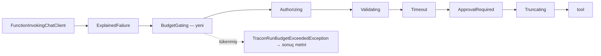

# Faz 243 — Bütçe Tükenince Tool Çağrısı Başlamaz

> **Durum:** 📋 Planlandı (2026-10-25)
> **Kademe:** tam — geri dönüşü pahalı karar ve maliyet sınırı: ağaç bütçesi tüketicinin harcama tavanıdır (K-999 ailesi). Kapı her tool kaynağının zincirine girer; yanlış konum tavanı sessizce delikli bırakır (MEMORY: yapısal iddia, K-320). GA'dan sonra bu davranışı değiştirmek major sürüm ister
> **Plan onayı:** Bakımcı, 2026-10-25 (sohbette alınan karar: koşul `IsExhausted` — token, maliyet ya da süre; ret biçimi: tool koşmaz, model açıklayıcı sonuç alır, sonraki model çağrısı bugünkü kapıda durur)
> **Kaynak:** [ADAYLAR.md](ADAYLAR.md) · **F-530**
> **Genellik:** Ağaç bütçesi (`Tracon:AgentGraph:MaxTotalCost`, `MaxTotalTokens` — varsayılan 200.000, `MaxDuration`) kuran ve tool'u ücret raporlayan (`TraconToolUsage.Report`: ses, görsel, dış API) her kurulum. İş tüketici kodunda kalamaz: tüketici tool'un başlangıcını bütçe ile bağlayamaz; zincir Tracon'undur. İkinci kanıt ilk ilkedir: K-999 tavanı "yeni işi durdurur" diye tanımlar ve yeniden açılma notu bu kalemi adıyla anar ("ücretli tool çağrısını başlamadan reddetme … ayrı karardır")
> **Karşı görüş:** (1) "Tool döngüsü MAF'tadır; Tracon araya giremez." Cevap: döngü MAF'ın `FunctionInvokingChatClient`'ındadır ama her tool çağrısı Tracon'un sarmalayıcı zincirinden geçer (`ToolWrapperChain.Compose`). Kapı oraya girer; MAF değişmez. (2) "Sonraki model çağrısı zaten reddedilir; ikinci tool'un maliyeti küçüktür." Cevap: ikinci tool'un maliyeti sınırsızdır (ses, görsel, dış API) ve yan etkisi geri alınamaz. Sonucunu okuyacak model çağrısı olmayacağı için o tool'u koşturmak yalnız harcamadır
> **Önkoşul:** Yok. Faz 239 (kota sürekliliği) kapandı; kota bu fazda okunmaz (§243.3)
> **Paketler:** `Tracon.Core` (`ToolWrapperChain`, yeni `BudgetGatingAIFunction`, `AgentRunBudget` iç metni, skill script yürütücüsü), `Tracon.Abstractions` (`AgentRunBudget` XML, iç açıklama)
> **Yeni paket:** Yok · **Migration:** Yok
> **Public API:** Büyümüyor — kapı `internal`; değişen yalnız XML metni (`TraconAgentGraphOptions.MaxTotalCost`/`MaxTotalTokens`/`MaxDuration`, `AgentRunBudget`, `TraconToolUsage`)
> **Tüketici yüzeyi:** site `concepts/governance.md` (bütçe), `guides/production.md`, `guides/write-your-own-tool.md` (`TraconToolUsage`), `concepts/workflows.md` (K-999 cümlesinin tool eşi) · sevk edilen: yukarıdaki XML, `CHANGELOG.md` `[Unreleased]` (davranış değişikliği: tükenmiş bütçede tool başlamaz)
> **Manuel test alanı:** `docs/manuel-test/12-GOZLEMLENEBILIRLIK-MALIYET.md`

---

## Bu Faza Başlarken

> `faz-baslangic` skill'ini uygula. Aşağıdaki liste o skill'in 2. adımıdır —
> **tamamını değil, yalnız işaret edilen bölümleri oku.**

1. Bu doküman
2. Kararlar — dosyanın tamamını **okuma**, yalnız bu kalemleri grep'le:
   ```bash
   grep -n "K-999 —\|K-483 —\|K-990 —\|K-893 —\|K-1046 —\|K-737 —\|K-840 —" docs/KARARLAR.md
   ```
   **K-999** (fonksiyon düğümü tükenmiş bütçede başlamaz; bu fazın emsali),
   **K-483** (toplama tek yerde), **K-990** (kota girdisi harcayan run başına),
   **K-893** (yan kanal modelin token'ı run'a girer), **K-1046** (hosted çağrı
   kaydı), **K-737/K-840** (iptal mi arıza mı)
3. Önceki fazdan devir: yok. Faz 210'un (K-999) tam metni gerekirse:
   `git show 2a8149ef:docs/arsiv/fazlar/210-BUTCE-DUGUM-KAPISI.md`
4. Alan hafızası (iki alan):
   [`hafiza/olcum-kota-ve-secenekler.md`](hafiza/olcum-kota-ve-secenekler.md) (bütçe ve toplama tuzakları) ·
   [`hafiza/tool-onay-ve-yetkilendirme.md`](hafiza/tool-onay-ve-yetkilendirme.md) (zincir sırası, ret kaydı)
5. Gerektiğinde: zincirin sıra gerekçesi `ToolWrapperChain.cs`'in kendi yorumundadır
   (`:9-29`); [`MIMARI.md`](MIMARI.md) § *K2 — Tool'lar yalnız kodda tanımlanır*

---

## Amaç

Ağaç bütçesi bugün iki yerde denetlenir: her model çağrısından önce
(`RunBudgetChatClient`) ve her alt agent çağrısından önce (`ChildAgentInvoker`).
Tool çağrısı denetlenmez. Bir model turu iki ücretli tool isterse ve birincisi
tavanı geçirirse, ikincisi yine koşar. Sonraki model çağrısı reddedilir ama
ikinci tool'un parası ve yan etkisi gitmiştir.

- **F-530** — tükenmiş bütçede (token, maliyet ya da süre) hiçbir tool çağrısı
  başlamaz. Tool'un yerine model açıklayıcı bir sonuç alır. Kayıt çağrıyı başarısız
  gösterir. Run, sonraki model çağrısında bugünkü kimlikle kapanır
  (`Failed`, `run_budget_exceeded`).

### Bugün ne çalışmıyor — doğrulanmış kanıt

| Kanıt | Gözlem |
|---|---|
| [`RunBudgetChatClient.cs:94-104`](../src/Tracon.Core/Models/RunBudgetChatClient.cs) | Bütçe yalnız model çağrısından önce okunur (`IsExhausted`) |
| [`ChildAgentInvoker.cs:516`](../src/Tracon.Core/Graph/ChildAgentInvoker.cs) | Alt agent çağrısı da denetlenir |
| [`ToolWrapperChain.cs:59-129`](../src/Tracon.Core/Tools/ToolWrapperChain.cs) | Zincir: ExplainedFailure → Authorizing → Validating → Timeout → ApprovalRequired → Truncating → tool. Hiçbir katman bütçeye bakmaz |
| [`ToolRegistry.cs:130`](../src/Tracon.Core/Tools/ToolRegistry.cs) · [`WorkspaceToolGovernance.cs:112`](../src/Tracon.Core/Workspace/WorkspaceToolGovernance.cs) · [`McpTenantTools.cs:219`](../src/Tracon.Mcp/Internal/McpTenantTools.cs) | Kod tool'ları, çalışma alanı tool'ları ve MCP tool'ları zinciri tek yerden alır |
| [`TraconToolUsage.cs:58`](../src/Tracon.Core/Tools/TraconToolUsage.cs) · [`NonTokenCostAccumulator.cs:347-353`](../src/Tracon.Core/Recording/NonTokenCostAccumulator.cs) | Tool'un raporladığı ücret bütçeye **anında** yazılır (`RecordUsage(0, increase)`). İkinci tool başlarken `IsCostBudgetExhausted` zaten `true` olabilir |
| [`AgentRunBudget.cs:266`](../src/Tracon.Abstractions/Runs/AgentRunBudget.cs), `:385`, `:402` | `IsExhausted` = token ∨ maliyet ∨ süre. Model çağrısı ve fonksiyon düğümü için ayrı ret metinleri var; tool için yok |
| [`ExplainedFailureAIFunction.cs:43-66`](../src/Tracon.Core/Tools/ExplainedFailureAIFunction.cs) | `TraconException`'ın mesajı tool sonucu olur ve çağrı kayıtta başarısız işaretlenir (`ToolExplainedFailures`) |
| [`ModelProviderRegistry.cs:554`](../src/Tracon.Core/Models/ModelProviderRegistry.cs) | `ToolLoop.AllowConcurrentToolCalls` açıksa bir turun tool'ları birlikte başlar |
| `K-999` satırı (`docs/KARARLAR.md:1034`) | Yeniden açılma notu: "ücretli tool çağrısını başlamadan reddetme istenirse ayrı karardır" |

> Kanıtlar 2026-10-25 tarihinde doğrulandı.

---

## 243.1 — Kapı ve zincirdeki yeri



- **Konum:** `ExplainedFailure`'ın hemen içinde, `Authorizing`'den önce.
  Gerekçe: bütçe okuması bellek içidir ve en ucuz denetimdir. Yetki işleyicisi
  (tüketicinin kodu, belki bir ağ çağrısı) tükenmiş bir run için koşmaz.
  `ExplainedFailure` dışta kalır, çünkü reddin mesajını modele o taşır ve çağrıyı
  kayıtta başarısız o işaretler.
- **Koşul:** `TraconRunContext.Current?.Budget is { IsExhausted: true }`. Bu
  koşul `RunBudgetChatClient`'ınkiyle **aynıdır** (bakımcı kararı). Gerekçe: tool'un
  sonucunu ancak bir model çağrısı okur, ve aynı koşul o çağrıyı reddeder.
  Fonksiyon düğümünün kuralı (K-999: yalnız maliyet ve süre) burada geçerli
  değildir, çünkü düğümün çıktısını model değil bir sonraki düğüm okur.
- **Ret:** kapı `TraconRunBudgetExceededException` atar. Mesaj yeni bir iç metinden
  gelir: `AgentRunBudget.DescribeToolStartExhaustion()` → "<aşılan sınır>. The tool
  call did not start." `ExplainedFailure` mesajı modele verir ve çağrıyı başarısız
  kaydeder. MAF'ın döngüsü sonucu modele götürmek ister. `RunBudgetChatClient`
  o çağrıyı reddeder. Run bugünkü kimlikle kapanır.
- **Bütçe yoksa** (`Budget` boş) kapı tek bir `AsyncLocal` okumasıdır; depo turu yoktur.
- **Kapı kaydı tek yerdedir.** `ToolWrapperChain.Compose` kod, çalışma alanı ve
  MCP tool'larına aynı anda ulaşır (`ToolWrapperChain.cs:9-16`).

## 243.2 — Zincirin dışındaki tool kaynakları

**Uygulamanın ilk işi bir ölçümdür.** Bir tool çağrısının geçtiği bütün yollar
listelenir ve her biri için karar yazılır (*Plandan Sapmalar*):

```bash
grep -rn "ToolWrapperChain.Compose\|: AIFunction\b\|: DelegatingAIFunction" src --include='*.cs'
```

| Kaynak | Bugünkü denetim | Bu fazda |
|---|---|---|
| Kod, çalışma alanı, MCP tool'ları | yok | kapı (§243.1) |
| Alt agent (arka plan ve `Tool` modu) | `ChildAgentInvoker:516` | değişmez |
| Skill script'i (`run_skill_script` → `SandboxedSkillScriptRunner.ExecuteAsync:343`) | yok | aynı koşul, aynı ret metni; yürütücünün girişinde. Dış sandbox ücretli olabilir |
| Skill okuma tool'ları, bellek ve todo tool'ları (MAF provider'ları) | yok | **değişmez** — ücret raporlamaz, yan etkisi Tracon'un deposundadır. Ölçüm aksini gösterirse plandan sapma olarak yazılır |
| Hosted tool (sağlayıcının bulutunda) | sonraki model çağrısı | **değişmez** — çağrı model yanıtının içinde olur; Tracon başlangıcını göremez. Site bunu sınır olarak yazar |
| İstemci tool'u (yalnız bildirim) | — | sunucuda koşmaz |

🚨 MEMORY: "Planın YAPISAL iddiasını GREP'le ölç." Kapının her kod, çalışma alanı
ve MCP tool'unu gördüğünü bir fonksiyonel test kanıtlar; yalnız `Compose` okuması
yetmez.

## 243.3 — Sınırlar ve bilinçli dışarıda bırakılanlar

- **Eşzamanlı tool çağrısı.** `AllowConcurrentToolCalls` açıkken bir turun
  tool'ları aynı anda başlar. Kapı, başlamış kardeşi durduramaz. Bu sınır bir
  testle sabitlenir ve site bunu yazar. Tavanı kesin isteyen kurulum eşzamanlı
  çağrıyı kapatır.
- **Tavanı geçiren ilk tool.** Ücret ancak tool bittikten sonra bilinir. Tavanı
  geçiren çağrı koşar; kapı ondan **sonrakini** durdurur. Bu, K-999'un
  "başlamış iş durmaz" kuralının eşidir.
- **Kiracı kotası okunmaz.** Faz 239 kararı: kota yeni bir iş biriminin (fonksiyon
  düğümü, agent adımı) başında okunur, sıcak yolda okunmaz. Tool çağrısı sıcak
  yoldur. Kota yine run kapanırken yazılır (K-990).
- **Muafiyet yok.** K-999'daki `StartsWhenBudgetIsSpent` eşi eklenmez: tool'un
  sonucunu okuyacak model çağrısı olmayacaktır (Açık Soru 1).

---

## Planlanan Public API

> Taslak imzalardır. Gerçekleşen imzalar kapanışta ayrı bir bölüme yazılır.

```csharp
// Tracon.Core — internal
internal sealed class BudgetGatingAIFunction(AIFunction inner) : DelegatingAIFunction(inner);

// Tracon.Abstractions — AgentRunBudget (internal üye)
internal string DescribeToolStartExhaustion();
```

Public yüzey değişmez. XML metinleri yeni davranışı yazar.
**Bugün eklemek bedava / sonradan eklemek kırıcı:** imza değişmez, ama
davranış değişikliği GA'dan sonra Faz 237 kuralına göre "XML'de belgelenen
davranışın değişmesi" olur, yani major. Bugün `CHANGELOG`'da adıyla anılır.

### HTTP `endpoint`'leri

Yeni uç yok. Reddedilen çağrı run olaylarında bugünkü başarısız tool olayıyla
görünür; run'ın kapanış kimliği değişmez (`run_budget_exceeded`).

### Arayüz payı

Yok.

---

## Planlanan Dosya Listesi

```
src/Tracon.Abstractions/Runs/
└── AgentRunBudget.cs                          # DescribeToolStartExhaustion (internal) + XML
src/Tracon.Core/
├── Tools/BudgetGatingAIFunction.cs            # yeni
├── Tools/ToolWrapperChain.cs                  # katman + sıra yorumu
├── Tools/TraconToolUsage.cs                   # XML: tükenmiş bütçede sonraki tool başlamaz
├── Skills/Scripts/SandboxedSkillScriptRunner.cs   # girişte aynı koşul (§243.2)
└── TraconOptions.cs                           # TraconAgentGraphOptions XML
tests/
├── Tracon.AspNetCore.FunctionalTests/ToolBudgetGateTests.cs
└── Tracon.Core.UnitTests/Tools/…              # zincir sırası
```

---

## Hata Modları ve Testler

| Ne bozulabilir | Seviye | Test (taslak ad) |
|---|---|---|
| Aynı turda ikinci ücretli tool, birinci tavanı geçirdikten sonra koşar (bugünkü davranış) | Fonksiyonel (gerçek host, `FakeModelProvider` iki tool çağrısı, `MaxTotalCost`) | `ToolBudgetGateTests` — ikinci tool'un gövdesi çağrılmaz; taban sürümde kırmızı |
| Reddedilen çağrı kayıtta başarılı görünür | Fonksiyonel | aynı sınıf — çağrı kaydı başarısız ve ret metnini taşır |
| Run başka bir kimlikle kapanır | Fonksiyonel | aynı sınıf — `Failed`, `run_budget_exceeded` |
| Token tavanı tool'u durdurmaz | Fonksiyonel | aynı sınıf — `MaxTotalTokens` satırı (varsayılan tavan 200.000 olduğu için bu yol bütçe yapılandırmayan kurulumda da işler) |
| Süre tavanı tool'u durdurmaz | Fonksiyonel (`FakeTimeProvider`) | aynı sınıf — `MaxDuration` satırı |
| MCP ya da çalışma alanı tool'u kapıyı atlar | Fonksiyonel | aynı sınıf — MCP test sunucusu ve çalışma alanı tool'u |
| Skill script'i kapıyı atlar | Fonksiyonel | aynı sınıf — script satırı |
| Bütçesiz run'da kapı bir şey değiştirir | Fonksiyonel (mevcut testler değişmeden yeşil) | tool testleri |
| Kapı yetki işleyicisinden sonra koşar | Birim (zincir sırası) | `ToolWrapperChainTests` |
| Eşzamanlı çağrıda kardeş tool durur sanılır | Fonksiyonel (bilinen sınırın sabiti) | aynı sınıf — `AllowConcurrentToolCalls = true` iki tool da başlar; site cümlesiyle eşleşir |
| Alt agent çağrısı iki kez reddedilir ya da ret metni değişir | Fonksiyonel (mevcut) | alt agent bütçe testleri değişmeden yeşil |
| Ret iptal gibi görünür | Birim | iptal edilen token `OperationCanceledException` kalır (K-737) |

Beş soru: **iptal** — kapı token'ı okumaz; iptal bugünkü yoldan geçer ·
**eşzamanlılık** — yukarıda; bütçe okuması `Interlocked`'tır · **boş/aşırı
girdi** — `MaxTotalCost = 0` "sınır yok" demektir (bugünkü anlam); kapı bunu
değiştirmez · **başka kiracı** — bütçe ağaca aittir, kiracı ayrımı gerekmez ·
**alt sistem hatası** — kapı depoya dokunmaz.

---

## Manuel Kabul Case'leri

| # | Ön koşul | Adımlar | Beklenen sonuç |
|---|---|---|---|
| 1 `🤖` | `samples/Tracon.Api`, ücret raporlayan bir tool (ses tool'u), küçük `Tracon__AgentGraph__MaxTotalCost` | Aynı turda iki seslendirme isteyen istem | Birinci çağrı koşar; ikinci çağrı ret metniyle başarısız; run `Failed`/`run_budget_exceeded`; run detayında iki tool satırı |

---

## Açık Sorular

| # | Soru | Seçenekler | Öneri |
|---|---|---|---|
| 1 | Kodda bir muafiyet bayrağı (`TraconToolRegistration`) olsun mu? | A: yok · B: `StartsWhenBudgetIsSpent` eşi | **A** — sonucu okuyacak model çağrısı yoktur; ihtiyaç ölçülürse ayrı karar |
| 2 | Ret metni modele hangi sınırın aşıldığını söylesin mi? | A: evet (`DescribeExceededLimit` metni) · B: genel cümle | **A** — bugünkü model çağrısı ve düğüm metinleriyle aynı biçim; metin tutar ya da kimlik taşımaz |

---

## Bitiş Ölçütleri (DoD)

- [ ] `ToolBudgetGateTests` aynı turdaki ikinci tool'un başlamadığını üç sınır için (maliyet, token, süre) kanıtlar; test taban sürümde kırmızıdır (kayıt: komut + çıktı)
- [ ] Kod, çalışma alanı, MCP ve skill script'i yolları kapıdan geçer (§243.2 ölçümü *Plandan Sapmalar*'da)
- [ ] Reddedilen çağrı kayıtta başarısız ve ret metnini taşır; run `run_budget_exceeded` ile kapanır
- [ ] Eşzamanlı çağrı sınırı testle sabitlendi ve sitede yazılı
- [ ] `CHANGELOG.md [Unreleased]` davranış değişikliğini adıyla yazar
- [ ] Site sayfaları (Tüketici yüzeyi satırı) güncel; `npm run build` + `check-links.mjs` temiz
- [ ] Dört doğrulama kapısı sıfır uyarı verir
- [ ] `samples/Tracon.Api` ile gerçek `run` yapıldı (Manuel 1), çıktı belgeye yazıldı
- [ ] `secret` taraması boş döndü
- [ ] `🤖` case `docs/manuel-test/12-GOZLEMLENEBILIRLIK-MALIYET.md` içinde ve koşuldu
- [ ] `faz-denetim` koşuldu; 🔴 bulgu kalmadı

### Doğrulama komutları

```bash
python3 scripts/kapi.py test --proje Tracon.AspNetCore.FunctionalTests --sinif ToolBudgetGateTests
grep -rn "ToolWrapperChain.Compose" src --include='*.cs'      # §243.2 kaynak listesi
```

---

## Riskler

| Risk | Önlem |
|------|-------|
| Kapı yanlış katmana girer ve bir tool kaynağını görmez (K-320 sınıfı) | §243.2 ölçümü ilk iştir; her kaynak için fonksiyonel test |
| `ExplainedFailure` dışına konan kapı ret metnini "Error: Function failed." yapar | Konum §243.1; zincir sırası birim testi |
| Ret, onay bekleyen bir tool'un onay akışını bozar | MAF onay isteğini zinciri **çağırmadan** üretir (`ApprovalRequiredAIFunction` sarmalayıcıdan okunur); kapı yalnız gerçek çağrıda, onay devamının run'ında koşar ve o run'ın bütçesini okur. Uygulama bunu ölçer: tükenmiş bütçede onay isteği hâlâ oluşuyor mu? Oluşuyorsa davranış sitede yazılır. Mevcut onay testleri değişmeden yeşil kalır |
| Tool'un ücreti bütçeye geç yazılırsa kapı tükenmeyi görmez | `NonTokenCostAccumulator.RecordIntoBudget` raporla aynı anda yazar (kanıt tablosu); test bunu sırayla kanıtlar |

---

<!-- ============================================================
     AŞAĞISI ÇALIŞIRKEN DOLAR — doküman kapanışta silinir (`faz-kapat`).
     Kalıcı kısım `faz-tamamlama` Adım 5'te yerine taşınır. Başlıkları SİLME.
     ============================================================ -->

## Plandan Sapmalar

> Çalışırken dolar. Plan ile gerçek arasındaki fark **gizlenmez**. Kapanışta
> kapanış commit mesajına taşınır. §243.2 kaynak listesi ve kararları buraya yazılır.

## Bu Fazda Verilen Kararlar

> Çalışırken dolar. Dört kategoriden birine giren karar (AGENTS.md)
> `docs/KARARLAR.md`'ye K-NNN ve kategori etiketiyle girer; girmeyen karar
> kapanışta commit mesajına taşınır (`faz-tamamlama` Adım 8). Plan numara rezerve
> etmez. Beklenen kayıt: tükenmiş bütçede tool başlamaz *(public-api,
> geri-dönüşü-pahalı; alternatifler: yalnız maliyet ve süre (K-999 kuralı), muafiyet
> bayrağı, tool döngüsünü `Terminate` ile kesmek)*. K-999'un yeniden açılma notu
> bu kayıtla kapanır.

## Süreç Ölçümü

> Kapanışta doldurulur. **Tablo olarak** — onay kutusu DEĞİL: `faz-kapat`
> işaretsiz kutuda durur. `faz-kapat` bu tabloyu `docs/FAZ-DEFTERI.md`'ye taşır;
> eşik **167**'den itibaren boş bir değer hücresinde kapanışı durdurur.
> `ölçülmedi` **geçerli bir değerdir** — kapı bir sayı değil, bir **karar** arar.
> Kapı bölümün VARLIĞINI denetler, doğruluğunu denetlemez (K-766).

| Metrik | Değer |
|---|---|
| Plan revizyonu sayısı | |
| Düzeltme turu sayısı | |
| 🔴 bulgu: gerçek / gürültü / araştırılacak | |
| Fazın ürettiği regresyon | |
| Faz kapandıktan sonra bulunan kusur | ölçülmedi (kapanış anı) |

## Denetim Bulguları

> `faz-denetim` çıktısı. Her satır: bulgu · seviye (🔴/🟡/🟢) · sonuç
> (düzeltildi / gerekçelendi / F-NN olarak devredildi). 🟢 kapanışta
> `ADAYLAR.md`'ye gider.
