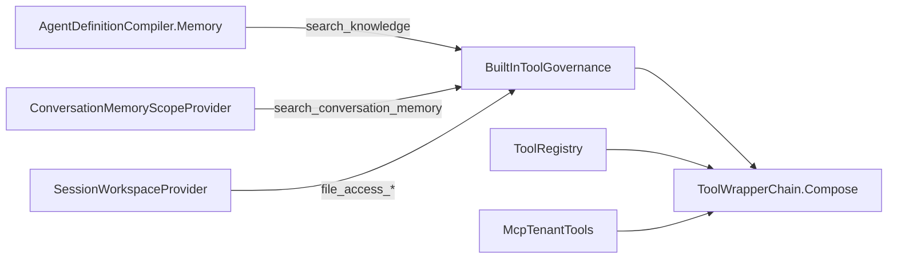

# Faz 246 — Bilgi ve Konuşma Hafızası Aramaları Tool Zincirinden Geçer

> **Durum:** 📋 Planlandı (2026-10-26)
> **Kademe:** tam — güvenlik sınırı: `IToolAuthorizationHandler` kararı iki tool'a ilk kez uygulanır; reddeden bir işleyici bilgi aramasını durdurur (davranış değişikliği). GA'dan sonra bu sınırı değiştirmek major sürüm ister
> **Plan onayı:** Bakımcı, 2026-10-26 (sohbette alınan kararlar: iki tool `ToolEffect.External` taşır; zincire giriş kaynak başına `ToolWrapperChain.Compose` ile olur, K-1069 emsali)
> **Kaynak:** [ADAYLAR.md](ADAYLAR.md) · **F-688**
> **Genellik:** Bilgi araması (`EnableVectorSearch`) ya da konuşma hafızası (`OnDemand`) açan ve yetki işleyicisi, argüman doğrulayıcısı, ağaç bütçesi veya tool zaman aşımı kuran her kurulum. İş tüketici kodunda kalamaz: iki tool Tracon'un derleyicisinde ve sağlayıcısında kurulur, tüketici onları sarmalayamaz. İkinci kanıt ilk ilkedir: `IToolAuthorizationHandler` sözleşmesi "may call a specific tool" der (`ToolAuthorizationTypes.cs:4`), site "a decision for every tool call" vaat eder (`guides/embedding.md:19`) ve K-1069 aynı açığı workspace tool'ları için kapattı
> **Karşı görüş:** (1) "Arama salt okumadır; yetki ve bütçe gereksizdir." Cevap: her `search_knowledge` çağrısı sorgu metnini kiracının embedding sağlayıcısına gönderir (egress, ücret); bir işleyici bilgi koleksiyonunu kullanıcıya göre kapatmak isteyebilir ve bugün kapatamaz. (2) "`FunctionInvokingChatClient`'a tek bir `FunctionInvoker` her kaynağı kapsar." Cevap: onay isteyen çağrı invocation'dan önce kısa devre olur (K-490); tanımsız tool için descriptor ve effect yoktur; çift sarmalama tespiti gerekir; geri dönüşü pahalıdır. Reddedildi
> **Önkoşul:** Yok. Faz 243 (bütçe kapısı zincirde, K-1089) kapandı
> **Paketler:** `Tracon.Core` (`AgentDefinitionCompiler.Memory`, `VectorSearchToolFactory`, `ConversationMemoryScopeProvider`, `WorkspaceToolGovernance` → yerleşik tool yönetişimi, `ToolWrapperChain`), `Tracon.Abstractions` (`IToolAuthorizationHandler` XML)
> **Yeni paket:** Yok · **Migration:** Yok
> **Public API:** Büyümüyor — yeni tipler `internal`; değişen yalnız XML metni. `wc -l src/*/PublicAPI.Shipped.txt`: 18 dosya × 1 satır (2026-10-26), yani hiçbir şey sevk edilmedi
> **Tüketici yüzeyi:** site `guides/embedding.md` (`:19` vaadi düzelir), `guides/reliability.md` (`:574-577` bütçe kapısının istisna listesi), `guides/context-and-memory.md` (iki tool'un yönetişimi; maliyet satırı `:310-311`) · sevk edilen: `IToolAuthorizationHandler` XML (hangi tool kaynakları işleyiciye ulaşır), `CHANGELOG.md` `[Unreleased]` → *Changed* (işleyici, doğrulayıcı, zaman aşımı ve bütçe artık iki tool'u görür; effect `External`)
> **Manuel test alanı:** `docs/manuel-test/20-BELLEK-RAG-BAGLAM.md`

---

## Bu Faza Başlarken

> `faz-baslangic` skill'ini uygula. Aşağıdaki liste o skill'in 2. adımıdır —
> **tamamını değil, yalnız işaret edilen bölümleri oku.**

1. Bu doküman
2. Kararlar — dosyanın tamamını **okuma**, yalnız bu kalemleri grep'le:
   ```bash
   grep -n "K-487 —\|K-488 —\|K-490 —\|K-936 —\|K-1030 —\|K-1043 —\|K-1044 —\|K-1065 —\|K-1069 —\|K-1089 —\|K-874 —" docs/KARARLAR.md
   ```
   **K-487** (sarmalayıcı sırası; yeni sarmalama noktası katmanları taşımalı),
   **K-488** (ret normal sonuç döner, kapı fail-closed), **K-490** (onay
   `GetService` ile kısa devre olur), **K-936** (her bilgi embedding çağrısı
   `EmbeddingProviderAccess`'ten geçer), **K-1030** (eklenti sağlayıcı tool'ları
   zincir dışı), **K-1043** (alt agent tool modu kayıt dışı), **K-1044** (hosted
   tool'da zincir yok), **K-1065** (konuşma hafızası Core'da, depo tüketicinin),
   **K-1069** (workspace tool'ları zincirden geçer — bu fazın emsali),
   **K-1089** (bütçe kapısı `ExplainedFailure`'ın içinde), **K-874** (embedding
   ücreti kapsam dışı, F-363)
3. Önceki fazdan devir: yok. Faz 243'ün kaynak tablosu gerekirse:
   `git show 7b025084:docs/243-TOOL-BUTCE-KAPISI.md | sed -n 285,300p`
4. Alan hafızası (üç alan):
   [`hafiza/tool-onay-ve-yetkilendirme.md`](hafiza/tool-onay-ve-yetkilendirme.md) (zincir sırası, ret kaydı; `:15` bütçe kapısının görmediği kaynaklar) ·
   [`hafiza/konusma-hafizasi.md`](hafiza/konusma-hafizasi.md) (sahte model senaryosu sağlayıcı başına bir kez tüketilir) ·
   [`hafiza/oturum-calisma-alani.md`](hafiza/oturum-calisma-alani.md) (workspace yönetişimi, bu fazın kalıbı)
5. Gerektiğinde: zincirin sıra gerekçesi `ToolWrapperChain.cs`'in kendi yorumundadır
   (`:9-29`); [`MIMARI.md`](MIMARI.md) § *K2 — Tool'lar yalnız kodda tanımlanır*

---

## Amaç

Tracon her tool çağrısını bir sarmalayıcı zincirinden geçirir: açıklanan hata,
bütçe kapısı, yetki, argüman doğrulama, zaman aşımı, onay ve çıktı kırpma
(`ToolWrapperChain.cs:18-19`). Kayıtlı tool'lar, MCP tool'ları ve workspace
tool'ları bu zincirden geçer. İki yerleşik arama tool'u geçmez:
`search_knowledge` ve `search_conversation_memory`. Bu yüzden yetki işleyicisi
onları görmez, bütçe tükenince de başlarlar ve kiracının egress reddi modele
genel bir "Function failed" metniyle ulaşır.

- **F-688** — iki arama tool'u zincirden `ToolEffect.External` ile geçer. Yetki,
  bütçe, doğrulama, zaman aşımı ve kırpma onlara da uygulanır. `search_knowledge`
  embedding token sayısını `TraconToolUsage` ile raporlar (fiyat yok, F-363 açık
  kalır). Yeni bir kaynak envanteri kapısı, zincir dışı kalan her tool kaynağını
  gerekçesiyle adlandırır.

### Bugün ne çalışmıyor — doğrulanmış kanıt

| Kanıt | Gözlem |
|---|---|
| [`AgentDefinitionCompiler.Memory.cs:199`](../src/Tracon.Core/Compilation/AgentDefinitionCompiler.Memory.cs) | `tools.Add(VectorSearchToolFactory.Create(...))` — fonksiyon zincirsiz eklenir |
| [`AgentDefinitionCompiler.ChatOptions.cs:186-188`](../src/Tracon.Core/Compilation/AgentDefinitionCompiler.ChatOptions.cs) | Kayıtlı tool `_tools.TryGet` ile zaten sarmalanmış gelir |
| [`ToolRegistry.cs:113-130`](../src/Tracon.Core/Tools/ToolRegistry.cs) | Kayıt, açılışta `ToolDescriptor` kurar ve `ToolWrapperChain.Compose` çağırır |
| [`ToolWrapperChain.cs:121`](../src/Tracon.Core/Tools/ToolWrapperChain.cs) | `AuthorizingAIFunction`'ı kuran tek yer. `Compose`'un üç çağıranı var: `ToolRegistry.cs:130`, `WorkspaceToolGovernance.cs:112`, `McpTenantTools.cs:219` |
| [`ConversationMemoryScopeProvider.cs:95-105`](../src/Tracon.Core/Memory/ConversationMemoryScopeProvider.cs) | `InvokingCoreAsync` iç MAF sağlayıcısının `AIContext`'ini değiştirmeden döner; `search_conversation_memory` (`:89`) `AIContext.Tools` ile gelir |
| [`WorkspaceToolGovernance.cs:90-122`](../src/Tracon.Core/Workspace/WorkspaceToolGovernance.cs) | Kayıt dışı bir fonksiyon için tek seferlik `TraconToolRegistration` + `ToolDescriptor` kurup `Compose` çağıran emsal (K-1069) |
| [`ToolAuthorizationTypes.cs:4`](../src/Tracon.Abstractions/Tools/ToolAuthorizationTypes.cs) | Sözleşme: "Decides whether a tenant/user may call a specific tool" |
| [`VectorSearchToolFactory.cs:68-69`](../src/Tracon.Core/Knowledge/VectorSearchToolFactory.cs) | `generated.Usage` atılır; embedding token sayısı hiçbir yere yazılmaz |
| [`EmbeddingProviderAccess.cs:90-113`](../src/Tracon.Core/Knowledge/EmbeddingProviderAccess.cs) | Egress reddi `TraconTenantProviderRefusedException` atar; `ExplainedFailure` katmanı olmadığı için model MEAI'nin genel "Error: Function failed." metnini alır |
| `docs-site/src/content/docs/guides/embedding.md:19` | "A decision for every tool call" — bugün doğru değil |

> Kanıtlar 2026-10-26 tarihinde doğrulandı (kod okuması; işleyicinin bu
> tool'ları görmediği testle değil, `IToolAuthorizationHandler`'ın tek
> tüketicisinin `AuthorizingAIFunction` olduğu ve onun tek kurulduğu yerin
> `Compose` olduğu grep'le ölçüldü). İlk iş: Hata Modları tablosundaki yetki
> testini **düzeltmeden önce** kırmızı gör.

---

## 246.1 — Yerleşik tool yönetişimi

`WorkspaceToolGovernance` bugün yalnız workspace tool'larını yönetir. Faz onu
genel bir iç servise çevirir (ad uygulama anında seçilir; öneri
`BuiltInToolGovernance`). Servis bir `AIFunction`, bir `ToolEffect` ve isteğe
bağlı zaman aşımı/çıktı sınırı alır; tek seferlik `TraconToolRegistration` ve
`ToolDescriptor` kurar; `ToolWrapperChain.Compose` çağırır. Varsayılan zaman
aşımı ve çıktı sınırı `TraconOptions.Tools`'tan gelir (`ToolRegistry.cs:101-102`
ile aynı kaynak).

- Workspace çağıranı aynı servisi kullanır; davranışı değişmez
  (`SessionWorkspaceProviderTests` aynen yeşil kalmalı).
- Yönetilen tool `IToolRegistry.List()`'e ve `/api/tools`'a **girmez** (K-1044
  emsali: derleme anında bağlanan tool katalog tool'u değildir).
- Descriptor alanları: `Name`, `Description`, `JsonSchema` fonksiyondan;
  `Effect = External`; `RequiresApproval = false`; `RunsOnClient = false`.



## 246.2 — `search_knowledge`

Derleyici fonksiyonu kurar kurmaz yönetişimden geçirir. Ekleme `toolTransform`'dan
önce kalır (`AgentDefinitionCompiler.cs:642-657`); replay oynatıcısı
(`RecordedToolPlayback.cs:115`) bugün kayıtlı tool'u nasıl sarıyorsa yönetilen
tool'u da öyle sarar. Uygulayan oturum bunu ölçer: replay yönetilen tool'u ne
atlamalı ne iki kez sarmalı.

Egress reddi (`TraconTenantProviderRefusedException`) artık `ExplainedFailure`
katmanından geçer: model genel metin yerine Tracon'un açıklayıcı sonucunu alır.
Kayıt satırı hatayı bugünkü gibi taşır (`ToolInvocationTracker.cs:128`).

## 246.3 — `search_conversation_memory`

`ConversationMemoryScopeProvider.InvokingCoreAsync`, iç sağlayıcının döndürdüğü
`AIContext.Tools` içindeki `SearchToolName` adlı fonksiyonu yönetilen sarmalayıcıyla
değiştirir. Değişim **her çağrıda** yapılır: durum başlatıcısı oturum yoksa her
çağrıda koşar (`:63-65`), tool örneği çağrıya bağlı olabilir.

- 🚨 Önce ölç: iç sağlayıcı aynı tool örneğini mi, her çağrıda yenisini mi döner?
  Aynıysa sarmalayıcı örnek başına önbelleğe alınabilir; değilse her çağrıda kurulur.
- **Fail-closed değişmezi:** dönen bağlamda yönetilmemiş bir `AIFunction` kalırsa
  (MAF tool'u yeniden adlandırırsa ya da ikinci bir tool eklerse) çağrı hata
  verir. Zincir sessizce düşemez.
- `AgentOptionsGuard` (`AgentOptionsGuard.cs:57,125,160`) değişmez: değişim
  sağlayıcının kendi dönüşünde olur, `ChatOptions.Tools`'a dokunmaz.

## 246.4 — Kullanım raporu

`search_knowledge`, `generated.Usage` varsa `TraconToolUsage.Report` çağırır:
`Unit = Tokens`, `Quantity = InputTokenCount`, `Provider = access.ProviderName`,
`Cost = null`. `Cost` boş olduğu için bütçe, kota ve webhook toplamı değişmez
(`TraconToolUsage.cs:89-93`: yalnız `Cost` `NonTokenCost`'a girer). Fiyat kimliği
F-363'ün işidir ve açık kalır. Konuşma hafızası için Tracon embedding'i görmez
(`ConversationMemorySchema.cs:62`; site `context-and-memory.md:219-220`); rapor
yazılmaz.

## 246.5 — Kaynak envanteri kapısı

Bir mimari testi, model isteğine tool ekleyen her kaynak noktasını tarar ve her
birini iki listeden birinde ister: **zincirde** (`Compose` çağrısıyla) ya da
**bilerek zincir dışı** (gerekçe ve karar numarasıyla). Desen
`TimeoutSiteTests` / `PeriodicTimerSiteTests`'tir (`KnownSites`; yeni site düşer,
kaybolan site düşer). Bilerek zincir dışı kalanlar bugün:

| Kaynak | Gerekçe |
|---|---|
| Hosted tool | Sağlayıcı koşar (K-1044) |
| Alt agent tool modu, arka plan alt agent'ları | `ChildAgentInvoker` bütçeyi ve beklemeyi taşır (K-1043, Faz 243) |
| `load_skill`, `read_skill_resource`, `run_skill_script` | MAF `AgentSkillsProvider`; betik bütçesi koşucu girişinde (Faz 243) |
| `file_memory_*`, `todos_*`, harness `mode_*` | Ücret raporlamaz, yan etkisi Tracon deposunda (Faz 243) |
| Eklentinin eklediği sağlayıcı tool'ları | K-1030 |

Tarama deseni (hangi ifadeler "tool ekleme noktası" sayılır) uygulama anında
ölçülür; plan yalnız kuralı koyar: listede olmayan yeni bir kaynak testi düşürür.

## 246.6 — Belge

- `IToolAuthorizationHandler` XML'i hangi kaynakların işleyiciye ulaştığını ve
  hangilerinin ulaşmadığını yazar (246.5 tablosu).
- Site: `embedding.md:19` vaadi kaynak listesine bağlanır; `reliability.md:574-577`
  bütçe kapısının istisna listesinden iki tool çıkar; `context-and-memory.md`
  iki tool'un yönetişimini ve `search_knowledge` kullanım satırını yazar.
- `CHANGELOG.md` `[Unreleased]` → *Changed*: `External`'ı reddeden bir işleyici
  artık bilgi ve konuşma hafızası aramasını da durdurur.

---

## Planlanan Public API

Yok. `BuiltInToolGovernance` (ya da seçilen ad) `internal`'dır. `ToolDescriptor`,
`ToolEffect`, `TraconToolRegistration`, `ToolCallUsage` zaten public'tir ve
değişmez. Değişen yalnız XML metnidir.

### HTTP `endpoint`'leri

Yok. `/api/runs/{id}/tools` satırları bugün de yazılır (`RunRecordingAgent.Persistence.cs:365-404`);
`search_knowledge` satırı artık `Usage` taşır.

### Arayüz payı

Yok.

---

## Planlanan Dosya Listesi

```
src/Tracon.Core/
├── Tools/BuiltInToolGovernance.cs          (WorkspaceToolGovernance'tan genelleşir; ad uygulamada)
├── Workspace/WorkspaceToolGovernance.cs    (silinir ya da ince bir çağırana döner)
├── Workspace/SessionWorkspaceProvider.cs   (yeni servisi kullanır)
├── Compilation/AgentDefinitionCompiler.Memory.cs
├── Knowledge/VectorSearchToolFactory.cs    (kullanım raporu)
├── Memory/ConversationMemoryScopeProvider.cs
└── TraconServiceCollectionExtensions.Registration.Core.cs
src/Tracon.Abstractions/Tools/ToolAuthorizationTypes.cs   (XML)
tests/Tracon.Core.UnitTests/Architecture/ToolSourceGovernanceTests.cs   (yeni kapı)
tests/Tracon.Core.UnitTests/Memory/ConversationMemoryScopeProviderTests.cs
tests/Tracon.AspNetCore.FunctionalTests/KnowledgeToolGovernanceTests.cs  (yeni)
tests/Tracon.AspNetCore.FunctionalTests/ToolBudgetGateTests.cs
tests/Tracon.AspNetCore.FunctionalTests/ConversationMemoryTests.cs
docs-site/src/content/docs/guides/{embedding,reliability,context-and-memory}.md
CHANGELOG.md
```

---

## Hata Modları ve Testler

| Ne bozulabilir | Seviye | Test sınıfı |
|---|---|---|
| Yetki işleyicisi `search_knowledge`'ı reddeder ama tool yine koşar (bugünkü durum — **önce kırmızı**) | Fonksiyonel | `KnowledgeToolGovernanceTests` (`RecordingDenyingHandler` emsali: `SessionWorkspaceGovernanceTests.cs:225`) |
| Aynısı `search_conversation_memory` için | Fonksiyonel | `ConversationMemoryTests` (yeni case; `OnDemand` + `InMemoryVectorStore`) |
| İşleyici `Effect = External` yerine başka değer görür | Fonksiyonel | aynı iki sınıf |
| Bütçe tükenince arama başlar, embedding çağrılır | Fonksiyonel | `ToolBudgetGateTests` (kaynak başına yeni case; `CountingEmbeddingGenerator` sayacı `0` kalır) |
| Yavaş vektör deposu zaman aşımına uğramaz | Fonksiyonel | `KnowledgeToolGovernanceTests` (bekleyen depo + kısa `DefaultTimeout`) |
| Argüman doğrulayıcısının reddi uygulanmaz | Fonksiyonel | `KnowledgeToolGovernanceTests` (`ToolGovernanceEndpointTests` emsali) |
| Egress reddi modele genel "Function failed" olarak gider | Fonksiyonel | `KnowledgeTenantPolicyTests` (`:168-226`; iddia açıklayıcı sonuç metni) |
| MAF tool'u yeniden adlandırır, yönetilmemiş tool sızar | Birim | `ConversationMemoryScopeProviderTests` (sahte iç sağlayıcı başka adla tool döner → hata) |
| Replay yönetilen tool'u atlar ya da iki kez sarar | Birim | `RecordedToolPlaybackTests` (uygulamada adı ölçülür) |
| `search_knowledge` kullanım satırı token taşımaz ya da `Cost` doldurur ve bütçeye girer | Fonksiyonel | `KnowledgeToolGovernanceTests` (`/runs/{id}/tools` satırı `Usage.Quantity > 0`, `Cost = null`; ağaç maliyeti değişmez) |
| Başka kiracının adına yetki isteği | Fonksiyonel | `KnowledgeToolGovernanceTests` (işleyici isteğin `TenantId`'sini kaydeder) |
| Workspace davranışı refactor'la değişir | Birim + Fonksiyonel | `SessionWorkspaceProviderTests`, `SessionWorkspaceGovernanceTests` (aynen yeşil) |
| Yeni bir tool kaynağı zincir dışı eklenir ve kimse fark etmez | Birim (mimari) | `ToolSourceGovernanceTests` |

Beş soru: **iptal** — run iptali zincirin zaman aşımı katmanından geçer, ek
davranış yok · **eşzamanlılık** — 246.3'teki her çağrı sarmalaması paylaşılan
durum tutmaz; önbellek seçilirse örnek başına ve iş parçacığı güvenli olmalı ·
**boş/aşırı girdi** — kırpma katmanı `JsonElement` sonucu işler
(`ToolResultText.cs:51`) · **başka kiracı** — yetki isteği kiracıyı taşır (tablo) ·
**alt sistem hatası** — vektör deposu ya da embedding hatası `ExplainedFailure`'dan
geçer, run devam eder.

---

## Manuel Kabul Case'leri

| # | Ön koşul | Adımlar | Beklenen sonuç |
|---|---|---|---|
| 1 🤖 | `samples/Tracon.Api` + PgVector + gerçek OpenAI embedding; bilgi araması açık bir agent | Agent'a bilgi gerektiren bir soru sor; `GET /tracon/api/runs/{id}/tools` | `search_knowledge` satırı `usage.unit = tokens`, `quantity > 0`, `cost = null` taşır |
| 2 🤖 | Aynı agent, `Tracon:AgentGraph:MaxTotalTokens` model çağrısının hemen üstünde | Aynı soruyu sor | Arama başlamaz; satır bütçe reddini taşır; run `run_budget_exceeded` ile kapanır |

Case'ler `docs/manuel-test/20-BELLEK-RAG-BAGLAM.md`'ye eklenir.

---

## Açık Sorular

| # | Soru | Seçenekler | Öneri |
|---|---|---|---|
| 1 | Yönetişim servisinin adı ve yeri | A: `Tools/BuiltInToolGovernance` · B: `WorkspaceToolGovernance` adı kalır, genelleşir | A — ad kapsamı söylemeli |
| 2 | Konuşma hafızası sarmalayıcısı önbelleğe alınır mı | A: her çağrıda kur · B: tool örneği başına önbellek | Ölçüme bağlı (246.3); ölçülmeden A |
| 3 | Kullanım raporu `IsEstimated` taşır mı | A: `false` (sağlayıcı sayısı) · B: `true` | A — sayı sağlayıcının `Usage`'ından gelir |

---

## Kapsam Dışı

- Embedding fiyatı ve maliyetin bütçeye girmesi — F-363 (fiyat kimliği yok, K-874).
- Skill, dosya hafızası, todo, harness ve eklenti tool'ları — 246.5 tablosundaki gerekçeler.
- Harness agent'ında `EnableConversationMemory`'nin sessizce yok sayılması — F-699 (kod okuması, ölçülmeli).
- Uzlaştırıcının kayıt dışı tool'u (arama, MCP, workspace) "güvensiz" sayıp otomatik devamı reddetmesi — F-700 (kod okuması, ölçülmeli).

---

## Bitiş Ölçütleri (DoD)

- [ ] Reddeden bir `IToolAuthorizationHandler` ile `search_knowledge` ve `search_conversation_memory` koşmaz; model açıklayıcı sonuç alır; tool satırı reddi taşır; işleyici `Effect = External` görür
- [ ] Tükenmiş bütçede iki arama da başlamaz (`CountingEmbeddingGenerator` sayacı `0`)
- [ ] Egress reddi modele açıklayıcı sonuç olarak ulaşır
- [ ] `search_knowledge` satırı embedding token sayısını taşır; `Cost = null`; ağaç maliyeti değişmez
- [ ] `ToolSourceGovernanceTests` zincir dışı her kaynağı gerekçesiyle listeler; listede olmayan yeni kaynak testi düşürür
- [ ] Workspace testleri aynen yeşil
- [ ] Dört doğrulama kapısı sıfır uyarı verir (`python3 scripts/kapi.py kapanis --taban <faz öncesi commit>`)
- [ ] `samples/Tracon.Api` ile gerçek `run` yapıldı (manuel case 1), çıktı belgeye yazıldı
- [ ] `secret` taraması boş döndü
- [ ] `🤖` case'ler `docs/manuel-test/20-BELLEK-RAG-BAGLAM.md` içinde ve koşuldu; gerisi otomatik testte
- [ ] `faz-denetim` koşuldu; 🔴 bulgu kalmadı
- [ ] `docs-site/` güncellendi (246.6); `npm run build` + `check-links.mjs` temiz; `CHANGELOG.md` *Changed* satırı yazıldı

### Doğrulama komutları

```bash
# Önce kırmızı: yetki testi düzeltmeden önce düşmeli
python3 scripts/kapi.py test --proje Tracon.AspNetCore.FunctionalTests --sinif "*KnowledgeToolGovernanceTests*"
# Gerçek run'ın tool satırları
curl -s http://localhost:5081/tracon/api/runs/<runId>/tools | jq '.[] | {toolName, usage}'
```

---

## Riskler

| Risk | Önlem |
|------|-------|
| Varsayılan reddeden (`External`'ı kapatan) tüketici işleyicisi bilgi aramasını durdurur | `CHANGELOG` *Changed* satırı ve site; `rc.1` öncesi kırıcı değişiklik serbesttir (UR-012 B) |
| Doğrulayıcısı bilinmeyen tool'u reddeden tüketici iki aramayı reddeder | Aynı satırda yazılır; descriptor şeması fonksiyonun kendi şemasıdır |
| MAF konuşma hafızası tool'unu yeniden adlandırır | 246.3 fail-closed değişmezi + birim testi |
| Replay iki kez sarar ya da atlar | Hata modu tablosundaki replay testi |
| Yönetilen tool `/api/tools`'ta görünmediği için işleyici yazarı adını bilmez | XML ve site iki adı sabit metin olarak yazar |

---

<!-- ============================================================
     AŞAĞISI ÇALIŞIRKEN DOLAR — doküman kapanışta silinir (`faz-kapat`).
     Kalıcı kısım `faz-tamamlama` Adım 5'te yerine taşınır. Başlıkları SİLME.
     ============================================================ -->

## Plandan Sapmalar

> Çalışırken dolar. Plan ile gerçek arasındaki fark **gizlenmez**. Kapanışta
> kapanış commit mesajına taşınır.

## Bu Fazda Verilen Kararlar

> Çalışırken dolar. Dört kategoriden birine giren karar (AGENTS.md)
> `docs/KARARLAR.md`'ye K-NNN ve kategori etiketiyle girer; girmeyen karar
> kapanışta commit mesajına taşınır (`faz-tamamlama` Adım 8). Plan numara rezerve
> etmez.

## Süreç Ölçümü

> Kapanışta doldurulur. **Tablo olarak** — onay kutusu DEĞİL.

| Metrik | Değer |
|---|---|
| Plan revizyonu sayısı | |
| Düzeltme turu sayısı | |
| 🔴 bulgu: gerçek / gürültü / araştırılacak | |
| Fazın ürettiği regresyon | |
| Faz kapandıktan sonra bulunan kusur | ölçülmedi (kapanış anı) |

## Denetim Bulguları

> `faz-denetim` çıktısı. Her satır: bulgu · seviye (🔴/🟡/🟢) · sonuç
> (düzeltildi / gerekçelendi / F-NN olarak devredildi). 🟢 kapanışta
> `ADAYLAR.md`'ye gider.
