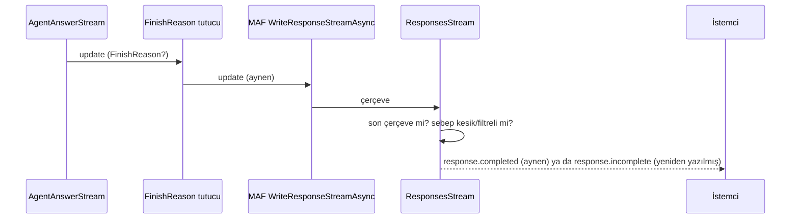

# Faz 251 — Kesik ve Filtreli Yanıtın Sinyali: Responses `incomplete` ve `tracon.output.filtered`

> **Durum:** 📋 Planlandı (2026-10-26)
> **Kademe:** tam — public HTTP tel sözleşmesi: K-991'in kapalı ayna listesi büyür (yeni `custom` çerçeve tipi) ve `/v1/responses` `status`/son olay anlamı değişir; `RunEventCustomTypes`'a public sabit eklenir. GA'dan sonra bu tel davranışını değiştirmek major sürüm ister
> **Plan onayı:** Bakımcı, 2026-10-26 (sohbette alınan karar: içerikli filtre yanıtı yeni ayrılmış tip `tracon.output.filtered` ile kaydedilir, run `Completed` kalır, K-991 listesine ve `RecordToolPayloads` muafiyetine girer; Responses `incomplete` + `content_filter` der)
> **Kaynak:** [ADAYLAR.md](ADAYLAR.md) · **F-503**, **F-505**
> **Genellik:** `/v1/responses` kullanan her OpenAI SDK tüketicisi ve run olaylarını okuyan her istemci. İkinci kanıt ekosistem standardıdır: OpenAI Responses kesik ya da filtreli yanıtı `status: "incomplete"` ve `incomplete_details.reason` (`max_output_tokens` · `content_filter`) ile, akışta `response.incomplete` olayıyla bildirir; SDK bunu okur. İlk ilke K-919 ve K-991'dir: yarım cevap tam cevap gibi görünmez. İş tüketici kodunda kalamaz: istemci yarım yanıtı ancak ikinci bir istekle (`GET /api/runs/{id}/events`) öğrenir, OpenAI SDK'sının o kanalı yoktur. İki kalem de sözleşme kusurudur, bu yüzden § *Tüketici geri bildirimi kuralı*'ndan muaftır
> **Karşı görüş:** (1) "Responses gövdesini MAF yazar; MAF düzeltene kadar beklenmeli." Cevap: `Microsoft.Agents.AI.Hosting.OpenAI` alpha'dır ve Tracon aynı JSON'u bugün zaten sonradan işler (`AppendPendingApprovalOutputItems`, `OpenAIResponsesEndpoints.cs:418`). Yama aynı dikiştedir ve MAF `incomplete` yazmaya başlarsa etkisiz kalacak biçimde yazılır (Hata Modları). (2) "İçerikli filtre yanıtı nadirdir; yeni ayrılmış tip sözleşmeyi büyütür." Cevap: Anthropic `refusal` bitişi `ContentFilter`'a eşlenir (`hafiza/openai-saglayici.md`, F-426) ve model metnin ortasında reddedebilir; kullanıcı yarım cevabı görür, kayıtta iz yoktur. K-919'un kesilme için kapattığı açık budur. Bedel tek bir sabit ve listeye bir satırdır
> **Önkoşul:** Yok. Faz 207 (K-991, K-992) kapandı
> **Paketler:** `Tracon.AspNetCore` (`OpenAIResponsesEndpoints`, `OpenAICompatSupport`, `RunNoticeMirror`, `AgentEndpoints` OpenAPI metni) · `Tracon.Core` (`FinishReasonDetectingChatClient`, `RunEventWriter` muafiyet listesi, `TraconCoreJsonContext`) · `Tracon.Abstractions` (`RunEventCustomTypes.OutputFiltered`)
> **Yeni paket:** Yok · **Migration:** Yok
> **Public API:** Büyüyor — bir `const string` (`RunEventCustomTypes.OutputFiltered`). `1.0.0` GA'dan (K-603) önce ucuz: `wc -l src/*/PublicAPI.Shipped.txt` → 18 dosya, toplam 18 satır (2026-10-26), yani hiçbir şey sevk edilmedi. Yük record'u `internal` kalır (`OutputTruncatedEventPayload` emsali)
> **Tüketici yüzeyi:** site `guides/openai-api.md` (uyumluluk matrisi "Cut-off answer" satırı `:281` ve paragraf `:294-301` — bugün "does not mark … `incomplete` yet" der), `concepts/runs.md` § *Truncated output* (`:569`; filtreli yanıt için kardeş alt bölüm), `http-api.md` § *Streaming* (`custom` listesi) · sevk edilen: `RunEventCustomTypes.OutputFiltered` XML (`api/` üretilir), run ucu açıklaması (`AgentEndpoints.cs:283`) → `docs/openapi/tracon.json` + `schema.ts` + `TraconApiClient.g.cs`, `CHANGELOG.md` `[Unreleased]` → *Changed* (iki not)
> **Manuel test alanı:** `docs/manuel-test/08-OPENAI-UYUMLU-UCLAR.md` (Responses `incomplete`) · `docs/manuel-test/22-GUARDRAIL-VE-YAPISAL-CIKTI.md` (filtreli yanıt olayı)

---

## Bu Faza Başlarken

> `faz-baslangic` skill'ini uygula. Aşağıdaki liste o skill'in 2. adımıdır —
> **tamamını değil, yalnız işaret edilen bölümleri oku.**

1. Bu doküman
2. Kararlar — dosyanın tamamını **okuma**, yalnız bu kalemleri grep'le:
   ```bash
   grep -n "K-919 —\|K-985 —\|K-991 —\|K-992 —\|K-889 —\|K-679 —" docs/KARARLAR.md
   ```
   **K-919** (kesilme ayrı sonuçtur; düz metin `Completed` + olay, yapılandırılmış hata),
   **K-985** (ham `stop_reason` ve kesilme sebebi), **K-991** (ajan akışı kayıtlı bildirimleri
   `done`'dan önce `custom` çerçevesi olarak verir; listeye tip eklemek sözleşme kararıdır),
   **K-992** (`/v1/chat/completions` `finish_reason` son model çağrısından eşlenir; run kaydından
   bağımsız), **K-889** (harness döngüsü dışarıya yalnız son iterasyonu verir), **K-679** (çerçeve
   adı her zaman `custom`)
3. Önceki fazdan devir: yok. Faz 207'nin devir notu ve tuzakları gerekirse:
   `git show 2a8149ef:docs/arsiv/fazlar/207-AKISTA-KESILEN-CIKTI-BILDIRIMI.md | awk '/## Sonraki Faza Devir Notu/,0'`
4. Alan hafızası (üç alan):
   [`hafiza/run-olay-sozlesmesi.md`](hafiza/run-olay-sozlesmesi.md) (ayrılmış olay tipleri, yük muafiyeti) ·
   [`hafiza/openai-saglayici.md`](hafiza/openai-saglayici.md) (Anthropic `refusal` → `ContentFilter`, ham `stop_reason`) ·
   [`hafiza/http-uc-tuzaklari.md`](hafiza/http-uc-tuzaklari.md) (SSE ve OpenAI uyumlu uçlar)
5. Gerektiğinde: kesilme yükleminin tek yer olma gerekçesi `FinishReasonDetectingChatClient.cs`'in
   kendi remarks bölümündedir (`:15-75`); ayna kapısının gerekçesi `RunNoticeMirror.cs:9-54`

---

## Amaç

Bir yanıt yarım kaldığında onu okuyan istemci bunu bilmelidir. Bugün iki yolda bilmez:

- **F-503** — `/v1/responses` çıktı sınırında ya da bağlam penceresinde kesilen yanıtı
  `status: "completed"` ile döner; akışta son olay `response.completed`'tır. OpenAI SDK'sı
  kullanan istemci yarım cevabı tam sanar. Faz bunu OpenAI'nin kendi anlamıyla düzeltir:
  `status: "incomplete"`, `incomplete_details.reason` ve akışta `response.incomplete`.
- **F-505** — model metin üretip sonra içerik filtresine takılırsa dedektör yanıtı geçirir
  (doğru: yarım cevap korunur) ama kayıtta hiçbir iz bırakmaz. Faz `tracon.output.filtered`
  olayını yazar, ajan akışına `done`'dan önce aynalar ve Responses'ta `content_filter` der.

### Bugün ne çalışmıyor — doğrulanmış kanıt

| Kanıt | Gözlem |
|---|---|
| [`OpenAIResponsesEndpoints.cs:297-300`](../src/Tracon.AspNetCore/OpenAICompat/OpenAIResponsesEndpoints.cs) | Akışsız yol MAF'ın `OpenAIResponses.WriteResponse`'unu yazar ve yalnız bekleyen onayları ekler; `status`'a dokunmaz |
| [`OpenAIResponsesEndpoints.cs:488-503`](../src/Tracon.AspNetCore/OpenAICompat/OpenAIResponsesEndpoints.cs) | Akışlı yol `WriteResponseStreamAsync` çerçevelerini olduğu gibi yazar; bitiş sebebi okunmaz |
| [`OpenAICompatSupport.cs:159-166`](../src/Tracon.AspNetCore/OpenAICompat/OpenAICompatSupport.cs) | Chat Completions eşlemesi (`length` · `content_filter` · `stop`) tek yerdedir; Responses onu kullanmaz |
| [`OpenAIChatCompletionsEndpoints.cs:397-406`](../src/Tracon.AspNetCore/OpenAICompat/OpenAIChatCompletionsEndpoints.cs) | Akışta son `FinishReason`'ı yakalayan desen (emsal) |
| [`FinishReasonDetectingChatClient.cs:87`](../src/Tracon.Core/Models/FinishReasonDetectingChatClient.cs) · [`:145`](../src/Tracon.Core/Models/FinishReasonDetectingChatClient.cs) | Filtre yalnız **boş** yanıtta hata olur; içerikli filtre yanıtı için hiçbir şey yazılmaz |
| [`FinishReasonDetectingChatClient.cs:182-183`](../src/Tracon.Core/Models/FinishReasonDetectingChatClient.cs) | `IsTruncated` tek kesilme yüklemidir (`Length` + bağlam penceresi) |
| [`RunNoticeMirror.cs:122-127`](../src/Tracon.AspNetCore/Streaming/RunNoticeMirror.cs) | Kapalı liste: `OutputTruncated` her zaman, `QuotaThreshold` seçenekle |
| [`RunNoticeMirror.cs:99`](../src/Tracon.AspNetCore/Streaming/RunNoticeMirror.cs) · [`AgentEndpoints.cs:1107-1116`](../src/Tracon.AspNetCore/Endpoints/AgentEndpoints.cs) | Depo yalnız kota seçeneği açıksa ya da bir `update` kesilme bildirdiyse okunur; filtre bu kapıyı açmaz |
| [`RunEventWriter.cs:421-422`](../src/Tracon.Core/Recording/RunEventWriter.cs) | `RecordToolPayloads` kapalıyken yükü korunan tipler: `QuotaThreshold`, `OutputTruncated`, `ToolInputDeclined` |
| [`AgentEndpoints.cs:281-285`](../src/Tracon.AspNetCore/Endpoints/AgentEndpoints.cs) | Uç açıklaması ayna listesini sayar; üç üretilmiş yapıta girer |
| `docs-site/src/content/docs/guides/openai-api.md:281`, `:299-301` | "Responses … does not mark a cut-off answer `incomplete` yet" — bilinen sınır olarak yazılı |
| Faz 207 Sapma 6 (ölçüldü, geçici prob) | `Length` ile kesik düz metin `/v1/responses`'ta akışsız `"status":"completed"`, akışta `response.completed` döner |

> Kanıtlar 2026-10-26 tarihinde doğrulandı (kod okuması + Faz 207'nin prob ölçümü). İlk iş:
> Hata Modları tablosundaki Responses testlerini ve filtre olayı testini **düzeltmeden önce**
> kırmızı gör.

---

## 251.1 — Tek eşleme: bitiş sebebinden yanıtın tamlığı

`OpenAICompatSupport` bugün `ToChatFinishReason`'ı taşır. Yanına Responses'ın eşlemesi girer;
iki uç aynı yüklemleri okur (K-992'nin kardeşi):

| Son bitiş sebebi | Chat Completions (`finish_reason`) | Responses (`status` · `incomplete_details.reason`) |
|---|---|---|
| `Length`, `TraconFinishReasons.ContextWindowExceeded` (`IsTruncated`) | `length` | `incomplete` · `max_output_tokens` |
| `ContentFilter` (içerik varken; boşsa run zaten düşer) | `content_filter` | `incomplete` · `content_filter` |
| Diğer her şey (`Stop`, `ToolCalls`, `null`) | `stop` | `completed` · yok |

- Bağlam penceresi kesilmesi OpenAI'de ayrı bir sebep değildir; `max_output_tokens` yazılır ve
  site bunu söyler.
- Karar run kaydından bağımsızdır (K-992): `Tracon:RunRecording:Enabled = false` iken de doğrudur.
- Ara tool turunun kesilmesi sayılmaz: yalnız son sebep karar verir (Faz 207'nin kuralı).

## 251.2 — Responses: akışsız gövde ve akışın son olayı (F-503)

**Akışsız.** `WriteResponse`'tan dönen JSON, bekleyen onayları ekleyen aynı sonradan işleme
adımında tamlık durumunu da alır: `status` ve `incomplete_details`. Tek bir JSON yeniden
yazım fonksiyonu iki işi yapar; ikinci bir ayrıştırma eklenmez. Bekleyen onaylı yanıtın son
sebebi `ToolCalls`'tır, dokunulmaz.

**Akışlı.** `updates` dizisi bir sarmalayıcıdan geçer ve son boş olmayan `FinishReason`'ı tutar
(Chat Completions emsali). MAF'ın son çerçevesi (`response.completed`) yazılmadan önce
yakalanır; sebep eksikse olduğu gibi yazılır, eksik değilse `event: response.incomplete` adıyla
ve gövdesindeki `response.status` ile `response.incomplete_details` değiştirilerek yazılır.
Diğer çerçeveler bayt bayt aynı geçer.

**Doğrulanmadı — `maf-api-kesfi` ve geçici bir probla ölçülmeli:** MAF
`OpenAIResponses.WriteResponseStreamAsync` (1.25.0-alpha) son çerçeveyi gerçekten
`response.completed` adıyla mı yazar; gövde `{"type":…,"response":{…}}` biçiminde mi; mesaj
öğesinin (`output_item.done`) kendi `status` alanı var mı. Ölçüm sonucu bu bölüme yazılır;
Açık Soru 1 ona bağlıdır.



**MAF düzeltirse.** Yeniden yazım yalnız `status == "completed"` iken uygulanır; MAF
`incomplete` yazmaya başlarsa yama etkisiz kalır (Hata Modları'nda test).

## 251.3 — İçerikli filtre yanıtı kaydedilir (F-505)

`FinishReasonDetectingChatClient`, `IsContentFilter && HasContent` dalında (akışsız `:87`
yanı, akışlı `:145` yanı) `RecordTruncatedTextAsync`'in kardeşi olan bir yazım yapar:

- Tip: `RunEventCustomTypes.OutputFiltered` = `tracon.output.filtered` (public sabit, XML ile).
- Metin: "The provider's content filter stopped the model mid-answer; the answer is incomplete."
- Yük: `internal` bir record (`OutputFilteredEventPayload`), `TraconCoreJsonContext`'e kayıtlı.
  Alanlar: `provider` ve sağlayıcının ham bitiş değeri (varsa; ör. Anthropic `refusal`, K-985).
  **Cevap metni asla yazılmaz.**
- Run `Completed` kalır; hata sınıfı yoktur (K-919'un düz metin kuralı).
- Yan kanal çağrısı (özetleyici, `aiJudge`) yazmaz: aynı `SideChannelFallback` kuralı.
- Yapılandırılmış yanıt: olay yine yazılır; yapılandırılmış doğrulayıcının sonucu değişmez
  (Açık Soru 3).
- Boş filtre yanıtı bugünkü gibi `TraconContentFilteredException` olur (regresyon testi).

## 251.4 — Ayna listesi ve yük muafiyeti (K-991 genişler)

- `RunNoticeMirror.IsMirrored`: `OutputFiltered => true`.
- Depo okuma kapısı: bugün `sawTruncation` yalnız `IsTruncated`'a bakar. Kapı "yanıt eksik
  olabilir" yüklemine genişler: `IsTruncated || ContentFilter`. Yüklem `FinishReasonDetectingChatClient`'ta
  tek yerde yazılır (ör. `IsIncomplete`); `AgentEndpoints` ve Responses eşlemesi onu okur.
- `RunEventWriter.KeepsPayloadWithPayloadsOff`: `OutputFiltered` eklenir (yük kullanıcı verisi
  taşımaz, `OutputTruncated` ile aynı gerekçe).
- Run ucunun OpenAPI açıklaması listeyi sayar (`AgentEndpoints.cs:283`): yeni tip eklenir,
  üç üretilmiş yapıt yenilenir (zincir: `hafiza/nswag-istemci-uretimi.md`, adım 1-4).
- Bu bir sözleşme kararıdır (K-991): uygulama oturumu `public-api` kategorisinde bir `K-*`
  yazar; reddedilen alternatifler: "kesilme olayına `cause: content_filter`" ve "run'ı düşür".

**Kapsam dışı (aday olarak kalır):** F-504 (workflow SSE'si agent adımının kesildiğini
söylemez) ve F-506 (konsol playground'u `custom` çerçevelerini göstermez). F-506'nın rozeti
bu fazdan sonra iki tipi gösterir.

---

## Planlanan Public API

> Taslak imzalardır. Gerçekleşen imzalar kapanışta ayrı bir bölüme yazılır.

```csharp
// Tracon.Abstractions — RunEventCustomTypes
/// <summary>The model stopped mid-answer because the provider's content filter cut it off; the answer is incomplete.</summary>
public const string OutputFiltered = ReservedPrefix + "output.filtered";
```

### HTTP tel değişiklikleri

| Yüzey | Bugün | Faz sonrası |
|---|---|---|
| `POST /v1/responses` (JSON) | kesik/filtreli yanıt `status: "completed"` | `status: "incomplete"`, `incomplete_details.reason` |
| `POST /v1/responses` (SSE) | son olay `response.completed` | kesik/filtreli yanıtta `response.incomplete` |
| `POST /api/agents/{name}/run` (SSE) | `custom` listesi: `tracon.output.truncated`, `tracon.quota.threshold` | `+ tracon.output.filtered` |
| `GET /api/runs/{id}/events` | filtreli yanıt için olay yok | `Custom` · `tracon.output.filtered` |

### Arayüz payı

Yok (F-506 kapsam dışı).

---

## Planlanan Dosya Listesi

```
src/Tracon.Abstractions/Runs/RunEventCustomTypes.cs          # OutputFiltered + XML
src/Tracon.Core/Models/FinishReasonDetectingChatClient.cs    # filtre yazımı, IsIncomplete yüklemi
src/Tracon.Core/Models/OutputFilteredEventPayload.cs         # yeni, internal
src/Tracon.Core/TraconCoreJsonContext.cs                     # yük kaydı
src/Tracon.Core/Recording/RunEventWriter.cs                  # muafiyet listesi
src/Tracon.AspNetCore/OpenAICompat/OpenAICompatSupport.cs    # Responses eşlemesi
src/Tracon.AspNetCore/OpenAICompat/OpenAIResponsesEndpoints.cs  # JSON yeniden yazımı + son çerçeve
src/Tracon.AspNetCore/Streaming/RunNoticeMirror.cs           # liste + kapı
src/Tracon.AspNetCore/Endpoints/AgentEndpoints.cs            # kapı yüklemi + OpenAPI metni
docs/openapi/tracon.json · packages/tracon-client/src/schema.ts · src/Tracon.Client/Generated/TraconApiClient.g.cs  # üretilir
tests/Tracon.AspNetCore.FunctionalTests/…ResponsesIncompleteTests.cs   # yeni
tests/Tracon.AspNetCore.FunctionalTests/OutputTruncationStreamingTests.cs  # filtre ikizleri
tests/Tracon.Core.UnitTests/Models/FinishReasonDetectingChatClientTests.cs  # filtre yazımı
```

`FinishReasonModelProvider` (Faz 207'nin test sağlayıcısı) bitiş sebebini yazar; Responses
testleri onu kullanır. Konumu: `grep -rn "class FinishReasonModelProvider" tests/`.

---

## Hata Modları ve Testler

> Seviye kuralı: davranış HTTP ve akış sınırını geçer, bu yüzden Responses ve ayna testleri
> fonksiyoneldir ([`test-seviyeleri.md`](../.agents/ortak/test-seviyeleri.md)).

| Ne bozulabilir | Seviye | Test |
|---|---|---|
| Kesik düz metin `/v1/responses` JSON'da `completed` kalır | Fonksiyonel | `ResponsesIncompleteTests` — `status`, `incomplete_details.reason = max_output_tokens` |
| Akışta son olay `response.completed` kalır ya da olay iki kez gelir | Fonksiyonel | aynı sınıf — son olay `response.incomplete`, tam bir kez; önceki çerçeveler değişmez |
| Bağlam penceresi kesilmesi başka sebep yazar | Fonksiyonel | `ContextWindowExceeded` → `max_output_tokens` |
| İçerikli filtre yanıtı Responses'ta `completed` kalır | Fonksiyonel | `ContentFilter` + metin → `incomplete` · `content_filter` |
| Ara tool turunun kesilmesi yanıtı `incomplete` yapar | Fonksiyonel | tool turu `Length`, son tur `Stop` → `completed` |
| Harness döngüsünün erken kesik iterasyonu sonucu bozar | Fonksiyonel | ilk iterasyon `Length`, son `Stop` → `completed` (K-889) |
| Bekleyen onaylı yanıt bozulur | Fonksiyonel | onay öğesi eklenir, `status` değişmez |
| Run kaydı kapalıyken karar değişir | Fonksiyonel | `Tracon:RunRecording:Enabled=false` ile kesik yanıt yine `incomplete` |
| MAF `incomplete` yazmaya başlarsa çift yama | Birim | gövdesi zaten `incomplete` olan çerçeve/JSON değişmez |
| İçerikli filtre yanıtı iz bırakmaz | Birim + Fonksiyonel | `FinishReasonDetectingChatClientTests` (akışlı/akışsız); `/events`'te `tracon.output.filtered`, run `Completed` |
| Olay cevap metnini taşır | Birim | yük yalnız sağlayıcı ve ham sebep; metin yok |
| Boş filtre yanıtı artık hata olmaz (regresyon) | Birim | `TraconContentFilteredException` aynen |
| Yan kanal (özetleyici) filtre olayı yazar | Birim | `SideChannelFallback` varken olay yok |
| Ajan akışı filtre bildirimini taşımaz | Fonksiyonel | `custom` çerçevesi `done`'dan hemen önce, `/events` ile bayt bayt aynı |
| Filtre olmadan depo okunur (kapı genişler, maliyet) | Fonksiyonel | bitişi `Stop` olan run'da depo okuma sayacı 0 (Faz 207 emsali) |
| `RecordToolPayloads=false` yükü siler | Fonksiyonel | yük korunur |
| Depo okuma hatası akışı bozar | Fonksiyonel | uyarı + `done` (mevcut kural, filtre tipiyle yeniden) |
| Akış iptal edilir | Fonksiyonel | istemci koparsa son çerçeve yazılmaz, istisna sızmaz |
| Başka kiracının run'ı okunur | — | yeni yol yok: ayna yalnız isteğin kendi run'ını kiracı süzgeciyle okur (`RunNoticeMirror.cs:51-53`) |
| Üretilen OpenAPI/istemci bayatlar | Fonksiyonel | `OpenApiSnapshotTests` + `ClientCoverageTests` |

---

## Manuel Kabul Case'leri

| # | Ön koşul | Adımlar | Beklenen sonuç |
|---|---|---|---|
| 1 🤖 | Gerçek OpenAI anahtarı; `MaxOutputTokens: 16` olan düz metin agent'ı | Resmî OpenAI .NET ya da Python SDK'sıyla `/v1/responses`'a uzun cevap isteyen soru, akışsız ve akışlı | `response.status == "incomplete"`, `incomplete_details.reason == "max_output_tokens"`; akışta son olay `response.incomplete` |
| 2 🤖 | Aynı agent | `POST /api/agents/{name}/run` akışlı | `done`'dan önce `custom` · `tracon.output.truncated` (regresyon) |
| 3 👤 (son çare) | İçerik filtresini gerçekten tetikleyen bir sağlayıcı istemi | Akışlı run | `custom` · `tracon.output.filtered`; tetiklenemezse case "koşulamadı" yazılır, davranış fonksiyonel testte kanıtlıdır |

---

## Açık Sorular

| # | Soru | Seçenekler | Öneri |
|---|---|---|---|
| 1 | Son mesaj öğesinin kendi `status`'u da `incomplete` olsun mu? | A: evet — OpenAI kesik mesaj öğesini de `incomplete` işaretler · B: yalnız yanıt düzeyi | **A**, MAF gövdesi öğe `status`'u taşıyorsa (251.2 ölçümü). Taşımıyorsa B ve site cümlesi |
| 2 | Filtre olayının yükü ham sağlayıcı sebebini taşısın mı? | A: `provider` + ham sebep (`refusal`, `SAFETY`) · B: yalnız `provider` | **A** — K-985 ham `stop_reason`'ı zaten okur; operatör hangi filtrenin kestiğini görür |
| 3 | Yapılandırılmış yanıt içerikli filtreye takılırsa olay yazılsın mı? | A: evet, doğrulayıcının sonucu ayrıca · B: yalnız düz metin | **A** — olay sebebi açıklar; yapılandırılmış doğrulayıcı zaten reddeder |

---

## Bitiş Ölçütleri (DoD)

- [ ] `/v1/responses` kesik düz metinde JSON `status: "incomplete"` + `incomplete_details.reason: "max_output_tokens"` döner; akışta son olay `response.incomplete`'tır
- [ ] İçerikli filtre yanıtı: run `Completed`, `/events`'te `tracon.output.filtered`, ajan akışında `done`'dan önce `custom` çerçevesi, Responses'ta `content_filter`
- [ ] Ara tool turu ve erken harness iterasyonu kesilmesi sonucu değiştirmez
- [ ] `RunEventCustomTypes.OutputFiltered` XML'i ve run ucu açıklaması yeni tipi anar; OpenAPI ve iki istemci yenilendi
- [ ] Yeni `K-*` (`public-api`): ayna listesi `tracon.output.filtered` ile genişledi, alternatifler adıyla
- [ ] Dört doğrulama kapısı sıfır uyarı verir
- [ ] `samples/Tracon.Api` ile gerçek `run` yapıldı (case 1 ve 2), çıktı belgeye yazıldı
- [ ] `secret` taraması boş döndü
- [ ] `🤖` case'ler `docs/manuel-test/08-…` ve `22-…` içinde ve koşuldu; gerisi otomatik testte
- [ ] `faz-denetim` koşuldu; 🔴 bulgu kalmadı
- [ ] `docs-site/` güncellendi (`guides/openai-api.md` matris satırı ve paragraf, `concepts/runs.md`, `http-api.md`); `npm run check` temiz

### Doğrulama komutları

```bash
# Responses, akışsız
curl -s http://localhost:5081/tracon/v1/responses -H "Authorization: Bearer $KEY" \
  -H "Content-Type: application/json" \
  -d '{"model":"short-answer-agent","input":"Write a long essay about rivers."}' | jq '.status, .incomplete_details'

# Responses, akışlı — son olay
curl -sN http://localhost:5081/tracon/v1/responses -H "Authorization: Bearer $KEY" \
  -H "Content-Type: application/json" \
  -d '{"model":"short-answer-agent","input":"Write a long essay about rivers.","stream":true}' | grep '^event:' | tail -1
```

---

## Riskler

| Risk | Önlem |
|---|---|
| MAF son çerçevenin adını ya da gövdesini bir alpha sürümünde değiştirir; yeniden yazım sessizce durur | Son çerçeveyi bulamayan yol bir uyarı loglar; fonksiyonel test olay adını sabitler, MAF yükseltmesinde kırmızı olur |
| Yeni `custom` tipi, listeyi iki tip sanan istemciyi şaşırtır | K-991 bilinmeyen `customType`'ın yok sayılmasını söyler; CHANGELOG *Changed* notu ve `http-api.md` |
| Kapı genişler, `Stop` dışı her filtre bitişi depo okur | Yalnız `ContentFilter` + içerik; test okuma sayacını sabitler |
| OpenAI SDK'sı `response.incomplete`'ı tanımaz | Resmî olay adıdır; case 1 SDK ile koşulur |

---

<!-- ============================================================
     AŞAĞISI ÇALIŞIRKEN DOLAR — doküman kapanışta silinir (`faz-kapat`).
     Kalıcı kısım `faz-tamamlama` Adım 5'te yerine taşınır. Başlıkları SİLME.
     ============================================================ -->

## Plandan Sapmalar

> Çalışırken dolar. Plan ile gerçek arasındaki fark **gizlenmez**. Kapanışta
> kapanış commit mesajına taşınır.

## Bu Fazda Verilen Kararlar

> Çalışırken dolar. Dört kategoriden birine giren karar (AGENTS.md)
> `docs/KARARLAR.md`'ye K-NNN ve kategori etiketiyle girer; girmeyen karar
> kapanışta commit mesajına taşınır (`faz-tamamlama` Adım 8). Plan numara rezerve
> etmez.

## Süreç Ölçümü

> Kapanışta doldurulur. **Tablo olarak** — onay kutusu DEĞİL: `faz-kapat`
> işaretsiz kutuda durur. `faz-kapat` bu tabloyu `docs/FAZ-DEFTERI.md`'ye taşır;
> eşik **167**'den itibaren boş bir değer hücresinde kapanışı durdurur.
> `ölçülmedi` **geçerli bir değerdir** — kapı bir sayı değil, bir **karar** arar.
> Kapı bölümün VARLIĞINI denetler, doğruluğunu denetlemez (K-766).

| Metrik | Değer |
|---|---|
| Plan revizyonu sayısı | |
| Düzeltme turu sayısı | |
| 🔴 bulgu: gerçek / gürültü / araştırılacak | |
| Fazın ürettiği regresyon | |
| Faz kapandıktan sonra bulunan kusur | ölçülmedi (kapanış anı) |

## Denetim Bulguları

> `faz-denetim` çıktısı. Her satır: bulgu · seviye (🔴/🟡/🟢) · sonuç
> (düzeltildi / gerekçelendi / F-NN olarak devredildi). 🟢 kapanışta
> `ADAYLAR.md`'ye gider.
