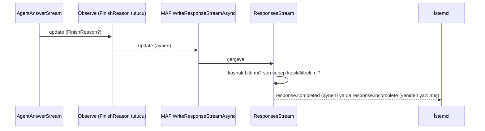

# Faz 251 — Kesik ve Filtreli Yanıtın Sinyali: Responses `incomplete` ve `tracon.output.filtered`

> **Durum:** ✅ Tamamlandı (2026-10-28)
> **Kademe:** tam — public HTTP tel sözleşmesi: K-991'in kapalı ayna listesi büyür (yeni `custom` çerçeve tipi) ve `/v1/responses` `status`/son olay anlamı değişir; `RunEventCustomTypes`'a public sabit eklenir. GA'dan sonra bu tel davranışını değiştirmek major sürüm ister
> **Plan onayı:** Bakımcı, 2026-10-26 (sohbette alınan karar: içerikli filtre yanıtı yeni ayrılmış tip `tracon.output.filtered` ile kaydedilir, run `Completed` kalır, K-991 listesine ve `RecordToolPayloads` muafiyetine girer; Responses `incomplete` + `content_filter` der)
> **Kaynak:** [ADAYLAR.md](ADAYLAR.md) · **F-503**, **F-505**
> **Genellik:** `/v1/responses` kullanan her OpenAI SDK tüketicisi ve run olaylarını okuyan her istemci. İkinci kanıt ekosistem standardıdır: OpenAI Responses kesik ya da filtreli yanıtı `status: "incomplete"` ve `incomplete_details.reason` (`max_output_tokens` · `content_filter`) ile, akışta `response.incomplete` olayıyla bildirir; SDK bunu okur. İlk ilke K-919 ve K-991'dir: yarım cevap tam cevap gibi görünmez. İş tüketici kodunda kalamaz: istemci yarım yanıtı ancak ikinci bir istekle (`GET /api/runs/{id}/events`) öğrenir, OpenAI SDK'sının o kanalı yoktur. İki kalem de sözleşme kusurudur, bu yüzden § *Tüketici geri bildirimi kuralı*'ndan muaftır
> **Karşı görüş:** (1) "Responses gövdesini MAF yazar; MAF düzeltene kadar beklenmeli." Cevap: `Microsoft.Agents.AI.Hosting.OpenAI` alpha'dır ve Tracon aynı JSON'u bugün zaten sonradan işler (`AppendPendingApprovalOutputItems`, `OpenAIResponsesEndpoints.cs:418`). Yama aynı dikiştedir ve MAF `incomplete` yazmaya başlarsa etkisiz kalacak biçimde yazılır (Hata Modları). (2) "İçerikli filtre yanıtı nadirdir; yeni ayrılmış tip sözleşmeyi büyütür." Cevap: Anthropic `refusal` bitişi `ContentFilter`'a eşlenir (`hafiza/openai-saglayici.md`, F-426) ve model metnin ortasında reddedebilir; kullanıcı yarım cevabı görür, kayıtta iz yoktur. K-919'un kesilme için kapattığı açık budur. Bedel tek bir sabit ve listeye bir satırdır
> **Önkoşul:** Yok. Faz 207 (K-991, K-992) kapandı
> **Paketler:** `Tracon.AspNetCore` (`OpenAIResponsesEndpoints`, `OpenAICompatSupport`, `RunNoticeMirror`, `AgentEndpoints` OpenAPI metni) · `Tracon.Core` (`FinishReasonDetectingChatClient`, `RunEventWriter` muafiyet listesi, `TraconCoreJsonContext`) · `Tracon.Abstractions` (`RunEventCustomTypes.OutputFiltered`)
> **Yeni paket:** Yok · **Migration:** Yok
> **Public API:** Büyüyor — bir `const string` (`RunEventCustomTypes.OutputFiltered`). `1.0.0` GA'dan (K-603) önce ucuz: `wc -l src/*/PublicAPI.Shipped.txt` → 18 dosya, toplam 18 satır (2026-10-26), yani hiçbir şey sevk edilmedi. Yük record'u `internal` kalır (`OutputTruncatedEventPayload` emsali)
> **Tüketici yüzeyi:** site `guides/openai-api.md` (uyumluluk matrisi "Cut-off answer" satırı `:281` ve paragraf `:294-301` — bugün "does not mark … `incomplete` yet" der), `concepts/runs.md` § *Truncated output* (`:569`; filtreli yanıt için kardeş alt bölüm), `http-api.md` § *Streaming* (`custom` listesi) · sevk edilen: `RunEventCustomTypes.OutputFiltered` XML (`api/` üretilir), run ucu açıklaması (`AgentEndpoints.cs:283`) → `docs/openapi/tracon.json` + `schema.ts` + `TraconApiClient.g.cs`, `CHANGELOG.md` `[Unreleased]` → *Changed* (iki not)
> **Manuel test alanı:** `docs/manuel-test/08-OPENAI-UYUMLU-UCLAR.md` (Responses `incomplete`) · `docs/manuel-test/22-GUARDRAIL-VE-YAPISAL-CIKTI.md` (filtreli yanıt olayı)

---

## Bu Faza Başlarken

> `faz-baslangic` skill'ini uygula. Aşağıdaki liste o skill'in 2. adımıdır —
> **tamamını değil, yalnız işaret edilen bölümleri oku.**

1. Bu doküman
2. Kararlar — dosyanın tamamını **okuma**, yalnız bu kalemleri grep'le:
   ```bash
   grep -n "K-919 —\|K-985 —\|K-991 —\|K-992 —\|K-889 —\|K-679 —" docs/KARARLAR.md
   ```
   **K-919** (kesilme ayrı sonuçtur; düz metin `Completed` + olay, yapılandırılmış hata),
   **K-985** (ham `stop_reason` ve kesilme sebebi), **K-991** (ajan akışı kayıtlı bildirimleri
   `done`'dan önce `custom` çerçevesi olarak verir; listeye tip eklemek sözleşme kararıdır),
   **K-992** (`/v1/chat/completions` `finish_reason` son model çağrısından eşlenir; run kaydından
   bağımsız), **K-889** (harness döngüsü dışarıya yalnız son iterasyonu verir), **K-679** (çerçeve
   adı her zaman `custom`)
3. Önceki fazdan devir: yok. Faz 207'nin devir notu ve tuzakları gerekirse:
   `git show 2a8149ef:docs/arsiv/fazlar/207-AKISTA-KESILEN-CIKTI-BILDIRIMI.md | awk '/## Sonraki Faza Devir Notu/,0'`
4. Alan hafızası (üç alan):
   [`hafiza/run-olay-sozlesmesi.md`](hafiza/run-olay-sozlesmesi.md) (ayrılmış olay tipleri, yük muafiyeti) ·
   [`hafiza/openai-saglayici.md`](hafiza/openai-saglayici.md) (Anthropic `refusal` → `ContentFilter`, ham `stop_reason`) ·
   [`hafiza/http-uc-tuzaklari.md`](hafiza/http-uc-tuzaklari.md) (SSE ve OpenAI uyumlu uçlar)
5. Gerektiğinde: kesilme yükleminin tek yer olma gerekçesi `FinishReasonDetectingChatClient.cs`'in
   kendi remarks bölümündedir (`:15-75`); ayna kapısının gerekçesi `RunNoticeMirror.cs:9-54`

---

## Amaç

Bir yanıt yarım kaldığında onu okuyan istemci bunu bilmelidir. Bugün iki yolda bilmez:

- **F-503** — `/v1/responses` çıktı sınırında ya da bağlam penceresinde kesilen yanıtı
  `status: "completed"` ile döner; akışta son olay `response.completed`'tır. OpenAI SDK'sı
  kullanan istemci yarım cevabı tam sanar. Faz bunu OpenAI'nin kendi anlamıyla düzeltir:
  `status: "incomplete"`, `incomplete_details.reason` ve akışta `response.incomplete`.
- **F-505** — model metin üretip sonra içerik filtresine takılırsa dedektör yanıtı geçirir
  (doğru: yarım cevap korunur) ama kayıtta hiçbir iz bırakmaz. Faz `tracon.output.filtered`
  olayını yazar, ajan akışına `done`'dan önce aynalar ve Responses'ta `content_filter` der.

### Bugün ne çalışmıyor — doğrulanmış kanıt

| Kanıt | Gözlem |
|---|---|
| [`OpenAIResponsesEndpoints.cs:297-300`](../src/Tracon.AspNetCore/OpenAICompat/OpenAIResponsesEndpoints.cs) | Akışsız yol MAF'ın `OpenAIResponses.WriteResponse`'unu yazar ve yalnız bekleyen onayları ekler; `status`'a dokunmaz |
| [`OpenAIResponsesEndpoints.cs:488-503`](../src/Tracon.AspNetCore/OpenAICompat/OpenAIResponsesEndpoints.cs) | Akışlı yol `WriteResponseStreamAsync` çerçevelerini olduğu gibi yazar; bitiş sebebi okunmaz |
| [`OpenAICompatSupport.cs:159-166`](../src/Tracon.AspNetCore/OpenAICompat/OpenAICompatSupport.cs) | Chat Completions eşlemesi (`length` · `content_filter` · `stop`) tek yerdedir; Responses onu kullanmaz |
| [`OpenAIChatCompletionsEndpoints.cs:397-406`](../src/Tracon.AspNetCore/OpenAICompat/OpenAIChatCompletionsEndpoints.cs) | Akışta son `FinishReason`'ı yakalayan desen (emsal) |
| [`FinishReasonDetectingChatClient.cs:87`](../src/Tracon.Core/Models/FinishReasonDetectingChatClient.cs) · [`:145`](../src/Tracon.Core/Models/FinishReasonDetectingChatClient.cs) | Filtre yalnız **boş** yanıtta hata olur; içerikli filtre yanıtı için hiçbir şey yazılmaz |
| [`FinishReasonDetectingChatClient.cs:182-183`](../src/Tracon.Core/Models/FinishReasonDetectingChatClient.cs) | `IsTruncated` tek kesilme yüklemidir (`Length` + bağlam penceresi) |
| [`RunNoticeMirror.cs:122-127`](../src/Tracon.AspNetCore/Streaming/RunNoticeMirror.cs) | Kapalı liste: `OutputTruncated` her zaman, `QuotaThreshold` seçenekle |
| [`RunNoticeMirror.cs:99`](../src/Tracon.AspNetCore/Streaming/RunNoticeMirror.cs) · [`AgentEndpoints.cs:1107-1116`](../src/Tracon.AspNetCore/Endpoints/AgentEndpoints.cs) | Depo yalnız kota seçeneği açıksa ya da bir `update` kesilme bildirdiyse okunur; filtre bu kapıyı açmaz |
| [`RunEventWriter.cs:421-422`](../src/Tracon.Core/Recording/RunEventWriter.cs) | `RecordToolPayloads` kapalıyken yükü korunan tipler: `QuotaThreshold`, `OutputTruncated`, `ToolInputDeclined` |
| [`AgentEndpoints.cs:281-285`](../src/Tracon.AspNetCore/Endpoints/AgentEndpoints.cs) | Uç açıklaması ayna listesini sayar; üç üretilmiş yapıta girer |
| `docs-site/src/content/docs/guides/openai-api.md:281`, `:299-301` | "Responses … does not mark a cut-off answer `incomplete` yet" — bilinen sınır olarak yazılı |
| Faz 207 Sapma 6 (ölçüldü, geçici prob) | `Length` ile kesik düz metin `/v1/responses`'ta akışsız `"status":"completed"`, akışta `response.completed` döner |

> Kanıtlar 2026-10-26 tarihinde doğrulandı (kod okuması + Faz 207'nin prob ölçümü). İlk iş:
> Hata Modları tablosundaki Responses testlerini ve filtre olayı testini **düzeltmeden önce**
> kırmızı gör.

---

## 251.1 — Tek eşleme: bitiş sebebinden yanıtın tamlığı

`OpenAICompatSupport` bugün `ToChatFinishReason`'ı taşır. Yanına Responses'ın eşlemesi girer;
iki uç aynı yüklemleri okur (K-992'nin kardeşi):

| Son bitiş sebebi | Chat Completions (`finish_reason`) | Responses (`status` · `incomplete_details.reason`) |
|---|---|---|
| `Length`, `TraconFinishReasons.ContextWindowExceeded` (`IsTruncated`) | `length` | `incomplete` · `max_output_tokens` |
| `ContentFilter` (içerik varken; boşsa run zaten düşer) | `content_filter` | `incomplete` · `content_filter` |
| Diğer her şey (`Stop`, `ToolCalls`, `null`) | `stop` | `completed` · yok |

- Bağlam penceresi kesilmesi OpenAI'de ayrı bir sebep değildir; `max_output_tokens` yazılır ve
  site bunu söyler.
- Karar run kaydından bağımsızdır (K-992): `Tracon:RunRecording:Enabled = false` iken de doğrudur.
- Ara tool turunun kesilmesi sayılmaz: yalnız son sebep karar verir (Faz 207'nin kuralı).

## 251.2 — Responses: akışsız gövde ve akışın son olayı (F-503)

**Akışsız.** `WriteResponse`'tan dönen JSON, bekleyen onayları ekleyen aynı sonradan işleme
adımında tamlık durumunu da alır: `status` ve `incomplete_details`. Tek bir JSON yeniden
yazım fonksiyonu iki işi yapar; ikinci bir ayrıştırma eklenmez. Bekleyen onaylı yanıtın son
sebebi `ToolCalls`'tır, dokunulmaz.

**Akışlı.** `updates` dizisi bir sarmalayıcıdan geçer (`ResponsesStreamRewriter.Observe`) ve son
boş olmayan `FinishReason`'ı tutar (Chat Completions emsali). Kaynak bittikten **sonra** MAF'ın
yazdığı çerçeveler `Patch`'ten geçer: kapanan mesaj öğesi (`output_item.done`) `incomplete` olur ve
`response.completed`, `event: response.incomplete` adıyla, `response.status` ile
`response.incomplete_details` değiştirilerek yazılır. Kaynak bitmeden yazılan çerçeveler ve tam
yanıtın her çerçevesi aynı `string` olarak geçer (ayrıştırılmaz). Plan yalnız son çerçeveyi
anıyordu; ölçüm (aşağıda) kapanış çerçevelerinin kuyrukta yazıldığını ve OpenAI'nin öğeyi de
işaretlediğini gösterdi.

**Ölçüldü (2026-10-27)** — `maf-api-kesfi` imza dökümü ve repo dışı geçici prob,
`Microsoft.Agents.AI.Hosting.OpenAI` 1.25.0-alpha.261014.1. Soru: MAF
`OpenAIResponses.WriteResponseStreamAsync` ve `WriteResponse` bitiş sebebini okur mu?

| Ölçüm | Sonuç |
|---|---|
| Son çerçevenin adı | `event: response.completed`. `Length`, `ContentFilter`, `Stop` ve `null` için **aynı**: MAF `FinishReason`'ı hiç okumaz |
| Gövde biçimi | `{"type":"response.completed","response":{…,"status":"completed",…},"sequence_number":N}` — tek satır `data:` |
| `incomplete_details` | `response` nesnesinde **anahtar yok** (`null` bile değil). Akışsız `WriteResponse` gövdesinde de yok |
| Mesaj öğesinin `status`'u | **Var.** `output_item.added` → `in_progress`; `output_item.done` ve `response.output[]` → `completed` |
| Son öğenin kapanışı | MAF son mesaj öğesinin `output_text.done` · `content_part.done` · `output_item.done` çerçevelerini ve `response.completed`'ı `updates` bittikten **sonra** yazar. Önceki öğeleri sıradaki öğe açılınca kapatır (tool turundan önceki metin). Yani son bitiş sebebi, son öğenin kapanış çerçeveleri yazılırken bellidir |
| Akışsız `output[]` sırası | `function_call`, `message`, `function_call_output`, `message` — kesilen son mesaj dizinin **son `message` öğesidir** |
| JSON kaçışı | Varsayılan kodlayıcı: ASCII dışı ve HTML'e duyarlı karakterler `\u015E`, `\u003C` gibi yazılır. `JsonNode.ToJsonString()` aynı baytları üretir; yeniden yazım değişmeyen alanları bozmaz |

Karşılaştırma için gerçek OpenAI (`gpt-5.4-mini`, `max_output_tokens: 16`, iki çağrı, SDK
`openai` Python 3.0.0): akışsız `status: "incomplete"`, `incomplete_details:
{"reason":"max_output_tokens"}`, `output[0].status: "incomplete"`. Akışta sıra
`…output_text.done`, `content_part.done`, `output_item.done` (öğe `status: "incomplete"`),
`response.incomplete`; son olay `response.incomplete`'tır. Tracon bu şekle uyar.

**Sonuç:** Açık Soru 1 → **A**. MAF gövdesi öğe `status`'u taşır; son mesaj öğesi hem
`output_item.done` çerçevesinde hem `response.output[]` içinde `incomplete` olur (OpenAI'nin
yaptığı gibi). "MAF düzeltirse" kuralı aşağıda: yeniden yazım yalnız `completed` gövdeye uygulanır.



**MAF düzeltirse.** Yeniden yazım yalnız `status == "completed"` iken uygulanır; MAF
`incomplete` yazmaya başlarsa yama etkisiz kalır (Hata Modları'nda test).

## 251.3 — İçerikli filtre yanıtı kaydedilir (F-505)

`FinishReasonDetectingChatClient`, `IsContentFilter && HasContent` dalında (akışsız `:87`
yanı, akışlı `:145` yanı) `RecordTruncatedTextAsync`'in kardeşi olan bir yazım yapar:

- Tip: `RunEventCustomTypes.OutputFiltered` = `tracon.output.filtered` (public sabit, XML ile).
- Metin: "The provider's content filter stopped the model mid-answer; the answer is incomplete."
- Yük: `internal` bir record (`OutputFilteredEventPayload`), `TraconCoreJsonContext`'e kayıtlı.
  Tek alan: `provider`. Ham sağlayıcı sözcüğü (`refusal`, `SAFETY`) yazılmaz: Core halkasına
  ulaşmaz (Plandan Sapmalar 2). **Cevap metni asla yazılmaz.**
- Run `Completed` kalır; hata sınıfı yoktur (K-919'un düz metin kuralı).
- Yan kanal çağrısı (özetleyici, `aiJudge`) yazmaz: aynı `SideChannelFallback` kuralı.
- Yapılandırılmış yanıt: olay yine yazılır; yapılandırılmış doğrulayıcının sonucu değişmez
  (Açık Soru 3).
- Boş filtre yanıtı bugünkü gibi `TraconContentFilteredException` olur (regresyon testi).

## 251.4 — Ayna listesi ve yük muafiyeti (K-991 genişler)

- `RunNoticeMirror.IsMirrored`: `OutputFiltered => true`.
- Depo okuma kapısı: bugün `sawTruncation` yalnız `IsTruncated`'a bakar. Kapı "yanıt eksik
  olabilir" yüklemine genişler: `IsTruncated || ContentFilter`. Yüklem `FinishReasonDetectingChatClient`'ta
  tek yerde yazılır (ör. `IsIncomplete`); `AgentEndpoints` ve Responses eşlemesi onu okur.
- `RunEventWriter.KeepsPayloadWithPayloadsOff`: `OutputFiltered` eklenir (yük kullanıcı verisi
  taşımaz, `OutputTruncated` ile aynı gerekçe).
- Run ucunun OpenAPI açıklaması listeyi sayar (`AgentEndpoints.cs:283`): yeni tip eklenir,
  üç üretilmiş yapıt yenilenir (zincir: `hafiza/nswag-istemci-uretimi.md`, adım 1-4).
- Bu bir sözleşme kararıdır (K-991): uygulama oturumu `public-api` kategorisinde bir `K-*`
  yazar; reddedilen alternatifler: "kesilme olayına `cause: content_filter`" ve "run'ı düşür".

**Kapsam dışı (aday olarak kalır):** F-504 (workflow SSE'si agent adımının kesildiğini
söylemez) ve F-506 (konsol playground'u `custom` çerçevelerini göstermez). F-506'nın rozeti
bu fazdan sonra iki tipi gösterir.

---

## Planlanan Public API

> Taslak imzalardır. Gerçekleşen imzalar kapanışta ayrı bir bölüme yazılır.

```csharp
// Tracon.Abstractions — RunEventCustomTypes
/// <summary>The model stopped mid-answer because the provider's content filter cut it off; the answer is incomplete.</summary>
public const string OutputFiltered = ReservedPrefix + "output.filtered";
```

### Gerçekleşen Public API

`src/Tracon.Abstractions/PublicAPI.Unshipped.txt` (tek satır, `OutputTruncated`'ın yanında):

```
const Tracon.RunEventCustomTypes.OutputFiltered = "tracon.output.filtered" -> string!
```

Başka public üye eklenmedi. `FinishReasonDetectingChatClient.IsContentFilter` ve `IsIncomplete`,
`OutputFilteredEventPayload`, `ResponsesIncompleteness` ve `ResponsesStreamRewriter` `internal`'dır.

### HTTP tel değişiklikleri

| Yüzey | Bugün | Faz sonrası |
|---|---|---|
| `POST /v1/responses` (JSON) | kesik/filtreli yanıt `status: "completed"` | `status: "incomplete"`, `incomplete_details.reason` |
| `POST /v1/responses` (SSE) | son olay `response.completed` | kesik/filtreli yanıtta `response.incomplete` |
| `POST /api/agents/{name}/run` (SSE) | `custom` listesi: `tracon.output.truncated`, `tracon.quota.threshold` | `+ tracon.output.filtered` |
| `GET /api/runs/{id}/events` | filtreli yanıt için olay yok | `Custom` · `tracon.output.filtered` |

### Arayüz payı

Yok (F-506 kapsam dışı).

---

## Planlanan Dosya Listesi

```
src/Tracon.Abstractions/Runs/RunEventCustomTypes.cs          # OutputFiltered + XML
src/Tracon.Core/Models/FinishReasonDetectingChatClient.cs    # filtre yazımı, IsIncomplete yüklemi
src/Tracon.Core/Models/OutputFilteredEventPayload.cs         # yeni, internal
src/Tracon.Core/TraconCoreJsonContext.cs                     # yük kaydı
src/Tracon.Core/Recording/RunEventWriter.cs                  # muafiyet listesi
src/Tracon.AspNetCore/OpenAICompat/OpenAICompatSupport.cs    # Responses eşlemesi
src/Tracon.AspNetCore/OpenAICompat/OpenAIResponsesEndpoints.cs  # JSON yeniden yazımı + son çerçeve
src/Tracon.AspNetCore/Streaming/RunNoticeMirror.cs           # liste + kapı
src/Tracon.AspNetCore/Endpoints/AgentEndpoints.cs            # kapı yüklemi + OpenAPI metni
docs/openapi/tracon.json · packages/tracon-client/src/schema.ts · src/Tracon.Client/Generated/TraconApiClient.g.cs  # üretilir
tests/Tracon.AspNetCore.FunctionalTests/…ResponsesIncompleteTests.cs   # yeni
tests/Tracon.AspNetCore.FunctionalTests/OutputTruncationStreamingTests.cs  # filtre ikizleri
tests/Tracon.Core.UnitTests/Models/FinishReasonDetectingChatClientTests.cs  # filtre yazımı
```

Gerçekleşen ek dosyalar: `src/Tracon.AspNetCore/OpenAICompat/ResponsesIncompleteness.cs` (JSON
işaretleme + akış yeniden yazıcısı; sınıfı birim düzeyinde sınanabilsin diye ayrı dosya),
`tests/Tracon.AspNetCore.FunctionalTests/ResponsesIncompletePatchTests.cs` (saf kural testleri),
`scripts/dokuman-bakim.py` (`SURUM_DAMGASI_KAYDI` tek satır), `docs/manuel-test/{00-INDEKS,08-…,22-…}.md`,
site: `concepts/runs.md` · `http-api.md` · `guides/openai-api.md` · `guides/model-providers.md` ·
`capabilities.md`, `src/Tracon.Google/README.md`, üç `///` bloğu (`IModelProvider`,
`TraconContentFilteredException`, `RunEventType`).

`FinishReasonModelProvider` (Faz 207'nin test sağlayıcısı) bitiş sebebini yazar; Responses
testleri onu kullanır. Konumu: `grep -rn "class FinishReasonModelProvider" tests/`.

---

## Hata Modları ve Testler

> Seviye kuralı: davranış HTTP ve akış sınırını geçer, bu yüzden Responses ve ayna testleri
> fonksiyoneldir ([`test-seviyeleri.md`](../.agents/ortak/test-seviyeleri.md)).

| Ne bozulabilir | Seviye | Test |
|---|---|---|
| Kesik düz metin `/v1/responses` JSON'da `completed` kalır | Fonksiyonel | `ResponsesIncompleteTests` — `status`, `incomplete_details.reason = max_output_tokens` |
| Akışta son olay `response.completed` kalır ya da olay iki kez gelir | Fonksiyonel | aynı sınıf — son olay `response.incomplete`, tam bir kez; önceki çerçeveler değişmez |
| Bağlam penceresi kesilmesi başka sebep yazar | Fonksiyonel | `ContextWindowExceeded` → `max_output_tokens` |
| İçerikli filtre yanıtı Responses'ta `completed` kalır | Fonksiyonel | `ContentFilter` + metin → `incomplete` · `content_filter` |
| Ara tool turunun kesilmesi yanıtı `incomplete` yapar | Fonksiyonel | tool turu `Length`, son tur `Stop` → `completed` |
| Harness döngüsünün erken kesik iterasyonu sonucu bozar | Fonksiyonel | ilk iterasyon `Length`, son `Stop` → `completed` (K-889) |
| Bekleyen onaylı yanıt bozulur | Fonksiyonel | onay öğesi eklenir, `status` değişmez |
| Run kaydı kapalıyken karar değişir | Fonksiyonel | `Tracon:RunRecording:Enabled=false` ile kesik yanıt yine `incomplete` |
| MAF `incomplete` yazmaya başlarsa çift yama | Birim | gövdesi zaten `incomplete` olan çerçeve/JSON değişmez |
| İçerikli filtre yanıtı iz bırakmaz | Birim + Fonksiyonel | `FinishReasonDetectingChatClientTests` (akışlı/akışsız); `/events`'te `tracon.output.filtered`, run `Completed` |
| Olay cevap metnini taşır | Birim | yük yalnız sağlayıcı ve ham sebep; metin yok |
| Boş filtre yanıtı artık hata olmaz (regresyon) | Birim | `TraconContentFilteredException` aynen |
| Yan kanal (özetleyici) filtre olayı yazar | Birim | `SideChannelFallback` varken olay yok |
| Ajan akışı filtre bildirimini taşımaz | Fonksiyonel | `custom` çerçevesi `done`'dan hemen önce, `/events` ile bayt bayt aynı |
| Filtre olmadan depo okunur (kapı genişler, maliyet) | Fonksiyonel | bitişi `Stop` olan run'da depo okuma sayacı 0 (Faz 207 emsali) |
| `RecordToolPayloads=false` yükü siler | Fonksiyonel | yük korunur |
| Depo okuma hatası akışı bozar | Fonksiyonel | uyarı + `done` (mevcut kural, filtre tipiyle yeniden) |
| Akış iptal edilir | Fonksiyonel | istemci koparsa son çerçeve yazılmaz, istisna sızmaz |
| Başka kiracının run'ı okunur | — | yeni yol yok: ayna yalnız isteğin kendi run'ını kiracı süzgeciyle okur (`RunNoticeMirror.cs:51-53`) |
| Üretilen OpenAPI/istemci bayatlar | Fonksiyonel | `OpenApiSnapshotTests` + `ClientCoverageTests` |

---

## Manuel Kabul Case'leri

| # | Ön koşul | Adımlar | Beklenen sonuç |
|---|---|---|---|
| 1 🤖 | Gerçek OpenAI anahtarı; `MaxOutputTokens: 16` olan düz metin agent'ı | Resmî OpenAI .NET ya da Python SDK'sıyla `/v1/responses`'a uzun cevap isteyen soru, akışsız ve akışlı | `response.status == "incomplete"`, `incomplete_details.reason == "max_output_tokens"`; akışta son olay `response.incomplete` |
| 2 🤖 | Aynı agent | `POST /api/agents/{name}/run` akışlı | `done`'dan önce `custom` · `tracon.output.truncated` (regresyon) |
| 3 👤 (son çare) | İçerik filtresini gerçekten tetikleyen bir sağlayıcı istemi | Akışlı run | `custom` · `tracon.output.filtered`; tetiklenemezse case "koşulamadı" yazılır, davranış fonksiyonel testte kanıtlıdır |

---

## Açık Sorular

| # | Soru | Seçenekler | Öneri |
|---|---|---|---|
| 1 | Son mesaj öğesinin kendi `status`'u da `incomplete` olsun mu? | A: evet — OpenAI kesik mesaj öğesini de `incomplete` işaretler · B: yalnız yanıt düzeyi | **A**, MAF gövdesi öğe `status`'u taşıyorsa (251.2 ölçümü). Taşımıyorsa B ve site cümlesi |
| 2 | Filtre olayının yükü ham sağlayıcı sebebini taşısın mı? | A: `provider` + ham sebep (`refusal`, `SAFETY`) · B: yalnız `provider` | **A** — K-985 ham `stop_reason`'ı zaten okur; operatör hangi filtrenin kestiğini görür |
| 3 | Yapılandırılmış yanıt içerikli filtreye takılırsa olay yazılsın mı? | A: evet, doğrulayıcının sonucu ayrıca · B: yalnız düz metin | **A** — olay sebebi açıklar; yapılandırılmış doğrulayıcı zaten reddeder |

---

## Bitiş Ölçütleri (DoD)

- [x] `/v1/responses` kesik düz metinde JSON `status: "incomplete"` + `incomplete_details.reason: "max_output_tokens"` döner; akışta son olay `response.incomplete`'tır — `ResponsesIncompleteTests` (akışsız/akışlı) ve canlı koşum (gerçek `gpt-5.4-mini`, resmî SDK)
- [x] İçerikli filtre yanıtı: run `Completed`, `/events`'te `tracon.output.filtered`, ajan akışında `done`'dan önce `custom` çerçevesi, Responses'ta `content_filter` — `OutputTruncation*Tests`, `ResponsesIncompleteTests`; canlı: gerçek Gemini (yerel akış 2/2, `/v1/responses` akışı 1/6)
- [x] Ara tool turu ve erken harness iterasyonu kesilmesi ya da filtrelenmesi sonucu değiştirmez — `A_tool_turn_cut_at_the_limit_or_filtered_…` (`length` · `content_filter`) · `An_earlier_cut_harness_iteration_…` (akışsız/akışlı) · `OutputTruncationToolTurnTests` filtre ikizleri
- [x] `RunEventCustomTypes.OutputFiltered` XML'i ve run ucu açıklaması yeni tipi anar; OpenAPI ve iki istemci yenilendi — `tracon.json` (`OpenApiSnapshotTests` yenilendi), `schema.ts` (`npm run generate`, Vitest `schema-drift` yeşil), `TraconApiClient.g.cs` (NSwag zinciri; `ClientCoverageTests` yeşil)
- [x] Yeni `K-*` (`public-api`): ayna listesi `tracon.output.filtered` ile genişledi, alternatifler adıyla — `K-1108`, `K-1109` işlendi (taslaklar Entegrasyon Notları b: `K-NEW-1`, `K-NEW-2`)
- [x] Dört doğrulama kapısı sıfır uyarı verir — `python3 scripts/kapi.py kapanis --taban d8579948` entegrasyon ağacında (dört fazın birleşmesi ve doküman commit'leri): 30.008 test, 39 modül, 1 atlandı (koşullu), 0 kırmızı; `dotnet format --verify-no-changes`, `npm run check` (build, bağlantı, SEO, ağırlık, içerik), `performans`, betik testleri, `kapi.py tarama` ve `dokuman-bakim.py --denetle` yeşil (2026-10-28)
- [x] `samples/Tracon.Api` ile gerçek `run` yapıldı (case 1 ve 2), çıktı belgeye yazıldı — "Canlı Koşum Kaydı"
- [x] `secret` taraması boş döndü — `python3 scripts/kapi.py tarama`: temiz; canlı koşumda anahtarlar yalnız user-secrets'tan okundu, hiçbir çıktıya ya da dosyaya yazılmadı
- [x] `🤖` case'ler `docs/manuel-test/08-…` ve `22-…` içinde ve koşuldu; gerisi otomatik testte — `MT-COMPAT-058` · `MT-GUARD-118` · `MT-GUARD-119` (üçü de `🤖`; `👤` yok)
- [x] `faz-denetim` koşuldu; 🔴 bulgu kalmadı — bağımsız `faz-denetcisi` (taze bağlam, son diff): 🔴 yok, 🟡 iki (ikisi de kapandı: muaf bildirimlerin yükü cümlesi, ara turdaki filtre testi), 🟢 altı grup (ucuzları düzeltildi, kalanı aday); ayrıntı "Denetim Bulguları"
- [x] `docs-site/` güncellendi (`guides/openai-api.md` matris satırı ve paragraf, `concepts/runs.md`, `http-api.md`; düzeltme turunda `guides/model-providers.md` bir cümle); `npm run check` temiz — ölçüldü (2026-10-27, kilit altında; düzeltme turundan sonra 2026-10-28'de yeniden koşuldu, sonuç aynı): derleme 1051 sayfa · içerik 69 el yazısı sayfa geçti · bağlantı 0 kırık · SEO 0 hata · ağırlık tavanın altında (en ağır sayfa `concepts/governance` 58 195 B, tavan 59 000; dokunulan sayfalar onu geçmedi). **Koşul:** `docs-site/public/llms-full.txt` bayat ve `check:content` yalnız onun yüzünden kırmızıdır; yukarıdaki sonuçlar dosya geçici olarak yeniden üretilip geri alınarak alındı. Dalda yalnız o dosya (+3 859 B; düzeltme turundan önce +3 753 B) farklı çıkar; `llms.txt` ve `Tracon.AgentMap.md` değişmez. Entegratör `python3 scripts/kapi.py uret` koşar (Entegrasyon Notları f)

### Doğrulama komutları

```bash
# Responses, akışsız
curl -s http://localhost:5081/tracon/v1/responses -H "Authorization: Bearer $KEY" \
  -H "Content-Type: application/json" \
  -d '{"model":"short-answer-agent","input":"Write a long essay about rivers."}' | jq '.status, .incomplete_details'

# Responses, akışlı — son olay
curl -sN http://localhost:5081/tracon/v1/responses -H "Authorization: Bearer $KEY" \
  -H "Content-Type: application/json" \
  -d '{"model":"short-answer-agent","input":"Write a long essay about rivers.","stream":true}' | grep '^event:' | tail -1
```

---

## Riskler

| Risk | Önlem |
|---|---|
| MAF son çerçevenin adını ya da gövdesini bir alpha sürümünde değiştirir; yeniden yazım sessizce durur | Son çerçeveyi bulamayan yol bir uyarı loglar; fonksiyonel test olay adını sabitler, MAF yükseltmesinde kırmızı olur |
| Yeni `custom` tipi, listeyi iki tip sanan istemciyi şaşırtır | K-991 bilinmeyen `customType`'ın yok sayılmasını söyler; CHANGELOG *Changed* notu ve `http-api.md` |
| Kapı genişler, `Stop` dışı her filtre bitişi depo okur | Yalnız `ContentFilter` + içerik; test okuma sayacını sabitler |
| OpenAI SDK'sı `response.incomplete`'ı tanımaz | Resmî olay adıdır; case 1 SDK ile koşulur |

---

<!-- ============================================================
     AŞAĞISI ÇALIŞIRKEN DOLAR — doküman kapanışta silinir (`faz-kapat`).
     Kalıcı kısım `faz-tamamlama` Adım 5'te yerine taşınır. Başlıkları SİLME.
     ============================================================ -->

## Plandan Sapmalar

> Çalışırken dolar. Plan ile gerçek arasındaki fark **gizlenmez**. Kapanışta
> kapanış commit mesajına taşınır.

1. **Akışta iki çerçeve yeniden yazılır, biri değil.** Plan yalnız `response.completed`'ı anıyordu.
   Ölçüm (251.2): MAF son mesaj öğesinin kapanışını da `updates` bittikten sonra yazar ve OpenAI kesik
   öğeyi `output_item.done` içinde de `incomplete` işaretler. Açık Soru 1-A bu yüzden iki çerçeveyi kapsar.
   Yeniden yazım "kaynak bitti mi?" bilgisiyle çalışır (`ResponsesStreamRewriter`); bitmeden yazılan
   çerçeveye dokunulmaz.
2. **Filtre olayının yükü yalnız `provider` taşır; Açık Soru 2-A uygulanamadı (B uygulandı).** Plan K-985'in
   ham `stop_reason` okumasına dayanıyordu. O okuma `Tracon.Anthropic` içindedir
   (`AnthropicStopReasonChatClient`) ve yalnız iki sebebi yeniden yazar (`model_context_window_exceeded`,
   `pause_turn`). `refusal` ve Gemini `SAFETY` adaptörde `ChatFinishReason.ContentFilter`'a eşlenir.
   `FinishReasonDetectingChatClient` filtre dalına yalnız `ContentFilter` ile girer; yani oradaki
   `finishReason.Value` her zaman `content_filter`'dır. Sabit bir alan telde gürültüdür, sonradan anlam
   değiştirirse kırıcıdır; sonradan alan eklemek ucuzdur. Ham sözcük için sağlayıcı paketlerinde bir kanca
   gerekir ve bu faz o paketlere dokunmaz. Bkz. 🟢 adaylar (Entegrasyon Notları e).
3. **Manuel case 3 koşuldu, "koşulamadı" yazılmadı.** Gerçek Gemini (`gemini-strict-filter`) yerel akışta 2/2
   denemede yanıtın ortasında durdu (olasılıklı), `/v1/responses` akışında 6 denemede 1 kez
   `content_filter` verdi. Case `🤖` oldu (`MT-GUARD-119`). Case 2 ayrı bir case oldu (`MT-GUARD-118`);
   case 1 `MT-COMPAT-058`'dir.
4. **Kaynak bitmeden kapanan mesaj öğesi `completed` kalır.** Gemini akışında metin, ondan sonra gelen akıl
   yürütme öğesi yüzünden erken kapandı: `output_item.done` `completed` taşıdı, terminal olayın
   `output[]`'ı `incomplete` taşıdı. Terminal olay doğruluk kaynağıdır; site sayfası ve
   `ResponsesStreamRewriter` açıklaması bunu söyler. Planın "öğe de `incomplete` olur" cümlesi bu durumda
   yalnız terminal olay için doğrudur. Bu sınır deterministik bir testle sabitlendi (Hata Modu → Test Eşlemesi).
   **Tetikleyici ölçüldü (düzeltme turu):** MAF, açık öğeden farklı türde bir içerik gelince öğeyi kapatır
   (`generator.IsSupported` yanlış: metinden sonra akıl yürütme ya da tool çağrısı). `IsSameMessage` yolu (farklı
   `MessageId`/`AuthorName`/`Role`) bu sürümde ÇALIŞMAZ: `previousUpdate` döngüde `null` başlar, yalnız o dalın
   içinde atanır ve `IsSameMessage(update, null)` hep doğrudur. Decompile (`AgentResponseUpdateExtensions`) ve
   `WriteResponseStreamAsync` ile metin→metin sondası (üç değişken de tek açık öğe verdi) birbirini doğruladı.
   Metin bu yüzden tetikleyiciyi sayarak değil "MAF'ın zaten kapattığı öğe `completed` kalır" diye yazıldı;
   MAF o hatayı düzeltirse erken kapanma sıklaşır ve metin yine doğru kalır.
5. **Plan riski "OpenAI SDK'sı `response.incomplete`'ı tanımaz" kısmen yanlıştı.** SDK olayı tanır
   (`ResponseIncompleteEvent`). `stream.get_final_response()` ise yalnız `response.completed`'dan sonra döner
   ve gerçek OpenAI'nin kesik akışında da `RuntimeError` verir (ölçüldü). Kusur Tracon'da değildir. Site
   sayfası ve `MT-COMPAT-058` yanıtın son olayın `response`'ından okunmasını söyler.
6. **Yeni dosyalar.** `ResponsesIncompleteness.cs` (planın dosya listesinde yoktu: yeniden yazıcı birim
   düzeyinde sınanabilsin diye ayrı sınıf), `OutputFilteredEventPayload.cs` (planda vardı),
   `ResponsesIncompletePatchTests.cs`. `FinishReasonDetectingChatClient`'ta kayıt koruması
   (`NoticeWriter`) iki yazım için ortak oldu; `IsContentFilter` `internal` oldu.
7. **`scripts/dokuman-bakim.py`.** `SURUM_DAMGASI_KAYDI`'na tek satır: yeniden yazıcının XML'indeki
   "ölçüldü" damgası kayıt ister. Betik fazın izinli dosyaları arasında anılmıyordu; kapı kızdığı için eklendi.
8. **Plana ek yüzeyler.** `/v1/responses` ucunun OpenAPI açıklaması (planda yalnız run ucu vardı) tüketiciye
   yeni `status` anlamını söyler. Ayrıca `capabilities.md` satırı, `guides/model-providers.md` (sağlayıcı
   yazarı sözleşmesi), `src/Tracon.Google/README.md`, `IModelProvider` ve `TraconContentFilteredException`
   `///` blokları "boş filtre yanıtı hata, metinli yanıt bildirim" ayrımını anlatır.
   `RunEventType` önsözü "iki bildirim tipi" diyordu; `ToolInputDeclined` zaten muaftı. Dört tip sayıldı
   ve "Two exceptions" cümlesi "Three exceptions" oldu.
9. **Site senkron kapısı `paket-readme` kuralı.** Google README'si değişince kural `packages.md` ister.
   `packages.md` paket başına tek özet satırı taşır ve o satır değişmedi; README cümlesi bir run olayını
   anlatır. Kapanışta `dokuman-bakim.py --site-denetle --taban <commit> --site-gerekce-yazildi` ile geçilir
   (Entegrasyon Notları f).
10. **Ortam notu.** Örnek uygulama `Tracon:Ui:AuthToken` boşken açıktır, ama OpenAI SDK'sı her istekte
    `Authorization` gönderir ve başlık API anahtarı sayılıp `401` alır. Canlı koşum SDK çağrılarına
    `extra_headers={"Authorization": Omit()}` verdi (`MT-COMPAT-058` ön koşulunda yazılı).

11. **`ic-dongu` bir kırmızı buldu, düzeltildi.** İlk koşumda `TestDelayClassificationTests.Every_Task_Delay_under_tests_carries_a_known_class`
    üç TFM'de düştü: `ResponsesIncompleteTests.StallingModelProvider`'ın `Task.Delay(Timeout.InfiniteTimeSpan, …)` satırı
    sınıf etiketi taşımıyordu. `// delay: simulated` eklendi (düzeltme turu: 1). `ic-dongu` ilk kırmızıda durduğu için
    `Generators.UnitTests` ve `Sql.Shared.UnitTests` o koşumda çalışmadı; düzeltmeden sonra ayrı koşuldu (338 · 90 × 3 yeşil).
12. **Ön denetim.** Uygulayıcı, bitmiş dalı bağımsız bir `faz-denetcisi` alt agent'ına salt-okunur okuttu (`faz-denetim`
    DEĞİLDİR; o entegratörde). Sonuç: 0 🔴, 2 🟡, 6 🟢. 🟡 1: karar taslağı başlıkları numara alınca 160 B'ı aşıyordu (taslaklar
    kısaltıldı, betiğin kendi ölçüsüyle 127 ve 144 B). 🟡 2: `llms-full.txt` bayat (Sapma 9'un devamı: entegratör üretir, bkz.
    Entegrasyon Notları f). 🟢: iki sevk edilen `///` cümlesi yumuşatıldı (sağlayıcı adı bağlamanın sağlayıcısıdır; "asla"
    yerine "normalde"), bir test adının iddiası gövdesiyle eşlendi, Entegrasyon yol listesi düzeltildi, ikisi aday oldu
    (F-yeni 6, 7; 7 sonradan kapandı, bkz. Denetim Bulguları). Açık kalan: "son çerçeve bulunamadı" uyarı satırının uç düzeyi testi yok (tek `if`; MAF çıktısı
    enjekte edilemez, bayrak birim testli, gerçek akışlarda uyarının çıkmadığı `AskAsync` içinde sınanır).

## Canlı Koşum Kaydı (2026-10-27)

> `samples/Tracon.Api` derlenmiş DLL'den, port 5181, `ASPNETCORE_ENVIRONMENT=Development`, dört bağlantı/token
> değişkeni boş (bellek içi depo). Uygulama günlüğünde `Npgsql` satırı: 0. Gerçek `gpt-5.4-mini` ve
> `gemini-3.6-flash`, en küçük istemler. Uygulama koşum sonunda durduruldu.

**Case 1 — `MT-COMPAT-058`** (resmî `openai` Python SDK 3.0.0, `manuel-kesilen-openai`, `maxOutputTokens: 16`):

```
--- Responses, non-streaming
{"status": "incomplete", "incomplete_details": "max_output_tokens", "output": [["message", "incomplete"]],
 "output_text": "Rivers are among the most important and enduring features of the natural"}
--- Responses, streaming
get_final_response(): RuntimeError: Didn't receive a `response.completed` event.
events (collapsed): created, in_progress, output_item.added, content_part.added, output_text.delta,
                    output_text.done, content_part.done, output_item.done, incomplete
last event: response.incomplete | count of terminal events: 1 | output_item.done items: [('message', 'incomplete')]
final response: {"status": "incomplete", "incomplete_details": "max_output_tokens", "output": [["message", "incomplete"]], ...}
--- negative control (manuel-kisa-openai): status completed / incomplete_details null; last event response.completed;
    get_final_response() returned
```

Karşılaştırma için gerçek `api.openai.com` aynı iki biçimde (16 token): akışsız `incomplete` +
`max_output_tokens` + mesaj öğesi `incomplete`; akışta aynı olay sırası, son olay `response.incomplete`,
`get_final_response()` aynı `RuntimeError`.

**Case 2 — `MT-GUARD-118`** (yerel akış, aynı agent):

```
frame tail: ['update', 'custom', 'done'] | error frames: 0
custom: tracon.output.truncated | payload {"provider":"openai","maxOutputTokens":16,"cause":"output_limit"}
replay custom frames: 1 | byte-for-byte equal: True | run status: Completed | error: None
negative control: tail ['update', 'update', 'done'], custom 0
```

**Case 3 — `MT-GUARD-119`** (gerçek Gemini, `gemini-strict-filter`; filtre olasılıklıdır):

```
native stream, attempt 1: tail=['update','custom','done'] custom=['tracon.output.filtered'] error=0
  notice: {"type":"Custom","customType":"tracon.output.filtered",
           "text":"The provider's content filter stopped the model mid-answer; the answer is incomplete.",
           "payload":"{\"provider\":\"google\"}"}
  streamed text chars: 168 | byte-for-byte equal with /events: True | run: Completed | error: None
/v1/responses stream, attempt 3 of 6: last=response.incomplete status=incomplete reason=content_filter
  item_done=[('message','incomplete')] text chars: 36 | terminal events: 1
other outcomes with the same prompt: tracon.output.truncated (thinking tokens used the 1024 budget),
  error content_filtered (filter before any text) - both expected, unchanged behaviour
```

## Hata Modu → Test Eşlemesi

> Planın "Hata Modları ve Testler" tablosundaki her satırın gerçekleşen karşılığı. Önce düşen test yazıldı;
> kırmızı koşum: `ResponsesIncomplete*` 22 / `OutputTruncation*` 9 / `FinishReasonDetectingChatClientTests` +
> `ReservedPayloadPolicyTests` 4 test düştü, kalan yeşiller "değişmez" kontrolleriydi.

| Satır | Test |
|---|---|
| Kesik düz metin JSON'da `completed` kalır · akışta son olay · bağlam penceresi | `ResponsesIncompleteTests.A_cut_off_answer_is_incomplete_because_of_max_output_tokens` (`length`, `context_window_exceeded` × akışsız/akışlı) |
| Olay iki kez gelir · önceki çerçeveler değişir | `ResponsesIncompleteTests.An_incomplete_stream_keeps_the_event_order_and_numbering_of_a_complete_one_and_changes_its_last_event_and_item_status` (olay adları ve sırası, `sequence_number` aralıksız); dokunulmayan çerçevenin aynı dize olarak geçişi bir seviye aşağıda: `ResponsesIncompletePatchTests` (`ShouldBeSameAs`) |
| İçerikli filtre Responses'ta `completed` kalır | `ResponsesIncompleteTests.A_content_filtered_answer_with_text_is_incomplete_because_of_content_filter` |
| Ara tool turu · harness erken iterasyonu | `A_tool_turn_cut_at_the_limit_or_filtered_does_not_make_the_final_answer_incomplete` (`length` · `content_filter` × akışsız/akışlı) · `An_earlier_cut_harness_iteration_does_not_make_the_last_one_incomplete` · `A_cut_final_harness_iteration_is_incomplete`; filtre ikizi: `OutputTruncationToolTurnTests.An_intermediate_tool_turn_stopped_by_a_content_filter_records_no_notice_for_a_run_whose_final_turn_completes` · `Streamed_plain_text_run_whose_intermediate_tool_turn_was_stopped_by_a_content_filter_sends_no_notice` |
| Bekleyen onaylı yanıt | `A_pending_approval_response_keeps_its_status_and_gets_its_function_call_item` |
| Run kaydı kapalı | `The_status_does_not_depend_on_run_recording` |
| MAF `incomplete` yazarsa çift yama | `ResponsesIncompletePatchTests.A_body_that_is_not_completed_is_left_alone` · `A_terminal_frame_that_already_says_incomplete_is_left_alone_and_not_reported_missing` · `A_completed_frame_whose_body_is_not_completed_is_left_alone` |
| Son çerçeve bulunamazsa uyarı | `ResponsesIncompletePatchTests.A_stream_that_never_wrote_the_terminal_frame_is_reported_missing` · `A_terminal_frame_this_code_cannot_read_passes_through_and_is_reported_missing`; uç tarafı: gerçek akışlarda `Tracon.OpenAICompat` kategorisinde hiçbir uyarı **yok** (`AskAsync`; metne değil kategori önekine bakar) |
| Erken kapanan öğe (Sapma 4) | `ResponsesIncompleteTests.A_message_closed_before_the_stream_ends_keeps_its_own_status_but_the_final_response_is_incomplete` |
| Akış iptal edilir | `ResponsesIncompleteTests.A_client_that_goes_away_mid_stream_ends_the_run_without_a_terminal_frame_or_an_error_log` |
| İçerikli filtre yanıtı iz bırakmaz · olay cevap metnini taşır | Birim: `FinishReasonDetectingChatClientTests.Filtered_response_that_still_carries_text_records_the_notice_without_the_text` · `Streaming_filtered_response_…`; fonksiyonel: `OutputTruncationTests.A_plain_text_response_stopped_by_a_content_filter_completes_and_records_the_notice` · `OutputTruncationStreamingTests.A_streamed_plain_text_response_stopped_by_a_content_filter_completes_and_records_the_notice` (yük anahtarları yalnız `provider`) |
| Boş filtre yanıtı hata kalır | `FinishReasonDetectingChatClientTests.A_filtered_empty_response_is_still_an_error_and_records_no_notice` · `OutputTruncationTests.A_filtered_empty_response_still_records_the_tokens_it_spent` · `ResponsesIncompleteTests.An_empty_content_filtered_answer_is_still_an_error_not_an_incomplete_response` |
| Yan kanal olay yazmaz | `FinishReasonDetectingChatClientTests.A_side_channel_call_records_no_filter_notice` |
| Yapılandırılmış yanıt (Açık Soru 3) | `FinishReasonDetectingChatClientTests.A_structured_response_stopped_by_a_filter_records_the_notice_and_is_still_returned` · `OutputTruncationTests.A_structured_response_stopped_by_a_content_filter_*` |
| Ajan akışı bildirimi `done`'dan önce, `/events` ile bayt bayt aynı | `OutputTruncationStreamingTests.A_streamed_filter_notice_is_the_recorded_event_sent_before_done` · `A_harness_loop_with_a_cut_and_a_filtered_iteration_sends_both_notices_in_record_order` |
| Kapı genişler (depo okuma sayacı) | `OutputTruncationStreamingTests.The_stream_reads_the_run_events_only_after_an_update_reported_a_cut_or_a_filter` (`content_filter` → 1, `stop` → 0) |
| `RecordToolPayloads=false` | `OutputTruncationTests.The_filter_notice_keeps_its_payload_when_payload_recording_is_off` · `ReservedPayloadPolicyTests` (yeni `InlineData`) |
| Depo okuma hatası | `OutputTruncationStreamingTests.A_store_failure_while_reading_the_filter_notice_still_ends_the_stream_with_done` |
| Üretilen OpenAPI/istemci bayatlar | `OpenApiSnapshotTests` (yenilendi) · `ClientCoverageTests` · `ClientSchemaFieldCoverageTests` · `@tracon/client` Vitest (`schema-drift`) |
| Başka kiracının run'ı | Yeni yol yok; test eklenmedi |

## Bu Fazda Verilen Kararlar

> Çalışırken dolar. Dört kategoriden birine giren karar (AGENTS.md)
> `docs/KARARLAR.md`'ye K-NNN ve kategori etiketiyle girer; girmeyen karar
> kapanışta commit mesajına taşınır (`faz-tamamlama` Adım 8). Plan numara rezerve
> etmez.

**Açık Sorular.**

| # | Seçim | Gerekçe |
|---|---|---|
| 1 | **A** — mesaj öğesinin `status`'u da `incomplete` | Ölçüm: MAF gövdesi öğe `status`'u taşır; OpenAI kesik öğeyi `output_item.done` içinde ve `output[]` içinde işaretler. Kaynak bitmeden kapanan öğe istisnadır (Sapma 4) |
| 2 | **B** — yük yalnız `provider` (önerilen A uygulanamadı) | Sapma 2: ham sözcük Core halkasına ulaşmaz; sabit alan gürültüdür |
| 3 | **A** — yapılandırılmış yanıtta olay yazılır, doğrulayıcının sonucu değişmez | Testler: `OutputTruncationTests.A_structured_response_stopped_by_a_content_filter_*` (doğrulama kapalı: run `Completed` + olay; açık ve geçersiz belge: run `Failed` + olay) |

**Karar defteri adayları** (dört kategoriden biri + reddedilen alternatif): `K-NEW-1` ve `K-NEW-2`,
aşağıda Entegrasyon Notları (b).

**Karar defterine girmeyenler** (commit mesajına gider): yeniden yazıcının konumu (`ResponsesStreamRewriter`
kuyruk çerçevelerine uygular: gerekçesi ölçümdür, alternatifi yoktu); bildirim kapısının adı
(`IsIncomplete`); `NoticeWriter` ortak koruması.

### Entegrasyon Notları

> Entegratör içindir: aşağıdakileri ilgili dosyalara tek tek, sırayla işler. Bu fazın dalı yalnız
> `src/`, `tests/`, üretilmiş sözleşme dosyaları (`docs/openapi/tracon.json`, `schema.ts`,
> `TraconApiClient.g.cs`), `docs/manuel-test/` (06 `MT-PROV-052`, 08, 22, indeks satırları), site sayfaları,
> `scripts/dokuman-bakim.py` (`SURUM_DAMGASI_KAYDI` tek satır, Sapma 7) ve bu dokümana dokundu.

**(a) CHANGELOG.md — `[Unreleased]`.** Tam metin ve bölüm:

*### Added*

```
- **`RunEventCustomTypes.OutputFiltered` (`tracon.output.filtered`): a run records when a provider's content filter stops an answer that already has text.** The run still completes with the partial answer. The payload holds the `provider` and never the answer, and it survives `RecordToolPayloads = false`. The agent run stream (`POST /api/agents/{name}/run`) sends the event as a `custom` frame right before `done`, next to `tracon.output.truncated`, with the same data `GET /api/runs/{id}/events` serves; a structured response gets the event too, and the structured-response validator still decides whether the document is usable. A filtered answer with no content at all still fails the run as `content_filtered`.
```

*### Changed*

```
- **`POST /v1/responses` reports a cut-off or filtered answer as `incomplete`.** Microsoft Agent Framework wrote `status: "completed"` (and `response.completed` on a stream) for every finish reason. An answer the model cut off at its output token limit or its context window now has `status: "incomplete"` and `incomplete_details.reason: "max_output_tokens"`; an answer a content filter stopped after it wrote text has the reason `content_filter`. The message item that was cut is `incomplete` too, and a stream ends with `response.incomplete` in place of `response.completed`, as OpenAI's own stream does. Only the answer's final model call decides, so a tool turn or an earlier loop iteration that hit the limit changes nothing, and the status does not depend on run recording. **Upgrade note:** a client that took `status == "completed"` to mean a whole answer now sees the truth for these answers. The OpenAI Python SDK's `stream.get_final_response()` now raises `RuntimeError` when the stream ends with `response.incomplete`, as it already does against OpenAI's own incomplete stream: read the `response` of the last event of the stream instead.

- **The `custom` frames of the agent run stream come from a list of three types.** `tracon.output.filtered` joins `tracon.output.truncated` (always) and `tracon.quota.threshold` (with `PublishThresholdToRunStream`). A client that reads frames by name and ignores an unknown `customType` needs no change; a client that assumed the list holds two types should handle a third.
```

**(b) K-* taslakları** (`docs/KARARLAR.md` §2, numara entegratörde; ikisi de `public-api`). Betiğin kendi ölçüsüyle (`_karar_basligi`, başlık `K-1104 — …` dahil): başlık 127 ve 156 B (sınır 160), satır 492 ve 587 B (sınır 600); K-NEW-2'ye okuma kapısı eklenince yeniden ölçüldü. Numara 4 haneyi aşarsa yeniden ölç:

```
| **K-NEW-1 — `/v1/responses` kesik ya da filtreli yanıtı `incomplete` bildirir; akışta son olay `response.incomplete` (F-503)** *(kategori: public-api)* | 2026-10-27 | Alternatif: `completed` bırakıp yalnız run olayına güvenmek — OpenAI SDK'sının o kanalı yok; MAF yazıcısı bitiş sebebini okumaz (alpha.261014.1'de ölçüldü). Yeniden yazım yalnız `completed` gövdeye ve kaynak bittikten sonra yazılan çerçevelere uygulanır. | MAF `incomplete` yazmaya başlarsa |
| **K-NEW-2 — İçerikli filtre yanıtı `tracon.output.filtered` yazar, ajan akışı onu `done`'dan önce `custom` verir; K-991 listesi ve kapısı genişler** *(kategori: public-api)* | 2026-10-27 | Alternatif: kesilme olayına `cause: content_filter` eklemek ya da run'ı düşürmek — ilki iki sonucu tek tipe sıkıştırır, ikincisi elindeki yarım cevabı atar. Yük yalnız `provider`'dır. Depo, bir `update` kesilme ya da filtre bildirince okunur (`IsIncomplete`): K-991'in kesilme kapısı genişledi. | Bir sağlayıcı paketi ham sözcüğü Core halkasına taşırsa |
```

K-992'nin "yeniden açılma koşulu" (*"Responses `incomplete` (F-503) aynı yüklemle gelince"*) gerçekleşti: K-NEW-1 aynı
yüklemleri okur (`FinishReasonDetectingChatClient.IsTruncated` / `IsContentFilter`). K-992 satırına "bkz. K-NEW-1" eklenir; K-991
satırının "listeye tip eklemek sözleşme kararıdır" kuralı K-NEW-2 ile işlendi. K-991 satırı "depo yalnız kota
seçeneği açıksa ya da bir `update` kesilme sebebi taşıdıysa okunur" der; kapı artık `IsIncomplete`'tir (kesilme ya da
filtre) ve K-NEW-2 bunu söyler. Bu yüzden K-991 satırına, K-992'nin yanına, "bkz. K-NEW-2" notu da eklenir. `docs/ADAYLAR.md`'den F-503 ve F-505 satırları
`faz-kapat` adımında kapanan kalemlere taşınır.

**(c) Hafıza notları.**

- `docs/hafiza/maf-oturum.md` (≈1,4 KB boş; "MAF oturumu, `ChatHistoryProvider`, Responses"):
  *"**🚨 MAF'ın Responses yazıcısı bitiş sebebini OKUMAZ ve son öğeyi `updates` bittikten SONRA kapatır**
  (2026-10-27, Faz 251, `Hosting.OpenAI` 1.25.0-alpha.261014.1 ölçüldü): her sebep `status: completed` ve
  `response.completed` ile biter; `incomplete_details` anahtarı gövdede hiç yoktur. Tracon yeniden yazar
  (`ResponsesIncompleteness` · `ResponsesStreamRewriter`): yalnız `completed` gövdeye ve kaynak bittikten sonra
  yazılan çerçevelere dokunur. Kaynak bitmeden kapanan öğe (metinden sonra farklı türde içerik: akıl yürütme/tool)
  kendi `output_item.done`'ında `completed` kalır; terminal olay doğruluk kaynağıdır. MAF'ın `IsSameMessage`
  yolu (farklı `MessageId`/`AuthorName`/`Role`) bu sürümde çalışmaz: `previousUpdate` `null` başlar, yalnız o dalda
  atanır. MAF düzeltirse erken kapanma sıklaşır, metin bunu karşılar. Resmî Python SDK'nın
  `get_final_response()`'u yalnız `response.completed`'dan sonra döner (gerçek OpenAI'de de): yanıtı son olayın
  `response`'ından oku. Yükseltmede `ResponsesIncompleteTests` kayma kapısıdır."*
- `docs/hafiza/kod-haritasi.md` (15 997/16 000 B, DAR): "İçerik filtresi tespiti" satırına
  `AspNetCore/OpenAICompat/ResponsesIncompleteness.cs` (Responses yeniden yazımı) eklenecek; yer yoksa
  entegratör eski bir satırı `arsiv/`'e taşır.
- `docs/hafiza/run-olay-sozlesmesi.md` (15 958/16 000 B, DAR): **iki ek sığmaz.** Cümle ≈ +115 B, liste ≈ +34 B;
  dosya ≈ 16 110 B olur ve 16 000 B bütçesini aşar. Önce aynı dosyadan eski bir maddeyi (≥ ≈ 110 B)
  `docs/arsiv/HAFIZA-GECMISI.md`'ye taşı, sonra ekle. Ekler: 2026-10-14 tarihli "Yeni ayrılmış `CustomType`
  canlı ajan akışına kendiliğinden girmez" maddesine bir cümle: *"Faz 251: ikinci tip `tracon.output.filtered`;
  kapı 'kesilmiş' yerine `IsIncomplete` (kesilme ya da filtre) okur."* Aynı dosyada
  "Ayrılmış `Custom` tipin yük muafiyeti AÇIK LİSTEDİR" maddesindeki liste dört tip olur (`quota.threshold`,
  `output.truncated`, `output.filtered`, `tool.input.declined`).
- `docs/hafiza/elle-kosum-ortami.md` (9,6 KB; ≈6 KB boş): *"Örnek uygulama `Tracon:Ui:AuthToken` boşken açıktır,
  ama başlık taşıyan her istek API anahtarı sayılıp `401` alır: resmî OpenAI SDK'sı `api_key` zorunlu
  tuttuğundan boş-token koşumunda her çağrıya `extra_headers={"Authorization": Omit()}` ver
  (`TraconEndpointFilter`: başlıksız istek loopback'te yerel operatördür)."* Aynı dosyaya: *"Gemini
  `gemini-strict-filter` yanıtın ortasında filtre bildirimini olasılıkla verir (2/2 yerel akış, 1/6
  `/v1/responses` akışı); akışsız yolda 7 denemede görülmedi."*

**(d) MIMARI / MAF-GENISLEME-NOKTALARI.** `docs/MAF-GENISLEME-NOKTALARI.md` § `OpenAIResponses` yardımcısı
(satır ≈232-239): "`WriteResponse` / `WriteResponseStreamAsync` bitiş sebebini okumaz; Tracon sonradan
yeniden yazar (`ResponsesIncompleteness`, K-NEW-1). MAF `incomplete` yazmaya başlarsa yeniden yazım etkisiz
kalır." `docs/MIMARI.md` değişmez (katman ya da veri modeli yok). `docs/MAF-KAPSAMA.md` §5 `OpenAIResponses`
satırı: "kullanım" sütununa "bitiş sebebi Tracon'da" notu isteğe bağlı.

**(e) 🟢 adaylar** (uygulanmadı):

- **F-yeni 1 — Filtre olayında sağlayıcının ham filtre sözcüğü.** `AnthropicStopReasonChatClient` (`refusal`) ve
  Gemini adaptörü (`SAFETY`, `BLOCKLIST` …) ham sözcüğü Core halkasına taşıyacak bir kanalla (örn. run kapsamında
  salt-okunur bir tutucu) ulaştırırsa `OutputFilteredEventPayload`'a `finishReason` eklenebilir. Ek alan
  geriye dönük uyumludur. Bugün sabit olurdu.
- **F-yeni 3 — `OutputTruncated` ve `OutputFiltered` olaylarının `provider` alanı, yedek zincirde cevap veren
  halkayı değil `binding.Provider`'ı yazar.** `FallbackChatClient` cevap veren halkayı
  `AgentRunScope.FallbackAttribution`'a yazar; dedektör onu okumaz. İki olayda da aynı sınıf.
- **F-yeni 4 — Gemini akışında akıl yürütme içeriği metinden sonra da gelir.** Ölçüm: `output_item.done` sırası
  `message`, `reasoning`. MAF mesaj öğesini bu yüzden erken kapatır ve `output_item.done` `completed` taşır
  (Sapma 4). Gerçek OpenAI ölçümünde (akıl yürütme belirteci 0) bu durum görülmedi. Öğe sırasına bakan bir
  Responses tüketicisi Gemini'de farklı görür. MAF tarafı ölçüldü (farklı türde içerik gelince açık öğeyi
  kapatır); güncellemeleri o sırayla Gemini'nin mi Gemini adaptörünün mü verdiği ölçülmedi.
- **F-yeni 5 — `/v1/responses` akışsız Gemini çağrısı mid-answer filtre vermedi (7 denemede 0).** Gemini
  akışsız yolda engellenen yanıtın metnini döndürmüyor olabilir; doğrulanmadı. Doğrulanırsa akışsız yolda
  filtre bildirimi hiç yazılamaz ve site cümlesi bunu söylemelidir.
- **F-yeni 6 — Tool turundan sonra metinsiz filtre hata değil bildirim olur.** `HasContent`/`sawContent`
  tüm turların içeriğini birikir (fonksiyon çağrısı da içeriktir; akışsız yanıt döngünün tüm mesajlarını
  taşır). Son tur boş ve filtreli olsa da run `Completed` biter ve olay yazılır; Responses'ta `incomplete`
  döner ama `output[]`'da mesaj öğesi yoktur. Davranış bu fazdan öncesine aittir; bu fazın tek eki bildirimin
  yazılmasıdır. Değiştirmek ayrı bir karardır: son turun metni boşsa hata mı olmalı?
- **F-yeni 8 — Yeniden yazıcının hata-açık kapsamı yalnız `JsonException`.** `ResponsesStreamRewriter.TryReadData`
  yalnız `System.Text.Json.JsonException`'ı yakalar (`ResponsesIncompleteness.cs` ~271): `Patch`'ten çıkan başka bir
  istisna `ResponsesStream.ExecuteAsync`'in genel `catch (Exception ex)`'ine ulaşır ve cevaptan SONRA bir `error`
  çerçevesi ekler; akışsız `PatchResponse` de genel `catch`'e düşer ve `502` verirdi. MAF'ın tipli yazıcısıyla bugün
  erişilemez (decompile ile kontrol edildi). İsteğe bağlı sigorta: çağrıyı sar, çerçeveyi olduğu gibi geçir,
  `MissedTerminalFrame`'i koru.
- **F-yeni 9 — Yeniden yazıcının CRLF testi yok.** `ResponsesStreamRewriter` çerçeveyi `\n` satır sonlarıyla
  tanır; satırları CRLF olan bir çerçeve tanınmadan değişmeden geçer ve yanıt kesikse "son çerçeve bulunamadı"
  uyarısı loglanır (davranış kodda okunur); bunu pinleyen test yok.

(F-yeni 2 — `TraconContentFilteredException.FinishReason` XML'i — ve F-yeni 7 — `MT-PROV-052` çatalı — düzeltme
turunda kapandı, bkz. Denetim Bulguları; numaralar kayma olmasın diye yeniden verilmedi.)

**(f) Kapanış komutları.** Site senkron kapısı `paket-readme` kuralı Google README'si için `packages.md`
ister (Sapma 9); `--site-gerekce-yazildi` ile geç. Hand-written sayfalar değiştiği için `llms.txt` /
`llms-full.txt` ve `Tracon.AgentMap.md` yeniden üretilir: `python3 scripts/kapi.py uret`.

## Süreç Ölçümü

> Kapanışta doldurulur. **Tablo olarak** — onay kutusu DEĞİL: `faz-kapat`
> işaretsiz kutuda durur. `faz-kapat` bu tabloyu `docs/FAZ-DEFTERI.md`'ye taşır;
> eşik **167**'den itibaren boş bir değer hücresinde kapanışı durdurur.
> `ölçülmedi` **geçerli bir değerdir** — kapı bir sayı değil, bir **karar** arar.
> Kapı bölümün VARLIĞINI denetler, doğruluğunu denetlemez (K-766).

| Metrik | Değer |
|---|---|
| Plan revizyonu sayısı | 12 sapma |
| Düzeltme turu sayısı | 1 |
| 🔴 bulgu: gerçek / gürültü / araştırılacak | 0 / 0 / 0 |
| Fazın ürettiği regresyon | 0 |
| Faz kapandıktan sonra bulunan kusur | ölçülmedi (kapanış anı) |

## Denetim Bulguları

> `faz-denetim` çıktısı. Her satır: bulgu · seviye (🔴/🟡/🟢) · sonuç
> (düzeltildi / gerekçelendi / F-NN olarak devredildi). 🟢 kapanışta
> `ADAYLAR.md`'ye gider.

**Taze son denetim** (entegratörün `faz-denetcisi`'si, nihai diff üzerinde, decompile ile doğrulanmış): 0 🔴 · 2 🟡 · 6 🟢 grup.
Hepsi uygulayıcı dalında işlendi; commit'ler `faz/251` üzerinde. Ön okumanın bulguları Plandan Sapmalar 12'dedir.

| Bulgu | Seviye | Sonuç |
|---|---|---|
| `RunEventType` önsözü, yük muafiyeti olan dört bildirimin yükünün "kullanıcı verisi ya da cevap" taşımadığını söylüyordu; `tracon.quota.threshold` kiracı, kullanıcı ve oturum kimliğini taşır | 🟡 | **Düzeltildi** (`42c61601`): cümle "bir tool'un girdisini ya da çıktısını ve cevap metnini asla taşımaz" oldu. Filtre bildirimine dokunan öteki `///` ve site metinleri tarandı, aynı aşırı genelleme yok; bu fazın bir test yorumu hizalandı |
| "Yalnız cevabı bitiren tur karar verir" cümlesinin (`concepts/runs`) filtre testi yoktu | 🟡 | **Düzeltildi** (`d5e0db47`): `A_tool_turn_cut_at_the_limit_or_filtered_…` teorisine `content_filter` satırı (akışsız/akışlı) ve `OutputTruncationToolTurnTests`'e iki filtre ikizi. Kırmızı kanıt: dedektör "herhangi bir güncelleme `ContentFilter` dedi" olarak yerelde değiştirilince 38 testten 2'si düştü (ikisi de akışlı); mutasyon geri alındı, 38/38 yeşil. Akışsız satırlar karşı kontroldür: MEAI son turun sebebini döndürür, dedektör mutasyonu oraya ulaşmaz |
| `RunErrorClass.ContentFiltered` açıklaması, komşusu `OutputTruncated` gibi bildirimi anmıyordu | 🟢 | **Düzeltildi** (`42c61601`) |
| `TraconContentFilteredException.FinishReason` açıklaması "Anthropic `refusal` ya da Gemini `SAFETY`" diyordu; değer hep `content_filter`'dır | 🟢 | **Düzeltildi** (`42c61601`); F-yeni 2 kapandı |
| `IsTruncated` açıklaması run ucunun onu okuduğunu söylüyordu; uç `IsIncomplete` okur | 🟢 | **Düzeltildi** (`42c61601`) |
| `AzureOpenAIModelProvider` açıklaması "`content_filtered` kaydeder" diyordu; boş ve metinli yanıtı ayırmıyordu | 🟢 | **Düzeltildi** (`42c61601`); `ToChatFinishReason` açıklamasındaki eski "asla ulaşmaz" cümlesi de "normalde" oldu |
| Erken kapanma metni dardı: "bir öğe MAF zaten kapattıysa kendi çerçevesinde `completed` kalır, terminal olay doğrudur" | 🟢 | **Düzeltildi** (`357746dc`): `///`, site ve `/v1/responses` OpenAPI açıklaması; üç sözleşme dosyası bir kez yenilendi, yalnız o açıklama değişti. **Sapma:** denetçinin tetikleyicisi (`IsSameMessage` yanlış) bu MAF sürümünde ölçülemedi — Plandan Sapmalar 4; metin tetikleyiciyi saymaz |
| Site: "the final response is always complete and right"; `model-providers` `/v1/responses` `incomplete`'i anmıyordu | 🟢 | **Düzeltildi** (`357746dc`): "whole and accurate"; Anthropic uzun yanıt paragrafına tek cümle; `get_final_response()` cümlesi `RuntimeError`'ı açıkça söyler. Ağırlık (düzeltme turundan sonra, `npm run check` kilit altında): `guides/openai-api` 43 482 → 43 511 B, `guides/model-providers` 57 447 → 57 458 B (tavan 59 000), `concepts/runs` · `http-api` · `capabilities` değişmedi |
| `An_incomplete_stream_differs_…` başlığı yalnız olay adlarını karşılaştıran bir gövdeye "yalnız bunlar farklı" diyordu | 🟢 | **Düzeltildi** (`ad4e6c72`): başlık karşılaştırılanı söyler; iki koşunun çerçeveleri id ve zaman damgası yüzünden çerçeve çerçeve karşılaştırılamaz, aynı dize geçişi `ResponsesIncompletePatchTests`'te sabit |
| `AskAsync`'in negatif log denetimi uyarı metninin bir parçasına bağlıydı | 🟢 | **Düzeltildi** (`ad4e6c72`): `Warning Tracon.OpenAICompat` kategori önekine bakar. Kırmızı kanıt: yeniden yazıcı terminal çerçeveyi yazmaz ve bildirmez hâle getirilince (yerel mutasyon) `ResponsesIncompleteTests`'in 30 testinden 10'u `AskAsync`'teki bu denetimden düştü; mutasyon geri alındı, 54/54 yeşil |
| Entegrasyon Notları: hafıza bütçesi · K-991 kapısı ve ölçüler · CHANGELOG `RuntimeError` · `MT-PROV-052` çatalı | — | **Düzeltildi** (`42d1dfde` ve bu belge): (a) `run-olay-sozlesmesi.md` iki ek sığmaz, önce eski bir madde `HAFIZA-GECMISI`'ne; (b) K-NEW-2 `IsIncomplete` kapısını söyler, K-991'e "bkz. K-NEW-2", ölçüler 127/156 B ve 492/587 B; (c) upgrade note `RuntimeError`'ı açıkça yazar; (d) `MT-PROV-052`'nin ikinci çatalı metinli yarıda kesilmeyi ayırır; F-yeni 7 kapandı |
| Hata-açık kapsamı yalnız `JsonException`; CRLF testi yok | 🟢 | **Aday, düzeltilmedi** (istek üzerine): F-yeni 8, 9 |
| `docs-site/public/llms-full.txt` bayat | — | **Açık**, entegratörde (`python3 scripts/kapi.py uret`); Entegrasyon Notları f |
