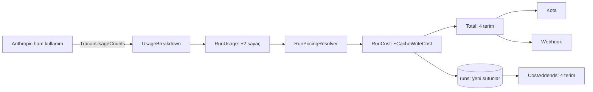

# Faz 253 — Önbellek Yazma Token'ı ve Fiyatı Run Maliyetine Girer

> **Durum:** 📋 Planlandı (2026-10-26)
> **Kademe:** tam — migration (üç sağlayıcıda `runs` sütunları) · kalıcı veri: run maliyetinin bileşimi ve fiyat anlık görüntüsü değişir · K-483 sınıfı toplama ifadesine dördüncü terim (kota tavanı güvenliği)
> **Plan onayı:** Bakımcı, 2026-10-26 (sohbette alınan karar: iki adlı fiyat — `CacheWriteCostPerMillionTokens` kısa TTL, `CacheWriteLongCostPerMillionTokens` uzun TTL; run iki token sayısını ve tek `CacheWriteCost` terimini taşır; `Total()` dört terim)
> **Kaynak:** [ADAYLAR.md](ADAYLAR.md) · **F-420**
> **Genellik:** Anthropic'i önbellekle (`anthropic.promptCaching = true`) kullanan her tüketici; run maliyetini, maliyet kotasını, webhook toplamını ya da istatistik ucunu okuyan her kurulum. İlk ilke: Tracon run maliyetini sözleşme olarak sunar ve maliyet kotası onunla tavan uygular. Tek tüketici ölçümü (podcast pilotu, toplamın ~%1'i) yalnız sinyaldir. Ekosistem: Anthropic yazmayı TTL'e göre faturalar (5 dk 1,25×, 1 sa 2× girdi fiyatı); OpenAI yazma ücreti almaz; Gemini bağlam önbelleğini saklama süresine göre ücretlendirir. İş tüketici kodunda kalamaz: fiyatlama `RunPricingResolver`'da, toplamlar depoda yapılır
> **Karşı görüş:** "Ölçülen pilotta pay ~%1'dir; migration'ın maliyeti değerden büyük olabilir." Cevap: pay iş yüküne bağlıdır — uzun sabit bağlamı 1 saatlik TTL ile yazan bir tüketici için yazma, girdi faturasının iki katıdır ve Tracon onu düz girdi fiyatıyla eksik sayar; maliyet tavanı olan kiracı tavanı aşar (K-483'ün koruduğu sınıf). Migration `rc.1`'den önce ucuzdur; sonra kırıcı olmayan ama pahalı bir eklemedir. Fiyat verilmezse davranış bugünküdür (geri uyum, 253.3)
> **Önkoşul:** Faz 204 (`promptCaching.ttl`, kapandı). **Sıra notu:** Faz 252 de `ModelDescriptor`'a ve `ProviderRegistrationCore.BindModels`'e alan ekler; 252'den sonra uygulanırsa satır numaraları kayar, anlam değişmez
> **Paketler:** `Tracon.Abstractions` (`RunUsage`, `RunCost`, `RunTreeCost`, `ModelDescriptor`, `CurrencyTotals`, `RunStatistics`, yeni `TraconUsageCounts`) · `Tracon.Core` (`UsageBreakdown`, `RunPricingResolver`, `RunCostCombiner`, `SideChannelUsageAccumulator`, `ModelPriceOverride`, bağlayıcı, bellek içi depo) · `Tracon.Anthropic` (ham kullanımdan TTL dökümü) · `Tracon.Sql.Shared` + üç sağlayıcı (sütunlar, `CostAddends`) · `Tracon.UI` (maliyet satırı) · `Tracon.Testing.Contracts.Xunit` (`RunStoreContract`)
> **Yeni paket:** Yok · **Migration:** gerekli — `runs` tablosuna token, tutar ve fiyat anlık görüntüsü sütunları, üç sağlayıcıda; numara uygulama anında alınır (K-178)
> **Public API:** Büyüyor — `RunUsage`, `RunCost`, `RunTreeCost`, `ModelDescriptor`, `RunStatistics`'e alanlar; yeni `TraconUsageCounts` sabit sınıfı. `1.0.0` GA'dan (K-603) önce ucuz: `wc -l src/*/PublicAPI.Shipped.txt` → 18 dosya, toplam 18 satır (2026-10-26). Bugün eklemek bedava, sonra eklemek `sealed record`'larda kırıcıdır
> **Tüketici yüzeyi:** site `reference/configuration.md` (`:332-339` fiyat anahtarları: `CacheWrite`, `CacheWriteLong`), `guides/model-providers.md` (`:362-372` önbellek paragrafı: yazma artık fiyatlanır; katalog tablosu), `capabilities.md` satırı (`:71` Anthropic) · sevk edilen: `RunUsage`/`RunCost`/`ModelDescriptor`/`TraconUsageCounts` XML, OpenAPI → iki istemci, `CHANGELOG.md` `[Unreleased]` → *Added* + *Upgrading* (migration)
> **Manuel test alanı:** `docs/manuel-test/12-GOZLEMLENEBILIRLIK-MALIYET.md` · `docs/manuel-test/06-SAGLAYICI-DIGER.md` (Anthropic)

---

## Bu Faza Başlarken

> `faz-baslangic` skill'ini uygula. Aşağıdaki liste o skill'in 2. adımıdır —
> **tamamını değil, yalnız işaret edilen bölümleri oku.**

1. Bu doküman
2. Kararlar — yalnız bu kalemleri grep'le:
   ```bash
   grep -n "K-032 —\|K-483 —\|K-893 —\|K-976 —\|K-178 —\|K-985 —\|K-990 —" docs/KARARLAR.md
   ```
   **K-032** (katalog yapılandırmadan gelir), **K-483** (önbellek fiyatı çıkarmalıdır ve her
   toplamın terimidir; tanımsız oran `Unknown`'a düşürmez), **K-893** (çok modelli run her payı
   kendi modeliyle fiyatlar), **K-976** (para birimi karışık toplam tutar taşımaz;
   `CurrencyTotals`), **K-178** (migration numaraları sağlayıcı başına bağımsız), **K-985** (ham
   sağlayıcı temsili okunur), **K-990** (çocuk run maliyetinin kotaya girişi)
3. Önceki fazdan devir: yok
4. Alan hafızası (dört alan):
   [`hafiza/olcum-kota-ve-secenekler.md`](hafiza/olcum-kota-ve-secenekler.md) (🚨 K-483 dersi: toplama ifadesine terim eklemek) ·
   [`hafiza/openai-saglayici.md`](hafiza/openai-saglayici.md) (Anthropic: `InputTokenCount` = girdi + okuma + yazma; yazma `AdditionalCounts["CacheCreationInputTokens"]`) ·
   [`hafiza/sql-migration.md`](hafiza/sql-migration.md) · [`hafiza/sql-paylasilan-sorgu-uretimi.md`](hafiza/sql-paylasilan-sorgu-uretimi.md)
5. Gerektiğinde: `MEMORY.md`'nin "Elle tekrarlanan bir toplama ifadesine terim eklemek" maddesi —
   bu fazın birinci tuzağıdır

---

## Amaç

Anthropic önbelleğe **yazmayı** okumadan ayrı ve daha pahalı faturalar. Tracon bugün yalnız
önbellek **okumasını** ayrı fiyatlar; yazma token'ları düz girdi fiyatıyla sayılır. Run
maliyeti, maliyet kotası ve webhook toplamı bu yüzden eksiktir.

- **F-420** — Yazma token'ları TTL'e göre iki sayaçla kaydedilir; katalog iki yazma fiyatı
  taşır; run maliyetinin dördüncü terimi `CacheWriteCost`'tur ve her toplamdan geçer. Fiyat
  verilmezse yazma bugünkü gibi girdi fiyatıyla sayılır.

### Bugün ne çalışmıyor — doğrulanmış kanıt

| Kanıt | Gözlem |
|---|---|
| [`RunSupportTypes.cs:42`](../src/Tracon.Abstractions/Runs/RunSupportTypes.cs) | `RunUsage` yalnız `CachedInputTokens` (okuma) taşır; yazma sayacı yok |
| [`RunSupportTypes.cs:189-192`](../src/Tracon.Abstractions/Runs/RunSupportTypes.cs) · [`:249-252`](../src/Tracon.Abstractions/Runs/RunSupportTypes.cs) | `RunCost.Total()` ve `RunTreeCost.Total()` üç terimdir: girdi + çıktı + önbellek okuma |
| [`ModelDescriptor.cs:69`](../src/Tracon.Abstractions/Models/ModelDescriptor.cs) · [`TraconOptions.cs:949-975`](../src/Tracon.Core/TraconOptions.cs) | Katalog ve `ModelPriceOverride` yalnız `CachedInputCostPerMillionTokens` taşır |
| [`RunPricingResolver.cs:58-80`](../src/Tracon.Core/Models/RunPricingResolver.cs) · [`:160-206`](../src/Tracon.Core/Models/RunPricingResolver.cs) | Fiyat çıkarmalıdır: tam fiyatlı girdi = `InputTokens − CachedInputTokens`; yazma token'ları o farkın içinde kalır ve girdi fiyatıyla sayılır |
| [`UsageBreakdown.cs:37`](../src/Tracon.Core/Recording/UsageBreakdown.cs) | Yalnız `CachedInputTokenCount` okunur |
| [`SqlQueriesBase.cs:72`](../src/Tracon.Sql.Shared/Internal/SqlQueriesBase.cs) | `CostAddends = ["input_cost", "output_cost", "cached_input_cost"]` — SQL toplamlarının tek kaynağı |
| [`HostedToolUsageChatClient.cs:44`](../src/Tracon.Core/Models/HostedToolUsageChatClient.cs) · [`:184`](../src/Tracon.Core/Models/HostedToolUsageChatClient.cs) | Core'un Anthropic'e özgü bir `AdditionalCounts` anahtarını okuduğu emsal (`WebSearchRequests`) |
| [`AnthropicRequestSettings.cs:60-76`](../src/Tracon.Anthropic/AnthropicRequestSettings.cs) · [`:109-110`](../src/Tracon.Anthropic/AnthropicRequestSettings.cs) | `promptCaching` ve `ttl` (`5m`, `1h`) bağlamada okunur |
| `src/Tracon.UI/frontend/src/components/run-comparison.tsx:88-99` | Konsol üç terimi elle toplar ("All THREE terms") — K-483 sınıfının istemci kopyası |
| MEAI 10.11.0 `UsageDetails` (2026-10-26, DLL dize okuması) | Yazma için bir özellik yok: `CachedInputTokenCount`, `ReasoningTokenCount`, girdi/çıktı ses-metin sayaçları var, yazma yok |
| Anthropic SDK 12.58.0 (2026-10-26, DLL dize okuması) | `Usage.CacheCreation` → `Ephemeral5mInputTokens`, `Ephemeral1hInputTokens`; ayrıca `CacheCreationInputTokens`. **Tip yeri ve akışlı yoldaki konumu `maf-api-kesfi` ile doğrulanmalı** |
| Faz 204 ölçümü (aday gövdesi) | Yazma token'ı `InputTokenCount`'a girer ve `AdditionalCounts["CacheCreationInputTokens"]`'e yazılır (toplam, TTL'siz) |

> Kanıtlar 2026-10-26 tarihinde doğrulandı (kod okuması + iki DLL'in dize okuması). Adım 0
> canlı ölçümdür.

---

## 253.0 — Adım 0: canlı ölçüm (kod yazmadan önce)

Gerçek Anthropic anahtarıyla (`dotnet user-secrets`, K-059) aynı uzun talimatı iki kez
gönder: `ttl = 5m` ve `ttl = 1h`; akışsız ve akışlı. Her koşumda kaydet:

- `UsageDetails.InputTokenCount`, `CachedInputTokenCount`, `AdditionalCounts` anahtarları
- `RawRepresentation` içindeki `Usage.CacheCreation.Ephemeral5mInputTokens` / `Ephemeral1hInputTokens`
  (akışta hangi olayda geldiği: `message_start` mı `message_delta` mı)

**Kanal kuralı (ADAYLAR'daki Genellik):** ölçüm yazma token'ının `InputTokenCount`'a **hiç
girmediğini** gösterirse kalem maliyet kaydı kusurudur; faz durur ve kusur kanalına geçer
(kullanıcıya sor). Girdi fiyatıyla sayılıyorsa (Faz 204'ün ölçümü) plan aynen sürer.

### Ölçüm sonucu (2026-10-27 · Anthropic SDK 12.58.0 · MEAI 10.11.0)

Probe repo dışında, geçici bir konsol projesidir; hiçbir üretim kodundan önce koştu. İstek
Tracon'un `AnthropicProviderSettingsChatClient` biçimindedir: `ChatOptions.RawRepresentationFactory`
→ `MessageCreateParams.FromRawUnchecked`, üst düzey `cache_control`. Her senaryo benzersiz bir
ön ek kullanır (başta bir nonce), bu yüzden her çağrı taze bir yazmadır. `max_tokens = 16`, ön ek
~6,3 K (Haiku 4.5) ve ~8,2 K (Haiku 5.5) token. İki model, 12 çağrı (ilk deneme olan 26 K'lık
ön ekli bir ek çağrı dâhil değil: o çağrı ilk denemeydi ve aynı biçimi verdi, toplam 13 çağrı).
Haiku 4.5 sayıları aşağıdadır; Haiku 5.5 aynı biçimi verdi (`InputTokenCount = 8225`, yazma
`8221`, okuma `8221`).

| # | Kol | `ttl` | `InputTokenCount` | `CachedInputTokenCount` | `AdditionalCounts` | Ham `cache_creation` 5m / 1h |
|---|---|---|---|---|---|---|
| S1 | akışsız, yazma | `5m` | 6340 | 0 | `CacheCreationInputTokens=6337` | 6337 / 0 |
| S2 | akışsız, yazma | `1h` | 6340 | 0 | `CacheCreationInputTokens=6337` | 0 / 6337 |
| S3 | akışlı, yazma | `5m` | 6340 | 0 | `CacheCreationInputTokens=6337` | 6337 / 0 (`message_start`) |
| S4 | akışlı, yazma | `1h` | 6340 | 0 | `CacheCreationInputTokens=6337` | 0 / 6337 (`message_start`) |
| S5 | akışsız, S1'in ön eki (okuma) | `5m` | 6340 | 6337 | yok | 0 / 0 |
| S6 | akışsız, yazma | verilmedi | 6340 | 0 | `CacheCreationInputTokens=6337` | 6337 / 0 |

Ham kullanım nesnesi (S2): `{"input_tokens":3,"cache_creation_input_tokens":6337,"cache_read_input_tokens":0,"cache_creation":{"ephemeral_5m_input_tokens":0,"ephemeral_1h_input_tokens":6337},"output_tokens":4,…}`.

Çıkarımlar:

1. **Yazma token'ı `InputTokenCount`'a girer:** `6340 = 3 + 6337 + 0` (düz girdi + yazma + okuma).
   Kanal kuralının "kusur" dalı **tetiklenmedi**; kalem özelliktir, plan aynen sürer. Bugün Tracon
   yazmayı tam girdi fiyatıyla sayar, çünkü çıkarmalı hesap (`InputTokens − CachedInputTokens`)
   yazmayı çıkarmaz.
2. **Adaptör TTL dökümünü MEAI'ye taşımaz.** `UsageDetails` yalnız toplam yazmayı
   `AdditionalCounts["CacheCreationInputTokens"]` ile verir. Yazma sıfırsa (S5) anahtar hiç yazılmaz.
3. **Döküm ham yanıtta durur.** Akışsız: `Message.Usage.RawData["cache_creation"]`
   (`ephemeral_5m_input_tokens`, `ephemeral_1h_input_tokens`). Akışlı: **yalnız `message_start`
   olayında** (`message.usage.cache_creation`). `message_delta.usage` toplamı
   (`cache_creation_input_tokens`) taşır, dökümü taşımaz; SDK modeli `MessageDeltaUsage` da
   `CacheCreation` özelliği içermez. `UsageContent` akışın **en son** güncellemesinde gelir
   (`RawRepresentation` yok) ve yalnız toplamı taşır. Halka bu yüzden `message_start`'ta dökümü
   tutmalı ve `UsageContent` geçerken iki anahtarı eklemelidir.
4. **Döküm 13 çağrının 13'ünde geldi** (iki model, iki kol, `ttl` verilmeyen çağrı dâhil;
   okumada iki değer sıfır). `ttl` verilmezse yazma 5 dakikalık sayaca düşer.
5. Okumada `CachedInputTokenCount` doğru dolar (S5: 6337); yazma `CachedInputTokenCount`'a girmez.

## 253.1 — Token'lar: sağlayıcıdan bağımsız iki sayaç

- `Tracon.Abstractions`'ta `public static class TraconUsageCounts` iki anahtar sabiti taşır:
  `CacheWriteInputTokens` (kısa TTL) ve `CacheWriteLongInputTokens` (uzun TTL). Herhangi bir
  sağlayıcı `UsageDetails.AdditionalCounts`'a bu anahtarlarla yazabilir (`TraconFinishReasons`
  emsali: sağlayıcıdan bağımsız sözleşme).
- `Tracon.Anthropic` bir model halkası (`AnthropicStopReasonChatClient`'ın yanında) ham
  kullanımdan TTL dökümünü okur ve iki anahtarı yazar. Döküm yoksa toplam
  (`CacheCreationInputTokens`) kısa TTL sayılır (Açık Soru 1).
- `UsageBreakdown` iki anahtarı okur; `RunUsage` iki alan kazanır:
  `CacheWriteInputTokens`, `CacheWriteLongInputTokens` (ikisi de **`InputTokens`'ın içinde**,
  `CachedInputTokens` gibi). `SideChannelUsageAccumulator` aynı iki sayacı taşır.

## 253.2 — Fiyat: katalog ve yapılandırma

- `ModelDescriptor` ve `ModelPriceOverride`: `CacheWriteCostPerMillionTokens`,
  `CacheWriteLongCostPerMillionTokens` (`decimal?`). Kısa anahtarlar `CacheWrite`,
  `CacheWriteLong` (`Input`/`Output`/`CachedInput` emsali). Okunamayan metin açılışı durdurur
  (K-1099; `ProviderRegistrationCore.BindModels` ve `Binding.Models.cs`).
- `RunPricingResolver.Compute` dört parça hesaplar:
  - tam fiyatlı girdi = `InputTokens − CachedInputTokens − (fiyatı olan yazma token'ları)`
  - okuma = `CachedInputTokens × okuma fiyatı` (bugünkü)
  - yazma = `kısa × kısa fiyat + uzun × uzun fiyat`
  - çıktı (bugünkü)
- `RunCost` kazanır: `CacheWriteCost` (tek tutar) ve iki fiyat anlık görüntüsü
  (`CacheWritePricePerMillionTokens`, `CacheWriteLongPricePerMillionTokens`).

## 253.3 — Geri uyum kuralı (tanımsız oran)

Bir TTL'in fiyatı verilmemişse o TTL'in yazma token'ları **tam fiyatlı girdide kalır** —
bugünkü davranış. Hiçbir run `Unknown`'a düşmez (K-483'ün ikinci yarısı). Fiyatı olmayan bir
kurulumun maliyeti bit bit aynı kalır; bu bir regresyon testidir.

## 253.4 — Dördüncü terim her toplamdan geçer (K-483 sınıfı)

🚨 Bu fazın birinci tuzağı. Terim **tek kaynaklardan** girer, elle toplanan her yer taranır:

- `RunCost.Total()` ve `RunTreeCost.Total()` dört terim.
- `SqlQueriesBase.CostAddends` += `cache_write_cost` (SQL ağaç, istatistik, zaman serisi,
  deney kolu, yargıç toplamları buradan türer).
- `CurrencyTotals` (K-976), `RunCostCombiner`, `InMemoryRunStore.Statistics`/`Queries`.
- Kota ve webhook toplamı `RunSpend.Total` / `RunCost.Total()` üzerinden okur;
  `QuotaEnforcer.cs` terimleri kendisi toplamaz (grep, 2026-10-26). Uygulama oturumu bunu
  `grep -rn "\.Total()" src` (bugün 29 satır, 13 dosya) ve `grep -rn "CachedInputCost" src`
  ile yeniden kanıtlar; elle `InputCost + OutputCost` yazan her yer tek tek düzeltilir.
- Konsol `run-comparison.tsx:88-99` elle toplar → dört terim; `server-types.ts:114`, `:129`,
  `:164` alan listeleri.
- `RunStatistics.CachedInputTokens` (`RunStatistics.cs:109`) yanına iki toplam (Açık Soru 2).



## 253.5 — Depo

Üç sağlayıcıda `runs`'a sütunlar: `cache_write_input_tokens`, `cache_write_long_input_tokens`
(`bigint`), `cache_write_cost` (`numeric(20,10)`; SQLite `TEXT`, F-497 kuralı aynen), iki
fiyat anlık görüntüsü. Eski satırlar `NULL` kalır ve "yazma ayrı fiyatlanmadı" anlamına gelir
(geri doldurma yok). `RunOrdinals` ve `SqlRunStore` okuma/yazma; `RunStoreContract` yeni
alanların gidiş-dönüşünü dört depoda sınar.

---

## Planlanan Public API

> Taslak imzalardır. Gerçekleşen imzalar kapanışta ayrı bir bölüme yazılır.

```csharp
// Tracon.Abstractions
public static class TraconUsageCounts
{
    public const string CacheWriteInputTokens = "tracon.cache_write_input_tokens";
    public const string CacheWriteLongInputTokens = "tracon.cache_write_long_input_tokens";
}

public sealed record RunUsage
{
    public long? CacheWriteInputTokens { get; init; }      // inside InputTokens
    public long? CacheWriteLongInputTokens { get; init; }  // inside InputTokens
}

public sealed record RunCost
{
    public decimal? CacheWriteCost { get; init; }
    public decimal? CacheWritePricePerMillionTokens { get; init; }
    public decimal? CacheWriteLongPricePerMillionTokens { get; init; }
    public decimal? Total(); // four addends
}

public sealed record RunTreeCost { public decimal? CacheWriteCost { get; init; } }

public sealed record ModelDescriptor
{
    public decimal? CacheWriteCostPerMillionTokens { get; init; }
    public decimal? CacheWriteLongCostPerMillionTokens { get; init; }
}

// Tracon.Core
public sealed class ModelPriceOverride
{
    public decimal? CacheWriteCostPerMillionTokens { get; set; }
    public decimal? CacheWriteLongCostPerMillionTokens { get; set; }
}
```

Anahtar adlarının biçimi (`tracon.` öneki) uygulama anında `AdditionalCounts`'ın mevcut
anahtar biçimine göre kesinleşir.

### HTTP

Yeni uç yok. `RunRecord`, `RunCost`, `RunTreeCost`, istatistik ve `ModelDescriptor` şemaları
alan kazanır; OpenAPI ve iki istemci yenilenir.

### Arayüz payı

Run ayrıntısının maliyet satırı ve karşılaştırma bir terim kazanır; bundle payı ölçülür ve
yazılır (bugün `index-*.js.br` 188.718 B, 2026-10-26).

---

## Planlanan Dosya Listesi

```
src/Tracon.Abstractions/Runs/RunSupportTypes.cs · RunStatistics.cs · CurrencyTotals.cs · RunRecord.cs
src/Tracon.Abstractions/Models/ModelDescriptor.cs
src/Tracon.Abstractions/Models/TraconUsageCounts.cs            # yeni
src/Tracon.Anthropic/AnthropicCacheUsageChatClient.cs          # yeni (ad uygulamada)
src/Tracon.Core/Recording/UsageBreakdown.cs · SideChannelUsageAccumulator.cs · RunCostCombiner.cs
src/Tracon.Core/Models/RunPricingResolver.cs
src/Tracon.Core/TraconOptions.cs · TraconServiceCollectionExtensions.Binding.Models.cs
src/Tracon.Providers.Shared/ProviderRegistrationCore.cs
src/Tracon.Core/Storage/InMemoryRunStore.*.cs
src/Tracon.Sql.Shared/Internal/SqlQueriesBase.cs · Stores/SqlRunStore.cs · Stores/RunOrdinals.cs
src/Tracon.{PostgreSql,SqlServer,Sqlite}/Migrations/NNNN_cache_write_cost.sql   # numara uygulamada
src/Tracon.Testing.Contracts.Xunit/Contracts/RunStoreContract.cs
src/Tracon.UI/frontend/src/components/run-comparison.tsx · lib/server-types.ts · run maliyet satırı
```

---

## Hata Modları ve Testler

> Fiyat ve toplam depo, kiracı ve kota sınırlarını geçer; toplamlar sözleşme ve fonksiyonel
> seviyededir ([`test-seviyeleri.md`](../.agents/ortak/test-seviyeleri.md)).

| Ne bozulabilir | Seviye | Test |
|---|---|---|
| Yazma token'ı iki kez sayılır (girdi + yazma) | Birim | `RunPricingResolverTests` — çıkarmalı hesap, dört parça |
| Fiyat yokken maliyet değişir (regresyon) | Birim + Fonksiyonel | fiyatsız kurulumda tutar bit bit aynı |
| Yalnız bir TTL'in fiyatı varken diğeri kaybolur | Birim | fiyatsız TTL tam fiyatlı girdide kalır |
| Kota sayacı dördüncü terimi kaçırır → kiracı tavanı aşar | Fonksiyonel | `QuotaCostCeilingTests` benzeri: yazmalı run tavanı doldurur (K-483 vakasının ikizi) |
| Webhook toplamı terimi kaçırır | Fonksiyonel | webhook yükünde toplam |
| SQL ağaç/istatistik toplamı terimi kaçırır | Sözleşme | `RunStoreContract` (dört depo) + `CostAddends` |
| Para birimi karışık ağaçta tutar yazılır | Sözleşme | `CurrencyTotals` kuralı (K-976) yeni terimde |
| Yan kanal (özetleyici) yazma token'ı kaybolur | Birim | `SideChannelUsageAccumulatorTests` |
| Anthropic ham döküm akışta farklı olayda gelir | Fonksiyonel | sahte Anthropic teli: akışlı ve akışsız (Adım 0'ın sonucu) |
| Döküm yokken toplam anahtar kaybolur | Birim | yalnız `CacheCreationInputTokens` → kısa TTL (Açık Soru 1) |
| Okunamayan fiyat metni sessiz kalır | Birim | `UnreadableProviderConfiguration` probu yeni alanları kendiliğinden kapsar; `TraconPricingBindingTests` |
| Eski satır (sütunlar `NULL`) listeyi çökertir | Sözleşme | eski satır okuması (MEMORY "struct alanı" dersi) |
| Migration üç sağlayıcıda farklı | Fonksiyonel | migration bütünlük kapısı (`kapi.py tarama`) + üç entegrasyon koşumu |
| Konsol üç terimle toplar | Vitest | `run-comparison` dört terim |
| İptal / başka kiracı | — | yeni yol yok: fiyatlama run kapanışında, kiracı damgası K-355 ile aynen |

---

## Manuel Kabul Case'leri

| # | Ön koşul | Adımlar | Beklenen sonuç |
|---|---|---|---|
| 1 🤖 | Gerçek Anthropic anahtarı; `promptCaching=true`, `ttl=5m`; katalogda iki yazma fiyatı | Aynı uzun talimatla iki run | İlk run'da `cacheWriteInputTokens > 0`, `cacheWriteCost` = token × kısa fiyat; ikinci run'da okuma, yazma yok |
| 2 🤖 | Aynı, `ttl=1h` | Bir run | `cacheWriteLongInputTokens > 0`, uzun fiyatla fiyatlanır |
| 3 🤖 | Fiyat yazılmamış kurulum | Aynı run | Maliyet bugünkü değerle aynı (yazma girdi fiyatında) |

---

## Açık Sorular

| # | Soru | Seçenekler | Öneri |
|---|---|---|---|
| 1 | Ham TTL dökümü yoksa (`CacheCreationInputTokens` var, döküm yok) toplam hangi TTL sayılır? | A: kısa TTL · B: bağlamanın `ttl` ayarı · C: fiyatlanmaz, girdide kalır | **B**, ayar yoksa A — Tracon bağlama başına tek TTL gönderir; Adım 0 dökümün her zaman geldiğini gösterirse soru düşer |
| 2 | `RunStatistics` yazma token toplamlarını taşısın mı? | A: evet, iki toplam · B: yalnız maliyet | **A** — okuma için zaten var (`RunStatistics.cs:109`); simetri |
| 3 | Gemini'nin saklama süresi ücreti aynı alana mı girer? | A: hayır, ayrı yan kanal (C-12 hosted tool ücreti gibi) · B: evet | **A** — süre tabanlı ücret token tabanlı değildir; aday olarak yazılır |

---

## Bitiş Ölçütleri (DoD)

- [x] Adım 0 ölçümü bu dokümana yazıldı (iki TTL, iki kol)
- [ ] Önbellekli Anthropic run'ında `RunUsage` iki yazma sayacını, `RunCost` `CacheWriteCost`'u taşır; `Total()` dört terimdir
- [ ] Fiyatsız kurulumda maliyet değişmez (regresyon testi yeşil)
- [ ] `grep -rn "\.Total()\|CachedInputCost" src` ile bulunan her toplama yeri dördüncü terimi taşır; tarama sonucu dokümana yazıldı
- [ ] Kota tavanı yazmalı run'da doğru dolar (fonksiyonel test)
- [ ] Migration üç sağlayıcıda; `RunStoreContract` dört depoda yeşil
- [ ] Yeni `K-*` (`kalıcı-veri`, `public-api`): yazma terimi ve geri uyum kuralı, reddedilen alternatifler (TTL sözlüğü, tek fiyat) adıyla
- [ ] Dört doğrulama kapısı sıfır uyarı verir
- [ ] `samples/Tracon.Api` ile gerçek `run` yapıldı (case 1-3), çıktı belgeye yazıldı
- [ ] `secret` taraması boş döndü
- [ ] `🤖` case'ler `docs/manuel-test/12-…` ve `06-…` içinde ve koşuldu
- [ ] `faz-denetim` koşuldu; 🔴 bulgu kalmadı
- [ ] `docs-site/` güncellendi; `npm run check` temiz; bundle payı ölçüldü ve yazıldı

### Doğrulama komutları

```bash
# Run maliyetinde yazma terimi
curl -s http://localhost:5081/tracon/api/runs/$RUN -H "Authorization: Bearer $KEY" \
  | jq '.usage.cacheWriteInputTokens, .usage.cacheWriteLongInputTokens, .cost.cacheWriteCost'

# Toplama yerlerinin taraması
grep -rn "\.Total()\|CachedInputCost" src --include='*.cs' | grep -v Generated
```

---

## Riskler

| Risk | Önlem |
|---|---|
| Bir toplama yeri dördüncü terimi kaçırır, kota tavanı aşılır (K-483 vakası) | 253.4 taraması DoD maddesidir; kota fonksiyonel testi |
| Anthropic SDK dökümü bir sürümde taşır | Halka dökümü bulamazsa toplamı Açık Soru 1 kuralıyla yazar ve uyarı loglar; SDK yükseltmesinde test kırmızı olur |
| Eski satırlarda `NULL` sütun bir listeyi çökertir | Sözleşme testi eski satır okur |
| Fiyat iki yerde (katalog + `Tracon:Pricing`) | `RunPricingResolver`'ın öncelik sırası aynen; iki bağlayıcı aynı testte |

---

<!-- ============================================================
     AŞAĞISI ÇALIŞIRKEN DOLAR — doküman kapanışta silinir (`faz-kapat`).
     Kalıcı kısım `faz-tamamlama` Adım 5'te yerine taşınır. Başlıkları SİLME.
     ============================================================ -->

## Plandan Sapmalar

> Çalışırken dolar. Plan ile gerçek arasındaki fark **gizlenmez**. Kapanışta
> kapanış commit mesajına taşınır.

## Bu Fazda Verilen Kararlar

> Çalışırken dolar. Dört kategoriden birine giren karar (AGENTS.md)
> `docs/KARARLAR.md`'ye K-NNN ve kategori etiketiyle girer; girmeyen karar
> kapanışta commit mesajına taşınır (`faz-tamamlama` Adım 8). Plan numara rezerve
> etmez.

## Süreç Ölçümü

> Kapanışta doldurulur. **Tablo olarak** — onay kutusu DEĞİL: `faz-kapat`
> işaretsiz kutuda durur. `faz-kapat` bu tabloyu `docs/FAZ-DEFTERI.md`'ye taşır;
> eşik **167**'den itibaren boş bir değer hücresinde kapanışı durdurur.
> `ölçülmedi` **geçerli bir değerdir** — kapı bir sayı değil, bir **karar** arar.
> Kapı bölümün VARLIĞINI denetler, doğruluğunu denetlemez (K-766).

| Metrik | Değer |
|---|---|
| Plan revizyonu sayısı | |
| Düzeltme turu sayısı | |
| 🔴 bulgu: gerçek / gürültü / araştırılacak | |
| Fazın ürettiği regresyon | |
| Faz kapandıktan sonra bulunan kusur | ölçülmedi (kapanış anı) |

## Denetim Bulguları

> `faz-denetim` çıktısı. Her satır: bulgu · seviye (🔴/🟡/🟢) · sonuç
> (düzeltildi / gerekçelendi / F-NN olarak devredildi). 🟢 kapanışta
> `ADAYLAR.md`'ye gider.
