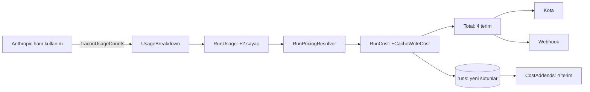

# Faz 253 — Önbellek Yazma Token'ı ve Fiyatı Run Maliyetine Girer

> **Durum:** 📋 Planlandı (2026-10-26)
> **Kademe:** tam — migration (üç sağlayıcıda `runs` sütunları) · kalıcı veri: run maliyetinin bileşimi ve fiyat anlık görüntüsü değişir · K-483 sınıfı toplama ifadesine dördüncü terim (kota tavanı güvenliği)
> **Plan onayı:** Bakımcı, 2026-10-26 (sohbette alınan karar: iki adlı fiyat — `CacheWriteCostPerMillionTokens` kısa TTL, `CacheWriteLongCostPerMillionTokens` uzun TTL; run iki token sayısını ve tek `CacheWriteCost` terimini taşır; `Total()` dört terim)
> **Kaynak:** [ADAYLAR.md](ADAYLAR.md) · **F-420**
> **Genellik:** Anthropic'i önbellekle (`anthropic.promptCaching = true`) kullanan her tüketici; run maliyetini, maliyet kotasını, webhook toplamını ya da istatistik ucunu okuyan her kurulum. İlk ilke: Tracon run maliyetini sözleşme olarak sunar ve maliyet kotası onunla tavan uygular. Tek tüketici ölçümü (podcast pilotu, toplamın ~%1'i) yalnız sinyaldir. Ekosistem: Anthropic yazmayı TTL'e göre faturalar (5 dk 1,25×, 1 sa 2× girdi fiyatı); OpenAI yazma ücreti almaz; Gemini bağlam önbelleğini saklama süresine göre ücretlendirir. İş tüketici kodunda kalamaz: fiyatlama `RunPricingResolver`'da, toplamlar depoda yapılır
> **Karşı görüş:** "Ölçülen pilotta pay ~%1'dir; migration'ın maliyeti değerden büyük olabilir." Cevap: pay iş yüküne bağlıdır — uzun sabit bağlamı 1 saatlik TTL ile yazan bir tüketici için yazma, girdi faturasının iki katıdır ve Tracon onu düz girdi fiyatıyla eksik sayar; maliyet tavanı olan kiracı tavanı aşar (K-483'ün koruduğu sınıf). Migration `rc.1`'den önce ucuzdur; sonra kırıcı olmayan ama pahalı bir eklemedir. Fiyat verilmezse davranış bugünküdür (geri uyum, 253.3)
> **Önkoşul:** Faz 204 (`promptCaching.ttl`, kapandı). **Sıra notu:** Faz 252 de `ModelDescriptor`'a ve `ProviderRegistrationCore.BindModels`'e alan ekler; 252'den sonra uygulanırsa satır numaraları kayar, anlam değişmez
> **Paketler:** `Tracon.Abstractions` (`RunUsage`, `RunCost`, `RunTreeCost`, `ModelDescriptor`, `CurrencyTotals`, `RunStatistics`, yeni `TraconUsageCounts`) · `Tracon.Core` (`UsageBreakdown`, `RunPricingResolver`, `RunCostCombiner`, `SideChannelUsageAccumulator`, `ModelPriceOverride`, bağlayıcı, bellek içi depo) · `Tracon.Anthropic` (ham kullanımdan TTL dökümü) · `Tracon.Sql.Shared` + üç sağlayıcı (sütunlar, `CostAddends`) · `Tracon.UI` (maliyet satırı) · `Tracon.Testing.Contracts.Xunit` (`RunStoreContract`)
> **Yeni paket:** Yok · **Migration:** gerekli — `runs` tablosuna token, tutar ve fiyat anlık görüntüsü sütunları, üç sağlayıcıda; numara uygulama anında alınır (K-178)
> **Public API:** Büyüyor — `RunUsage`, `RunCost`, `RunTreeCost`, `ModelDescriptor`, `RunStatistics`'e alanlar; yeni `TraconUsageCounts` sabit sınıfı. `1.0.0` GA'dan (K-603) önce ucuz: `wc -l src/*/PublicAPI.Shipped.txt` → 18 dosya, toplam 18 satır (2026-10-26). Bugün eklemek bedava, sonra eklemek `sealed record`'larda kırıcıdır
> **Tüketici yüzeyi:** site `reference/configuration.md` (`:332-339` fiyat anahtarları: `CacheWrite`, `CacheWriteLong`), `guides/model-providers.md` (`:362-372` önbellek paragrafı: yazma artık fiyatlanır; katalog tablosu), `capabilities.md` satırı (`:71` Anthropic) · sevk edilen: `RunUsage`/`RunCost`/`ModelDescriptor`/`TraconUsageCounts` XML, OpenAPI → iki istemci, `CHANGELOG.md` `[Unreleased]` → *Added* + *Upgrading* (migration)
> **Manuel test alanı:** `docs/manuel-test/12-GOZLEMLENEBILIRLIK-MALIYET.md` · `docs/manuel-test/06-SAGLAYICI-DIGER.md` (Anthropic)

---

## Bu Faza Başlarken

> `faz-baslangic` skill'ini uygula. Aşağıdaki liste o skill'in 2. adımıdır —
> **tamamını değil, yalnız işaret edilen bölümleri oku.**

1. Bu doküman
2. Kararlar — yalnız bu kalemleri grep'le:
   ```bash
   grep -n "K-032 —\|K-483 —\|K-893 —\|K-976 —\|K-178 —\|K-985 —\|K-990 —" docs/KARARLAR.md
   ```
   **K-032** (katalog yapılandırmadan gelir), **K-483** (önbellek fiyatı çıkarmalıdır ve her
   toplamın terimidir; tanımsız oran `Unknown`'a düşürmez), **K-893** (çok modelli run her payı
   kendi modeliyle fiyatlar), **K-976** (para birimi karışık toplam tutar taşımaz;
   `CurrencyTotals`), **K-178** (migration numaraları sağlayıcı başına bağımsız), **K-985** (ham
   sağlayıcı temsili okunur), **K-990** (çocuk run maliyetinin kotaya girişi)
3. Önceki fazdan devir: yok
4. Alan hafızası (dört alan):
   [`hafiza/olcum-kota-ve-secenekler.md`](hafiza/olcum-kota-ve-secenekler.md) (🚨 K-483 dersi: toplama ifadesine terim eklemek) ·
   [`hafiza/openai-saglayici.md`](hafiza/openai-saglayici.md) (Anthropic: `InputTokenCount` = girdi + okuma + yazma; yazma `AdditionalCounts["CacheCreationInputTokens"]`) ·
   [`hafiza/sql-migration.md`](hafiza/sql-migration.md) · [`hafiza/sql-paylasilan-sorgu-uretimi.md`](hafiza/sql-paylasilan-sorgu-uretimi.md)
5. Gerektiğinde: `MEMORY.md`'nin "Elle tekrarlanan bir toplama ifadesine terim eklemek" maddesi —
   bu fazın birinci tuzağıdır

---

## Amaç

Anthropic önbelleğe **yazmayı** okumadan ayrı ve daha pahalı faturalar. Tracon bugün yalnız
önbellek **okumasını** ayrı fiyatlar; yazma token'ları düz girdi fiyatıyla sayılır. Run
maliyeti, maliyet kotası ve webhook toplamı bu yüzden eksiktir.

- **F-420** — Yazma token'ları TTL'e göre iki sayaçla kaydedilir; katalog iki yazma fiyatı
  taşır; run maliyetinin dördüncü terimi `CacheWriteCost`'tur ve her toplamdan geçer. Fiyat
  verilmezse yazma bugünkü gibi girdi fiyatıyla sayılır.

### Bugün ne çalışmıyor — doğrulanmış kanıt

| Kanıt | Gözlem |
|---|---|
| [`RunSupportTypes.cs:42`](../src/Tracon.Abstractions/Runs/RunSupportTypes.cs) | `RunUsage` yalnız `CachedInputTokens` (okuma) taşır; yazma sayacı yok |
| [`RunSupportTypes.cs:189-192`](../src/Tracon.Abstractions/Runs/RunSupportTypes.cs) · [`:249-252`](../src/Tracon.Abstractions/Runs/RunSupportTypes.cs) | `RunCost.Total()` ve `RunTreeCost.Total()` üç terimdir: girdi + çıktı + önbellek okuma |
| [`ModelDescriptor.cs:69`](../src/Tracon.Abstractions/Models/ModelDescriptor.cs) · [`TraconOptions.cs:949-975`](../src/Tracon.Core/TraconOptions.cs) | Katalog ve `ModelPriceOverride` yalnız `CachedInputCostPerMillionTokens` taşır |
| [`RunPricingResolver.cs:58-80`](../src/Tracon.Core/Models/RunPricingResolver.cs) · [`:160-206`](../src/Tracon.Core/Models/RunPricingResolver.cs) | Fiyat çıkarmalıdır: tam fiyatlı girdi = `InputTokens − CachedInputTokens`; yazma token'ları o farkın içinde kalır ve girdi fiyatıyla sayılır |
| [`UsageBreakdown.cs:37`](../src/Tracon.Core/Recording/UsageBreakdown.cs) | Yalnız `CachedInputTokenCount` okunur |
| [`SqlQueriesBase.cs:72`](../src/Tracon.Sql.Shared/Internal/SqlQueriesBase.cs) | `CostAddends = ["input_cost", "output_cost", "cached_input_cost"]` — SQL toplamlarının tek kaynağı |
| [`HostedToolUsageChatClient.cs:44`](../src/Tracon.Core/Models/HostedToolUsageChatClient.cs) · [`:184`](../src/Tracon.Core/Models/HostedToolUsageChatClient.cs) | Core'un Anthropic'e özgü bir `AdditionalCounts` anahtarını okuduğu emsal (`WebSearchRequests`) |
| [`AnthropicRequestSettings.cs:60-76`](../src/Tracon.Anthropic/AnthropicRequestSettings.cs) · [`:109-110`](../src/Tracon.Anthropic/AnthropicRequestSettings.cs) | `promptCaching` ve `ttl` (`5m`, `1h`) bağlamada okunur |
| `src/Tracon.UI/frontend/src/components/run-comparison.tsx:88-99` | Konsol üç terimi elle toplar ("All THREE terms") — K-483 sınıfının istemci kopyası |
| MEAI 10.11.0 `UsageDetails` (2026-10-26, DLL dize okuması) | Yazma için bir özellik yok: `CachedInputTokenCount`, `ReasoningTokenCount`, girdi/çıktı ses-metin sayaçları var, yazma yok |
| Anthropic SDK 12.58.0 (2026-10-26, DLL dize okuması) | `Usage.CacheCreation` → `Ephemeral5mInputTokens`, `Ephemeral1hInputTokens`; ayrıca `CacheCreationInputTokens`. **Tip yeri ve akışlı yoldaki konumu `maf-api-kesfi` ile doğrulanmalı** |
| Faz 204 ölçümü (aday gövdesi) | Yazma token'ı `InputTokenCount`'a girer ve `AdditionalCounts["CacheCreationInputTokens"]`'e yazılır (toplam, TTL'siz) |

> Kanıtlar 2026-10-26 tarihinde doğrulandı (kod okuması + iki DLL'in dize okuması). Adım 0
> canlı ölçümdür.

---

## 253.0 — Adım 0: canlı ölçüm (kod yazmadan önce)

Gerçek Anthropic anahtarıyla (`dotnet user-secrets`, K-059) aynı uzun talimatı iki kez
gönder: `ttl = 5m` ve `ttl = 1h`; akışsız ve akışlı. Her koşumda kaydet:

- `UsageDetails.InputTokenCount`, `CachedInputTokenCount`, `AdditionalCounts` anahtarları
- `RawRepresentation` içindeki `Usage.CacheCreation.Ephemeral5mInputTokens` / `Ephemeral1hInputTokens`
  (akışta hangi olayda geldiği: `message_start` mı `message_delta` mı)

**Kanal kuralı (ADAYLAR'daki Genellik):** ölçüm yazma token'ının `InputTokenCount`'a **hiç
girmediğini** gösterirse kalem maliyet kaydı kusurudur; faz durur ve kusur kanalına geçer
(kullanıcıya sor). Girdi fiyatıyla sayılıyorsa (Faz 204'ün ölçümü) plan aynen sürer.

### Ölçüm sonucu (2026-10-27 · Anthropic SDK 12.58.0 · MEAI 10.11.0)

Probe repo dışında, geçici bir konsol projesidir; hiçbir üretim kodundan önce koştu. İstek
Tracon'un `AnthropicProviderSettingsChatClient` biçimindedir: `ChatOptions.RawRepresentationFactory`
→ `MessageCreateParams.FromRawUnchecked`, üst düzey `cache_control`. Her senaryo benzersiz bir
ön ek kullanır (başta bir nonce), bu yüzden her çağrı taze bir yazmadır. `max_tokens = 16`, ön ek
~6,3 K (Haiku 4.5) ve ~8,2 K (Haiku 5.5) token. İki model, 12 çağrı (ilk deneme olan 26 K'lık
ön ekli bir ek çağrı dâhil değil: o çağrı ilk denemeydi ve aynı biçimi verdi, toplam 13 çağrı).
Haiku 4.5 sayıları aşağıdadır; Haiku 5.5 aynı biçimi verdi (`InputTokenCount = 8225`, yazma
`8221`, okuma `8221`).

| # | Kol | `ttl` | `InputTokenCount` | `CachedInputTokenCount` | `AdditionalCounts` | Ham `cache_creation` 5m / 1h |
|---|---|---|---|---|---|---|
| S1 | akışsız, yazma | `5m` | 6340 | 0 | `CacheCreationInputTokens=6337` | 6337 / 0 |
| S2 | akışsız, yazma | `1h` | 6340 | 0 | `CacheCreationInputTokens=6337` | 0 / 6337 |
| S3 | akışlı, yazma | `5m` | 6340 | 0 | `CacheCreationInputTokens=6337` | 6337 / 0 (`message_start`) |
| S4 | akışlı, yazma | `1h` | 6340 | 0 | `CacheCreationInputTokens=6337` | 0 / 6337 (`message_start`) |
| S5 | akışsız, S1'in ön eki (okuma) | `5m` | 6340 | 6337 | yok | 0 / 0 |
| S6 | akışsız, yazma | verilmedi | 6340 | 0 | `CacheCreationInputTokens=6337` | 6337 / 0 |

Ham kullanım nesnesi (S2): `{"input_tokens":3,"cache_creation_input_tokens":6337,"cache_read_input_tokens":0,"cache_creation":{"ephemeral_5m_input_tokens":0,"ephemeral_1h_input_tokens":6337},"output_tokens":4,…}`.

Çıkarımlar:

1. **Yazma token'ı `InputTokenCount`'a girer:** `6340 = 3 + 6337 + 0` (düz girdi + yazma + okuma).
   Kanal kuralının "kusur" dalı **tetiklenmedi**; kalem özelliktir, plan aynen sürer. Bugün Tracon
   yazmayı tam girdi fiyatıyla sayar, çünkü çıkarmalı hesap (`InputTokens − CachedInputTokens`)
   yazmayı çıkarmaz.
2. **Adaptör TTL dökümünü MEAI'ye taşımaz.** `UsageDetails` yalnız toplam yazmayı
   `AdditionalCounts["CacheCreationInputTokens"]` ile verir. Yazma sıfırsa (S5) anahtar hiç yazılmaz.
3. **Döküm ham yanıtta durur.** Akışsız: `Message.Usage.RawData["cache_creation"]`
   (`ephemeral_5m_input_tokens`, `ephemeral_1h_input_tokens`). Akışlı: **yalnız `message_start`
   olayında** (`message.usage.cache_creation`). `message_delta.usage` toplamı
   (`cache_creation_input_tokens`) taşır, dökümü taşımaz; SDK modeli `MessageDeltaUsage` da
   `CacheCreation` özelliği içermez. `UsageContent` akışın **en son** güncellemesinde gelir
   (`RawRepresentation` yok) ve yalnız toplamı taşır. Halka bu yüzden `message_start`'ta dökümü
   tutmalı ve `UsageContent` geçerken iki anahtarı eklemelidir.
4. **Döküm 13 çağrının 13'ünde geldi** (iki model, iki kol, `ttl` verilmeyen çağrı dâhil;
   okumada iki değer sıfır). `ttl` verilmezse yazma 5 dakikalık sayaca düşer.
5. Okumada `CachedInputTokenCount` doğru dolar (S5: 6337); yazma `CachedInputTokenCount`'a girmez.

## 253.1 — Token'lar: sağlayıcıdan bağımsız iki sayaç

- `Tracon.Abstractions`'ta `public static class TraconUsageCounts` iki anahtar sabiti taşır:
  `CacheWriteInputTokens` (kısa TTL) ve `CacheWriteLongInputTokens` (uzun TTL). Herhangi bir
  sağlayıcı `UsageDetails.AdditionalCounts`'a bu anahtarlarla yazabilir (`TraconFinishReasons`
  emsali: sağlayıcıdan bağımsız sözleşme).
- `Tracon.Anthropic` bir model halkası (`AnthropicStopReasonChatClient`'ın yanında) ham
  kullanımdan TTL dökümünü okur ve iki anahtarı yazar. Döküm yoksa toplam
  (`CacheCreationInputTokens`) kısa TTL sayılır (Açık Soru 1).
- `UsageBreakdown` iki anahtarı okur; `RunUsage` iki alan kazanır:
  `CacheWriteInputTokens`, `CacheWriteLongInputTokens` (ikisi de **`InputTokens`'ın içinde**,
  `CachedInputTokens` gibi). `SideChannelUsageAccumulator` aynı iki sayacı taşır.

## 253.2 — Fiyat: katalog ve yapılandırma

- `ModelDescriptor` ve `ModelPriceOverride`: `CacheWriteCostPerMillionTokens`,
  `CacheWriteLongCostPerMillionTokens` (`decimal?`). Kısa anahtarlar `CacheWrite`,
  `CacheWriteLong` (`Input`/`Output`/`CachedInput` emsali). Okunamayan metin açılışı durdurur
  (K-1099; `ProviderRegistrationCore.BindModels` ve `Binding.Models.cs`).
- `RunPricingResolver.Compute` dört parça hesaplar:
  - tam fiyatlı girdi = `InputTokens − CachedInputTokens − (fiyatı olan yazma token'ları)`
  - okuma = `CachedInputTokens × okuma fiyatı` (bugünkü)
  - yazma = `kısa × kısa fiyat + uzun × uzun fiyat`
  - çıktı (bugünkü)
- `RunCost` kazanır: `CacheWriteCost` (tek tutar) ve iki fiyat anlık görüntüsü
  (`CacheWritePricePerMillionTokens`, `CacheWriteLongPricePerMillionTokens`).

## 253.3 — Geri uyum kuralı (tanımsız oran)

Bir TTL'in fiyatı verilmemişse o TTL'in yazma token'ları **tam fiyatlı girdide kalır** —
bugünkü davranış. Hiçbir run `Unknown`'a düşmez (K-483'ün ikinci yarısı). Fiyatı olmayan bir
kurulumun maliyeti bit bit aynı kalır; bu bir regresyon testidir.

## 253.4 — Dördüncü terim her toplamdan geçer (K-483 sınıfı)

🚨 Bu fazın birinci tuzağı. Terim **tek kaynaklardan** girer, elle toplanan her yer taranır:

- `RunCost.Total()` ve `RunTreeCost.Total()` dört terim.
- `SqlQueriesBase.CostAddends` += `cache_write_cost` (SQL ağaç, istatistik, zaman serisi,
  deney kolu, yargıç toplamları buradan türer).
- `CurrencyTotals` (K-976), `RunCostCombiner`, `InMemoryRunStore.Statistics`/`Queries`.
- Kota ve webhook toplamı `RunSpend.Total` / `RunCost.Total()` üzerinden okur;
  `QuotaEnforcer.cs` terimleri kendisi toplamaz (grep, 2026-10-26). Uygulama oturumu bunu
  `grep -rn "\.Total()" src` (bugün 29 satır, 13 dosya) ve `grep -rn "CachedInputCost" src`
  ile yeniden kanıtlar; elle `InputCost + OutputCost` yazan her yer tek tek düzeltilir.
- Konsol `run-comparison.tsx:88-99` elle toplar → dört terim; `server-types.ts:114`, `:129`,
  `:164` alan listeleri.
- `RunStatistics.CachedInputTokens` (`RunStatistics.cs:109`) yanına iki toplam (Açık Soru 2).



### Tarama sonucu (2026-10-27 · uygulama oturumu)

```bash
grep -rn "\.Total()" src --include='*.cs' | grep -v "/Generated/"        # 39 satır, 13 dosya (taban `eb0341f3`: 30 satır, 13 dosya; plan 29 yazmıştı)
grep -rln "CachedInputCost" src --include='*.cs' | grep -v "/Generated/"  # 13 dosya
grep -rln "CacheWriteCost" src --include='*.cs' | grep -v "/Generated/"   # aynı 13 dosya
grep -rn "cached_input_cost" src --include='*.cs' --include='*.sql' | grep -v "/Migrations/"
grep -rn "InputCost ?? 0\|InputCost + " src samples --include='*.cs'
```

Satır sayısı taban commit'te 30'du (plan 29 yazmıştı) ve 39 oldu; dosya sayısı aynı (13). Fark iki dosyadadır:
`RunStoreContract` 9 → 15 (yeni case'ler yeni terimi sınar) ve `InMemoryRunStore.Statistics` 1 → 4 (elle toplam
kopyaları `Total()`'a indi). **Üçüncü terimi anan her
dosya dördüncüyü de anar:** iki dosya kümesinin farkı boştur. Elle yazılmış `InputCost + OutputCost`
toplamı kalmadı. Kalan `?? 0` satırları `Total()` gövdeleri ile üç ağaç toplayıcısıdır
(bellek içi depo, `SqlRunStore`, `FileRunStore`); üçü de dördüncü terimi taşır. Token tarafında aynı
sınama geçer: `CachedInputTokens` anan her dosya bir yazma sayacı da anar. Tek istisna üç
`MigrationsViews/0001_read_views.sql` dosyasıdır; `0002` onları yeniden tanımlar.

| Yer | Bulgu | Karar |
|---|---|---|
| `RunSupportTypes.cs` — `RunCost.Total()`, `RunTreeCost.Total()` | elle üç terim | dört terim; `Total()` tek kaynaktır |
| `RunSpend` ×2 · `RunRecordingAgent.Completion` · `RunBudgetChatClient` · `ModelRunJudge` · `EvaluatorRunJudge` · `OnlineEvalSummaryService` | `Total()` çağırır | değişmedi; terim kendiliğinden girer. Kota sayacı ve webhook toplamı: `AnthropicCacheWriteTests.The_quota_counter_and_the_webhook_carry_the_whole_cost_including_the_write` |
| `RunRecordingAgent.Completion` · `RunBudgetChatClient` · `ModelRunJudge` · `EvaluatorRunJudge` | **Plan görmedi:** dört yer `UsageDetails` → `RunUsage` eşlemesini elle yazıyordu; yeni sayaç dört yerde kaybolabilirdi | tek eşleyici `UsageBreakdown.ToRunUsage`; yansıma testi `Every_property_of_RunUsage_is_filled_by_the_one_mapping` |
| `InMemoryRunStore.Statistics` · `.Analytics` · `.Queries` | **Plan görmedi:** `costSum` ve `RunCostTotal` elle toplam kopyaları; ağaç maliyeti ve ağaç kullanımı elle toplanıyor | `RunCost.Total()`; ağaç toplamı dördüncü terimi ve iki sayacı ekler; istatistik iki token toplamı taşır |
| `RunCostCombiner` · `CurrencyTotals.Tree` · `SideChannelUsageAccumulator` | dördüncü terim yok | terim ve sayaçlar eklendi; `RunCostCombinerTests`, `SideChannelUsageAccumulatorTests`, `RunSpendTests` |
| `RunUsageSum.Add` — üç çağıran: `RunRecordingAgent.Completion` ×2 (agent'ın kendi payı, diğer modellerin payı) ve `RunCostCombiner` (agent'ın modelini adlandıran pay) | iki sayaç eklenmişti ama **hiçbir test onları okumuyordu** (denetim 🟡1): iki satır silinse yan kanallı her run (özetleyici, `aiJudge`, onarım turu) sayaçsız `RunUsage` kurar, yazılan token düz girdi fiyatında kalır, kota, webhook ve istatistik eksik çıkar; tüm testler yeşil kalırdı | `RunUsageSumTests` (6) ve `SideChannelCacheWriteRunTests` (3: üç çağıran yer, bir `RunRecordingAgent` ve fiyat çözücüyle); **dokuzuncu mutasyon yeri** |
| `SqlQueriesBase.CostAddends` + üç `*Queries.cs` | SQL ağaç, istatistik, zaman serisi, deney kolu ve yargıç toplamı buradan türer | `cache_write_cost` eklendi; `CostAddendsCrossCheckTests` listeyi `RunCost.Total()`'a karşı doğrular |
| `SqlRunStore` | okuma, yazma, ağaç; `ReadUsage`'ın "bir şey bildirildi mi" sınaması | beş sütun; yalnız yazma bildiren run artık bir `RunUsage` üretir (`A_run_that_reports_only_a_cache_write_count_still_produces_a_usage_record`) |
| `MigrationsViews/0001_read_views.sql` ×3 (`runs_v1.total_cost`) | **Plan görmedi:** görünümdeki `total_cost` elle üç terimdir | `0002_read_views_cache_write.sql` görünümü yeniden tanımlar: dört terim, yeni sütunlar SONA; `ReadViewContractTests`, `ReadViewCostTermTests` |
| `run-comparison.tsx` | elle üç terim | `lib/cost.ts` `runCostTotal`; `COST_TERMS` derleme zamanı kapısı |
| `server-types.ts` | `Fix<>` alan listeleri | yeni alanlar eklendi |
| `samples/Tracon.Samples.FileRunStore/FileRunStore.cs` | **Plan görmedi:** beşinci depo; çözümde yok, yalnız `kapi.py yayin` koşar | token toplamları, ağaç kullanımı ve ağaç maliyeti dördüncü terimi taşır. Yerel kanıt: örnek ve iki sözleşme sınıfı geçici, projeye bağlı bir test projesinde derlendi ve koşuldu (140 test, 0 hata; proje silindi). Paketlenmiş sürüme karşı koşum entegratörün `yayin` provasındadır |
| `RunRecordingAgent.Notifications` — `DescendantUsage` | yalnız token kurar | değişmedi: webhook yükü girdi/çıktı token'ı ve maliyet taşır; maliyet `RunSpend.Total`'dan gelir |
| `QuotaEnforcer` | terimleri kendisi toplamaz | değişmedi |

Sınıf korumaları — terim eklenir de toplanmazsa kırmızı olur:
- `RunCostCombinerTests.Every_cost_term_of_RunCost_is_summed` — `RunCost`'un her `decimal?` terimi `Total()`'a girer.
- `RunUsageMappingTests.Every_property_of_RunUsage_is_filled_by_the_one_mapping` — `RunUsage`'ın her özelliği tek eşleyicide dolar.
- `CostAddendsCrossCheckTests` ve `ReadViewCostTermTests` (`Tracon.Sql.Shared.UnitTests`).
- `RunUsageSumTests` ve `SideChannelCacheWriteRunTests` — yan kanal toplamı (`RunUsageSum.Add`) iki sayacı taşır.
- Konsol: `lib/cost.ts` `COST_TERMS` — `RunCost`'a `*Cost` alanı eklenir de listeye girmezse `tsc` durur.

Mutasyon denemesi (2026-10-27, denetim düzeltmesiyle 2026-10-28): dördüncü terim dokuz yerden sırayla
çıkarıldı — `Total()`, `RunCostCombiner`, `ToRunUsage`, `CostAddends`, bellek içi ağaç toplamı, Anthropic
halkasının `Report`'u, `SqlRunStore.ReadUsage`, konsolun `COST_TERMS`'i ve (dokuzuncu) `RunUsageSum.Add`.
Her çıkarmada en az bir test kırmızı oldu. Özgün dosyalar sağlama toplamıyla geri kondu.
`RunUsageSum.Add`'in iki satırı silinince 9 yeni testten 7'si düştü; üç run düzeyi testin üçü de
`usage.CacheWriteInputTokens` üzerinde ("should be 250000 but was null"). Kalan iki test null ve "işlem yok"
durumunu sınar, bu yüzden yeşil kalır. `RunCostCombiner`'ın agent'ın modelini adlandıran payı birleştirmesi
çıkarılınca yalnız üçüncü run düzeyi test düştü (maliyet terimi).

## 253.5 — Depo

Üç sağlayıcıda `runs`'a sütunlar: `cache_write_input_tokens`, `cache_write_long_input_tokens`
(`bigint`), `cache_write_cost` (`numeric(20,10)`; SQLite `TEXT`, F-497 kuralı aynen), iki
fiyat anlık görüntüsü. Eski satırlar `NULL` kalır ve "yazma ayrı fiyatlanmadı" anlamına gelir
(geri doldurma yok). `RunOrdinals` ve `SqlRunStore` okuma/yazma; `RunStoreContract` yeni
alanların gidiş-dönüşünü dört depoda sınar.

---

## Planlanan Public API

> Taslak imzalardır. Gerçekleşen imzalar kapanışta ayrı bir bölüme yazılır.

```csharp
// Tracon.Abstractions
public static class TraconUsageCounts
{
    public const string CacheWriteInputTokens = "tracon.cache_write_input_tokens";
    public const string CacheWriteLongInputTokens = "tracon.cache_write_long_input_tokens";
}

public sealed record RunUsage
{
    public long? CacheWriteInputTokens { get; init; }      // inside InputTokens
    public long? CacheWriteLongInputTokens { get; init; }  // inside InputTokens
}

public sealed record RunCost
{
    public decimal? CacheWriteCost { get; init; }
    public decimal? CacheWritePricePerMillionTokens { get; init; }
    public decimal? CacheWriteLongPricePerMillionTokens { get; init; }
    public decimal? Total(); // four addends
}

public sealed record RunTreeCost { public decimal? CacheWriteCost { get; init; } }

public sealed record ModelDescriptor
{
    public decimal? CacheWriteCostPerMillionTokens { get; init; }
    public decimal? CacheWriteLongCostPerMillionTokens { get; init; }
}

// Tracon.Core
public sealed class ModelPriceOverride
{
    public decimal? CacheWriteCostPerMillionTokens { get; set; }
    public decimal? CacheWriteLongCostPerMillionTokens { get; set; }
}
```

Anahtar adlarının biçimi (`tracon.` öneki) uygulama anında `AdditionalCounts`'ın mevcut
anahtar biçimine göre kesinleşir.

### HTTP

Yeni uç yok. `RunRecord`, `RunCost`, `RunTreeCost`, istatistik ve `ModelDescriptor` şemaları
alan kazanır; OpenAPI ve iki istemci yenilenir.

### Arayüz payı

Run ayrıntısının maliyet satırı ve karşılaştırma bir terim kazanır; bundle payı ölçülür ve
yazılır (bugün `index-*.js.br` 188.718 B, 2026-10-26).

**Ölçüm (2026-10-27):** `src/Tracon.UI/wwwroot/assets/index-*.js.br` 188.718 B → 188.759 B, yani **+41 B**.
Derleme betiğinin gzip bütçesi: 226,0 KB / 250 KB. Yeni bağımlılık yok. Gerçekleşen arayüz: karşılaştırma
tek toplayıcıyı (`runCostTotal`) kullanır; run ayrıntısı iki yazma birim fiyatını yalnız run bir yazmayı
fiyatladıysa gösterir (çoğu run yazmaz; iki kalıcı "—" hücresi her run'da gürültü olurdu). Dashboard'un
token dökümü yazma tokenlarını hâlâ düz girdi gösterir (🟢 aday, aşağıda).

**Ekran görüntüleri yeniden üretilmedi; yalnız damga tazelendi.** Kaynak değişince `.ui-source.sha256`
bayatlar ve `check:content` kızarır. `TRACON_UI_SCREENSHOTS=1` ile 44 görüntü bu kaynakla yeniden üretildi
ve işlenmiş sürümle piksel piksel karşılaştırıldı: her görüntüde piksellerin %0,12–0,78'i farklıdır ve fark
yalnız dinamik metindir — üst çubuktaki sürüm etiketi, run kimliği, saat. Tohumdaki run'ların fiyatı yoktur;
hiçbir ekran yeni bir maliyet satırı çizmez. Emsal: `hafiza/dokumantasyon.md` (Faz 198, Faz 216). Yeniden
üretilen görüntüler işlenmedi: tam üretim yalnız dinamik metni değiştirir ve merge çakışması üretir.

**E2E (`Tracon.Ui.E2ETests`):** ikinci tam koşum 105/105 geçti (70 sn). İlk tam koşum (aynı anda başka işler
çalışırken, ekran görüntüsü anahtarı açık) 104/105 verdi: `ShellTests.Shell_opens_and_asks_for_token_when_required`
bir kez düştü (token girişinden sonra Dashboard başlığı 30 sn içinde gelmedi). Sınıf tek başına 6/6 geçti ve
ikinci tam koşum yeşildi; yük altında bir kez görülen titreşim olarak kaydedildi. Hata tek başına
yeniden üretilmediği için tabanla karşılaştırma gerekmedi.

---

## Planlanan Dosya Listesi

```
src/Tracon.Abstractions/Runs/RunSupportTypes.cs · RunStatistics.cs · CurrencyTotals.cs · RunRecord.cs
src/Tracon.Abstractions/Models/ModelDescriptor.cs
src/Tracon.Abstractions/Models/TraconUsageCounts.cs            # yeni
src/Tracon.Anthropic/AnthropicCacheUsageChatClient.cs          # yeni (ad uygulamada)
src/Tracon.Core/Recording/UsageBreakdown.cs · SideChannelUsageAccumulator.cs · RunCostCombiner.cs
src/Tracon.Core/Models/RunPricingResolver.cs
src/Tracon.Core/TraconOptions.cs · TraconServiceCollectionExtensions.Binding.Models.cs
src/Tracon.Providers.Shared/ProviderRegistrationCore.cs
src/Tracon.Core/Storage/InMemoryRunStore.*.cs
src/Tracon.Sql.Shared/Internal/SqlQueriesBase.cs · Stores/SqlRunStore.cs · Stores/RunOrdinals.cs
src/Tracon.{PostgreSql,SqlServer,Sqlite}/Migrations/NNNN_cache_write_cost.sql   # numara uygulamada
src/Tracon.Testing.Contracts.Xunit/Contracts/RunStoreContract.cs
src/Tracon.UI/frontend/src/components/run-comparison.tsx · lib/server-types.ts · run maliyet satırı
```

---

## Hata Modları ve Testler

> Fiyat ve toplam depo, kiracı ve kota sınırlarını geçer; toplamlar sözleşme ve fonksiyonel
> seviyededir ([`test-seviyeleri.md`](../.agents/ortak/test-seviyeleri.md)).

| Ne bozulabilir | Seviye | Test |
|---|---|---|
| Yazma token'ı iki kez sayılır (girdi + yazma) | Birim | `RunPricingResolverTests` — çıkarmalı hesap, dört parça |
| Fiyat yokken maliyet değişir (regresyon) | Birim + Fonksiyonel | fiyatsız kurulumda tutar bit bit aynı |
| Yalnız bir TTL'in fiyatı varken diğeri kaybolur | Birim | fiyatsız TTL tam fiyatlı girdide kalır |
| Kota sayacı dördüncü terimi kaçırır → kiracı tavanı aşar | Fonksiyonel | `QuotaCostCeilingTests` benzeri: yazmalı run tavanı doldurur (K-483 vakasının ikizi) |
| Webhook toplamı terimi kaçırır | Fonksiyonel | webhook yükünde toplam |
| SQL ağaç/istatistik toplamı terimi kaçırır | Sözleşme | `RunStoreContract` (dört depo) + `CostAddends` |
| Para birimi karışık ağaçta tutar yazılır | Sözleşme | `CurrencyTotals` kuralı (K-976) yeni terimde |
| Yan kanal (özetleyici) yazma token'ı kaybolur | Birim | `SideChannelUsageAccumulatorTests` |
| Anthropic ham döküm akışta farklı olayda gelir | Fonksiyonel | sahte Anthropic teli: akışlı ve akışsız (Adım 0'ın sonucu) |
| Döküm yokken toplam anahtar kaybolur | Birim | yalnız `CacheCreationInputTokens` → kısa TTL (Açık Soru 1) |
| Okunamayan fiyat metni sessiz kalır | Birim | `UnreadableProviderConfiguration` probu yeni alanları kendiliğinden kapsar; `TraconPricingBindingTests` |
| Eski satır (sütunlar `NULL`) listeyi çökertir | Sözleşme | eski satır okuması (MEMORY "struct alanı" dersi) |
| Migration üç sağlayıcıda farklı | Fonksiyonel | migration bütünlük kapısı (`kapi.py tarama`) + üç entegrasyon koşumu |
| Konsol üç terimle toplar | Vitest | `run-comparison` dört terim |
| İptal / başka kiracı | — | yeni yol yok: fiyatlama run kapanışında, kiracı damgası K-355 ile aynen |

---

## Manuel Kabul Case'leri

| # | Ön koşul | Adımlar | Beklenen sonuç |
|---|---|---|---|
| 1 🤖 | Gerçek Anthropic anahtarı; `promptCaching=true`, `ttl=5m`; katalogda iki yazma fiyatı | Aynı uzun talimatla iki run | İlk run'da `cacheWriteInputTokens > 0`, `cacheWriteCost` = token × kısa fiyat; ikinci run'da okuma, yazma yok |
| 2 🤖 | Aynı, `ttl=1h` | Bir run | `cacheWriteLongInputTokens > 0`, uzun fiyatla fiyatlanır |
| 3 🤖 | Fiyat yazılmamış kurulum | Aynı run | Maliyet bugünkü değerle aynı (yazma girdi fiyatında) |

Case'ler `docs/manuel-test/`'te: `MT-PROV-096`, `MT-PROV-097` (`06-SAGLAYICI-DIGER.md`) ve `MT-OBS-086`
(`12-GOZLEMLENEBILIRLIK-MALIYET.md`). Üçü de aşağıdaki koşumda koşuldu.

### Canlı koşum sonucu (2026-10-27 · `samples/Tracon.Api` · port 5183 · bellek içi depo)

Ortam: `ASPNETCORE_ENVIRONMENT=Development`; `Tracon__PostgreSql__ConnectionString`,
`Tracon__SqlServer__ConnectionString`, `Tracon__Sqlite__ConnectionString` ve `Tracon__Ui__AuthToken` boş.
İki başlatmanın günlüğünde `Npgsql` satırı yok (0). Anthropic anahtarı `dotnet user-secrets`'ten geldi
(yalnız anahtar adları listelendi); değeri hiçbir yere yazılmadı. Model `claude-haiku-5-5`. Örnek katalog
satırı (USD / milyon token): girdi 0,1 · çıktı 0,5 · okuma 0,01 · yazma 0,125 · uzun yazma 0,2.
Talimat ~2,4 K token; her kolun talimatı başında yeni bir `nonce` taşır, yani ilk çağrı taze bir yazmadır.
Mesaj `Say ok.`, `maxOutputTokens = 64`. Run kaydı `GET /api/runs/{id}` ile okundu.

| Case | Run | `inputTokens` | okuma | yazma kısa / uzun | `inputCost` | `cachedInputCost` | `cacheWriteCost` | fiyat kısa / uzun |
|---|---|---|---|---|---|---|---|---|
| 1 · `ttl=5m` · akışsız · ilk run | `01a17e2a-3f46-71b2-b31f-14a9be1b4a25` | 2429 | 0 | 2425 / — | 4e-07 | 0 | 0,000303125 | 0,125 / — |
| 1 · aynı istek, ikinci run | `01a17e2a-432b-72ce-b63c-b593951ef9c0` | 2429 | 2425 | — / — | 4e-07 | 2,425e-05 | `null` | `null` |
| 1 · `ttl=5m` · akışlı | `01a17e2a-c666-785e-b5db-9068375770ef` | 2429 | 0 | 2425 / — | 4e-07 | 0 | 0,000303125 | 0,125 / — |
| 2 · `ttl=1h` · akışsız | `01a17e2a-6903-7823-b1ac-24166e42af9b` | 2429 | 0 | — / 2425 | 4e-07 | 0 | 0,000485 | — / 0,2 |
| 2 · `ttl=1h` · akışlı | `01a17e2a-6c92-7430-be50-d1f6048fe6aa` | 2431 | 0 | — / 2427 | 4e-07 | 0 | 0,0004854 | — / 0,2 |
| 3 · yazma fiyatı yok · `ttl=5m` | `01a17e2c-a702-755e-b5e3-18ef52ee8571` | 2428 | 0 | 2424 / — | **0,0002428** | 0 | `null` | `null` |

Okuma:
- Hesap tutar: `4 × 0,1 / 10⁶ = 4e-07` düz girdi, `2425 × 0,125 / 10⁶ = 0,000303125` yazma,
  `2425 × 0,2 / 10⁶ = 0,000485` uzun yazma, `2425 × 0,01 / 10⁶ = 2,425e-05` okuma. Dört terim yan yana; yazma
  tokenları `inputCost`'ta bir kez sayıldı (`4`, `2429 − 2425`), `2429` değil.
- **Case 1, ikinci run:** okuma var, yazma yok; `cacheWriteCost` ve iki fiyat `null`. İlk deneme: ikinci run'a
  farklı mesaj gönderildi ve yeniden yazdı. `promptCaching` üst düzey `cache_control` koyar; önbellek girdisi
  kullanıcı mesajını da kapsar, mesaj değişince yeni giriş açılır. İkinci run aynı mesajla koşuldu.
- **Case 2:** yalnız uzun sayaç dolar; akışlı yolda da aynı (döküm `message_start`'tan okundu).
- **Case 3:** yazma fiyat anahtarları ortam değişkeniyle boşaltılarak yeniden başlatıldı
  (`Tracon__Providers__Anthropic__Models__1__CacheWriteCostPerMillionTokens=` ve uzun eşi; `/api/models`
  iki fiyatı `null` gösterdi). Yazma sayacı yine kaydedildi (`2424`), `cacheWriteCost` `null`, ve
  `inputCost = 2428 × 0,1 / 10⁶ = 0,0002428`: yazma tokenları tam fiyatlı girdide kaldı, yani bu faz
  öncesinin hesabı. Run `Unknown`'a düşmedi (`source = Catalog`).
- **Bütünlük:** `GET /api/stats` o ana kadarki 8 run için `totalCost = 0,00225087 USD` verdi; dört terimin
  run başına toplamı `0,002250870`. Token toplamları (girdi 19.438 · okuma 4.852 · yazma 9.702 · uzun yazma
  4.852) run'ların toplamıyla aynıdır.

---

## Açık Sorular

| # | Soru | Seçenekler | Öneri |
|---|---|---|---|
| 1 | Ham TTL dökümü yoksa (`CacheCreationInputTokens` var, döküm yok) toplam hangi TTL sayılır? | A: kısa TTL · B: bağlamanın `ttl` ayarı · C: fiyatlanmaz, girdide kalır | **B**, ayar yoksa A — Tracon bağlama başına tek TTL gönderir; Adım 0 dökümün her zaman geldiğini gösterirse soru düşer |
| 2 | `RunStatistics` yazma token toplamlarını taşısın mı? | A: evet, iki toplam · B: yalnız maliyet | **A** — okuma için zaten var (`RunStatistics.cs:109`); simetri |
| 3 | Gemini'nin saklama süresi ücreti aynı alana mı girer? | A: hayır, ayrı yan kanal (C-12 hosted tool ücreti gibi) · B: evet | **A** — süre tabanlı ücret token tabanlı değildir; aday olarak yazılır |

---

## Bitiş Ölçütleri (DoD)

- [x] Adım 0 ölçümü bu dokümana yazıldı (iki TTL, iki kol)
- [x] Önbellekli Anthropic run'ında `RunUsage` iki yazma sayacını, `RunCost` `CacheWriteCost`'u taşır; `Total()` dört terimdir — kanıt: `AnthropicCacheWriteTests` (akışlı ve akışsız, tel ve kayıt), `RunCostTotalTests`, canlı koşum
- [x] Fiyatsız kurulumda maliyet değişmez (regresyon testi yeşil) — kanıt: `PricingResolverCacheWriteTests.Without_a_write_rate_the_cost_is_exactly_what_it_was_before_the_write_counters_existed`, `AnthropicCacheWriteTests.Without_write_rates_the_cost_is_what_it_was_before_the_write_was_priced`, canlı case 3
- [x] `grep -rn "\.Total()\|CachedInputCost" src` ile bulunan her toplama yeri dördüncü terimi taşır; tarama sonucu dokümana yazıldı — 253.4 "Tarama sonucu"
- [x] Kota tavanı yazmalı run'da doğru dolar (fonksiyonel test) — `AnthropicCacheWriteTests.The_quota_counter_and_the_webhook_carry_the_whole_cost_including_the_write`
- [x] Migration üç sağlayıcıda; `RunStoreContract` dört depoda yeşil — kanıt: `CacheWriteMigrationTests` (×3, eski şemadan yükseltme), `ReadViewContractTests` (×3), `RunStoreContract` (bellek içi, SQLite, PostgreSQL, SQL Server); beşinci depo `FileRunStore` örneği de geçti (geçici proje)
- [ ] Yeni `K-*` (`kalıcı-veri`, `public-api`): yazma terimi ve geri uyum kuralı, reddedilen alternatifler (TTL sözlüğü, tek fiyat) adıyla — taslak yazıldı (*Entegrasyon Notları*, b: `K-NEW-1…3`); numara ve işleme entegratörde
- [ ] Dört doğrulama kapısı sıfır uyarı verir — entegratörde (`kapi.py kapanis`). Bu dalda yerel kanıt: *Doğrulama kaydı*
- [x] `samples/Tracon.Api` ile gerçek `run` yapıldı (case 1-3), çıktı belgeye yazıldı — "Canlı koşum sonucu"
- [x] `secret` taraması boş döndü — `kapi.py tarama` temiz; fark üzerinde anahtar kalıbı yok
- [x] `🤖` case'ler `docs/manuel-test/12-…` ve `06-…` içinde ve koşuldu — `MT-PROV-096`, `MT-PROV-097`, `MT-OBS-086`
- [ ] `faz-denetim` koşuldu; 🔴 bulgu kalmadı — entegratörde
- [ ] `docs-site/` güncellendi; `npm run check` temiz; bundle payı ölçüldü ve yazıldı — **kısmen:** sayfalar güncel, bundle +41 B yazıldı, `build`, `check:links` ve `check:weight` temiz; `check:content` tek bulguyla kırmızı (`llms-full.txt`, bu fazın yasak listesinde; entegratör üretir)

### Doğrulama komutları

```bash
# Run maliyetinde yazma terimi
curl -s http://localhost:5081/tracon/api/runs/$RUN -H "Authorization: Bearer $KEY" \
  | jq '.usage.cacheWriteInputTokens, .usage.cacheWriteLongInputTokens, .cost.cacheWriteCost'

# Toplama yerlerinin taraması
grep -rn "\.Total()\|CachedInputCost" src --include='*.cs' | grep -v Generated
```

### Doğrulama kaydı (2026-10-27 · `faz/253` · kod ağacı `edd25903`; sonrasında yalnız bu doküman değişti)

| Komut | Sonuç |
|---|---|
| `python3 scripts/kapi.py ic-dongu --taban eb0341f3` (heavy kilidiyle) | **çıkış 0.** `dotnet build Tracon.slnx -c Release`: 0 uyarı, 0 hata. On dört test projesi, 0 hata: `Anthropic.UnitTests` 522 · `AspNetCore.FunctionalTests` 2878 · `Azure.UnitTests` 714 · `Client.UnitTests` 28 · `Core.UnitTests` 15.771 · `Generators.UnitTests` 338 · `Google.UnitTests` 711 · `OpenAI.UnitTests` 1134 · `PostgreSql.IntegrationTests` 1162 (1 atlandı) · `Sql.Shared.UnitTests` 270 · `SqlServer.IntegrationTests` 1087 · `Sqlite.IntegrationTests` 3441 · `Testing.Contracts.Xunit.UnitTests` 42 · `Ui.E2ETests` 105. Çok hedefli projelerde sayı üç TFM'in (net8.0, net9.0, net10.0) toplamıdır |
| atlanan test | `PostgreSql.IntegrationTests` içinde `BoundedSqlLoadTests.Bounded_run_recording_load_produces_a_report`: eski, koşullu `Assert.SkipUnless`; bu faz test atlamadı |
| `dotnet format Tracon.slnx --verify-no-changes` | çıkış 0 |
| `python3 scripts/kapi.py tarama` | temiz (15 işaretli sentetik credential atlandı); `secret` kalıbı taraması fark üzerinde boş |
| `python3 scripts/dokuman-bakim.py --denetle` | çıkış 0; kırık bağlantı 0 |
| `python3 scripts/dokuman-bakim.py --site-denetle --taban eb0341f3` | 4 kural tetiklendi; hedef sayfaların hepsi değişti |
| `python3 -m unittest scripts/dokuman_bakim_test.py` | 307 test, OK |
| `docs-site`: `npm ci`, `npm run build`, `check:links`, `check:weight` (heavy kilidiyle) | derleme temiz · bağlantı: 1052 sayfa, 186.933 başvuru, 0 kırık, SEO 0 hata · ağırlık: 1052 sayfa ≤ 59.000 B gzip, en ağır 58.195 B |
| `docs-site`: `check:content` | **tek bulgu:** `docs-site/public/llms-full.txt` `capabilities.md` ile uyuşmuyor. Dosyayı entegratör üretir (*Entegrasyon Notları*, f-4). README sayısı ve ekran görüntüsü damgası bu fazda düzeltildi |
| `Tracon.Ui.E2ETests`, tam koşum | 105/105 (ikinci koşum); `ic-dongu` içinde yine 105/105. İlk koşumda yük altında 1 titreşim (bkz. "Arayüz payı") |
| `cd src/Tracon.UI/frontend && npx tsc --noEmit && npx vitest run` | `tsc` temiz. Vitest 39 dosya, 526/526. İlk koşumda 1 test düştü (adı kaydedilmedi; makine yükü ortalaması 55); sonraki 18 koşum (yük 55–130) 526/526 |
| PostgreSQL ve SQL Server `IntegrationTests`, tek başına | 1162 (1 atlandı) ve 1087; ikisi de 0 hata |
| `samples/Tracon.Samples.FileRunStore` | geçici, projeye bağlı test projesiyle derlendi (0 uyarı) ve iki sözleşme sınıfı koştu: 139/139 (denetim düzeltmesinden önce; sonra 140/140, aşağıda); proje silindi |
| Canlı koşum | yukarıda ("Canlı koşum sonucu") |

#### Denetim düzeltmeleri sonrası (2026-10-28 · bağımsız denetim: 🔴 yok, 🟡 2, 🟢 7)

| Komut | Sonuç |
|---|---|
| Kırmızı kanıt: `RunUsageSum.Add`'in iki satırı silindi; `kapi.py test --proje Tracon.Core.UnitTests --tfm net10.0 --sinif "*RunUsageSumTests*" "*SideChannelCacheWriteRunTests*"` | 9 testten 7'si kırmızı. Üç run düzeyi testin üçü de `usage.CacheWriteInputTokens` üzerinde düştü ("should be 250000 / 300000 but was null"). Kalan ikisi null ve "işlem yok" durumunu sınar. Özgün dosya geri kondu (SHA-256 aynı); koşum yeşil: 15 test her çerçevede |
| Kırmızı kanıt: `RunCostCombiner`'ın agent'ın modelini adlandıran payı birleştirmesi çıkarıldı | yalnız `A_side_channel_share_that_names_the_agents_own_model_is_priced_with_the_agents_share` kırmızı; geri konuldu (SHA-256 aynı) |
| Kırmızı kanıt: bellek içi ağaç toplamından uzun sınıf çıkarıldı (`InMemoryRunStore.Queries`) | `InMemoryRunStoreContractTests`: 1 kırmızı, `Tree_usage_sums_both_cache_write_classes_across_the_runs_of_the_tree` ("should be 25 but was null"); diğer ağaç case'leri yeşil; geri konuldu |
| Kırmızı kanıt: SQLite ağaç sorgusunda uzun terim `NULL` yapıldı (`SqliteQueries`) | `SqliteRunStoreContractTests`: 1 kırmızı, aynı case ("should be 25 but was 20"); geri konuldu |
| `RunStoreContract`, yeni ağaç case'leriyle | bellek içi 124 · SQLite 124 · PostgreSQL 124 · SQL Server 124 (PostgreSQL ve SQL Server heavy kilidiyle, Docker); her biri 0 hata. `FileRunStore` örneği (geçici proje): 140/140; proje silindi |
| `Tracon.Core.UnitTests` tam, 3 TFM | 5.267 test her çerçevede, 0 hata (`ic-dongu`: 5.257; +10 = 6 + 3 + 1 sözleşme case'i) |
| `Tracon.Sqlite.IntegrationTests` tam, 3 TFM | 1.148 test her çerçevede, 0 hata (`ic-dongu`: 1.147) |
| `Tracon.Testing.Contracts.Xunit.UnitTests` | 14 test her çerçevede, 0 hata |
| `dotnet format Tracon.slnx --verify-no-changes --include <dört değişen .cs dosyası>` | çıkış 0 |
| `dokuman-bakim.py --denetle`, `--site-denetle --taban eb0341f3`, `kapi.py tarama` | çıkış 0; 5 kural tetiklendi, hedeflerin hepsi değişti (`paket-readme` için `packages.md`); `tarama` temiz |
| docs-site (heavy kilidiyle): `npm run build`, `check:weight`, `check:links` | temiz. `check:content` yalnız `llms-full.txt` bulgusu. Ağırlık (gzip, varlıklarıyla; tavan 59.000 B): `guides/model-providers` 57.664 → 57.684 B (+20), `reference/configuration` 55.669 → 55.711 B (+42), `packages` 41.059 B; en ağır sayfa `concepts/governance` 58.195 B |

---

## Riskler

| Risk | Önlem |
|---|---|
| Bir toplama yeri dördüncü terimi kaçırır, kota tavanı aşılır (K-483 vakası) | 253.4 taraması DoD maddesidir; kota fonksiyonel testi |
| Anthropic SDK dökümü bir sürümde taşır | Halka dökümü bulamazsa toplamı Açık Soru 1 kuralıyla yazar ve uyarı loglar; SDK yükseltmesinde test kırmızı olur |
| Eski satırlarda `NULL` sütun bir listeyi çökertir | Sözleşme testi eski satır okur |
| Fiyat iki yerde (katalog + `Tracon:Pricing`) | `RunPricingResolver`'ın öncelik sırası aynen; iki bağlayıcı aynı testte |

---

<!-- ============================================================
     AŞAĞISI ÇALIŞIRKEN DOLAR — doküman kapanışta silinir (`faz-kapat`).
     Kalıcı kısım `faz-tamamlama` Adım 5'te yerine taşınır. Başlıkları SİLME.
     ============================================================ -->

## Plandan Sapmalar

> Çalışırken dolar. Plan ile gerçek arasındaki fark **gizlenmez**. Kapanışta
> kapanış commit mesajına taşınır.

1. **Anahtar biçimi.** Plan taslağı `tracon.cache_write_input_tokens` yazdı ve biçimi uygulamaya bıraktı.
   Gerçekleşen: `Tracon.CacheWriteInputTokens` ve `Tracon.CacheWriteLongInputTokens`. Mevcut
   `AdditionalCounts` anahtarları (`CacheCreationInputTokens`, `WebSearchRequests`) PascalCase'tir; `Tracon.`
   öneki bir sağlayıcının kendi anahtarından ayırır.
2. **Halkanın yeri.** Plan: `AnthropicStopReasonChatClient`'ın yanında. Gerçekleşen: adaptörün hemen üstünde,
   yani `AnthropicStopReasonChatClient`'ın **içinde** (`AnthropicProviderSettingsChatClient` > `AnthropicStopReasonChatClient` >
   `AnthropicCacheUsageChatClient` > adaptör). Sebep: bir `pause_turn` devamı ayrı bir API çağrısıdır ve kendi
   `message_start` olayını taşır; halka her çağrıyı ayrı okur, üst katmanlar toplar (`UsageDetails.Add` anahtar
   başına toplar). `AnthropicCacheWriteTests.Each_call_of_a_paused_turn_reports_its_own_split` bunu sınar.
3. **Planın görmediği toplama yerleri** (253.4 tarama tablosu): `runs_v1` okuma görünümü ×3 · `FileRunStore`
   örneği (beşinci depo) · dört elle `UsageDetails` → `RunUsage` eşleyicisi · bellek içi depoda elle toplam
   kopyaları · `SqlRunStore.ReadUsage`'ın "bir şey bildirildi mi" sınaması · konsolda `lib/cost.ts`. Plan
   bunlardan yalnız `run-comparison.tsx`, bellek içi depo ve SQL'i adlandırmıştı. Sonuç: `Tracon.Testing.Contracts.Xunit`
   değişti — sekiz yeni case; `Every_cost_total_includes_the_cache_charge` beklentisi (yazma terimi toplamda) ve
   karışık para birimi case'i güncellendi. Dış `IRunStore` yazarları etkilenir (CHANGELOG *Upgrading*).
4. **`RunRecord.cs` değişmedi.** Plan dosya listesi onu andı; `RunRecord` `RunUsage` ve `RunCost`'u referansla
   taşır, alanlar kendiliğinden akar.
5. **Okuma görünümü migration'ı ayrı bir dosya ve ayrı bir kapıdır.** `MigrationsViews/0002_read_views_cache_write.sql`
   migration bütünlük kapısının (`src/*/Migrations/*.sql`) dışındadır; yalnız `EnableReadViews` açan host onu koşar.
6. **Ekran görüntüleri yeniden üretilmedi, yalnız damga tazelendi** (ölçüm: "Arayüz payı"). Plan ekran
   görüntüsünden söz etmedi.
7. **`README.md` ve `scripts/dokuman-bakim.py` değişti.** README'deki "N public types" sayısı 625 → 626 (yeni
   `TraconUsageCounts`; `check:content` sayıyı üretilen API sayfalarıyla karşılaştırır). `dokuman-bakim.py`
   `SURUM_DAMGASI_KAYDI`'na bir satır girdi: yeni halka dosyasındaki SDK sürüm damgası kayıtsızdı.
8. **`docs-site/public/llms-full.txt` bu dalda bayat.** `capabilities.md` değişti; dosyayı entegratör üretir
   (bu fazın yasak listesinde). `npm run check` bu yüzden `check:content`'te tek bulguyla kırmızıdır
   (aşağıda *Entegrasyon Notları*, f).
9. **Yeniden hesaplama yolu da yazma terimini yazar.** Plan bu yolu anmadı. `RunCostRecalculationService`
   `UpdateRunCostAsync`'i çağırır; o artık yazma tutarını ve iki birim fiyatı da yazar
   (`UpdateRunCostAsync_writes_the_cache_write_charge_and_its_unit_prices`). Token sayaçları run kapanışında
   yazılmıştır. Yükseltmeden önceki bir run'ın yazma sayacı yoktur: yeniden hesaplama onu fiyatlayamaz, yazma
   tokenları girdide kalır (geri uyum kuralı, 253.3).

## Bu Fazda Verilen Kararlar

> Çalışırken dolar. Dört kategoriden birine giren karar (AGENTS.md)
> `docs/KARARLAR.md`'ye K-NNN ve kategori etiketiyle girer; girmeyen karar
> kapanışta commit mesajına taşınır (`faz-tamamlama` Adım 8). Plan numara rezerve
> etmez.

**Açık Sorular — planın önerisi uygulandı (2026-10-27):**

| # | Seçim | Gerekçe ve kanıt |
|---|---|---|
| 1 | **B**, ayar yoksa A: ham TTL dökümü yoksa toplam, bağlamanın `anthropic.promptCaching.ttl` ayarının sınıfına yazılır; ayar yoksa kısa sınıfa. Döküm toplamdan azsa kalan aynı sınıfa gider. Halka bir kez uyarı loglar. | Adım 0'da döküm 13 çağrının 13'ünde geldi; soru yine de düşmedi: Riskler tablosu SDK dökümü taşırsa halkanın toplamı bu kuralla yazmasını ve uyarı loglamasını ister. Maliyet: tek sınıf seçimi ve bir uyarı. `AnthropicCacheWriteTests.Without_the_split_the_whole_total_goes_to_the_class_the_binding_asks_for` üç satırı sınar (ayarsız, `5m`, `1h`). |
| 2 | **A**: `RunStatistics` iki yazma toplamını taşır (`long`; veri yoksa 0, `CachedInputTokens` gibi). | Okuma için zaten var; simetri. `RunStoreContract.Statistics_total_the_cache_writes_of_every_run_beside_the_input_total` dört depoda sınar. |
| 3 | **A**: Gemini'nin saklama süresi ücreti bu alana girmez. | Süre tabanlı ücret token tabanlı değildir. 🟢 aday olarak *Entegrasyon Notları* (e)'de. |

**K olmayan kararlar** (kapanışta commit mesajına: reddedilen bir alternatifleri yok ya da gerekçeleri koddan
okunur):
- **Anahtar yalnız sayı sıfırdan büyükse yazılır.** Adaptör de sıfır yazmada `CacheCreationInputTokens`
  anahtarını yazmaz (Adım 0, bulgu 2); halka onu izler. `RunUsage` alanı bildirilmemişse `null`'dır.
- **`null` ve 0 ayrımı, okuma terimiyle aynı.** Sağlayıcı sıfır yazma bildirdi ve oran var → `0m` tutar. Oran yok
  veya sayı yok → alan `null` ve fiyat anlık görüntüsü yok. `0` bir oran olarak geçerlidir ve `null` sayılmaz
  (`A_zero_write_rate_is_honoured_and_is_not_treated_as_undefined`).
- **Çelişki koruması.** Okuma + fiyatlanan yazma token'ı `InputTokens`'ı aşarsa yazma oranları yok sayılır, yazma
  tokenları girdide kalır ve bir uyarı loglanır: bir token iki kez fiyatlanmaz
  (`More_written_and_cached_tokens_than_input_tokens_keeps_the_written_tokens_in_the_input`).
- **SQLite tutar sütunu `TEXT`** (F-497 kuralı, diğer tutar sütunları gibi); iki fiyat anlık görüntüsü `NUMERIC`
  (mevcut `*_price_per_mtok` sütunları gibi). PostgreSQL ve SQL Server `numeric(20,10)` / `decimal(20,10)`.
- **Okuma görünümü `runs_v1`.** Yeni görünüm tanımı `0002` dosyasındadır; `total_cost` dört terim, beş yeni
  sütun görünümün SONUNDA (sıra sözleşmesi); SQLite'ta `TEXT` sütunlar `CAST(… AS REAL)` ile toplanır.
- **Konsol.** Run ayrıntısı yazma birim fiyatlarını yalnız run bir yazmayı fiyatladıysa gösterir; karşılaştırma
  toplamı `runCostTotal`'dan gelir.

**Gerçekleşen imzalar** (taslakla fark: yalnız anahtar değerleri ve `RunStatistics` türü):

| Tip | Üye | Tür |
|---|---|---|
| `TraconUsageCounts` (yeni `static class`) | `CacheWriteInputTokens = "Tracon.CacheWriteInputTokens"`, `CacheWriteLongInputTokens = "Tracon.CacheWriteLongInputTokens"` | `const string` |
| `RunUsage` | `CacheWriteInputTokens`, `CacheWriteLongInputTokens` | `long?` |
| `RunCost` | `CacheWriteCost`, `CacheWritePricePerMillionTokens`, `CacheWriteLongPricePerMillionTokens`; `Total()` dört terim | `decimal?` |
| `RunTreeCost` | `CacheWriteCost`; `Total()` dört terim | `decimal?` |
| `RunStatistics` | `CacheWriteInputTokens`, `CacheWriteLongInputTokens` | `long` |
| `ModelDescriptor` (`init`) · `ModelPriceOverride` (`set`) | `CacheWriteCostPerMillionTokens`, `CacheWriteLongCostPerMillionTokens` | `decimal?` |

Yapılandırma anahtarları: `…:CacheWriteCostPerMillionTokens` ve `…:CacheWriteLongCostPerMillionTokens`
(`Tracon:Providers:{OpenAI,AzureOpenAI,Anthropic,Google}:Models:*` ve `Tracon:Pricing:Providers:*:*`; kısa
anahtarlar `CacheWrite`, `CacheWriteLong`). Telde: `usage`/istatistik için `cacheWriteInputTokens`,
`cacheWriteLongInputTokens`; `cost`/`treeCost` için `cacheWriteCost`; `cost` için
`cacheWritePricePerMillionTokens`, `cacheWriteLongPricePerMillionTokens`; model için
`cacheWriteCostPerMillionTokens`, `cacheWriteLongCostPerMillionTokens`. `PublicAPI.Unshipped.txt`: Abstractions
+23, Core +4, `Tracon.Testing.Contracts.Xunit` +8 (yeni `RunStoreContract` case'leri).

### Entegrasyon Notları

> Bu bölüm entegratör içindir. Fazın dokunmadığı dosyalar: `CHANGELOG.md`, `docs/KARARLAR.md` ve üretilen karar
> indeksleri, `docs/hafiza/**`, `docs/MIMARI*.md`, `docs/MAF-*.md`, `docs-site/public/llms*.txt`, `MEMORY.md`,
> `docs/FAZ-DEFTERI.md`, `docs/YOL-HARITASI.md`, `docs/ADAYLAR.md`. Kapanış kapıları, `faz-denetim`, `faz-kapat`,
> Süreç Ölçümü ve Durum satırı entegratördedir.

#### (a) `CHANGELOG.md` — hedef: `## [Unreleased]`

`[Unreleased]` bugün boş. Yeni bir `### Upgrading from 1.0.0-preview.6` bölümü ve bir `### Added` bölümü gerekir.
Metin (İngilizce, olduğu gibi):

````markdown
### Upgrading from 1.0.0-preview.6

- **Migrations.** PostgreSQL `0066`, SQL Server `0054` and SQLite `0053`. With `AutoApplyMigrations`
  (the default) they run at startup. Each adds five nullable columns to `runs`: `cache_write_input_tokens`,
  `cache_write_long_input_tokens`, `cache_write_cost`, `cache_write_price_per_mtok` and
  `cache_write_long_price_per_mtok`. No column is dropped and no row is backfilled: a run recorded before the
  upgrade keeps `NULL` in all five, which reads as "the write was not priced apart". A database that turned on
  `EnableReadViews` also gets a second definition of `runs_v1`: its `total_cost` adds the write charge and the
  five columns come last.
- **A prompt-cache write can raise the cost of a run.** With a write price set (see Added), the tokens Anthropic
  wrote into its cache leave the plain input charge and are billed at the write price. A run that wrote
  therefore costs more than it did before, and the cost quota ceiling, the webhook total and the statistics
  follow. With no write price nothing changes.
- **Public types changed.** `RunUsage`, `RunCost`, `RunTreeCost`, `RunStatistics`, `ModelDescriptor` and
  `ModelPriceOverride` gain properties; the wire, the OpenAPI document and both clients gain the same fields.
  Code that adds the cost terms of a `RunCost` by hand must add `CacheWriteCost`: call `RunCost.Total()`
  instead. A custom `IRunStore` must store the new fields and pass the new cases of `RunStoreContract` and
  its two updated expectations.

### Added

- **A prompt-cache write is priced: it is the fourth term of a run's cost.** Anthropic bills a write to its
  prompt cache apart from plain input, by how long the entry lives (1.25 times the input price for five
  minutes, 2 times for one hour), and Tracon counted the written tokens at the plain input price.
  `RunUsage.CacheWriteInputTokens` and `RunUsage.CacheWriteLongInputTokens` now hold the tokens written with the
  short and the long time to live (both inside `InputTokens`, like `CachedInputTokens`), and
  `RunCost.CacheWriteCost` holds the charge, with the prices that produced it
  (`CacheWritePricePerMillionTokens`, `CacheWriteLongPricePerMillionTokens`). `RunCost.Total()` and
  `RunTreeCost.Total()` add four terms, and so do the cost quota, the webhook total, the statistics, the run
  tree, the read view `runs_v1` and the console. Set the prices with `CacheWriteCostPerMillionTokens` and
  `CacheWriteLongCostPerMillionTokens` on a catalog row (`Tracon:Providers:Anthropic:Models:*`) or a
  `Tracon:Pricing` entry (short keys `CacheWrite` and `CacheWriteLong`). A class with no price keeps its
  tokens in the full-price input charge, so a setup that sets none computes the cost it computed before, to the
  last digit, and no run falls to `Unknown`. `RunStatistics` gains the totals `CacheWriteInputTokens` and
  `CacheWriteLongInputTokens`. `Tracon.Anthropic` reads the split by time to live from the raw usage of every
  call, streamed or not; when an SDK or API leaves it out, the whole write counts under the time to live of
  `anthropic.promptCaching.ttl` (the short one when it sets none) and a warning is logged once.
- **`TraconUsageCounts`: provider-independent keys for cache writes.** A model provider that bills a cache
  write reports it by adding the tokens to `UsageDetails.AdditionalCounts` under
  `TraconUsageCounts.CacheWriteInputTokens` (and `CacheWriteLongInputTokens`, for a provider with a second time
  to live). Tracon reads them in one place, so every provider gets the same pricing.
````

#### (b) K-* taslakları — `docs/KARARLAR.md` §2 (şablon §3; numara entegratörde)

Başlık ≤ 160 B ve satır ≤ 600 B gerçek numarayla ölçüldü (K-1103 uzunluğunda); `dokuman-bakim.py --denetle`
için kalıcı-veri / public-api etiketi ve `Alternatif:` var.

```
| **K-NEW-1 — Önbellek yazması run maliyetinin DÖRDÜNCÜ terimidir: TTL'e göre iki sayaç ve iki fiyat; fiyatsız yazma girdide kalır (F-420, Faz 253)** *(kategori: kalıcı-veri, public-api)* | 2026-10-27 | Alternatif: TTL sözlüğü `IReadOnlyDictionary<string, long>` — sütun ve alan olmaz, SQL'de JSON'a döner; tek yazma fiyatı — 5 dk (1,25×) ile 1 sa (2×) ayrı faturalanır. Ölçüldü: canlı run 2425 kısa token × 0,125 = 0,000303125; fiyatsız kurulum eski tutarı verdi. | Bir sağlayıcı üçüncü bir yazma sınıfı faturalarsa |
| **K-NEW-2 — Önbellek yazması sağlayıcıdan bağımsız iki anahtarla bildirilir: `TraconUsageCounts`; Core yalnız bu anahtarları okur (F-420, Faz 253)** *(kategori: public-api)* | 2026-10-27 | Alternatif: Core'un Anthropic'e özgü `CacheCreationInputTokens`'ı okuması — her sağlayıcı Core'da dal ister ve toplam TTL'siz kalır. Ölçüldü: adaptör yalnız toplamı verir; döküm ham `usage.cache_creation`'da (akışlı yalnız `message_start`), bu yüzden halka Anthropic paketinde durur. | Bir sağlayıcı yazmayı iki sınıftan fazla bildirirse |
| **K-NEW-3 — Eski `runs` satırları yazma sütunlarında NULL kalır ve "ayrı fiyatlanmadı" demektir; geri doldurma yok (F-420, Faz 253)** *(kategori: kalıcı-veri)* | 2026-10-27 | Alternatif: eski satırları bugünkü fiyatla yeniden hesaplamak — fiyatlı run bir anlık görüntüdür; geçmiş tutar yeniden yazılır, ve eski satırda yazma sayacı yoktur. Ölçüldü: üç sağlayıcıda eski satır NULL okundu, liste, istatistik ve ağaç çökmedi. | Bakımcı geçmiş maliyetin yeniden yazılmasını isterse |
```

DoD maddesi "Yeni `K-*` … reddedilen alternatifler (TTL sözlüğü, tek fiyat) adıyla" bu taslaklarla karşılanır;
numara ve işlenmesi entegratördedir. Kodda, XML dokümanında, testte ve sitede yeni K numarası anılmadı.

#### (c) Hafıza notları — `docs/hafiza/`

Hedef dosyaların çoğu bütçeye yakındır (`dokuman-bakim.py --denetle`, 16.000 B sınırı): `kod-haritasi.md` 15.997,
`openai-saglayici.md` 15.947, `frontend.md` 15.857, `dokumantasyon.md` 15.368, `olcum-kota-ve-secenekler.md` 15.340.
Bu yüzden metinler boşluğu olan dosyalara yazıldı; bütçe aşılırsa içerik silinmez, `HAFIZA-GECMISI.md`'ye taşınır.

- **`olcum-kota-ve-secenekler.md`** (K-483 maddesinin yanına; ~660 B boşluk var, metin kısaltılabilir): *"🚨 Dördüncü terim (Faz 253): terim tek kaynaklardan
  girer ve tarama iki küme karşılaştırır. `RunCost.Total()`, `UsageBreakdown.ToRunUsage` (dört elle eşleyici tek
  eşleyiciye indi), `SqlQueriesBase.CostAddends`, okuma görünümü `runs_v1` (`MigrationsViews/0002`; planın
  taramasında yoktu, uygulama taramasında bulundu) ve konsolda `lib/cost.ts` `COST_TERMS`. Tarama: `grep -rln "CachedInputCost" src` ile
  `grep -rln "CacheWriteCost" src` kümeleri AYNI olmalı; fark atlanmış yerdir. Beşinci depo
  `samples/Tracon.Samples.FileRunStore` çözümde değildir ve yalnız `kapi.py yayin`'de koşar; terim eklerken onu elle
  tara. Yeni terim eklemenin test kapıları: `Every_cost_term_of_RunCost_is_summed`,
  `Every_property_of_RunUsage_is_filled_by_the_one_mapping`, `CostAddendsCrossCheckTests`,
  `ReadViewCostTermTests`, TS `COST_TERMS` tür kapısı. Token sayacı da bir toplayıcıdan geçer:
  `RunUsageSum.Add` (yan kanal) iki yazma sayacını taşıyordu ama denetime kadar hiçbir test onu okumuyordu;
  kapı `RunUsageSumTests` ve `SideChannelCacheWriteRunTests`."*
- **`hosted-tool.md`** (Anthropic `AdditionalCounts` emsali orada; `openai-saglayici.md` dolu): *"Anthropic önbellek yazması (SDK 12.58.0, ölçüm 2026-10-27):
  yazma token'ları `InputTokenCount`'un İÇİNDEDİR; adaptör yalnız toplamı `AdditionalCounts["CacheCreationInputTokens"]`
  yazar (sıfırsa anahtar yok). TTL dökümü yalnız ham `usage.cache_creation`'dadır: akışsız `Message.RawData["usage"]`,
  akışlı yalnız `message_start` olayı — `message_delta` toplamı taşır, `UsageContent` en sonda gelir ve yalnız toplamı
  taşır. `AnthropicCacheUsageChatClient` bu yüzden adaptörün hemen üstünde, `AnthropicStopReasonChatClient`'ın İÇİNDE
  durur: `pause_turn` devamı ayrı bir çağrıdır. Döküm 13 çağrının 13'ünde geldi (Haiku 4.5/5.5 · iki TTL · akışlı ve
  akışsız); gelmezse halka toplamı bağlamanın `ttl` ayarına yazar ve bir kez uyarır. Üst düzey `cache_control` tüm
  isteği (kullanıcı mesajı dahil) önbelleğe alır: ikinci çağrı aynı mesajla okur, farklı mesajla yeniden yazar."*
- **`sql-migration.md`**: *"Okuma görünümleri (`MigrationsViews/*.sql`) `src/*/Migrations/*.sql` bütünlük kapısının
  DIŞINDADIR. `runs`'a sütun ekleyen faz `runs_v1`'i de yeniden tanımlar: PostgreSQL `CREATE OR REPLACE VIEW`,
  SQL Server `CREATE OR ALTER` (`EXEC` içinde), SQLite `DROP` + `CREATE`. Yeni sütunlar görünümün SONUNA gider;
  SQLite'ta `TEXT` tutar sütunları `CAST(… AS REAL)` ile toplanır (Faz 253, `0002_read_views_cache_write.sql`)."* Aynı
  dosyanın "ANKRAJLANMALIDIR" bölümüne: *"Birleştirme veya yeniden yazma commit SHA'sını değiştirir: ankraj
  girdileri yeni SHA'ya taşınır (Faz 253: üç dosya)."*
- **`sql-paylasilan-sorgu-uretimi.md`** (`CostAddends` maddesine): *"Dördüncü terim `cache_write_cost` bu listeye girdi
  (Faz 253); `CostAddendsCrossCheckTests` listeyi `RunCost.Total()`'a karşı doğruladığı için eksik terim kırmızı olur."*
- **`site-yayin-ve-tema.md`** (ekran görüntüsü kuralı orada; `dokumantasyon.md` dolu): *"Yeni bir public tip `README.md`'deki 'N public types' sayısını (`check:content` üretilen
  `api/package-*.md` sayfalarından karşılaştırır) ve `kapi.py tarama` kanıt kapısını (tipin adı sitede geçmeli)
  etkiler (Faz 253: 625 → 626, `TraconUsageCounts` `guides/model-providers.md`'de anıldı). `capabilities.md` satırı
  `docs-site/public/llms-full.txt`'i bayatlatır: `node docs-site/scripts/build-agent-map.mjs`. Arayüz kaynağı
  değişince `.ui-source.sha256` bayatlar; değişen yüzey hiçbir ekranda görünmüyorsa görüntüleri değil yalnız damgayı
  tazele (Faz 253 ölçümü: 44 görüntü yeniden üretildi, fark yalnız sürüm etiketi, kimlik ve saat; fiyatsız tohum
  yeni bir maliyet satırı çizmez)."*
- **`frontend-test-altyapisi.md`** (`frontend.md` dolu): *"Maliyet toplamı konsolda tek yerden gelir: `lib/cost.ts` `runCostTotal`. `COST_TERMS`
  `RunCost`'un `*Cost` alanlarının tam listesidir ve `tsc` eksik terimde durur; bir ekran terimleri elle
  toplamaz."*
- **`test-yalitimi-vakalari.md`**: *"`Tracon.Ui.E2ETests` tam koşumunda, başka işler çalışırken, `ShellTests.Shell_opens_and_asks_for_token_when_required`
  bir kez düştü (Dashboard başlığı 30 sn içinde gelmedi); sınıf tek başına 6/6 ve ikinci tam koşum 105/105 geçti
  (Faz 253, 2026-10-27). Yük kaynaklı titreşim; tabanla karşılaştırılacak kalıcı bir kırmızı yok."*
- **`kod-haritasi.md`** (15.997/16.000 B: yer açılırsa): `TraconUsageCounts` → `src/Tracon.Abstractions/Models/TraconUsageCounts.cs`;
  `AnthropicCacheUsageChatClient` → `src/Tracon.Anthropic/`; tek `UsageDetails` → `RunUsage` eşleyicisi
  `UsageBreakdown.ToRunUsage`; migration'lar `0066`/`0054`/`0053`; `lib/cost.ts`.

#### (d) `docs/MIMARI.md` ve `docs/MAF-GENISLEME-NOKTALARI.md`

- **`MIMARI.md` §5 (Veri Modeli), `runs` satırı:** "token dışı harcamanın dört snapshot sütunu (`non_token_*`, K-974)"
  cümlesinin yanına ekle: *"; önbellek yazmasının beş sütunu (`cache_write_*`: iki token sayacı, tutar, iki birim fiyat;
  hepsi `NULL`'lanabilir, eski satırlarda `NULL`, geri doldurma yok)"*. Aynı bölümde run maliyetinin terim listesi
  geçiyorsa üçüncü terimin yanına dördüncüyü yaz (bugün `MIMARI.md` `CachedInputCost`'u adıyla anmıyor).
- **`MAF-GENISLEME-NOKTALARI.md`:** değişiklik yok. Yeni bir MAF genişleme noktası kullanılmadı;
  `UsageDetails.AdditionalCounts` MEAI'nin mevcut sözlüğüdür ve Tracon yalnız iki anahtar adını sabitler.
  `MAF-KAPSAMA.md` etkilenmez.

#### (e) 🟢 aday önerileri — `docs/ADAYLAR.md`

1. **Gemini saklama süresi ücreti** (Açık Soru 3 A): süre tabanlı ücret token tabanlı değildir; hosted-tool ücreti
   gibi (C-12) ayrı bir yan kanal gerekir. Tüketici sinyali gelirse.
2. **Dashboard token dökümü yazma tokenlarını göstermez** (`charts.tsx`, `chart.ts` `tokenBreakdown`): okuma ayrı
   dilim, yazma düz girdi sayılır. Veri artık `RunStatistics`'te var; bir "cache write" dilimi eklenebilir.
3. **README'deki "N public types" sayısı elle tutulur:** public tip ekleyen her faz aynı satırı düzenler ve
   paralel fazlar çakışır. Sayıyı `build-api-reference.mjs` yazabilir ya da cümle sayıyı bırakabilir. Aynı sınıf:
   `.ui-source.sha256` damgası birleştirilemez, yeniden hesaplanır.
4. **`ShellTests.Shell_opens_and_asks_for_token_when_required` yük altında bir kez düştü** (bkz. hafıza notu):
   sürekli kırmızı değil; titreşim yeniden görülürse bekleme koşulu sağlamlaştırılır.
5. **`samples/Tracon.Samples.FileRunStore` çözümde değildir:** yerel `ic-dongu` onu derlemez (aracın kendi
   uyarısı). Projeye bağlı bir test projesi yerel kanıt verir; kalıcı bir `*.slnf` ya da kapı adayı olabilir.
6. **Migration bütünlük kapısı `MigrationsViews/*.sql`'i kapsamaz** (`scripts/kapi.py` ~482: glob yalnız
   `src/*/Migrations/*.sql` ve `src/*/MigrationsKnowledge/*.sql`). Artık iki görünüm tanımı (`0001`, `0002`)
   sevk ediliyor; yerinde bir düzenleme CI'da değil, yalnız kullanıcının veritabanında açılışta sağlama toplamıyla
   yakalanır. (Denetim 🟢3.)
7. **Anthropic halkasının "bir kez uyar"ı örnek başınadır** (derlenmiş agent başına). `AnthropicCacheWriteTests`
   uyarının VAR olduğunu kanıtlar, "bir kez" olduğunu değil; sıfır olmayan dökümün kalan dalı yalnız dolaylı
   kapsanır. (Denetim 🟢4.)
8. **Katalogda yazma fiyatı yokken sağlayıcı yazma bildiriyorsa operasyonel sinyal yok.** Run sessizce düz girdi
   fiyatında kalır (253.3 tasarımı); `UnpricedModelWarningService` gibi bir kerelik uyarı olabilir. Ayrıca SQLite
   `SelectRuns` satır başına üç ilişkili alt sorgu ve ~0,7 KB SQL metni kazandı; `QueryRuns`'a karşı ölçülmedi.
   (Denetim 🟢7.)

#### (f) Birleştirme ve kapanış adımları (entegratöre)

1. **Migration numaraları** (PostgreSQL `0066`, SQL Server `0054`, SQLite `0053`) bu fazın taban commit'inden sonra
   başka bir fazın migration eklemediğini varsayar. Çakışırsa sonra gelen yeniden numaralanır. Numarayı anan yerler:
   üç migration dosya adı, `CacheWriteMigrationTests.MigrationId` (×3), `scripts/applied-migrations.json`,
   `docs-site/.../getting-started/persistence.md`, beş SQL yorumu (üç `MigrationsViews/0002` ve iki migration
   başlığı) ve (a)'daki CHANGELOG metni.
2. **`scripts/applied-migrations.json` ankrajı** üç dosya için `8d9e5b11603b043411adf6b3f963246ebb6085cf`'dir (bu
   dalın commit'i). Birleştirme SHA'yı değiştirirse üç girdi, dosyaları ana dalda ekleyen commit'e taşınır
   (`hafiza/sql-migration.md` § "ANKRAJLANMALIDIR"); sonra `kapi.py tarama`.
3. **Üretilen sözleşme dosyaları elle birleştirilmez, birleşmiş kaynaktan yeniden üretilir:**
   `docs/openapi/tracon.json` + `packages/tracon-client/src/schema.ts` + `src/Tracon.Client/Generated/TraconApiClient.g.cs`
   (sıra: `hafiza/nswag-istemci-uretimi.md`, "Sira: (1) `TRACON_OPENAPI_REFRESH=1 dotnet test …`");
   `docs/sozlesme/yapilandirma.txt` (`TRACON_SOZLESME_REFRESH=1`);
   `tests/Tracon.Core.UnitTests/Architecture/public-surface-baseline.txt` (`TRACON_PUBLIC_SURFACE_REFRESH=1`; bu faz
   Abstractions 408 → 409);
   `tests/Tracon.Sql.Shared.UnitTests/Baselines/sql-text-baseline.{postgres,sqlite,sqlserver}.txt`
   (`TRACON_SQL_SNAPSHOT_REFRESH=1`).
4. **Site:** `docs-site/public/llms-full.txt` bayat (`capabilities.md` değişti): `node docs-site/scripts/build-agent-map.mjs`
   (ya da `kapi.py uret`). Bu, bu dalda `check:content`'in tek kalan bulgusudur. `README.md`'deki public tip sayısı ve
   `docs-site/public/screenshots/.ui-source.sha256` damgası birden çok faz değiştirdiyse birleşmeden sonra
   yeniden hesaplanır (`check:content` beklenen sayıyı söyler; damga için `node scripts/refresh-console-screenshot-stamp.mjs`,
   `docs-site` içinde).
5. **`Tracon.Testing.Contracts.Xunit` sözleşmesi değişti** (sekiz yeni case, iki beklenti güncellendi): yayın provası
   (`kapi.py yayin`) koşmalıdır. `samples/Tracon.Samples.FileRunStore` yerelde projeye bağlı geçici bir test
   projesiyle sözleşmeyi geçti (140 test, 0 hata); paketlenmiş sürüme karşı koşum provadadır.
6. **Ortak sıcak noktalar** (çakışma beklenir): `RunSupportTypes.cs`, `RunStatistics.cs`, `ModelDescriptor.cs`,
   `ProviderRegistrationCore.BindModels`, `RunPricingResolver.cs`, `UsageBreakdown.cs`, `SqlRunStore.cs`,
   `RunOrdinals.cs`, `SqlQueriesBase.cs`, `TraconOptions.cs`, üç `PublicAPI.Unshipped.txt`,
   `samples/Tracon.Api/appsettings.json` (yalnız Claude satırları), `docs-site/.../packages.md` (`Tracon.Anthropic`
   satırı), `docs-site/.../guides/model-providers.md` (sayfa 57.684 B / 59.000 B: diğer fazların eklemeleriyle tavana
   yaklaşır), `docs/manuel-test/00-INDEKS.md` (06 ve 12 satırları; case sayıları 48 → 50 ve 85 → 86),
   `scripts/dokuman-bakim.py` (`SURUM_DAMGASI_KAYDI`'na bir satır).

## Süreç Ölçümü

> Kapanışta doldurulur. **Tablo olarak** — onay kutusu DEĞİL: `faz-kapat`
> işaretsiz kutuda durur. `faz-kapat` bu tabloyu `docs/FAZ-DEFTERI.md`'ye taşır;
> eşik **167**'den itibaren boş bir değer hücresinde kapanışı durdurur.
> `ölçülmedi` **geçerli bir değerdir** — kapı bir sayı değil, bir **karar** arar.
> Kapı bölümün VARLIĞINI denetler, doğruluğunu denetlemez (K-766).

| Metrik | Değer |
|---|---|
| Plan revizyonu sayısı | |
| Düzeltme turu sayısı | |
| 🔴 bulgu: gerçek / gürültü / araştırılacak | |
| Fazın ürettiği regresyon | |
| Faz kapandıktan sonra bulunan kusur | ölçülmedi (kapanış anı) |

## Denetim Bulguları

> `faz-denetim` çıktısı. Her satır: bulgu · seviye (🔴/🟡/🟢) · sonuç
> (düzeltildi / gerekçelendi / F-NN olarak devredildi). 🟢 kapanışta
> `ADAYLAR.md`'ye gider.

Bağımsız denetim (2026-10-28): 🔴 yok, 🟡 2, 🟢 7. Düzeltmeler `faz/253` üzerinde yeni commit'lerdir; hiçbir
commit yeniden yazılmadı (migration ankrajı `8d9e5b11`'e bağlıdır).

| Bulgu | Seviye | Sonuç |
|---|---|---|
| `RunUsageSum.Add` iki yazma sayacını topluyordu ama hiçbir test onları okumuyordu; iki satır silinse yan kanallı her run sayaçsız `RunUsage` kurar (K-483 sınıfı) | 🟡 1 | düzeltildi: `347762f1` — `RunUsageSumTests` (6) ve `SideChannelCacheWriteRunTests` (3, üç çağıran yer). Kırmızı kanıt: iki satır silinince 9 testten 7'si düşer. 253.4'te dokuzuncu mutasyon yeri |
| Ağaç toplamının uzun sınıfı hiç pozitif sınanmıyordu (kısa `ShouldBe(67)`, uzun `ShouldBeNull`) | 🟡 2 | düzeltildi: `764f8957` — kök ve iki çocukla ağaç 67 kısa / 25 uzun; "kimsenin bildirmediği sınıf `null` kalır" ayrı case (`Tree_usage_keeps_a_cache_write_class_nobody_in_the_tree_reported_null`). Kırmızı kanıt: bellek içi ve SQLite'ta uzun terim çıkarılınca düşer. Dört depo ve `FileRunStore` yeşil |
| `src/Tracon.Anthropic/README.md` etkiyi yalnız cached-input sayaçlarında gösteriyordu | 🟢 1 | düzeltildi: `bba86569` — bir cümle, rehber bağlantısıyla. Site kuralı `paket-readme` paket README'si değişince `packages.md`'nin değişmesini ister: `Tracon.Anthropic` satırına bir yan cümle eklendi (`95e67a30`) |
| `configuration.md` "yazmanın sınıfı sağlayıcının bildirimidir" diyordu (döküm yoksa sınıf `anthropic.promptCaching.ttl`'den gelir); `model-providers.md` özel adaptör yazarına sayının `InputTokenCount` İÇİNDE olacağını söylemiyordu | 🟢 2 | düzeltildi: `bba86569` — iki satır. Ağırlık: `model-providers` 57.664 → 57.684 B, `configuration` 55.669 → 55.711 B (tavan 59.000 B) |
| Migration bütünlük kapısı `MigrationsViews/*.sql`'i kapsamaz | 🟢 3 | F-NN olarak devredilecek: Entegrasyon Notları (e) 6 |
| Halkanın "bir kez uyar"ı örnek başına; test uyarının varlığını kanıtlar, "bir kez"i değil; sıfır olmayan dökümün kalan dalı yalnız dolaylı kapsanır | 🟢 4 | F-NN olarak devredilecek: (e) 7 |
| CHANGELOG taslağı "yeni case'ler" derken iki güncellenen beklentiyi anmıyordu | 🟢 5 | düzeltildi: bu doküman, Entegrasyon Notları (a) |
| `RunCostTotalTests` özeti ve `RunTreeCost_Total_sums_only_the_three_cost_terms` adı eski; 253.4 sayıları yanlış ("26 satır", "29'dan") | 🟢 6 | düzeltildi: `b9e37d78` (özet ve ad; assertion'lar aynı) ve bu doküman (253.4: taban 30 → 39 satır, `RunStoreContract` 9 → 15, `InMemoryRunStore.Statistics` 1 → 4) |
| Katalogda yazma fiyatı yokken sağlayıcı yazma bildiriyorsa operasyonel sinyal yok; SQLite `SelectRuns` üç ilişkili alt sorgu ve ~0,7 KB SQL metni kazandı, `QueryRuns`'a karşı ölçülmedi | 🟢 7 | F-NN olarak devredilecek: (e) 8 |

Açık kalan: `docs-site/public/llms-full.txt` bayat (`capabilities.md` değişti). Dosya bu fazın yasak listesindedir;
entegratör üretir (Entegrasyon Notları, f-4).
