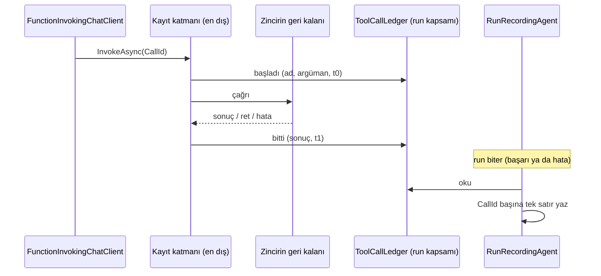

# Faz 254 — Tool Çağrısı Zincirde Kaydedilir: Başarısız Akışsız Run'ın Tool Satırları ve Betik Yolu

> **Durum:** 📋 Planlandı (2026-10-26)
> **Kademe:** tam — geri dönüşü pahalı karar: tool satırının kayıt noktası mesaj gözleminden tool zincirine taşınır ve her run yolunun (`tool_invocations`) anlamını değiştirir; `Tracon.Testing` public yüzeyi büyür; denetim izi (`script.denied`) yeni bir ret türünü kaydeder
> **Plan onayı:** Bakımcı, 2026-10-26 (sohbette alınan kararlar: çağrı ve sonuç yönetilen tool sarmalayıcısında o anda run kapsamına yazılır, mesaj yolu aynı `CallId`'yi ikinci kez yazmaz, zincir dışı tool'lar mesajdan okunmaya devam eder; bütçe yüzünden reddedilen betik `script.denied` yazar, sebep bütçe metnidir)
> **Kaynak:** [ADAYLAR.md](ADAYLAR.md) · **F-689**, **F-690**
> **Genellik:** Kuyruklu run (`Prefer: respond-async`), devam run'ı, workflow agent adımı ve `/v1/*` akışsız uçları kullanan her tüketici — Tracon'un akışsız yolu kullanan bütün yüzeyleri. Sorun ilk ilkedir: `GET /api/runs/{id}/tools` ve run olayları, en çok ihtiyaç duyulan anda (run başarısız bittiğinde) boştur; gece nöbetçisi neyin çağrıldığını göremez (mercek 2). F-690'ın ikinci kanıtı Faz 243 denetimidir: bütçe kapısının betik yolu ve gerçek token yolu uçtan uca sınanmıyor. İş tüketici kodunda kalamaz: kayıt Tracon'un run kaydedicisindedir
> **Karşı görüş:** (1) "Akışsız yolu içeride akışla koşmak daha basittir." Cevap: sağlayıcıya giden istek türü değişir (akışlı API), yapılandırılmış çıktı ve kullanım davranışı her sağlayıcıda yeniden ölçülmelidir; reddedildi. (2) "Boşluğu belgelemek yeter." Cevap: başarısız run'ın tool izi gözlemlenebilirliğin asıl amacıdır; ayrıca akışsız yolda süre bugün hiç ölçülmez (`ToolInvocationTracker.cs:17-22`) — zincirde kayıt onu da çözer. (3) "Bütçe reddi erişim kararı değildir, denetim izine girmez." Cevap: bakımcı kararı — her betik reddi tek kuralla denetlenir; diğer bütün retler zaten `script.denied` yazar
> **Önkoşul:** Yok. Faz 243 (bütçe kapısı, K-1089) ve Faz 246 (yerleşik tool yönetişimi, kaynak envanteri) kapandı
> **Paketler:** `Tracon.Core` (yeni bir zincir katmanı ya da `ExplainedFailureAIFunction` genişlemesi, `TraconRunContext`'e bir defter, `RunRecordingAgent.*`, `ToolInvocationTracker`, `SandboxedSkillScriptRunner`) · `Tracon.Testing` (`FakeModelProvider`)
> **Yeni paket:** Yok · **Migration:** Yok
> **Public API:** Büyüyor — yalnız `Tracon.Testing`: `FakeModelProvider`'a kullanım bildiren tool çağrısı aşırı yüklemesi. `1.0.0` GA'dan (K-603) önce ucuz (`wc -l src/*/PublicAPI.Shipped.txt` → 18 satır, 2026-10-26). `Tracon.Core` değişiklikleri `internal`
> **Tüketici yüzeyi:** site `concepts/runs.md` (tool satırları: akışsız run'da da süre; başarısız run'da satırlar), `guides/reliability.md` (bütçe reddi ve betik denetimi), `concepts/governance.md` (`script.denied` sebepleri) · sevk edilen: `FakeModelProvider` XML + `src/Tracon.Testing/README.md` örneği, `CHANGELOG.md` `[Unreleased]` → *Fixed* (başarısız akışsız run'ın tool satırları; akışsız süre) + *Added* (`FakeModelProvider`)
> **Manuel test alanı:** `docs/manuel-test/16-IS-KUYRUGU-VE-ZAMANLAMA.md` (kuyruklu run'ın tool satırları) · `docs/manuel-test/14-SKILL-VE-SCRIPT.md` (betik reddi denetimi)

---

## Bu Faza Başlarken

> `faz-baslangic` skill'ini uygula. Aşağıdaki liste o skill'in 2. adımıdır —
> **tamamını değil, yalnız işaret edilen bölümleri oku.**

1. Bu doküman
2. Kararlar — yalnız bu kalemleri grep'le:
   ```bash
   grep -n "K-487 —\|K-488 —\|K-1043 —\|K-1044 —\|K-1069 —\|K-1089 —\|K-089 —" docs/KARARLAR.md
   ```
   **K-487** (sarmalayıcı sırası; yeni katman sırayı taşır), **K-488** (ret normal sonuç döner,
   kapı fail-closed), **K-1043** (alt agent tool modu), **K-1044** (hosted tool'da zincir yok),
   **K-1069** (workspace tool'ları zincirden geçer), **K-1089** (tükenmiş bütçede tool başlamaz;
   `run_budget_exceeded` kimliği korunur), **K-089** (denetim izinin aktörü)
3. Önceki fazdan devir: yok. Faz 243'ün denetim bulguları gerekirse:
   `git show 7b025084:docs/243-TOOL-BUTCE-KAPISI.md | awk '/## Denetim Bulguları/,0'`
4. Alan hafızası (üç alan):
   [`hafiza/tool-onay-ve-yetkilendirme.md`](hafiza/tool-onay-ve-yetkilendirme.md) (zincir sırası, ret kaydı) ·
   [`hafiza/cekirdek-calistirma.md`](hafiza/cekirdek-calistirma.md) (🚨 `AsyncLocal` yazımı async yardımcıdan çağırana akmaz; tool'un gördüğü servis sağlayıcı boştur) ·
   [`hafiza/run-olay-sozlesmesi.md`](hafiza/run-olay-sozlesmesi.md)
5. Gerektiğinde: zincir sırasının gerekçesi `ToolWrapperChain.cs:9-35`; ortam-yazım/kapsam-okuma
   deseni `TraconRunContext.cs:221-270`

---

## Amaç

Tracon tool satırını (`tool_invocations`) ve tool olaylarını **model yanıtının mesajlarından**
okur. Akışlı yol mesajları geldikçe görür. Akışsız yol onları yalnız **başarılı** yanıtın
sonunda görür; run hata ile biterse hiçbir tool satırı yazılmaz ve süre hiçbir zaman ölçülmez.

- **F-689** — Yönetilen tool sarmalayıcısı çağrıyı ve sonucu, olduğu anda, run kapsamındaki bir
  deftere yazar. Kaydedici kapanışta (başarı ya da hata) defterden satır yazar; mesaj yolu aynı
  `CallId`'yi ikinci kez yazmaz. Akışsız yolda süre de ölçülür.
- **F-690** — Bütçe kapısının betik yolu uçtan uca sınanır (model → onay → devam run'ı →
  betik); bütçe reddi `script.denied` yazar; `FakeModelProvider` tool turunda kullanım bildirir,
  böylece token bütçesi testi yan kanal yerine gerçek kullanım yolunu sınar.

### Bugün ne çalışmıyor — doğrulanmış kanıt

| Kanıt | Gözlem |
|---|---|
| [`RunRecordingAgent.cs:258-267`](../src/Tracon.Core/Recording/RunRecordingAgent.cs) | Akışsız yol `base.RunCoreAsync`'ten dönen `response.Messages`'ı gezer; tool içeriği yalnız burada kaydedilir |
| [`RunRecordingAgent.cs:368-375`](../src/Tracon.Core/Recording/RunRecordingAgent.cs) | Hata dalı run'ı `Failed` kapatır; mesaj olmadığı için tool satırı ve tool olayı yazılmaz |
| [`RunRecordingAgent.Persistence.cs:365-400`](../src/Tracon.Core/Recording/RunRecordingAgent.Persistence.cs) | `WriteToolCallAsync`/`WriteToolResultAsync` izleyiciyi mesaj gözleminden besler |
| [`ToolInvocationTracker.cs:17-22`](../src/Tracon.Core/Recording/ToolInvocationTracker.cs) | "Duration is measured only in a streaming run" — akışsız yolda süre boş bırakılır |
| [`ToolInvocationTracker.cs:24-27`](../src/Tracon.Core/Recording/ToolInvocationTracker.cs) | İzleyici iş parçacığı güvenli değildir; tek okuma döngüsünden kullanılır |
| [`RunRecordingAgent.Completion.cs:178-183`](../src/Tracon.Core/Recording/RunRecordingAgent.Completion.cs) | Kapanış yalnız **bitmemiş** çağrıları (`DrainUnfinished`) yazar |
| `AgentRunJobHandler.cs:180` · `RunContinuationJobHandler.cs:259` · [`WorkflowAgentStepExecutor.cs:47`](../src/Tracon.Workflows/Internal/WorkflowAgentStepExecutor.cs) | Üç sunucu yolu akışsız `RunAsync`'i çağırır |
| [`ToolWrapperChain.cs:18-19`](../src/Tracon.Core/Tools/ToolWrapperChain.cs) · [`:64`](../src/Tracon.Core/Tools/ToolWrapperChain.cs) | Sıra: ExplainedFailure → BudgetGating → Authorizing → Validating → Timeout → ApprovalRequired → Truncating → fonksiyon; `Compose` tek kurulum yeri |
| [`TraconRunContext.cs:221-270`](../src/Tracon.Core/Recording/TraconRunContext.cs) | Sarmalayıcıların `CallId` ile anahtarlı ortam-yazım/kapsam-okuma biriktiricileri (emsal: `ToolAuthorization`, `ToolExplainedFailures`) |
| [`AuthorizingAIFunction.cs:107`](../src/Tracon.Core/Tools/AuthorizingAIFunction.cs) | Sarmalayıcı `CallId`'yi `FunctionInvokingChatClient.CurrentContext` ile okur (emsal) |
| [`SandboxedSkillScriptRunner.cs:350-355`](../src/Tracon.Core/Skills/Scripts/SandboxedSkillScriptRunner.cs) | Bütçe reddi `TraconRunBudgetExceededException` atar, denetim kaydı yazmaz |
| [`SandboxedSkillScriptRunner.cs:996-1018`](../src/Tracon.Core/Skills/Scripts/SandboxedSkillScriptRunner.cs) | Diğer retler `DenyAsync` → `script.denied` yazar |
| [`FakeModelProvider.cs:133`](../src/Tracon.Testing/FakeModelProvider.cs) · [`:189`](../src/Tracon.Testing/FakeModelProvider.cs) · [`:210`](../src/Tracon.Testing/FakeModelProvider.cs) | Metin yanıtı kullanım bildirebilir; `CallsTool`/`CallsTools` bildiremez |
| [`ToolSourceGovernanceTests.cs:115`](../tests/Tracon.Core.UnitTests/Architecture/ToolSourceGovernanceTests.cs) | Her tool kaynağı "zincirde" ya da "zincir dışında, kararıyla" diye adlandırılır (Faz 246 kapısı) |

> Kanıtlar 2026-10-26 tarihinde doğrulandı (kod okuması). İlk iş: kuyruklu run'ın bütçe
> reddiyle bittiği senaryoda `GET /api/runs/{id}/tools`'un boş döndüğünü **düzeltmeden önce**
> fonksiyonel testle kırmızı gör.

---

## 254.1 — Tool çağrı defteri (F-689)

- `TraconRunContext`'e `internal` bir defter girer (ad uygulamada; öneri `ToolCallLedger`):
  `ConcurrentDictionary<string, Entry>`, anahtar `CallId`. Kayıt: ad, kaynak, biçimlenmiş
  argümanlar, başlangıç zaman damgası (`TimeProvider`), bitiş damgası, sonuç (başarı · hata
  metni · ret). `AllowConcurrentInvocation` açıkken eşzamanlı yazım güvenlidir (emsal:
  `ToolUsageAccumulator.cs:18`).
- **Yazan:** zincirin **en dış** noktası — bütçe reddi ve yetki reddi de defterde görünmelidir.
  `ExplainedFailureAIFunction` zaten en dıştadır ve `CallId`'yi okur (`:60`); ya o genişler ya
  da onun da dışına ince bir kayıt katmanı girer (K-487: sıra gerekçesi `ToolWrapperChain`
  yorumuna yazılır). Karar uygulamada ölçülür; ölçüt: ret ve hata dahil her çağrı tam bir
  kez yazılır.
- **🚨 `AsyncLocal` kuralı.** Defter run kapsamında **önceden kurulur** (`CreateScope`); sarmalayıcı
  yalnız `TraconRunContext.Current`'ı okur ve deftere yazar, kapsam açmaz.
- **Okuyan:** kaydedici.
  - Akışsız başarı: mesaj yolu olayları bugünkü gibi yazar; satır üretirken süreyi defterden
    alır (akışsız yolda süre artık ölçülür). Satır `CallId` başına bir kez.
  - Akışsız hata ya da iptal: `CompleteAsync`, defterde olup satırı yazılmamış her çağrının
    satırını yazar (bitmişse sonucuyla, bitmemişse bugünkü "ended before the tool result"
    gerekçesiyle).
  - Akışlı yol: bugünkü gibi; defter yalnız tekrarı önlemek için okunur (Açık Soru 2).
- **Zincir dışı kaynaklar** (hosted tool, K-1044; istemci tool'ları; `ToolSourceGovernanceTests`
  envanterinin "outside" satırları) mesajdan okunmaya devam eder; site bunu söyler.



## 254.2 — Bütçe reddi denetlenir (F-690)

`SandboxedSkillScriptRunner`'ın bütçe dalı (`:350-355`) atmadan önce `script.denied` yazar;
`after` alanı bütçe ret metnidir (`DenyAsync`'in serileştirme kuralıyla, `:1015-1017`).
İstisna ve kimlik değişmez (`TraconRunBudgetExceededException`, `run_budget_exceeded`, K-1089).
Denetim yazımı başarısız olursa betik yine başlamaz (K-488: kapı fail-closed; gözlemlenebilirlik
işlevi bozmaz — yazım hatası loglanır).

## 254.3 — Testlerin boşlukları (F-690)

- **Betik yolu uçtan uca:** model `run_skill_script` çağırır → onay ister → karar → devam run'ı
  yeni bütçeyle betiği koşar; bütçesi tükenmiş devam run'ında betik başlamaz ve `script.denied`
  yazılır. Seviye fonksiyonel (HTTP + kuyruk + onay).
- **Gerçek token yolu:** `FakeModelProvider`'a tool çağrısı turunda kullanım bildiren aşırı
  yükleme (`CallsTool(string, object?, int inputTokens, int outputTokens)`; `RespondsWith(string,
  int, int)` emsali). Faz 243'ün token bütçesi testi yan kanaldan bu yola taşınır.

---

## Planlanan Public API

> Taslak imzalardır. Gerçekleşen imzalar kapanışta ayrı bir bölüme yazılır.

```csharp
// Tracon.Testing
public FakeModelProvider CallsTool(string toolName, object? arguments, int inputTokens, int outputTokens);
public FakeModelProvider CallsTools(int inputTokens, int outputTokens, params (string ToolName, object? Arguments)[] calls);
```

### HTTP

Yeni uç yok. `GET /api/runs/{id}/tools` başarısız akışsız run'da dolu döner ve akışsız run'da
`duration` taşır (tel şeması aynı, anlam genişler).

### Arayüz payı

Yok.

---

## Planlanan Dosya Listesi

```
src/Tracon.Core/Recording/TraconRunContext.cs           # defter alanı
src/Tracon.Core/Recording/ToolCallLedger.cs             # yeni, internal
src/Tracon.Core/Tools/ExplainedFailureAIFunction.cs     # ya da yeni en dış kayıt katmanı
src/Tracon.Core/Tools/ToolWrapperChain.cs               # sıra yorumu
src/Tracon.Core/Recording/RunRecordingAgent.cs · .Lifecycle.cs · .Persistence.cs · .Completion.cs
src/Tracon.Core/Recording/ToolInvocationTracker.cs      # süre kaynağı
src/Tracon.Core/Skills/Scripts/SandboxedSkillScriptRunner.cs
src/Tracon.Testing/FakeModelProvider.cs · README.md
tests/Tracon.AspNetCore.FunctionalTests/…FailedRunToolRowsTests.cs   # yeni
tests/Tracon.AspNetCore.FunctionalTests/…SkillScriptBudgetTests.cs   # yeni ya da genişler
```

---

## Hata Modları ve Testler

| Ne bozulabilir | Seviye | Test |
|---|---|---|
| Bütçe reddiyle biten kuyruklu run'da `/tools` boş | Fonksiyonel | `FailedRunToolRowsTests` — reddedilen ve başarılı çağrının satırı var |
| Model hatasıyla biten akışsız run'da önceki başarılı çağrı kaybolur | Fonksiyonel | ilk tur tool, ikinci tur model istisnası → bir satır |
| Başarılı akışsız run'da satır iki kez yazılır (defter + mesaj) | Fonksiyonel | `CallId` başına tek satır; mevcut testler aynen |
| Akışlı run'da satır iki kez yazılır | Fonksiyonel | akışlı yolun mevcut testleri + tekrar sayımı |
| Akışsız yolda süre hâlâ boş | Fonksiyonel | `duration` dolu (sahte saatle sabit) |
| Eşzamanlı tool çağrıları defteri bozar | Fonksiyonel | `CallsTools` + `AllowConcurrentToolCalls` → iki satır, doğru eşleşme |
| Yetki reddi satırı yanlış sonuç yazar | Birim + Fonksiyonel | ret satırı `Succeeded=false`, sebep (emsal `ToolAuthorizationAccumulator`) |
| İptal edilen run'da bitmemiş çağrı | Fonksiyonel | "ended before the tool result" satırı (mevcut `DrainUnfinished` davranışı) |
| Zincir dışı tool (hosted) satırı kaybolur | Fonksiyonel | hosted tool satırı mesajdan yazılır (regresyon) |
| Workflow agent adımı başarısızken satır yok | Fonksiyonel | `WorkflowAgentStepExecutor` yolu: başarısız adımın tool satırı |
| Tool'un gördüğü kapsam yanlış run'a yazar (alt agent) | Fonksiyonel | çocuk run'ın çağrısı çocuğun satırında (`TraconRunContext` iç içe) |
| Başka kiracının run'ı | — | defter run kapsamındadır; satır `TenantId` damgasıyla (K-355) |
| Bütçe reddi denetim kaydı yazmaz | Fonksiyonel | `script.denied`, `after` = bütçe metni |
| Denetim yazımı düşerse betik başlar | Birim | düşen `IAuditLog` ile betik yine reddedilir |
| Betik yolu: onay → devam run'ı yeni bütçeyle koşar | Fonksiyonel | uçtan uca senaryo |
| `FakeModelProvider` kullanımı tool turunda raporlanmaz | Birim (`Tracon.Testing.UnitTests`) | yeni aşırı yükleme kullanım taşır |
| Kayıt deposu hatası tool çağrısını bozar | Birim | defter yazımı bellekte; depo yazımı kapanışta, hata loglanır (gözlemlenebilirlik kuralı) |

---

## Manuel Kabul Case'leri

| # | Ön koşul | Adımlar | Beklenen sonuç |
|---|---|---|---|
| 1 🤖 | `samples/Tracon.Api`, tool çağıran bir agent, ağaç bütçesi küçük | `POST /api/agents/{name}/run` + `Prefer: respond-async`; run bütçe reddiyle biter | `GET /api/runs/{id}/tools` reddedilen ve önceki çağrıyı listeler, `duration` dolu |
| 2 🤖 | Betik taşıyan skill, onay açık | Betik çağrısını onayla, devam run'ının bütçesini tüket | `GET /api/audit` → `script.denied`, sebep bütçe metni |

---

## Açık Sorular

| # | Soru | Seçenekler | Öneri |
|---|---|---|---|
| 1 | Başarısız akışsız run'da tool **olayları** (`ToolInvoking`/`ToolInvoked`) da defterden yazılsın mı? | A: evet, kapanışta sırayla · B: yalnız satırlar | **A** — run ekranı olaylardan okur; satır var olay yok tutarsız görünür. Olayların zaman damgası defterin `t0`/`t1`'idir |
| 2 | Akışlı yol da satırı defterden mi üretsin (tek kaynak)? | A: evet, iki yol tek kural · B: akışlı yol bugünkü gibi | **B** bu fazda — akışlı yol doğru çalışıyor; tek kaynak ayrı bir sadeleştirme adayı |
| 3 | Defter boyutu sınırlansın mı? | A: run başına en çok N kayıt · B: sınırsız (tool çağrı sayısı zaten bütçeli) | **B** — `MaxToolCalls`/ağaç bütçesi üst sınırdır; ölçülürse aday |

---

## Bitiş Ölçütleri (DoD)

- [ ] Bütçe reddiyle ya da model hatasıyla biten akışsız run'da `GET /api/runs/{id}/tools` her çağrıyı tam bir kez listeler
- [ ] Akışsız başarılı run'da satır sayısı değişmez ve `duration` doludur
- [ ] Zincir dışı kaynakların satırları regresyonsuz
- [ ] Bütçe reddi `script.denied` yazar; istisna kimliği `run_budget_exceeded` aynen
- [ ] Betik yolu uçtan uca fonksiyonel testte; token bütçesi testi gerçek kullanım yolunda
- [ ] `FakeModelProvider` aşırı yüklemeleri XML ve `Tracon.Testing/README.md` örneğiyle
- [ ] Yeni `K-*` (`geri-dönüşü-pahalı`): tool satırının kayıt noktası zincirdir, reddedilen alternatif (içeride akışla koşmak) adıyla
- [ ] Dört doğrulama kapısı sıfır uyarı verir
- [ ] `samples/Tracon.Api` ile gerçek `run` yapıldı (case 1, 2), çıktı belgeye yazıldı
- [ ] `secret` taraması boş döndü
- [ ] `🤖` case'ler `docs/manuel-test/16-…` ve `14-…` içinde ve koşuldu
- [ ] `faz-denetim` koşuldu; 🔴 bulgu kalmadı
- [ ] `docs-site/` güncellendi; `npm run check` temiz

### Doğrulama komutları

```bash
# Başarısız kuyruklu run'ın tool satırları
curl -s http://localhost:5081/tracon/api/runs/$RUN/tools -H "Authorization: Bearer $KEY" | jq '.[] | {toolName, error, duration}'

# Betik reddi denetimi
curl -s "http://localhost:5081/tracon/api/audit?action=script.denied" -H "Authorization: Bearer $KEY" | jq '.[0]'
```

---

## Riskler

| Risk | Önlem |
|---|---|
| Satır iki kez yazılır (defter + mesaj) ve kota/istatistik tool sayısını şişirir | `CallId` başına tek yazım kuralı; mevcut tool sayım testleri aynen geçmeli |
| Yeni en dış katman K-487 sırasını bozar (ret sonucu modele farklı ulaşır) | Katman sonucu değiştirmez, yalnız kaydeder; `ToolWrapperChain` sıra testleri |
| `AsyncLocal` kapsamı async yardımcıda açılır, defter boş kalır | Defter kapsam kurulurken yaratılır; sarmalayıcı yalnız okur (`hafiza/cekirdek-calistirma.md`) |
| Alt agent çağrısı üst run'ın defterine yazar | Fonksiyonel test: iç içe run kapsamı |

---

<!-- ============================================================
     AŞAĞISI ÇALIŞIRKEN DOLAR — doküman kapanışta silinir (`faz-kapat`).
     Kalıcı kısım `faz-tamamlama` Adım 5'te yerine taşınır. Başlıkları SİLME.
     ============================================================ -->

## Plandan Sapmalar

> Çalışırken dolar. Plan ile gerçek arasındaki fark **gizlenmez**. Kapanışta
> kapanış commit mesajına taşınır.

## Bu Fazda Verilen Kararlar

> Çalışırken dolar. Dört kategoriden birine giren karar (AGENTS.md)
> `docs/KARARLAR.md`'ye K-NNN ve kategori etiketiyle girer; girmeyen karar
> kapanışta commit mesajına taşınır (`faz-tamamlama` Adım 8). Plan numara rezerve
> etmez.

## Süreç Ölçümü

> Kapanışta doldurulur. **Tablo olarak** — onay kutusu DEĞİL: `faz-kapat`
> işaretsiz kutuda durur. `faz-kapat` bu tabloyu `docs/FAZ-DEFTERI.md`'ye taşır;
> eşik **167**'den itibaren boş bir değer hücresinde kapanışı durdurur.
> `ölçülmedi` **geçerli bir değerdir** — kapı bir sayı değil, bir **karar** arar.
> Kapı bölümün VARLIĞINI denetler, doğruluğunu denetlemez (K-766).

| Metrik | Değer |
|---|---|
| Plan revizyonu sayısı | |
| Düzeltme turu sayısı | |
| 🔴 bulgu: gerçek / gürültü / araştırılacak | |
| Fazın ürettiği regresyon | |
| Faz kapandıktan sonra bulunan kusur | ölçülmedi (kapanış anı) |

## Denetim Bulguları

> `faz-denetim` çıktısı. Her satır: bulgu · seviye (🔴/🟡/🟢) · sonuç
> (düzeltildi / gerekçelendi / F-NN olarak devredildi). 🟢 kapanışta
> `ADAYLAR.md`'ye gider.
