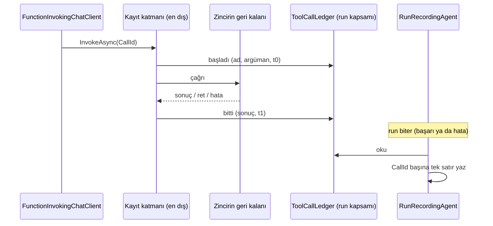

# Faz 254 — Tool Çağrısı Zincirde Kaydedilir: Başarısız Akışsız Run'ın Tool Satırları ve Betik Yolu

> **Durum:** 📋 Planlandı (2026-10-26)
> **Kademe:** tam — geri dönüşü pahalı karar: tool satırının kayıt noktası mesaj gözleminden tool zincirine taşınır ve her run yolunun (`tool_invocations`) anlamını değiştirir; `Tracon.Testing` public yüzeyi büyür; denetim izi (`script.denied`) yeni bir ret türünü kaydeder
> **Plan onayı:** Bakımcı, 2026-10-26 (sohbette alınan kararlar: çağrı ve sonuç yönetilen tool sarmalayıcısında o anda run kapsamına yazılır, mesaj yolu aynı `CallId`'yi ikinci kez yazmaz, zincir dışı tool'lar mesajdan okunmaya devam eder; bütçe yüzünden reddedilen betik `script.denied` yazar, sebep bütçe metnidir)
> **Kaynak:** [ADAYLAR.md](ADAYLAR.md) · **F-689**, **F-690**
> **Genellik:** Kuyruklu run (`Prefer: respond-async`), devam run'ı, workflow agent adımı ve `/v1/*` akışsız uçları kullanan her tüketici — Tracon'un akışsız yolu kullanan bütün yüzeyleri. Sorun ilk ilkedir: `GET /api/runs/{id}/tools` ve run olayları, en çok ihtiyaç duyulan anda (run başarısız bittiğinde) boştur; gece nöbetçisi neyin çağrıldığını göremez (mercek 2). F-690'ın ikinci kanıtı Faz 243 denetimidir: bütçe kapısının betik yolu ve gerçek token yolu uçtan uca sınanmıyor. İş tüketici kodunda kalamaz: kayıt Tracon'un run kaydedicisindedir
> **Karşı görüş:** (1) "Akışsız yolu içeride akışla koşmak daha basittir." Cevap: sağlayıcıya giden istek türü değişir (akışlı API), yapılandırılmış çıktı ve kullanım davranışı her sağlayıcıda yeniden ölçülmelidir; reddedildi. (2) "Boşluğu belgelemek yeter." Cevap: başarısız run'ın tool izi gözlemlenebilirliğin asıl amacıdır; ayrıca akışsız yolda süre bugün hiç ölçülmez (`ToolInvocationTracker.cs:17-22`) — zincirde kayıt onu da çözer. (3) "Bütçe reddi erişim kararı değildir, denetim izine girmez." Cevap: bakımcı kararı — her betik reddi tek kuralla denetlenir; diğer bütün retler zaten `script.denied` yazar
> **Önkoşul:** Yok. Faz 243 (bütçe kapısı, K-1089) ve Faz 246 (yerleşik tool yönetişimi, kaynak envanteri) kapandı
> **Paketler:** `Tracon.Core` (yeni bir zincir katmanı ya da `ExplainedFailureAIFunction` genişlemesi, `TraconRunContext`'e bir defter, `RunRecordingAgent.*`, `ToolInvocationTracker`, `SandboxedSkillScriptRunner`) · `Tracon.Testing` (`FakeModelProvider`)
> **Yeni paket:** Yok · **Migration:** Yok
> **Public API:** Büyüyor — yalnız `Tracon.Testing`: `FakeModelProvider`'a kullanım bildiren tool çağrısı aşırı yüklemesi. `1.0.0` GA'dan (K-603) önce ucuz (`wc -l src/*/PublicAPI.Shipped.txt` → 18 satır, 2026-10-26). `Tracon.Core` değişiklikleri `internal`
> **Tüketici yüzeyi:** site `concepts/runs.md` (tool satırları: akışsız run'da da süre; başarısız run'da satırlar), `guides/reliability.md` (bütçe reddi ve betik denetimi), `concepts/governance.md` (`script.denied` sebepleri) · sevk edilen: `FakeModelProvider` XML + `src/Tracon.Testing/README.md` örneği, `CHANGELOG.md` `[Unreleased]` → *Fixed* (başarısız akışsız run'ın tool satırları; akışsız süre) + *Added* (`FakeModelProvider`)
> **Manuel test alanı:** `docs/manuel-test/16-IS-KUYRUGU-VE-ZAMANLAMA.md` (kuyruklu run'ın tool satırları) · `docs/manuel-test/14-SKILL-VE-SCRIPT.md` (betik reddi denetimi)

---

## Bu Faza Başlarken

> `faz-baslangic` skill'ini uygula. Aşağıdaki liste o skill'in 2. adımıdır —
> **tamamını değil, yalnız işaret edilen bölümleri oku.**

1. Bu doküman
2. Kararlar — yalnız bu kalemleri grep'le:
   ```bash
   grep -n "K-487 —\|K-488 —\|K-1043 —\|K-1044 —\|K-1069 —\|K-1089 —\|K-089 —" docs/KARARLAR.md
   ```
   **K-487** (sarmalayıcı sırası; yeni katman sırayı taşır), **K-488** (ret normal sonuç döner,
   kapı fail-closed), **K-1043** (alt agent tool modu), **K-1044** (hosted tool'da zincir yok),
   **K-1069** (workspace tool'ları zincirden geçer), **K-1089** (tükenmiş bütçede tool başlamaz;
   `run_budget_exceeded` kimliği korunur), **K-089** (denetim izinin aktörü)
3. Önceki fazdan devir: yok. Faz 243'ün denetim bulguları gerekirse:
   `git show 7b025084:docs/243-TOOL-BUTCE-KAPISI.md | awk '/## Denetim Bulguları/,0'`
4. Alan hafızası (üç alan):
   [`hafiza/tool-onay-ve-yetkilendirme.md`](hafiza/tool-onay-ve-yetkilendirme.md) (zincir sırası, ret kaydı) ·
   [`hafiza/cekirdek-calistirma.md`](hafiza/cekirdek-calistirma.md) (🚨 `AsyncLocal` yazımı async yardımcıdan çağırana akmaz; tool'un gördüğü servis sağlayıcı boştur) ·
   [`hafiza/run-olay-sozlesmesi.md`](hafiza/run-olay-sozlesmesi.md)
5. Gerektiğinde: zincir sırasının gerekçesi `ToolWrapperChain.cs:9-35`; ortam-yazım/kapsam-okuma
   deseni `TraconRunContext.cs:221-270`

---

## Amaç

Tracon tool satırını (`tool_invocations`) ve tool olaylarını **model yanıtının mesajlarından**
okur. Akışlı yol mesajları geldikçe görür. Akışsız yol onları yalnız **başarılı** yanıtın
sonunda görür; run hata ile biterse hiçbir tool satırı yazılmaz ve süre hiçbir zaman ölçülmez.

- **F-689** — Yönetilen tool sarmalayıcısı çağrıyı ve sonucu, olduğu anda, run kapsamındaki bir
  deftere yazar. Kaydedici kapanışta (başarı ya da hata) defterden satır yazar; mesaj yolu aynı
  `CallId`'yi ikinci kez yazmaz. Akışsız yolda süre de ölçülür.
- **F-690** — Bütçe kapısının betik yolu uçtan uca sınanır (model → onay → devam run'ı →
  betik); bütçe reddi `script.denied` yazar; `FakeModelProvider` tool turunda kullanım bildirir,
  böylece token bütçesi testi yan kanal yerine gerçek kullanım yolunu sınar.

### Bugün ne çalışmıyor — doğrulanmış kanıt

| Kanıt | Gözlem |
|---|---|
| [`RunRecordingAgent.cs:258-267`](../src/Tracon.Core/Recording/RunRecordingAgent.cs) | Akışsız yol `base.RunCoreAsync`'ten dönen `response.Messages`'ı gezer; tool içeriği yalnız burada kaydedilir |
| [`RunRecordingAgent.cs:368-375`](../src/Tracon.Core/Recording/RunRecordingAgent.cs) | Hata dalı run'ı `Failed` kapatır; mesaj olmadığı için tool satırı ve tool olayı yazılmaz |
| [`RunRecordingAgent.Persistence.cs:365-400`](../src/Tracon.Core/Recording/RunRecordingAgent.Persistence.cs) | `WriteToolCallAsync`/`WriteToolResultAsync` izleyiciyi mesaj gözleminden besler |
| [`ToolInvocationTracker.cs:17-22`](../src/Tracon.Core/Recording/ToolInvocationTracker.cs) | "Duration is measured only in a streaming run" — akışsız yolda süre boş bırakılır |
| [`ToolInvocationTracker.cs:24-27`](../src/Tracon.Core/Recording/ToolInvocationTracker.cs) | İzleyici iş parçacığı güvenli değildir; tek okuma döngüsünden kullanılır |
| [`RunRecordingAgent.Completion.cs:178-183`](../src/Tracon.Core/Recording/RunRecordingAgent.Completion.cs) | Kapanış yalnız **bitmemiş** çağrıları (`DrainUnfinished`) yazar |
| `AgentRunJobHandler.cs:180` · `RunContinuationJobHandler.cs:259` · [`WorkflowAgentStepExecutor.cs:47`](../src/Tracon.Workflows/Internal/WorkflowAgentStepExecutor.cs) | Üç sunucu yolu akışsız `RunAsync`'i çağırır |
| [`ToolWrapperChain.cs:18-19`](../src/Tracon.Core/Tools/ToolWrapperChain.cs) · [`:64`](../src/Tracon.Core/Tools/ToolWrapperChain.cs) | Sıra: ExplainedFailure → BudgetGating → Authorizing → Validating → Timeout → ApprovalRequired → Truncating → fonksiyon; `Compose` tek kurulum yeri |
| [`TraconRunContext.cs:221-270`](../src/Tracon.Core/Recording/TraconRunContext.cs) | Sarmalayıcıların `CallId` ile anahtarlı ortam-yazım/kapsam-okuma biriktiricileri (emsal: `ToolAuthorization`, `ToolExplainedFailures`) |
| [`AuthorizingAIFunction.cs:107`](../src/Tracon.Core/Tools/AuthorizingAIFunction.cs) | Sarmalayıcı `CallId`'yi `FunctionInvokingChatClient.CurrentContext` ile okur (emsal) |
| [`SandboxedSkillScriptRunner.cs:350-355`](../src/Tracon.Core/Skills/Scripts/SandboxedSkillScriptRunner.cs) | Bütçe reddi `TraconRunBudgetExceededException` atar, denetim kaydı yazmaz |
| [`SandboxedSkillScriptRunner.cs:996-1018`](../src/Tracon.Core/Skills/Scripts/SandboxedSkillScriptRunner.cs) | Diğer retler `DenyAsync` → `script.denied` yazar |
| [`FakeModelProvider.cs:133`](../src/Tracon.Testing/FakeModelProvider.cs) · [`:189`](../src/Tracon.Testing/FakeModelProvider.cs) · [`:210`](../src/Tracon.Testing/FakeModelProvider.cs) | Metin yanıtı kullanım bildirebilir; `CallsTool`/`CallsTools` bildiremez |
| [`ToolSourceGovernanceTests.cs:115`](../tests/Tracon.Core.UnitTests/Architecture/ToolSourceGovernanceTests.cs) | Her tool kaynağı "zincirde" ya da "zincir dışında, kararıyla" diye adlandırılır (Faz 246 kapısı) |

> Kanıtlar 2026-10-26 tarihinde doğrulandı (kod okuması). İlk iş: kuyruklu run'ın bütçe
> reddiyle bittiği senaryoda `GET /api/runs/{id}/tools`'un boş döndüğünü **düzeltmeden önce**
> fonksiyonel testle kırmızı gör.

---

## 254.1 — Tool çağrı defteri (F-689)

- `TraconRunContext`'e `internal` bir defter girer (ad uygulamada; öneri `ToolCallLedger`):
  `ConcurrentDictionary<string, Entry>`, anahtar `CallId`. Kayıt: ad, kaynak, biçimlenmiş
  argümanlar, başlangıç zaman damgası (`TimeProvider`), bitiş damgası, sonuç (başarı · hata
  metni · ret). `AllowConcurrentInvocation` açıkken eşzamanlı yazım güvenlidir (emsal:
  `ToolUsageAccumulator.cs:18`).
- **Yazan:** zincirin **en dış** noktası — bütçe reddi ve yetki reddi de defterde görünmelidir.
  `ExplainedFailureAIFunction` zaten en dıştadır ve `CallId`'yi okur (`:60`); ya o genişler ya
  da onun da dışına ince bir kayıt katmanı girer (K-487: sıra gerekçesi `ToolWrapperChain`
  yorumuna yazılır). Karar uygulamada ölçülür; ölçüt: ret ve hata dahil her çağrı tam bir
  kez yazılır.
- **🚨 `AsyncLocal` kuralı.** Defter run kapsamında **önceden kurulur** (`CreateScope`); sarmalayıcı
  yalnız `TraconRunContext.Current`'ı okur ve deftere yazar, kapsam açmaz.
- **Okuyan:** kaydedici.
  - Akışsız başarı: mesaj yolu olayları bugünkü gibi yazar; satır üretirken süreyi defterden
    alır (akışsız yolda süre artık ölçülür). Satır `CallId` başına bir kez.
  - Akışsız hata ya da iptal: `CompleteAsync`, defterde olup satırı yazılmamış her çağrının
    satırını yazar (bitmişse sonucuyla, bitmemişse bugünkü "ended before the tool result"
    gerekçesiyle).
  - Akışlı yol: bugünkü gibi; defter yalnız tekrarı önlemek için okunur (Açık Soru 2).
- **Zincir dışı kaynaklar** (hosted tool, K-1044; istemci tool'ları; `ToolSourceGovernanceTests`
  envanterinin "outside" satırları) mesajdan okunmaya devam eder; site bunu söyler.



## 254.2 — Bütçe reddi denetlenir (F-690)

`SandboxedSkillScriptRunner`'ın bütçe dalı (`:350-355`) atmadan önce `script.denied` yazar;
`after` alanı bütçe ret metnidir (`DenyAsync`'in serileştirme kuralıyla, `:1015-1017`).
İstisna ve kimlik değişmez (`TraconRunBudgetExceededException`, `run_budget_exceeded`, K-1089).
Denetim yazımı başarısız olursa betik yine başlamaz (K-488: kapı fail-closed; gözlemlenebilirlik
işlevi bozmaz — yazım hatası loglanır).

## 254.3 — Testlerin boşlukları (F-690)

- **Betik yolu uçtan uca:** model `run_skill_script` çağırır → onay ister → karar → devam run'ı
  yeni bütçeyle betiği koşar; bütçesi tükenmiş devam run'ında betik başlamaz ve `script.denied`
  yazılır. Seviye fonksiyonel (HTTP + kuyruk + onay).
- **Gerçek token yolu:** `FakeModelProvider`'a tool çağrısı turunda kullanım bildiren aşırı
  yükleme (`CallsTool(string, object?, int inputTokens, int outputTokens)`; `RespondsWith(string,
  int, int)` emsali). Faz 243'ün token bütçesi testi yan kanaldan bu yola taşınır.

---

## Planlanan Public API

> Taslak imzalardır. Gerçekleşen imzalar kapanışta ayrı bir bölüme yazılır.

```csharp
// Tracon.Testing
public FakeModelProvider CallsTool(string toolName, object? arguments, int inputTokens, int outputTokens);
public FakeModelProvider CallsTools(int inputTokens, int outputTokens, params (string ToolName, object? Arguments)[] calls);
```

### HTTP

Yeni uç yok. `GET /api/runs/{id}/tools` başarısız akışsız run'da dolu döner ve akışsız run'da
`duration` taşır (tel şeması aynı, anlam genişler).

### Arayüz payı

Yok.

---

## Planlanan Dosya Listesi

```
src/Tracon.Core/Recording/TraconRunContext.cs           # defter alanı
src/Tracon.Core/Recording/ToolCallLedger.cs             # yeni, internal
src/Tracon.Core/Tools/ExplainedFailureAIFunction.cs     # ya da yeni en dış kayıt katmanı
src/Tracon.Core/Tools/ToolWrapperChain.cs               # sıra yorumu
src/Tracon.Core/Recording/RunRecordingAgent.cs · .Lifecycle.cs · .Persistence.cs · .Completion.cs
src/Tracon.Core/Recording/ToolInvocationTracker.cs      # süre kaynağı
src/Tracon.Core/Skills/Scripts/SandboxedSkillScriptRunner.cs
src/Tracon.Testing/FakeModelProvider.cs · README.md
tests/Tracon.AspNetCore.FunctionalTests/…FailedRunToolRowsTests.cs   # yeni
tests/Tracon.AspNetCore.FunctionalTests/…SkillScriptBudgetTests.cs   # yeni ya da genişler
```

---

## Hata Modları ve Testler

| Ne bozulabilir | Seviye | Test |
|---|---|---|
| Bütçe reddiyle biten kuyruklu run'da `/tools` boş | Fonksiyonel | `FailedRunToolRowsTests` — reddedilen ve başarılı çağrının satırı var |
| Model hatasıyla biten akışsız run'da önceki başarılı çağrı kaybolur | Fonksiyonel | ilk tur tool, ikinci tur model istisnası → bir satır |
| Başarılı akışsız run'da satır iki kez yazılır (defter + mesaj) | Fonksiyonel | `CallId` başına tek satır; mevcut testler aynen |
| Akışlı run'da satır iki kez yazılır | Fonksiyonel | akışlı yolun mevcut testleri + tekrar sayımı |
| Akışsız yolda süre hâlâ boş | Fonksiyonel | `duration` dolu (sahte saatle sabit) |
| Eşzamanlı tool çağrıları defteri bozar | Fonksiyonel | `CallsTools` + `AllowConcurrentToolCalls` → iki satır, doğru eşleşme |
| Yetki reddi satırı yanlış sonuç yazar | Birim + Fonksiyonel | ret satırı `Succeeded=false`, sebep (emsal `ToolAuthorizationAccumulator`) |
| İptal edilen run'da bitmemiş çağrı | Fonksiyonel | "ended before the tool result" satırı (mevcut `DrainUnfinished` davranışı) |
| Zincir dışı tool (hosted) satırı kaybolur | Fonksiyonel | hosted tool satırı mesajdan yazılır (regresyon) |
| Workflow agent adımı başarısızken satır yok | Fonksiyonel | `WorkflowAgentStepExecutor` yolu: başarısız adımın tool satırı |
| Tool'un gördüğü kapsam yanlış run'a yazar (alt agent) | Fonksiyonel | çocuk run'ın çağrısı çocuğun satırında (`TraconRunContext` iç içe) |
| Başka kiracının run'ı | — | defter run kapsamındadır; satır `TenantId` damgasıyla (K-355) |
| Bütçe reddi denetim kaydı yazmaz | Fonksiyonel | `script.denied`, `after` = bütçe metni |
| Denetim yazımı düşerse betik başlar | Birim | düşen `IAuditLog` ile betik yine reddedilir |
| Betik yolu: onay → devam run'ı yeni bütçeyle koşar | Fonksiyonel | uçtan uca senaryo |
| `FakeModelProvider` kullanımı tool turunda raporlanmaz | Birim (`Tracon.Testing.UnitTests`) | yeni aşırı yükleme kullanım taşır |
| Kayıt deposu hatası tool çağrısını bozar | Birim | defter yazımı bellekte; depo yazımı kapanışta, hata loglanır (gözlemlenebilirlik kuralı) |

---

## Manuel Kabul Case'leri

| # | Ön koşul | Adımlar | Beklenen sonuç |
|---|---|---|---|
| 1 🤖 | `samples/Tracon.Api`, tool çağıran bir agent, ağaç bütçesi küçük | `POST /api/agents/{name}/run` + `Prefer: respond-async`; run bütçe reddiyle biter | `GET /api/runs/{id}/tools` reddedilen ve önceki çağrıyı listeler, `duration` dolu |
| 2 🤖 | Betik taşıyan skill, onay açık | Betik çağrısını onayla, devam run'ının bütçesini tüket | `GET /api/audit` → `script.denied`, sebep bütçe metni |

---

## Açık Sorular

| # | Soru | Seçenekler | Öneri |
|---|---|---|---|
| 1 | Başarısız akışsız run'da tool **olayları** (`ToolInvoking`/`ToolInvoked`) da defterden yazılsın mı? | A: evet, kapanışta sırayla · B: yalnız satırlar | **A** — run ekranı olaylardan okur; satır var olay yok tutarsız görünür. Olayların zaman damgası defterin `t0`/`t1`'idir |
| 2 | Akışlı yol da satırı defterden mi üretsin (tek kaynak)? | A: evet, iki yol tek kural · B: akışlı yol bugünkü gibi | **B** bu fazda — akışlı yol doğru çalışıyor; tek kaynak ayrı bir sadeleştirme adayı |
| 3 | Defter boyutu sınırlansın mı? | A: run başına en çok N kayıt · B: sınırsız (tool çağrı sayısı zaten bütçeli) | **B** — `MaxToolCalls`/ağaç bütçesi üst sınırdır; ölçülürse aday |

---

## Bitiş Ölçütleri (DoD)

- [x] Bütçe reddiyle, model hatasıyla ya da iptalle biten akışsız run'da `GET /api/runs/{id}/tools` zincirden geçen her çağrıyı tam bir kez listeler — `FailedRunToolRowsTests` (bütçe reddi, sağlayıcı kesintisi, iptal, eşzamanlı çağrı) + `FallbackToolSideEffectTests` ikizi (yedek bağlantı oynatmadan sonra da düşer: çalışan çağrının tek satırı); canlı: aşağıdaki "Canlı Koşum Kanıtı"
- [x] Akışsız başarılı run'da satır sayısı değişmez ve zincirden geçen çağrının `duration`'ı doludur: satırlar mesajlardan gelir ve süreyi/zamanı defterden alır; mesajlarda olmayan çağrıların defter satırları yalnız run başarısız ya da iptal bittiğinde yazılır — `A_queued_run_that_succeeds_writes_one_row_and_one_pair_of_events_per_call_and_measures_the_duration` + `FallbackToolSideEffectTests.A_side_effecting_tool_runs_once_even_though_the_fallback_asks_for_it_again` (başarıdan sonra tek satır, tek olay çifti)
- [x] Zincir dışı kaynakların satırları regresyonsuz — mevcut `HostedToolRunTests`, `SubAgentToolModeTests`, `SkillScriptExecutorRoutingTests`, `StreamingTests` aynen yeşil; tam fonksiyonel koşum 2880/2880 ("Regresyon koşumları")
- [x] Bütçe reddi `script.denied` yazar; istisna kimliği `run_budget_exceeded` aynen — `SandboxedSkillScriptRunnerTests.Budget` (birim) + `SkillScriptBudgetTests` (fonksiyonel); canlı: case 2
- [x] Betik yolu uçtan uca fonksiyonel testte; token bütçesi testi gerçek kullanım yolunda — `SkillScriptBudgetTests` (model → onay → devam run'ı → betik) + `ToolBudgetGateTests.A_tool_does_not_start_once_the_turn_that_asked_for_it_spent_the_token_budget`
- [x] `FakeModelProvider` aşırı yüklemeleri XML ve `Tracon.Testing/README.md` örneğiyle — ayrıca site `guides/testing.md` yöntem tablosu
- [x] Yeni `K-*` (`geri-dönüşü-pahalı`): tool satırının kayıt noktası zincirdir, reddedilen alternatif (içeride akışla koşmak) adıyla — `K-1110`, `K-1111`, `K-1112` işlendi (taslaklar Entegrasyon Notları b: `K-NEW-1`, `K-NEW-2`, `K-NEW-3`)
- [ ] Dört doğrulama kapısı sıfır uyarı verir
- [x] `samples/Tracon.Api` ile gerçek `run` yapıldı (case 1, 2), çıktı belgeye yazıldı — "Canlı Koşum Kanıtı" (2026-10-27, bellek içi depo, gerçek OpenAI)
- [x] `secret` taraması boş döndü — `python3 scripts/kapi.py tarama` temiz
- [x] `🤖` case'ler `docs/manuel-test/16-…` ve `14-…` içinde ve koşuldu — `MT-JOB-154`, `MT-SKILL-087` (2026-10-27)
- [ ] `faz-denetim` koşuldu; 🔴 bulgu kalmadı — bağımsız denetçi koştu: 🔴 yok, 🟡 beş (hepsi düzeltildi), 🟢 beş (iki küçük düzeltme grubu yapıldı, üç aday); ayrıntı "Denetim Bulguları". Kutuyu entegratör işaretler
- [ ] `docs-site/` güncellendi; `npm run check` temiz — sayfalar yazıldı; kilit altında dört kapı tek tek koşuldu (2026-10-28): `build` (üretim + Astro) ✅ · `check:links` ✅ (1051 sayfa, kırık yok; SEO 0 hata) · `check:weight` ✅ (en ağır `concepts/governance` 58 194 B / 59 000 B, temel sürümle aynı) · `check:content` tek bulgu: `docs-site/public/llms-full.txt` bayat (üretilen dosya; entegratör `python3 scripts/kapi.py uret` koşar, bu çalışma ağacında koşulmadı). Konsol ekran görüntüsü damgası yenilendi ve `checkConsoleScreens` temiz. Kutu `uret` koşumundan sonra işaretlenir

### Doğrulama komutları

```bash
# Başarısız kuyruklu run'ın tool satırları
curl -s http://localhost:5081/tracon/api/runs/$RUN/tools -H "Authorization: Bearer $KEY" | jq '.[] | {toolName, error, duration}'

# Betik reddi denetimi
curl -s "http://localhost:5081/tracon/api/audit?action=script.denied" -H "Authorization: Bearer $KEY" | jq '.[0]'
```

---

## Riskler

| Risk | Önlem |
|---|---|
| Satır iki kez yazılır (defter + mesaj) ve kota/istatistik tool sayısını şişirir | `CallId` başına tek yazım kuralı; mevcut tool sayım testleri aynen geçmeli |
| Yeni en dış katman K-487 sırasını bozar (ret sonucu modele farklı ulaşır) | Katman sonucu değiştirmez, yalnız kaydeder; `ToolWrapperChain` sıra testleri |
| `AsyncLocal` kapsamı async yardımcıda açılır, defter boş kalır | Defter kapsam kurulurken yaratılır; sarmalayıcı yalnız okur (`hafiza/cekirdek-calistirma.md`) |
| Alt agent çağrısı üst run'ın defterine yazar | Fonksiyonel test: iç içe run kapsamı |

---

<!-- ============================================================
     AŞAĞISI ÇALIŞIRKEN DOLAR — doküman kapanışta silinir (`faz-kapat`).
     Kalıcı kısım `faz-tamamlama` Adım 5'te yerine taşınır. Başlıkları SİLME.
     ============================================================ -->

## Plandan Sapmalar

> Çalışırken dolar. Plan ile gerçek arasındaki fark **gizlenmez**. Kapanışta
> kapanış commit mesajına taşınır.

**Önce ölçülen yapısal iddialar** (`faz-uygulama` Adım 1). Hepsi koddan okundu veya grep'lendi:

| Plan iddiası | Ölçüm | Sonuç |
|---|---|---|
| Zincir sırası `ToolWrapperChain.cs:18-19`'daki gibidir | `Compose` gövdesi: ExplainedFailure → BudgetGating → Authorizing → [Validating] → Timeout → [ApprovalRequired] → Truncating → işlev | Doğru |
| Sarmalayıcılar `CallId`'yi `FunctionInvokingChatClient.CurrentContext`'ten okur | `grep -rn "FunctionInvokingChatClient.CurrentContext" src/`: yedi okuyucu (ExplainedFailure, Authorizing, Timeout, Truncating, `TraconToolUsage`, `RecordedToolPlayback`, `McpElicitingTool`) | Doğru |
| Defter "`CreateScope`'ta önceden kurulur" | `TraconRunContext` yalnız `AsyncLocal` tutucusudur. Kapsam iki yerde kurulur: `RunRecordingAgent.PrepareRun` public `AgentRunScope`'u kurar (biriktiriciler bu başlatıcıdadır), `CreateScope` özel `RunScope`'u. Defter `PrepareRun`'da yaratılır, ikisine de verilir | **Konum yanlış, niyet doğru** — katman kapsam açmaz, yalnız `TraconRunContext.Current.ToolCalls`'u okur ve yazar |
| Hosted ve istemci tool'ları zincir dışıdır | `ToolSourceGovernanceTests.Outside` + `Compose` istemci bildirimini değiştirmeden döndürür | Doğru. **Eksik**: zincir dışı kümede ayrıca alt agent (Tool kipi), arka plan agent'ları, `load_skill`/`read_skill_resource`/`run_skill_script`, dosya belleği, todo, harness (`mode_*`) ve uzantı sağlayıcıları var. İlk yazımda site ve `/tools` açıklaması listeyi tam gibi sundu ve üç kalemi (arka plan agent'ları, harness, uzantı sağlayıcıları) saymadı (denetim 🟡-3). Düzeltilmiş site (`concepts/runs.md`) "among them" der ve sekiz kalemi adıyla sayar; `/tools` açıklaması "among them" der ve hosted tool'u, çerçeve tool'unu (`run_skill_script` örneği; dosya belleği ve todo da buna girer), alt agent'ı, arka plan agent'larını, harness'ı ve uzantı sağlayıcılarını sayar |
| Akışsız süre bugün boş (`ToolInvocationTracker.cs:17-22`) | Kod okundu; canlı koşum da `duration` boş verirdi | Doğru |
| Alt agent kendi kapsamını açar | `RunRecordingAgent.RunCoreAsync` gövdesinde `SetCurrent(start.Scope)`; çocuk kendi `PrepareRun`'ını koşar | Doğru — çocuğun tool'u çocuğun defterine yazar (`A_call_made_in_a_child_run_belongs_to_the_child_run_and_not_to_its_parent`) |

**Sapmalar**

1. **Kayıt katmanı: yeni ince katman, `ExplainedFailureAIFunction` genişlemedi.** Plan ikisini de açık bıraktı ("uygulamada ölçülür"). Karar: `CallRecordingAIFunction`, `ExplainedFailureAIFunction`'ın **dışında**, zincirin en dış katmanı. Sebepler: (a) `ExplainedFailureAIFunction`'ın sözleşmesi "başka hiçbir şey yakalanmaz" (`Any_other_exception_still_travels`); defterin başarısız çağrıyı görmesi için `catch (Exception)` + yeniden fırlatma gerekir — bir sınıfta iki sorumluluk; (b) defter modelin okuduğu sonucu tutar: dışarıda olunca açıklanmış hata cümlesi sonuç olarak görünür, içeride olsaydı istisna görünürdü ve sonucu yeniden kurmak gerekirdi; (c) maliyet: "en dış katman" assert'i taşıyan sekiz satır `CallRecordingAIFunction`'a çevrildi (`ToolWrapperChainTests` ×3, `BudgetGatingAIFunctionTests`, `SessionWorkspaceProviderTests`, `ToolApprovalTests` ×2, `AgentDefinitionCompilerTests`). Ölçüt ("ret ve hata dahil her çağrı tam bir kez"): `CallRecordingAIFunctionTests` (birim, gerçek tool-call döngüsüyle) ve `FailedRunToolRowsTests` (fonksiyonel).
2. **Yetki reddi satırı `Succeeded=false` DEĞİL.** Plan tablosu "ret satırı `Succeeded=false`" der. `ToolInvocationRecord.AuthorizationDenied` sözleşmesi (Faz 69) ret'in hata olmadığını söyler: `Error` boş, `AuthorizationDenied=true`. Defter yolu aynı izleyiciyi kullandığı için ret satırı iki yolda birebir aynıdır. Sözleşme korundu; test bunu sabitler (`b.AuthorizationDenied` true, `b.Succeeded` true). Bütçe reddi ise gerçek bir hatadır (`Succeeded=false`, "The tool call did not start.").
3. **Satırın `CreatedAt`'ı.** Plan söylemiyordu. Alan sözleşmesi "çağrının bittiği an"dır, ama akışsız run satırı run sonunda yazar ve tüm satırlar aynı anı taşırdı (sıra belirsiz). Akışsız yolda satır artık defterin bitiş zamanını taşır. Akışlı yol değişmedi.
4. **Olay damgası (Açık Soru 1 A).** `RunEventDraft`'a `internal DateTimeOffset? Timestamp` girdi (public API değişmez); `RunEventWriter.AppendInOrderAsync` `draft.Timestamp ?? clock` damgalar. Kapanışta olaylar **zamana göre** yazılır (başlangıç, aynı anda bitişten önce): eşzamanlı çağrılarda olay sırası gerçek sırayı izler. **Sınır:** kapanışta yazılan olayların sıra numarası, run sürerken canlı yazılmış olaylardan (alt run olayları, uyarılar) sonradır; zamanı ise öncedir. Okuyucu sıra numarasına güvenir. Başarılı akışsız run'ın olayları eskisi gibi yazım anını taşır (plan: "mesaj yolu bugünkü gibi").
5. **`FakeModelProvider.CallsTool` ikiye bölündü.** Public API kuralı RS0027 (`hafiza/analyzer-tanilari.md`) en uzun aşırı yüklemede opsiyonel parametre ister; plan `CallsTool(string, object?, int, int)` ekleyince eski `CallsTool(string, object? = null)` kırmızı oldu. Çözüm: `CallsTool(string)` + `CallsTool(string, object?)`. Kaynak ve ikili uyum korunur (eski çağrı noktaları iki argümanı derleme anında gömer). Taslak imza bölümü aşağıda.
6. **Devam run'ında bütçe tüketme (F-690 test boşluğu).** Plan: "bütçesi tükenmiş devam run'ında betik başlamaz". Ölçüm: (i) onay devam run'ı (`ApprovalResumeJobHandler`) yeni bir kök run'dır ve bütçesi sıfırdan başlar; yalnız workflow devamı önceki harcamayı devralır (F-531); (ii) devam run'ının ilk işi onaylanan çağrıdır, model çağrısı sonra gelir; (iii) aynı turun kardeş tool'u onaylanan betikten ÖNCE koşmaz — **iki yönde ve üç düzenle ölçüldü** (kardeş onaysız; kardeş kullanıcı onaylı + betik kalıcı kuralla onaylı; çağrı sırası ters): betik hep ilk koştu, kardeş sonra. Sonuç: gerçek yolda devam run'ının bütçesini betikten önce harcayan tek şey run'ın önüne konan paralı bir adımdır. Test (`SkillScriptBudgetTests`) ve canlı case bunu bir `IAgentDecorator` ile kurar (`ChargesTheContinuation`); gerekçe sınıf yorumundadır. Sıra ölçümü bir söz değildir (MEAI sürümüyle değişebilir) — bu yüzden test sıraya dayanmaz.
7. **Uç açıklaması ve üretilen sözleşme dosyaları.** Plan "tel şeması aynı" der; şema gerçekten aynı. Ama `GET /api/runs/{id}/tools` açıklaması "Duration is measured only for streaming runs" diyordu ve `ToolInvocationRecord.Duration` XML'i buna yaslanıyordu — yanlış kalamazdı. İki açıklama düzeltildi; üç commit'li kopya yenilendi: `docs/openapi/tracon.json` (`TRACON_OPENAPI_REFRESH=1`), `packages/tracon-client/src/schema.ts` (`npm run generate`), `src/Tracon.Client/Generated/TraconApiClient.g.cs` (NSwag dizisi). Her birinde yalnız bu iki açıklama satırı değişti.
8. **Mimari kapı sayısı.** `RunRecordingStagePolicyTests`: `RunRecordingAgent.Persistence.cs` için izinli çağrı yeri 1 → 2. Defter adımı, yazamadığı çağrıyı `tool_invocation` aşamasıyla sayar ("gözlemlenebilirlik işlevselliği bozmaz": kapanışı düşürmez, sayar ve loglar).
9. **`TestDelayClassificationTests`.** İki yeni sahte "asılı tool gövdesi" `// delay: simulated` etiketi aldı.
10. **Site senkron kapısı (`paket-readme`).** `src/Tracon.Testing/README.md` değişti; kural `packages.md`'yi ister. `packages.md` paketi tek satırla anlatır ("You write tests against agents — fakes, not mocks") ve bu satır değişmedi: README'ye bir örnek eklendi, paketin ne için seçildiği değişmedi. Yöntem tablosu `guides/testing.md`'de güncellendi. Kapı `--site-gerekce-yazildi` ile geçilir.
11. **Duvar saati geri düzeltilirse.** Plan söylemiyordu. Defterin bitiş zamanı başlangıç zamanından önce okunmaz: `ToolCallLedger.End` bitişi başlangıca kıstırır. Süre monotonik saatten gelir ve negatif olamaz; kıstırma yalnız kayıttaki damgayı korur. Kıstırma olmasa kapanış adımı bitiş olayını başlangıç olayından önce sıralar, izleyici sonucu çağrıdan önce görür ve satırı `unknown` adıyla yazardı. Test: `ToolCallLedgerTests.A_wall_clock_corrected_backwards_during_a_call_does_not_put_its_end_before_its_start` (ve kaydedici düzeyinde `RunRecordingAgentLedgerTests`).
12. **Konsol dipnotu düzeltildi (denetim 🟡-4).** Plan "Arayüz payı: Yok" der. Ölçüm: `Tools` ekranının dipnotu (`tools.durationNote`, `locales/en/agents.ts` ve `locales/tr/agents.ts`) ve `run-detail.tsx`'teki `ToolCallRow` yorumu "süre yalnız akışlı çalıştırmada ölçülür" diyordu. Faz 254'ten sonra bu yalnız zincir dışı tool'lar için doğrudur. İlk turda metni düzeltip geri aldım (konsol kaynağındaki her değişiklik ekran görüntüsü damgasını bayatlatır); koordinatör "şimdi düzelt" dedi. İki dilde metin ve yorum düzeltildi (`a27b8637`). Doğrulama: `npx tsc --noEmit` çıkış 0 · `npx vitest run` 37 dosya, 518 test geçti · üç `check-*.mjs` betiği temiz. Ekran görüntüleri `TRACON_UI_SCREENSHOTS=1` ile E2E testinden yeniden üretildi (kilit altında, `DocumentationScreenshotTests` 1/1, 44 PNG = 22 ekran × 2 tema). **Hiçbiri dipnotu göstermez:** `tools*.png` ilk görünüm penceresidir (2880×1800, 2× yoğunluk) ve dipnot sayfanın sonundadır. Piksel karşılaştırması (`sharp`, commit'teki PNG'ye karşı) 44 görüntüde yalnız şunları gösterdi: başlık çubuğundaki sürüm etiketi (`v1.0.0-preview.5.126` → `v1.0.0-preview.6.17`, her ekranda), çalıştırma kimlikleri, saatler ve süreler (`avg 46ms`, `last 22 sec. ago`, `1ms` / `2ms`). Bu yüzden 44 PNG'nin hepsi commit'tekine geri alındı (anasayfa kırpımlarının pinleri bozulmaz). Damga `node docs-site/scripts/refresh-console-screenshot-stamp.mjs` ile yenilendi ve `checkConsoleScreens` hatasız döndü. Entegratör diğer fazları birleştirince damgayı yeniden hesaplar; beklenen budur. **Site senkron kapısı (`arayuz`, hedef `ui.md`):** `ui.md`'nin Tools bölümü ne bu dipnotu ne çağrı sürelerini anlatır (grep: `duration`, `footnote`); değişen yalnız bir metin ve bir kod yorumudur, ekran ya da bileşen eklenmedi ve düzen değişmedi. Kapı `--site-gerekce-yazildi` ile geçilir.
13. **Plandaki "Kayıt deposu hatası tool çağrısını bozar" satırı ve kapanış adımının `catch`'i (denetim 🟡-2).** Plan satırı "defter yazımı bellekte; depo yazımı kapanışta, hata loglanır" der. Yazıcı ilk depo hatasında kendini kapatır ve hatayı sayar (`RunRecordingFailureMetricTests`), bu yüzden depo hatası `WriteLedgerCallsAsync`'in `catch`'ine girmez. O `catch` yazıcının dışında kalan hata içindir: `FormatArguments` bir argüman değerinin `ToString()`'ini çağırır ve o kod çağıranındır. `catch` hatayı `tool_invocation` aşamasında sayar, loglar ve run'ı kapatır. Testler (`RunRecordingAgentLedgerTests`): `A_store_that_refuses_the_events_while_the_calls_are_written_...` (olayları reddeden depo) · `A_store_that_refuses_the_tool_row_is_counted_once_and_the_run_still_closes_with_the_models_failure` (satırı reddeden depo, `FaultyRunStore.FailToolInvocations`: arayana model hatası döner, kayıp `tool_invocation` aşamasında bir kez sayılır, kapanış olayı sink'e ulaşır) · `A_tool_argument_that_cannot_be_printed_does_not_escape_the_close_step_and_the_run_still_closes` (`catch`'i sürer: run `Failed` kapanır, arayana model hatası döner, kayıp bir kez sayılır). **Kırmızı-önce:** `catch` geçici olarak `InvalidCastException`'a daraltılınca son test `should throw` ile düştü, diğer dördü yeşil kaldı; `catch` geri konunca beş test yeşil. `RunRecordingStagePolicyTests` izinli çağrı yeri 1 → 2 kalır; test yorumu ikinci yerin bu `catch` olduğunu ve onu hangi testin sürdüğünü söyler.
14. **Defter satırları yalnız run başarısız ya da iptal bittiğinde yazılır (denetim 🟡-1).** Plan: "Akışsız hata ya da iptal: `CompleteAsync`, defterde olup satırı yazılmamış her çağrının satırını yazar". İlk uygulama kapanış adımını her durumda koşturdu; başarılı run'da da yalnız defterin bildiği çağrılar yazıldı. Vaka: `FallbackToolSideEffectTests` — birincil bağlantı aracı koşturur (defter c1), sonra sağlayıcı düşer; yedek bağlantıda aynı çağrı `RecordedToolPlayback`'ten yanıtlanır (mesaj satırı c2, zincirsiz). Kapanışta talep edilmemiş c1 de yazılıyordu: `/tools` iki `charge_customer` satırı (c1 süreli, c2 süresiz, ikisi Succeeded), iki olay çifti ve iki metrik sayımı gösterdi. Gövde bir kez koştu ve hiçbir şey bir satırın tekrar olduğunu söylemiyordu; çift tahsilat gibi okunur. Aynı şekil: yapılandırılmış çıktı onarımı (yalnız son deneme döner) ve akışsız `LoopAgent`. **Karar (koordinatör, seçenek a):** `CompleteAsync`, `WriteLedgerCallsAsync`'i yalnız `RunStatus.Failed` ya da `RunStatus.Canceled` kapanışında çağırır. `Claim` yolu aynen kalır: başarılı run'ın mesaj satırları süreyi ve zamanı defterden almaya devam eder (DoD 2). Sonuç: başarılı run'da satır yalnız mesajın bildirdiği çağrı içindir. Birincil bağlantının koşturduğu çağrı (c1) ve onarılan yapılandırılmış çıktının önceki denemelerinin çağrıları satır bırakmaz; bu faza kadar da bırakmıyordu. **Kırmızı-önce:** testler önce yazıldı. Koşulsuz çağrıyla `A_side_effecting_tool_runs_once_even_though_the_fallback_asks_for_it_again` `should have single item but had` ile düştü; ikizi `A_run_that_fails_after_the_fallback_replayed_the_call_lists_the_call_that_ran_once` yeşildi. Koşul eklenince `FallbackToolSideEffect` + `FailedRunToolRows` + `SkillScriptBudget` + `ToolBudgetGate` 33/33 geçti. **Kalan kenar (ele alınmadı):** mesajı olan ama `Failed` kapanan çocuk run (onay isteyen çocuk, `FailsOnApproval`) da kapanış adımına girer; orada defterin bildiği ama mesajda olmayan çağrı (yedek bağlantı ile onay birleşimi) yine yazılır.
15. **Gönderilen metin kodla eşleşmedi: üç yer (denetim 🟡-3).** (i) `concepts/runs.md` "`/v1/*` endpoint'leri akışlı değildir" diyordu. `stream: true` ile `/v1/chat/completions` ve `/v1/responses` akışlı koşar. Metin şimdi "the non-streaming form of the `/v1/*` endpoints" der; CHANGELOG taslağındaki aynı cümle de düzeltildi. (ii) `concepts/runs.md` ve `/tools` uç açıklaması zincir dışı tool'ları tam liste gibi sundu. `ToolSourceGovernanceTests.Outside` üç kalem daha tutar: arka plan agent'ları, harness `mode_*` ve uzantı sağlayıcıları. İkisi de şimdi "among them" der ve adlarını sayar. Uç açıklaması değiştiği için üç commit'li sözleşme kopyası (`docs/openapi/tracon.json`, `packages/tracon-client/src/schema.ts`, `TraconApiClient.g.cs`) madde 7'deki zincirle yenilendi; her birinde yalnız bu açıklama satırı değişti (`git diff -U0` ile doğrulandı; `TraconClientJsonContext.g.cs` değişmedi). (iii) `ToolInvocationRecord.cs` XML'i (NuGet'e girer) "recorded where it happens, so its record exists however the run ends" ve "written when the call settles" diyordu. Defter bellektedir ve satır run kapanırken yazılır (tamamlandı, başarısız ya da iptal); süreç run açıkken ölürse satır yoktur. "Settles" yalnız akışlı run için doğruydu. İki cümle yeniden yazıldı; site, uç açıklaması ve CHANGELOG taslağı aynı dili kullanır. Remarks bölümü OpenAPI'ye girmez.
16. **`concepts/governance.md` paragrafı kaldırıldı (denetim 🟡-5).** Plan "Tüketici yüzeyi" listesinde `concepts/governance.md` (`script.denied` sebepleri) vardı ve ilk uygulama oraya bir paragraf ekledi. Sayfa sitenin en ağır sayfasıdır: 58 194 → 58 330 B (tavan 59 000 B; pay 806 → 670 B). Aynı bilgi `guides/reliability.md`'de vardır. Paragraf kaldırıldı, işaretçi cümle eklenmedi; sayfa temel sürümle birebir aynıdır. `check:weight` (kilit altında, 2026-10-28): en ağır sayfa `concepts/governance` **58 194 B** (tavan 59 000 B); 1051 sayfanın hepsi tavanın altında.
17. **Küçük düzeltmeler (denetim 🟢-4 ve 🟢-5).** DoD 1 "zincirden geçen her çağrı" der. Madde 1(c) sekiz assert sayar (`ToolWrapperChainTests` ×3). "Gerçekleşen dosya listesi" değişen sekiz mevcut testi ve paylaşılan sahteyi sayar. `CallRecordingAIFunction` yorumu tek `catch`'i söyler (kaydeder ve olduğu gibi yeniden fırlatır). `ToolCallLedger` yorumu akışlı run'ın süresini izleyicinin ölçtüğünü ve kapanış adımının yalnız başarısız ya da iptal run'da yazdığını söyler. `Tracon.Testing/README.md` örneği tavanın ağaç tavanı `Tracon:AgentGraph:MaxTotalTokens` olduğunu söyler. Açık Soru 2 B satırı kapanış adımının akışlı run'da da koştuğunu söyler.

### Gerçekleşen public API

`Tracon.Testing` (yalnız bu paket büyür; `Tracon.Core` değişiklikleri `internal`):

```csharp
public FakeModelProvider CallsTool(string toolName);                                               // yeni; eski opsiyonel parametre aşırı yüklemeye bölündü
public FakeModelProvider CallsTool(string toolName, object? arguments);                            // eski imza, opsiyonelsiz
public FakeModelProvider CallsTool(string toolName, object? arguments, int inputTokens, int outputTokens);
public FakeModelProvider CallsTools(int inputTokens, int outputTokens, params (string ToolName, object? Arguments)[] calls);
```

`internal` yüzey: `ToolCallLedger`, `ToolCallSnapshot`, `CallRecordingAIFunction`, `AgentRunScope.ToolCalls`, `ToolInvocationTracker.IsPending` ve `ledger` parametresi, `RunEventDraft.Timestamp`. Tel şeması aynı; yalnız iki açıklama metni değişti.

### Gerçekleşen dosya listesi

```
src/Tracon.Core/Recording/ToolCallLedger.cs                 # yeni, internal
src/Tracon.Core/Tools/CallRecordingAIFunction.cs            # yeni, internal (en dış katman)
src/Tracon.Core/Tools/ToolWrapperChain.cs                   # sıra yorumu + katman
src/Tracon.Core/Recording/TraconRunContext.cs               # AgentRunScope.ToolCalls
src/Tracon.Core/Recording/RunRecordingAgent.Lifecycle.cs    # PrepareRun/CreateScope/RunScope
src/Tracon.Core/Recording/RunRecordingAgent.Persistence.cs  # WriteLedgerCallsAsync, olay zamanı
src/Tracon.Core/Recording/RunRecordingAgent.Completion.cs   # kapanışta defter adımı (yalnız Failed/Canceled)
src/Tracon.Core/Recording/ToolInvocationTracker.cs          # claim, süre, CreatedAt
src/Tracon.Core/Recording/RunEventWriter.cs                 # RunEventDraft.Timestamp
src/Tracon.Core/Skills/Scripts/SandboxedSkillScriptRunner.cs
src/Tracon.Testing/FakeModelProvider.cs · Internal/FakeChatClient.cs · Internal/FakeModelScript.cs · PublicAPI.Unshipped.txt · README.md
src/Tracon.AspNetCore/Endpoints/ObservabilityEndpoints.cs · src/Tracon.Abstractions/Runs/ToolInvocationRecord.cs   # açıklamalar
docs/openapi/tracon.json · packages/tracon-client/src/schema.ts · src/Tracon.Client/Generated/TraconApiClient.g.cs   # üretilen (yalnız /tools açıklaması)
src/Tracon.UI/frontend/src/locales/{en,tr}/agents.ts · screens/run-detail.tsx · docs-site/public/screenshots/.ui-source.sha256   # dipnot metni, yorum, damga
tests/…/FailedRunToolRowsTests.cs · SkillScriptBudgetTests.cs · FallbackToolSideEffectTests.cs (iki test) · ToolBudgetGateTests.cs (yeni test)
tests/Tracon.Core.UnitTests/{Recording/ToolCallLedgerTests, Recording/ToolInvocationTrackerLedgerTests, Recording/RunRecordingAgentLedgerTests, Recording/RunEventTimestampTests, Tools/CallRecordingAIFunctionTests, Skills/SandboxedSkillScriptRunnerTests.Budget}.cs
tests/Tracon.Core.UnitTests/Fakes/FaultyRunStore.cs           # FailToolInvocations
tests/Tracon.Core.UnitTests/Architecture/RunRecordingStagePolicyTests.cs   # izinli çağrı yeri 1 → 2 (yorumla)
tests/Tracon.Core.UnitTests/{Tools/ToolWrapperChainTests (3 assert), Tools/BudgetGatingAIFunctionTests, Workspace/SessionWorkspaceProviderTests, Approvals/ToolApprovalTests (2), Compilation/AgentDefinitionCompilerTests}.cs   # mevcut testler: "en dış katman" assert'i, sekiz
tests/Tracon.Testing.UnitTests/FakeModelProviderToolUsageTests.cs
docs-site: concepts/runs.md · guides/reliability.md · guides/testing.md   (concepts/governance.md temel sürümle aynı: madde 16)
docs/manuel-test: 14-…md (MT-SKILL-087) · 16-…md (MT-JOB-154) · 00-INDEKS.md (iki satır)
```

## Canlı Koşum Kanıtı

> `samples/Tracon.Api`, derlenmiş DLL'den, port 5184, bellek içi depo (`/api/meta` → `persistent: false`),
> `ASPNETCORE_ENVIRONMENT=Development`, `Tracon__PostgreSql__ConnectionString=` `Tracon__SqlServer__ConnectionString=`
> `Tracon__Sqlite__ConnectionString=` `Tracon__Ui__AuthToken=` boş. Uygulama günlüğünde `Npgsql` satırı: **0**.
> Gerçek model: `openai` / `gpt-5.4-mini` (her case birkaç yüz token). Koşum sonunda uygulama durduruldu.
>
> Not (2026-10-28): koşum `8b5dc752` öncesi kodla yapıldı. Sonraki davranış değişikliği (`fcd1c2fa`: defter satırları yalnız `Failed`/`Canceled` kapanışta yazılır) iki case'in sonucunu etkilemez: case 1 başarısız bir run'dır (yazım aynı); case 2a başarılı bir run'dır ve defterin tek başına bildiği bir çağrısı yoktu. Gerçek model maliyeti yüzünden koşum yinelenmedi.

**Case 1 — `MT-JOB-154`** (`Tracon__AgentGraph__MaxTotalCost=0.005`; agent `live-narrator` HTTP ile oluşturuldu, `toolNames: ["narrate"]`):

```
POST /tracon/api/agents/live-narrator/run   Prefer: respond-async   → 202
GET  /tracon/api/runs/{id}                  → status Failed, isStreaming false
      error.type run_budget_exceeded — "The run tree's cost budget is exhausted (0.007009/0.005000). ..."
GET  /tracon/api/runs/{id}/tools            → 2 satır (Faz 254'ten önce: [])
  narrate  error=null                                                         duration 00:00:00.0177485
  narrate  error="... Raise Tracon:AgentGraph:MaxTotalCost to allow more. The tool call did not start."   duration 00:00:00.0007126
GET  /tracon/api/runs/{id}/events           → run.started · tool.invoking(16:16:40.566992) · tool.invoked(.584752)
                                              · tool.invoking(.585009) · tool.failed(.585722) · run.failed
```

**Case 2 — `MT-SKILL-087`** (`Tracon__AgentGraph__MaxTotalCost=0.05`; geçici kod: `UseSkillScripts` + `IAgentDecorator` `Faz254ChargesTheContinuation`, ikisi de koşum sonunda geri alındı; skill `budget-skill` + `hello` script'i + grant HTTP ile kuruldu):

```
2a  live-script          sessionId live-a → AwaitingApproval → POST approvals/{id}/decide {approved:true}
                         → devam run'ı Completed;  GET audit → script.run  budget-skill/hello
2b  live-script-charged  sessionId live-b → AwaitingApproval → decide
                         → devam run'ı Failed  run_budget_exceeded  "(5.000000/0.050000)"
    GET /tracon/api/audit?action=script.denied → 1 giriş
      { "action":"script.denied", "entity":"budget-skill/hello",
        "after":"\"The run tree's cost budget is exhausted (5.000000/0.050000). Raise Tracon:AgentGraph:MaxTotalCost to allow more. The tool call did not start.\"" }
    GET /tracon/api/audit?action=script.run → 1 giriş (yalnız 2a)
```

**Temel sürüme karşı kırmızı** (`git worktree add --detach … eb0341f3`, yeni test dosyaları kopyalandı):
`FailedRunToolRowsTests` 9 senaryodan **7'si düştü** (bütçe reddi, sağlayıcı kesintisi, iptal, eşzamanlı çağrı + ret, başarılı run süresi, kiracı, workflow adımı); akışlı run ve alt run senaryoları temelde de yeşildi (regresyon bekçisi). `SkillScriptBudgetTests` 3'ten **1'i düştü** (`script.denied` yok); onaylı betik ve kontrol temelde yeşil. `SandboxedSkillScriptRunnerTests.Budget` temel çalıştırıcıda `script.denied` testi düştü. İlk kırmızı (düzeltmeden önce): `rows.Count should be 2 but was 0`.

**Kıstırma için kırmızı** (Plandan Sapmalar, madde 11): `ToolCallLedger.End` içindeki kıstırma geçici olarak kaldırıldı. `ToolCallLedgerTests.A_wall_clock_corrected_backwards_during_a_call_does_not_put_its_end_before_its_start` düştü; `RunRecordingAgentLedgerTests.A_wall_clock_corrected_backwards_while_the_tool_runs_still_writes_the_start_before_the_end` düştü (`should have single item but had` — `unknown` satırı ve ikinci satır). Kıstırma geri konunca ikisi de yeşil.

**Regresyon koşumları** (`python3 scripts/kapi.py test`, Release, bu çalışma ağacında). İlk tur (2026-10-27) tüm projeleri, denetim sonrası tur (2026-10-28) hedefli sınıfları koştu:

| Proje | Sonuç |
|---|---|
| `Tracon.AspNetCore.FunctionalTests` — tüm proje, ilk tur (`8b5dc752` öncesi kod) | 2880 geçti · 0 düştü · 0 atlandı (net10.0, 15 dk 8 sn) |
| `Tracon.Core.UnitTests` — tüm proje, ilk tur | 5254 geçti × 3 hedef (net8.0 · net9.0 · net10.0) |
| `Tracon.Testing.UnitTests` · `Tracon.Workflows.UnitTests` · `Tracon.Client.UnitTests` · `Tracon.Generators.UnitTests` · `Tracon.Mcp.UnitTests` — ilk tur | 40/40 · 563/563 · 28/28 · 340/340 · 98/98 |
| `Tracon.AspNetCore.FunctionalTests` — denetim sonrası, son kod: tool satırı okuyan sınıflar (`ConcurrentToolInvocation` · `ConversationMemory` · `FailedRunToolRows` · `FallbackToolSideEffect` · `GovernanceEndpoint` · `HostedTool*` · `Image*` · `Knowledge*` · `LateToolCompletion` · `NonTokenSpend` · `RunContinuation` · `RunReplayEndpoint` · `RunResourceAuthorization` · `ToolBudgetGate` · `ToolGovernanceEndpoint` · `VoiceEndpoint` · `SkillScriptBudget`) + `StructuredOutput` · `Fallback` · `Approval` · `SubAgent` · `Streaming` · `OpenApiSnapshot` | 431 geçti · 0 düştü |
| `Tracon.Core.UnitTests` — denetim sonrası, hedefli (`Recording` · `Ledger` · `Tool` · `Structured` · `Reconciliation` · `Playback` · `ForeignCancellation` · `ShippedDocumentation` · `SourceLanguage` · `Fallback` · `Approval` · `Budget`) | 1012 geçti × 3 hedef |
| `Tracon.Workflows.UnitTests` · `Tracon.Client.UnitTests` · `Tracon.Testing.UnitTests` — denetim sonrası, son koda karşı derlenip tümü | 563/563 · 28/28 · 40/40 |
| Konsol: `npx tsc --noEmit` · `npx vitest run` · `check-tokens/-modal-layer/-custom-classes` | çıkış 0 · 37 dosya, 518 test · temiz |
| `DocumentationScreenshotTests` (E2E, kilit altında, `TRACON_UI_SCREENSHOTS=1`) | 1/1; 44 PNG üretildi, hepsi geri alındı (Plandan Sapmalar 12) |

`python3 scripts/kapi.py tarama` temiz. `dotnet format --verify-no-changes` bu fazın dokunduğu her projede ve her değişen `.cs` dosyasında sıfır. `python3 scripts/dokuman-bakim.py --denetle` çıkış 0 (`reference/changelog` sayfası `npm run generate` ile üretilir; o üretilmeden yalnız o bağlantı kırmızıydı).

## Bu Fazda Verilen Kararlar

> Çalışırken dolar. Dört kategoriden birine giren karar (AGENTS.md)
> `docs/KARARLAR.md`'ye K-NNN ve kategori etiketiyle girer; girmeyen karar
> kapanışta commit mesajına taşınır (`faz-tamamlama` Adım 8). Plan numara rezerve
> etmez.

**Açık Sorular** (planın önerisi uygulandı; ölçüm gerektiren yoktu):

| # | Seçim | Uygulama |
|---|---|---|
| 1 | **A** — olaylar da defterden | Run başarısız ya da iptal bittiğinde, defterin `t0`/`t1`'iyle, zamana göre sıralı. Damga `RunEventDraft.Timestamp` (internal) ile taşınır; `RunEventTimestampTests` üç durumu sabitler |
| 2 | **B** — akışlı yol bugünkü gibi | Akışlı yolda satırı yine mesajlar üretir; defter yalnız tekrarı önler: `OnResult`/`DrainUnfinished` çağrıyı talep eder. Süre ve `CreatedAt` akışlı yolda izleyicinin kendi ölçümüdür (`A_run_that_streams_keeps_its_own_measurement`). Kapanış adımı akışlı run'ın başarısız/iptal kapanışında da koşar; akışlı run çağrıları akış sırasında gördüğü için orada normalde talep edilmemiş çağrı kalmaz ve süre izleyicide kalır |
| 3 | **B** — defter boyutu sınırsız | Sınır eklenmedi. Defter run kapsamındadır ve run bitince atılır; çağrı sayısı tool döngüsü ve ağaç bütçesiyle zaten sınırlı |

**Karar özeti.** Tool satırının kayıt noktası artık mesaj gözlemi değil, tool zincirinin en dış katmanıdır (`CallRecordingAIFunction`); kaydedici run başarısız ya da iptal bittiğinde defteri okur ve mesaj yoluyla aynı kodla yazar; başarılı run'ın satırları mesajlardan gelir ve süreyi/zamanı defterden alır. Mesaj yolu zincir dışı tool'lar için kalır. Reddedilen alternatifler: akışsız run'ı içeride akışla koşturmak (plan karşı görüş 1), `ExplainedFailureAIFunction`'ı genişletmek (Plandan Sapmalar, madde 1).

### Entegrasyon Notları

> Entegratör içindir. Bu fazın kodu bu dosyalara dokunmadı (CHANGELOG, KARARLAR, hafıza, MIMARI).

**(a) CHANGELOG — `[Unreleased]`**

*Fixed:*

- The tool rows and the tool events of a run that does not stream (a queued run, a run that continues an approval, an agent step of a workflow, the non-streaming form of the `/v1/*` endpoints) survive a failure. Before, a run that ended in an exception wrote no row and no event for the calls it had made: the budget refused its next model call, the provider failed, somebody cancelled it, and `GET /api/runs/{runId}/tools` was empty exactly when the trail was needed. A call that goes through the tool chain is now noted in memory where it happens, and the run writes it when it closes after a failure or a cancellation. A run that answered keeps the rows its messages hold, so a call that only the chain noted (a fallback model link was answered from the result of the first) gets no second row. A process that stops while a run is open leaves no row for these calls. A hosted tool, the framework's own tools and an agent called as a tool are still read from the messages of the answer.
- A tool row of a run that does not stream carries its `duration`, and its `createdAt` is the moment the call settled. Before, `duration` was empty and every row of the run carried the moment the run was written.

*Added:*

- `FakeModelProvider.CallsTool(name, arguments, inputTokens, outputTokens)` and `FakeModelProvider.CallsTools(inputTokens, outputTokens, calls)`: a turn that asks for tools reports its token usage, so a test of the token budget, the usage or the cost goes through the path a real provider takes.
- A skill script that the run tree's budget refuses writes a `script.denied` audit entry, as every other refused script does. The exception and its `run_budget_exceeded` identity are unchanged.

*Changed:*

- `FakeModelProvider.CallsTool(string, object? = null)` is now two overloads, `CallsTool(string)` and `CallsTool(string, object?)`. Existing calls compile and bind as before, and the compiled signature of the two-argument call is unchanged.
- The description of `GET /api/runs/{runId}/tools` and the documentation of `ToolInvocationRecord.Duration` no longer say that a run that does not stream has no duration (no schema change).

**(b) K-* taslakları** (`docs/KARARLAR.md` §2, `K-NEW-n` yerine numara yazılır; başlık ≤ 160 B, satır ≤ 600 B ölçüldü):

```
| **K-NEW-1 — Tool satırı zincirin EN DIŞ katmanında deftere not edilir, kaydedici kapanışta yazar; K-487'nin sırasını genişletir (F-689)** *(kategori: geri-dönüşü-pahalı)* | 2026-10-27 | Alternatif: akışsız run'ı içeride akışla koşturmak — istek türü değişir; `ExplainedFailureAIFunction`'ı genişletmek — "başka hiçbir şey yakalanmaz" bozulur. K-487'nin Authorizing-en-dış sırasının önüne üç katman girer. Satır yalnız Failed/Canceled'da yazılır. | Zincir dışı kaynak zincire girerse ya da akışsız yol akışla birleşirse |
| **K-NEW-2 — Bütçe yüzünden reddedilen betik `script.denied` yazar; istisna ve `run_budget_exceeded` kimliği aynı kalır (F-690)** *(kategori: güvenlik)* | 2026-10-27 | Alternatif: bütçe reddini denetlememek — bakımcı kararı: her betik reddi tek kuralla denetlenir; girdiyi fail-closed yazmak — ret betiği zaten durdurur, depo hatası run'ı ikinci bir hatayla bozardı (K-089 betiği ÇALIŞTIRAN yola özgüdür). | Bütçe reddi ayrı bir denetim eylemine ayrılırsa |
| **K-NEW-3 — `FakeModelProvider` tool turunun kullanımını bildirir: `CallsTool`/`CallsTools` aşırı yüklemeleri; opsiyonel parametre bölündü (F-690)** *(kategori: public-api)* | 2026-10-27 | Alternatif: yeni adlı yöntemler (`CallsToolWithUsage`) — `RespondsWith(text, in, out)` emsali aşırı yüklemedir; RS0027'yi bastırmak — kalıcı muafiyet olurdu. Kaynak ve ikili uyum korunur. | GA'dan sonra aşırı yükleme eklemek ikili uyumu bozarsa |
```

**(c) Hafıza notları**

1. **`docs/hafiza/tool-onay-ve-yetkilendirme.md`, 15. madde (Faz 243 notu) zincirdeki araçlar için BAYAT.** Sonundaki cümle ("Kayıt tuzağı: akışsız `RunAsync` bütçe reddiyle biterse hiç araç satırı yazmaz; araç satırını sınayan test `RunStreamingAsync` kullanır.") Faz 254 ile yanlıştır. Yerine: "Kayıt: zincirdeki araç her çağrıyı en dış katmanda (`CallRecordingAIFunction`) run'ın `ToolCallLedger`'ına not eder; run başarısız ya da iptal bitince satırlar defterden yazılır, yani akışsız run bütçe reddiyle bitse de satırlar kalır (Faz 254). Başarılı run'ın satırları mesajlardan gelir ve süreyi defterden alır. `run_skill_script` ve diğer zincir dışı araçlar hâlâ mesajdan okunur."
2. **`docs/hafiza/tool-onay-ve-yetkilendirme.md`, yeni madde.** "🚨 Onay devam run'ı yeni bir KÖK run'dır ve bütçesi sıfırdan başlar (yalnız workflow devamı önceki harcamayı devralır, F-531); ilk işi onaylanan çağrıdır. Aynı turun kardeş tool'u onaylanan betikten ÖNCE koşmaz — onaylı çağrılar önce koşar (kalıcı kuralla onaylı betik de ilk koşar; çağrı sırası ters olsa da). Bu yüzden 'devam run'ında betik bütçeye takılır' testi bütçeyi run'ın önüne konan bir adımla (`IAgentDecorator`) harcar; sıra MEAI sürümüyle değişebilir, teste gömme (Faz 254)."
3. **`docs/hafiza/cekirdek-calistirma.md` (dolu: 15 999 / 16 000 B — önce eski bir satır `docs/arsiv/HAFIZA-GECMISI.md`'ye taşınmalı, sonra bu maddeler eklenmeli).** "🚨 Bir tool satırı üreten her yol önce defterde çağrıyı TALEP eder (`ToolInvocationTracker.OnResult`/`DrainUnfinished` → `ToolCallLedger.Claim`); talep unutulursa kapanışta aynı çağrı ikinci kez yazılır. Kapanış adımı yalnız `Failed`/`Canceled` kapanışında koşar: başarılı run'da bir yedek bağlantının yanıtlandığı çağrı çift satır olurdu. Yeni bir satır üretme yolu eklerken `Claim` çağır (Faz 254)." ve "🚨 `AgentRunScope.ToolCalls` `PrepareRun`'da kurulur; zincir kapsam AÇMAZ (`AsyncLocal` yazımı async yardımcıdan çağırana akmaz). Defteri `null` bırakan kapsam (workflow'un kendi kapsamı) sessizce eski yolu (mesaj) kullanır."
4. **`docs/hafiza/test-altyapisi.md` (ya da `test-kosum-tuzaklari.md`).** "🚨 Kuyruklu run'da süreyi sabitlemek için DI'ya donmuş bir `TimeProvider` kaydetme: işçi işi kiralayamaz (iş gerçek saatle damgalanır, işçi donmuş saate bakar) ve run sonsuza dek `Queued` kalır. Duvar saatini gerçek saat + kaydırma, monoton saati (`GetTimestamp`) yalnız tool gövdesinin kaydırdığı bir saat yap; zamanlayıcılar sistemin kalsın (`FailedRunToolRowsTests.SteppedClock`, Faz 254)."

**(d) MIMARI / MAF-GENISLEME-NOKTALARI.** Değişiklik gerekmez: zincir sırası ne `MIMARI*.md`'de ne `MAF-*.md`'de yazılı (grep: yalnız kod yorumu ve hafıza notu). MAF'ın hiçbir genişleme noktası değişmedi. `docs/hafiza/tool-onay-ve-yetkilendirme.md` ve `ToolWrapperChain.cs` yorumu sırayı taşır.

**(e) 🟢 aday bulgular** (uygulanmadı; yalnız rapor)

1. **Akışlı yolu da defterden beslemek (tek kaynak).** Q2 B ile bilerek ertelendi. Ek kanıt: akışlı bir run'da çağrının sonucu tüketiciye ulaşmadan tüketici erken bırakılırsa (`DisposeAsync`), çağrı "ended before the tool result" ile kapanır; defter gerçek sonucu bilir.
2. **Zincir dışı çerçeve tool'ları için satır.** `run_skill_script`, `load_skill`, `read_skill_resource`, dosya belleği, todo ve alt agent (Tool kipi) çağrıları başarısız akışsız run'da satır bırakmaz. Çalıştırılan betik kendi `skill_script` satırını yazar; reddedilen betik denetim izine düşer; ama model-yüzlü çağrının kendisi yoktur. Bu araçları sarmak (örn. `AgentSkillsProvider` çıktısını `BuiltInToolGovernance` gibi bir katmandan geçirmek) onlara bütçe kapısını da getirirdi.
3. **Olayları canlı yazmak.** Kapanışta yazılan olayların sıra numarası canlı olaylardan (alt run olayları) sonradır. `CallRecordingAIFunction` olayları `scope.Writer` ile çağrı anında yazsaydı (mesaj yolu atlanır), `GET /api/runs/{id}/events` kuyruklu run sürerken de araç olayını gösterir ve sıra tam doğru olurdu; bedeli mesaj yoluyla çift yazımı önlemek için başka bir talep kuralı.
4. **Oynatma ile yanıtlanan çağrı.** `RecordedToolPlayback` zincirin DIŞINDADIR; yeniden oynatılan çağrı defterde yoktur. Başarısız bir devam/yeniden oynatma run'ında oynatılan çağrılar satır bırakmaz (eskisi gibi). Gerekirse oynatma sarmalayıcısı kendi çağrısını deftere yazabilir.
5. **Ortak saat.** `FailedRunToolRowsTests`'in `SteppedClock`'ı (monotonik saat yalnız ilerler, duvar saati gerçek saat artı ilerleme, sistem zamanlayıcıları gerçek) başka fonksiyonel testlerde de işe yarar; şu an dosyaya özeldir ve `Infrastructure/` altına alınabilir.
6. **Defter yalnız bellektedir (🟢, denetim 🟢-1).** Süreç ölürse kuyruklu run onunla gider: ne satır ne olay kalır ve `RunReconciliationService.FindUnsafeToolAsync` (`:235-257`) o run'ı tool'suz görür; otomatik devam yıkıcı bir çağrıyı tekrarlayabilir. `ToolCallLedger.End`'de depoya yazma (write-through) bunu kapatır; çağrı başına depo yazımı ayrı bir tasarımdır (maliyet, hata kipi). Bu fazdan önce de kuyruklu run kapanıştan önce tool satırı yazmazdı.
7. **`LedgerSteps` duvar saatine göre sıralar (🟢, denetim 🟢-2).** `RunRecordingAgent.Persistence.cs:~498-508`: defter monotonik zaman tutar, sıralama duvar saatindedir. İki çağrı ARASINDA duvar saati geri giderse sonraki çağrının olayları öne geçebilir. Aynı çağrının başlangıcı ile bitişi kıstırmayla korunur (madde 11).
8. **Başarılı akışsız run'da olaylar yazım anını, satır bitiş anını taşır (🟢, denetim 🟢-3).** `Persistence.cs:243,247` (`at: null`) ve `ToolInvocationTracker.cs:~184`. Olay çiftinden süre hesaplayan tüketici yaklaşık 0 ms görür, satır 250 ms der. Talep edilen yolda olaylara defter zamanını vermek küçük bir değişikliktir.

**(f) Üretilen dosyalar.** Bu çalışma ağacında `kapi.py uret` koşulmadı (entegratöre ait). Üç site sayfası değişti (`concepts/runs.md`, `guides/reliability.md`, `guides/testing.md`; `concepts/governance.md` temel sürümle aynı): `docs-site/public/llms-full.txt` bayattır ve `kapi.py uret` ile yeniden yazılır (`kapanis` bunu ilk adımda kendisi koşar). Yeni bir `capabilities.md` satırı gerekmedi: public yüzey `Tracon.Testing`'de iki aşırı yükleme eklenmesinden ibaret ve `capabilities.md` metot düzeyinde değildir.

## Süreç Ölçümü

> Kapanışta doldurulur. **Tablo olarak** — onay kutusu DEĞİL: `faz-kapat`
> işaretsiz kutuda durur. `faz-kapat` bu tabloyu `docs/FAZ-DEFTERI.md`'ye taşır;
> eşik **167**'den itibaren boş bir değer hücresinde kapanışı durdurur.
> `ölçülmedi` **geçerli bir değerdir** — kapı bir sayı değil, bir **karar** arar.
> Kapı bölümün VARLIĞINI denetler, doğruluğunu denetlemez (K-766).

| Metrik | Değer |
|---|---|
| Plan revizyonu sayısı | 17 sapma |
| Düzeltme turu sayısı | 1 |
| 🔴 bulgu: gerçek / gürültü / araştırılacak | 0 / 0 / 0 |
| Fazın ürettiği regresyon | 0 |
| Faz kapandıktan sonra bulunan kusur | ölçülmedi (kapanış anı) |

## Denetim Bulguları

> `faz-denetim` çıktısı. Her satır: bulgu · seviye (🔴/🟡/🟢) · sonuç
> (düzeltildi / gerekçelendi / F-NN olarak devredildi). 🟢 kapanışta
> `ADAYLAR.md`'ye gider.

Bağımsız denetçi (taze bağlam, tam net diff): 🔴 yok, 🟡 beş, 🟢 beş. Koordinatör kararları aşağıdadır.

| # | Bulgu | Seviye | Sonuç |
|---|---|---|---|
| 1 | Defter-only çağrılar BAŞARILI run'da da yazılıyordu: `FallbackToolSideEffectTests` senaryosunda iki satır, iki olay çifti, çift metrik; çift tahsilat gibi okunur | 🟡 | düzeltildi — `fcd1c2fa` (kapanış adımı yalnız `Failed`/`Canceled`); Plandan Sapmalar 14; DoD 2 ve CHANGELOG taslağı aynı cümleyi söyler |
| 2 | Kapanış adımının yeni `catch`'i hiçbir testte sürülmüyordu; `RunRecordingStagePolicyTests` tam o çağrı yeri için artmıştı | 🟡 | düzeltildi — `83c7975a` (`FaultyRunStore.FailToolInvocations`, `ToString()`'i atan argüman; `catch` daraltılınca kırmızı); Plandan Sapmalar 13 |
| 3 | Gönderilen metin kodla eşleşmiyordu: `/v1/*` akışsız değil; zincir dışı liste eksik; `ToolInvocationRecord` XML'i "where it happens" ve "when the call settles" | 🟡 | düzeltildi — `a3d01ce1` (site), `1dc850b5` (uç açıklaması, XML, üç sözleşme kopyası); Plandan Sapmalar 15 ve 'Site tam listeyi söyler' satırı |
| 4 | Konsol dipnotu `tools.durationNote` ve `run-detail.tsx` yorumu fazın kendi sözleşmesinin tersini söylüyordu | 🟡 | düzeltildi — `a27b8637` (metin, yorum, damga); 44 ekran görüntüsü yeniden üretildi, hiçbiri dipnotu göstermez, hepsi geri alındı; Plandan Sapmalar 12 |
| 5 | `concepts/governance.md` (sitenin en ağır sayfası) 58 194 → 58 330 B; aynı bilgi `guides/reliability.md`'de var | 🟡 | düzeltildi — `a3d01ce1` (paragraf kaldırıldı); Plandan Sapmalar 16 |
| 6 | Defter yalnız bellektedir: süreçle ölen kuyruklu run satır ve olay bırakmaz; `RunReconciliationService.FindUnsafeToolAsync` onu tool'suz görür | 🟢 | aday — Entegrasyon Notları (e) madde 6 |
| 7 | `LedgerSteps` duvar saatine göre sıralar; iki çağrı arasında geri giden saat olay sırasını bozabilir | 🟢 | aday — (e) madde 7 |
| 8 | Başarılı akışsız run'da olaylar yazım anını, satır bitiş anını taşır | 🟢 | aday — (e) madde 8 |
| 9 | DoD 1 "her çağrı"; Sapmalar 1(c) yedi (sekiz olmalı); dosya listesi sekiz mevcut testi saymıyor | 🟢 | düzeltildi — bu belgenin commit'i; Plandan Sapmalar 17 |
| 10 | `CallRecordingAIFunction` yorumu "catch yok" diyor; `ToolCallLedger` yorumu akışlı sürenin de defterden geldiğini ima ediyor; README "agent üzerinde token tavanı" diyor; Açık Soru 2 B akışlı yolda kapanış adımını anmıyor | 🟢 | düzeltildi — `d731cb52` (yorum ve README), `fcd1c2fa` (`ToolCallLedger` yorumu), bu belgenin commit'i (Açık Soru 2 B); Plandan Sapmalar 17 |

