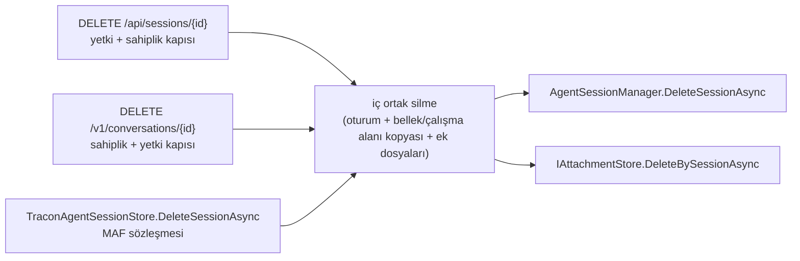

# Faz 255 — Çalışma Anı Bağımlılıkları ve MAF 1.26

> **Durum:** 🚧 Uygulanıyor (2026-10-28)
> **Kademe:** tam — güvenlik ve kiracı sınırı (oturum silme yolu; BYOK isteğinin kimlik başlığı değişir) · public API davranışı (Anthropic örnekleme beyanı daralır, alanı taşıyan tanım reddedilir; `SamplingFields` büyüyebilir) · geri dönüşü pahalı (Anthropic SDK major sürümü)
> **Plan onayı:** 👤 2026-10-28 (farukatasoy) — "fazı geliştir commit atabilirsin". Kapsam kararları 👤 aynı gün: çalışma anı seti · ortak silme yolu · Anthropic 13'e geç ve beyanı daralt. Açık Sorular 1–4 plandaki önerilen seçenekle uygulandı (bkz. Plandan Sapmalar 1).
> **Kaynak:** [RC-KALITE-DALGALARI.md](RC-KALITE-DALGALARI.md) Q-10 · **F-745** (çalışma anı bağımlılık seti ve MAF 1.26), **F-746** (`DELETE /v1/conversations/{id}` oturumun ek dosyalarını silmez)
> **Genellik:** Her tüketici. Sevk edilen 21 paketin grafiği MAF'ın bir minor sürümü (1.25 → 1.26) ve platformun bir yamasının (10.0.13 → 10.0.14) gerisindedir. Tüketici MAF 1.26'yı kendi projesine alırsa Tracon'un ikilisi `TraconAgentSessionStore`'da `TypeLoadException` ile kırılabilir: 1.26 `AgentSessionStore`'a soyut bir üye ekledi (ölçüldü, derleme `CS0534`). İş tüketici kodunda kalamaz. İkinci kanıt: ilk ilke (`rc.1` bu grafiği dondurur) ve freeze ölçütü 2'nin bayatlaması (`YAYIN-HAZIRLIK.md` §2).
> **Karşı görüş:** "Anthropic 13 bir major sürüm; tüketicinin `Temperature`/`TopK` kullanan Anthropic tanımı reddedilmeye başlar." **Cevap:** SDK 13 bu alanları istekten kaldırdı; yükseltmeden sonra onları göndermenin yolu yoktur. Seçenek reddetmek ya da sessizce düşürmektir; Tracon'un kuralı sessiz düşürmeyi yasaklar (K-1103, Faz 252). `rc.1`'den önce kırmak ucuzdur (UR-012 B). 12.x'te kalmak 👤 kararla seçilmedi.
> **Önkoşul:** RC kalite Dalga 0 (2026-10-28, kapandı). Faz 193 (`net8.0`/`net9.0` düşer) bu fazdan bağımsızdır; ikisi `Directory.Packages.props` ve `CHANGELOG.md`'yi paylaşır, **paralel koşmaz**.
> **Paketler:** `Tracon.AspNetCore`, `.Core`, `.Anthropic`, `.Google`, `.Azure`, `.OpenAI`, `.Sqlite`, `.Abstractions` (yalnız Açık Soru 1 A seçilirse) (+ `Directory.Packages.props`, `.github/dependabot.yml`)
> **Yeni paket:** Yok · **Migration:** Yok
> **Public API:** Büyüyebilir (Açık Soru 1: `SamplingFields`'e iki üye). Silinen satır beklenmez. `PublicAPI.Shipped.txt` bugün **0** satırdır (`find src -name PublicAPI.Shipped.txt -exec cat {} + | grep -vcE '^\s*$|^#'` → `0`); değişiklik `1.0.0` GA'dan (K-603) önce ucuzdur.
> **Tüketici yüzeyi:** site: `reference/compatibility.md:135-162` (test edilen sürümler) · `guides/model-providers.md:197,225` (Anthropic `TopK` sütunu) · `capabilities.md:53` · `guides/ef-core.md:44` (Sqlite sürüm damgası) · `concepts/governance.md` ya da oturum sayfası (silmenin ek dosyalarını da sildiği) — sevk edilen: `src/Tracon.Anthropic/README.md` (§ *Known behavior differences*, `:44`, `:141`), `src/Tracon.Google/README.md:107`, `///` sürüm damgaları, `CHANGELOG.md` `[Unreleased]`
> **Manuel test alanı:** [`01-KURULUM-VE-PAKETLEME.md`](manuel-test/01-KURULUM-VE-PAKETLEME.md) (paketlenmiş tüketici) · [`06-SAGLAYICI-DIGER.md`](manuel-test/06-SAGLAYICI-DIGER.md) (Anthropic gerçek anahtar) · [`08-OPENAI-UYUMLU-UCLAR.md`](manuel-test/08-OPENAI-UYUMLU-UCLAR.md) (conversation silme)

---

## Bu Faza Başlarken

> `faz-baslangic` skill'ini uygula. Aşağıdaki liste o skill'in 2. adımıdır —
> **tamamını değil, yalnız işaret edilen bölümleri oku.**

1. Bu doküman.
2. Kararlar — dosyanın tamamını **okuma**:
   ```bash
   grep -n "K-1016 —\|K-1017 —\|K-1103 —\|K-1104 —\|K-543 —\|K-283 —" docs/KARARLAR.md
   ```
   **K-1016** (`TraconAgentSessionStore` `internal`; köprü oturum açmaz; `isolation` bölümü katlanır, başka bölüm reddedilir) · **K-1017** (yükseltme istek davranışını değiştirmez; Anthropic adaptörü `Extended` ile kurulur) · **K-1103** (model reddi `RejectedSamplingFields`; denetim = yüzey desteği − model reddi) · **K-1104** (değer sınırı `SamplingLimits`) · **K-543** (Dependabot grubu) · **K-283** (bir davranışı düzeltmek çağıranı sessizce değiştirir).
3. Emsal faz — MAF 1.25 yükseltmesi, aynı iş türü:
   ```bash
   git show 2a8149ef:docs/arsiv/fazlar/214-CALISMA-ANI-BAGIMLILIKLARI-VE-MAF-125.md | sed -n '/## Plandan Sapmalar/,/## Bu Fazda/p'
   ```
   Sapma 5'teki sürüm damgası tablosu bu fazın Adım 255.5 kalıbıdır.
4. Alan hafızası: [`hafiza/maf-oturum.md`](hafiza/maf-oturum.md) (köprü) ·
   [`hafiza/tedarik-zinciri.md`](hafiza/tedarik-zinciri.md) (sürüm damgası, AOT vaadi) ·
   [`hafiza/oturum-calisma-alani.md`](hafiza/oturum-calisma-alani.md) (oturum silmenin sildiği içerik) ·
   [`hafiza/yayin-ve-surumleme.md`](hafiza/yayin-ve-surumleme.md) (kırıcı not).
5. Gerektiğinde: [`MAF-KAPSAMA.md`](MAF-KAPSAMA.md) §10 (MAF takip süreci P-02…P-05) ·
   [`.agents/skills/maf-api-kesfi/SKILL.md`](../.agents/skills/maf-api-kesfi/SKILL.md) § *Sürüm yükseltirken*.

---

## Amaç

Sevk edilen paketlerin çalışma anı grafiğini en yeni sürümlere taşı. Upstream'in
zorladığı iki değişikliği `rc.1`'den önce kalıcı biçimde karşıla: MAF 1.26'nın
soyut `DeleteSessionAsync`'i ve Anthropic SDK 13'ün örnekleme alanlarını kaldırması.
Oturum silmenin üç yolunu tek bir iç yola topla.

- **F-745** — MAF 1.26 + Hosting `1.26.0-preview.261023.1` + platform 10.0.14 + Anthropic 13.3.0 + Google.GenAI 1.27.0 + Azure.Core 1.64.0 + Sqlite 10.0.14; köprünün silmesi; Anthropic örnekleme beyanı.
- **F-746** — `DELETE /v1/conversations/{id}` oturumu ve bellek kopyasını siler, ek dosyalarını bırakır. Ortak silme yolu bunu kapatır.

### Bugün ne çalışmıyor — doğrulanmış kanıt

| Kanıt | Gözlem |
|---|---|
| [`Directory.Packages.props:19,26,67,68,79,80,133,134,149,195,301`](../Directory.Packages.props) | MAF `1.25.0`, platform `10.0.13`, Hosting `[1.25.0-preview.261014.1]`, Hosting.OpenAI `[1.25.0-alpha.261014.1]`, Anthropic `12.58.0`, Google.GenAI `1.26.1`, Azure.Core `1.63.0`, Sqlite `10.0.13`, OpenApi `10.0.13`. NuGet'te en yeniler: `1.26.0` (2026-10-23), `1.26.0-preview.261023.1`, `10.0.14` (2026-10-25), `13.3.0`, `1.27.0`, `1.64.0` |
| [`TraconAgentSessionStore.cs:39`](../src/Tracon.AspNetCore/Sessions/TraconAgentSessionStore.cs) | MAF 1.26'da derleme kırılır: `CS0534 … does not implement inherited abstract member 'AgentSessionStore.DeleteSessionAsync(AIAgent, AgentSessionStoreKey, CancellationToken)'` (deneme yükseltmesi, üç TFM) |
| [`SessionEndpoints.cs:338-376`](../src/Tracon.AspNetCore/Endpoints/SessionEndpoints.cs) | `DELETE /api/sessions/{id}`: yetki kapısı → sahiplik kapısı → `AgentSessionManager.DeleteSessionAsync` (oturum + bellek ve çalışma alanı kopyası, `ISubjectContentEraser`) → `IAttachmentStore.DeleteBySessionAsync` |
| [`OpenAIConversationsEndpoints.cs:247-282`](../src/Tracon.AspNetCore/OpenAICompat/OpenAIConversationsEndpoints.cs) | `DELETE /v1/conversations/{id}`: aynı kapılar, `manager.DeleteSessionAsync` (`:276`); **ek dosyaları silinmez** (F-746) |
| [`AgentSessionManager.cs:620`](../src/Tracon.Core/Sessions/AgentSessionManager.cs) | Yönetici silmesi ek dosyalarına dokunmaz; eraser'lar bellek (`ConversationMemoryEraser`) ve çalışma alanıdır (`SessionWorkspaceEraser`) |
| [`AnthropicModelProvider.cs:84-88`](../src/Tracon.Anthropic/AnthropicModelProvider.cs) | `SupportedSamplingFields` `TopK` taşır. Anthropic 13.3.0'da `MessageCreateParams` `temperature`, `top_k`, `top_p` alanlarını **taşımaz** (12.58.0 taşıyordu; iki sürüm decompile edildi). Deneme: `ModelSamplingWireTests.Anthropic_sends_top_k_stop_sequences_and_the_tool_choice` kırmızı, gövdede `top_k` yok; `disable_parallel_tool_use` yerinde |
| [`AnthropicRequestSettingsTests.cs:328-329`](../tests/Tracon.Anthropic.UnitTests/AnthropicRequestSettingsTests.cs) | SDK 13.3 kiracı anahtarını `Authorization: Bearer …` ile ve `anthropic-version: 2026-10-21` ile gönderir; test `x-api-key` bekler (3 TFM kırmızı). Giden anahtar **kiracınınki**dir (prob); BYOK ihlali yok |
| [`AnthropicProviderHealthCheck.cs:22,55`](../src/Tracon.Anthropic/AnthropicProviderHealthCheck.cs) · [`README.md:141`](../src/Tracon.Anthropic/README.md) | Sağlık denetimi SDK'yı kullanmaz; ham `x-api-key` ve `anthropic-version: 2023-06-01` gönderir. SDK ile tutarlılığı ölçülmeli |
| `maf-kapsama.py fark` (1.25.0 → 1.26.0) | +üye 3, −üye 1: `AgentSessionStore.DeleteSessionAsync`, `DelegatingAgentSessionStore.DeleteSessionAsync`, `AgentFileStore.ScanContent(…, CancellationToken)` (eski aşırı yükleme kalktı). Tracon `ScanContent` çağırmaz (`git grep` boş). Paket ailesi envanteri: 40 paket, değişiklik yok, Hosting hâlâ ön sürüm |
| MAF 1.26 decompile | `DeleteSessionAsync`'i MAF host kodu çağırmaz; yalnız `DelegatingAgentSessionStore` ve `IsolationKeyScopedAgentSessionStore` iletir. MAF'ın sözleşmesi: "olmayan oturum no-op" |

> Kanıtlar 2026-10-28'de doğrulandı. Deneme yükseltmesi izole worktree'de (HEAD
> `8295ca9c`): bütün çözüm geçici bir `DeleteSessionAsync` gövdesiyle **0 hata, 0
> uyarı** derlendi. MAF'a bağlı 11 test projesi (25 046 test) MAF 1.26 ile yeşildi.
> Tam set (platform + Anthropic 13 + Google + Azure.Core + Sqlite) ile yalnız yukarıdaki
> iki Anthropic testi düştü (26 667 testten).

---

## 255.1 — Sürüm hedefleri

| Paket | Bugün | Hedef | Not |
|---|---|---|---|
| `Microsoft.Agents.AI` ailesi (`MicrosoftAgentsAIVersion`) | 1.25.0 | **1.26.0** | MEAI ≥ 10.10 ister; Tracon 10.11.0 |
| `Microsoft.Agents.AI.Hosting`, `.Hosting.A2A`, `.Hosting.AspNetCore` | `[1.25.0-preview.261014.1]` | **`[1.26.0-preview.261023.1]`** | K-008: yalnız `Tracon.AspNetCore` |
| `Microsoft.Agents.AI.Hosting.OpenAI` | `[1.25.0-alpha.261014.1]` | **`[1.26.0-alpha.261023.1]`** | |
| `A2A.AspNetCore`, `A2A` | `[1.0.0-preview3]` | değişmez | NuGet'te en yeni |
| `MicrosoftExtensionsVersion` | 10.0.13 | **10.0.14** | platform yaması |
| `Microsoft.Data.Sqlite`, `Microsoft.AspNetCore.OpenApi` | 10.0.13 | **10.0.14** | |
| `Microsoft.AspNetCore.TestHost`, `.Mvc.Testing` | 10.0.13 | **10.0.14** | aynı ASP.NET Core hattı (`Directory.Packages.props:298`) |
| `Anthropic` | 12.58.0 | **13.3.0** | §255.3 |
| `Google.GenAI` | 1.26.1 | **1.27.0** | |
| `Azure.Core` | 1.63.0 | **1.64.0** | |
| `System.Security.Cryptography.Pkcs` ×3 | 8.0.2 / 9.0.21 / 10.0.13 | **yeniden ölç** | CVE sabitidir (`Directory.Packages.props:175-188`); SqlClient hâlâ açık sürüm çekiyor mu, Faz 214 yöntemiyle ölç |

Kapsam dışı (👤 2026-10-28): test ve derleme araçları (xunit.v3 4, MTP, Playwright
1.64, Meziantou, Roslyn, SDK `10.0.403` / `global.json`). Ayrı faz, Faz 215 emsali.

Hedefler uygulama anında flat container ile **yeniden ölçülür**; daha yeni bir
sürüm çıktıysa en yenisi alınır ve sapma olarak yazılır.

## 255.2 — Köprünün silmesi ve ortak silme yolu



- **Bir iç yol, üç çağıran.** Oturumu silen etkileşimli üç yol aynı iç servisi
  çağırır: oturum kaydı, `ISubjectContentEraser` kopyaları ve ek dosyaları birlikte
  silinir. Servis `internal`'dır; yeri (Core mu AspNetCore mu) `IAttachmentStore`'un
  kaydına göre seçilir — **ölçülmeli**.
- **Kapılar HTTP ucunda kalır.** Yetki (`RunAuthorizationGate`) ve sahiplik
  (`SessionOwnershipGate`) kapıları uçlarda kalır; iç servis kapı taşımaz. Köprüyü
  yalnız Tracon'un kendi uçları ve host kodu çağırır; MAF 1.26 onu çağırmaz.
- **Kiracı sınırı depo katmanındadır.** `ISessionStore` ve `IAttachmentStore`
  çağrıları ortam kiracısını kullanır (`AgentSessionManager` `_tenantContext`,
  ek dosyası silmesi açık kiracı alır).
- **Köprü sözleşmesi:** `DeleteSessionAsync` anahtarı `ToSessionId` ile katlar
  (K-1016: `isolation` bölümü; başka bölüm `NotSupportedException`). Olmayan oturum
  **no-op**'tur (MAF sözleşmesi); hata atmaz.
- **Kapsam dışı:** veri sahibi silmesi (`SqlDataSubjectStore`) ve saklama
  (`SqlRetentionStore`) ek dosyalarını kendi işlemlerinde zaten siler; onlara
  dokunulmaz.
- **🚨 K-283:** silmeyi değiştirmek ona dayanan çağıranı sessizce değiştirir.
  `git grep -n "DeleteSessionAsync\|DeleteBySessionAsync" -- src` ile **her** çağıranı
  tara; bugün üç etkileşimli yol + iki depo uygulamasıdır.

## 255.3 — Anthropic SDK 13

Ölçülen üç fark (12.58.0 → 13.3.0, decompile ve deneme):

| Fark | Etki | Ne yapılır |
|---|---|---|
| `MessageCreateParams` `temperature`, `top_k`, `top_p` taşımaz; adaptör `ChatOptions.Temperature/TopK/TopP`'yi düşürür | Tracon `TopK`'yi destekleniyor diye beyan eder → **sessiz düşürme** (K-1103 kuralına aykırı); sıcaklık ve top_p de düşer | Beyan daralır: Anthropic `TopK` taşımaz; sıcaklık/top_p taşıyan Anthropic tanımı kaydetme ve derleme anında reddedilir (Açık Soru 1) |
| Anahtar `Authorization: Bearer` ile, `anthropic-version: 2026-10-21` ile gider | Kiracı anahtarı doğru gider (prob). Gerçek API'nin bu çifti kabul ettiği **ölçülmedi** | 🤖/👤 kabul case'i gerçek anahtarla (§ *Manuel Kabul*). Test başlık adına değil, anahtarın gittiğine bakar |
| 12.59.0: akış tanınmayan SSE olay adlarını da verir | `AnthropicStopReasonChatClient` ve önbellek kullanımı halkası bilinmeyen olayı görebilir | Decompile + akış testi; bilinmeyen olay sessizce yutulmaz ama run'ı düşürmez (İ3) — **ölçülmeli** |

- **Sağlık denetimi.** `AnthropicProviderHealthCheck` ham HTTP ile `x-api-key` +
  `2023-06-01` gönderir. SDK ile aynı kimlik biçimine mi geçmeli, yoksa eski sürüm
  başlığı API'de destekli mi kalır — **ölçülmeli** (Açık Soru 2).
- **README § *Known behavior differences*** yeniden yazılır: "Temperature must be 1
  while budgeted thinking is on" maddesi SDK 13'te geçersizdir (sıcaklık hiç
  gönderilemez). Bütçeli düşünme (`ThinkingConfigEnabled.budget_tokens`) 13.3'te
  durur (decompile).
- K-1017'nin `Extended` kurulumu ve system yerleşimi 13.3 adaptöründe yeniden ölçülür.

## 255.4 — Matris ve takip süreci (P-02…P-05)

- `MAF-KAPSAMA.md` başlığı ve §5 `1.26.0` ölçümüne geçer; `maf-kapsama.py temas`
  (`kapi.py uret`) yeniden üretilir; `✗` tabanı kapıdan geçer.
- `MAF-GENISLEME-NOKTALARI.md` § *Sürüm damgası*: üç üye farkı ve hangisinin
  **kullanılmadığı** yazılır (`ScanContent` — Tracon çağırmaz; `DeleteSessionAsync`
  — köprü uygular, MAF çağırmaz).
- MAF 1.26 sürüm notunun Tracon'a dokunan öteki maddeleri tek tek yargılanır ve
  matrise yazılır: #9542 yinelenen onay kimliği reddi (Tracon `ToolApprovalAgent`'ı
  kullanır; testler yeşil, onay devam yolu ölçülmeli) · #9382 AG-UI istek anında
  agent seçimi (Tracon `AGUI.Server` kullanır, MAF'ın AG-UI paketini değil →
  etkisiz) · #9540/#9394/#9432 workflow durum sıfırlama ve fan-out tekilleştirme ·
  #9269 bellek sağlayıcısı iptali · #9534 A2A görev durum iletisi · #9539 MCP çağrı
  başlığı doğrulaması.

## 255.5 — Sürüm damgaları

`dokuman-bakim.py` "Bağımlılık sürüm damgası" kapısı eski sürümü anan satırı
bulur. Bugün bilinenler (her biri yeni sürüme karşı **yeniden ölçülür** ya da
tarihlenir; Faz 214 Sapma 5 tablosu kalıbı):

- Anthropic 12.58.0: `AnthropicCacheUsageChatClient.cs:19`, `AnthropicModelProvider.cs:84`, `AnthropicProviderSettingsChatClient.cs:36,164`, `AnthropicStopReasonChatClient.cs:17,206`, `src/Tracon.Anthropic/README.md:44`
- Google.GenAI 1.26.1: `GoogleModelProvider.cs:87,104`, `src/Tracon.Google/README.md:107`
- MAF 1.25: `TraconA2AOptions.cs:8`, `OpenAIResponsesEndpoints.cs:30,458`, `ResponsesIncompleteness.cs:16,102`, `RecordingLoopEvaluator.cs:38,46`, `AggregatedResponseGuard.cs:20`, `WorkflowDefinitionValidator.cs:471,486`
- Azure.Core 1.63.0: `OpenAIAudioTransport.cs:13`
- Site: `reference/compatibility.md:135-162`, `guides/ef-core.md:44`

---

## Planlanan Public API

> Taslaktır. Gerçekleşen imza kapanışta yazılır.

```csharp
// Tracon.Abstractions — yalnız Açık Soru 1 = A ise
[Flags]
public enum SamplingFields
{
    // … bugünkü üyeler …
    Temperature = 1 << 8,   // sağlayıcı sıcaklığı gönderir
    TopP = 1 << 9,          // sağlayıcı top_p'yi gönderir
}
```

Bugün eklemek bedavadır (`Shipped` boş); sonradan eklemek davranış kırıcıdır: beyan
etmeyen her üçüncü taraf sağlayıcı sıcaklığı "desteklemiyor" sayılır. Bu yüzden
`ISamplingSupport` uygulamayan sağlayıcı için varsayılan bugünkü davranışı korumalıdır
(sıcaklık gönderilir) — **ölçülmeli**: `ModelProviderRegistry.cs:176-178` uygulamayan
sağlayıcıya `SamplingFields.None` verir.

### HTTP `endpoint`'leri

Yeni uç yok. Değişen davranış:

| Metot | Yol | Değişen |
|---|---|---|
| `DELETE` | `/v1/conversations/{id}` | Oturumun ek dosyalarını da siler (F-746) |
| `PUT`/`POST` | agent tanımı kaydetme | Anthropic bağlamasında `Temperature`, `TopP`, `TopK` reddedilir (`400`, alan yolu ile) |

### Arayüz payı

Yok.

---

## Planlanan Dosya Listesi

```
Directory.Packages.props                     # §255.1
.github/dependabot.yml                       # grup değişirse
src/Tracon.AspNetCore/Sessions/TraconAgentSessionStore.cs      # DeleteSessionAsync
src/Tracon.AspNetCore/Endpoints/SessionEndpoints.cs            # ortak yola geçer
src/Tracon.AspNetCore/OpenAICompat/OpenAIConversationsEndpoints.cs  # ortak yola geçer (F-746)
src/Tracon.{Core|AspNetCore}/Sessions/<ortak silme servisi>.cs  # yeni, internal
src/Tracon.Anthropic/AnthropicModelProvider.cs                 # beyan
src/Tracon.Anthropic/AnthropicProviderHealthCheck.cs           # Açık Soru 2
src/Tracon.Anthropic/README.md
src/Tracon.Abstractions/Models/ISamplingSupport.cs             # Açık Soru 1 = A
src/Tracon.Core/Compilation/SamplingCapabilityCheck.cs | SamplingSupportCheck.cs
src/**/*.cs                                  # §255.5 damgaları
tests/Tracon.Anthropic.UnitTests/AnthropicRequestSettingsTests.cs
tests/Tracon.AspNetCore.FunctionalTests/ModelSamplingWireTests.cs
tests/Tracon.AspNetCore.FunctionalTests/<SessionDeletion…>Tests.cs  # yeni
docs/MAF-KAPSAMA.md · docs/MAF-GENISLEME-NOKTALARI.md · docs-site/… (başlıktaki liste)
CHANGELOG.md
```

---

## Hata Modları ve Testler

| Ne bozulabilir | Seviye | Test |
|---|---|---|
| Köprünün silmesi başka kiracının oturumunu siler | Fonksiyonel (kiracı sınırı, gerçek host) | yeni `SessionDeletionPathTests` — iki kiracı, aynı oturum kimliği |
| Köprü olmayan oturumda hata atar (MAF sözleşmesi no-op ister) | Birim + fonksiyonel | aynı sınıf |
| Köprü `isolation` dışı bölümü sessizce birleştirir | Birim | mevcut `SessionStoreIsolationTests`'e silme vakası |
| `DELETE /v1/conversations/{id}` ek dosyasını bırakır (F-746) | Fonksiyonel, **önce kırmızı** | yeni test: ek dosyalı oturum, silme, `GET` ek dosyası `404` |
| `DELETE /api/sessions/{id}` davranışı ortak yola geçince değişir (sıra: kopya önce, kayıt sonra) | Fonksiyonel | mevcut oturum silme testleri + kopya silinemezse oturumun yerinde kaldığı vaka |
| Yetki ya da sahiplik reddinde silme yine olur | Fonksiyonel | iki uç için ret → kayıt ve ek dosyası yerinde |
| Bellek kopyası silinemezse ek dosyası silinmiş, oturum duruyor (yarım silme) | Fonksiyonel (alt sistem hatası) | eraser hata atar → ne oturum ne ek dosyası silinir; sıra ölçülür |
| Anthropic tanımı `Temperature`/`TopK`/`TopP` ile sessizce kaydedilir ve alan düşer | Fonksiyonel (kaydetme + derleme) | `ModelSamplingWireTests` yeniden yazılır: kaydetme `400` ve alan yolu; derlemede aynı ret (K-1103 iki okuyucu) |
| Fallback zincirindeki Anthropic halkası alanı düşürür | Fonksiyonel | birincil OpenAI + Anthropic yedek → ret (`SamplingCapabilityCheck` yedek halkayı okur) |
| `ISamplingSupport` uygulamayan üçüncü taraf sağlayıcıda sıcaklık artık reddedilir | Birim (Açık Soru 1) | varsayılanın korunduğu vaka |
| BYOK isteği paylaşılan anahtarı gönderir | Birim (gerçek soket) | `A_tenant_credential_client_sends_the_same_settings` — başlık adından bağımsız, kiracı anahtarı tel üstünde |
| Anahtar ya da `Authorization` başlığı loga veya kayda sızar | Birim | mevcut `SecretLeakTests` Bearer biçimiyle |
| Akışta tanınmayan SSE olayı run'ı düşürür | Fonksiyonel (akış) | sahte sunucu bilinmeyen olay gönderir → run tamamlanır |
| Paketlenmiş tüketicide MAF 1.26 ile `TypeLoadException` | Paket | `uyum-probu.cs -- ileri` (0 eksik tip/üye) + negatif kontrol |
| Deneysel tip public imzaya sızar | Paket | `uyum-probu.cs -- deneysel` (`public_maruziyet` yalnız F-560'ın dört satırı) |

Beş soru: **iptal** — silmede iptal belirteci depoya iletilir, yarım silme sırası
ölçülür · **eşzamanlılık** — aynı oturum iki uçtan aynı anda silinir: ikincisi
no-op/404 · **boş/aşırı girdi** — boş oturum kimliği `ArgumentException` (bugünkü),
köprüde boş `SessionId` · **başka kiracı** — yukarıdaki iki kiracılı vaka ·
**alt sistem hatası** — eraser ve ek dosyası deposu hata atar.

---

## Manuel Kabul Case'leri

| # | Ön koşul | Adımlar | Beklenen sonuç |
|---|---|---|---|
| 1 `🤖` (`06`) | Gerçek Anthropic anahtarı, SDK 13.3 | Anthropic agent'ı ile bir run; kiracı BYOK anahtarıyla bir run | İki run da `200`; istek `anthropic-version: 2026-10-21` taşır. Anahtar yoksa `👤` (bakımcı) |
| 2 `🤖` (`06`) | Aynı | `Temperature` taşıyan Anthropic tanımı kaydet | `400`, alan yolu `model.temperature`; mesaj sağlayıcının alanı göndermediğini söyler |
| 3 `🤖` (`08`) | `samples/Tracon.Api`, ek dosyalı bir conversation | `DELETE /tracon/v1/conversations/{id}` | `deleted: true`; ek dosyası artık okunamaz (`404`) |
| 4 `🤖` (`01`) | `kapi.py yayin --kuru --surum 1.0.0-preview.7.255` | Paketlenmiş tüketici (net8 dahil) | EXIT 0 |

---

## Açık Sorular

| # | Soru | Seçenekler | Öneri |
|---|---|---|---|
| 1 | Sıcaklık ve top_p'nin sağlayıcı düzeyinde reddi nasıl beyan edilir? | A: `SamplingFields`'e `Temperature` ve `TopP`; uygulamayan sağlayıcı için varsayılan "gönderilir" korunur · B: Anthropic sağlayıcısı katalog tanımlayıcılarına varsayılan `SupportsSampling = false` yazar | **A** — bilgi sağlayıcının gerçeğidir, modelin değil (K-1103'ün yüzey/model ayrımı); B kataloğu "doğrulama listesi"ne çevirir (`SamplingCapabilityCheck` remarks'ı bunu reddeder) |
| 2 | `AnthropicProviderHealthCheck` hangi kimlik biçimini kullansın? | A: SDK ile aynı (`Bearer` + `2026-10-21`) · B: ham `x-api-key` + `2023-06-01` kalsın | Gerçek API'de ölç; ikisi de geçerse **A** (tek biçim, SDK ile kayma yok) |
| 3 | Ortak silme servisi hangi pakette? | A: `Tracon.Core` (`IAttachmentStore` Abstractions'ta) · B: `Tracon.AspNetCore` | **A**, eğer `IAttachmentStore` Core'da her zaman kayıtlıysa — ölç |
| 4 | Pkcs CVE sabitleri kalkar mı? | A: kaldır · B: 10.0.14'e çek · C: değiştirme | Faz 214 yöntemiyle ölç (boş proje + `NuGetAudit`) |

---

## Bitiş Ölçütleri (DoD)

- [x] `Directory.Packages.props` §255.1 hedeflerinde (flat container ile yeniden ölçüldü); `dotnet restore Tracon.slnx` uyarısız; `dotnet list Tracon.slnx package --vulnerable --include-transitive` açık yok — 2026-10-28: hedefler hâlâ en yenisi; `dotnet restore Tracon.slnx --force` uyarısız; vulnerable listesi 49 projede boş
- [x] `TraconAgentSessionStore.DeleteSessionAsync` ortak silme yolunu çağırır; olmayan oturum no-op; `isolation` dışı bölüm `NotSupportedException` (K-1016) — `SessionDeletionPathTests.The_bridge_*`, `SessionStoreIsolationTests` (bölüm katlama, ret)
- [x] Üç etkileşimli silme yolu tek iç servisi çağırır; F-746 testi düzeltmeden **önce kırmızı**, sonra yeşil; iki kiracılı silme testi yeşil — düzeltmeden önce `Deleting_a_conversation_deletes_the_attachments_of_its_session` ve eraser vakasının conversation kolu kırmızıydı (MAF 1.25 + eski uç); sonra yeşil. İki kiracı: `Deleting_a_session_in_one_tenant_leaves_the_same_id_in_another_tenant` (uç) ve `The_bridge_deletes_in_the_current_tenant_only` (köprü). Sıra: `SessionDeletionTests`
- [x] Anthropic: `SupportedSamplingFields` `TopK` taşımaz; `Temperature`/`TopP`/`TopK` taşıyan Anthropic bağlaması kaydetmede ve derlemede reddedilir (fallback halkası dahil); `ModelSamplingWireTests` ve `AnthropicRequestSettingsTests` yeni davranışı sabitler — `ModelSamplingSupportTests` (tablo, kaydetme `400`, fallback halkası), `SamplingSupportTests` (derleme), `ModelSamplingWireTests`, `AnthropicRequestSettingsTests.Temperature_top_p_and_top_k_never_reach_the_request_body`, `ModelRunJudgeTests` (denetim 🔴 2)
- [x] Gerçek Anthropic API'si `Bearer` + `2026-10-21` isteğini kabul eder (manuel case 1) ya da case `👤` olarak bakımcıya devredildi — `MT-PROV-099` koşuldu (2026-10-28, gerçek `claude-haiku-5-5`): sağlık `Healthy`, paylaşılan anahtar ve kiracı anahtarı run'ları `Completed` (`ok`), üç alan `400`
- [x] `maf-kapsama.py fark` sonucu `MAF-GENISLEME-NOKTALARI.md` § *Sürüm damgası*'nda; `MAF-KAPSAMA.md` 1.26.0 ölçümünde; `maf-kapsama.py denetle` yeşil — fark: +tip 0 · −tip 0 · +üye 8 · −üye 1 (`ScanContent`, kullanılmıyor); envanter 40 paket; `denetle`: temas tablosu taze, `✗` tabanda
- [x] §255.5 damgaları yeniden ölçüldü; `dokuman-bakim.py` "Bağımlılık sürüm damgası" temiz — iki sürümün decompile diff'iyle (Sapma 7); kapı temiz
- [x] `uyum-probu.cs -- ileri` 0 eksik tip/üye (negatif kontrolle); `-- deneysel` yalnız F-560 satırları — `ileri --tracon 1.0.0-preview.6`: 1617 üye, `eksik_tip=0 eksik_uye=0`; negatif kontrol (`--ust Microsoft.Agents.AI@1.20.0`): `eksik_tip=1` (`DelegatingAgentSessionStore`); `deneysel`: `public_maruziyet=4` (`AddLoopEvaluator` ×4 = F-560)
- [x] `CHANGELOG.md` `[Unreleased]`: Changed (bağımlılıklar), Changed/Breaking (Anthropic örnekleme reddi, adıyla), Fixed (F-746) — Upgrading ×4, Changed ×2, Fixed ×1
- [x] `YAYIN-HAZIRLIK.md` ölçüt 2 yeniden ✅ (çalışma anı); test/derleme araçları ayrı kalem olarak anılır
- [x] Dört doğrulama kapısı sıfır uyarı verir: `python3 scripts/kapi.py kapanis --taban <faz öncesi commit>` — 2026-10-28 `kapi.py kapanis --taban 9f1d9da6`: üretim, tarama, doküman denetimi, betik testleri, zorlanmış restore, build (sıfır uyarı), pack, site, `dotnet format` yeşil. Tam test ilk koşumda (denetim öncesi) 30 089 test yeşil; denetim düzeltmelerinden sonraki koşumda 30 104 testten biri düştü (`BackgroundChildQuotaTests.The_threshold_a_late_child_crosses_is_written_to_the_childs_own_stream`, 11 sn `TimeoutException`; faza ait değil, izole geçti) ve yalnız test aşaması yeniden koşunca 30 104 test, 0 başarısız, 1 atlanmış
- [x] `samples/Tracon.Api` ile gerçek `run` yapıldı, çıktı belgeye yazıldı (Responses, A2A ve conversation silme dahil) — 2026-10-28, Release, bellek içi depo (`Npgsql` günlük satırı 0), `claude-haiku-5-5`: `POST /v1/responses` → `completed`, `['ok']`; `DELETE /v1/conversations/{id}` → `deleted: true`, ek dosyası `200` → `404`, oturum `404`; A2A `SendMessage` (`summarizer`, `contextId`) → `ROLE_AGENT` yanıtı, `contextId` döndü
- [x] `secret` taraması boş döndü (`kapi.py tarama`) — `Tarama: ✅ temiz`
- [x] `🤖` case'ler `docs/manuel-test/01`, `06`, `08` içinde ve koşuldu; `👤` yalnız gerçek anahtar yoksa — sete tek case girdi (`MT-PROV-099`, koşuldu); öteki üçü kodla tekrarlanır ve örnek uygulamada koşuldu (Sapma 10); `👤` yok
- [x] `faz-denetim` koşuldu; 🔴 bulgu kalmadı — iki 🔴, ikisi gerçek, ikisi kapandı (bkz. Denetim Bulguları)
- [x] `docs-site/` güncellendi (başlıktaki sayfalar); `npm run build` + `check-links.mjs` temiz — `npm run check` (içerik, derleme, bağlantı, ağırlık) temiz; en ağır sayfa `guides/model-providers` 58 853 B (tavan 59 000 B)
- [x] `RC-KALITE-DALGALARI.md` Q-10 satırının Durum hücresi `✅ Faz 255`

### Doğrulama komutları

```bash
# deneme ölçümünün yeniden üretimi
git worktree add --detach /tmp/wt255 HEAD   # props'u §255.1'e çek, sonra:
dotnet build Tracon.slnx -c Release
python3 scripts/maf-kapsama.py fark <eski.txt> <yeni.txt>   # maf-api-kesfi § Sürüm yükseltirken
dotnet run .agents/skills/nuget-danismani/scripts/uyum-probu.cs -- deneysel
python3 scripts/kapi.py test --proje Tracon.Anthropic.UnitTests --sinif "*AnthropicRequestSettingsTests*" --tfm net10.0
python3 scripts/kapi.py yayin --kuru --surum 1.0.0-preview.7.255
```

---

## Riskler

| Risk | Önlem |
|------|-------|
| Gerçek Anthropic API'si `Bearer` ile API anahtarını reddeder | Manuel case 1 gerçek anahtarla; reddederse SDK'nın kimlik seçeneği ölçülür (`ApiKey` ↔ `AuthToken`) ve sapma yazılır |
| Anthropic tanımı reddi var olan tüketici tanımlarını kırar | `rc.1` öncesi; CHANGELOG adıyla anar; ret mesajı alanı ve nedeni söyler |
| Ortak silme yolu `DELETE /api/sessions` sırasını değiştirir (K-283) | Mevcut testler + yarım silme vakası; her çağıran `git grep` ile tarandı |
| Ön sürüm Hosting bir sonraki minor'da yine kırar | K-008 sınırı; deneme yükseltmesi önce koşar |
| Bu arada daha yeni sürüm çıkar | Uygulama anında yeniden ölç; en yenisini al, sapma yaz |

---

<!-- ============================================================
     AŞAĞISI ÇALIŞIRKEN DOLAR — doküman kapanışta silinir (`faz-kapat`).
     Kalıcı kısım `faz-tamamlama` Adım 5'te yerine taşınır. Başlıkları SİLME.
     ============================================================ -->

## Plandan Sapmalar

> Çalışırken dolar. Plan ile gerçek arasındaki fark **gizlenmez**. Kapanışta
> kapanış commit mesajına taşınır.

1. **Açık Sorular cevaplandı (öneriyle).** (1) = A: `SamplingFields` `Temperature` ve `TopP` taşır; `ISamplingSupport`
   uygulamayan sağlayıcı ikisini gönderir sayılır (`ModelProviderRegistry.List`), uygulayan onları adıyla bildirir.
   (2) = A: gerçek API `x-api-key` + `2023-06-01`, `Bearer` + `2023-06-01` ve `Bearer` + `2026-10-21` çiftlerinin
   hepsine `200` verdi (2026-10-28, `GET /v1/models`); sağlık denetimi SDK'yı izler. (3) = A: `SessionDeletion`
   `Tracon.Core`'dadır; `IAttachmentStore` Core'da `TryAddTraconDefault` ile her kurulumda kayıtlıdır. (4) = C:
   `Pkcs` sabitleri değişmedi; SqlClient 7.1.1 hâlâ en yenisi ve boş projede net8.0 `8.0.1`, net9/net10 `9.0.18` ile
   `NU1902` + `NU1903` veriyor.
2. **Plan `A2ASessionStore`'u saymıyordu.** `DelegatingAgentSessionStore` (1.26) `DeleteSessionAsync`'i anahtarı olduğu
   gibi iletir; `A2ASessionStore` türevi geçersiz kılmazsa MAF'ın `isolation` bölümlü anahtarı köprüde `caller::contextId`
   kimliğine katlanır ve `a2a:<özet>` altındaki konuşma yerinde kalırdı. Derleme bunu göstermez (taban artık somut).
   Geçersiz kılma anahtarı diğer üç çağrıdaki gibi `Rewrite` eder ve silmeden önce `SessionOwnershipGate.DeniesAsync`'i
   sorar (silme uçlarının sorusu; `CheckRunSessionAsync` değil: olmayan oturum no-op'tur). Mutasyon kontrolü: anahtarı
   yeniden yazmayan sürüm iki teste düşürüyor.
3. **Silme sırası değişti.** Plan "oturum, sonra ek dosyaları" varsayıyordu (bugünkü `/api/sessions` sırası). Uygulanan
   sıra kopya, ek dosyaları, kayıttır (`AgentSessionManager.DeleteSessionAsync`'in `internal` aşırı yükü
   `afterContentErased` alır; genel imza ve davranış aynı kaldı). Gerekçe: ek dosyası silinemezse kayıt yerinde kalır ve
   tekrar çağrı bitirir; kayıt önce gidince ek dosyasını adlandıracak oturum kalmaz. K-283 taraması: `git grep
   DeleteSessionAsync|DeleteBySessionAsync -- src` üç etkileşimli yol + iki depo uygulaması.
4. **Plan Responses yüzeyinin "hiçbir örnekleme alanını göndermediğini" söylüyordu** (`OpenAIModelProvider` remark'ı).
   Telde ölçüldü (`ModelSamplingWireTests`): `openai-responses` `temperature` ve `top_p` gönderir. Tablo ve remark
   düzeltildi; iki alan eklenmeden bu yanlış görünmüyordu.
5. **İki bulgu aynı yolda.** Katalogda `SupportsSampling = false` olan bir Anthropic modeli ve `Temperature` taşıyan
   tanım artık iki hata verir (`sampling_unsupported` ve `sampling_field_unsupported`, ikisi de `model.temperature`).
   İkisi de doğru; tek bulguya indirmek `SamplingCapabilityCheck`'i sağlayıcı beyanına bağlardı ve kapsamı büyütürdü.
   `AgentValidationWarningTests` ikisini de bekler. README artık `SupportsSampling = false` önermez.
6. **`1024` tanımsız bit oldu.** `ProviderRegistrationCoreTests` tanımsız bit örneği olarak `"256"` kullanıyordu; `256`
   artık `Temperature`. Örnek `"1024"`'e taşındı (aynı kural).
7. **Sürüm damgaları decompile diff'iyle taşındı.** Her damgayı elle yeniden ölçmek yerine iki sürümün tam decompile'ı
   diff'lendi (`ilspycmd -p`, MAF beş derleme; Anthropic adaptör sınıfı; Google adaptör sınıfı). Yalnız değişen kod yeniden
   ölçüldü. Yöntem `hafiza/tedarik-zinciri.md`'de. `dokuman-bakim.py` `SURUM_DAMGASI_KAYDI`'na
   `AnthropicProviderHealthCheck.cs` eklendi (yeni damga).
8. **MAF'ın dosya araması artık 10 sn'de iptal olur** (#9536; `AgentFileStore.SearchTimeout`). Plan bunu saymıyordu;
   dosya belleği ve çalışma alanı `InMemoryAgentFileStore` yolunu kullanır. Matrise yazıldı; gerçek büyük depoda süre
   ölçülmedi.
9. **Site senkron kapısı iki kural için gerekçeyle geçildi** (`--site-gerekce-yazildi`). `http-api`
   (`A2ASessionStore.cs` tetikledi): yeni uç ve yeni durum kodu yok; `DELETE /v1/conversations/{id}`'nin ek dosyalarını da
   silmesi `concepts/sessions.md`'de yazıldı. OpenAPI `description` metinleri yanlış değil (`/api/sessions` ek dosyalarını
   zaten anar, `/v1` "the session underneath it" der); metni değiştirmek anlık görüntüyü, .NET ve TypeScript istemcisini
   yeniden üretmeyi ister ve yeni bilgi taşımaz. `paket-readme` (`Tracon.Anthropic/README.md` tetikledi): `packages.md`
   Anthropic satırı yetenekleri sayar, örnekleme alanı reddini ve kimlik başlığını taşımaz; model sağlayıcıları sayfası
   (`guides/model-providers.md`) ikisini yazar.
10. **Kabul seti.** Plan dört `🤖` case sayıyordu (`01`, `06` ×2, `08`). `faz-tamamlama` Adım 3 (2026-10-17) kodla tekrarlanan
   davranışı sete almaz: alan reddi (`ModelSamplingSupportTests`), conversation silme (`SessionDeletionPathTests`) ve
   paketlenmiş tüketici (`kapi.py yayin --kuru`, `uyum-probu`) kodla tekrarlanır. Sete **tek case** girdi: `MT-PROV-099`
   (gerçek API'nin SDK 13 kimlik biçimini kabul etmesi; kodla tekrarlanamaz). Öteki üçü ayrıca örnek uygulamada koşuldu
   (DoD'de çıktısı).
11. **Denetim 🔴 #2: `ModelRunJudge` aynı kuralı dışarıda bırakıyordu.** Yargıç kendi `ChatOptions`'ını yazar ve agent
   derleyicisinden geçmez; `Temperature`/`TopP` taşıyan bir Anthropic yargıç modeli hatasız varsayılan sıcaklıkla
   çalışırdı. `JudgeAsync` artık `SamplingSupportCheck`'i sorar (yalnız yargıcın gönderdiği iki alan) ve ilk modele
   gitmeden `TraconException` atar. Sınıf taraması: `git grep "\.Temperature\b\|\.TopP\b" -- src` — `ModelRunJudge`'dan
   başka `ModelBinding` örnekleme alanını `ChatOptions`'a yazan yer agent derleyicisidir. aiJudge döngü ölçütü ve
   `EvaluatorRunJudge` alanları hiç okumaz.
12. **Dependabot grubu değişmedi.** `Anthropic`, `Google.GenAI` ve `Azure.Core` `agent-stack` grubunda değildir ve
   ayrı PR alır; zincir kopmadı, bu yüzden K-543 satırı ve `dependabot.yml` aynı kaldı.

## Bu Fazda Verilen Kararlar

> Çalışırken dolar. Dört kategoriden birine giren karar (AGENTS.md)
> `docs/KARARLAR.md`'ye K-NNN ve kategori etiketiyle girer; girmeyen karar
> kapanışta commit mesajına taşınır (`faz-tamamlama` Adım 8). Plan numara rezerve
> etmez.

- **K-1114** *(güvenlik, kalıcı-veri)* — oturum silme tek iç yoldur (`SessionDeletion`): kopya, ek dosyaları, kayıt.
- **K-1115** *(public-api)* — `SamplingFields` `Temperature` ve `TopP` taşır; Anthropic SDK 13 üçünü göndermez, beyan
  daralır, tanım reddedilir.
- **Commit mesajına** (kategori dışı): sağlık denetimi SDK'nın kimlik biçimini ve `anthropic-version` değerini yazar
  (gerçek API ikisini de kabul eder, Açık Soru 2 = A); `Pkcs` CVE sabitleri kalır (Açık Soru 4 = C); sürüm damgaları
  decompile diff'iyle taşındı; `ProviderRegistrationCoreTests` tanımsız bit örneği `1024`.

## Süreç Ölçümü

> Kapanışta doldurulur. **Tablo olarak** — onay kutusu DEĞİL: `faz-kapat`
> işaretsiz kutuda durur. `faz-kapat` bu tabloyu `docs/FAZ-OLCUMLERI.md`'ye taşır;
> eşik **167**'den itibaren boş bir değer hücresinde kapanışı durdurur.
> `ölçülmedi` **geçerli bir değerdir** — kapı bir sayı değil, bir **karar** arar.
> Kapı bölümün VARLIĞINI denetler, doğruluğunu denetlemez (K-766).

| Metrik | Değer |
|---|---|
| Plan revizyonu sayısı | 0 (plan dokümanı değişmedi; 12 sapma yazıldı) |
| Düzeltme turu sayısı | 1 (denetim sonrası) |
| 🔴 bulgu: gerçek / gürültü / araştırılacak | 2 / 0 / 0 |
| Fazın ürettiği regresyon | 1 (yargıç yolu: SDK 13 sıcaklığı hatasız düşürüyordu; kapanıştan önce denetimde yakalandı) |
| Faz kapandıktan sonra bulunan kusur | ölçülmedi (kapanış anı) |

## Denetim Bulguları

> `faz-denetim` çıktısı. Her satır: bulgu · seviye (🔴/🟡/🟢) · sonuç
> (düzeltildi / gerekçelendi / F-NN olarak devredildi). 🟢 kapanışta
> `ADAYLAR.md`'ye gider.

Denetçi: `faz-denetcisi` (taze bağlam), `9f1d9da6...33bf6636`. Triyaj: iki 🔴'ın ikisi de denetçi önerisiyle **gerçek**.

| # | Bulgu | Seviye | Sonuç |
|---|---|---|---|
| 1 | Faz dokümanının planı silinmiş (bölüm başlığı değiştirirken okuma listesindeki alıntıyı eşleştirdim) | 🔴 | Düzeltildi: doküman `9f1d9da6` sürümünden anchored başlık eşlemesiyle yeniden kuruldu; 17 DoD kutusu, plan gövdesi ve sapmalar yerinde. Ders: `index(\"## Başlık\")` satır başına demirlenmeden bölüm değiştirme |
| 2 | `ModelRunJudge` `Temperature`/`TopP`'yi sağlayıcı beyanına sormadan `ChatOptions`'a yazar | 🔴 | Düzeltildi: `JudgeAsync` `SamplingSupportCheck`'i sorar (yalnız iki alan), modele gitmeden `TraconException`; `ModelRunJudgeTests` ×3 (düşen alan, gönderilen alan, yargıcın hiç göndermediği alan). Sınıf taraması Sapma 11'de; CHANGELOG'a cümle |
| 3 | Anthropic'in üç alanı düşürdüğüne tel testi yok (tanım alanı kaydedemez, yokluk garanti) | 🟡 | Düzeltildi: `AnthropicRequestSettingsTests.Temperature_top_p_and_top_k_never_reach_the_request_body` adaptöre alanları doğrudan verir; `ModelSamplingWireTests` açıklaması ona işaret eder |
| 4 | Yeni retle çelişen bayat metinler (site "temperature `1`", "Portable settings", örnek yorumu, test adları, `SecretLeakTests`) | 🟡 | Düzeltildi; `llms-full.txt` yeniden üretildi, `npm run check` temiz |
| 5 | Google README "1.27.0'da aynı ölçüm" diyor, ölçülmedi | 🟡 | Düzeltildi: "Not measured again on 1.27.0" |
| 6 | Sahiplik reddi ek dosyasını sınamıyor | 🟡 | Düzeltildi: `A_session_another_user_owns_keeps_its_session_and_attachments_when_the_delete_is_refused` (iki uç) |
| 7 | Kayıtsız conversation'a yüklenmiş ek dosyaları silinmez | 🟢 | Gerekçelendi: bilinçli, `/api/sessions` ile aynı, `A_conversation_that_was_never_used…` sabitliyor |
| 8 | A2A/köprü silmesi `SessionAccess.Delete` yetkisini sormaz (MAF çağırmıyor) | 🟢 | F-747 olarak devredildi |
| 9 | Eşzamanlı iki silme için test yok | 🟢 | Yapıldı: `Two_deletes_of_one_conversation_at_once_delete_it_once_and_neither_fails` |
| 10 | A2A silme testinin "plain" yemi gerçek katlanmış kimlik değil | 🟢 | Yapıldı: yem `apikey\:key-1::ctx-1` |
| 11 | Eraser hatası testi hata türünü/mesajı sınamıyor | 🟢 | Yapıldı: mesaj `The copy store is down.` ya da `500` |
