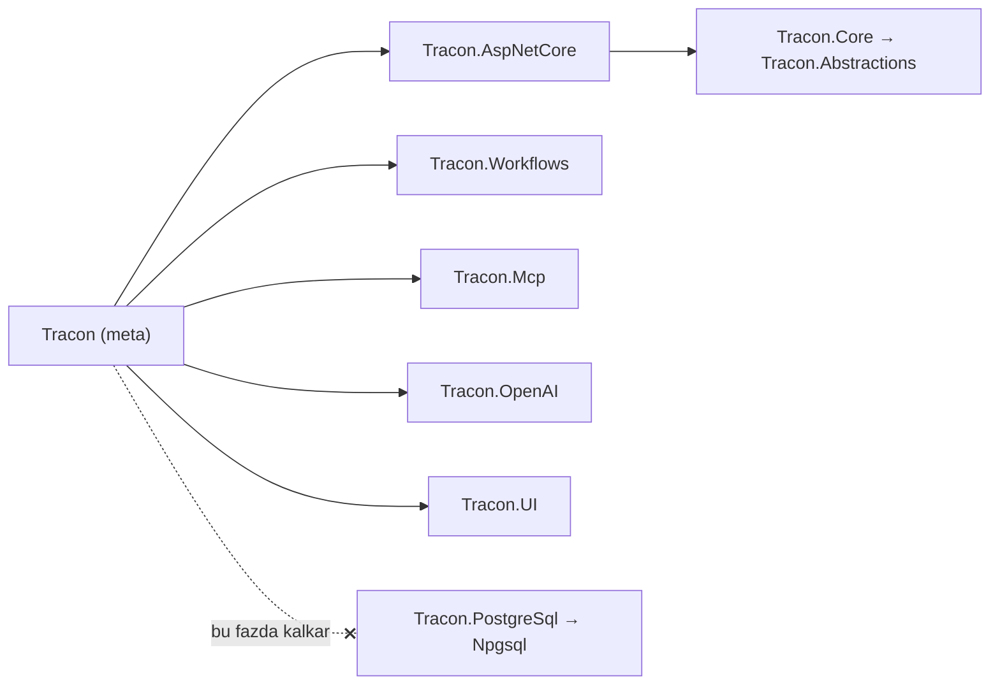

# Faz 256 — Meta Paketten Deponun Ayrılması

> **Durum:** ✅ Tamamlandı (2026-10-28)
> **Kademe:** tam — geri dönüşü pahalı karar (meta paketin bileşimi `rc.1`'de kilitlenir; K-185 yerine yeni karar) · yayınlanmış preview'a göre kırıcı (`Tracon` tek başına artık `UsePostgreSql` getirmez; tüketicide `CS1061`)
> **Plan onayı:** onaylandı (2026-10-28, kullanıcı: "fazı geliştir"). Bileşim kararı 👤 2026-10-28 (farukatasoy): "yalnız depo çıkar" (meta = `AspNetCore` + `Mcp` + `OpenAI` + `UI` + `Workflows`)
> **Kaynak:** [RC-KALITE-DALGALARI.md](RC-KALITE-DALGALARI.md) Q-14 · **F-748** (meta paket PostgreSQL kullanmayan tüketiciye Npgsql taşır)
> **Genellik:** PostgreSQL kullanmayan her tüketici: SQL Server, SQLite ve bellek deposu. Şablonun varsayılan çıktısı da bu sınıftadır (`--persistence memory`, `template.json:36`). İş tüketici kodunda kalamaz: bir meta paketin geçişli bağımlılığı tüketici tarafından çıkarılamaz; tek yol meta paketi bırakmaktır ve o zaman meta paket bu sınıf için değersizdir. İkinci kanıt: Tracon'un kendi tasarım kuralı ("PostgreSQL kullanmayan tüketici `Npgsql`'i çekmez", `MT-PKG-030`) meta paketin kendisi tarafından çiğneniyor.
> **Karşı görüş:** "Tek paketle başlamak kolaydır; depo seçimi bir adım ekler." **Cevap:** gerçek, ama adım yalnız PostgreSQL kullanana eklenir ve tek satırdır (`dotnet add package Tracon.PostgreSql`). Şablon bu satırı `--persistence postgres` seçiminde kendisi yazar. Bellek deposu `Tracon.Core`'dadır; `Tracon` tek başına yine agent koşturur. Sağlayıcı (`Tracon.OpenAI`) meta pakette kalır, çünkü onu çıkarmanın üçüncü taraf kazancı ölçüldü ve küçük çıktı (§256.1).
> **Önkoşul:** Yok. RC Dalga 0 kapandı; Q-10 Faz 255'te kapandı. Faz 193 (`net8.0`/`net9.0` düşer, en erken 2026-11-10) `src/Tracon/Tracon.csproj` ve `CHANGELOG.md`'yi paylaşır — **paralel koşmaz**.
> **Paketler:** `Tracon` (meta) · `Tracon.Templates` (şablon içeriği) — kod paketi değişmez
> **Yeni paket:** Yok · **Migration:** Yok
> **Public API:** Büyümüyor. Meta paket derleme çıktısı taşımaz (`IncludeBuildOutput=false`). `PublicAPI.Shipped.txt` bugün **0** satırdır (`find src -name PublicAPI.Shipped.txt -exec cat {} + | grep -vcE '^\s*$|^#'` → `0`). Kırıcılık API'de değil, paket grafındadır: `Tracon`'a güvenen tüketici `TraconPostgreSqlBuilderExtensions`'ı kaybeder. `rc.1`'den önce serbesttir (UR-012 B), sürüm notunda adıyla anılır.
> **Tüketici yüzeyi:** site: `packages.md:3,7,26-41,43-49` · `reference/compatibility.md:75` (Meta `Yes` → `No`) · `llms-full.txt` (üretilir) — sevk edilen: `src/Tracon/Tracon.csproj:4` (`<Description>`) · `src/Tracon/README.md:6-8,16-17,46,55-57` · kök `README.md:177,228` · şablon `Tracon.Starter.csproj` · `CHANGELOG.md` `[Unreleased]` → *Upgrading from 1.0.0-preview.6*
> **Manuel test alanı:** [`01-KURULUM-VE-PAKETLEME.md`](manuel-test/01-KURULUM-VE-PAKETLEME.md) (`MT-PKG-030`) · [`24-TEST-PAKETI-VE-SABLON.md`](manuel-test/24-TEST-PAKETI-VE-SABLON.md) (`MT-TEST-008`, `:205` notu) — iki case güncellenir; yeni case yok

---

## Bu Faza Başlarken

> `faz-baslangic` skill'ini uygula. Aşağıdaki liste o skill'in 2. adımıdır —
> **tamamını değil, yalnız işaret edilen bölümleri oku.**

1. Bu doküman.
2. Kararlar — dosyanın tamamını **okuma**:
   ```bash
   grep -n "K-001 —\|K-185 —\|K-209 —\|K-007 —\|K-602 —\|K-283 —" docs/KARARLAR.md
   grep -n "^### K-185\|^### K-209" docs/arsiv/KARARLAR-GECMISI.md   # tam gerekçe
   grep -n "UR-012" docs/YAYIN-HAZIRLIK.md
   ```
   **K-001** (modüler aile + meta paket) · **K-185** (meta `SqlServer` içermez; bu fazda yerini yeni karar alır) · **K-209** (meta Anthropic ve Google içermez; **değişmez**) · **K-007** (yeni bağımlılık gerekçesi) · **K-602** (tek sürüm hattı: Tracon kardeşleri birbirine tam sürümle bağlıdır) · **K-283** (bir davranışı düzeltmek çağıranı sessizce değiştirir) · **UR-012 B** (`rc.1`'e kadar kırıcılık ölçüt değildir).
3. Önceki fazdan devir: yok. Faz 255'in devri bu fazı ilgilendirmez.
4. Alan hafızası: [`hafiza/paketleme-ve-dagitim.md`](hafiza/paketleme-ve-dagitim.md) (meta paket, `buildTransitive/`, şablon, yerel feed) · [`hafiza/yayin-ve-surumleme.md`](hafiza/yayin-ve-surumleme.md) (kırıcı not, repo dışı tüketici).
5. Test seviyesi: [`.agents/ortak/test-seviyeleri.md`](../.agents/ortak/test-seviyeleri.md) § *paket*. Bu fazın her davranışı **paket** sınırını geçer.

---

## Amaç

`Tracon` meta paketi bugün `Tracon.PostgreSql`'i, onunla birlikte Npgsql'i her
tüketiciye taşır. SQL Server, SQLite ya da bellek deposu seçen tüketici bu
sürücüyü kullanmaz ama grafından çıkaramaz. Bu faz depoyu meta paketten çıkarır.
Meta paket depo seçmeyen kontrol düzlemi olur; depo her zaman açık bir
referanstır. Kazanan: PostgreSQL kullanmayan her tüketici ve şablonun varsayılan
çıktısı. PostgreSQL kullanan tüketici bir satır ekler.

- **F-748** — `Tracon` meta paketi `Tracon.PostgreSql`'e referans vermez; şablon, örnekler, kapılar ve sevk edilen metin bu bileşime göre düzelir.

### Bugün ne çalışmıyor — doğrulanmış kanıt

| Kanıt | Gözlem |
|---|---|
| [`src/Tracon/Tracon.csproj:29`](../src/Tracon/Tracon.csproj) | Meta paket `Tracon.PostgreSql`'e `ProjectReference` verir |
| [`src/Tracon.PostgreSql/Tracon.PostgreSql.csproj:13`](../src/Tracon.PostgreSql/Tracon.PostgreSql.csproj) | `Tracon.PostgreSql` Npgsql'e bağlıdır |
| Probe: `Tracon` + `Tracon.SqlServer` (`1.0.0-preview.6`, nuget.org) | Graf Npgsql'i içerir (46 üçüncü taraf paketi) |
| [`Tracon.Starter.csproj:35-50`](../src/Tracon.Templates/content/Tracon.Starter/Tracon.Starter.csproj) · [`template.json:36`](../src/Tracon.Templates/content/Tracon.Starter/.template.config/template.json) | Şablon her seçimde `Tracon`'u referanslar; varsayılan depo `memory`'dir. Varsayılan çıktı Npgsql taşır ama hiç kullanmaz |
| [`tests/Tracon.Package.Tests/TemplateInstantiationTests.cs:40,57`](../tests/Tracon.Package.Tests/TemplateInstantiationTests.cs) | Şablon derleme testi iki birleşimi koşar (`memory`, `sqlserver`); `postgres` birleşimi **hiç** derlenmez. Bugün gerekmiyordu, çünkü PostgreSQL meta paketten geliyordu |
| [`docs/manuel-test/01-KURULUM-VE-PAKETLEME.md:793`](manuel-test/01-KURULUM-VE-PAKETLEME.md) | `MT-PKG-030` tasarım kuralını yazar ("PostgreSQL kullanmayan tüketici `Npgsql`'i çekmez"), beklenen sonucu ise `Tracon.PostgreSql`'i meta bağımlılığı sayar — case kendi kuralıyla çelişir |

> Kanıtlar 2026-10-28 tarihinde HEAD `5d615e0e` üstünde doğrulandı. Probe
> projeleri nuget.org'daki `1.0.0-preview.6` ile `dotnet list package
> --include-transitive` koştu; bileşim HEAD'de aynıdır (`Tracon.csproj`
> Faz 255'te değişmedi).

---

## 256.1 — Yeni bileşim ve ölçülen graf

Meta paketin referansları beşe iner:



**Ölçülen graf** (probe, `1.0.0-preview.6`, `net10.0`; yalnız paket kimliği):

| Tüketici biçimi | Toplam | Üçüncü taraf | Not |
|---|---:|---:|---|
| `Tracon` | 39 | 30 | Bugünkü meta |
| `AspNetCore` + `UI` + `Workflows` + `Mcp` + `OpenAI` | 36 | 29 | **Bu fazın meta'sı**. Farkı yalnız `Npgsql`, `Tracon.PostgreSql`, `Tracon` |
| `AspNetCore` + `UI` | 32 | 28 | Depo ve sağlayıcı da çıksaydı |
| `AspNetCore` | 31 | 28 | OpenAI SDK, MCP ve MAF Workflows **zaten burada** |
| `Tracon` + `Tracon.SqlServer` | 56 | 46 | Bugün Npgsql içerir |

Seçilmeyen iki seçenek ve ölçülen nedeni:

- **Depo ve sağlayıcı birlikte çıkar.** Ek kazanç yalnız `Tracon.OpenAI` ve
  `Microsoft.Agents.AI.OpenAI`'dir. OpenAI SDK `Tracon.AspNetCore`'un
  `Microsoft.Agents.AI.Hosting.OpenAI` bağımlılığı üzerinden grafta kalır
  (`src/Tracon.AspNetCore/Tracon.AspNetCore.csproj:74`). Bedeli: her tüketici bir
  satır daha ekler ve `Tracon` tek başına agent koşturamaz.
- **Depo başına meta paket.** 21 → 23 paket (her biri `yeni-paket.md` kontrol
  listesi). Şablonun varsayılanı olan bellek deposu için yine depo içermeyen bir
  meta gerekir; yoksa varsayılan çıktı Npgsql taşımaya devam eder.

**Lib boyutu (ölçüldü, `lib/net10.0`).** PostgreSQL kullanmayan tüketicinin
grafından çıkan: Npgsql 10.0.3 **2,1 MB** + `Tracon.PostgreSql` **1,6 MB**.

**K-209 değişmez.** Meta paket yine Anthropic, Google ve Azure içermez.
**K-185'in yerini yeni karar alır** (§256.5).

## 256.2 — Repo içi tüketiciler

Meta paketten PostgreSQL alan her repo içi proje açık referans alır. Liste
ölçüldü (`grep -rln "Tracon/Tracon.csproj" --include='*.csproj' .` ve
`Include="Tracon"` taraması):

| Proje | Bugün | Bu fazda |
|---|---|---|
| [`samples/Tracon.Api/Tracon.Api.csproj:17`](../samples/Tracon.Api/Tracon.Api.csproj) | Meta + `SqlServer` + `Sqlite`; `UsePostgreSql` çağırır (`Program.cs:1699`) | `../../src/Tracon.PostgreSql/Tracon.PostgreSql.csproj` `ProjectReference` eklenir |
| [`samples/Tracon.Embedded/Tracon.Embedded.csproj:8`](../samples/Tracon.Embedded/Tracon.Embedded.csproj) | Meta; PostgreSQL API'si kullanır | Aynı ekleme |
| [`bench/capacity/Tracon.CapacityHost/Tracon.CapacityHost.csproj:31`](../bench/capacity/Tracon.CapacityHost/Tracon.CapacityHost.csproj) | `PackageReference Include="Tracon"`; `UsePostgreSql` çağırır | `<PackageReference Include="Tracon.PostgreSql" Version="$(TraconCapacityPackageVersion)" />` |
| Yedi `samples/Tracon.Samples.*` projesi (altı test projesi ve `ExtensionAotSmoke`) | Meta; PostgreSQL ya da OpenAI API'si **kullanmaz** (ölçüldü) | Değişmez |
| `tests/Tracon.Package.Tests/Infrastructure/*ConsumerProject.cs`, `SurfaceProbeProject.cs`, `LocalReferenceTests.cs:391` | Meta; üretilen program PostgreSQL çağırmaz | Değişmez |

🚨 **Kapasite host'u kapanış kapısında derlenmez.** Yalnız `scripts/capacity.py`
`prepare_consumer` (`:326-370`) onu paketlenmiş feed'e karşı derler. Referans
unutulursa kapı yeşil kalır ve kırılma ilk kapasite ölçümünde çıkar. DoD bu yüzden
ayrı bir derleme komutu ister (§Doğrulama komutları).

`samples/Tracon.Api`'nin OpenAPI XML hedefi (`TraconRemoveDuplicateSqlXmlDocs`)
PostgreSQL XML'ini kanonik tutar ve `ReferenceSourceTarget == 'ProjectReference'`
koşuluna dayanır. Doğrudan `ProjectReference` bu koşulu korur;
`OpenApiSharedSqlXmlDocTests` bunu zaten yakalar.

## 256.3 — Şablon

`Tracon.Starter.csproj` öteki depolar gibi PostgreSQL için koşullu referans alır:

```xml
<!--#if (UsePostgres) -->
    <PackageReference Include="Tracon.PostgreSql" Version="TRACON_TEMPLATE_PACKAGE_VERSION" />
<!--#endif -->
```

`Program.cs`'in `#if (UsePostgres)` bloğu değişmez. Sağlayıcı satırları değişmez
(`openai` meta paketten gelir). Şablonun `README.md`'si ve `WRITE_MODEL_NAME_HERE`
bu fazın işi değildir — Q-11'dir (§Kapsam dışı).

## 256.4 — Kapılar

Üç kapı bileşimi kilitler. Biri yeterli değildir: mimari test proje grafını görür
ama paket grafını görmez; taban dosyası paket grafını görür ama "neden" demez.

1. **Mimari (birim, her kapıda).** `DependencyDirectionTests.AllowedReferences`
   (`tests/Tracon.Core.UnitTests/Architecture/DependencyDirectionTests.cs:83`)
   `["Tracon"]` satırından `Tracon.PostgreSql` çıkar. `:15-17`'deki yorum çizimi
   düzelir. Yeni test: `The_meta_package_reaches_no_storage_package` — meta
   paketin geçişli Tracon kapanışında `Tracon.PostgreSql`, `Tracon.SqlServer` ve
   `Tracon.Sqlite` yoktur. Desen: `The_AGUI_sdk_is_taken_only_by_the_AGUI_package…`
   (`:197`). Mesaj K numarasını ve "depo açık referanstır" kuralını yazar.
2. **Paket grafı tabanı (paket).** `Baselines/transitive-dependencies.txt`'in
   `# Tracon` bölümünden (`:6`) **yalnız** `Npgsql` (`:69`) ve `Tracon.PostgreSql`
   satırları silinir. Başka satır değişirse plan dışıdır — dur ve ölç. Dosya başına
   tarihli bir açıklama satırı eklenir (emsal: `:4`, Faz 214).
3. **Şablon çıktısı (paket).** `TemplateInstantiationTests`:
   - `Most_minimal_combination…` (`memory`) ve `Most_full_combination…`
     (`sqlserver`) derlemeden sonra `obj/project.assets.json`'un `libraries`
     bölümünde `Npgsql/` anahtarı **yoktur**. Bu, RC Dalga 1 çıkış kapısının
     "SQL Server tüketicisinin paket grafında Npgsql yok (paket probu)" maddesidir.
   - Yeni: `Postgres_combination_compiles_with_zero_warnings` —
     `--persistence postgres --provider anthropic --ui true`. Derlenir, sıfır uyarı,
     `project.assets.json` `Npgsql/` **içerir**. `anthropic` bilinçli seçildi:
     meta dışı bir sağlayıcıyla birlikte PostgreSQL referansının şablondan geldiğini
     kanıtlar.

`TemplateRunTests` (`memory`, `--ui false`) değişmez ama ilk kez PostgreSQL
derlemesi olmadan bir host'u başlatır. Gizli bir tür yükleme bağımlılığı varsa
orada düşer. `PackageFamilyAlignment` (`src/Tracon.Core/Diagnostics/PackageFamilyAlignment.cs:70`)
yalnız yüklenmiş derlemeleri okur; eksik `Tracon.PostgreSql` onu etkilemez (kod
okundu, test zaten koşar).

## 256.5 — Karar, sürüm notu ve sevk edilen metin

**Karar.** Kapanışta `docs/KARARLAR.md`'ye yeni bir `K-*` girer
*(kategori: public-api, geri-dönüşü-pahalı)*: "`Tracon` meta paketi depo
içermez; depo her zaman açık referanstır". `Alternatif:` satırı iki seçeneği adıyla
anar: depo ve sağlayıcıyı birlikte çıkarmak (ölçülen kazanç iki paket) ve depo
başına meta paket (bellek varsayılanını çözmez). K-185 satırına
`*(yerini aldı: <tarih>, K-<yeni>)*` notu düşer. Numara uygulama anında alınır.

**Sürüm notu.** `CHANGELOG.md` → `[Unreleased]` → *Upgrading from
1.0.0-preview.6* başına bir madde. Taslak (İngilizce, sevk edilen metin):

> **The `Tracon` package no longer brings PostgreSQL.** It now carries the HTTP
> API, workflows, MCP, the OpenAI provider, and the console, and no storage engine,
> so a host on SQL Server, SQLite, or the in-memory stores no longer takes Npgsql.
> A host that calls `UsePostgreSql` and references only `Tracon` fails to build
> (`CS1061`: `ITraconBuilder` does not contain a definition for `UsePostgreSql`).
> Add the package: `dotnet add package Tracon.PostgreSql --prerelease`. A project
> generated with `--persistence postgres` from the new template already references it.

**Sevk edilen metin.** Her satır "meta paket PostgreSQL getirir" iddiasını
kaldırır ve PostgreSQL'i "Not in the meta package" sınıfına taşır:

| Yer | Değişiklik |
|---|---|
| `src/Tracon/Tracon.csproj:4` `<Description>` | "with PostgreSQL support" ve "PostgreSQL persistence" kalkar; "storage engines are separate packages" kalır |
| `src/Tracon/README.md:6-8` | Ortak set listesinden PostgreSQL kalkar |
| `src/Tracon/README.md:10-17` | Kurulum bloğuna `dotnet add package Tracon.PostgreSql --prerelease` girer; örnek kod `UsePostgreSql` ile kalır |
| `src/Tracon/README.md:46` | Tablo satırı kalkar |
| `src/Tracon/README.md:55-57` | "swap … in for PostgreSQL" cümlesi "choose `Tracon.PostgreSql`, `.SqlServer` or `.Sqlite`" olur |
| `README.md:177` | `Tracon.PostgreSql` satırına **Not in the meta package** girer |
| `README.md:228` | Kurulum bloğuna `Tracon.PostgreSql` satırı girer. `:32-44`'teki "Two lines" örneği ve cümlesi **dokunulmaz** (Q-11) |
| `docs-site/…/packages.md:3,7,26-41` | Meta tablosundan `Tracon.PostgreSql` kalkar; "eight packages counting the two that come transitively" → yedi |
| `docs-site/…/packages.md:43-49` | "Not in the meta package" tablosuna `Tracon.PostgreSql` girer: "Durable storage on PostgreSQL, and the only built-in vector-search store (knowledge search)". `Tracon.SqlServer` satırı "instead of PostgreSQL" demeyi bırakır |
| `docs-site/…/reference/compatibility.md:75` | Meta sütunu `Yes` → `No` |
| `docs/MIMARI.md:24` | "Meta pakete dâhil olmayanlar" listesine `PostgreSql` girer, K numarası değişir |
| `docs/manuel-test/01…:784-818` `MT-PKG-030` | Başlık "beş bileşen"; beklenen listeden `Tracon.PostgreSql` çıkar, "görünmez" listesine girer. ➜ CI (`TransitiveDependencyTests`, mimari test) |
| `docs/manuel-test/24…:400-440` `MT-TEST-008` | Ters çevrilir: `postgres` seçimi `Tracon.PostgreSql` satırı **ekler**; `openai` eklemez. ➜ CI (`Postgres_combination…`) |
| `docs/manuel-test/24…:205` | "ikisi de meta pakete dahil DEĞİL (postgres/openai aksine)" → yalnız `openai` aksine |

Envanterin tamamı `tuketici-dokuman-senkronu` ile kapanışta yeniden çıkarılır.
Bu tablo başlangıçtır, sınır değildir.

---

## Planlanan Public API

Yok. Meta paket derleme çıktısı taşımaz. Hiçbir `PublicAPI.*.txt` dosyası
değişmez.

### HTTP `endpoint`'leri

Yok.

### Arayüz payı

Yok.

---

## Planlanan Dosya Listesi

```
src/Tracon/
├── Tracon.csproj                     # ProjectReference ve Description
└── README.md
src/Tracon.Templates/content/Tracon.Starter/
└── Tracon.Starter.csproj             # #if (UsePostgres) referansı
samples/Tracon.Api/Tracon.Api.csproj
samples/Tracon.Embedded/Tracon.Embedded.csproj
bench/capacity/Tracon.CapacityHost/Tracon.CapacityHost.csproj
tests/Tracon.Core.UnitTests/Architecture/DependencyDirectionTests.cs
tests/Tracon.Package.Tests/
├── Baselines/transitive-dependencies.txt
└── TemplateInstantiationTests.cs
README.md
CHANGELOG.md
docs-site/src/content/docs/packages.md
docs-site/src/content/docs/reference/compatibility.md
docs/MIMARI.md
docs/manuel-test/01-KURULUM-VE-PAKETLEME.md
docs/manuel-test/24-TEST-PAKETI-VE-SABLON.md
```

---

## Hata Modları ve Testler

> Davranışların hepsi **paket** sınırını geçer. Birim seviyesi yalnız proje
> grafını kilitler; paket grafını kanıtlamaz.

| Ne bozulabilir | Seviye | Test sınıfı |
|---|---|---|
| Meta pakete bir depo paketi geri eklenir (doğrudan ya da geçişli) | Birim (mimari) | `DependencyDirectionTests.The_meta_package_reaches_no_storage_package` |
| Meta grafı Npgsql dışında bir şey daha kaybeder ya da kazanır (ör. `ProjectReference` yanlış satırdan silinir) | Paket | `TransitiveDependencyTests` — taban farkı yalnız iki satır |
| Şablonun `memory` ve `sqlserver` çıktısı hâlâ Npgsql taşır | Paket | `TemplateInstantiationTests` — `project.assets.json` iddiası |
| Şablonun `postgres` çıktısı derlenmez (`CS1061`, referans eksik) | Paket | `TemplateInstantiationTests.Postgres_combination_compiles_with_zero_warnings` |
| PostgreSQL derlemesi olmadan host başlamaz (gizli tür yükleme bağımlılığı) | Paket (çalıştırma) | `TemplateRunTests` (mevcut; ilk kez PostgreSQL'siz koşar) |
| Örnek uygulama ya da gömülü örnek derlenmez | Derleme | Kapı `derleme` adımı |
| Kapasite host'u sessizce kırılır (kapıda derlenmez) | Paket (elle komut) | §Doğrulama komutları — kapasite tüketicisi derlemesi |
| Örneğin OpenAPI belgesi PostgreSQL XML'ini kaybeder ya da çift sayar | Fonksiyonel | `OpenApiSharedSqlXmlDocTests` (mevcut) |
| Analyzer ve üreteç meta paket üzerinden akmayı bırakır | Paket | `LocalReferenceTests` (mevcut; meta tüketicisi) |
| Sürüm notu ya da sevk edilen metin "meta PostgreSQL getirir" demeye devam eder | Site kapısı + grep | DoD grep satırı |

Beş soru: **iptal**, **eşzamanlılık** ve **başka kiracı** uygulanmaz — faz
çalışma anı kod yolu eklemez, yalnız paket bileşimini değiştirir. **Boş/aşırı
girdi** şablon seçeneklerinde ölçülür (`memory`, `sqlserver`, `postgres`).
**Alt sistem hatası**: PostgreSQL derlemesi yokken başlangıç (`TemplateRunTests`).

---

## Manuel Kabul Case'leri

Yeni kabul case'i yok. Davranışın tamamı kodla tekrarlanır (paket grafı, şablon
derlemesi, host başlangıcı). `MT-PKG-030` ve `MT-TEST-008` yeni bileşime göre
güncellenir ve otomatik teste işaret eder (`➜ CI`); `docs/manuel-test/00-INDEKS.md`
sayaç satırı aynı değişiklikte düzelir.

---

## Kapsam dışı

| Kalem | Neden |
|---|---|
| Sağlayıcıyı meta paketten çıkarmak | 👤 2026-10-28 seçilmedi; ölçülen kazanç iki paket (§256.1) |
| OpenAI SDK'nın `Tracon.AspNetCore` grafından çıkması | Kaynağı `Microsoft.Agents.AI.Hosting.OpenAI`'dir (K-008 yalnız orada izin verir) ve OpenAI uyumlu uçları taşır. Ayrı bir tasarım sorusudur; bu faz onu açmaz |
| `WRITE_MODEL_NAME_HERE`, `first-agent.md`, tek anahtar biçimi, README "Two lines" cümlesi, adım sayısı kapısı | Q-11. Bu fazdan sonra açılır; bu faz yalnız paket satırlarına dokunur |
| Şablonda `--ui false` iken `Tracon.UI`'nin grafta kalması | Açık Soru 1 |

---

## Açık Sorular

| # | Soru | Seçenekler | Öneri |
|---|---|---|---|
| 1 | Şablon `--ui false` iken meta paketi mi referanslasın? | A: evet, bugünkü gibi; `Tracon.UI` grafta kalır, yalnız `UseUI()` satırı düşer · B: `ui=false` iken meta yerine `AspNetCore` + `Workflows` + `Mcp` + `OpenAI` | **A.** Ölçüldü: `Tracon.UI` üçüncü taraf paketi getirmez (`AspNetCore`+`UI` − `AspNetCore` = yalnız `Tracon.UI`, `lib/net10.0` 240 KB). B şablona dört koşullu satır ekler ve meta paketi ilk temas yolundan çıkarır. Bu fazın konusu depo sürücüsüdür |

---

## Bitiş Ölçütleri (DoD)

- [x] `grep -c "Tracon.PostgreSql" src/Tracon/Tracon.csproj` → `0` (ölçüldü)
- [x] `TransitiveDependencyTests` yeşil; `git diff` tabanın `# Tracon` bölümünden yalnız `Npgsql` ve `Tracon.PostgreSql` satırlarının silindiğini gösterir (artı tarihli bir açıklama satırı)
- [x] `DependencyDirectionTests.The_meta_package_reaches_no_storage_package` yeşil; meta'ya `Tracon.PostgreSql` geri eklenince kırmızı. Denendi: meta csproj değişmeden önce `DependencyDirectionTests` 8 testten 2'si düştü (`Each_package_references_only_allowed_packages` ve yeni test; mesaj `'Tracon.PostgreSql' is in the closure of the 'Tracon' meta package…`), csproj değişince 8/8 yeşil
- [x] `TemplateInstantiationTests`: `memory` ve `sqlserver` çıktısında `Npgsql/` yok; `postgres` çıktısı sıfır uyarıyla derlenir ve `Npgsql/` içerir. Şablondan `Tracon.PostgreSql` satırı çıkarılınca `Postgres_combination…` `CS1061` ile düştü (`'ITraconBuilder' does not contain a definition for 'UsePostgreSql'`), satır geri konunca yeşil
- [x] `TemplateRunTests` yeşil (PostgreSQL derlemesi olmadan host başlar)
- [x] Kapasite host'u paketlenmiş feed'e karşı derlenir. Çıktı: repo dışı kopya + yerel feed (`1.0.0-preview.6.34`), `Tracon.CapacityHost -> …/bin/Release/net10.0/Tracon.CapacityHost.dll`, `Build succeeded. 0 Warning(s) 0 Error(s)`. Referans satırı yokken `CS1061` verirdi (aynı mekanizma, ayrıca koşulmadı)
- [x] `CHANGELOG.md` *Upgrading from 1.0.0-preview.6* maddesi `CS1061`'i ve düzeltme komutunu adıyla yazar
- [x] Sevk edilen metin ve site taraması boş döner (komut aşağıda; deseni Sapma 6 düzeltti)
- [x] Yeni `K-*` kaydı (K-1116) `Alternatif:` ile yazıldı; K-185 satırında `yerini aldı` notu var; `RC-KALITE-DALGALARI.md` Q-14 `✅ Faz 256`
- [x] Dört doğrulama kapısı sıfır uyarı verir: `python3 scripts/kapi.py kapanis --taban 5d615e0e` çıkış 0, 30 108 test, 0 düştü (üçüncü koşum; ilki `ConsumerSurfaceTests`'te düştü, ikincisi bütçe denetiminde — Sapma 8 ve denetim tablosu)
- [x] `samples/Tracon.Api` ile gerçek `run` yapıldı (tek kullanımlık `pgvector/pgvector:pg18` container'ı, 127.0.0.1:55433; kapatıldı ve silindi). `GET /tracon/api/meta` → `storage.persistent: true`, `runStore: SqlRunStore`; `GET /api/diagnostics` → `persistenceProvider: PostgreSQL`, `canConnect: true`, `migrationsUpToDate: true`, `pendingMigrations: []`; `POST /api/agents/f256-probe/run` (echo) iki kez SSE ile döndü ve `runs` tablosunda iki satır (`status` 1) oluştu
- [x] `secret` taraması boş döndü (`kapi.py tarama`: temiz; bağlantı parolası yalnız ortam değişkeniyle verildi, dosyaya yazılmadı)
- [x] `MT-PKG-030` ve `MT-TEST-008` güncellendi (`➜ CI`); yeni kabul case'i yok. Denetim iki case daha buldu ve düzeltti: `MT-PKG-073`, `MT-TEST-061`
- [x] `faz-denetim` koşuldu; 🔴 bulgu yoktu, 🟡 üçü kapandı (Denetim Bulguları)
- [x] `docs-site/` güncellendi; `npm run check` (içerik, derleme, bağlantı, ağırlık) temiz: 1054 sayfa, 187 376 iç referans, sıfır kırık

### Doğrulama komutları

```bash
# Meta paketin nuspec bağımlılıkları (pack sonrası) — beş Tracon paketi, Tracon.PostgreSql yok
V=$(dotnet msbuild src/Tracon/Tracon.csproj -t:MinVer -getProperty:PackageVersion -p:Configuration=Release -nologo)
unzip -p "artifacts/package/release/Tracon.$V.nupkg" Tracon.nuspec | grep -o 'dependency id="[^"]*"' | sort -u

# Paket ve şablon kapıları
python3 scripts/kapi.py test --proje Tracon.Package.Tests --sinif TransitiveDependencyTests
python3 scripts/kapi.py test --proje Tracon.Package.Tests --sinif TemplateInstantiationTests
python3 scripts/kapi.py test --proje Tracon.Package.Tests --sinif TemplateRunTests
python3 scripts/kapi.py test --proje Tracon.Core.UnitTests --sinif DependencyDirectionTests

# Kapasite host'u — capacity.py prepare_consumer (:326-370) ile aynı yol:
# repo dışı kopya, yerel feed, ayrı paket önbelleği (yerel sürüm global önbelleğe girmez)
R=$(git rev-parse --show-toplevel)
W=$(mktemp -d) && cp -R "$R/bench/capacity" "$W/capacity" && cd "$W/capacity"
cat > NuGet.config <<EOF
<configuration>
  <packageSources><clear />
    <add key="nuget.org" value="https://api.nuget.org/v3/index.json" />
    <add key="tracon-local" value="$R/artifacts/package/release" />
  </packageSources>
  <packageSourceMapping>
    <packageSource key="tracon-local"><package pattern="Tracon*" /></packageSource>
    <packageSource key="nuget.org"><package pattern="*" /></packageSource>
  </packageSourceMapping>
</configuration>
EOF
NUGET_PACKAGES="$W/packages" dotnet build Tracon.CapacityHost/Tracon.CapacityHost.csproj \
  -c Release -p:TraconCapacityPackageVersion="$V"

# Sevk edilen metin taraması — "meta PostgreSQL getirir" iddiası kalmamalı
# (düzeltildi: ilk desen tabanda da eşleşiyordu; üretilen api/ sayfaları dışarıda, desen iddiayı arar)
grep -rn -i "PostgreSQL persistence, the OpenAI\|with PostgreSQL support\|instead of PostgreSQL" \
  src/Tracon/ README.md docs-site/src/content/docs --exclude-dir=api --include='*.md' --include='*.mdx' --include='*.csproj'
```

---

## Riskler

| Risk | Önlem |
|------|-------|
| PostgreSQL kullanan tüketici yükseltmede `CS1061` alır; hata paketin adını söylemez | Sürüm notu hatayı ve tek satırlık düzeltmeyi adıyla yazar; `packages.md` PostgreSQL'i "Not in the meta package" tablosunda gösterir |
| Bilgi araması (vektör) yalnız PostgreSQL'dedir; meta paketle başlayan tüketici onu artık görmez | `packages.md` satırı "the only built-in vector-search store" der. Davranış değişmez: PostgreSQL'siz host'ta arama bugün de kapalıdır |
| Faz 193 ile çakışma (`Tracon.csproj`, `CHANGELOG.md`) | İki faz paralel koşmaz. Faz 193 en erken 2026-11-10'da başlar |
| Q-11 aynı dosyalara (kök `README.md`, şablon) dokunur | Bu faz yalnız paket satırlarını ve kurulum komutunu değiştirir. "Two lines" cümlesi ve `first-agent.md` Q-11'e kalır |
| Tabandaki bir satır sürüm yükseltmesiyle de değişir ve fark karışır | Taban kimlik karşılaştırır, sürüm değil (dosyanın kuralı). Fark iki satırdan büyükse dur ve ölç |
| Eski `.nupkg`'ler `artifacts/package/release/` altında durur ve probe yanlış sürümü okur | `TemplateFixture` sürümü MinVer'den alır (`TemplateFixture.cs:152-185`); elle komutlar da `V`'yi aynı yoldan alır |

---

<!-- ============================================================
     AŞAĞISI ÇALIŞIRKEN DOLAR — doküman kapanışta silinir (`faz-kapat`).
     Kalıcı kısım `faz-tamamlama` Adım 5'te yerine taşınır. Başlıkları SİLME.
     ============================================================ -->

## Plandan Sapmalar

> Çalışırken dolar. Plan ile gerçek arasındaki fark **gizlenmez**. Kapanışta
> kapanış commit mesajına taşınır.

1. **Karar numarası `K-1116`.** Plan numara rezerve etmez; uygulama anında en yüksek numara `K-1115` idi.
2. **Planın tablosunda olmayan iki yüzey.** `docs-site/…/getting-started/persistence.md` (`UsePostgreSql()` örneği
   kurulum satırı ve `CS1061` uyarısı olmadan duruyordu) ve kök `README.md:177` satırındaki "The only built-in
   vector-search store" cümlesi eklendi. İkisi de sevk edilen metindeki "meta paket PostgreSQL getirir" izlenimini
   kapatır; yeni iddia değildir (`compatibility.md` aynı cümleyi taşır).
3. **`CapacityPackageIsolationTests` değişmedi.** Plan onu anmadı; `Tracon.PostgreSql.dll` iddiasını koruyor çünkü
   kapasite host'u artık paketi açıkça alıyor (§256.2). Meta paketin kendisi hakkında bir iddia taşımaz.
4. **Örnek uygulama koşumu tek kullanımlık veritabanında yapıldı.** Paylaşılan `ap-pg` container'ına dokunulmadı
   (`elle-kosum-ortami.md`: `AutoApplyMigrations` orada migration uygular). `pgvector/pgvector:pg18` imajı ile
   yeni bir container açıldı, koşum sonrası silindi.
5. **Site senkronu: `proje-sablonu → getting-started/index.md` kuralı gerekçeyle geçildi.** Şablon değişikliği yalnız
   `--persistence postgres` seçiminde bir `PackageReference` satırı ekler. `getting-started/index.md` şablonun paket
   referanslarını anlatmaz (yalnız `net10.0` hedefini ve sürüm sabitlemesini söyler; ikisi de doğru). Değişikliği anlatan
   sayfalar güncellendi: `packages.md`, `getting-started/persistence.md`, `reference/compatibility.md`. `first-agent.md`
   Q-11'in işidir (§Kapsam dışı). `--site-gerekce-yazildi` ile geçildi.

**Tüketici yüzeyi envanteri.** `docs-site/`: `packages.md` · `getting-started/persistence.md` ·
`reference/compatibility.md` (elle) · `public/llms-full.txt` (üretildi). Sevk edilen metin: `src/Tracon/Tracon.csproj`
`<Description>` · `src/Tracon/README.md` · kök `README.md` · `CHANGELOG.md` (site `reference/changelog.md` ondan üretilir).
Agent haritası ve yerel referans: `capabilities.md` satırı gerekmedi (PostgreSQL satırı depo seçimini anlatır, meta
paketi anmaz); `Tracon.AgentMap.md` değişmedi. Kapılar: `ShippedDocumentationSelfContainmentTests` ·
`CapabilityExampleTests` · `SourceLanguageTests` (12/12) · `LocalReferenceTests` (10/10) · `npm run check` (içerik 1054
sayfa, bağlantı 187376 referans, sıfır kırık; ağırlık tavanı altında).

6. **DoD'deki sevk edilen metin taraması düzeltildi.** İlk desen (`PostgreSQL persistence` …) tabanda da eşleşiyordu:
   `capabilities.md:328` ve üretilen `api/` sayfaları paketin kendi işini anlatır, meta paketi anmaz. Sıfıra ulaşılamazdı.
   Desen iddianın kendisine daraltıldı (`PostgreSQL persistence, the OpenAI` · `with PostgreSQL support` · `instead of
   PostgreSQL`) ve `api/` dışarıda bırakıldı; sonuç sıfırdır. `capabilities.md:328` bilerek değişmedi: satır agent
   haritasına girer ve harita 11256 / 11264 B'tedir (F-714); F-749'a yazıldı.
7. **İki manuel case'in beklenen sonucu daha yanlış çıktı** (denetim 🟡-2): `MT-PKG-073` (`postgres` varyantı "yalnız
   `Tracon`") ve `MT-TEST-061` (meta paketin altı bileşeni). Plan tablosunda yoklardı; ikisi de düzeltildi.
8. **Kapanış kapısı gerçek bir regresyon yakaladı.** `ConsumerSurfaceTests.Internal_type_is_not_visible_to_a_package_consumer`
   (`MigrationRunner`) tam testte düştü, izole koşumda da düştü. Sebep: `MigrationRunner` depo paketlerinde `internal`'dır
   ve sonda yalnız `Tracon`'u referanslıyordu; meta paket depoyu getirmeyince tip grafta kalmadı, derleme `CS0122` yerine
   `CS0246` verdi. Plan bu testi anmamıştı; ben de paket testlerinden yalnız üç sınıfı koşmuştum. Düzeltme:
   `SurfaceProbeProject.WriteAsync` sahibi paketi (`owningPackage`) referanslar, `MigrationRunner` vakası
   `Tracon.PostgreSql` verir. Sınıf taraması: 30 108 testin başka hiçbiri düşmedi. Ders `hafiza/paketleme-ve-dagitim.md`'de.

## Bu Fazda Verilen Kararlar

> Çalışırken dolar. Dört kategoriden birine giren karar (AGENTS.md)
> `docs/KARARLAR.md`'ye K-NNN ve kategori etiketiyle girer; girmeyen karar
> kapanışta commit mesajına taşınır (`faz-tamamlama` Adım 8). Plan numara rezerve
> etmez.

- **K-1116** — `Tracon` meta paketi depo içermez; depo her zaman açık referanstır *(kategori: public-api,
  geri-dönüşü-pahalı, kullanıcı kararı)*. K-185'in yerini aldı. `docs/KARARLAR.md`'de.

## Süreç Ölçümü

> Kapanışta doldurulur. **Tablo olarak** — onay kutusu DEĞİL: `faz-kapat`
> işaretsiz kutuda durur. `faz-kapat` bu tabloyu `docs/FAZ-OLCUMLERI.md`'ye taşır;
> eşik **167**'den itibaren boş bir değer hücresinde kapanışı durdurur.
> `ölçülmedi` **geçerli bir değerdir** — kapı bir sayı değil, bir **karar** arar.
> Kapı bölümün VARLIĞINI denetler, doğruluğunu denetlemez (K-766).

| Metrik | Değer |
|---|---|
| Plan revizyonu sayısı | 0 (plan yeniden yazılmadı; 8 sapma kaydı) |
| Düzeltme turu sayısı | 3 (denetim bulguları · `ConsumerSurfaceTests` regresyonu · bütçe aşımı) |
| 🔴 bulgu: gerçek / gürültü / araştırılacak | 0 / 0 / 0 (🟡: 3 gerçek) |
| Fazın ürettiği regresyon | 1 (`ConsumerSurfaceTests` `MigrationRunner` vakası; kapanış kapısı yakaladı, kapanıştan önce düzeldi) |
| Faz kapandıktan sonra bulunan kusur | ölçülmedi (kapanış anı) |

## Denetim Bulguları

> `faz-denetim` çıktısı. Her satır: bulgu · seviye (🔴/🟡/🟢) · sonuç
> (düzeltildi / gerekçelendi / F-NN olarak devredildi). 🟢 kapanışta
> `ADAYLAR.md`'ye gider.

Denetçi taze bağlamlı `faz-denetcisi`; aralık `5d615e0e..b5de3141`. 🔴 yok.

| Bulgu | Seviye | Sonuç |
|---|---|---|
| DoD'deki sevk edilen metin taraması taban commit'te de eşleşiyordu, sıfır olamazdı | 🟡 | Düzeltildi: desen iddiaya daraltıldı, `api/` dışarıda (Sapma 6) |
| `MT-PKG-073` ve `MT-TEST-061` eski bileşimi yazıyordu | 🟡 | Düzeltildi (Sapma 7); `MT-PKG-073`'e `➜ CI` işareti eklendi |
| `proje-sablonu → getting-started/index.md` site kapısı kırmızı | 🟡 | Gerekçelendi ve `--site-gerekce-yazildi` ile geçildi (Sapma 5); denetçi koşumundan sonra yazıldı |
| `UsePostgreSql` kullanan README ve rehber örnekleri yalnız `Tracon` ile derlenmez; `README.md:174` "everything with one reference"; bilgi hata metinleri ve agent haritası paketi anmaz | 🟢 | Tek aday: F-749 |
