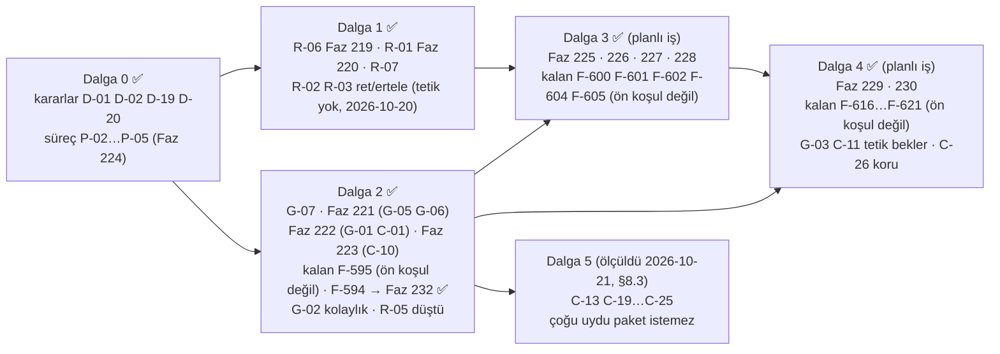

# MAF 1.25.0 — Yetenek Matrisi, Tracon Kapsaması ve Strateji

> **Ölçüm:** 2026-10-18 · **Sürüm:** `Microsoft.Agents.AI` **1.25.0** (NuGet hattında en yeni; 2026-10-18'de yeniden doğrulandı) · MEAI 10.11.0 · MCP 2.2.0 · VectorData 10.10.0. Tracon pin'i aynıdır (Faz 214).
> **Önceki sürüm:** 2026-10-17. Bu sürüm onun yerine geçer. Önceki sürümün hataları §0'dadır.
> **Yer:** 2026-10-19'a kadar `claudedocs/maf-1.25.0-yetenek-matrisi.md` idi; D-20 ile buraya taşındı. Her MAF sürümünde yeniden ölçülür (§10).
> **Dalga 1 ölçümü:** 2026-10-19. R-01…R-07'nin ölçüm şartları koşuldu; sonuçlar §6'da, düşen iddialar §0'da (#12–#16).
> **Dalga 2 ölçümü:** 2026-10-19. G-01…G-06, C-01, C-10 ve R-05 kod, derleme probu ve çalışma anı probu ile ölçüldü; sonuçlar §7.0'da, düşen iddialar §0'da (#18–#24).
> **Dalga 1–2 kapanış ölçümü:** 2026-10-20. Planlı kalem kalmadı (Faz 219–223, G-07). Kalan iki kapsam dilimi F-594 ve F-595 oldu; Dalga 3'ün ön koşulu değiller (F-594 için Dalga 3 ölçümüyle düştü: §0 #31). Ölçüm bir guard açığı buldu ve kapattı (§0 #25, K-1035). Tetiklerin hiçbiri ateşlenmedi: MAF 1.25.0, MEAI 10.11.0, MCP 2.2.0 ve OpenAI 2.14.0 NuGet'te en yeni sürümdür; dotnet/extensions#7863 açıktır.
> **Dalga 0 kapanışı:** 2026-10-20. D-01 = C (K-1036) ve D-19 = B (K-1037) 👤; P-04 `maf-api-kesfi` § *Dördüncü adım*; P-05 K-129 ve K-212 koşulları ölçülebilir; P-02 ve P-03 Faz 224 (`scripts/maf-kapsama.py`).
> **Dalga 3 ölçümü:** 2026-10-20. C-03, C-04, C-07, C-08, C-09, C-11, C-12 ve C-17 kod, `ilspycmd` ve gerçek host üzerinde çalışma anı probu ile ölçüldü (probe kalıcı değildir; kontrol: düz MAF agent'ı). Sonuçlar §8.0'da, düşen iddialar §0'da (#26–#34). C-03 ölçümü Handoff workflow'unun hiç devretmediğini buldu ve kapattı (#34, K-1039). Bir kusur sınıfı bulundu ve aynı gün kapandı: iki `Free` üye Tracon altında belgelendiği gibi çalışmaz (#26, #27), sınıf taraması üçüncüyü buldu (#33). Üçü `Protected` (K-1038).
> **Dalga 3 kapanışı ve Dalga 4 ölçümü:** 2026-10-21. Dalga 3'ün planlı işi kapandı (Faz 225–228). Kalan dilimler (F-594/F-600, F-601, F-602, F-604, F-605) adaydadır ve Dalga 4'ün ön koşulu değildir. Dalga 4 kod, `ilspycmd` ve gerçek host üzerinde üç çalışma anı probuyla ölçüldü (probe kalıcı değildir). Sonuçlar §8.2'de, düşen iddialar §0'da (#35–#40). Bir K0 bulundu: A2A çok turlu değildir (#35). Kararlar 👤 (2026-10-21): C-15 (a) tam faz, site A2A'yı tek turlu yazar · K-103 workflow adımı için açıldı (K-1051) · D-06 = koru · G-03 ve C-11 tetik bekler. Tetik yok: MAF 1.25.0, MEAI 10.11.0, MCP 2.2.0 ve OpenAI 2.14.0 NuGet'te en yenidir.
> **Dalga 4 kapanışı ve Dalga 5 ölçümü:** 2026-10-21. Dalga 4'ün planlı işi kapandı (Faz 229, 230). Kalan dilimler (F-616…F-621) adaydadır ve Dalga 5'in ön koşulu değildir. Dalga 5 kod, `ilspycmd`, gerçek host üzerinde dört çalışma anı probu (biri Docker ile) ve bir Native AOT yayın probuyla ölçüldü (probe kalıcı değildir). Sonuçlar §8.3'te, düşen iddialar §0'da (#41–#49). Bir kusur bulundu ve kapandı: MAF'ın onaya sardığı tool `AddTool` ile kaydedilince katalog "onay istemez" diyordu ve dış yüzey kapısı onu görmüyordu (#45); sınıfın ikinci üyesi (skill tool'ları) F-626'dır (#50). Magentic ölçüldü ve açıldı (#49, K-1060). MCP 2.3.0'a yükseltildi (#48). `any-maf-feature` rehberi shell, uzak agent ve Purview tariflerini aldı. MAF 1.25.0, MEAI 10.11.0 ve OpenAI 2.14.0 NuGet'te en yenidir.
> **Kitle:** Tracon bakımcısı ve faz planlayan oturumlar. Bu belge **plan girdisidir**, karar defteri değildir. Kararlar `K-*`'e, adaylar `ADAYLAR.md`'ye yalnız `aday-kesfi` ve `faz-planlama` ile girer.
> **Yöntem özeti:** 40/40 MAF paketi `MetadataLoadContext` ile okundu (1.166 tip, iç içe tipler ve üyeler dahil). Tracon tarafında 2.326 `.cs` dosyası jeton indeksine çevrildi. MAF 1.16.0 (Tracon'un ilk pin'i) ile karşılaştırıldı. Ayrıntı §12.

**Özet:** 144 yetenek satırı — ✅ 49 · 🟡 21 · ❌ 73 · ⛔ 1 (2026-10-21 sayımı, Faz 229 sonrası: A2A izolasyon satırı ❌ → 🟡; Dalga 4 ölçümü sonrası 🟡 20 · ❌ 74 idi; 2026-10-20 özeti 143 satır ve ✅ 47 · 🟡 19 · ❌ 76 diyordu, Faz 226 ve 227'den sonra sayılmamıştı — F-597; 2026-10-18 özeti ✅ 43 · 🟡 14 · ❌ 85 diyordu). MAF'ın 1.064 üst düzey public tipinin 231'i `src/`'de anılır (%22). En büyük bulgular: (1) değerlendirilmemiş her kalem MAF 1.16'da zaten vardı — takip açığı sürüm farkında değil, **başlangıç yüzeyindedir**; (2) her MAF özelliği için bir kaçış yolu vardır, ama yol **kayıplıdır** (fabrika agent'ı 12 model halkasını, BYOK'u, egress'i ve maliyeti kaybeder) ve **belgesizdir**; (3) 13 paralel uygulamanın 1'i hata (küçük), 1'i borçtur. Dalga 1 ölçümü (2026-10-19) iki "hata" hükmünü düşürdü ve Dalga 1'de kırıcı kalem bırakmadı (§6). Dalga 2 ölçümü (2026-10-19) kaçış yolunu sanılandan geniş buldu (özel `IAgentSource` BYOK ve maliyeti geri kazanır; `IAgentDecorator` agent middleware'ini bugün taşır), R-05'i düşürdü ve yakalanmamış bir K0 buldu: `TraconRunOptions` MAF'ın tool middleware'ini kırar (G-07, §7.0).

---

## 0. Güvenilirlik denetimi — önceki sürümde ne yanlıştı

| # | Önceki iddia | Ölçüm (2026-10-18) | Düzeltme |
|---|---|---|---|
| 1 | "40 paketin 32'si okundu; 8'i okunmadı" | 40/40 okundu: altı eski hat paketi ayrı probe ile, `Workflows.Generators` analyzer DLL'i, `ProjectTemplates` şablon | §4, §5.15 |
| 2 | "`ChatClientAgentRunOptions` ✅" | `src/`'de 0 kullanım. `TraconRunOptions : AgentRunOptions` | ❌ (§5.1) |
| 3 | "`AsAIFunction` ❌ — kendi kodu (`ChildAgentInvoker`)" | `ChildAgentInvoker` MAF'ın `BackgroundAgentsProvider`'ını sarar. `AsAIFunction` ayrı bir çağrı modudur. Paralel kod yok | kapsama açığı, kendi kodu değil |
| 4 | "Background responses ❌ — K-778" | K-778 Durable Task kararıdır. Asıl engel K-030 (`store=false`) | §5.1, D-09 |
| 5 | "`FunctionEvaluator` ✅", "`Delegate` loop evaluator ✅" | ikisi de yalnız testte (`src/` 0) | 🟡 |
| 6 | "❌ `ReflectingExecutor`, `[MessageHandler]` … aday" | `ReflectingExecutor`, `IMessageHandler`, `[StreamsMessage]`, `[YieldsMessage]`, `HandoffsWorkflowBuilder` 1.25'te `[Obsolete]` | ⛔ aday değil |
| 7 | "❌ `AddFanOutEdge`, `AddSwitch`, alt workflow … yok" | Tracon çağırmaz, ama tüketici `AddWorkflow(name, Func<IServiceProvider, Workflow>)` ile hepsini Tracon altında koşar | yeni "kapsama" sütunu ayırır (K1) |
| 8 | Satırlar tip odaklıydı | Önemli üyeler eksikti: mesaj enjeksiyonu, agent düzeyi tool middleware, hosted tool içerik kaydı, atıflar, MCP elicitation/sampling, `ChatToolMode`, `ChatOptions` alanları | eksik üyeler satır oldu; satırlar yetenek düzeyinde yeniden gruplandı |
| 9 | K-036 notu: "Chat Completions için public yazıcı yoktur" | MEAI.OpenAI `AsOpenAIChatCompletion` · `AsOpenAIStreamingChatCompletionUpdatesAsync` ve MAF.OpenAI `AgentResponse.AsOpenAIChatCompletion` vardır (OPENAI001) | R-03 |
| 10 | "Kayıt yok" satırları tarihsizdi | 1.16 yüzeyiyle karşılaştırıldı: değerlendirilmemiş kalemlerin hepsi 1.16.0'da vardı | §1.2 |
| 11 | — (yakalanmadı) | `MIMARI.md:252` ve K-019 "MAF köprüsü (öncelik 10)" der. Kodda yok: `AgentSourcePriority` yalnız `Code = 0`, `Database = 100` | R-07, D-06 |
| 12 | R-01: "Hata; ses yolu MEAI arayüzlerine geçer, kırıcı" | `ISpeechToTextClient`/`ITextToSpeechClient` 10.11'de hâlâ `MEAI001` (derleme probu); public imzaya giremez (GA ölçütü 5). MEAI sözleşmesi ses listesi, karakter sınırı, istek başına kiracı kimliği, hizalama, faturalı karakter ve diyalog taşımaz | Haklı; ekleyici köprü (§6) |
| 13 | R-02: "`OrderedFailoverChatClient`'tan türet" | `OrderedFailoverChatClient` `sealed`'dır. Yalnız soyut `FailoverChatClient` türetilebilir; o da `MEAI001` | Koru, ertele (§6) |
| 14 | R-03: "Hata; dönüştürücü + `ModelReaderWriter`" | Tel probu: akış dönüştürücüsü `FinishReason`'ı boş her chunk'a `finish_reason:"stop"` yazar; akışsız çıktı dört ek alan taşır ve `ToolCalls`'u K-992'ye aykırı eşler | Haklı, ret (§6) |
| 15 | R-04, R-05 Dalga 1'de | İkisinde de kırıcı ya da internal iş yok; değer ekleyici yüzeydedir | Dalga 2 (§6) |
| 16 | R-07: "MIMARI ve K-019" | K-003 de aynı kaymayı taşıyordu ("`AddAIAgent` ile kodda tanımlananlar katalogda görünür") | üçü düzeltildi |
| 17 | R-06: "builder'a geç" (tek adım) | Harness skill'i **kaynak** olarak alır (`HarnessAgentOptions.AgentSkillsSource`) ve provider'ı `options: null` ile kendisi kurar; builder yalnız provider üretir. Tek zincir için harness'ın yerleşik provider'ı kapanır, Tracon'unki `AIContextProviders`'a girer. Yan bulgu: harness bugün `AgentSkillsProviderOptions` alamaz (C-08) | Faz 219 planı (2026-10-19) |
| 18 | §1.1-4: "agent middleware'i yalnız fabrika agent'ıyla gelir" | Public `IAgentDecorator` derlenmiş agent'ı da sarar; içinde `agent.AsBuilder().Use(…)` (run middleware) ve `UseAIContextProviders(MessageAIContextProvider…)` çalışır, 12 halka korunur. Agent'a özgü seçim `descriptor.Name` ile yapılır. Kapalı olanlar: tool middleware (#23), tam `AIContextProvider` (tool ve talimat ekleyen), MAF seçenekleri | §7.0 · G-05 kapı listesi |
| 19 | G-02: "BYOK + egress ve maliyet bugün **hiçbir yolla** geri kazanılamaz" | Public `IAgentSource`'un `ResolveAsync`'i async'tir → `CreateChatClientAsync` BYOK ve egress uygular. Katalog dekoratöre descriptor'ı kaynağın `ListAsync`'inden verir (`CompositeAgentCatalog.cs:124-131`); `AgentDescriptor.Model` dolu ise maliyet hesaplanır. docs-site "Agent source" biçimini anlatır, kazanımı söylemez | G-02 "tek yol" değil "kolaylık" (§7.0) |
| 20 | G-01: "deneysel MAF tipi kancanın parametresinde görünür → D-01" | Derleme probu (MAF 1.25): `ChatClientAgentOptions`, `HarnessAgentOptions`, `HarnessAgent`, `TodoProvider`, `AIAgentBuilder.Use`, `AIAgent.CurrentRunContext` tip düzeyinde deneysel değil. Kontrol: `HarnessAgentOptions.MaxContextWindowTokens` MAAI001 verir. `uyum-probu deneysel` tip düzeyini sayar | D-01 G-01'in ön koşulu değil |
| 21 | §7.1: "DI'daki `AgentFileStore` öneksizdir → kiracılar arası sızıntı" | Yalnız bellek içi varsayılan (`InMemoryAgentFileStore`) öneksizdir. `SqlAgentFileStore` her sorguda `ITenantContext.TenantId` kullanır: kiracıya bağlıdır, agent'a bağlı değildir | §7.1 satırı düzeltildi. **Düzeltme (2026-10-21, §0 #52):** SQL deposu agent'a da bağlıdır |
| 22 | R-05: "run kimliğini options'a yaz; ekleyici yetenek" | `TraconRunContext.Current`/`CurrentRunId` ve `TraconRunOptions` zaten public. MAF-yerli kod `AIAgent.CurrentRunContext?.RunOptions as TraconRunOptions` ile okur. Ek anahtar Tracon'u bilen koda yeni şey vermez | düştü |
| 23 | — (yakalanmadı) | Çalışma anı probu: MAF fonksiyon middleware'i (`AIAgentBuilder.Use(…FunctionInvocationContext…)`) `options: null` ile çalışır, `TraconRunOptions` ile `NotSupportedException` atar. `ChatClientAgentRunOptions` `sealed`'dır. Tracon uçları hep `TraconRunOptions` geçer | G-07 ✅ (§7.0) |
| 24 | §1 ve C-10: "alt workflow hatası ve uyarısı kaydedilmez" | Faz 221 denetimi (`monodis --typedef`, MAF 1.25.0): `SubworkflowErrorEvent` `WorkflowErrorEvent`'ten, `SubworkflowWarningEvent` `WorkflowWarningEvent`'ten türer. `WorkflowEventMapper` deseni alt tipi yakalar → `ExecutorFailed` yazılır; `WorkflowRunner` run'ı `Failed` yapar. Kayıpta kalan: Magentic plan/ledger olayları ve tüketicinin kendi `WorkflowEvent`'i | C-10 kapsamı daralır |
| 25 | — (yakalanmadı) | Dalga 1–2 kapanış ölçümü (2026-10-20, decompile + çalışma anı): `AgentOptionsGuard` iki üyeyi `Free` sayıyordu. `UseProvidedChatClientAsIs` `ChatClientAgent`'ın varsayılan istemci yığınını (onay bağlaması, servis çağrısı başına geçmiş yazıcısı) atlar → sahte onay tool'u koşturdu, servis çağrısı başına kalıcılıkla kiracı geçmişi boş kaldı. `AllowConcurrentInvocation` Tracon'un FIC'ini bulup açar → tanımın `AllowConcurrentToolCalls = false`'u ezildi | ikisi `Protected` (K-1035); `AgentExtensionRunTests` |
| 26 | C-07, §5.1: "`EnableMessageInjection` uzantıyla açılır (K1)"; site ve XML örneği: *"Lets a caller inject a message into a running turn"* | Dalga 3 probu (gerçek host, 2026-10-20). Tracon'un FIC'i sağlanan istemcinin içindedir; MAF kendi FIC'ini eklemez ve `MessageInjectingChatClient` döngünün **üstüne** düşer. Tool turları arasında mesaj girmez. Akışlı run'da mesaj o run'a hiç girmez; sonraki turda yeni kullanıcı mesajının **arkasına** girer. Akışsız run'da son yanıttan sonra yalnız enjekte mesajla ek bir model çağrısı yapılır (geçmiş yok) ve ilk yanıt dönen yanıttan düşer. Kontrol (düz MAF agent'ı): mesaj ikinci model çağrısına girer | ✅ `kusur-giderme` (2026-10-20): `Protected` (K-1038); belge örneği provider ekler. Kapı: `AgentExtensionRunTests.An_extension_cannot_set_an_option_that_works_differently_under_Tracon` |
| 27 | K-1032, C-08: "`RequirePerServiceCallChatHistoryPersistence` serbesttir" | Aynı kök neden. Tool'un döngü içinde gördüğü kalıcı geçmiş: Tracon `0,0` (üye açık ya da kapalı); kontrol (düz MAF agent'ı, üye açık) `2,4`. Üye Tracon altında "servis çağrısı başına" değil "run başına" yazar | ✅ #26 ile aynı düzeltme; sohbet agent'ının seam'i kalktı (K-1032 yeniden açıldı) |
| 28 | C-09: "script'ler yine Tracon kapılarından geçer"; §5.3: "kodda sınıf skill'i yazan tüketici onu veremez (K0)" | `AgentClassSkill<T>` script'i C# metodudur (`AgentInlineSkillScript`, `MethodInfo`); Tracon'un kapıları (`SandboxedSkillScriptRunner`) saklı ve dosya script'i içindir. Probe: uzantının eklediği ikinci `AgentSkillsProvider` Tracon skill'i olmayan agent'ta çalışır (K1). Tracon skill'i de varsa MAF reddeder: *"Multiple providers use the same state key 'AgentSkillsProvider'"*; HTTP yanıtı uzantıyı anmaz (`agent_source_failed`) | C-09 kapsamı değişir (§8.0). ✅ Tanılama: MAF'ın uzantıdan sonraki reddi uzantıyı adlandırır (`AgentExtensionRegistry.Build`, `A_framework_refusal_after_an_extension_ran_names_the_extension`) |
| 29 | §5.13 `ChatOptions` satırı: "`ProviderSettings` ham yol olarak kalır" | OpenAI `SupportedSettings` boştur; her anahtar reddedilir. `Reasoning.Output` korunur ve tanımda alanı yoktur: probe `400`. MEAI Responses istemcisi onu `reasoning.summary`'ye eşler → OpenAI'da akıl yürütme özeti **K0** | C-03'e girer |
| 30 | §5.1 `ChatClientAgentRunOptions`: "`/v1/responses` MAF'ın ürettiği seçenek nesnesini geçirir (ölçülmedi)" | `OpenAIResponsesMapOptions` varsayılanı `RejectRequestSettings`'tir: seçenek `null` döner, istek ayarı `400` alır. HTTP'de run başına `ChatOptions` yolu yok (K0). Kod yolunda `ChatClientAgentRunOptions` `RunRecordingAgent`'tan değişmeden geçer (probe): `ModelId` sağlayıcıya ulaşır ama run kaydı tanımın modelini yazar; `ChatClientFactory` çalışır ve halkaları atlayabilir; koruma tablosu bu yolu görmez | ✅ K-1039: `RunChatOptionsRule` aynı tabloyu run'a uygular; HTTP kapalı kalır |
| 31 | Dalga 1–2 kapanışı ve F-594: "Dalga 3'ün ön koşulu değil" | #26 ve #27'nin düzeltmesi döngü içi bir yuva ister. F-594'ün tasarım sorusu (yuva, K-320 sırası) budur | C-07 F-594'e bağlanır |
| 32 | §5.4: hosted tool'lar "K0" | Probe: uzantının provider'ı (`AIContext.Tools`) `HostedWebSearchTool` ve `HostedCodeInterpreterTool`'u modele ulaştırır (K1, K-1030: provider denetlenmez). `ChatOptions.Tools` yolu `400` (korunan). MEAI Chat Completions istemcisi web search dışındaki hosted tool'u **sessizce düşürür** (okuma) | C-12 kapsamı (§8.0) |
| 33 | Guard: "`ChatOptions.RawRepresentationFactory` serbesttir" | #26 sınıf taraması (MEAI 10.11 okuması + Tracon kodu). Sağlayıcı SDK'sı isteği önce ham nesneden kurar ve yalnız boş kalanı doldurur: ham nesne tanımın modelini, örneklemesini, token sınırını ve `Reasoning`'ini ezer. Anthropic ve Google halkaları ham nesne varken tanımın `ProviderSettings`'ini atlar (`AnthropicProviderSettingsChatClient.cs:116`, `GoogleProviderSettingsChatClient.cs:71`). `store=false` korunur (MAF.OpenAI önceki fabrikayı sarar). Taranıp temiz çıkan: `DisableApprovalNotRequiredFunctionBypassing` (MAF'ta da FIC'in üstünde), ertelenmiş OTel (Tracon `autoWireChatClient: false`), `AllowBackgroundResponses` (`store=false` ile yüksek sesle düşer, D-09), `AdditionalProperties` (yalnız `strict` anahtarı) | ✅ `Protected` (K-1038) |
| 34 | §5.8 Handoff "K3"; C-03: "run başına `ChatOptions` yalnız kod tüketicisinin" | C-03 ölçümünde bulundu (MAF Workflows 1.25 decompile + gerçek host, taban commit'te kırmızı). MAF `HandoffAgentExecutor` handoff tool beyanlarını ve talimatını yalnız `ChatClientAgentRunOptions` ile verir ve handoff çağrısını yalnız kendi agent kimliğinden okur. Workflow adımı `ChildAgentInvoker`'dır: seçeneği düşürüyordu (model handoff tool'unu hiç görmedi), çocuğun güncellemesi de çocuğun kimliğini taşıyordu (çağrı dış tool sanıldı, run `AwaitingInput`). **Hiçbir stored Handoff workflow'u devretmiyordu**; testler yalnız derlemeyi ve süreyi sınıyordu | ✅ `kusur-giderme` (K-1039): sarmalayıcı seçeneği kuraldan geçirip `TraconRunOptions` iç taşıyıcısıyla iletir, güncellemeye kendi `Id`'sini yazar. Kapı: `WorkflowHandoffTests` |
| 35 | — (yakalanmadı). `guides/external-agents.md` A2A bölümü bağlamı anmaz; yanıt `contextId`'yi geri yazar | Dalga 4 probu (gerçek host, 2026-10-21): aynı `contextId` ile ikinci A2A mesajında model yalnız ikinci mesajı görür (`user:second turn`). MAF `A2AServer` oturumu ajan adıyla anahtarlı `AgentSessionStore`'dan alır, yoksa `NoopAgentSessionStore` kurar (decompile). Tracon anahtarlı kayıt yapmaz. `TraconAgentSessionStore` `isolation` bölümünü zaten katlar; `AgentIsolationKeyProvider` kayıtlı değil | A2A bugün tek turludur → C-15 (a). **Karar verildi 👤 (2026-10-21):** tam faz (kiracı içi sınır). **Kapandı (Faz 229, 2026-10-21):** `contextId` konuşmayı sürdürür; konuşma çağıranın kimliğine bağlıdır; site çok turu ve izolasyonu anlatır |
| 36 | §8 C-11, §8.0: "ilk tel üreticisi AG-UI olur" | `AGUI.Server` 1.0.0 resume yükü `{approved, toolCall, result}` taşır ve düz `ToolApprovalResponseContent` üretir. `AGUI.*` içinde `AlwaysApprove` 0 kez geçer (decompile) | C-11'in tel üreticisi yok → tetik bekler |
| 37 | İ6, §7.0 G-03 ("tüketicisi Dalga 4'tür"), §5.9 AG-UI "C-15 (proxy)" | Decompile: `MapAGUIServer` agent'ı `ChatClientAgentRunOptions { ChatOptions }` ile çağırır. İstemci tool'u ilk turda beyandır; devam turunda çalışan vekil (`AIFunctionFactory.Create` + `ApprovalRequiredAIFunction`) ve SDK'nın kendi ürettiği onay çifti olur. K-1039 kuralı çalışan tool'u reddeder (`RunChatOptionsRule.cs:66`). Probe: girdide gelen onay çifti katalog agent'ında tool'u koşturmaz, denetim satırı yazmaz, run `InvalidOperationException` ile düşer. Kontrol: `/v1/responses`'ın `function_approval_response` içeriği de tool'u koşturmaz | İ6 AG-UI'da tutmaz: protokol uyarlaması tool ve onay anlamı taşır. Tracon kendi AG-UI ucunu yazar; G-03'ün tüketicisi kalmaz (§8.2) |
| 38 | K-103 ve `ChildAgentInvoker`: "workflow adımı tool onayı bekleyemez"; gerekçe: MAF ağaç ortasında askıya alma sunmaz | MAF Workflows 1.25 decompile: beş desen `ToolApprovalRequestContent`'i varsayılan olarak workflow dış isteğine çevirir (`AIContentExternalHandler`, `InterceptUserInputRequests = false`; Handoff `intercepted: false`). Tracon `ChildAgentInvoker` önce reddeder (`ChildAgentInvoker.cs:699-709`). Tracon'un dış istek deposu, checkpoint'i ve sürdürmesi hazırdır | K-103'ün yeniden açılma koşulu **workflow adımı için** karşılandı; alt agent ağacı için karşılanmadı. **Karar verildi 👤 (2026-10-21): K-1051** (§8.2 C-18 a). **Ölçüldü (Faz 230, 2026-10-21):** host düğümünde (`Sequential`, `Concurrent`, `Handoff`, `GroupChat`, `GetWorkflowAgent`) iddia doğru — istek `WorkflowRequest` olur, cevap checkpoint JSON'undan kurulur, iki host + tek SQLite'ta araç bir kez koşar; Concurrent'ta iki istek ayrı cevaplanır, Handoff ve GroupChat sürer. **Ölçülmedi:** Magentic (katılımcıları reddi sürdürür). **Ölçüldü (2026-10-21, §0 #49):** Magentic katılımcısı da bekler (K-1060). **Düştü:** karma zincir ve `GetWorkflowAgentStep` host değil `FunctionExecutor`'dır (`AddPortHandler` internal) → onayı düşürür; ret orada sürer (K-1055). Executor kimliği adı yeniden yazar: `approval-agent` → `approval_agent` (K-1057) |
| 39 | §5.6 "`ExpectedToolCall` yok"; §8.0 C-12 "(a) Faz 226 (planlandı)"; §1.1-2 "hosted tool'lar yok"; §10 P-03 "taban 53" | `ToolCallArgumentsCheck.cs:266-287` MAF `ExpectedToolCall` kurar (Faz 227). Faz 226 2026-10-21'de kapandı. `CARPI_TABANI = 51` | düzeltildi |
| 40 | §8.2 C-14 (2026-10-21 sabahı): "(a) sampling önce"; elicitation "Tracon'un onay modeliyle çakışır" | Aynı gün ekosistem taraması: MCP spec 2026-07-28 Sampling, Roots ve Logging'i kullanımdan kaldırır (SEP-2577); SDK 2.2 `[Obsolete(MCP9005)]` yazar. Sunucudan istemciye isteğin yerine MRTR gelir: sunucu `InputRequiredResult` döner, istemci özgün isteği `inputResponses` ve `requestState` ile yeniden gönderir; ikisi de `RequestParams`'ta public'tir (decompile). MRTR'de SDK handler'ı çağıranın `await` zincirinde koşar (okuma) | Sampling ve roots/logging elendi. Elicitation onay gibi askıya alınabilir → F-617 |
| 41 | §8 C-13: "uydu paket"; §5.2 `FileAccessProvider` "K-062: dosya sistemi riski" | `FileAccessProvider` çekirdek `Microsoft.Agents.AI`'dadır (`MAAI001`, `AIContextProvider`); tool'ları varsayılan olarak `ApprovalRequiredAIFunction`'dır; depo bir `AgentFileStore`'dur (dosya sistemi değil). Tracon `AgentFileStore`'u (`MAAI001`) bugün içte kullanır (`TenantPrefixingAgentFileStore`). Shell (Docker) probu: `DockerShellExecutor` (stateless) `AddTool(fn, RequiresApproval = true)` ile Tracon altında onay bekler, karar sonrası konteynerde koşar (uid 65534, ağ kapalı, kök salt okunur) | Dosya dilimi uydu paket istemez; İ5 ile Core'a girebilir. Shell dilimi bugün K1'dir (§8.3) |
| 42 | §9 D-05 ve C-24: "AOT dışı uydu paket" (K-342: `Expression<>` süzgeci AOT'u bozar) | MAF `ChatHistoryMemoryProvider` `VectorStore.GetDynamicCollection` kullanır; MEVD 10.10'da bu üye `[RequiresDynamicCode]` taşımaz (taşıyan yalnız tipli `GetCollection<TKey,TRecord>`). MAF derlemesi `IsAotCompatible`'dır. Native AOT yayın probu (osx-arm64, `ChatHistoryMemoryProvider` + `ChatClientAgent` yolu): **0 uyarı**, ikili çalıştı | K-342'nin gerekçesi Tracon'un kendi `VectorStore`'unu yazmasına aittir; tüketicinin DI'daki `VectorStore`'unu okumaya ait değildir. Bağlayıcının AOT duruşu tüketicinindir (§8.3) |
| 43 | §5.12, D-03, C-21: "+16 paket (Power Fx)" | YAML okuma ve yazma kararlı `Microsoft.Agents.ObjectModel` 2026.5.5'tedir (`YamlSerializer.Deserialize<T>` ve `Serialize(BotElement)` public; bağımlılık 3). Power Fx yalnız `=…` ifadesini değerlendirmek içindir. MAF'ın kendi `FromYaml`'ı `internal` ve `[RequiresDynamicCode]`'dur | YAML içe/dışa aktarma ön sürüm paketsiz yapılabilir; ifade reddedilir (§8.3) |
| 44 | §5.9 A2A istemci "K1 (fabrika)→K3"; C-19 "uydu paketler" | Probe (gerçek host): `A2AClient(...).AsAIAgent()` fabrika agent'ı olarak Tracon'un kendi A2A ucuna bağlandı. İki tur aynı `sessionId` ile: uzak model iki kullanıcı mesajını da gördü (`A2AAgentSession` `contextId`'yi Tracon oturumunda taşır). İki tarafta da run kaydı var; uzak run çağıranın run'ına bağlı değil (`parent` boş), çağıranın kaydında model ve maliyet yok | Uzak agent bugün kod ile K2'dir (agent düzeyi); eksik: belge, egress, `secret` adla, run bağı (§8.3) |
| 45 | — (yakalanmadı). `ToolDescriptor.RequiresApproval` "tool onay ister mi" sorusunun cevabıdır | Probe: `AddTool(new ApprovalRequiredAIFunction(fn))` (MAF'ın `DockerShellExecutor.AsAIFunction()` ve `FileAccessProvider` tool'larının varsayılan biçimi; Hyperlight `execute_code`'u koşullu sarar). Run onay bekler, karar tool'u bir kez koşturur, denetim satırı yazılır; ama `/api/tools` `requiresApproval:false` döner. `ExternalSurfaceGuard.EnsureNoApprovalRequiredTools` (`ExternalSurfaceGuard.cs:204`) ve replay (`RunReplayService.cs:462`) bayrağı okur. Aynı agent A2A'ya açıldı: Tracon bayrağıyla host açılışta reddeder; MAF sarmalıyla host açılır, A2A çağrısı `-32603` döner, run `Failed` ("cannot respond to an approval request"). Bayrak yalnız kayıt seçeneğinden gelir (`ToolRegistry.cs:120`) | 🟡 kusur: güvenlik açığı değil (çalışma anında kapalı kalır), ama açılış kapısı, konsol ve replay sözü bozulur. Ayrıca MAF sarmalı `TruncatingAIFunction`'ın içinde kalır (`ToolWrapperChain` sırası). Önerilen düzeltme: kayıtta sarmalı aç ve bayrağı kur |
| 46 | §8 C-22: "`FunctionInvokingRealtimeClient`, tool'lar Tracon zincirinden" | MEAI 10.11 decompile: `FunctionInvokingRealtimeClient*` içinde onay işleme yok ("Approval" 0 kez; `FunctionInvokingChatClient`'ta 96). `ApprovalRequiredAIFunction` gerçek zamanlı oturumda onaysız koşar. Tool çağrısı mesaj döngüsünü bloke eder (belgeli sınır). Arayüzler `MEAI001` | B modu onay gerektiren tool'u ya dışlar ya kendi askısını yazar (§8.3) |
| 47 | §5.13 `IHostedFileClient`: "+OpenAI `AsIHostedFileClient`"; C-23 "düşük" | Üç sağlayıcı SDK'sı da uygular: MEAI.OpenAI `OpenAIHostedFileClient`, Anthropic 12.58 `AnthropicHostedFileClient`, Google.GenAI 1.26.1 `GoogleGenAIHostedFileClient`. Üçü de Tracon'un grafiğindedir | Yeni paket gerekmez (§8.3) |
| 48 | Dalga 4 başlığı (2026-10-21): "MCP 2.2.0 NuGet'te en yenidir" | `ModelContextProtocol.Core` 2.3.0 2026-10-20T23:39Z yayımlandı. Kırıcı değişiklik `McpClient.ServerInfo` nullable: `src/` ve `tests/`'te kullanım 0 (grep). Davranış değişikliği: modern Streamable HTTP yanıtı başlıkları ilk protokol mesajına kadar göndermez; uzun ve sessiz handler'da proxy zaman aşımı olabilir (Tracon agent'ı MCP tool'u olarak yayınlar) | ✅ 2026-10-21: probe (TestServer + gerçek MCP istemcisi, 3 sn'lik agent tool'u): başlıklar 2.2.0'da 252 ms, 2.3.0'da 3.219 ms'de geldi. API farkı +1 üye, 0 kaldırma; MCP testleri yeşil. Pin 2.3.0'a çıktı; site uzun çağrı için `EnableTasks`'ı anar |
| 49 | §8.2 C-18 sıra "(a) Faz 230 (planlandı)"; §5.8 `AIAgentHostOptions` "ölçülmedi" | Faz 230 2026-10-21'de kapandı. Host düğümünde agent onayı MAF varsayılanıyla (`InterceptUserInputRequests = false`) `ToolApproval` workflow isteği olur; Tracon `AIAgentHostOptions`'ı atamaz. Magentic ölçüldü (probe + `WorkflowToolApprovalPatternTests`): katılımcı `BindAsExecutor` ile host edilir, onay isteği doğar, onay tool'u bir kez koşturur, ret işi sürdürür, plan onayından sonra da çalışır; yönetici host edilmez ve reddi sürdürür (K-1060) | düzeltildi; Magentic açıldı |
| 50 | — (yakalanmadı). #45'in sınıf taraması | Probe (gerçek host): skill'li agent A2A'ya açıldı; `load_skill` MAF varsayılanıyla `ApprovalRequiredAIFunction`'dır ve kayıt defterinde değildir → kapı görmez, host açılır, ilk skill yüklemesi run'ı `approval_unanswerable` ile düşürür, A2A `-32603` döner | **Kapandı (Faz 231, F-626, 2026-10-21).** Tanım `Skills.DisableReadApproval` ile `load_skill` ve `read_skill_resource` onayını kapatır, `run_skill_script` hep onaylı kalır; kapı etkin ayarı okur (kod ve veritabanı agent'ı). Gerçek model ve gerçek host ile ölçüldü. Asıl sınır çalışma anı reddidir, sızıntı yok |
| 51 | `guides/any-maf-feature.md` § *Build the workflow in code*: "tanınmayan olay yalnız log'a yazılır, run'a kaydedilmez"; §1.3 aynı cümle | Faz 223'ten beri `tracon.workflow.event` olarak kaydedilir (`WorkflowEventMapper.DescribeUnrecognized`) | düzeltildi (site ve §1.3) |
| 52 | §0 #21, §8.3 C-13 (a) ve `guides/any-maf-feature.md`: "`SqlAgentFileStore` kiracıya bağlıdır, agent'a bağlı değildir" | `SqlAgentFileStore.cs:51-101` her sorguya `agent_name` = run'ın ambient `AgentName`'ini ekler (`:328-330`; K-114); tablo benzersizliği `(tenant_id, agent_name, path)`. Bellek içi varsayılan iki öneki de taşımaz | düzeltildi (site ve iki satır) |

---

## 1. Kısa cevaplar

### 1.1 Tüketiciye sunabileceğimiz imkânları sunmuyor muyuz?

Evet. Ölçülen en büyük açıklar (her biri §5'te bir satırdır):

1. **Çalışan run'a mesaj eklenemez.** MAF `MessageInjectingChatClient` · `EnableMessageInjection` (1.16'dan beri) kullanılmaz.
2. **Hosted tool'lar yok.** Code interpreter, file search, hosted MCP, image generation tanımda açılamaz. Açık olan tek hosted tool (web search) bile run kaydına girmez ve ücreti sayılmaz. *Faz 226 sonrası:* code interpreter, file search ve web search tanımda adla açılır, kaydedilir ve ücreti sayılır. Açık kalan: hosted MCP (F-604); image generation reddedildi.
3. **MCP istemcisi eksik.** Elicitation, sampling, roots ve task istemcisi yok. Elicitation isteyen bir MCP sunucusu Tracon altında çalışmaz.
4. **Tüketici MAF'ı bildirimsel agent'a takamaz.** Kendi tam `AIContextProvider`'ı veya bir MAF seçeneği yalnız fabrika agent'ıyla gelir. O yol 12 model halkasını, BYOK'u, egress'i ve maliyeti kaybeder (§7.1). *Dalga 2 ölçümü (§0 #18, #23):* run middleware'i ve `MessageAIContextProvider` bugün `IAgentDecorator` ile halkalar korunarak gelir; MAF tool middleware'i ise her agent tipinde K0'dır (G-07). *Faz 222 sonrası:* G-07 kapandı; tanım `ExtensionNames` ile adlı uzantı seçer, uzantı MAF seçeneğini, tam `AIContextProvider`'ı ve tool middleware'ini halkalar korunarak verir. Kapalı kalan: korunan üyeler (K-1029, K-1035) ve model istemcisi halkası (F-594).
5. **Protokol ve entegrasyon yok.** AG-UI, A2A istemcisi, Purview, MAF YAML agent'ı, Foundry, Copilot Studio — hiçbiri yok.
6. **Ses yalnız ElevenLabs.** MEAI'nin `ISpeechToTextClient`/`ITextToSpeechClient` sağlayıcıları (OpenAI dahil) bağlanamaz. *Faz 220 sonrası:* DI'daki MEAI istemcisi köprüyle bağlanır (`AddSpeechSynthesizer`/`AddSpeechTranscriber(name, binding)`, `UseOpenAISpeech`); kiracı anahtarı kullanılmaz (F-583).

Oran (tip düzeyi, ad çakışmaları hariç): `Microsoft.Agents.AI` 63/125 · `Abstractions` 17/28 · `Workflows` 38/132 · MEAI 49/230 · MCP Core 45/218. Uzantı sınıfları adla anılmadığı için az sayılır; üye düzeyi §5'tedir.

### 1.2 MAF'ı iyi takip edemedik mi?

İki ayrı sonuç var:

- **Sürüm farkı iyi izlendi.** 1.16 → 1.25 arasında eklenen 16 çekirdek tipin hepsi `MAF-GENISLEME-NOKTALARI.md` sürüm tablosundadır. Her birinin bir hükmü vardır.
- **Başlangıç yüzeyi hiç envanterlenmedi.** Değerlendirilmemiş 59 satırın 56'sı (`✗`) MAF 1.16 döneminde, yani Tracon'un ilk gününde vardı (1.16-dönemi 21 paket ayrıca okunarak ölçüldü). Yalnız 3'ü (`✗⁺`) sonra geldi. 1.16'da var olup hiç değerlendirilmeyenler: `MessageInjectingChatClient`, `AIAgentBuilder` ve agent düzeyi tool middleware, `AgentRunContext`, `ChatToolMode`, `CitationAnnotation`, `ErrorContent`, hosted tool'lar, `ISpeechToTextClient`/`ITextToSpeechClient`, `IRealtimeClient`, `IConversationSplitter`, workflow OTel, `SwitchBuilder`, alt workflow, `AIAgentHostOptions`, A2A istemcisi, AG-UI, Purview, YAML agent, `Tools.Shell`, MCP skill ve task istemcisi, MCP elicitation/sampling/roots, Chat Completions dönüştürücüsü. Yetenekler faz faz, ihtiyaç anında keşfedildi. Hiçbir tur "MAF'ın tamamı nedir" sorusunu sormadı.
- **Referans dışı paketler görünmezdi.** 40 paketin 31'i referanssızdır; 16'sı bugün de "değerlendirilmedi" durumundadır. `dotnet package search` `--prerelease` olmadan ön sürümü göstermez; bu yüzden `Microsoft.Agents.AI.Mcp` beş ay "yok" sanıldı. Envanter betiği 2026-10-17'de geldi.

Süreç düzeltmesi §10'dadır.

### 1.3 Tüketiciler Tracon'u kısıtlayıcı bulup bırakır mı?

Risk gerçektir ve ölçülebilir. Bugün her MAF özelliği için bir kaçış yolu vardır: fabrika agent'ı, kod workflow'u, DI kaydı. Ama yol:

- **Kayıplıdır.** Fabrika agent'ı run kaydını, span'i ve onay kurallarını alır. Model halkalarını (bütçe, devre, fallback, önbellek, guard), kiracı anahtarını, egress politikasını ve maliyeti kaybeder (§7.1). Kod workflow'u MAF grafiğinin tamamını koşar; ama tanınmayan olaylar (Magentic plan ve ledger, tüketicinin kendi olayı) yalnız log'a yazılır. *Faz 223 sonrası:* `tracon.workflow.event` olarak kaydedilir (§0 #51). Alt workflow hata ve uyarı olayları tanınır: MAF'ta `WorkflowErrorEvent`/`WorkflowWarningEvent` alt tipidir (Faz 221 denetimi, MAF 1.25.0).
- **Belgesizdir.** docs-site fabrika agent'ı için yalnız "decorators still apply" der (`concepts/agents.md:156-158`). Kaybı yazmaz. *Faz 221 sonrası:* `guides/any-maf-feature.md` kaybı, kapıları ve geri kazanılamayanları yazar; örnekler `samples/Tracon.Samples.MafFeatures`'tan alıntıdır.

MAF bilen bir tüketici "Tracon'a girince MAF'ın X özelliğini ya da Tracon'un Y halkasını kaybediyorum" sonucuna kısa sürede ulaşır. Bu riski en ucuz kapatan iş kaçış kapısını ürünleştirmektir (Dalga 2, §7).

### 1.4 "Aynı işi kendimiz yazdıysak hata yapmışızdır" — katılıyor muyum?

**Kısmen.** Ölçülen 13 paralel uygulama dört sınıfa ayrılır (tam liste §6):

| Sınıf | Anlamı | Sayı | Örnek | Hüküm |
|---|---|---|---|---|
| **Hata** | MAF/MEAI'de vardı, değerlendirilmedi; Tracon'un ek ihtiyacı yok ya da taşınabilir | 1 | skill zinciri | Refaktör |
| **Borç** | Tracon önce yazdı, MAF sonra getirdi | 1 | `FallbackChatClient` (Faz 62) ↔ MEAI 10.9 `FailoverChatClient` | Koru; `MEAI001` kalkınca yeniden ölç |
| **Haklı** | MAF tipi Tracon sınırını (kiracı, run ağacı, bütçe, AOT, kayıt) taşımaz | 10 | `TraconRunContext`, `AgentDecoratorPipeline`, OpenAI Responses ve Chat Completions uçları, ses arayüzleri, iş kuyruğu, `IVectorSearchStore`, canlı ses | Koru; MAF tipini içte kullan ya da köprüle |
| **Ürün farkı** | Tracon'un kendi ürünü; MAF'ın eşi başka iş yapar | 1 satır (4 eş) | `AgentDefinition` ↔ MAF YAML, konsol ↔ DevUI | Koru; MAF'ınkini **ek** olarak aç |

"Hata" kelimesini yalnız ilk sınıf için kullanırım. Diğerleri bilinçli takastır. Ama takasın gerekçesi yazılı ve yeniden ölçülebilir olmalıdır. **Bugün 13'ün 7'sinde gerekçe yazılı değil ya da yanlış; 2'sinde kısmen yazılı.**

"Amerika'yı yeniden keşfetmeyelim" ilkesine katılırım ve onu şu sıraya çeviririm (İlke 1): **MAF tipini kullan → yetmiyorsa türet → o da yetmiyorsa sarmala → en son yaz.** Yazdıysan nedenini kayda koy ve her MAF sürümünde yeniden ölç. Tracon'un en iyi örnekleri bu sırayı izler: `TraconResponseCachingChatClient` MEAI'nin `DistributedCachingChatClient`'ından türer; `SqlChatHistoryProvider` MAF'ın `ChatHistoryProvider`'ını uygular.

---

## 2. Hedef, ilkeler ve kapsama merdiveni

**Hedef:** "MAF'ın her özelliği Tracon altında çalışsın, yönetilsin ve kaydedilsin."

### 2.1 Kapsama merdiveni

| Seviye | Ad | Ölçüt |
|---|---|---|
| **K0** | Erişilemez | Tüketici özelliği Tracon altında kullanamaz, ya da kullanınca Tracon'un run kaydı veya kiracı sınırı devre dışı kalır |
| **K1** | Çalışır | Tüketici kodla kullanır (fabrika agent, kod workflow'u, DI, `IAgentDecorator`). Agent düzeyinde run kaydı tutulur. Halka kaybı olabilir (§7.1) |
| **K2** | Kaydedilir | Özelliğin kendi olayı, kullanımı ve maliyeti run kaydına ve span'e girer. Kiracı sınırı uygulanır |
| **K3** | Yönetilir | Özellik veri ile açılır (tanım, HTTP API, konsol). Doğrulanır, sürümlenir, rol ve denetim izi altındadır |

Her yetenek K3'ü hedeflemez. Kural (İlke 2): **kod tanımlar, veri seçer.** Yürütülebilir şey (tool, context provider, middleware, sandbox) yalnız kodda kaydedilir. Tanım onu **adla** seçer. Bu, "tool'lar yalnız kodda tanımlanır" güvenlik sınırının genellemesidir ve onu gevşetmez.

### 2.2 İlkeler

| # | İlke | Kanıt / gerekçe |
|---|---|---|
| İ1 | **MAF önce:** kullan → türet → sarmala → yaz | §1.4 |
| İ2 | **Kod tanımlar, veri seçer:** ad-tabanlı uzantı kaydı | `ToolNames` ve `AddLoopEvaluator(kind, …)` bugün bu desendir |
| İ3 | **Tanınmayan kaybolmaz:** Tracon tanımadığı MAF içeriğini veya olayını düşürmez; genel olay olarak kaydeder | bugün düşürür: `RunRecordingAgent.Persistence.cs:239` `default: break`, `WorkflowEventMapper.cs:103` |
| İ4 | **Ağırlık paketin yerini belirler, varlığını değil:** +N paket, AOT dışı, ön sürüm veya native bağımlılık → uydu paket | K-129, K-212, K-342'nin ortak gerekçesi ağırlıktır; üçü de "çekirdeğe girmez" sorusuna cevap verir, "tüketiciye sunulmaz" sorusuna değil |
| İ5 | **Deneysel tip public imzaya girmez, içte kullanılabilir:** tüketici MEAI/MAF'ın kendi DI uzantısıyla kaydeder, Tracon DI'dan okur | Tracon `IImageGenerator`'ı (MEAI001) bugün böyle kullanır; public API'de yok |
| İ6 | **Proxy ile barındır:** MAF'ın bir `AIAgent` isteyen her barındırma API'si Tracon kataloğuna lazy proxy ile bağlanır. Protokol MAF'ın, yönetim Tracon'un | `ExternalAgentProxy` A2A için bunu bugün yapar |
| İ7 | **Her ret yeniden ölçülebilir:** ret kaydı ölçülebilir bir yeniden açılma koşulu taşır; bu matris her MAF sürümünde koşulu yeniden ölçer | K-212 "ağırlık düşerse" der ama eşik vermez |

---

## 3. Okuma anahtarı

| Sütun | Değerler |
|---|---|
| Durum | ✅ `src/` çağırır, türetir veya yapılandırır · 🟡 kısmen (alt küme, yalnız varsayılan, yalnız okunur, yalnız test) · ❌ `src/` çağırmaz · ⛔ MAF'ta `[Obsolete]`, aday değil |
| Neden kullanmıyoruz | kanıt: `K-…` karar · `F-…` aday · "Değerlendirilmedi" (kayıt yok) |
| Kendi kodu | `—` paralel kod yok · `Hata` · `Borç` · `Haklı` · `Ürün` (§1.4) |
| Takip | `✓` geçerli karar/ölçüm kaydı var · `~` kayıt var ama bayat veya yanlış · `✗` kayıt yok; yetenek MAF 1.16 döneminde (Tracon'un ilk pin'i) vardı — ölçüldü · `✗⁺` kayıt yok; yetenek 1.16'dan sonra geldi |
| Tüketici etkisi · kapsama | `K1→K3` = bugün → hedef · `—` hedef yok |
| Not | `R-` refaktör (§6) · `G-` kaçış kapısı (§7) · `C-` kapsama (§8) · `D-` karar (§9) · `Koru` |

---

## 4. Paket envanteri (40/40, 2026-10-18)

"Ek paket": `net10.0` boş proje, `Microsoft.Agents.AI` + `Workflows` tabanı (18 paket) üzerine yalnız o paket eklenince gelen geçişli paket sayısı. AspNetCore paketlerinde sayı üst sınırdır (§12).

| Paket | Sürüm | Olgunluk | Tracon | Ek paket | Hüküm |
|---|---|---|---|---|---|
| `Microsoft.Agents.AI` | 1.25.0 | GA | ✅ | — | Koru |
| `.Abstractions` | 1.25.0 | GA | ✅ | — | Koru |
| `.Harness` | 1.25.0 | GA | ✅ | — | Koru |
| `.OpenAI` | 1.25.0 | GA | ✅ | — | R-03 |
| `.Workflows` | 1.25.0 | GA | ✅ | — | C-18 |
| `.Hosting.OpenAI` | 1.25.0-alpha | alpha | ✅ (K-008) | — | Koru (K-036) |
| `.Hosting.A2A` | 1.25.0-preview | preview | ✅ (K-008) | — | C-15 |
| `.Hosting` | 1.25.0-preview | preview | 🟡 referans var, tip çağrısı yok | — | D-06 |
| `.Hosting.AspNetCore` | 1.25.0-preview | preview | 🟡 referans var, tip çağrısı yok | — | C-15 |
| `.Anthropic` | 1.25.0 | GA | ❌ | +2 | Koru: yalnız `AsAIAgent` kısayolu |
| `.GitHub.Copilot` | 1.25.0 | GA | ❌ | +2 | C-19 |
| `.Workflows.Declarative` | 1.25.0 | GA | ❌ (K-129) | +17 | D-03 |
| `.Workflows.Declarative.Mcp` | 1.25.0 | GA | ❌ (K-129) | — | D-03 |
| `.Workflows.Generators` | 1.25.0 | GA | ❌ | analyzer | Rehberde not |
| `.Declarative` | 1.25.0-rc1 | rc | ❌ | +16 | C-21 |
| `.Purview` | 1.25.0-rc1 | rc | ❌ | +17 | C-20 |
| `.A2A` | 1.25.0-preview | preview | ❌ | +2 | C-19 |
| `.Hosting.A2A.AspNetCore` | 1.25.0-preview | preview | ❌ | ≤ +30 | C-15 |
| `.Hosting.AGUI.AspNetCore` | 1.25.0-preview | preview | ❌ | ≤ +28 | C-15 |
| `.Hosting.AzureStorage` | 1.25.0-preview | preview | ❌ | ≤ +37 | Koru |
| `.AzureAI.Persistent` | 1.25.0-preview | preview | ❌ (K-212) | — | C-19 |
| `.Foundry` | 1.25.0-preview | preview | ❌ (K-212) | +22 | D-08 |
| `.Foundry.Hosting` | 1.25.0-preview | preview | ❌ (K-212) | — | C-19 |
| `.Workflows.Declarative.Foundry` | 1.25.0-preview | preview | ❌ (K-129, K-212) | — | D-03 |
| `.CopilotStudio` | 1.25.0-preview | preview | ❌ | +13 | C-19 |
| `.CosmosNoSql` | 1.25.0-preview | preview | ❌ | +23 | Koru |
| `.DevUI` | 1.25.0-preview | preview | ❌ | ≤ +31 | Koru |
| `.Hyperlight` | 1.25.0-preview | preview | ❌ (F-169) | +3, native win-x64/linux-x64 | D-07 |
| `.LocalCodeAct` | 1.25.0-preview | preview | ❌ (F-169) | +1 | Ret (sandbox yok) |
| `.Tools.Shell` | 1.25.0-preview | preview | ❌ | +1 | C-13 |
| `.AgentHooks` | 1.25.0-alpha | alpha | ❌ (F-141) | +2 | Koru |
| `.Mcp` | 1.25.0-alpha | alpha | ❌ | +9 | C-14 |
| `.Valkey` | 1.25.0-alpha | alpha | ❌ | +2 | Koru |
| `.AGUI` | 1.13.0-preview | eski hat | ❌ | — | C-15 kapsamı dışında (istemci) |
| `.DurableTask` | 1.16.0-preview | eski hat | ❌ (K-778) | — | Koru; MAF hattı 1.16'da kaldı |
| `.Hosting.AzureFunctions` | 1.16.0-preview | eski hat | ❌ (K-778) | — | Koru |
| `.AzureAI` | 1.0.0-rc5 | eski hat | ❌ (K-212) | — | `.Foundry` öncülü; kullanılmaz |
| `.Workflows.Declarative.AzureAI` | 1.0.0-rc5 | eski hat | ❌ | — | `.Foundry` öncülü; kullanılmaz |
| `.FoundryMemory` | 1.0.0-preview.260330.1 | eski hat | ❌ | — | `.Foundry` içine taşındı |
| `.ProjectTemplates` | 1.13.0-preview | eski hat | ❌ | şablon | `Tracon.Templates` var |

Katman paketleri: `Microsoft.Extensions.AI` (+`.Abstractions`, `.OpenAI`, `.Evaluation`, `.Evaluation.Quality`) 10.11.0 · `ModelContextProtocol.Core`, `.AspNetCore`, `.Extensions.Tasks` 2.2.0 · `Microsoft.Extensions.VectorData.Abstractions` 10.10.0.

---

## 5. Yetenek matrisi

### 5.1 Agent çekirdeği
*Microsoft.Agents.AI.Abstractions · Microsoft.Agents.AI*

| | Yetenek (MAF) | Tracon bugün | Neden kullanmıyoruz | Kendi kodu | Takip | Tüketici etkisi · kapsama | Not |
|---|---|---|---|---|---|---|---|
| ✅ | `AIAgent` · `RunAsync`/`RunStreamingAsync` · `AgentResponse(Update)` | her katman | — | — | ✓ | K3 | Koru |
| ✅ | `ChatClientAgent` + `ChatClientAgentOptions` (Id, Name, ChatOptions, ChatHistoryProvider, AIContextProviders) | düz agent (`AgentDefinitionCompiler.Agents.cs:21-62`) | — | — | ✓ | K3 | Koru |
| ✅ | `DelegatingAIAgent` | dört decorator + `ChildAgentInvoker` | — | — | ✓ | K3 | Koru |
| ✅ | `AgentRunOptions` türetme | `TraconRunOptions` | — | — | ✓ | K3 | Koru |
| ✅ | `AgentSession` · `StateBag` · Create/Serialize/Deserialize | `AgentSessionManager` | — | — | ✓ | K3 | Koru |
| ✅ | `AgentSessionStore` · `AgentSessionStoreKey` (MAAI001) | internal köprü | — | — | ✓ K-1016 | K3 | Koru |
| 🟡 | `AIAgentBuilder`: `Use(agent)`, `Use(runFunc, streamingFunc)`, `Use(sharedFunc)` · `AsBuilder` | `AgentDecoratorPipeline` (73 satır): `IAgentDecorator` + `Order` | Değerlendirilmedi | Haklı: sıra, descriptor ve hata normalizasyonu ekler; MAF builder'ı içte kullanabilirdi | ✗ | K3 (Faz 222): `AddAgentExtension(name, lambda)` + `context.Use(agent => agent.AsBuilder().Use(…).Build())`; tanım adla seçer | R-04 ölçüldü: refaktör yok |
| ❌ | Agent düzeyi tool middleware: `AIAgentBuilder.Use(Func<AIAgent, FunctionInvocationContext, next, ct, …>)` | yok; tool başına `DelegatingAIFunction` halkaları | Değerlendirilmedi | — | ✗ | K3 (G-07 + Faz 222): uzantının `context.Use`'u ya da `Order > 0` dekoratör takar; kanıt `AgentExtensionRunTests`, `MafFunctionMiddlewareTests`. Fonksiyonu değiştiren middleware Tracon'un tool zincirini atlar (K-1030) | — |
| 🟡 | Yapılandırılmış çıktı: `ChatOptions.ResponseFormat` ✔ · `RunAsync<T>`/`AgentResponse<T>` ✘ | şema veriden; onarım turu `StructuredResponseValidatingAgent` | `T` derleme anı tipidir; bildirimsel tanım bilemez | Ürün: onarım MAF'ta yok | ✓ | K1: kod tüketicisi katalog agent'ında `RunAsync<T>` çağırabilir (ölçülmedi) | G-05 rehber + test |
| 🟡 | `ChatClientAgentRunOptions` (run başına `ChatOptions`, `ChatClientFactory`) | K-1039: kod ve MAF yolu `RunChatOptionsRule`'dan geçer (tanımın üyesi, çalışan tool ve `ChatClientFactory` reddedilir; ek talimat ve tool beyanı geçer); workflow adımı handoff seçeneğini iletir (§0 #34). `/v1/responses` seçenek üretmez (`RejectRequestSettings`) | HTTP'de bilerek yok: varyasyon sürüm, deney ve parametreyle | — | ✓ K-1039 | K1 (kod) · HTTP — | Koru |
| ✅ | `AIAgent.AsAIFunction` (agent = senkron tool) | `SubAgentSettings.CallMode = Tool` (Faz 228): her callable agent `ChildAgentInvoker.AsAIFunction` ile tek tool; varsayılan `BackgroundAgentsProvider` (start · wait · read) | Ölçüldü (gerçek OpenAI, 3 tekrar): ebeveyn 5 → 2 model çağrısı, ~3.650 → ~410 girdi token'ı; MAF-yalnız Native AOT probu temiz (osx-arm64, `PublishAot`: `AsAIFunction` yayınlandı, tool kuruldu ve çalıştı; Tracon'un `ChildAgentInvoker`'ı probda yoktu) | — (önceki sürüm "kendi kodu" diyordu; yanlış) | ✓ K-1043 | K3 (Faz 228) | Koru |
| ❌ | `AIAgent.AsIChatClient(agent, session, …)` (MAAI001, 1.16'dan sonra geldi, 1.25'te genişledi) | yok | talep yok | — | ✗⁺ | K1: agent'ı `IChatClient` bekleyen yere (yargıç, başka framework) verme | C-04 (düşük) |
| 🟡 | `EnableMessageInjection` · `MessageInjectingChatClient` (`EnqueueMessagesAsync`, `GetPendingMessagesAsync`) · `UseMessageInjection` | Faz 222 sonrası: `AddAgentExtension` ile **açılır** (seçenek serbest); `EnqueueMessagesAsync`'i çağıran uç yok | Seçenek açma: ölçüldü (`AgentExtensionCompilationTests`) | — | ✗ | K0: korunur (K-1038); MAF katmanı Tracon'da döngünün üstüne düşer (§0 #26) | C-07 (yuva Faz 232'de açıldı; F-600) |
| 🟡 | `RequirePerServiceCallChatHistoryPersistence` · `Clear/Warn/ThrowOnChatHistoryProviderConflict` · `UseProvidedChatClientAsIs` | `Clear/Warn/ThrowOnChatHistoryProviderConflict` serbest. `RequirePerServiceCallChatHistoryPersistence` (K-1038) ve `UseProvidedChatClientAsIs` (K-1035) korunur | Ölçüldü: servis çağrısı başına yazıcı Tracon'da döngünün üstüne düşer (§0 #27) | — | ✗ | K0 (korunan iki üye) · K1 (çakışma üyeleri) | C-07 ile (yuva: Faz 232) |
| ❌ | `ChatClientAgentOptions.AllowConcurrentInvocation` | `FunctionInvokingChatClient`'a bağlı | K-553 | — | ✓ | K3 (eşi var) | Koru |
| ❌ | `EnableInvocableFunctionBypassing` (MAAI001) · `DisableApproval*` · MEAI `UseInvocableFunctionBypassing`/`UseApproval*` | bilerek kapalı | kayıt ve yetki zinciri her çağrıyı görmeli | — | ✓ | — | Koru (ret) |
| ❌ | `AgentRunContext` · `AIAgent.CurrentRunContext` | `TraconRunContext` (AsyncLocal, ağaç kapsamı) | Değerlendirilmedi | Haklı: MAF bağlamı run kimliği ve bütçe taşımaz; alt agent `options = null` ile çağrılır (ölçüldü) | ✗ | K1: MAF-yerli kod `CurrentRunContext.RunOptions as TraconRunOptions` ile run kimliğini okur (ölçüldü 2026-10-19) | R-05 düştü (§0 #22) |
| ❌ | Background responses: `AllowBackgroundResponses` · `ContinuationToken` · MEAI `ResponseContinuationToken` | `Prefer: respond-async` iş kuyruğu | K-030 (`store=false`); OpenAI arka plan modu sunucu tarafı saklama ister (belgeye göre; Tracon'da ölçülmedi). Önceki sürüm K-778 diyordu; yanlış | Haklı: kuyruk aynı ihtiyacı işçi tarafında karşılar | ~ | K0→K2: saatler süren "deep research" çağrısı işçiyi meşgul eder | D-09 · C-25 |
| ❌ | `AgentRequestMessageSourceAttribution`/`Type` · `WithAgentRequestMessageSource` | yalnız JSON bağlamında tip kaydı | Değerlendirilmedi | — | ✗ | K2 açığı: girdinin kaynağı (geçmiş, provider, dış) kayıtta ayrılmaz | F-595 |
| ❌ | `LoggingAgent` · `UseLogging` | yalnız testte | run kaydı daha zengin | — | ✗ | K1 (decorator olarak takılır) | Koru |
| ❌ | `FeatureUsage` · `AIAgentMetadata` | — | MAF'ın kendi telemetri işareti | — | ✓ | — | Koru |
| 🟡 | `IsolationKeyScopedAgentSessionStore` · `AgentIsolationKeyProvider` · `ClaimsIdentityAgentIsolationKeyProvider` · `DelegatingAgentSessionStore` · `InMemory/NoopAgentSessionStore` | A2A (Faz 229): `TraconCallerIsolationKeyProvider` `AgentIsolationKeyProvider`'dan, `A2ASessionStore` `DelegatingAgentSessionStore`'dan türer; MAF A2A sunucusu depoyu kendisi `IsolationKeyScopedAgentSessionStore` ile sarar. Öbür yüzeylerde kiracı `ITenantContext` | kiracı modeli daha geniş (rol, denetim); DI'da kayıtlı bir `AgentSessionStore` Tracon'unkinin yerine geçer (`TraconEndpointRouteBuilderExtensions.cs:451`) | Haklı | ✓ | K1 | MAF barındırma uçlarına proxy ile bağlanırken kiracı köprüsü (C-15) |
| ❌ | `AdditionalPropertiesExtensions` · `AgentAbstractionsJsonUtilities` · `AgentSessionExtensions.{Set,TryGet}InMemoryChatHistory` | — | yardımcı | — | ✗ | — | Gerek yok |

### 5.2 Geçmiş, bellek, bağlam
*Microsoft.Agents.AI · .Compaction*

| | Yetenek (MAF) | Tracon bugün | Neden kullanmıyoruz | Kendi kodu | Takip | Tüketici etkisi · kapsama | Not |
|---|---|---|---|---|---|---|---|
| ✅ | `ChatHistoryProvider` türetme + `ProviderSessionState<T>` | PostgreSQL, SQL Server, SQLite | — | — | ✓ | K3 | Koru |
| ✅ | `InMemoryChatHistoryProvider` (+Options) | varsayılan | — | — | ✓ | K3 | Koru |
| ✅ | `AIContextProvider` türetme | `McpResourceContextProvider` | — | — | ✓ | K3 | Koru |
| 🟡 | `MessageAIContextProvider` · `AIAgentBuilder.UseAIContextProviders` · MEAI `UseAIContextProviders` | Faz 222 sonrası: `AddAgentExtension` ile tam `AIContextProvider` tanıma bağlanır (`AIContextProviders` sonuna ekleme) | Ölçüldü: sohbet ve harness, `AgentExtensionRunTests` | — | ✗ | K1: provider'ın eklediği tool, Tracon'un tool zincirinden geçmez (yetki, onay, zaman aşımı yok) | C-01 ✅ (model halkası: Faz 232) |
| 🟡 | `TextSearchProvider` | açık; seçenekler varsayılan | `SearchTime = OnDemandFunctionCalling`, `CitationsPrompt`, `ContextFormatter`, `RecentMessageMemoryLimit` değerlendirilmedi | — | ✗ | K3 kısmen: "model isteyince ara" modu ve atıf istemi yok | C-08 |
| ✅ | `FileMemoryProvider` + `AgentFileStore` | SQL, kiracı önekli | — | — | ✓ K-110 K-114 | K3 | Koru |
| ✅ | `TodoProvider` | açık; `TodoListMessageBuilder`, `SuppressTodoListMessage` atanmaz | — | — | ✓ | K3 | Koru |
| 🟡 | `CompactionProvider` + 6 strateji + 3 tetik (`TokensExceed`, `MessagesExceed`, `TurnsExceed`) | açık | açılmayan: `ContextWindowCompactionStrategy` eşikleri (`ToolEvictionThreshold`, `TruncationThreshold`, `InputBudgetTokens`), `ToolCallFormatter`, tetikler `GroupsExceed`/`HasToolCalls`/`TokensBelow`/`All`/`Any` | — | ✗ | K3 kısmen | C-08 |
| ❌ | `ChatReducerCompactionStrategy` · MEAI `IChatReducer`/`SummarizingChatReducer`/`MessageCountingChatReducer`/`ReducingChatClient` | compaction aynı işi yapar | MAF'ın güncel yolu compaction | — | ✓ | — | Koru |
| 🟡 | `AgentModeProvider` + `AgentModeProviderOptions` (`Modes`, `DefaultMode`) | yalnız harness varsayılanı; mod tanımlanamaz; düz agent'ta yok | Değerlendirilmedi | — | ✗ | K1→K3: plan/uygula gibi modlar yok | C-08 |
| ❌ | `ChatHistoryMemoryProvider` (+Options, Scope, `SearchBehavior`) | yok. `IVectorSearchStore` + `search_knowledge` bilgi tabanıdır, konuşma hafızası değil | K-105, K-342: MEVD filtresi `Expression<>` → AOT. 10.10'da aynı (ölçüldü) | Haklı (AOT); farklı iş | ✓ | K0→K3: uzun dönem konuşma hafızası yok | D-05 · C-24 |
| ❌ | `FileAccessProvider` (ls, grep, read, write, replace) + `FileSystemAgentFileStore` | kapalı | K-062: dosya sistemi riski | — | ✓ | K0→K3: kodlama agent'ının dosya araçları yok | D-04 · C-13 |
| ❌ | `CosmosChatHistoryProvider` · `ValkeyChatHistoryProvider` | Tracon SQL store'u | kendi store'u var | Haklı | ✓ | K1: DI'da `ChatHistoryProvider` değiştirilebilir; konsol geçmiş görünümünü etkiler (ölçülmedi) | Koru; rehberde sınır |
| ❌ | `FoundryMemoryProvider` (MAAI001) | yok | K-212 | — | ✓ | K0→K2 | C-19 |

### 5.3 Skill'ler
*Microsoft.Agents.AI · Microsoft.Agents.AI.Mcp (alpha)*

| | Yetenek (MAF) | Tracon bugün | Neden kullanmıyoruz | Kendi kodu | Takip | Tüketici etkisi · kapsama | Not |
|---|---|---|---|---|---|---|---|
| 🟡 | `AgentSkillsProvider` (+Options) | açık; `DisableLoad/ReadResource/RunScriptApproval`, `SkillsInstructionPrompt`, `IncludeDetailedErrors` atanmaz. Faz 219 sonrası harness agent'ı da Tracon'un provider'ını `AIContextProviders` ile alır; harness artık seçenek alabilir (C-08) | Değerlendirilmedi | — | ✗ | K3 kısmen: skill onay anahtarları yönetilemez | C-08 |
| ✅ | `AgentFileSkill` · `AgentFileSkillsSource` · `AgentFileSkillScript` + Tracon kapıları (`SandboxedSkillScriptRunner`) | açık | — | Ürün: MAF script'i kendisi koşmaz | ✓ | K3 | Koru |
| ✅ | `AgentInlineSkill` | DB tanımından | — | — | ✓ | K3 | Koru |
| ✅ | Aggregating · Caching · Deduplicating · Filtering kaynakları | açık | — | — | ✓ | K3 | Koru |
| ✅ | `AgentSkillsProviderBuilder` | ✅ Faz 219: zincir builder ile kurulur; düz ve harness agent aynı yoldan alır (`AgentDefinitionCompiler.Skills.cs`) | — | — | ✓ | K3 | Koru; C-14 `UseMcpSkills` buradan girer |
| ❌ | `AgentClassSkill<T>` · `[AgentSkillResource]` · `[AgentSkillScript]` | yok; `AddSkill` yalnız `AgentSkillDefinition` alır | "skill = veri" | — | ✗ | K0→K3: kodda sınıf skill'i yazan tüketici onu veremez | C-09 |
| ❌ | `AgentInMemorySkillsSource` · `DelegatingAgentSkillsSource` | — | Tracon kaynağı var | — | ✗ | — | Koru |
| ❌ | `UseMcpSkills` + `AgentMcpSkillsSourceOptions` (alpha) | yok | paket beş ay "yok" sanıldı | — | ✗ | K0→K3: MCP sunucusundan skill dağıtımı | C-14 |

### 5.4 Tool, onay, kod çalıştırma
*Microsoft.Extensions.AI · Microsoft.Agents.AI · Tools.Shell · Hyperlight · LocalCodeAct*

| | Yetenek (MAF) | Tracon bugün | Neden kullanmıyoruz | Kendi kodu | Takip | Tüketici etkisi · kapsama | Not |
|---|---|---|---|---|---|---|---|
| ✅ | `AIFunctionFactory` · `AddTool`/`AddToolsFrom` | açık | — | — | ✓ | K3 | Koru |
| ✅ | `ApprovalRequiredAIFunction` · `ToolApprovalRequestContent`/`ResponseContent` | açık | — | — | ✓ | K3 | Koru |
| ✅ | `ToolApprovalAgent` + `AutoApprovalRules` | decorator (Order 20) | — | — | ✓ | K3 | Koru |
| ❌ | `ToolApprovalAgentOptions.MaxAutoApprovalIterations` | onay döngüsü Tracon'un | K-541 | — | ✓ | — | Koru |
| ❌ | `AlwaysApproveToolApprovalResponseContent` · `CreateAlwaysApproveTool(WithArguments)Response` | kalıcı `ToolApprovalRule` deposu | Değerlendirilmedi | Haklı (kalıcı, denetimli); köprü yok | ✗ | K1: MAF-yerli istemci "hep onayla" gönderirse kural yazılmaz | C-11 |
| 🟡 | `FunctionInvokingChatClient` | `AllowConcurrentInvocation`, `MaximumIterationsPerRequest`, `MaximumConsecutiveErrorsPerRequest`, `TerminateOnUnknownCalls` (Faz 225: `ModelBinding.ToolLoop`; yedek halka nesneyi tek parça alır) | açılmayan: `IncludeDetailedErrors` (bilerek kapalı: hata metni modele gitmez), `AdditionalTools`, `FunctionInvoker` — değerlendirilmedi | — | ✗ | K3 (dört üye); kalan üçü K0 | C-03 |
| ✅ | MCP tool'ları `McpClientTool : AIFunction` | açık | — | — | ✓ | K3 | Koru |
| ✅ | `HostedWebSearchTool` | harness `EnableWebSearch` (K-892) · `AddHostedTool(WebSearch)` (Faz 226, F-603) | — | — | ✓ | K3→K2: kayıtlı çağrı `ToolInvoking`/`ToolInvoked` olur, ücreti `Tracon:Pricing:HostedTools`'tan sayılır; harness çağrısı `tracon.content` kalır ve ücreti sayılır | C-12 |
| ✅ | `HostedCodeInterpreterTool` · `HostedFileSearchTool` | `AddHostedTool(CodeInterpreter / FileSearch)` (Faz 226, F-603) | — | — | ✓ | K0→K2: yüzey desteği `IHostedToolSupport` ile bildirilir (Responses, Anthropic, Google; dosya arama yalnız Responses); kod yorumlayıcı ücreti tahmindir | C-12 |
| ❌ | `HostedImageGenerationTool` · `HostedMcpServerTool` (+`ApprovalMode`) · `HostedToolSearchTool` (MEAI001) | yok | Değerlendirilmedi | — | ✗ | K0→K3: görsel üretimi geçmişe bayt koyar (bkz. F-603 kapsam dışı), hosted MCP ayrı güvenlik soruları (F-604) | C-12 |
| 🟡 | Hosted tool içerikleri: `CodeInterpreter`/`WebSearch`/`McpServer`/`ImageGeneration` `ToolCall/ResultContent` | kayıt `switch`'inin `default`'u `tracon.content` olayı yazar (Faz 223, F-589; yük `tool` + `callId`, tool girdisi/çıktısı yok) | Değerlendirilmedi | — | ✗ | K2 açığı kısmen kapandı: kayıtlı web arama / kod yorumlayıcı / dosya arama çağrısı tool olayıdır (Faz 226) ve ücreti sayılır; **atıf ve görsel/MCP için tip başına zengin olay açık** | C-12 |
| ❌ | `Tools.Shell`: `DockerShellExecutor` · `LocalShellExecutor` · `ShellPolicy` · `ShellEnvironmentProvider` | skill script'i için `ISkillScriptExecutor` (yer tüketicinin) | ön sürüm, kayıt yok | Ürün: Tracon "çalışır mı"yı, MAF "nerede"yi verir; çakışmaz | ✗ | K0→K2: kodlama agent'ı için shell tool'u yok; Docker yürütücüsü script'lere de yer olabilir | C-13; `LocalShellExecutor` ret |
| ❌ | CodeAct: `HyperlightCodeActProvider` (win-x64, linux-x64) · `LocalCodeActProvider` (yerel Python) | yok | F-169 (RID; 0.6.0'da ölçüldü) | — | ✓ | K0→K2 | D-07 |

### 5.5 Harness ve döngü
*Microsoft.Agents.AI.Harness · Microsoft.Agents.AI*

| | Yetenek (MAF) | Tracon bugün | Neden kullanmıyoruz | Kendi kodu | Takip | Tüketici etkisi · kapsama | Not |
|---|---|---|---|---|---|---|---|
| ✅ | `HarnessAgent` · `AsHarnessAgent` | tek dosya | — | — | ✓ K-020 | K3 | Koru |
| ✅ | `HarnessAgentOptions` atananlar: talimat, pencere ve çıktı sınırı, iterasyon, compaction, dosya belleği, todo, skill, web search, mod anahtarı, `DisableToolAutoApproval`, `OpenTelemetrySourceName`, `AIContextProviders`, `BackgroundAgents`, `LoopEvaluators`/`LoopAgentOptions` | `AgentDefinitionCompiler.Agents.cs:233-412` | — | — | ✓ | K3 | Koru |
| 🟡 | `HarnessAgentOptions` atanmayanlar: `FileAccessStore`/`FileAccessProviderOptions` · `AgentModeProviderOptions` · `ToolApprovalAgentOptions` · `DisableApproval*` · `DisableOpenTelemetry` | Faz 222 sonrası: `AgentModeProviderOptions`, `ToolApprovalAgentOptions`, `DisableApproval*` uzantıyla **serbest**; `FileAccessStore`/`FileAccessProviderOptions` (K-062) ve `DisableOpenTelemetry` **korunur** | K-062 (dosya); korunan tablo: `AgentOptionsGuard` | — | ~ | K0/K1 | D-04 · C-08 |
| ✅ | `BackgroundAgentsProvider` + `WaitTimeout` | alt agent (K-097, Faz 144) | `Instructions`, `AgentListBuilder`, `ReleaseSessionAsync`, `GetIncompleteTasks` kullanılmaz | — | ✓ | K3 | Koru |
| ✅ | `LoopAgent` + `LoopAgentOptions` (`MaxIterations`, `FreshContextPerIteration`, `NonStreamingReturnsLastResponseOnly`) | açık | `ExcludeOnBehalfOfMessages`, `OnBehalfOfAuthorName`, `SessionCreatedCallback` atanmaz | — | ✓ K-704 | K3 | Koru |
| ✅ | `LoopEvaluator`'lar: CompletionMarker, TodoCompletion, BackgroundTaskCompletion, AIJudge | açık; `DelegateLoopEvaluator` yalnız testte | — | — | ✓ | K3 | Koru |
| ❌ | `HarnessAgent.RunCoreAsync` override | dıştan `DelegatingAIAgent` | her agent tipinde aynı çalışır | — | ✓ | — | Koru |
| ❌ | `RoutePersistingRoutingChatClient` (MAAI001) | yok | F-179'un ön koşulları Tracon'da | — | ✓ | — | Koru |
| ❌ | `FunctionInvocationContextExtensions.WrapWithPendingMiddleware` (MAAI001, 1.25) | yok | sürüm tablosu "kullanılmıyor" | — | ✓ | K1: tüketicinin tool middleware'inde doğrudan kullanılır (Faz 222 sonrası); Tracon işi yok | — |

### 5.6 Değerlendirme
*Microsoft.Agents.AI · Microsoft.Extensions.AI.Evaluation*

| | Yetenek (MAF) | Tracon bugün | Neden kullanmıyoruz | Kendi kodu | Takip | Tüketici etkisi · kapsama | Not |
|---|---|---|---|---|---|---|---|
| ✅ | `IAgentEvaluator` · `LocalEvaluator` · `EvalCheck`/`EvalChecks` · `EvalItem` · `ToolCalledMode` | eval işi | — | — | ✓ | K3 | Koru |
| 🟡 | `FunctionEvaluator` · `AgentEvaluationResults` | yalnız testte (önceki sürüm ✅ diyordu) | — | — | ~ | — | Koru |
| ✅ | MEAI `IEvaluator` · `EvaluationResult` · `*Metric` (`EvaluatorRunJudge` köprüsü) | açık | — | — | ✓ Faz 155 | K3: tüketici her MEAI evaluator'ını kaydeder | Koru (İ5'in iyi örneği) |
| ❌ | `agent.EvaluateAsync(...)` · `Run.EvaluateAsync` (workflow) | Tracon agent'ı kendi run yolundan koşar | değerlendirme run'ı kayıttan geçmeli | Haklı | ✗ | K1; workflow değerlendirmesinin varlığı ölçülmedi | C-17 |
| 🟡 | `IConversationSplitter` · `ConversationSplitters.Full/LastTurn` · `EvalItem.Split`/`PerTurnItems` · `ExpectedToolCall` | `ExpectedToolCall` Faz 227'den beri kurulur (`ToolCallArgumentsCheck.cs:266-287`); bölücü ve tur başına öğe yok | bölücü: talep ölçülmedi (F-605) | Tracon kendi argüman kontrolünü yazdı: MAF `ToolCallArgsMatch` sayıyı ve nesneyi tür ve metne göre eşler (Faz 227) | ✗ | K3 (beklenen tool argümanı) · K0→K3 (çok turlu konuşma tur tur değerlendirilemez) | C-17 (b) F-605 |
| ❌ | `Evaluation.Quality` kataloğu | sevk edilen pakette yok | K-727 | — | ✓ | K1: tüketici kaydeder | Koru; rehbere örnek |
| ❌ | `FoundryEvals` (20+ evaluator) | yok | K-212 | — | ✓ | K0→K2 | C-19 |

### 5.7 Gözlemlenebilirlik
*Microsoft.Agents.AI · Microsoft.Extensions.AI · Workflows*

| | Yetenek (MAF) | Tracon bugün | Neden kullanmıyoruz | Kendi kodu | Takip | Tüketici etkisi · kapsama | Not |
|---|---|---|---|---|---|---|---|
| ✅ | `OpenTelemetryAgent` (+`EnableSensitiveData`) | decorator (Order 10) | — | — | ✓ | K2 | Koru |
| ✅ | `UseOpenTelemetry` (chat) | `ModelProviderRegistry.cs:467` | — | — | ✓ | K2 | Koru |
| ✅ | `HarnessAgentOptions.OpenTelemetrySourceName` | açık | — | — | ✓ | K2 | Koru |
| ❌ | Workflow `WithOpenTelemetry` · `WorkflowTelemetryOptions` | yok | Değerlendirilmedi | — | ✗ | K2 açığı: executor, kenar ve mesaj span'leri Tracon span deposuna girmez | F-595 |
| ❌ | MEAI OTel halkaları: embedding, görsel, ses, hosted file (`OpenTelemetryEmbeddingGenerator`, `OpenTelemetryImageGenerator` …) | yok | Değerlendirilmedi | — | ✗ | K2 açığı: Tracon tüketicinin `IEmbeddingGenerator`'ını doğrudan çağırır ve span açmaz (`VectorSearchToolFactory.cs:65`, 2026-10-20) | F-595 |
| ❌ | MEAI `UseLogging` · `LoggingChatClient` | yok | run kaydı yeter | — | ✗ | K1 | Koru |

### 5.8 Workflows
*Microsoft.Agents.AI.Workflows · .Declarative*

Kod workflow'u (`AddWorkflow(name, Func<IServiceProvider, Workflow>)`) MAF grafiğinin **tamamını** Tracon'un `WorkflowRunner`'ı altında koşar. Bu yüzden aşağıdaki ❌ satırların çoğu K1'dir: Tracon çağırmaz, tüketici kullanır.

| | Yetenek (MAF) | Tracon bugün | Neden kullanmıyoruz | Kendi kodu | Takip | Tüketici etkisi · kapsama | Not |
|---|---|---|---|---|---|---|---|
| ✅ | `WorkflowBuilder` (`AddEdge`, `BindExecutor`, `WithOutputFrom`, `WithName`, `Build`) · `Executor` · `FunctionExecutor` · `ExecutorBinding` | bildirimsel derleyici + kod workflow'u | — | — | ✓ | K3 | Koru |
| ✅ | `AgentWorkflowBuilder`: Sequential · Concurrent · Handoff (`WithHandoffs`, `WithHandoffInstructions`, `WithAutonomousMode`) · GroupChat (`RoundRobin`) · Magentic (`RequirePlanSignoff`, `WithMaxRounds`) | bildirimsel desenler; Handoff 2026-10-20'ye kadar devretmiyordu (§0 #34, K-1039) | — | — | ✓ | K3 | Koru |
| ✅ | Yürütme: `InProcessExecution.RunStreamingAsync`/`ResumeStreamingAsync` · `StreamingRun` (`WatchStreamAsync`, `TrySendMessageAsync(TurnToken)`, `SendResponseAsync`) | `WorkflowRunner` | — | — | ✓ | K3 | Koru |
| ✅ | Checkpoint: `CheckpointManager.CreateJson` + `ICheckpointStore<JsonElement>` | `TraconCheckpointStore` | — | — | ✓ | K3 | Koru |
| ✅ | HITL: `RequestPort` · `ExternalRequest/Response` · `RequestInfoEvent` · `MagenticPlanReviewRequest` | açık | — | — | ✓ | K3 | Koru |
| ✅ | Görselleştirme: `WorkflowVisualizer.ToMermaidString` · `Workflow.Reflect*` | `WorkflowGraphReader` | — | — | ✓ | K3 | Koru (`ToDotString` gerek yok) |
| 🟡 | Olaylar: 12 tip eşlenir (Started, Output, Error, Warning, SuperStep ×2, Executor ×3, RequestInfo, AgentResponse(Update)) | eşlenmeyen olay `tracon.workflow.event` olarak kaydedilir (Faz 223, F-589; `WorkflowEventMapper.DescribeUnrecognized`); `Warning` log'u `Debug`'a indi | Değerlendirilmedi | — | ✗ | **Kayıt açığı kapandı:** `MagenticPlanCreated`/`ProgressLedgerUpdated`/`Replanned` ve tüketicinin kendi `WorkflowEvent`'i artık kayıtta (yalnız tip adı ve metin verisi; tipli zengin olay yok) (`SubworkflowErrorEvent`/`SubworkflowWarningEvent` alt tip olduğundan `WorkflowErrorEvent`/`WorkflowWarningEvent` dalına düşer ve kaydedilir) | C-10 |
| ❌ | Graf topolojisi: `AddFanOutEdge` (+atayıcı) · `AddFanInBarrierEdge` · `AddSwitch`/`SwitchBuilder` · `AddChain` · `ForwardMessage`/`ForwardExcept` · `AddExternalCall` · koşullu `AddEdge<T>` | Tracon çağırmaz; kod workflow'unda tüketici kullanır | bildirimsel düğüm tipi yok | — | ✗ | K1→K3 | C-18 |
| ❌ | Alt workflow: `ConfigureSubWorkflow` · `SubworkflowBinding` | kod workflow'unda K1 | aynı | — | ✗ | K1→K3; alt workflow hata/uyarı olayları kaydedilir (alt tip) | C-18 |
| ❌ | Paylaşılan durum: `IWorkflowContext.QueueStateUpdateAsync`/`ReadStateAsync`/`ReadOrInitStateAsync`/`QueueClearScopeAsync` · `StatefulExecutor<…>` · `IResettableExecutor` · `ScopeKey` | yalnız örnekte (`ReviewAndReviseWorkflow.cs:91`) | kod işidir | — | ✗ | K1→K2: durum checkpoint'te, kayıtta görünmez | C-18 (düşük) |
| ❌ | Kaynak üretimli handler: `[MessageHandler]` · `[SendsMessage]` · `[YieldsOutput]` · `ProtocolBuilder` · `Workflows.Generators` (analyzer) | yok | tüketici paketi kendisi ekler | — | ✗ | K1 | G-05 rehberde örnek |
| ❌ | Orkestrasyon ayarları: Handoff `WithHandoff(from, to, reason)`/`EnableReturnToPrevious`/`WithTerminationCondition`/`WithToolCallFilteringBehavior` · Magentic `WithMaxStalls`/`WithMaxResets`/`WithPromptOverrides`/`WithResponseLanguage` (MAAI001) · Concurrent `WithAggregator` · Sequential `WithChainOnlyAgentResponses` · özel `GroupChatManager` | bildirimsel desende yok; kodda K1 | Değerlendirilmedi | — | ✗ | K1→K3 | C-18 |
| ❌ | Çıktı etiketleri: `OutputTag` · `WithIntermediateOutputFrom` · `Futures.EnableAgentResponseOutputTaggingAndFiltering` · `StreamingAggregators` · `AggregatingExecutor` | yok | Değerlendirilmedi | — | ✗ | K1→K2: ara çıktı nihai çıktıdan ayrılmaz | C-18 |
| ❌ | `AIAgentHostOptions` (`InterceptUserInputRequests`, `InterceptUnterminatedFunctionCalls`, `ReassignOtherAgentsAsUsers`, `Emit*`) · `ChatProtocolExecutor`/`ChatForwardingExecutor` | atanmaz; `Emit*` yalnız test ve örnekte. Faz 230 MAF varsayılanına dayanır (`InterceptUserInputRequests = false`) | Varsayılan yeter: onay host düğümünde workflow isteği olur (§0 #38, #49) | — | ✓ K-1055 | K3 (Faz 230, K-1060): `Sequential`, `Concurrent`, `Handoff`, `GroupChat`, `Magentic` (katılımcı) ve `GetWorkflowAgent` düğümünde agent onayı `ToolApproval` isteği olur; fonksiyon adımı ve Magentic yöneticisi reddi sürdürür | C-18 (a) ✅ |
| 🟡 | `AIAgentBinding` | yalnız okunur | giriş dışında agent'ı çağırmıyor (ölçüldü) | — | ✓ | — | Koru |
| ❌ | `Workflow.AsAIAgent` · `WithCheckpointing(agent)` | yok | ölçüldü: `WithCheckpointing` sessiz passthrough | — | ✓ | K0→K3: workflow'u agent gibi sunmak (katalog, `/v1`, A2A, alt agent) | C-18: Tracon runner sarmalı, `AsAIAgent` doğrudan değil |
| ❌ | Yürütme ortamı: `OpenStreamingAsync` · `RunAsync`/`ResumeAsync` (akışsız) · `Lockstep`/`Concurrent`/`OffThread` | tek yol: akışlı varsayılan ortam | Değerlendirilmedi | — | ✗ | K0: kod workflow'unda bile ortam seçilemez | C-18 (düşük) |
| ❌ | Hazır checkpoint store'ları (`FileSystemJson`, `Cosmos`, `FoundryJson`) · `CheckpointManager.CreateInMemory` · `WorkflowSessionCheckpointRecovery`/`WorkflowAgentMetadata` (MAAI001) | Tracon store | kiracı, saklama, kayıt | Haklı | ✓ | — | Koru |
| ❌ | `Workflows.Declarative` (+`.Mcp`, `.Foundry`; eski `.AzureAI`): YAML + Power Fx | yok | K-129: bugün +17 paket (taban 18 → 35, ölçüldü); `ResponseAgentProvider` şartı sürüyor (paket XML'i: *"not based on the Response API is currently not supported"*) | Ürün: `WorkflowDefinition` (JSON düğüm) | ✓ | K0→K2 | D-03 · C-21 |
| ⛔ | `ReflectingExecutor` · `IMessageHandler` · `[StreamsMessage]` · `[YieldsMessage]` · `HandoffsWorkflowBuilder` | — | 1.25'te `[Obsolete]` | — | ✓ | — | Aday değil |

### 5.9 Hosting ve protokoller
*Hosting · Hosting.OpenAI · Hosting.A2A · AGUI · DevUI · DurableTask · AzureFunctions*

| | Yetenek (MAF) | Tracon bugün | Neden kullanmıyoruz | Kendi kodu | Takip | Tüketici etkisi · kapsama | Not |
|---|---|---|---|---|---|---|---|
| ✅ | `OpenAIResponses` (`ToAgentRunRequest`, `WriteResponse`, `WriteResponseStreamAsync`, `CreateResponseId`, `GetSessionStoreId`) · `OpenAIResponsesRunRequest` | yalnız `Tracon.AspNetCore` (K-008) | — | — | ✓ | K3 | Koru |
| ❌ | `MapOpenAIResponses` · `MapOpenAIConversations` · `OpenAIResponsesMapOptions` | Tracon uçları | K-036: depo arayüzleri `internal` (1.25'te yeniden ölçüldü, `OpenAIResponsesEndpoints.cs:26`) | Haklı | ✓ | K3 | Koru; her sürümde yeniden ölç |
| ❌ | `MapOpenAIChatCompletions` · `OpenAIChatCompletionsMapOptions` · MEAI.OpenAI `AsOpenAIChatCompletion`/`AsOpenAIStreamingChatCompletionUpdatesAsync` · MAF.OpenAI `AgentResponse.AsOpenAIChatCompletion` (OPENAI001) | JSON elle yazılır (`OpenAIChatCompletionsEndpoints.cs`, 579 satır; tel biçimi ~45 satır record) | dönüştürücüler var (OPENAI001), ama ölçüldü: akışta her chunk'a `finish_reason:"stop"` yazar (§6) | Haklı (ölçüldü 2026-10-19) | ✓ | K3 (uç var) | R-03: ret |
| ✅ | A2A sunucu: `AddA2AServer` + `AgentRunMode.ReturnMessage` · `ExternalAgentProxy` | `Tracon.AspNetCore`; ajan adıyla anahtarlı `A2ASessionStore` + `TraconCallerIsolationKeyProvider`: `contextId` konuşmayı sürdürür, konuşma çağıranın kimliğine bağlıdır (Faz 229, §0 #35) | — | — | ✓ K-103 | K3 | C-15 (a) ✅ |
| ❌ | A2A `ReturnTask`/`ReturnTaskWhen` · `A2ARunDecisionContext` · `IsolationKeyScopedTaskStore` | yok | K-103: görev = askıya alınmış run | — | ✓ | K0 | protokoller arası HITL ile (C-15) |
| ❌ | `Hosting.A2A.AspNetCore`: `MapA2AJsonRpc` · `MapA2AHttpJson` | A2A SDK'nın `MapA2A`'sı | Değerlendirilmedi | — | ✗ | K3 (eşi var) | C-15: HTTP+JSON bağlaması farkını ölç |
| ❌ | Hosting DI: `AddAIAgent` · `AddWorkflow` · `IHostedAgentBuilder` (`WithAITool(s)`, `WithSessionStore`) · `AIHostAgent` · `HostedWorkflowState` | yok. K-019 ve `MIMARI.md:252` "MAF köprüsü (öncelik 10)" der; **kodda yok** | reddedilen iş: "Katalog `AddAIAgent` kayıtlarını okumadı" (Hosting ön sürüm → `Tracon.Core` bağlanamaz) | — | ~ | K0: `builder.AddAIAgent(...)` yazan tüketicinin agent'ı katalogda görünmez | D-06 · C-26 |
| ❌ | A2A istemci: `A2AAgent` · `A2AClient/AgentCard.AsAIAgent` · `A2ACardResolver.GetAIAgentAsync` | yok | kayıt yok (F-485 sunucu tarafıdır) | — | ✗ | K1 (fabrika)→K3 | C-19 |
| ❌ | AG-UI: `MapAGUIServer(pattern, AIAgent)` · `AddAGUIServer` · eski hat `AGUIChatClient` (1.13) | yok | Değerlendirilmedi | — | ✗ | K0→K3: CopilotKit gibi AG-UI ön yüzleri bağlanamaz | C-15 (b): MAF ucu değil, `AGUI.Server` üzerinde Tracon ucu (§0 #37) |
| ❌ | DevUI (`MapDevUI`, `AddDevUI`) | Tracon konsolu | `MIMARI.md:35` | Ürün | ✓ | K0 | Koru; isteğe bağlı geliştirme ucu (düşük) |
| ❌ | Durable Task (1.16 hattı, 25 tip) · Azure Functions (1.16, 7 tip) | iş kuyruğu Tracon'un | K-778; MAF hattı 1.16'da kaldı (ölçüldü) | Haklı | ✓ | K0 | Koru |
| ❌ | `Hosting.AzureStorage` (Blob session store) | Tracon store | talep yok | Haklı | ✗⁺ | K1 | Koru |
| ❌ | `Foundry.Hosting` (`AgentFrameworkResponseHandler`, toolbox, `FoundryResponses`, session store'ları) | yok | K-212 | — | ✓ | K0 | C-19 (Foundry'de barındırılmak ayrı hedef) |

### 5.10 Sağlayıcılar ve uzak agent'lar
*Microsoft.Agents.AI.OpenAI · .Anthropic · .Foundry · .GitHub.Copilot · .CopilotStudio · .AzureAI.Persistent*

| | Yetenek (MAF) | Tracon bugün | Neden kullanmıyoruz | Kendi kodu | Takip | Tüketici etkisi · kapsama | Not |
|---|---|---|---|---|---|---|---|
| ✅ | OpenAI: `AsIChatClient` (Chat, Responses) · `AsIChatClientWithStoredOutputDisabled` | `Tracon.OpenAI` | — | — | ✓ K-030 | K3 | Koru |
| ❌ | MAF.OpenAI kısayolları: `AsAIAgent` · `AIAgentWithOpenAIExtensions.RunAsync/RunStreamingAsync` · `AgentResponse.AsOpenAIResponse` | yok | Tracon agent'ı kendi derler | — | ✗ | — | R-03 dönüştürücüyü değerlendirir |
| 🟡 | Azure OpenAI | düz `OpenAI` istemcisi + `/openai/v1/` | K-1020 | — | ✓ | K3 | Koru |
| 🟡 | Anthropic | Anthropic SDK'nın `IChatClient`'ı; `Agents.AI.Anthropic` (GA) yalnız `AsAIAgent` + `DefaultMaxTokens` taşır (2 tip, ölçüldü) | paket değer katmaz | — | ✗ | K3 | Koru; envantere `karar` satırı yaz |
| ❌ | Foundry: `FoundryChatClient` · `FoundryAgent` · `AIProjectClient.AsAIAgent` · `FoundryAITool` (17 hosted tool) · `HostedMcpToolboxAITool` · `ClientHeaders` | yok | K-212: ağırlık (bugün +22, taban 18 → 40), doğrulanamazlık, uzak agent sınırı | — | ✓ | K0→K3 (model) / K2 (agent) | D-08 · C-19 |
| ❌ | Azure AI Persistent Agents (`PersistentAgentsClient.AsAIAgent`) | yok | K-212 ailesi | — | ✓ | K0→K2 | C-19 |
| ❌ | GitHub Copilot: `GitHubCopilotAgent` · `CopilotClient.AsAIAgent` (GA) | yok | keşifte anıldı, karar yok. `CopilotClient` yerel çalışma zamanı başlatır (`StartAsync`, `WorkingDirectory`, `RuntimePort` — imzadan okunur) | — | ✗ | K1→K2 | C-19; K-058 sınıfı süreç riski |
| ❌ | Copilot Studio: `CopilotStudioAgent` | yok | kayıt yok | — | ✗ | K1→K2 | C-19 |

### 5.11 Kurumsal ve uyum
*Purview · AgentHooks*

| | Yetenek (MAF) | Tracon bugün | Neden kullanmıyoruz | Kendi kodu | Takip | Tüketici etkisi · kapsama | Not |
|---|---|---|---|---|---|---|---|
| ❌ | Purview: `PurviewAgentMiddleware` (`Func<AIAgent, AIAgent>`) · `PurviewChatMiddleware` · `WithPurview` · `PurviewSettings` (rc) | yok | Değerlendirilmedi; +17 paket (ölçüldü) | Ürün: `IContentGuard` başka iş yapar (Purview, M365 DLP ve denetim servisidir) | ✗ | K1 (decorator olarak takılır)→K3 | C-20 |
| ❌ | AgentHooks (alpha) | yok | F-141: enforcement sözleşmesi yok, `FunctionInvokingChatClient`'lı istemciyi reddeder, native FFI | — | ✓ | K0 | Koru; her sürümde yeniden ölç |

### 5.12 Bildirimsel agent
*Microsoft.Agents.AI.Declarative (rc)*

| | Yetenek (MAF) | Tracon bugün | Neden kullanmıyoruz | Kendi kodu | Takip | Tüketici etkisi · kapsama | Not |
|---|---|---|---|---|---|---|---|
| ❌ | `PromptAgentFactory` · `ChatClientPromptAgentFactory` · `AggregatorPromptAgentFactory` · `CreateFromYamlAsync` · `PromptAgentExtensions.GetChatOptionsAsync` | yok | Değerlendirilmedi (K-129 yalnız workflow'u anar); +16 paket (Power Fx) | Ürün: `AgentDefinition` (JSON, DB, sürüm, doğrulama) | ✗ | K0→K3: MAF ve Foundry YAML agent'ı içe/dışa aktarılamaz | C-21: fabrikayı değil modeli (`GptComponentMetadata`) oku |

### 5.13 Microsoft.Extensions.AI temeli

| | Yetenek (MEAI) | Tracon bugün | Neden kullanmıyoruz | Kendi kodu | Takip | Tüketici etkisi · kapsama | Not |
|---|---|---|---|---|---|---|---|
| ✅ | `IChatClient` · `ChatOptions` · temel içerikler (Text, Data, Uri, FunctionCall/Result, Usage, TextReasoning, HostedFile) · `ChatResponseFormat` · `ReasoningOptions` | her katman | — | — | ✓ | K3 | Koru |
| ✅ | `ChatOptions` alanları | `Instructions`, `ModelId`, `Temperature`, `TopP`, `MaxOutputTokens`, `Tools`, `Reasoning.Effort`, `ResponseFormat`; Faz 225: `TopK`, `Seed`, `FrequencyPenalty`, `PresencePenalty`, `StopSequences`, `AllowMultipleToolCalls`, `ToolMode`, `Reasoning.Output` (`ModelBinding` alanları; sağlayıcı desteği `ISamplingSupport`) | — | — | ✓ | K3; `ProviderSettings` ham yol olarak kalır; `ConversationId`, `RawRepresentationFactory` korunur (K-1038) | Koru; K-1040 |
| ✅ | `DelegatingChatClient` halkaları (12) · `DistributedCachingChatClient` türetme | `ModelProviderRegistry` | — | — | ✓ | K3 | Koru (türetme İ1'in iyi örneği) |
| ✅ | `IEmbeddingGenerator` · `IImageGenerator` (MEAI001, yalnız içte) | açık | — | — | ✓ | K3 | Koru (İ5'in kanıtı) |
| ✅ | `ISpeechToTextClient` · `ITextToSpeechClient` (+Options, builder, OTel/Logging halkaları, OpenAI `AsISpeechToTextClient`/`AsITextToSpeechClient`) (MEAI001) | kendi public `ISpeechTranscriber`/`ISpeechSynthesizer` + ElevenLabs; ✅ Faz 220: `AddSpeechSynthesizer`/`AddSpeechTranscriber(name, binding)` DI'daki istemciyi köprüler, `UseOpenAISpeech` OpenAI için | MEAI 10.8.0'da (ilk pin) vardı; K-215 artık köprüyü anar. Ölçüldü (2026-10-19): `MEAI001`; ses listesi, karakter sınırı, kiracı kimliği, hizalama, faturalı karakter, diyalog yok. 🚨 OpenAI'nin `AsITextToSpeechClient()` adaptörü kullanılmadı: modeli yanlış raporlar, akışı SSE ister ve `AudioClient` kuran host Native AOT'ta derlenmez (K-1026, F-584) | Haklı; köprü eklendi | ✓ | K1: MEAI ses sağlayıcısı kiracı/egress/sınır kurallarıyla bağlanır | Koru: Tracon arayüzü |
| ❌ | `IRealtimeClient` · `IRealtimeClientSession` · `FunctionInvokingRealtimeClient` · `OpenAIRealtimeClient` (MEAI001) | canlı ses: OpenAI WebRTC SDP aktarımı (`OpenAILiveProvider`) | K-222 Seçenek A; `IRealtimeClient` hiç anılmaz | Haklı: aktarım farkı (tarayıcı-sağlayıcı WebRTC ↔ sunucu oturumu) — okumaya dayanır | ✗ | K0→K2: sunucu köprülü gerçek zamanlı mod yok | C-22 |
| ❌ | `IHostedFileClient` (+OpenAI `AsIHostedFileClient`) (MEAI001) | ekler satır içi (`AttachmentResolvingChatClient`) | Değerlendirilmedi | — | ✗ | K0→K2: büyük dosya her turda yeniden gönderilir | C-23 |
| ❌ | `FailoverChatClient` · `OrderedFailoverChatClient` · `RoutingChatClient` · `SemanticRoutingChatClient` (MEAI001, 10.9) | `FallbackChatClient` (925 satır, Faz 62) | sürüm tablosu: "değiştirmek karar işidir". Ölçüldü (2026-10-19): `OrderedFailoverChatClient` `sealed`; `FailoverChatClient` türetilebilir ama `MEAI001` | **Borç** | ✓ | K3 (davranış var) | R-02: koru, ertele |
| ❌ | `ImageGeneratingChatClient` (MEAI001) · `HostedImageGenerationTool` | `GenerateImageTool` (AIFunction + `IImageGenerator` + kullanım raporu) | Ölçüldü (2026-10-19, R-02 turu): MEAI'ninki `HostedImageGenerationTool`'u üç fonksiyona çevirir ve üretilen görseli `DataContent` olarak konuşmaya geri koyar (varsayılan `AllImages`). Kiracıyı çözmez, adet sınırı ve kullanım/maliyet raporu yoktur. Tracon'unki üreticiyi kiracı için çözer (`ResolveForTenantAsync`), `MaxImagesPerRequest`'i uygular, `ImagePricing` ile `TraconToolUsage.Report` yazar ve modele bayt değil ek kimliği döner (bağlam penceresi) | Haklı (kullanım ve maliyet raporu) | ✓ | K3 | Koru. Yeniden ölç: MEAI001 kalkar **ve** kullanım raporu için bir kanca gelirse |
| 🟡 | Atıf ve hata içerikleri: `CitationAnnotation` · `TextSpanAnnotatedRegion` · `ErrorContent` · `InputRequestContent`/`InputResponseContent` | `ErrorContent` `tracon.content` olarak kaydedilir (Faz 223); atıf (`TextContent.Annotations`) ve `InputRequest/ResponseContent` taban sınıfları kaydedilmez/`unrecognized` kalır | Değerlendirilmedi | — | ✗ | K2 açığı: sağlayıcı atıfları kayıtta yok | F-595 |
| ❌ | `ChatClientBuilder` halkaları (`UseLogging`, `UseDistributedCache`, `ConfigureOptions`, `UseChatReducer`) · `GetResponseAsync<T>` | yok | halka zinciri Tracon'un | — | ✗ | K0: tüketici kendi halkasını zincire koyamaz (fabrika hariç); Faz 222'nin uzantısı `IChatClient`'a ulaşmaz | F-594 (adlı halka yuvası) |
| ❌ | `AIJsonSchemaCreateOptions` · `AIJsonSchemaTransformOptions` | yok | ADAYLAR'da strict şema kalemi var (`StrictKey`) | — | ~ | K3 kısmen | mevcut adayla birleştir |

### 5.14 MCP SDK ve MAF.Mcp
*ModelContextProtocol.Core · .AspNetCore · .Extensions.Tasks · Microsoft.Agents.AI.Mcp (alpha)*

| | Yetenek | Tracon bugün | Neden kullanmıyoruz | Kendi kodu | Takip | Tüketici etkisi · kapsama | Not |
|---|---|---|---|---|---|---|---|
| ✅ | İstemci: `HttpClientTransport` · OAuth (`ClientOAuthOptions`) | `Tracon.Mcp` | — | — | ✓ | K3 | Koru |
| ✅ | İstemci: tools · prompts · resources · kaynak aboneliği | açık | — | — | ✓ | K3 | Koru |
| ✅ | Sunucu: `AddMcpServer` · `WithHttpTransport` · `MapMcp` · tool handler'ları · Tasks (`IMcpTaskStore`, `WithTasks`) | `Tracon.AspNetCore` | — | — | ✓ Faz 117 | K3 | Koru |
| ❌ | `StdioClientTransport` | yok | K-058: arayüzden süreç başlatmak K2 sınırını bozar | — | ✓ | K0 | D-10: yalnız kodda kayıtlı stdio sunucusu |
| ❌ | İstemci yetenekleri: Elicitation · Sampling · Roots · Logging · Progress · Completions | yok | Değerlendirilmedi | — | ✗ | **K0→K3:** elicitation isteyen sunucu çalışmaz. Sampling, Roots ve Logging MCP 2026-07-28'de kullanımdan kalktı (§0 #40) → hedef yok | C-14 (b) F-617 |
| ❌ | Sunucu: prompts/resources sunma · `[McpServerTool]` | yok | Değerlendirilmedi | — | ✗ | K0→K3: Tracon skill ve prompt'ları MCP prompt'u olarak yayınlanamaz | C-14 (düşük) |
| ❌ | OAuth: `DynamicClientRegistration` · `IdentityAssertionGrant` | yok | Değerlendirilmedi | — | ✗⁺ | K0→K3 | C-14 |
| ❌ | MAF.Mcp: `ListAgentToolsWithTasksAsync` + `McpTaskOptions` (uzun süren MCP tool'u, istemci tarafı; 1.16'da `ListAgentToolsWithTaskSupportAsync` adıyla) | yok | paket "yok" sanıldı | — | ✗ | K0→K2 | C-14 |

### 5.15 Eski hat paketleri (ilk kez okundu)

| Paket | Tipler (ölçüldü) | Hüküm |
|---|---|---|
| `AGUI` 1.13 | `AGUIChatClient` | AG-UI istemcisidir; C-15 sunucu tarafını kapsar |
| `DurableTask` 1.16 | 25 tip: `DurableAIAgent`, `DurableAgentContext`, `AsDurableAgentProxy`, `ConfigureDurableAgents`/`Workflows`, `IWorkflowClient` | K-778 Koru; hat 1.25'e gelmedi |
| `Hosting.AzureFunctions` 1.16 | 7 tip: `HttpTriggerOptions`, `McpToolTriggerOptions` | K-778 Koru |
| `AzureAI` 1.0.0-rc5 | 4 tip (eski `FoundryAgent`, `FoundryAITool`) | `.Foundry` 1.25'in öncülü; kullanılmaz |
| `Workflows.Declarative.AzureAI` rc5 | `AzureAgentProvider` | `.Workflows.Declarative.Foundry`'ye taşındı |
| `FoundryMemory` preview | 3 tip | `.Foundry.FoundryMemoryProvider`'a taşındı |
| `ProjectTemplates` 1.13 | şablon | `Tracon.Templates` var |
| `Workflows.Generators` 1.25 | analyzer (`analyzers/dotnet/cs`) | tüketici ekler; G-05 rehberine not |

---

## 6. Dalga 1 — refaktör: paralel uygulamalar

> **Ölçüm: 2026-10-19.** Her kalemin ölçüm şartı koşuldu. Yöntem: derleme probu (`TreatWarningsAsErrors`, `IsAotCompatible`), `maf-api-kesfi` imza dökümü, `ilspycmd` ile davranış okuması ve tel baytı probu. Sürümler: MEAI 10.11.0 · MAF 1.25.0 · OpenAI 2.14.0.
> **Sonuç: Dalga 1'de kırıcı kalem kalmadı.** İki "Hata" hükmü (R-01, R-03) ölçümle düştü. R-04 ve R-05 Dalga 2'ye taşındı.

| # | Tracon kodu | MAF/MEAI eşi | İlk hüküm (2026-10-18) | Ölçüm (2026-10-19) | Yeni hüküm | Kırıcı mı | Ne zaman |
|---|---|---|---|---|---|---|---|
| **R-01** | `ISpeechTranscriber`/`ISpeechSynthesizer` (`Tracon.Abstractions/Voice`), `Tracon.Voice` | `ISpeechToTextClient`/`ITextToSpeechClient` | Hata; ses yolu MEAI arayüzüne geçer; kırıcı | (1) İki arayüz, seçenek ve yanıt tipleri 10.11'de hâlâ `MEAI001` (derleme probu). Public imzaya giremez: GA ölçütü 5, UR-005. (2) MEAI sözleşmesi Tracon'un taşıdıklarını taşımaz: ses listesi, `MaxCharactersPerRequest`, istek başına kiracı kimliği (BYOK), hizalama, faturalı karakter ve `UsageSource`, diyalog (K-952), sağlık. (3) Kiracı kimliği için tek kanal `AdditionalProperties`'tir. `LoggingTextToSpeechClient` seçenekleri Trace düzeyinde JSON'a yazar → `secret` log'a sızar (K-059 sınıfı). (4) `ProviderName` metadata'dan okunur (`GetService<…ClientMetadata>`). (5) Tüketici yüzeyi public: `AddSpeechSynthesizer`/`AddSpeechTranscriber`; 1 örnek, 20+ test uygulaması, docs-site rehberi. (6) K-215'in gerekçesi paket yönüdür; MEAI alternatifini anmaz | **Haklı; köprü eksik.** Arayüz değişmez. Ek köprü: DI'daki (anahtarlı) MEAI istemcisini iç adaptörle `ISpeechSynthesizer`/`ISpeechTranscriber`'a bağla. Public kayıt yalnız ad ve servis anahtarı alır (İ5). Sınır dürüst yazılır: BYOK yok, ses listesi boş | Hayır (ekleyici) | `rc.1` öncesi (UR-012 B) · ✅ **Faz 220** (genel köprü + `UseOpenAISpeech`; OpenAI istemcisi `AudioClient` değil boru hattı üstünde, K-1026) |
| **R-02** | `FallbackChatClient` (925 satır) | `FailoverChatClient` · `OrderedFailoverChatClient` | Borç; `OrderedFailoverChatClient`'tan türet | (1) `OrderedFailoverChatClient` **`sealed`** — türetilemez. (2) `FailoverChatClient` soyuttur, türetilebilir (`SelectClientAsync` + `OnRoutingUpdateAsync`); ikisi de `MEAI001`. (3) Davranış (decompile): iptal dışı her hatada sıradakine geçer; sınıflandırıcı kancası yok → `IProviderRetryClassifier` ancak `OnRoutingUpdateAsync`'ten atarak durdurur. Her denemeye aynı `ChatOptions` gider → bağlantı başına `ModelId` ve araç defteri için `SelectClientAsync` sarmalayıcı istemci döndürmelidir. İstek durumu (defter, ilk hata) `RoutingContext` anahtarlı yan tabloda tutulur. Zincir-tükendi istisnası terminal güncellemede atılarak korunur. (4) Akış kuralı aynıdır: ilk kareden sonra geçiş yok (`OutputCommitted`). (5) Kazanç: iki döngü gövdesi (~230 satır). Sınıflandırıcı, olay yükü ve tembel async kurulum kalır | **Koru; ertele.** Her model çağrısının sıcak yolu deneysel bir taban sınıfa bağlanmaz. Tracon'un bağımlılığı alt sınırdır (`>= 10.11`); tüketicinin MEAI yükseltmesi ikili uyumu kırabilir | Hayır | `FailoverChatClient` `MEAI001`'den çıkınca yeniden ölç. Gerekçe yazıldı ✅ (`MAF-GENISLEME-NOKTALARI.md`, MEAI 10.9.0 satırı) |
| **R-03** | Chat Completions (579 satır) | `ChatResponse.AsOpenAIChatCompletion` · `AsOpenAIStreamingChatCompletionUpdatesAsync` · `AgentResponse.AsOpenAIChatCompletion` | Hata; dönüştürücü + `ModelReaderWriter` | (1) Üçü de `OPENAI001`. (2) AOT: `ModelReaderWriter.Write(x, Json, OpenAIContext.Default)` IL2026/IL3050 vermez. (3) Tel probu, akışsız: `refusal:null`, `tool_calls:[]`, `annotations:[]`, `logprobs:{content:[],refusal:[]}` ekler. `ToolCalls` → `"tool_calls"` (K-992 `"stop"` der). (4) **Akış: `FinishReason`'ı boş her chunk `finish_reason:"stop"` yazar** (ilk içerik chunk'ı dahil). `CreatedAt` boşsa `created:-62135596800` yazar. OpenAI akış sözleşmesi bozulur. (5) 579 satırın tel biçimi ~45 satır record'dur; gerisi run, onay, idempotency ve kiracı mantığıdır | **Haklı (ölçüldü). Ret.** K-036 notu düzeltilir: dönüştürücü vardır ama tel sözleşmesini bozar | — | Upstream akış kusuru düzelir ve OPENAI001 kalkarsa yeniden ölç |
| **R-04** | `AgentDecoratorPipeline` (73 satır) | `AIAgentBuilder` | Haklı; içte `AIAgentBuilder.Use` | `AIAgentBuilder` deneysel değil. Boru hattının mantığı 30 satırdır: `Order` sırası, descriptor, hata normalizasyonu (K-840). Builder yalnız döngünün yerini alır | **Refaktör yok.** Tüketici değeri (lambda middleware) C-01'dedir | — | Dalga 2 (C-01) |
| **R-05** | `TraconRunContext` | `AIAgent.CurrentRunContext` | Haklı; run kimliğini options'a da yaz | `CurrentRunContext` `AsyncLocal`'dır; setter erişilemez (CS0272). MAF onu her `RunAsync` katmanında aldığı options ile kurar → `AgentRunOptions.AdditionalProperties`'e yazılan run kimliği MAF-yerli koda görünür. Anahtar adı public sözleşmedir | Hüküm aynı; **ekleyici yetenek** | Hayır | **Düştü** (Dalga 2 ölçümü, §0 #22); asıl iş G-07 |
| **R-06** | elle skill kaynağı zinciri | `AgentSkillsProviderBuilder` | Hata (küçük) | Deneysel değil. MAF sırası: Aggregate → Caching → Filtering → Dedup. Tracon: Aggregate → Filtering → Caching (kiracı anahtarı) → Dedup. `UseSource`, `UseFilter`, `UseCachingOptions(CacheIsolationKeySelector)` zinciri kurar; fark önbellek ile süzgecin yer değiştirmesidir. `UseMcpSkills` bu builder'ın uzantısıdır (MAF.Mcp alpha) → C-14 ön koşulu doğrulandı | Hüküm aynı; kapsam büyüdü (§0 #17): iki agent tipi tek zincirden geçer | Hayır (internal) | ✅ **Faz 219** (2026-10-19): zincir builder'dan geçer; harness'ta MAF'ın yerleşik provider'ı her zaman kapalı, Tracon'unki `AIContextProviders` başında. Ölçülen fark: skill + alt agent birlikteyken skill araçları ve talimat bölümü alt agent'tan sonra gelir |
| **R-07** | `MIMARI.md:252`, K-019 | — | doküman kayması | Doğrulandı. Ek bulgu: **K-003** da "`AddAIAgent` ile kodda tanımlananlar katalogda görünür" diyordu | **Düzeltildi (2026-10-19):** üçü koda göre yazıldı. D-06 köprüyü açarsa metin o fazda yeniden yazılır | — | ✅ |

Gerekçesi yazılı, bu turda yeniden ölçülmeyen paralel uygulamalar:

| Tracon kodu | MAF/MEAI eşi | Sınıf | Gerekçe | Öneri |
|---|---|---|---|---|
| OpenAI Responses/Conversations uçları | `MapOpenAI*` | Haklı | K-036 | Koru; her sürümde `internal` depoyu yeniden ölç |
| iş kuyruğu | DurableTask · background responses | Haklı | K-778, K-030 | Koru |
| `IVectorSearchStore` | `VectorStore` + `ChatHistoryMemoryProvider` | Haklı (AOT) | K-342 | Koru; konuşma hafızası uydu pakette (C-24) |
| canlı ses (WebRTC aktarımı) | `IRealtimeClient` | Haklı (aktarım) | kısmen K-222 | Koru; B modu ek (C-22) |
| `GenerateImageTool` | `ImageGeneratingChatClient` | Haklı (ölçüldü 2026-10-19) | §5.13 `ImageGeneratingChatClient` satırı: MEAI'ninki görseli `DataContent` olarak konuşmaya koyar; kiracı, adet sınırı, maliyet raporu yok | Koru ✅ |
| `ToolApprovalRule` deposu | `AlwaysApproveToolApprovalResponseContent` | Haklı | yok | Koru + köprü (C-11) |
| `AgentDefinition` · `WorkflowDefinition` · konsol · `IContentGuard` | MAF YAML agent · Workflows.Declarative · DevUI · Purview | Ürün | kısmen (K-129, `MIMARI.md:35`) | Koru; MAF'ınkini ek olarak aç (C-20, C-21) |

**Freeze ile ilişki (ölçümden sonra).** Dalga 1'de kırıcı kalem kalmadı. UR-012 = B (2026-10-19) ile "kırıcı mı" sütunu sıralama ölçütü değildir; ölçüt en iyi RC'dir. R-01 köprüsü ekleyicidir ve `rc.1`'den önce gelir. R-06 internal'dır, her zaman yapılabilir. R-02 ve R-03 kod işi değildir; gerekçe ve yeniden ölçüm koşulu yazılır. R-04 ve R-05 Dalga 2'ye taşındı.

**Upstream'e bildirildi (2026-10-19): [dotnet/extensions#7863](https://github.com/dotnet/extensions/issues/7863).** `AsOpenAIStreamingChatCompletionUpdatesAsync`: `ChatResponseUpdate.FinishReason == null` → `StreamingChatCompletionUpdate.FinishReason == Stop` (probe: iki güncelleme, ilki `null`, ikincisi `Length`; çıktı `stop`, `length`).

---

## 7. Dalga 2 — kaçış kapısını ürünleştir

### 7.0 Ölçüm (2026-10-19)

> **Yöntem:** kod okuması (satır kanıtı), derleme probu (MAF 1.25, deneysel tanı hata düzeyinde; kontrol probu MAAI001'in çalıştığını gösterdi), `ilspycmd` ile MAF 1.25 davranış okuması, çalışma anı probu (`ChatClientAgent` + betikli `IChatClient` + MAF fonksiyon middleware'i + derlenmiş `Tracon.Abstractions`).
> **Sonuç:** Dalga 2'de kırıcı kalem yok. Kaçış yolu sanılandan geniş (§0 #18, #19). R-05 düştü (#22). Yakalanmamış bir K0 bulundu: **G-07**, C-01'in ve C-03'ün ön koşulu (#23). D-01 Dalga 2'nin ön koşulu değil (#20).

| # | İlk hüküm (2026-10-18) | Ölçüm (2026-10-19) | Yeni hüküm | Faz türü | Sıra |
|---|---|---|---|---|---|
| **G-07** *(yeni)* | — | MAF fonksiyon middleware'i `options` tipi `AgentRunOptions` ya da `ChatClientAgentRunOptions` değilse `NotSupportedException` atar (`FunctionInvocationDelegatingAgent.AgentRunOptionsWithFunctionMiddleware`). `ChatClientAgentRunOptions` `sealed` → `TraconRunOptions` ondan türeyemez. Uçlar (`AgentEndpoints`, `RunEndpoints`, `OpenAIChatCompletionsEndpoints`, `CatalogToolCallHandler`) ve 10 iç yol `TraconRunOptions` geçer; `RunRecordingAgent` onu içeri olduğu gibi iletir. `TraconRunOptions`'ı okuyan tek bileşen `RunRecordingAgent`'tır (`Lifecycle.cs:29`, `Completion.cs:37`); alanları zaten `TraconRunContext`'tedir. Aynı engel C-03'ün "run başına `ChatOptions`"ını da kapatır. `TraconRunOptions` remarks'ı "pratik bir kısıt değildir" der: bu artık yanlıştır | **K0.** Dönüşüm sınırı tektir: `RunRecordingAgent` içeri `ChatClientAgentRunOptions` geçirir (taban alanlar + `AdditionalProperties` kopyalanır). Dışta (`Order < 0`) fonksiyon middleware'i yine çalışmaz ve run alanlarını düşürür → belgelenir | hafif (public imza değişmez; iç dekoratörün gördüğü tip değişir → sürüm notu) | ✅ `kusur-giderme` (2026-10-19): `RunRecordingAgent.ForInnerAgent` içeri **düz** `AgentRunOptions` verir (`ChatClientAgentRunOptions` değil: her `AIAgent` düz tipi kabul eder, MAF middleware'i kendisi çevirir). Kapı: `MafFunctionMiddlewareTests` (önce kırmızı), `RunOptionsHandoffTests` (ratchet) |
| **G-05** | rehber | `capabilities.md:39` ve `concepts/agents.md:155-158` doğrulandı. Örnek kodun tipleri derlenir (`ModelBinding`, `IToolRegistry.TryGet` → `AIFunctionDeclaration`, DI'da `ChatHistoryProvider` kayıtlı, `TodoProvider` deneysel değil). Kapı listesi eksikti: `IAgentDecorator` + `AIAgentBuilder` (#18) ve özel `IAgentSource` (#19). `conversation_items` görünümü hâlâ ölçülmedi → örnek projeyi koşan faz ölçer | Hüküm aynı; kapsam büyüdü | hafif | **Faz 221** (F-587) |
| **G-06** | uyarı | Algılama mümkün: `ChatClientAgent.GetService(typeof(IChatClient))` istemciyi döndürür; MEAI `DelegatingChatClient.GetService` zinciri iner → registry halkası (`ProviderFailureNormalizingChatClient`) aranır. Fabrika her çözümlemede çağrılır → başlangıçta değil, ad başına ilk çözümlemede bir kez. `IChatClient` vermeyen agent "bilinmiyor"dur, uyarı vermez | Hüküm aynı | hafif (G-05 ile tek faz) | **Faz 221** (F-587) |
| **G-01** | kanca; D-01'e bağlı | Seam yok; iki nokta: `AgentDefinitionCompiler.Agents.cs:20-62` (sohbet), `:249+` (harness). Parametre tipleri deneysel değil (#20). Kanca `CompileCachedAsync` içinde koşar → sonuç önbelleğe girer (anahtar: tanım, kiracı, kültür); parametreli run önbelleği atlar. Tam options nesnesi `ChatOptions.Tools`'u, `ChatHistoryProvider`'ı ve Tracon provider'larını değiştirebilir → `ToolWrapperChain` (yetki, onay) atlanabilir | Hüküm aynı; D-01 ön koşulu düştü. **Tasarım sorusu 👤:** tam options mı, daraltılmış bağlam mı | tam (public-api) | **Faz 222** (F-588, ✅ 2026-10-19): kanca kapsamı ölçümle C seçildi (K-1029): tam MAF seçenek nesnesi + korunan üye tablosu + ratchet. Ölçüm: `ChatClientAgentOptions` 16, `HarnessAgentOptions` 32, `ChatOptions` 20 settable üye (plan 17/36 demişti); harness'ta `EnableMessageInjection` yok, yalnız sohbette |
| **C-01** | adlı kayıt | Ad-tabanlı desen var: `AddEvalCheck(kind, …)`, `AddLoopEvaluator(kind, …)`. `AgentDefinition`'da uzantı seçen alan yok (`Metadata` serbest sözlük). Tool middleware'i G-07 olmadan çalışmaz. MAF `UseAIContextProviders` yalnız `MessageAIContextProvider` alır; tam `AIContextProvider` derleme anında girer | Hüküm aynı; G-07'ye bağlı | tam (public-api + tanım alanı + doğrulayıcı + konsol + TS istemcisi) | **Faz 222** (F-588, ✅ 2026-10-19; K-1030). `AddChatClientRing` dilimi faza girmedi → **F-594**. Kapanış ölçümü (2026-10-20) iki `Free` üyenin korunan ayarı dolaylı değiştirdiğini buldu → `Protected` (§0 #25, K-1035). F-594 → Faz 232 ✅ (2026-10-21): **C-01 kapandı** |
| **G-04 / C-10** | kayıt genellemesi | `RunRecordingAgent.Persistence.cs:239` `default: break` ve `WorkflowEventMapper.cs:103` `_ => Unknown` doğrulandı. Hazır taşıyıcı var: `RunEventType.Custom = 29` + `RunEventCustomTypes.ReservedPrefix = "tracon."` (rezerve tipin yükü her zaman yazılır) | Hüküm aynı. **Tasarım soruları 👤:** rezerve tip adları (public sözleşme), büyük `DataContent` ve PII için yük politikası, tüketicinin kendi `WorkflowEvent` türevinin AOT'ta serileştirilmesi | tam (public-api) | **Faz 223** ✅ (F-589): `tracon.content` + `tracon.workflow.event` eklendi; atıf, mesaj kaynağı, OTel ve span'ler → **F-595** |
| **G-02** | async overload + model beyanı; "tek yol" | #19: özel `IAgentSource` iki halkayı da geri kazanır. Eksik olan ergonomidir: `ListAsync` + `ResolveAsync` + kaynak sözleşmesi | **Kolaylık.** Rehber yolu yazar (G-05). Faz 222'ye girmedi; tüketici talebi gelirse ayrı kalem | — | — |
| **G-03** | proxy'yi public yap | `ExternalAgentProxy` A2A'ya özgüdür: denetim izine `"a2a"` yazar, bekleyen onayı reddeder, her çağrıda kök run açar, `Tracon.AspNetCore`'dadır. Public yapmak genelleştirme ister: protokol adı, onay davranışı, paket yeri | Değer gerçek, tüketicisi Dalga 4'tür (C-15) | — | **Dalga 4'e taşındı** (C-15 ile). Dalga 4 ölçümü (2026-10-21): tüketicisi kalmadı (§0 #37) → tetik bekler (§8.2) |
| **R-05** | ekleyici yetenek | #22 | **Düştü** | — | — |

### 7.1 Fabrika agent'ı: neyi alır, neyi kaybeder (ölçüldü)

`AddAgent(name, Func<IServiceProvider, AIAgent> factory)` → `CodeAgentSource.ResolveAsync` fabrikayı **her çözümlemede** çağırır ve dönen agent'ı derlemeden geçirmez. Katalog yine dört decorator'ı uygular.

| Halka | Derlenmiş tanım | Fabrika agent'ı | Bugün geri kazanma yolu | Kalan açık |
|---|---|---|---|---|
| Run satırı, olaylar, tool çağrı kaydı (içerikten), token (`AgentResponse.Usage`), iptal, webhook, hata sınıfı, girdi kaydı ve replay | ✅ | ✅ `RunRecordingAgent` (Order 0) | — | — |
| `invoke_agent` span | ✅ | ✅ Order 10 | — | — |
| Kalıcı otomatik onay kuralları | ✅ | ✅ Order 20 | — | — |
| Oturum, `/v1/*`, A2A/MCP yayını, alt agent olarak çağrılma | ✅ | ✅ | — | — |
| **Model halkaları (12):** hata etiketleme · eşzamanlılık sınırı · içerik guard'ı · tool döngüsü (`AllowConcurrentToolCalls`, iterasyon sınırı) · ağaç bütçesi · yanıt önbelleği · `chat` span · ek çözme · devre kesici · fallback · bitiş sebebi algılama · hata normalizasyonu | ✅ (`ModelProviderRegistry.cs:338-519`) | ❌ | `IModelProviderRegistry.CreateChatClient(binding)` | — |
| Kiracı anahtarı (BYOK) + egress politikası | ✅ `CreateChatClientAsync` | ❌ | `AddAgent(name, factory)` ile yok: fabrika senkrondur; senkron `CreateChatClient` BYOK ve egress uygulamaz (`IModelProviderRegistry.cs:26-34`). **Özel `IAgentSource` ile var** (ölçüldü 2026-10-19): async `ResolveAsync` içinde `CreateChatClientAsync` | G-02 (kolaylık) |
| Maliyet, model kırılımı, maliyet kotası | ✅ | ❌ descriptor'da model yok (`RunRecordingAgentDecorator.cs:136-143`) | **Özel `IAgentSource` ile var:** `ListAsync`'in `AgentDescriptor.Model`'i dekoratöre gider (`CompositeAgentCatalog.cs:124-131`) | G-02 (kolaylık) |
| Tool zinciri (yetki, doğrulama, zaman aşımı, kırpma, onay işareti, scope) | ✅ | ❌ (tüketicinin kendi `AIFunction`'ı) | `IToolRegistry.TryGet(name, out tool)` | — |
| SQL geçmişi (`conversation_items`) | ✅ | ❌ SQL depoda DI'daki `ChatHistoryProvider` verilmezse konsol ve `/v1/conversations` boş kalır (ölçüldü, Faz 222: `FactoryAgentHistoryTests`) | DI'dan `ChatHistoryProvider` | — |
| Kiracı önekli dosya belleği ve metin araması | ✅ | ❌ | **yok:** `TenantPrefixingAgentFileStore` `internal`. DI'daki bellek içi varsayılan öneksizdir → **kiracılar arası sızıntı riski**; `SqlAgentFileStore` kiracıya bağlıdır ama agent'a bağlı değildir (ölçüldü 2026-10-19) | fabrikada kapı yok; tanım + uzantı (Faz 222) halkayı korur |
| Skill + script kapıları · MCP tool/kaynak · compaction (+kayıt olayı) · loop kaydı · çağıran olarak alt agent ağaç bütçesi | ✅ | ❌ | **yok** (hepsi `internal` derleyici adımı) | fabrikada kapı yok; tanım + uzantı (Faz 222) halkayı korur |
| Parametreli talimat · kültür · paylaşılan talimat · sürüm, deney, geri alma · kaydetme anı doğrulaması · konsoldan düzenleme | ✅ | ❌ | yok (kod agent'ının doğası) | — |

**Sonuç.** Fabrika agent'ı bugün "kayıtlı ama yönetimsiz" bir agent'tır. Bir tüketici MAF'ın tek bir seçeneği (ör. `EnableMessageInjection`) için fabrikaya geçerse 12 model halkasını, BYOK'u, egress'i ve maliyeti kaybeder. §1.3'teki riskin kaynağı budur. *Faz 222 sonrası:* MAF seçeneği için fabrikaya geçmek gerekmez; tanım `ExtensionNames` ile uzantı seçer ve bütün halkalar kalır. Fabrika agent'ı yalnız tanımın ifade edemediği agent için kalır; kaybı rehber yazar (`guides/any-maf-feature.md`).

### 7.2 Ürün işleri

> **Durum (2026-10-20):** G-07 ✅ (`kusur-giderme`) · G-05 + G-06 ✅ Faz 221 · G-01 ✅ Faz 222 · G-04 ✅ Faz 223, kalanı F-595 · G-02 kolaylık, tüketici talebi bekler · G-03 Dalga 4'e taşındı, orada tüketicisiz kaldı (§8.2, tetik bekler). Aşağıdaki tablo planın ilk hâlidir.

| Kimlik | İş | Neden önce | Not |
|---|---|---|---|
| **G-01** | **Derleme kancası — "tanım + MAF seçenekleri".** Derleyici bütün halkaları kurar; sonra koddaki kanca `ChatClientAgentOptions`/`HarnessAgentOptions`'ı `AsAIAgent`'tan önce değiştirir (provider ekler, middleware takar, MAF seçeneği açar). Kod agent'ında adla: `ConfigureAgent("coder", (ctx, options) => …)`. DB agent'ında C-01'in adlı uzantısıyla | **En yüksek çarpan:** MAF'ın her yeni seçeneği Tracon modeli değişmeden "tam halkalı K1" olur | K2 sınırı korunur (kod tanımlar, veri seçer). Deneysel MAF tipi kancanın parametresinde görünür → D-01 |
| **G-02** | Fabrika agent'ını tamamla: async overload `AddAgent(name, Func<AgentFactoryContext, CancellationToken, ValueTask<AIAgent>>)` (BYOK + egress için `CreateChatClientAsync`); model beyanı (`AgentFactoryOptions.Model`) → maliyet; yedek olarak `ChatClientMetadata`'dan çıkarım (yalnız sağlayıcı adı eşleşirse) | iki halka bugün **hiçbir yolla** geri kazanılamaz | ekleyici public API |
| **G-03** | Proxy agent'ı public yap: katalog adından lazy `AIAgent` (bugün `ExternalAgentProxy` `internal`) | İ6: tüketici Tracon agent'ını MAF'ın herhangi bir barındırma API'sine verir (AG-UI, DevUI, Durable, Purview) | C-15'in ön koşulu |
| **G-04** | Kayıt genellemesi (İ3) | yeni MAF tipi otomatik K2 olur | C-10 ile aynı iş |
| **G-05** | docs-site rehberi (§7.3) | risk belgesizlikten de doğar | G-01…G-03'ten **önce** "bugünkü durum" sürümüyle yayınlanabilir |
| **G-06** | Tanılama: fabrika agent'ının `IChatClient`'ı registry'den gelmiyorsa ad başına ilk çözümlemede bir kez uyarı; `capabilities.md` "Factory agents" satırının sınır hücresi kaybı söyler | tüketici kaybı kendisi fark etmez | algılama yöntemi ölçüldü (§7.0) |
| **G-07** | MAF run seçeneği uyumu: `RunRecordingAgent` içeri `ChatClientAgentRunOptions` geçirir; `TraconRunOptions` remarks'ı düzeltilir | MAF tool middleware'i bugün her Tracon run'ında atar (§0 #23); C-01 ve C-03 buna bağlıdır | public imza değişmez; iç dekoratörün gördüğü tip değişir |

### 7.3 docs-site rehber notu — "Use any MAF feature under Tracon"

**İş tanımı (gelecek faz):** docs-site'a MAF'ın herhangi bir özelliğini Tracon altında kullanma rehberi eklenir. Rehber fabrika agent'ının kaybettiği halkaları ve `IModelProviderRegistry.CreateChatClient` ile nasıl geri kazanıldığını yazar. Site İngilizcedir; aşağıdaki iskelet İngilizce başlık taşır.

- **Konum:** `docs-site/src/content/docs/guides/any-maf-feature.md`; `docs-site/src/sidebar.mjs` Guides altında, "Write your own agent decorator" yanında. `capabilities.md:39` ("Factory agents" satırı) ve `concepts/agents.md:156-158` bu sayfaya bağlanır.
- **Kitle:** MAF'ı bilen ve Tracon'un onu kısıtladığından şüphelenen .NET geliştiricisi.
- **Bölümler:**
  1. *The coverage ladder* — K0–K3 (unavailable · runs · recorded · managed).
  2. *Pick the lightest door* — (a) MEAI/MAF DI kayıtları Tracon'un okuduğu yerde (görsel, embedding, evaluator; R-01'den sonra ses) · (a2) `IAgentDecorator` içinde `AIAgentBuilder`: run middleware, `UseAIContextProviders`, `UseLogging`; halkalar korunur; tool middleware G-07'den sonra · (b) adlı uzantılar (C-01'den sonra) · (c) derleme kancası (G-01'den sonra) · (d) fabrika agent'ı · (d2) özel `IAgentSource` ("Agent source" biçimi): async çözümleme `CreateChatClientAsync` ile BYOK ve egress'i, `AgentDescriptor.Model` maliyeti geri kazanır · (e) kod workflow'u `AddWorkflow(name, factory)` · (f) MAF barındırma API'leri için proxy agent (G-03'ten sonra).
  3. *Factory agents: what you keep, what you lose* — §7.1 tablosunun İngilizcesi.
  4. *Win the links back* — aşağıdaki örnek.
  5. *What you cannot win back today* — BYOK/egress, maliyet, kiracı önekli dosya deposu, skill/compaction/MCP kaydı; her biri ilgili fazın bağlantısıyla. Dürüst liste; "yakında" yazılmaz.
  6. *Code workflows* — `WorkflowBuilder`'ın her özelliği koşar; tanınmayan olaylar (Magentic plan/ledger, tüketicinin kendi olayı) loglanır, kaydedilmez (C-10'a kadar). `Workflows.Generators` analyzer'ının eklenişi.
  7. *Checklist* — fabrika agent'ı yazmadan önce beş soru.
- **Örnek (rehbere girmeden önce derlenip koşularak doğrulanır):**

```csharp
builder.AddTracon()
    .UseOpenAI(builder.Configuration.GetSection(OpenAIProviderOptions.SectionName))
    .AddAgent("order-assistant", services =>
    {
        // The registry builds the 12 model rings: budget, circuit breaker,
        // fallback, cache, content guards, and the 'chat' span.
        // This synchronous overload applies no tenant key (BYOK) and no egress policy.
        var chatClient = services.GetRequiredService<IModelProviderRegistry>()
            .CreateChatClient(new ModelBinding { Provider = "openai", Model = "<model>" });

        // The registry returns the wrapped tool: authorization, validation,
        // timeout, truncation, and approval stay on.
        services.GetRequiredService<IToolRegistry>().TryGet("search_orders", out var searchOrders);

        return chatClient.AsAIAgent(new ChatClientAgentOptions
        {
            Name = "order-assistant",
            ChatOptions = new ChatOptions { Instructions = "...", Tools = [searchOrders!] },
            // Tracon's history store, so the console and /v1/conversations see the turns.
            ChatHistoryProvider = services.GetService<ChatHistoryProvider>(),
            // Any MAF provider or option is now yours.
            AIContextProviders = [new TodoProvider(new TodoProviderOptions())],
        });
    });
```

- **Örneğin söylemesi gereken sınırlar:** `AddAgent(name, factory)` ile run maliyeti hesaplanmaz, BYOK ve egress uygulanmaz → gerekiyorsa özel `IAgentSource`; `AgentFileStore`'u DI'dan doğrudan alma (bellek içi varsayılan öneksizdir, SQL deposu agent'a bağlı değildir); fabrika her run'da çağrılır; MAF tool middleware'i yalnız `Order > 0` dekoratörde ve G-07'den sonra çalışır.
- **Kapanış kuralı:** sayfa `tuketici-dokuman-senkronu` ile kapanır; örnek `samples/` altında derlenen bir projede yaşar, sayfa ondan alıntılar.

---

## 8. Dalga 3–5 — kapsama işleri

`C-` kimlikleri yerel plan kimliğidir. Her biri `aday-kesfi` turunda F-numarası alır, `faz-planlama` ile faza döner. Büyük kalemler birden çok faza bölünür.

| Kimlik | Kapsam (MAF tipleri) | Hedef | Paket yeri | Ön koşul | Not |
|---|---|---|---|---|---|
| **C-01** | **Ad-tabanlı MAF uzantı kaydı (İ2):** `AddContextProvider(name, factory)`, `AddAgentMiddleware(name, …)` (agent + tool middleware, `AIAgentBuilder`), `AddChatClientRing(name, slot, factory)` (döngü içi/dışı yuva), MAF seçenek yapılandırıcısı; `AgentDefinition` adları seçer, doğrulayıcı bilinmeyen adı reddeder | K3 (seçim) | Core | G-01 ile tek tasarım; D-01 | ✅ Faz 222 (`AddAgentExtension`, `ExtensionNames`, K-1029, K-1030): provider, middleware ve seçenek tek kapıdan girer. `AddChatClientRing` dilimi **Faz 232**'de `UseChatClient(ChatClientSlot, …)` olarak açıldı (✅ 2026-10-21, K-1062, K-1063). **C-01 kapandı** |
| **C-03** | Model ve tool döngüsü ayarları: `ChatOptions` (`TopK`, `Seed`, penalty'ler, `StopSequences`, `AllowMultipleToolCalls`, `ToolMode`, `Reasoning.Output`) · FIC (`MaximumConsecutiveErrorsPerRequest`, `TerminateOnUnknownCalls`) · run başına `ChatOptions` üst yazımı | K3 | Abstractions + Core | — | sağlayıcı desteği K-034 desenini izler. 🚨 `Reasoning` dışındaki bu `ChatOptions` üyeleri bugün `AgentOptionsGuard`'da `Free`'dir; tanım sahiplenince `Protected`'a geçer (K-1029 ilkesi), yoksa uzantı tanımı ezer. Run başına `ChatOptions` için `TraconRunOptions` `ChatClientAgentRunOptions` ile birleşemez |
| **C-04** | Alt agent çağrı modu: `AsAIFunction` (senkron tool) ✅ Faz 228 · `AsIChatClient` ❌ | K3 | Core | — | `ChildAgentInvoker` iki modda da ağaç bütçesini uygular |
| **C-07** | Çalışan run'a mesaj (steering): `EnableMessageInjection` · `MessageInjectingChatClient` | K3 + K2 (olay) | Core + AspNetCore + UI | probe: Tracon halkalarıyla birlikte çalışıyor mu | kiracı, rol, denetim; kuyruklu run'da kira. `EnableMessageInjection` korunur (K-1038): MAF katmanı döngünün altında olmalı → F-594 yuvası ön koşul |
| **C-08** | Bellek, bağlam, skill seçenekleri: TextSearch (OnDemand, atıf istemi) · AgentMode (modlar) · compaction eşik ve tetikleri · todo · skill onay anahtarları · `RequirePerServiceCallChatHistoryPersistence` | K3 | Abstractions + Core | — | çoğu veri alanı. Tanımın sahiplendiği üye `AgentOptionsGuard`'da `Protected` olur (bugün `AgentModeProviderOptions` `Free`; `RequirePerServiceCallChatHistoryPersistence` korunur, K-1038) |
| **C-09** | Kod tanımlı MAF skill: `AddSkill(AgentSkill)` (`AgentClassSkill<T>`) | K3 | Core | R-06 | script'ler yine Tracon kapılarından geçer |
| **C-10** | **Kayıt genellemesi (İ3):** tanınmayan workflow olayı ve içerik → `custom` olay · atıf · `ErrorContent` · mesaj kaynağı · hosted tool içerikleri · workflow OTel · embedding/ses span'leri | K2 | Core + Workflows | — | ✅ Faz 223 (K-1034): tanınmayan içerik ve workflow olayı. Kalan atıf, mesaj kaynağı, workflow OTel, embedding/ses span'leri → F-595 |
| **C-11** | "Hep onayla" köprüsü: `AlwaysApproveToolApprovalResponseContent` → `ToolApprovalRule` | K3 | Core | C-15 | küçük. **Dalga 4'e taşındı** (2026-10-20 👤): bugün teli yok, ilk üretici AG-UI (§8.0). Dalga 4 ölçümü (2026-10-21): AG-UI de üretmez (§0 #36) → tetik bekler |
| **C-12** | Hosted tool'lar: code interpreter, file search, image generation, hosted MCP, tool search; web search harness dışına; içerik kaydı + ücret raporu | K3 + K2 | Abstractions + Core | C-10; K-892'nin opt-in kuralı korunur | hosted MCP, Tracon'un MCP yönetimini atlar → ayrı onay modu gerekir |
| **C-13** | Kodlama agent'ı: `FileAccessProvider` (kiracı önekli store) · `DockerShellExecutor` (tool + `ISkillScriptExecutor`) · `ShellEnvironmentProvider` · Hyperlight CodeAct | K2 (+K3 seçim) | dosya: Core (§0 #41) · shell kalıcı mod ve Hyperlight: uydu | D-04 · D-07 · D-01 | onay zorunlu; `LocalShellExecutor` ve `LocalCodeAct` ret. Dalga 5: stateless shell bugün K1 (§8.3) |
| **C-14** | MCP istemci yetenekleri: elicitation → Tracon HITL · sampling → `IModelProviderRegistry` (bütçeli, kayıtlı) · roots · progress/logging · task istemcisi (`ListAgentToolsWithTasksAsync`) · MCP skill'leri (`UseMcpSkills`) · DCR OAuth · kodla kayıtlı stdio · sunucuda prompts/resources | K3 | `Tracon.Mcp` (+`Agents.AI.Mcp` alpha) | R-06 · D-10 · D-01 | elicitation K-103'ü (alt agent onay isteyemez) etkiler; birlikte tasarla |
| **C-15** | Protokol yüzeyleri (İ6): AG-UI (`MapAGUIServer` + proxy) · MAF A2A AspNetCore uçları · A2A görev modu · MAF barındırma uçlarına kiracı köprüsü (`AgentIsolationKeyProvider` ↔ `ITenantContext`) | K3 | `Tracon.AspNetCore` (ön sürüm zaten burada, K-008) | G-03 | AG-UI paketi ön sürüm; ER-001 ile aynı sınıf. Dalga 4 ölçümü (2026-10-21): G-03 ön koşul değil; AG-UI MAF ucuyla değil kararlı `AGUI.Server` ile; önce A2A çok tur (§8.2) |
| **C-17** | Değerlendirme: konuşma bölücü · tur başına değerlendirme · beklenen tool çağrısı · workflow değerlendirmesi (`Run.EvaluateAsync`) | K3 | Core + Workflows | — | — |
| **C-18** | Workflow kapsaması: bildirimsel düğümler (fan-out/in, switch, alt workflow, dış çağrı) · orkestrasyon ayarları (handoff, magentic, concurrent aggregator, sequential chain-only, özel group chat yöneticisi) · çıktı etiketleri · `AIAgentHostOptions` (agent onayı → workflow isteği) · workflow-as-agent · yürütme ortamı | K3 | `Tracon.Workflows` | C-10 | en büyük kalem; birkaç faza bölünür |
| **C-19** | Uzak agent sınıfı ve Foundry: A2A istemci · Copilot Studio · GitHub Copilot · Foundry agent/Persistent; Foundry model sağlayıcısı (`FoundryChatClient` → `IModelProvider`) · Foundry hafızası · Foundry eval | K2 (agent) · K3 (bağlantı ve model) | uydu paketler | D-08 · D-01 · D-19 | uzak agent'ın tool döngüsü Tracon dışındadır; sınır belgelenir, kayıt agent düzeyindedir. Dalga 5: A2A istemci fabrika ile bugün K2 (§0 #44, §8.3) |
| **C-20** | Purview: `PurviewAgentMiddleware` → `IAgentDecorator`; kiracı başına ayar | K3 | uydu `Tracon.Purview` | D-01 (rc) | Dalga 5: küçük değil — engel `Completed` yazılır, tur katmanı F-594 ister (§8.3) |
| **C-21** | Bildirimsel içe/dışa aktarma: MAF YAML agent (`GptComponentMetadata` → `AgentDefinition`) · Workflows.Declarative (Tracon `ResponseAgentProvider`) | K2/K3 | uydu paketler | D-03 | eşlenemeyen alan reddedilir, sessiz düşmez. Dalga 5: YAML kararlı ObjectModel ile (§0 #43) |
| **C-22** | Gerçek zamanlı ses B modu: `IRealtimeClient` + `FunctionInvokingRealtimeClient` (sunucu köprüsü), tool'lar Tracon zincirinden | K2 | `Tracon.Voice` veya sağlayıcı paketi | D-15 · D-01 | K-222'nin açık bıraktığı mod. Dalga 5: MEAI gerçek zamanlı tool çağırıcısı onay işlemez (§0 #46) |
| **C-23** | Sağlayıcı dosya istemcisi: `IHostedFileClient` | K2 | Core (DI'dan okuma, İ5) | D-01 | Dalga 5: üç sağlayıcı SDK'sı da uygular (§0 #47) |
| **C-24** | Konuşma hafızası: `ChatHistoryMemoryProvider` + MEVD `VectorStore` | K3 | Core (DI'dan `VectorStore`, İ5; §0 #42) | D-05 | kiracı kapsamı `ChatHistoryMemoryProviderScope` ile |
| **C-25** | Sağlayıcı arka plan yanıtı (`AllowBackgroundResponses`, `ContinuationToken`) | K2 | Core + `Tracon.OpenAI` | D-09 | Dalga 5 (decompile): K-030 çakışması yalnız halka `ConversationId`'yi silerse aşılır (§8.3) |
| **C-26** | MAF Hosting köprüsü: `AddAIAgent` anahtarlı kayıtları → `IAgentSource` | K2 | `Tracon.AspNetCore` | D-06 | R-07 kayması burada kapanır. Dalga 4 ölçümü (2026-10-21): köprülenen agent fabrika agent'ıdır, değer düşük; D-06 👤 (§8.2) |

### 8.0 Dalga 3 ölçümü (2026-10-20)

> **Yöntem:** kod okuması (satır kanıtı), `ilspycmd` ile MAF 1.25 ve MEAI 10.11 davranış okuması, gerçek host üzerinde çalışma anı probu (`TraconTestHost` + `FakeModelProvider` + `AddAgentExtension`). Davranış iddialarında kontrol olarak düz MAF agent'ı koşuldu. Probe kalıcı değildir.
> **Sonuç:** Dalga 3'ün ön koşulları (Dalga 1, 2) kapalıdır. Kırıcı kalem yok. Bir kusur sınıfı bulundu (#26, #27, #33): MAF'ın döngü içi katmanları Tracon'da döngü dışında kalır; ham gösterim tanımı ezer. ✅ Aynı gün kapandı (K-1038). C-07 F-594'ün yuvasına bağlanır (#31). C-11'in bugün üreticisi yoktur → Dalga 4.

| # | Ölçüm | Bugün | Yeni hüküm | Faz türü | Sıra |
|---|---|---|---|---|---|
| **C-03** | `Seed`, `TopK`, `StopSequences`, `ToolMode`, `FrequencyPenalty`, `AllowMultipleToolCalls` uzantıyla sağlayıcıya ulaşır (probe). `Reasoning.Output` K0 (#29). FIC ayarları (`MaximumConsecutiveErrorsPerRequest`, `TerminateOnUnknownCalls`) registry'nin `UseFunctionInvocation`'ında kurulur; tanım ve uzantı ulaşamaz. HTTP'de run başına `ChatOptions` yok; kod yolu korumayı atlar (#30). Yanıt önbelleği anahtarı `ChatOptions`'ın tamamını JSON olarak özetler: yeni alanlar önbelleği karıştırmaz | K1 (uzantı) · K0 (`Reasoning.Output`, FIC, HTTP) | Hüküm aynı. `ModelBinding` alanları + FIC alanları; alan tanıma geçince guard satırı `Free` → `Protected`. Run başına `ChatOptions` **karar verildi (K-1039, 2026-10-20):** HTTP'de yok; kod ve MAF yolu tek kuraldan geçer (bkz. §0 #30, #34) | tam (public-api, tanım alanı, konsol, TS) | 2 → **Faz 225** (uygulandı 2026-10-20; K-1040, K-1041, K-1042) |
| **C-04** | `AsAIFunction` sarmaladığı agent'ı `RunAsync(query, session, AgentRunOptions{FIC AdditionalProperties})` ile çağırır. `ChildAgentInvoker` gelen seçeneği okumaz; ağaç bilgisini `TraconRunContext`'ten alır (`ChildAgentInvoker.cs:197-203`) → derinlik, bütçe ve bekleme sınırı `AsAIFunction` modunda da uygulanır (okuma). `BackgroundAgentsProvider` 6 tool verir; tek çağrılık iş start → wait → results ister | K1 | Hüküm aynı; iş küçük: tanımda çağrı modu + `invoker.AsAIFunction(...)` | hafif (ekleyici alan) | 3 → **Faz 228** (uygulandı 2026-10-20; K-1043; ölçüldü: ebeveyn 5 → 2 model çağrısı, ~3.470 → 377 girdi token'ı) |
| **C-07** | #26. Kök neden konumdur, seçenek değil | K0 (adı açık, işlevi yok) | ✅ **Kusur kapandı** (2026-10-20, K-1038): üye `Protected`. Asıl iş döngü içi yuva ister → F-594 ile tek tasarım; sonra HTTP ucu, kiracı, rol, run kaydı olayı | kusur: hafif · iş: tam | kusur: 0 · iş: F-594'ten sonra |
| **C-08** | #27. `TextSearchProviderOptions`, `TodoProviderOptions` ve `AgentSkillsProviderOptions` Tracon tarafından `new()` ile kurulur; uzantı yalnız ek provider takabilir. `AgentModeProviderOptions` harness'ta serbesttir (K1). Compaction eşikleri (`ToolEvictionThreshold`, `TruncationThreshold`) korunan stratejinin içindedir (K0). Skill tool'ları MAF varsayılanıyla onay ister (`load_skill` dahil, 1.16'dan beri; manuel set bunu bekler) | K0/K1 karışık | Hüküm aynı; `RequirePerServiceCallChatHistoryPersistence` C-07 ile aynı kusurdadır, C-08'den çıkar | tam (tanım alanları) | 4 |
| **C-09** | #28. Kod skill'i Tracon skill'iyle birlikte uzantıdan verilemez | K1 (Tracon skill'i yoksa) · K0 (varsa) | Hüküm aynı; kapsam büyüdü: kod skill kaydı `CreateSkillsProvider`'a `UseSkill` olarak girer (tek provider, F-578 kuralı); ad çakışması kuralı (kod ↔ veri); katalog listesi; script'ler in-process çalışır → Tracon kapısı değil tool zinciri eşdeğeri gerekir 👤 | tam (güvenlik sınırı) | 5 |
| **C-11** | `AlwaysApproveToolApprovalResponseContent` MAF tipidir; OpenAI, A2A ve MCP tellerinde karşılığı yok. MAF `ToolApprovalAgent` kuralı oturumun `StateBag`'ine yazar (MAF 1.25 decompile): kural oturumla kalıcıdır, Tracon kural deposunda, arayüzde ve denetim izinde görünmez. Üretici yalnız kodu doğrudan çağıran tüketicidir | K1 (oturum kapsamlı, denetimsiz) | **Dalga 4'e taşındı (C-15 ile, 2026-10-20 👤):** ilk tel üreticisi AG-UI olur; köprü `ToolApprovalAgentDecorator`'da kural + denetim satırı yazar | — | Dalga 4 → tetik bekler (§0 #36) |
| **C-12** | #32. Chat Completions yalnız web search'ü eşler; Responses hepsini eşler. Hosted MCP onayı `McpServerToolCallContent` taşır; Tracon onay yolu `FunctionCallContent` bekler → denetim satırı `tool:unknown` yazar, "Hatırla" kural yazmaz (`ToolApprovalResolver.cs:91,197`). İçerik kaydı Faz 223'te var (`ContentEventPayload.cs:57-64`); file search orada yok; ücret yok. **Tel probu (2026-10-20, gerçek OpenAI, `gpt-5.4-mini`, Tracon'un istemcisi `AsIChatClientWithStoredOutputDisabled`, geçmiş turlar arasında JSON'dan geçirildi):** `store=false` hiçbir hosted tool'u engellemez. Code interpreter, web search, file search ve image generation iki turda çalışır (akışlı ve akışsız). Hosted MCP onayı (`AlwaysRequire`) JSON'dan dönen istekle onaylanır ve ikinci turda tool koşar. `UsageDetails` hosted tool ücretini taşımaz (`AdditionalCounts` boş) → ücret çağrı içeriğinden sayılmalı. File search MEAI'de tipsizdir (taban `ToolCallContent`/`ToolResultContent`, ham `FileSearchCallResponseItem`). Web search yanıtı `CitationAnnotation` taşır (F-595). Code interpreter çıktısı boş gelir (`include` istenmedi). Image generation görseli geçmişe bayt olarak koyar: bir görselde geçmiş JSON'u 1,5 MB. Chat Completions'ta hosted code interpreter **sessizce düşer**: model tool'suz cevap verir, hata yok | K1 (uzantı provider'ı) | Hüküm aynı. Faz bölünür: (a) adlı hosted tool kaydı (kod) + `ToolNames` seçimi + yüzey doğrulaması (Chat Completions'ta derleme hatası) + çağrı içeriğinden ücret + file search içerik tipi; image generation sunulmaz (Tracon `generate_image` ek kimliği döner, Haklı); (b) hosted MCP (`secret` adla, K-059; onay eşlemesi `McpServerToolCallContent`; OpenAI MCP sunucusunu kendi bulutundan çağırır → Tracon egress'i uygulanmaz, sunucu adresi kodda izinli listede) | tam (iki faz) | 6 → (a) **Faz 226** ✅ (kapandı 2026-10-21; üç sağlayıcı tel probu: Anthropic ve Google web search + code execution çalışır) · (b) F-604 |
| **C-17** | Suite yalnız agent hedefler (`EvalSuite.AgentName`). Vaka tek turdur (`Query`); `ExpectedTools` yalnız addır, argüman yok. `EvalJobHandler.cs:551` konuşma olarak yalnız yanıt mesajlarını verir. MAF `ToolCallArgsMatch` ve `ExpectedToolCall` hazırdır. `Run.EvaluateAsync` akışsız MAF `Run` ister; Tracon `StreamingRun` kullanır → workflow değerlendirmesi kayıttaki olaylardan kurulur | K1 | Hüküm aynı; üç dilim: (a) beklenen tool argümanı (kalıcı veri), (b) çok turlu vaka + bölücü, (c) workflow suite'i | tam (kalıcı-veri) | 7 → (a) **Faz 227** ✅ (kapandı; MAF `ToolCallArgsMatch` sayıyı ve nesneyi tür ve metne göre eşler, Tracon kendi kontrolünü yazdı) |

**Sıra gerekçesi.** 0: kusur (#26, #27, #33) faz değildi; `kusur-giderme` ile kapandı (K-1038). 1: F-594 (adlı halka yuvası) C-07'nin ön koşuludur. 2: C-03 en çok tüketiciye dokunur ve guard satırlarını sahiplenir. C-04 küçüktür, araya girebilir. C-12 gerçek sağlayıcı probu ister; probe planlamada koşulur.

### 8.1 Dalga sırası



**Neden bu sıra.** Dalga 1 ölçümden sonra kırıcı kalem taşımaz (§6). UR-012 = B (2026-10-19) ile her dalganın RC'yi iyileştiren kalemi `rc.1`'den önce girer; sıra kırıcılığa göre değil, çarpana göre kurulur. Dalga 2 sonraki her dalgayı ucuzlatır: adlı uzantılar birçok C kalemini "yalnız kayıt" işine çevirir; kayıt genellemesi K2'yi kendiliğinden getirir. Dalga 5'in kalemleri bağımsızdır ve tüketici talebine göre sıralanır.

### 8.2 Dalga 4 ölçümü (2026-10-21)

> **Yöntem:** kod okuması (satır kanıtı). `ilspycmd` ile MAF 1.25 `Hosting`, `Hosting.A2A`, `Hosting.A2A.AspNetCore`, `Hosting.AGUI.AspNetCore`, `Workflows`, `Mcp`, `AGUI.Server`/`AGUI.Abstractions` 1.0.0 ve MCP Core 2.2 okuması. Gerçek host üzerinde üç çalışma anı probu (`TraconTestHost` + `FakeModelProvider`): A2A bağlamı, `/v1/responses` onay içeriği, girdide onay çifti. Probe kalıcı değildir.
> **Ön koşul:** Dalga 3'ün planlı işi kapandı (Faz 225–228). Kalan dilimler Dalga 4'ün ön koşulu değildir. Tek bağ: F-602 ile C-14 (c) aynı tek-provider kuralını (F-578) ve ad çakışması kuralını paylaşır.
> **Sonuç:** Kırıcı kalem yok. Bir K0 bulundu: A2A çok turlu değildir (#35). İki öncül düştü: AG-UI MAF ucuyla bağlanamaz (#37); "hep onayla"nın tel üreticisi yoktur (#36). Bir karar yeniden açılabilir: K-103, workflow adımı için (#38). G-03, C-11 ve C-26'nın Dalga 4'te tüketicisi yoktur.

| # | Ölçüm | Bugün | Yeni hüküm | Faz türü | Sıra |
|---|---|---|---|---|---|
| **G-03** | `ExternalAgentProxy` A2A'ya özgüdür: `"a2a"` beş yerde sabittir, onayı reddeder, kök run açar, gelen `options`'ı okumaz. DI'a `AIAgent` değil `ExternalAgentProxy` tipiyle anahtarlı girer (`TraconA2ABuilderExtensions.cs:60`) → MAF'ın adla çözen barındırma API'leri (`MapAGUIServer(name, …)`, `MapA2AJsonRpc(name, …)`) onu bulamaz. İlk tüketici AG-UI düştü (#37). Kalanlar: DevUI (Koru), Purview (`Func<AIAgent, AIAgent>` → dekoratördür, proxy istemez), Durable (K-778) | K1 (yalnız A2A içinde) | **Tetik bekler** (👤 2026-10-21). Tetik: girdi uyarlaması tool ve onay anlamı taşımayan, proxy isteyen bir MAF barındırma API'si. C-26 ile tek tasarım: ikisi de anahtarlı `AIAgent` kaydına dokunur; köprü Tracon proxy'sini katalog kaydı sanarsa döngü kurulur | — | — |
| **C-11** | #36. Tracon yüzeyinde eşi var: onay kararının `Remember` alanı kalıcı `ToolApprovalRule` yazar (`ToolApprovalResolver.cs`). OpenAI, A2A, MCP ve AG-UI tellerinde "hep onayla" yoktur | K1 (yalnız MAF tipini doğrudan veren kod; oturum kapsamlı, denetimsiz) | **Tetik bekler** (👤 2026-10-21). Tetik: "hep onayla" taşıyan bir tel | — | — |
| **C-15 (a)** A2A | #35. MAF oturumu `GetKeyedService<AgentSessionStore>(agent.Name)` ile alır. `TraconAgentSessionStore` `isolation` bölümünü zaten katlar (`TraconAgentSessionStore.cs:96-115`); `AgentIsolationKeyProvider` kayıtlı değildir → yalnız depo eklenirse aynı kiracıda `contextId`'yi bilen başka çağıran konuşmayı sürdürür. Öbür yüzeylerde `SessionOwnershipGate` vardır (Faz 148). Görev modu: MAF işleyicisi onay isteğini `input-required`'a çevirmez; `ReturnImmediately` arka plan yanıtı ister (D-09). Seam: MAF adla anahtarlı `IAgentHandler`'ı kullanır | K0 (çok tur, belgesiz) | Anahtarlı `TraconAgentSessionStore` + çağıran kimliğinden `AgentIsolationKeyProvider` + sahiplik kapısı eşliği. Görev modu ayrı dilimdir (`IAgentHandler`; onay → `input-required`, K-103 sınıfı). 👤 2026-10-21: tam faz; ara önlem site notu | tam (güvenlik: kiracı içi sınır) | 1 → **F-614 → Faz 229 ✅** (kapandı 2026-10-21); görev modu **F-619** |
| **C-15 (b)** AG-UI | #37. `AGUI.Server` 1.0.1 kararlıdır; yayıncı "AG-UI Protocol"dür (Microsoft değil); bağımlılığı yalnız MEAI.Abstractions'tır. MAF paketi (preview) yalnız `MapAGUIServer` ve oturum sarmalayıcısı ekler. AG-UI istemcisi tool'u **istek başına** beyan eder; Tracon istemci tool'unu **kodda** beyan eder (`AddClientTool`) ve sonucu `toolResults` ile alır. `RunAgentInput.State` ve `Context` eşlenmez | K0 | Tracon kendi ucunu yazar: `AGUI.Server`'ın olay dönüştürücüsü (`AsAGUIEventStreamAsync`) + Tracon girdi eşlemesi (istemci tool sonucu → `toolResults`; onay resume → `ToolApprovalResolver`: sunucudaki bekleyen istekle eşleme, denetim satırı). Kararlar 👤: istek başına beyan edilen tool'un sınırı (kodda kayıtlı istemci tool'uyla kesişim mi), `State`, paket yeri ve tedarik zinciri onayı (`nuget-danismani`) | tam (public-api, güvenlik) | 3 → **F-616** |
| **C-15 (c)** A2A uçları | `MapA2AJsonRpc` ve `MapA2AHttpJson` anahtarlı `AIAgent` çözen ince sarmalayıcıdır. HTTP+JSON bağlaması A2A SDK'sında zaten vardır (`MapHttpA2A`) | K3 (JSON-RPC) | MAF ucu değer katmaz. HTTP+JSON istenirse kartta ikinci `AgentInterface` | hafif | talep |
| **C-14** | Tracon MCP istemcisini `clientOptions: null` ile kurar (`McpConnection.cs:174`, `McpShortLivedConnection.cs:63`, `McpOAuthAuthorizationCoordinator.cs:236`) → istemci yeteneği bildirilmez; elicitation ya da sampling isteyen sunucunun tool'u düşer. Bağlantı `(kiracı, sunucu)` başına paylaşılır (`McpTenantServerKey`). MCP 2.2 handler'ları (`ElicitationHandler`, `SamplingHandler`, `RootsHandler`) bağlantı başınadır ve yalnız parametre alır → çağıran run'ı ve kullanıcıyı bilmez (çağıranın `AsyncLocal`'inin handler'a akması **ölçülmedi**). Elicitation açık `tools/call` içinde insan cevabı bekler; Tracon'un onay modeli run'ı bitirir, karar sonraki turun girdisidir (K-103, S4). Sampling'de kiracı bağlantı anahtarından bilinir. MCP skill: `Microsoft.Agents.AI.Mcp` alpha'dır, `ModelContextProtocol` (tam) ve `Extensions.Tasks`'a bağlıdır; `AgentMcpSkill` script taşımaz, arşiv skill'ini diske açar (`ArchiveSkillsDirectory`). OAuth: MCP 2.2 `DynamicClientRegistration` (dönen `secret` K-059 ile çakışır) ve `ClientMetadataDocumentUri` (CIMD, `secret` yok) taşır. Stdio: D-10 açık | K0 | Dilimler (§0 #40 ile düzeltildi): (a) sampling: **elendi** (spec kullanımdan kaldırdı). (b) elicitation → **F-617**: MRTR ile run onay gibi askıya alınır, cevap sonraki turda `inputResponses` olur; eski sunucu kararı 👤. (c) MCP skill: paket yeri 👤 (K-008 gereği `Tracon.Mcp` olamaz; `Tracon.AspNetCore` ya da K-1037 uydu hattı); F-602 ile tek kural → **F-618**. (d) CIMD ⏸. (e) task istemcisi ⏸ (tasks uzantıya taşındı). (f) roots ve logging elendi; sunucu prompts/resources düşük | (b), (c) tam | 4 → (b) F-617, (c) F-618 |
| **C-18** | (a) Onay: #38. Tracon dış istek biçimleri `PlanReview`, `Text`, `Boolean`, `Json`'dur (`WorkflowResponseFactory.cs:119-128`); onay biçimi yoktur. (b) Topoloji: `WorkflowKind` bilerek kapalı listedir (beş desen; belgesi: arayüz workflow'u yalnız katalog agent'larını bağlar, yeni davranış üretmez). `Nodes` yalnız `Sequential` ve fonksiyon düğümü içindir. Fan-out, switch ve alt workflow veriden kontrol akışı kurar → koşul ancak kodda kayıtlı adlı yüklem olabilir (İ2). (c) Workflow-as-agent yoktur; değeri C-15 yüzeylerine bağlıdır. (d) Orkestrasyon ayarları (`WithHandoff(from, to, reason)`, sonlandırma, Magentic `WithMaxStalls`/`WithMaxResets`, adlı aggregator ve yönetici) kod workflow'unda K1'dir | K1 (kod) · K0 (onay) | (a) önce: K-103 workflow adımı için açıldı (K-1051, 👤 2026-10-21) → `ChildAgentInvoker` workflow kipinde reddetmez; yeni `ToolApproval` istek biçimi, denetim satırı (K-089) ve "Hatırla" kuralı. (b) ürün kararı 👤 (kapalı liste ilkesi). (c) C-15'ten sonra. (d) adlı kayıt (İ2) | (a) tam (güvenlik, kalıcı veri) · (b) tam · (d) tam | 2 → (a) **F-615 → Faz 230 ✅** (kapandı 2026-10-21; Magentic katılımcısı aynı gün ölçüldü ve açıldı — K-1060); (c) **F-620**; (d) **F-621**; (b) ⏸ |
| **C-26** | MAF `AddAIAgent` `ServiceDescriptor(typeof(AIAgent), ad, fabrika)` yazar. 1.25'te agent kataloğu tipi yoktur (yalnız soyut `WorkflowCatalog`) → adlar ancak kayıt anında `IServiceCollection`'dan ya da `GetKeyedServices<AIAgent>(KeyedService.AnyKey)` ile örnek kurarak okunur. Agent, DI'daki `IChatClient` ve anahtarlı ham `AITool` ile kurulan `ChatClientAgent`'tır → katalogda fabrika agent'ıdır (§7.1: 12 halka, BYOK, egress, maliyet ve tool zinciri yok). G-03 ile döngü riski | K0 | Değer düşük: kayıplı agent'ı görünür yapar. **D-06 = koru (👤 2026-10-21)**; açılırsa G-03 ile tek tasarım | tam | — |

**Sıra gerekçesi.** 1 (C-15 a): bugün çalışan bir yüzeyin belgesiz K0'ıdır; kod küçüktür, sınır güvenliktir. 2 (C-18 a): MAF mekanizması hazırdır ve Tracon onu reddeder; en çok workflow tüketicisine dokunur; önce K-103 kararı gerekir. 3 (C-15 b): en büyük yeni yüzeydir ve (a)'nın izolasyon sağlayıcısını kullanır. 4 (C-14 b, c): elicitation MRTR ile onay askısına oturur (§0 #40); MCP skill F-602 ile birlikte tasarlanır. Sampling elendi; C-18 (b) ürün kararı bekler. Aday kimlikleri: [`kesif/2026-10-21-maf-dalga-4.md`](kesif/2026-10-21-maf-dalga-4.md).

### 8.3 Dalga 5 ölçümü (2026-10-21)

> **Yöntem:** kod okuması (satır kanıtı). `ilspycmd` ile MAF 1.25 çekirdek, `Tools.Shell`, `Hyperlight`, `A2A`, `Foundry`, `Purview`, `Declarative`, `Workflows.Declarative`, `CopilotStudio`, `GitHub.Copilot`, `AzureAI.Persistent`, MEAI 10.11 (`.Abstractions`, çekirdek, `.OpenAI`) ve `Microsoft.Agents.ObjectModel` 2026.5.5 okuması. Gerçek host üzerinde dört çalışma anı probu (`TraconTestHost` + `FakeModelProvider`, ayrı worktree): P1 Docker shell tool'u Tracon onayıyla, P2 MAF'ın onaya sardığı tool, P3 `A2AAgent` fabrika agent'ı Tracon'un kendi A2A ucuna karşı, P4 dış yüzey kapısı. Bir Native AOT yayın probu (osx-arm64, yalnız MAF). NuGet ve sürüm notu taraması. Probe kalıcı değildir.
> **Ön koşul:** Dalga 5 yalnız Dalga 2'ye bağlıdır (§8.1); Dalga 2 kapalıdır. Dalga 4'ün kalan dilimleri ön koşul değildir.
> **Sonuç:** Kırıcı kalem yok. Bir kusur bulundu (#45). En büyük bulgu: "Dalga 5 = uydu paketler" öncülü çoğunlukla düştü. Dört kalem mevcut paketlere girebilir (C-13 a, C-23, C-24, C-25). Üç kalem bugün kodla çalışır ama belgesizdir (shell, uzak agent, Purview agent katmanı). Ön sürüm uydu hattı (K-1037) yalnız Hyperlight, Foundry, Purview ve shell'in kalıcı modu için gerekir.

| # | Ölçüm | Bugün | Yeni hüküm | Faz türü | Sıra |
|---|---|---|---|---|---|
| **C-13 (a)** dosya erişimi | #41. `FileAccessProvider` sekiz tool verir (`file_access_*`); okuma ve yazma grupları ayrı onaylanır. `HarnessAgentOptions.FileAccessStore` korunur (K-062). DI'daki `AgentFileStore` paylaşılan ham depodur: bellek içi varsayılan kiracısız ve agent'sızdır; `SqlAgentFileStore` kiracıyı ve run'ın agent'ını kullanır (§0 #52). Bu yüzden uzantıda `new FileAccessProvider(sp.GetRequiredService<AgentFileStore>())` yazan tüketici bellek içi depoda başka kiracının dosyasına, SQL deposunda aynı agent'ın dosya belleğine ulaşır (okuma) | K0 (tanım) · K1 riskli (uzantı) | Core'da tanım bayrağı; depo `TenantPrefixingAgentFileStore` altında ayrı alt ağaç; yazma tool'ları onaylı. 👤 K-062 açılır mı; kapsam (agent · oturum · kullanıcı); kota. Ara önlem gerekmez: `guides/any-maf-feature.md` § *What you cannot win back today* DI deposunu uyarır (SQL cümlesi §0 #52 ile düzeltildi) | tam (güvenlik) | **Faz 234** (F-628, planlandı 2026-10-21) |
| **C-13 (b)** shell | P1: `DockerShellExecutor` (stateless, `AsAIFunction(requireApproval: false)` + `RequiresApproval = true`) Tracon altında onay bekler, karar sonrası konteynerde koşar; çıktı modele döner. Yürütücü `docker` CLI'ını süreç olarak başlatır; varsayılanlar `--network none`, uid 65534, `--read-only`, `--cap-drop ALL`, 512 MB, 256 pid. Kalıcı mod oturum başına tek sahip ister; Tracon tool'u singleton'dır → kalıcı mod K0. Host Docker soketine erişir (soket host'ta root yetkisi verir) | K1 (stateless; tanım `ToolNames` ile seçer; yetki, onay, zaman aşımı, denetim Tracon'un) | Paket yazılmaz: belge (tarif, soket uyarısı, onay bayrağı). Kalıcı mod talep gelirse uydu (preview, K-1037). `LocalShellExecutor` ret | hafif (belge) · tam (kalıcı mod) | belge ✅ 2026-10-21 · kalıcı: talep |
| **C-13 (c)** Hyperlight | 0.8.0 (2026-10-17) native yalnız `linux-x64` ve `win-x64` (nupkg listesi); MAF 1.25 0.6.0'a bağlıdır. Köprü tool'u `InvokeAsync(args, default)` ile çağırır: iptal ve `Services` yok. Onay tool başına değil `execute_code` başınadır. Hipervizör ister; macOS'ta koşmaz | K0 | D-07 tetik bekler: platform listesi değişmedi | — | tetik |
| **C-19 (a)** A2A istemci | #44 (P3). `A2AAgent` oturumu `contextId`/`taskId` ile serileştirir. `AllowBackgroundResponses` → A2A `ReturnImmediately` (görev modu, F-619 ile bağ). Paket `Microsoft.Agents.AI.A2A` preview (+2) | K2 (agent düzeyi, kod) | Önce belge (P3 tarifi). K3 (uç ve `secret` adı tanımda, egress, run bağı) 👤: uzak agent veriyle tanımlanır mı (SSRF sınıfı) | hafif (belge) · tam (K3) | belge ✅ 2026-10-21 · K3: talep |
| **C-19 (b)** Foundry modeli | `FoundryChatClient`'ın yedi kurucusu `internal`. Mode 1 proje Responses API'sidir ve `AsIChatClient` kullanır (`store` açık → K-030 çakışması). Sağlayıcı MAF.Foundry istemez: `Azure.AI.Projects` (beta) + `AsIChatClientWithStoredOutputDisabled` yeter. `UseAzureOpenAI` bir Foundry kaynağının `/openai/v1/` ucunu bugün alabilir (Chat Completions; ölçülmedi) | K0 (Responses) · ? (Chat Completions) | **Öncelik dışı (👤 2026-10-21).** Açılırsa önce manuel case (Azure kaynağı); mevcut sağlayıcı çalışırsa (b) belge olur | — | öncelik dışı |
| **C-19 (c)** uzak agent sınıfları | Foundry agent, Persistent, Copilot Studio ve GitHub Copilot birer `AIAgent`'tır → P3 deseniyle fabrika agent'ı olur (okuma; ölçülmedi). Konuşmayı kendi sunucusu tutar. GitHub Copilot yerel süreç başlatır (K-058 sınıfı) | K1 (okuma) | Belgede tek satır; ayrı iş talep ister | — | talep |
| **C-20** Purview | `WithPurview(AIAgentBuilder)` / `PurviewAgentMiddleware` uzantı ya da dekoratörle bugün takılır. Her çağrı kendi `ServiceProvider`'ını, iş kanalını ve `HttpClient`'ını kurar → bir kez kurulmalı; Tracon egress'i uygulanmaz. Engel hata değildir: `System` rolünde metin döner → run `Completed` yazılır, `ContentBlocked` değil (okuma, K-326). Tur başına değerlendirme `ChatClientBuilder` katmanıdır ve FIC'in altında olmalıdır → F-594 yuvası. rc, +17 | K1 (agent katmanı; ölçülmedi, M365 kiracısı gerekir) | Uydu `Tracon.Purview` (rc → K-1037 hattı): kiracı başına sarmal, engel → `ContentBlocked` + denetim satırı. Sohbet katmanı F-594'ten sonra. "Küçük" değildir | tam | belge ✅ 2026-10-21 (agent katmanı) · uydu: talep |
| **C-21 (a)** YAML agent | #43. Bugün eşlenebilen alanlar: talimat, model, örnekleme (Faz 225), hosted tool (Faz 226), tool adları. `=…` ifadesi Power Fx ister → reddedilir. ObjectModel'in AOT duruşu ölçülmedi (MAF sarmalı `[RequiresDynamicCode]`) → çekirdeğe girmez. ObjectModel kararlıdır → ön sürüm hattı gerekmez | K0 | 👤 yer: kararlı uydu paket ya da `Tracon.Cli` komutu. Dışa aktarma `YamlSerializer.Serialize` ile | tam (public-api) | talep |
| **C-21 (b)** `Workflows.Declarative` | K-129 koşulu yeniden ölçüldü: XML cümlesi duruyor (XML satır 2261); 1.25'in önbellekteki net10.0 derlemelerinde tek alt tip `AzureAgentProvider`'dır (`.Declarative.Foundry`). Beş soyut üye public ve uygulanabilir; Tracon `/v1/conversations` deposu (K-043) bu yüzeye yakındır | K0 | D-03'ün "aç" önerisi K-129'un ölçülebilir koşuluyla çelişir → 👤: koşulsuz aç (uydu, +17) ya da koşulu bekle | tam | 👤 |
| **C-22** gerçek zamanlı ses B | #46. `OpenAIRealtimeClient` sunucu oturumu açar; oturum bir `AIAgent` run'ı değildir → Tracon run kaydı kendiliğinden oluşmaz. K-222'nin koşulu (A modunun gecikmesi kabul edilemez) ölçülmedi | K0 | Tetik bekler: K-222 gecikme ölçümü. Açılırsa onay gerektiren tool dışlanır ya da askı yazılır | tam | tetik |
| **C-23** sağlayıcı dosya istemcisi | #47. `IHostedFileClient` `MEAI001`'dir → İ5: içte kullanılır, public imzaya girmez. Tasarım soruları: dosya kimliği (kiracı, sağlayıcı, anahtar) başına eşlenir; BYOK anahtarı değişince dosyaya ulaşılamaz; Tracon eki silinince sağlayıcı dosyası da silinmelidir. Dosya arama (Faz 226) vektör deposunu bugün Tracon dışında ister | K0 | Core + mevcut sağlayıcı paketleri; yeni paket yok. Değer: büyük ek her turda yeniden gönderilmez. Talep ölçülmedi | tam (kalıcı veri) | talep |
| **C-24** konuşma hafızası | #42. `ChatHistoryMemoryProviderScope` (`ApplicationId`, `AgentId`, `UserId`, `SessionId`) süzgeci kiracı + agent + kullanıcıdan kurulabilir. `VectorStore` ve embedding üreticisi tüketicinin DI kaydıdır (İ5; `IEmbeddingGenerator` bugün böyledir). MEVD 10.11.0 (2026-10-14) çıktı; Tracon onu doğrudan pin'lemez (MAF 1.25 → 10.10.0) | K0 | Core'a girebilir. K-105/K-342 kullanıcı kararıdır → 👤 yeniden açılır mı. Kiracı süzgeci sınır geçer: kanıt fonksiyonel test olmalıdır | tam (güvenlik: kiracı süzgeci) | 2 (👤) |
| **C-25** arka plan yanıtı | Arka plan `store=true` ister (#33). `store` açıkken MEAI `ConversationId = response.Id` yazar (`OpenAIResponsesChatClient`, decompile satır 334); `ChatClientAgent` `ChatHistoryProvider` varken varsayılan olarak atar (K-030 hatası). `ClearOnChatHistoryProviderConflict` Tracon geçmişini düşürür → kabul edilemez. Tek yol: bir Tracon halkası yanıttaki `ConversationId`'yi siler; `ContinuationToken` ayrı taşınır. Run'a "sağlayıcıda bekliyor" durumu ve yoklayıcı gerekir | K0 | 👤 K-030'a bağlama başına istisna: sağlayıcı yanıtı saklar (OpenAI belgesine göre ZDR ile uyumsuz; ölçülmedi). Değer yalnız saatler süren model çağrısındadır | tam (kalıcı veri, geri dönüşü pahalı) | talep |
| **X-1** ön sürüm uydu hattı | K-1037: hattı ilk ön sürüm uydu paketin fazı kurar (`PackageFamilyAlignment` dışı, `uyum-probu deneysel` dışı, ayrı prova). Bugünkü sıralamada ilk uydu paket yok | — | Hat önceden kurulmaz; ilk uydu paket kararıyla birlikte planlanır | — | — |

**Sıra gerekçesi.** 0: #45 bir kusurdur; `kusur-giderme` ile kapandı (2026-10-21; sınıfın ikinci üyesi F-626) (sınıf: kayıt bayrağı yalnız seçenekten okunur; giriş noktaları `AddTool` ve kapsamlı `AddTool`). 1: Belge işi en ucuz kaldıraçtır. Üç K1 yol bugün çalışır ama belgesizdir (§1.3 "belgesizdir"): shell, uzak agent ve Purview agent katmanı. Belgeye DI dosya deposu uyarısı da girer. Tek hafif faz `guides/any-maf-feature.md`'yi genişletir. 2 ve 3: Core'a girebilen iki yetenek, ama ikisi de kullanıcı kararını yeniden açar (K-105/K-342, K-062). Geri kalanlar talep, tetik ya da Azure/M365 kaynağı bekler. Aday kimliği verilmedi: `aday-kesfi` yalnız istek üzerine koşar.


### 8.4 Dalga 5 kararları 👤 (2026-10-21, öneriyle)

Ölçüt UR-012 B'dir: `rc.1`'den önce en iyi tasarım. `rc.1` tarihsizdir (ER-001); seam ve public alan donmadan şekillenmelidir, ekleyici iş de girer.

| # | Karar | Ölçülen | Öneri | `rc.1` önce mi |
|---|---|---|---|---|
| K5-1 | F-626: skill'li agent dışa açılınca | #50: ilk `load_skill` run'ı düşürür; kapı görmez | (b) tanım okuma skill tool'larının onayını kapatabilir (F-601 dilimi), `run_skill_script` onaylı kalır, kapı etkin ayarı okur. (a) "kapı reddeder" skill'i dış yüzeyde tümden kapatır | Evet: tanım alanıdır ve bugün belgelenen bir yol kırık → **Karar verildi 👤 (2026-10-21): öneri kabul.** **Kapandı (Faz 231, F-626, 2026-10-21).** |
| K5-2 | K-105/K-342 yeniden açılır mı (C-24) | #42: AOT öncülü düştü; filtre bağlayıcınındır | Aç. Core, DI'dan `VectorStore` + embedding (İ5); kapsam kiracı + agent + kullanıcı; veri sahibi silme (`IDataSubjectStore`) planın parçası | Evet, ama K5-1 ve F-594'ten sonra → **Karar verildi 👤 (2026-10-21): öneri kabul.** [Faz 233](233-KONUSMA-HAFIZASI.md) (F-627) |
| K5-3 | K-062 yeniden açılır mı (C-13 a) | #41: MAF tipi Core'da; depo kotasız; sağlayıcı tool'u Tracon zincirini atlar | Aç, iki şartla: depo kotası ve dosya tool'larının Tracon zincirinden geçmesi (K-062'nin kendi koşulu) | Evet, K5-2'den sonra → **Karar verildi 👤 (2026-10-21): öneri kabul.** [Faz 234](234-OTURUM-CALISMA-ALANI.md) (F-628) |
| K5-4 | K-030'a arka plan istisnası (C-25) | §8.3: halka `ConversationId`'yi silmeli; OpenAI arka plan modu yanıtı ~10 dk saklar, ZDR ile uyumsuz (OpenAI belgesi) | Koru (açma). İş kuyruğu (`Prefer: respond-async`) aynı ihtiyacı karşılar. Tetik: yalnız arka planda çalışan bir model ya da işçi sınırını aşan çağrı | Hayır → **Karar verildi 👤 (2026-10-21): öneri kabul.** F-629 (tetik) |
| K5-5 | D-03 / K-129 (C-21 b) | Koşul yine yok; tek alt tip Foundry'nindir | Koru. Foundry öncelik dışı (👤); Tracon'un `WorkflowDefinition`'ı üründür | Hayır → **Karar verildi 👤 (2026-10-21): öneri kabul.** F-630 (tetik) |
| K5-6 | Uzak agent veriyle tanımlansın mı (C-19 a K3) | #44: kodla K2 bugün çalışır | Koru: kod tanımlar. Veri ile uç adresi SSRF ve egress tasarımı ister; talep gelince | Hayır → **Karar verildi 👤 (2026-10-21): öneri kabul.** F-631 (tetik) |
| K5-7 | MAF YAML içe/dışa aktarma yeri (C-21 a) | #43: kararlı ObjectModel yeter; AOT ölçülmedi | Talep gelince `Tracon.Cli` komutu: kütüphane grafiğine girmez | Hayır (kütüphane yüzeyi değil) → **Karar verildi 👤 (2026-10-21): öneri kabul.** F-632 (tetik) |
| K5-8 | Purview uydu paketi (C-20) | §8.3: tur katmanı F-594 ister; M365 kiracısı gerekir | Belge yeter (yapıldı). Uydu, F-594 ve talepten sonra | Hayır → **Karar verildi 👤 (2026-10-21): öneri kabul.** F-633 (tetik) |

Seam önceliği: F-594 (adlı model halkası yuvası) Dalga 3'ten kalan public seam'dir; C-07 (steering) ve Purview'un tur katmanı ona bağlıdır → **Faz 232**. Plan sırası (👤 2026-10-21): 231 → 232 → 233 → 234. Öteki dilimler `ADAYLAR.md` § *Tetik bekleyenler*'dedir: F-629…F-638.

---

## 9. Yeniden açılan kararlar 👤

Kullanıcı yönergesi: "geçmişte reddedilen yeni MAF yeteneği ekleme kararları yeniden değerlendirmeye açılacaktır." Aşağıdaki her satır bugün yeniden ölçüldü ya da ölçülemeyen kısmı işaretlendi.

| Kimlik | Karar | Özgün gerekçe | Bugün ölçülen | Öneri |
|---|---|---|---|---|
| **D-01** | UR-005 + UR-013 (F-560): Tracon'un `[Experimental]` katmanı yok; deneysel upstream tip public imzaya girmez | tek kararlı katman | MAF yüzeyinin büyük kısmı MAAI001/MEAI001/OPENAI001 (harness, compaction, loop, session store, ses, realtime, failover, hosted file) | **Karar verildi 👤 (2026-10-20): C (K-1036).** Aile kararlı kalır (UR-005 A, UR-013 sürer); ayrı hattaki uydu paket deneysel upstream tipi public imzasında taşıyabilir. Seçilmeyen: A koru · B Tracon `[Experimental]` katmanı |
| **D-02** | UR-012: freeze öncesi yeni yetenek yok | kırılma penceresi | `rc.1` upstream'e bağlı ve tarihsiz (ER-001). UR-012'nin kendi yeniden açılma ölçütü ("upstream GA uzun süre gelmezse") karşılanıyor. Dalga 1 ölçümü (2026-10-19): Dalga 1'de kırıcı kalem yok | **Karar verildi 👤 (2026-10-19): UR-012 = B.** Ölçüt en iyi RC'dir; `rc.1`'e kadar kırıcılık ölçüt değildir ve RC'yi iyileştiren ekleyici iş de girer. Ölçüt 7'nin sıfır kırılma penceresi yalnız son preview'da sayılır (`docs/YAYIN-HAZIRLIK.md`). Seçilmeyen: A koru · C yalnız uydu paketlerde serbest |
| **D-19** | UR-002/K-602: tek sürüm hattı | basitlik | ön sürüm MAF paketine bağlı uydu paket kararlı çıkamaz (NU5104 — `Tracon.AspNetCore` ile aynı sınıf) | **Karar verildi 👤 (2026-10-20): B (K-1037).** Mevcut aile tek hatta kalır (K-602, UR-004). Ön sürüm upstream'e bağlı yeni uydu paket ayrı ön sürüm hattında çıkar. İlk uydu paketin fazı hattı kurar: `PackageFamilyAlignment` listesi dışı, `uyum-probu deneysel` sayımı dışı, ayrı yayın provası. Seçilmeyen: A tek hat |
| **D-03** | K-129: `Workflows.Declarative` alınmadı | +19 paket; `ResponseAgentProvider` şartı | +17 (taban 18 → 35); şart sürüyor; paket GA oldu. Koşul ölçülebilir oldu (P-05, 2026-10-20): XML cümlesi duruyor, tek somut alt tip `AzureAgentProvider` → koşul yok. Ağırlık uydu pakette kalır (K-1037) | **Aç:** uydu paket; Tracon `ResponseAgentProvider` uygulaması yazılır. Sıra düşük (C-18'den sonra). Dalga 5 (2026-10-21): koşul yine yok; öneri K-129'un koşuluyla çelişir → 👤 (§8.3 C-21 b) |
| **D-04** | K-062: harness dosya erişimi kapalı | dosya sistemi riski | MAF'ın `FileAccessStore`'u bir `AgentFileStore`'dur; Tracon'un SQL, kiracı önekli store'u var | **Aç:** kiracı önekli store ile; yazma araçları onaylı |
| **D-05** | K-105/K-342: vektör hafıza bağlanmadı | AOT (`Expression<>` filtre) | MEVD 10.10'da filtre hâlâ `Expression<>`. Dalga 5 (2026-10-21): MAF sağlayıcısı `GetDynamicCollection` kullanır (`[RequiresDynamicCode]` yok); AOT yayın probu 0 uyarı (§0 #42) | **Aç:** Core, DI'dan tüketicinin `VectorStore`'u (İ5); önceki öneri "AOT dışı uydu paket" düştü. K-105/K-342 kullanıcı kararıdır 👤 |
| **D-06** | Reddedilen iş "Katalog `AddAIAgent` kayıtlarını okumadı" + K-019 köprüsü | Hosting ön sürüm; `Tracon.Core` bağlanamaz | `Tracon.AspNetCore` Hosting'e zaten bağlıdır; MIMARI ve K-019 köprüyü var sayar, kod yok | **Aç:** köprü `Tracon.AspNetCore`'da (C-26). Açılmazsa MIMARI ve K-019 düzeltilir (R-07). **Karar verildi 👤 (2026-10-21): koru (açma).** Dalga 4 ölçümü: köprülenen agent fabrika agent'ıdır (§8.2). MIMARI ve K-019 2026-10-19'da düzeltildi; KARARLAR §1 satırı ölçümü anar |
| **D-07** | F-169: CodeAct eşikte | RID | Hyperlight: win-x64, linux-x64 (0.6.0). LocalCodeAct: yerel Python, sandbox yok | **Hyperlight koşullu aç** (uydu, platform listesi belgeli, onay zorunlu). **LocalCodeAct ret** |
| **D-08** | K-212: Foundry ertelendi | 37 paket, doğrulanamazlık, uzak agent | +22 (taban 18 → 40). Koşul yeniden yazıldı (P-05, 2026-10-20 👤): ağırlık düştü (K-1037), doğrulanabilirlik kaldı. Statik ölçüm: `FoundryAgent` uç adresi ve `AIProjectClientOptions.Transport`'u dışarıdan alır → **koşul tip düzeyinde karşılanıyor**; uzak agent sınırı sürüyor | **Aç:** uydu paket; sahte sunucuya karşı sözleşme testi + gerçek kaynakta manuel case (👤 Azure). **Öncelik dışı (👤 2026-10-21):** Foundry geliştirmeleri şimdilik planlanmaz |
| **D-09** | K-030 sınırında background responses | `store=false` | Dalga 5 (2026-10-21, decompile): `store` açıkken `ConversationId` döner, `ChatClientAgent` varsayılan olarak atar; yalnız `ConversationId`'yi silen bir halka çakışmayı aşar (§8.3 C-25) | **👤:** bağlama başına `store=true` istisnası (sağlayıcı yanıtı saklar). Gerçek tel probu planlamada |
| **D-10** | K-058: stdio MCP yok | arayüzden süreç başlatma | kodla kayıtlı sunucu K2'yi bozmaz (kod tanımlar) | **Koşullu aç:** yalnız kod kaydı; arayüzde salt okunur |
| D-11 | F-141: AgentHooks elendi | üç ölçülmüş gerekçe | 1.25 alpha'da yeniden ölçülmedi | Koru; her sürümde yeniden ölç |
| D-12 | K-036: OpenAI uçları Tracon'un | `internal` depo | 1.25'te yeniden ölçüldü, sürüyor | Koru; R-03 ayrıdır |
| D-13 | K-778: iş kuyruğu | — | MAF durable hattı 1.16'da kaldı | Koru |
| D-14 | K-727: Quality kataloğu sevk edilmez | bağımlılık grafiği | — | Koru; rehberde örnek |
| D-15 | K-222: ses Seçenek A | kayıt vaadi | `IRealtimeClient` + `FunctionInvokingRealtimeClient` var | A'yı koru; B'yi ek mod olarak planla (C-22) |
| D-16 | Reddedilen iş "MAF tipleri sarmalanmadı" | — | — | Koru; bu stratejinin temelidir |
| D-17 | K-553 | — | — | Koru |
| **D-20** | Doküman yeri | bu matris `claudedocs/`'ta | `docs/MAF-GENISLEME-NOKTALARI.md` Faz 13'te kalmış; iki kaynak kayar | Bu matrisi `docs/MAF-KAPSAMA.md` olarak taşı; ölçülen sütunlar betikle üretilsin (P-02); GENISLEME-NOKTALARI yalnız imza defteri kalsın **Karar verildi 👤 (2026-10-19): taşındı** (`claudedocs/maf-1.25.0-yetenek-matrisi.md` → bu dosya). ✅ Faz 224: P-02 betiği ve GENISLEME-NOKTALARI'nın daraltılması (§ *Hâlâ kullanılmayan* bloğu eşleme tablosuna indi) |

---

## 10. MAF takip süreci

| Kimlik | Süreç işi | Gerekçe |
|---|---|---|
| P-01 | Başlangıç borcu bu matrisle kapandı: 1.25 yüzeyinin 40/40 paketi satıra bağlı | §1.2 |
| P-02 | Ölçülen sütunları betik üretsin (`scripts/maf-kapsama.py` önerisi): (1) `MetadataLoadContext` dökümü, (2) `src/`/`tests/`/`samples/` jeton indeksi, (3) önceki sürümle tip ve üye farkı, (4) mevcut `maf-paket-envanteri.py`. Yargı sütunları elle kalır. ✅ **Faz 224** (F-596): (2) `maf-kapsama.py temas` → `scripts/maf-kapsama-temas.tsv` (`kapi.py uret`, tazeliği `--denetle`); (3) `fark` (1.20.0 → 1.25.0 sürüm damgasını birebir verdi); (1) ve (4) mevcut `dump-api.sh` ve envanter. Durum sütunu bilerek elle kaldı 👤: doğrudan kapı 143 satırın 39'unda yanlış alarm verirdi | bu ölçüm elle iki saat sürdü; her sürümde tekrar edilmeli |
| P-03 | Kapı (ratchet): `✗` satır sayısı yalnız azalır. Yeni MAF tipi veya üyesi `✗⁺` satırı olarak girer ve sonraki `aday-kesfi` turunun girdisidir. ✅ **Faz 224**: `dokuman-bakim.py --denetle` → "MAF kapsama ✗ cırcırı"; taban 50 (2026-10-21, `CARPI_TABANI`; ilk taban 53'tü, `ImageGeneratingChatClient` satırı `✓` olunca 51'e, `AIAgentHostOptions` satırı Faz 230 ile `✓` olunca 50'ye indi) | takip açığı ölçülebilir olur |
| P-04 | Davranış izleme: her MAF sürümünde release notları ve `microsoft/agent-framework` örnek dizini okunur; "yeni yetenek" bulgusu matrise satır olur. ✅ 2026-10-20: `maf-api-kesfi` § *Dördüncü adım* (compare API'si 300 dosyada keser; ağaç klonu kesmez) | reflection niyeti göstermez |
| P-05 | Ret kayıtları ölçülebilir yeniden açılma koşulu taşır; matris her sürümde koşulu ölçer (İ7). ✅ 2026-10-20: K-129 (XML cümlesi + `ResponseAgentProvider` alt tipi) ve K-212 (doğrulanabilirlik; ağırlık K-1037 ile düştü 👤) yeniden yazıldı ve ölçüldü (§9 D-03, D-08) | koşulsuz ret sonsuza kadar sürer |

---

## 11. Yan bulgular

1. `MIMARI.md:252` ve K-019 "MAF köprüsü (öncelik 10)" der; kodda yoktur (R-07, D-06).
2. Tracon'un `internal WorkflowCatalog`'u MAF Hosting'in `WorkflowCatalog` tipiyle aynı adı taşır. `MapOpenAIConversations` da hem Tracon seçeneği hem MAF uzantısıdır. Grep'e dayalı ölçümü yanıltırlar (bu turda elle ayıklandı).
3. Fabrika agent'ının run'ı maliyetsiz kaydedilir; docs-site bunu söylemez (§7.1).
4. Harness web search çağrısı run kaydında yoktur ve ücreti sayılmaz (§5.4).
5. Tanınmayan workflow olayları yalnız log'a yazılır (§5.8).
6. K-036'nın "Chat Completions için public yazıcı yok" notu eksik ölçümdür (R-03).
7. `Microsoft.Agents.AI.Anthropic` envanterde `degerlendirilmedi`dir; ölçüm: yalnız iki kısayol tipi. `karar` satırı yazılabilir.
8. `search_knowledge` embedding çağrısında kullanım ve span raporu görülmedi (grep). Doğrulanmalı.
9. Önceki matrisin hataları §0'dadır.
10. K-003 de MAF Hosting köprüsünü var sayıyordu ("`AddAIAgent` ile kodda tanımlananlar katalogda görünür"); 2026-10-19'da K-019 ve `MIMARI.md:252` ile birlikte düzeltildi (R-07).
11. `/v1/chat/completions` istek ayrıştırıcısı yalnız metin parçalarını okur (`ReadContent`): `image_url` ve `input_audio` sessizce düşer, `tool_calls` taşıyan asistan mesajı düşer, `tool` mesajı `tool_call_id` taşımaz. **Ölçüldü (2026-10-19, fonksiyonel probe) → kusur F-580, aynı gün kapandı** (K-1025). Sınıf taraması: ek alımı `detail`'i ve dosya adını düşürüyordu (düzeltildi); tanınmayan istek alanları F-581 → istek yönü 2026-10-19'da kapandı (K-1027: `/v1/chat/completions` MAF'ın `RejectRequestSettings` kuralını izler). Upstream: MAF `Hosting.OpenAI` `input_file`'ın `filename`'ini düşürür ve `file_data`'yı `application/octet-stream` yapar.
12. MEAI.OpenAI akış dönüştürücüsü boş `FinishReason`'ı `stop` yazar (§6 R-03). Bildirildi: dotnet/extensions#7863 (2026-10-19).

---

## 12. Yöntem ve sınırlar

- **MAF yüzeyi:** 40/40 paket. 1.25 hattının 32 paketi + MEAI 10.11 (`.Abstractions`, `.OpenAI`, `.Evaluation`, `.Evaluation.Quality`) + MCP 2.2 (`.Core`, `.AspNetCore`, `.Extensions.Tasks`) + VectorData 10.10 tek probe projesinde restore edildi. Derlemeler `System.Reflection.MetadataLoadContext` ile **yüklenmeden** okundu: iç içe tipler, üyeler, `[Experimental]` ve `[Obsolete]` öznitelikleri dahil. Eski hattın altı paketi ayrı probe'da okundu. `Workflows.Generators` analyzer DLL'i ve `ProjectTemplates` şablonu dosya olarak sayıldı. Toplam 1.166 tip (1.064 üst düzey).
- **Tracon teması:** `src/`, `tests/`, `samples/` altındaki 2.326 `.cs` dosyası yorumlar ayıklanarak tanımlayıcı jetonlarına bölündü. Her MAF tip ve üye adı jeton olarak arandı. Ad çakışmaları (`Run`, `RunStatus`, `Executor`, `State`, `WorkflowCatalog`, `MapOpenAIConversations`) elle ayıklandı. ✅ yalnız `src/` temasıdır.
- **"MAF'ta ne zamandan beri":** iki 1.16-dönemi dökümü: (1) MAF 1.16.0 çekirdeği + MEAI 10.8.0; (2) aynı dönemin 21 paketi (`OpenAI`, `Hosting`, `Hosting.OpenAI`, `A2A`, `Hosting.AGUI.AspNetCore`, `Hosting.A2A.AspNetCore`, `Purview`, `Declarative`, `Workflows.Declarative`, `GitHub.Copilot`, `CopilotStudio`, `Tools.Shell`, `Mcp`, `Foundry`, `DevUI`, MEAI.OpenAI 10.8.0, MEAI.Evaluation 10.8.0, MCP Core 2.0.0). Her `✗`/`✗⁺` satırının tipleri ve üyeleri bu dökümlerde arandı. `Hosting.AzureStorage` ve `AgentHooks`'un 1.16 sürümü yoktur.
- **Paket ağırlığı:** `net10.0` boş proje; `Microsoft.Agents.AI` + `Workflows` tabanı (18 paket) üzerine tek paket eklenip `project.assets.json`'daki paket sayısı. ASP.NET Core paketleri `FrameworkReference` olmadan sayıldı; AspNetCore paketlerinin sayısı üst sınırdır. K-129 ve K-212'nin eski sayıları başka tabandan ölçülmüştü; fark taban farkıdır.
- **Davranış ölçülmedi.** Reflection imza görür, davranış görmez. "ölçülmedi" ve "okumaya dayanır" işaretli her iddia faz planlamasında probe ile doğrulanır.
- **Kapsama seviyesi (K0–K3) yargıdır.** Kanıtı satırın "Tracon bugün" sütunundadır.
- **Deneysel tipler:** MAAI001/MEAI001/OPENAI001 işaretli tipler kullanımda sayıldı; public imzaya girişleri ayrı bir sorudur (D-01, F-560).
