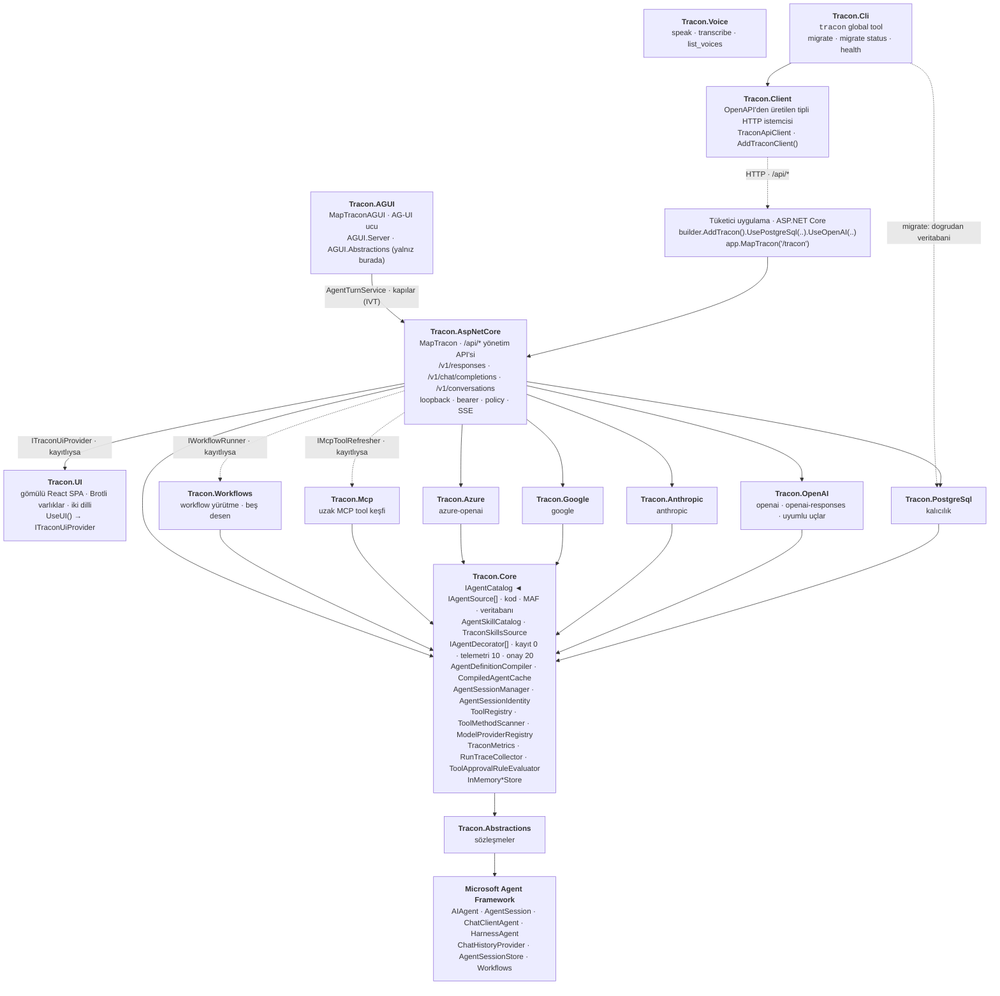
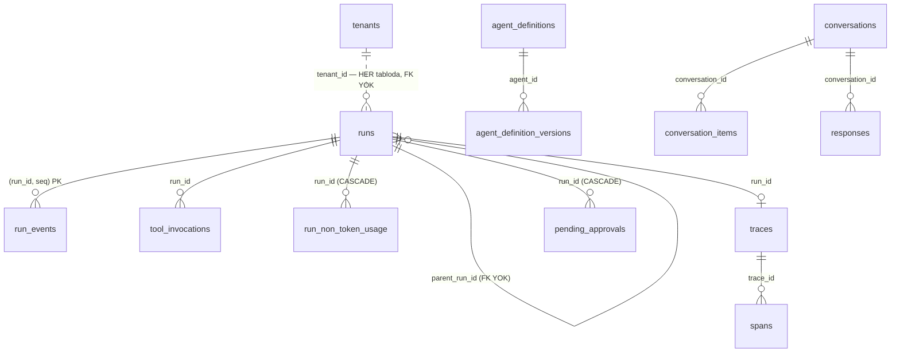
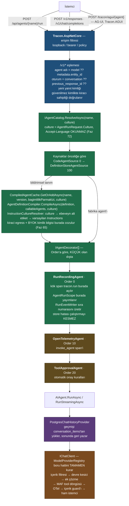
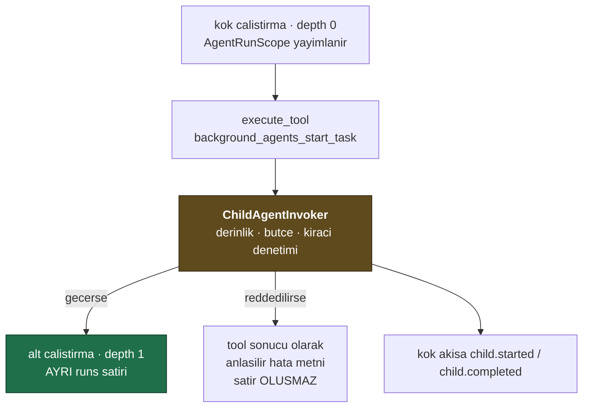
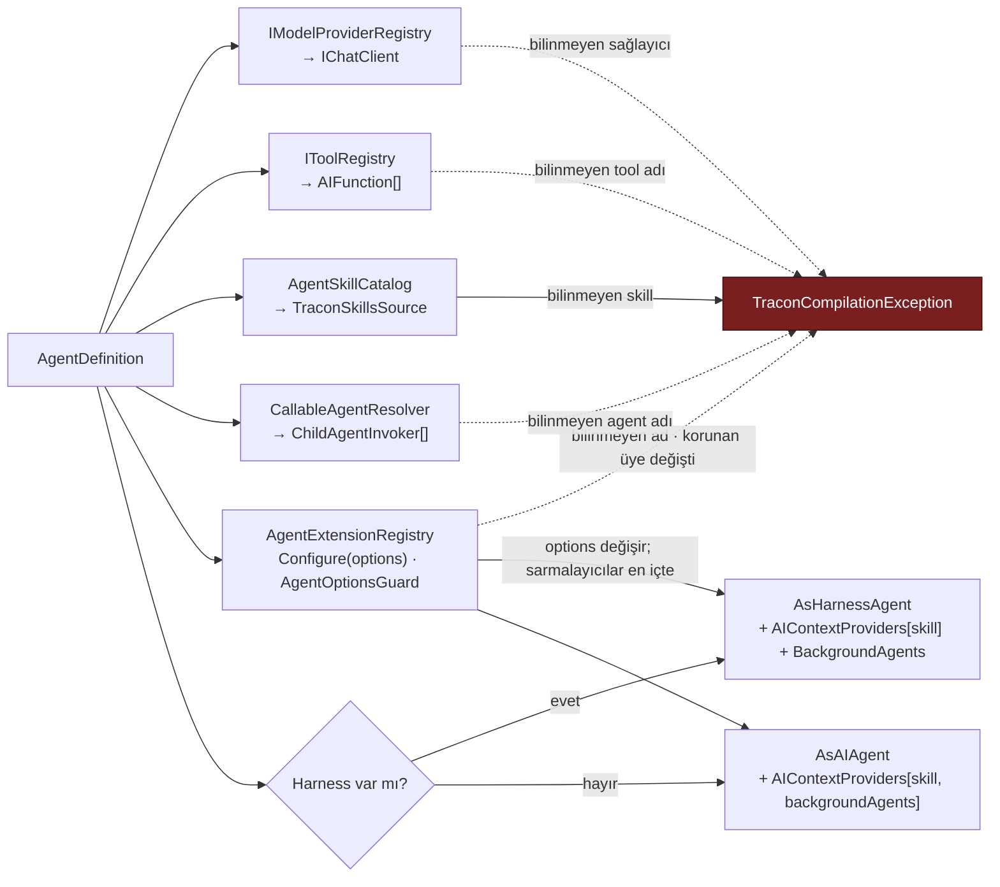
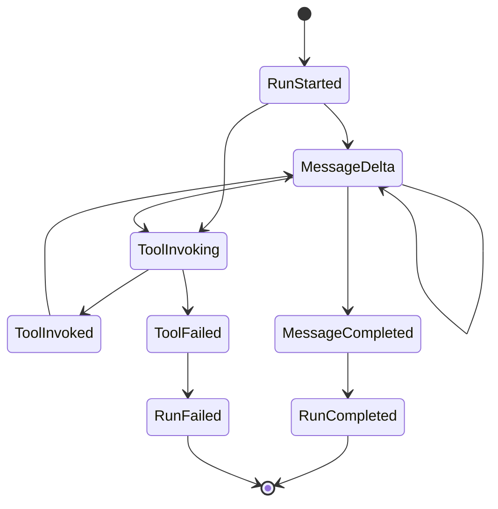
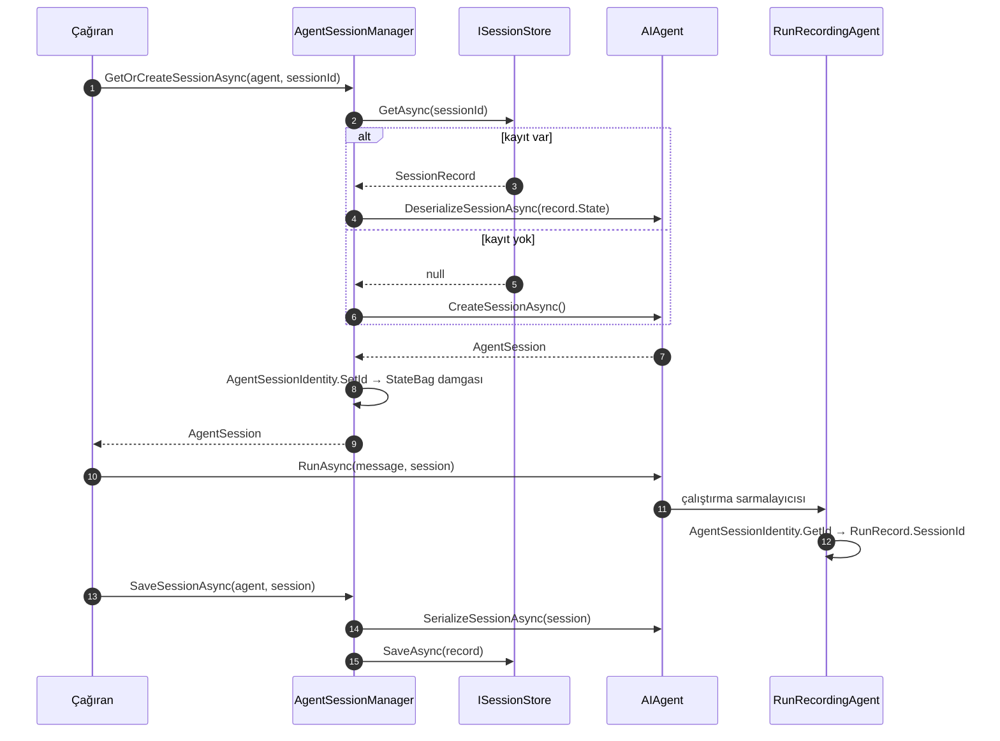

# Tracon — Mimari

> Tracon'in **bugünkü** mimari resmi. Faz dokümanları (`docs/NN-*.md`) sırayı
> anlatır; bu doküman **ne** inşa ettiğimizi. Kod ile çelişirse **doküman yanlıştır**.
>
> **Bütçelidir** — denetim `python3 scripts/dokuman-bakim.py --denetle`. Anlatı
> burada yaşamaz: faz geçmişi → [`arsiv/FAZ-GECMISI.md`](arsiv/FAZ-GECMISI.md) ·
> paket × faz → [`arsiv/PAKET-FAZ-GECMISI.md`](arsiv/PAKET-FAZ-GECMISI.md) ·
> MAF noktaları → [`MAF-GENISLEME-NOKTALARI.md`](MAF-GENISLEME-NOKTALARI.md).
> Bir bölüm büyüdüyse **eski hâlini** arşive taşı; üst üste yığma.

## 1. Güncel Durum

**Paket listesi tek yerdedir: [`README.md`](../README.md) → "Paketler".** Burada
tekrarlanmaz. Mimari açıdan anlamı olan kalemler:

- `Tracon.Sql.Shared` **paket değildir** — `.csproj`'u yoktur; üç SQL
  sağlayıcısı onu `<Compile Include=... />` ile derler: SQL `store`'ları
  (`Stores/`), `SqlQueriesBase`, `SqlDialect` (K-198), migration runner (K-176).
- Migration numaraları sağlayıcı başına bağımsızdır (K-178); tek kaynak
  `src/Tracon.<Sağlayıcı>/Migrations/*.sql` dosyalarıdır.
- `PgVectorSearchStore` (Faz 51) `Sql.Shared`'den geçmeyen **tek** `store`'dur —
  doğrudan `Npgsql` kullanır (K4, K-344).
- Meta pakete **dâhil olmayanlar**: `SqlServer` (K-185), `Sqlite`, `Anthropic`
  (K-209), `Google` (K-205), `Azure` (K-210; ayar sunmaz K-211, Responses yok
  K-213), `Voice` (K-216; sözleşme `Abstractions`'ta K-215, gerçek zamanlı
  katman `Core`'da K-222), `Templates`, `Testing`.
- `dotnet pack` **20 paket** üretir. Hangi fazın hangi pakete ne eklediği:
  [`arsiv/PAKET-FAZ-GECMISI.md`](arsiv/PAKET-FAZ-GECMISI.md).

Ne veritabanı ne de belirli bir model satıcısı **zorunludur**: `storage`
yapılandırılmazsa bellek içine düşer; OpenAI · uyumlu `endpoint`'ler ·
Anthropic · Google · Azure OpenAI birlikte çalışır.

**Neden Tracon?** MAF GA'dir ama resmî arayüzü DevUI preview'dur ve dokümanı
"not intended for production use" der. Tracon onun yerine geçmez, bıraktığı
yerden devam eder.
Faz faz nasıl buraya gelindiği: [`arsiv/FAZ-GECMISI.md`](arsiv/FAZ-GECMISI.md).

---

## 2. Katman Mimarisi

**Bağımlılık yönü tek yönlüdür ve döngü içermez:** her sağlayıcı/kalıcılık paketi
`Core`'a, `Core` `Abstractions`'a, `UI` ve `AGUI` `AspNetCore`'a bakar; ters yön yoktur.
Kural `DependencyDirectionTests.AllowedReferences` ile zorlanır. AOT uyumluluk
tablosu 9. bölümdedir (K-006).

> `Mcp` ve `Workflows`, `AspNetCore`'a **referans vermez** (kesikli oklar): HTTP
> katmanı onları `IMcpToolRefresher` (`internal`, Faz 213) ve `IWorkflowRunner`
> (public) soyutlamaları üzerinden tetikler. Böylece ikisi de isteğe bağlı paket
> kalır. Workflow motoru kayıtlı
> değilse yalnız çalıştırma uçları `501` döner; tanım yönetimi çalışır (K-118).

> `Tracon.AGUI` (Faz 236) ikinci bir çalıştırma yüzeyidir: istek AG-UI biçiminde gelir, tur kurulumu
> (`AgentTurnService`: kapılar, agent çözümü, bekleyen cevapların eşlemesi, çalıştırma seçenekleri)
> yönetim API'siyle ortaktır ve çıktı AG-UI olaylarıdır. Meta pakete girmez; AG-UI SDK'sı yalnız
> orada durur (K-1076). Ayrıntı ve tuzaklar: [`hafiza/a2a-konusma.md`](hafiza/a2a-konusma.md).

> `Tracon.Client` **hiçbir Tracon paketini referanslamaz** (Faz 83,
> K-565): DTO'ları OpenAPI belgesinden üretilir, `Abstractions`'ı yeniden
> kullanmaz — kesikli ok bunu **HTTP üzerinden çağırma** ilişkisi olarak
> gösterir, derleme-zamanı bağımlılık değil. `Tracon.Cli` üç SQL sağlayıcı
> paketini de referanslar (diyagramda yalnız `PostgreSql` gösterildi, `SqlServer`
> ve `Sqlite` aynı ilişkiyi taşır) — bir global tool olduğu için bu ağırlık
> tüketicinin grafiğine **girmez** (K-568).

Bu grafiği bozan bir referans eklemek yasaktır; mimari testi bunu zorlar.

---

## 3. Dört Değişmez Tasarım Kuralı

### K1 — Sıfır sürpriz
`AddTracon()` tek başına çalışır. PostgreSQL yapılandırılmazsa tüm `storage` bellek içine düşer. Veritabanı **zorunlu değildir**. Bir geliştirici paketi kurar, tek satır yazar ve çalışan bir arayüz görür.

### K2 — Tool'lar yalnız kodda tanımlanır
Arayüzden agent oluşturulabilir, ancak tool **kodu** yazılamaz. Arayüz sadece kodda kayıtlı tool'lardan seçim yaptırır.

**Arayüz iki dillidir, API tek dillidir.** Konsol metni sözlüklerden gelir ve eksik çeviri **derleme hatasıdır** (K-228); sunucunun `ProblemDetails` metni **İngilizce kalır** (K-232) — aynı hata günlükte, testte ve destek kaydında aynı okunmalıdır.

> **Gerekçe:** Arayüzden çalıştırılabilir kod tanımlanabilseydi, Tracon arayüzüne erişen herkes sunucuda kod çalıştırabilirdi.

**Kuralın bilinçli istisnaları — iki tanedir**, ikisi de §7'de korumalarıyla
birlikte anlatılır: **MCP tool'ları** (K-058; süreç *uzakta* çalışır, Tracon
yalnız istemcidir) ve **skill script'leri** (K-066; süreç *bu makinede* çalışır —
en sıkı istisna). MCP'de arayüz kullanıcısı **yeni kod yazmaz**, var olan bir
yeteneği etkinleştirir. Skill script'inde `AllowStoredScripts` açıkken yazar; o
kod yalnız içeriğine pinli bir grant'la çalışır (K-860) — yazan (`AgentsAdmin`)
ile izin veren (`SecurityAdmin`, çok kiracılıda platform yetkisi, K-861) iki ayrı
rol ve iki ayrı kayıttır. Bu ayrım kuralın özüdür.

### K3 — MAF nesneleri sızdırılır, sarmalanmaz
`AIAgent`, `AgentSession`, `ChatMessage`, `AIFunction` doğrudan kullanılır. Tracon bunların üzerine kendi paralel tip hiyerarşisini koymaz.

> **Gerekçe:** Sarmalama, MAF'ın her yeni sürümünde bakım borcu üretir ve tüketiciyi MAF ekosisteminden koparır. Tracon bir *kontrol düzlemi*dir, bir *soyutlama katmanı* değil.

### K4 — Her *belgelenmiş* genişleme noktası değiştirilebilir
Genişleme noktası bir rehberin, sample'ın veya contract suite'in tüketiciye uygulatmayı anlattığı public arayüzdür; Tracon'un paketleri arasındaki tesisat arayüzleri `internal`'dır ve genişleme noktası sayılmaz (Faz 213, K-1013). Genişleme noktaları `TryAdd*` ile kaydedilir. Tüketici kendi implementasyonunu daha önce kaydederse onunki kazanır. Aynı kural MAF'ın kendi `Hosting.OpenAI` paketinde de geçerlidir — bu yüzden `IConversationStorage` gibi arayüzleri değiştirebiliyoruz.

---

## 4. MAF Genişleme Noktaları

Ayrı dokümana taşındı: [`MAF-GENISLEME-NOKTALARI.md`](MAF-GENISLEME-NOKTALARI.md)
— hangi noktayı nasıl kullandığımız, hangilerini bilerek kullanmadığımız.
Her oturumda değil, yalnız MAF'a dokunurken okunur.

---

## 5. Veri Modeli (`tracon` şeması)

Ayrı şema kullanılır. Tüketici uygulamanın `public` şemasına **hiç dokunulmaz**.

> Diyagram **ilişkileri** gösterir; kesikli çizgi (`..`) yabancı anahtarı olmayan
> mantıksal bağdır. Şemanın kaynağı her zaman
> `src/Tracon.PostgreSql/Migrations/*.sql`'dir; hangi migration'ın hangi
> tabloyu eklediği [`arsiv/FAZ-GECMISI.md`](arsiv/FAZ-GECMISI.md) → "Migration
> geçmişi" altındadır.

**Span kimliği türetilir, üretilmez.** `spans.id = SHA-256(trace_id + ":" + span_id)`
ilk 16 baytıdır. Sebep: bir span, ebeveyninden **önce** tamamlanabilir; türetilmiş
kimlikte üst span'in kimliği haritasız hesaplanır. Ek fayda: aynı span iki kez
yazılırsa aynı satır güncellenir, tekrar kaydı oluşmaz.

| Tablo | İçerik |
|-------|--------|
| `__migrations` | Uygulanmış migration'lar, checksum ile |
| `tenants` | Kiracı kaydı; tek kiracıda tek varsayılan satır |
| `agent_definitions` | Agent tanımının güncel hali |
| `agent_definition_versions` | Değişmez versiyon geçmişi, geri alma için |
| `agent_definition_version_counters` | Ad başına gelmiş en büyük sürüm numarası, anahtar `(tenant_id, name)`, **`agent_definitions`'a yabancı anahtarı YOK**: silme tanımı ve geçmişi siler, sayaç kalır; numara ad başına bir kez verilir (K-1100). Kayıt sayacı, agent satırını ve geçmiş satırını tek işlemde yazar |
| `agent_skills` | Tenant-yalıtımlı markdown skill tanımı ve frontmatter |
| `agent_skill_resources` | Skill kaynağı; skill silinince cascade ile silinir |
| `sessions` | Serileştirilmiş `AgentSession` (**`json`**) + agent adı + `state_schema_version` (hep dolu) + `state_maf_version` (NULL = Faz 126 öncesi satır, K-649). Anahtar **`(tenant_id, id)`** — kimlik çağırandan gelir ve yalnız kiracı içinde benzersizdir (K-278) |
| `conversations` | Konuşma başlığı; `PostgresChatHistoryProvider` yazar |
| `conversation_items` | Konuşma mesajları, sıralı (**`json`**) |
| `responses` | **Boş.** `/v1/responses` ve `/v1/conversations` durumu `sessions` tablosunda tutulur (K-036, K-043); ayrı bir yanıt kaydı yazılmadı |
| `runs` | Çalıştırma özeti: agent, oturum, durum, token, süre, maliyet; token dışı harcamanın dört snapshot sütunu (`non_token_*`, K-974); önbellek yazmasının beş sütunu (`cache_write_*`: iki token sayacı, tutar, iki birim fiyat; hepsi `NULL`'lanabilir, eski satırlarda `NULL`, geri doldurma yok; K-1105, K-1107). Workflow kök satırında `agent_version` derlenen **tanım sürümüdür** (kod workflow'unda NULL, K-988) |
| `run_events` | Append-only olay akışı, `(run_id, seq)` birincil anahtar |
| `tool_invocations` | Tool çağrıları: ad, argüman, sonuç, süre, hata; tool'un bildirdiği ölçüm ve sağlayıcı/model |
| `run_non_token_usage` | Workflow fonksiyon düğümünün bildirdiği her token dışı kalem (birim, miktar, tutar, düğüm adı); run silinince cascade (K-974) |
| `traces` / `spans` | OpenTelemetry span'leri |
| `audit_log` | Kim, ne zaman, hangi tanımı değiştirdi |
| `attachments` | Yüklenen ek ustverisi + ikili içerik (`bytea`); `session_id` FK **değil** (K-112) |
| `agent_files` | Kalıcı `AgentFileStore`: agent başına yol→metin çifti |
| `workflows` | Arayüzden tanımlanan workflow grafının güncel hali (`jsonb`); `version` = geçmişteki en büyük numara |
| `workflow_definition_versions` | Workflow tanımının değişmez sürüm geçmişi, anahtar `(tenant_id, name, version)`, **`workflows`'a yabancı anahtarı YOK**: silme geçmişi silmez ve numara yeniden verilmez (K-987). Kayıt iki satırı tek işlemde yazar |
| `workflow_checkpoints` | Yürütme kontrol noktaları — durum **`json`**, `jsonb` değil (K-121); `state_schema_version`/`state_maf_version` NULL = Faz 126 öncesi satır (K-649) |
| `job_schedules` | Zamanlama tanımı: cron, saat dilimi, yük, etkin/pasif |
| `jobs` | Kuyruktaki iş: durum, kira, deneme sayısı, ilerleme sayaçları |
| `job_items` | Toplu işin tek girdisi ve ürettiği `run_id` |
| `eval_suites` | Bir agent'ı ölçen takım: hedef agent, bildirimsel `checks` (`jsonb`) |
| `eval_cases` | Takımın vakaları: sorgu, beklenen çıktı/tool'lar, terfi kökeni |
| `eval_runs` | Bir takımın tek koşusu: agent sürümü, model, geçme/kalma sayısı |
| `eval_case_results` | Vaka bazında sonuç; `case_id` **yabancı anahtar değil** (K-14) |
| `experiments` | A/B deneyi: hedef agent, kollar (`variants jsonb`), durum, başlangıç/bitiş, kanarya kuralı |
| `quotas` | Kota kuralı: kapsam (kiracı+agent+dönem), üç sınır (`max_runs`/`max_tokens`/`max_cost`) |
| `quota_usage` | Dönem sayacı; `agent_name = ''` kiracı geneli. `ON CONFLICT DO UPDATE` ile **atomik** artar. `notified_thresholds` (`text`, `,metrik:yüzde,` sınırlayıcılı liste) hangi eşiklerin bu dönemde zaten bildirildiğini kalıcı tutar — koşullu `UPDATE`'in etkilenen satır sayısıyla atomik claim edilir (Faz 146) |
| `webhook_subscriptions` | Olay aboneliği: adres, olay listesi, **`secret` değil** anahtar adı (K-059) |
| `webhook_deliveries` | Teslim **geçmişi** — kuyruk değil; zamanlama `jobs`'tadır (K-160) |
| `retention_policies` | Hedef başına saklama kuralı: yaş/hacim sınırı, arşiv bayrağı (K-198) |
| `retention_runs` | Temizleme koşusu geçmişi |
| `voice_sessions` | Konuşma bağlantısı özeti: tur, süre, karakter, kapanış nedeni. **Ses içermez**; `session_id` FK **değil** |
| `run_scores` | Çalıştırma/mesaj puanı: ikili/yıldız, yorum. `runs` FK yok |
| `pending_approvals` | Kuyruktan koşan bir çalıştırmanın bekleyen tool onayı — MAF oturum durumunun **izdüşümü**, sahibi değil. `run_id` FK **CASCADE** |
| `tenant_provider_bindings` | Kiracı × sağlayıcı başına BYOK bağlaması: yalnız yapılandırma anahtarının **adı** (`secret` değil, K-059), isteğe bağlı uç adresi. Anahtar `(tenant_id, provider_name)` (Faz 65) |
| `tenant_egress_policies` | Kiracı başına izinli sağlayıcı listesi; satır **yoksa** kiracı kısıtsızdır (K1, Faz 65) |

Kurallar:

- Zaman alanları `timestamptz`, UTC
- **Sorgulanan** serbest yapılı alanlar `jsonb`, sorgulanan yollarda GIN index
- 🚨 **Opak ve polimorfik yükler `json`, `jsonb` DEĞİL.** `jsonb` nesne anahtarlarını yeniden sıralar; System.Text.Json'ın `$type` ayracı ilk özellik olmak zorundadır. `sessions.state` ve `conversation_items.item` bu yüzden `json`. Karar K-027.
- `run_events.payload` `text` — `RunEventWriter` argümanları AOT uyumlu kalmak için elle biçimlendirir, çıktı geçerli JSON olmayabilir
- Birincil anahtarlar `uuid` v7 — zaman sıralı, index dostu; uygulama üretir (`TraconId.NewId()`), `gen_random_uuid()` **kullanılmaz**
- `RunStatus` ve `RunEventType` `smallint` olarak saklanır; enum değerleri kararlıdır
- 🚨 **NULL sütun içeren benzersizlik `COALESCE` ile kurulur.** PostgreSQL'de NULL'lar birbirine eşit sayılmaz; `quotas` kapsam benzersizliği `(tenant_id, COALESCE(agent_name, ''), period)` ifadesi üzerinedir ve `ON CONFLICT` yan tümcesi **aynı ifadeyi** yazar
- Her tabloda `tenant_id` (`text`); `tenants`'a **yabancı anahtar yoktur** — kısıt Faz 6'da gelir
- Şema adı yapılandırılabilir (`TraconPostgreSqlOptions.SchemaName`); `.sql`'deki `{schema}` yer tutucusu doğrulamadan sonra değiştirilir (K-029)
- `run_events` partition'ı **açılmadı** (K-063 → K-199): 100k satırda parti silme saniyede ~720k satır siliyor, hedef yükün çok üzerinde. `retention_policies` tabloyu sınırlı tutar

---

## 6. Çalıştırma Yolu

> **Sıra neden böyle?** Kayıt en **dışta** olmalıdır ki iç katmanların harcadığı
> süreyi de ölçsün. Onay ise model çağrısına en **yakın** katmandadır; dışına
> alınsaydı telemetri onay beklemesini kendi süresine katardı.
>
> 🚨 Kök span `RunRecordingAgent`'ın **kendi metot gövdesinde** açılır.
> `Activity.Current` bir `AsyncLocal`'dir ve async bir yardımcı metotta yapılan
> atama çağırana geri akmaz; ölçüldü, iç span'ler kök span'in çocuğu değil
> kardeşi oluyordu.
>
> 🚨 Aynı kuralın ikinci hâli **akışlı** yolda geçerlidir: bir
> `async IAsyncEnumerable` gövdesinde yapılan `AsyncLocal` ataması `yield return`
> sınırını aşmaz. `TraconRunContext.SetCurrent(...)` bu yüzden her
> `MoveNextAsync`'ten hemen önce tekrarlanır (Faz 12'de ölçüldü).

İki sapma vardır. **Deney ataması:** yalnız `POST /api/agents/{name}/run`
`ResolveAsync`'ten **önce** `ExperimentAssignmentResolver`'a uğrar; `Running` bir
deney varsa sürüm deneyden gelir. `/v1/*` ve alt-agent çağrıları bu adımı görmez
(K-131). **Asenkron çalıştırma:** `Prefer: respond-async` → `Queued` satır + iş
kuyruğu + `202`; işçi alınca diyagram normal işler (K-304). Workflow'un `run`,
`resume` ve `respond` uçları aynı yolu `tracon.workflow-run` işiyle izler (K-924);
kesilen workflow run'ını yalnız onu başlatan iş, yeniden kiralandığında son
checkpoint'ten sürdürür (K-923, K-927). `resume`/`respond` kaynak run'ın damgaladığı
tanım sürümünü derler; başka sürümü `definitionVersion` seçer (K-988). Kök çalıştırma onay
isteyerek biterse `AwaitingApproval` ile kapanır ve bir daha DEĞİŞMEZ (K-014);
karar YENİ bir çalıştırma açar (K-368) — bkz. §7.

Bir MCP tool'u çağrının ortasında kullanıcıdan bilgi isterse (elicitation) kök çalıştırma
aynı biçimde `AwaitingInput` ile kapanır: istek `inputs` çerçevesiyle duyurulur, cevap sonraki
turun `inputResponses` alanıdır ve tool çağrısı **baştan yeniden** yapılır (K-1071; yeniden
çağrı MAF'ın bekleyen-istek kaydına koşu kapanırken yazılır, K-1075). İsteği ancak yönetim
API'sinin oturumlu kök run'ı cevaplayabilir; oturumsuz run, alt agent, kanalsız yüzey, eski
protokol ve `url` modu `decline` alır (K-1072). Cevap sorulan soruya bağlıdır ve çağrı en çok bir
kez askıya alınır (K-1073); cevap `tool_input.answer` olarak fail-closed denetlenir ve değerini
yalnız MCP sunucusu görür (K-1074). Ayrıntı: [`hafiza/mcp-elicitation.md`](hafiza/mcp-elicitation.md).

### Çalıştırma ağacı

Bir agent `CallableAgents` taşıyorsa derleyici her alt agent'ı bir
`ChildAgentInvoker` ile sarar ve bunları MAF'ın `BackgroundAgentsProvider`'ına
verir. Sağlayıcı modele altı tool açar; model önce görevi başlatır, sonra bekler,
sonra sonucu okur. `SubAgentSettings.CallMode = Tool` (Faz 228, K-1043) bu sağlayıcıyı
kurmaz: her sarmalayıcı `AsAIFunction` ile adı agent adından türeyen tek bir tool olur,
bir çağrı çocuğu koşar ve cevabını döndürür. Aşağıdaki kurallar ve diyagramdaki
`ChildAgentInvoker` her iki kipte aynıdır; tool kayıt defteri zincirinden
(yetki, onay, tool zaman aşımı) geçmez, sınırı sarmalayıcı koyar.
Çocuğun sürümü tanımdadır (Faz 250, K-1102): `CreateChildAgents` her sarmalayıcıya
`CallableAgentReference.Version`'ı `pinnedVersion` olarak verir, iki kip de oradan geçer;
sabitli çocuğun açıklaması ve önbellek parmak izi sabit sürümden okunur
(`CallableAgentResolver.DescribeAsync`), sabitsiz çocuk her çağrıda güncel sürümü koşar.

Kurallar:

- Ağaçtaki her çalıştırma **aynı** `AgentRunBudget` örneğini paylaşır (K-096).
- Ağaçtaki her çalıştırma **aynı** W3C trace kimliğini paylaşır; trace tamponunun
  sahibi yalnız kök çalıştırmadır (K-099).
- Alt agent **aynı kiracıda** çalışır; kiracı değişmişse çağrı reddedilir.
- Alt agent **onay isteyemez**; isteyen alt çalıştırma `Failed` olur (K-103).

Derleyicinin içi (`AgentDefinitionCompiler.Compile`):

**Uzantı kancası (Faz 222, K-1029, K-1030).** `AgentDefinition.ExtensionNames` kodla kayıtlı uzantıları (`AddAgentExtension`) tanımdaki sırayla çağırır. Kanca, seçenek nesnesi (sohbet: `ChatClientAgentOptions`, harness: `HarnessAgentOptions`) tamamen kurulduktan sonra ve `AsAIAgent`/`AsHarnessAgent`'tan önce koşar; derleme önbelleğinin içindedir, sonuç `(kiracı, ad, tanım)` başına bir kez kurulur. `AgentOptionsGuard` korunan üyeleri (tool zinciri, `ChatHistoryProvider`, dosya erişimi, skill taraması, model ayarları, loop, alt-agent ağacı) her uzantıdan önce okur, sonra karşılaştırır; değişen üye `TraconCompilationException` verir. `AIContextProviders` yalnız sona eklenir. Doğrulama ve kayıt tanımı derler, yani uzantıyı koşar; replay `NoTools`/`ReplayTools` kipinde uzantıyı boşaltır (K-1033). Uzantının provider'ının eklediği tool Tracon'un tool zincirinden geçmez (bilinen sınır). **Model halkası (Faz 232, K-1062, K-1063):** `context.UseChatClient(ChatClientSlot, …)` iki sabit yuvadan birine `IChatClient` koyar — `ModelCall` FIC'in hemen altında, bütçenin üstünde; `Turn` ek çözümlemenin altında, FIC'in üstünde. Bu yüzden ana istemci uzantılardan sonra kurulur: kiracı durumu önce çözülür (`PrepareChatClientAsync` → `PendingChatClient`), zincir `Configure`'dan sonra halkalarla kurulur. Yedek bağlantı aynı halkaları alır; özetleyici ve yargıç almaz; halkayı yerleştiremeyen tüketici registry'si derlemeyi durdurur.

Çalıştırma olayları, `RunEventWriter` tarafından boşluksuz sıra numarasıyla yazılır:

**Oturum yolu** — çalıştırmadan bağımsızdır, çağıran yönetir:

Damga oturumun `StateBag` alanında yaşar ve `SerializeSessionAsync` çıktısına dahildir; bu yüzden geri yüklenen bir oturum kendi kimliğini bilir.

**Neden `DelegatingAIAgent`, neden middleware değil?**
MAF middleware zinciri agent'a özgüdür ve `HarnessAgent` kendi iç dekoratörlerini ekler. Dış sarmalayıcı, harness dahil **her** agent tipinde aynı şekilde çalışır.

**Neden sıra numarasını yazıcı üretir?**
Tek bir yazıcıdan gelen numaralar deterministik sıra garantiler. Canlı akış (SSE) ve geçmişe dönük yeniden oynatma aynı sonucu verir; istemci `Last-Event-ID` ile kaldığı yerden devam edebilir. Ajan run akışı (`POST /api/agents/{name}/run`) bu olayları değil MAF güncellemelerini taşır; kayıttan yalnız kapalı listedeki ayrılmış bildirimleri `done`'dan önce yeniden okuyup verir (`RunNoticeMirror`, K-991).

---

## 7. Güvenlik Modeli

Kendi dosyasındadır: [`MIMARI-GUVENLIK.md`](MIMARI-GUVENLIK.md) — çok
kiracılılık ve tool onayı · roller ve denetim izi · denetim zinciri ve veri
konusu hakları · skill script çalıştırma · kota ve webhook imzası · MCP OAuth
· içerik denetimi. Bölüm 17 KB'a ulaşınca ayrıldı (K-524).

## 8. Sürüm Politikası

`Microsoft.Agents.AI.Hosting` (preview) ve `.Hosting.OpenAI` (alpha) hâlâ ön
sürümdür. Ön sürüm bağımlılığı **yalnızca** `Tracon.AspNetCore` içinde
toplanır (K-008). Tracon o iki paket GA olana kadar `1.0.0-preview.N`
yayınlanır — sonra tek pakette sürüm güncellemesi yeterlidir.

**Tek sürüm hattı zorlanır (Faz 185).** Aile tek sürümde çıkar (K-602) ve iki
yerde korunur: (1) her Tracon→Tracon nuspec bağımlılığı tam aralıktır (`[x]`,
`TraconPinSiblingDependencies`, `src/Directory.Build.props`; kapı
`ReleaseArtifactTests.EverySiblingDependencyIsExactAndMatchesOwnVersion`);
(2) yüklü aile derlemeleri farklı sürümdeyse host **başlamaz**
(`PackageFamilyAlignmentService`, `IHostedLifecycleService.StartingAsync`,
opt-out yok). İkinci katman, açık aralıkla yayınlanmış preview.1/preview.2'yi
ve NU1608 ile geçen doğrudan başvuruyu yakalar. Host başlatmayan süreç
(`BuildServiceProvider()`) kontrolü koşturmaz. Ön sürüm upstream'e bağlı **yeni**
uydu paket bu hattın dışındadır ve kendi ön sürüm hattında çıkar (K-1037); aile
listesine girmez ve upstream deneysel tipi public imzasında taşıyabilir (K-1036).

---

## 9. Trim ve AOT

Bayrak paket başına `TraconAotCompatible` ile uygulanır (K-006); güncel liste
`grep -l "AotCompatible>false" src/*/*.csproj` ile doğrulanır — burada
tekrarlanmaz.

**Uyumlu olmayanlar ve nedenleri:** `AspNetCore` (minimal API delege
yönlendirmesi reflection kullanır) · `UI` (gömülü varlık tarama) · `SqlServer`
(sıfır IL2/IL3 ölçüldü ama canlı sorgu doğrulanmadı — vaat ertelendi, K-181) ·
`Sqlite` (`SQLitePCLRaw` yerel kütüphane taşır, K-196).

**Bayrak ile vaat ayrı şeylerdir (Faz 217).** `TraconAotCompatible` paketin KENDİ
IL'ini analiz eder; tüketicinin yayınını ölçmez. Sağlayıcı ve ses paketleri için
"Native AOT: Yes" vaadi ancak `samples/Tracon.Samples.ProviderAotSmoke` onu
kanıtlarsa verilir: gerçek istek/yanıt yolu sahte sunucuya karşı AOT'ta koşar ve
yayın sıfır uyarı verir (`release_extension_samples.py` sitenin tablosunu smoke'un
paket listesiyle karşılaştırır). `Anthropic` ve `Google` bayrağı taşır ama vaat
vermez: SDK'ları yansımalı JSON kullanır.

`Core` uyumludur: yansıma yalnız `AddToolsFrom` / `AddTool(Delegate)` yolundadır
ve ikisi de işaretlidir (K-350). **Önerilen yol** `AddGeneratedTools()`
(Faz 52) — derleme anında üretilir, sıfır yansıma. Ölçüm notları:
[`hafiza/build-ve-analyzer.md`](hafiza/build-ve-analyzer.md).

---

## 10. İlgili Dokümanlar

Faz listesi ve durumu **tek yerdedir**: [`YOL-HARITASI.md`](YOL-HARITASI.md),
her fazın `Durum:` satırından üretilir. Seçilmemiş adaylar:
[`ADAYLAR.md`](ADAYLAR.md). Dalgaların sıralama gerekçesi kapandı ve arşive
taşındı (K-427); yalnız grep'lenir.

Karar arıyorsan [`KARARLAR-INDEKS.md`](KARARLAR-INDEKS.md)'ten satırı bul ve
`KARARLAR.md`'yi **grep'le**. MAF'a dokunurken
[`MAF-GENISLEME-NOKTALARI.md`](MAF-GENISLEME-NOKTALARI.md); bir alana dokunurken
[`hafiza/`](hafiza/); "neden böyle olmuş?" için yalnız grep ile
[`arsiv/`](arsiv/).
