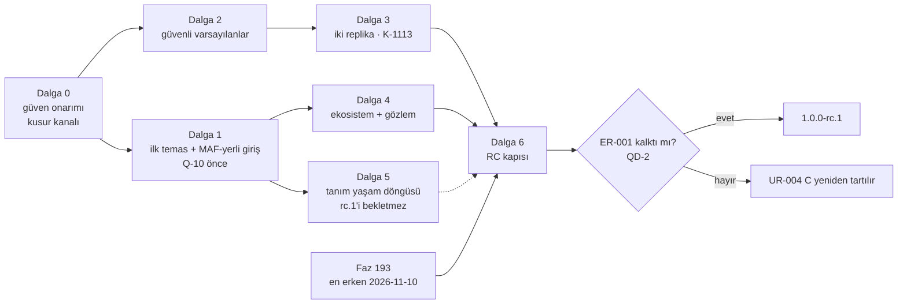

# RC Kalite Dalgaları — Hedef, Kararlar ve Faz Sırası

> **Ölçüm:** 2026-10-28 · HEAD `8295ca9c` · MAF `1.26.0` en yeni (Tracon pin'i `1.25.0`) · MEAI `10.11.0` · MCP SDK `2.3.0` · canlı sürüm `1.0.0-preview.6`.
> **Kaynak:** "Tracon Stratejik Değerlendirme Raporu" (2026-10-26, `af816fc6`; repoda değildir) ve onun ölçümü [`kesif/2026-10-28-rc-kalite-raporu-olcumu.md`](kesif/2026-10-28-rc-kalite-raporu-olcumu.md). Raporun ölçülen 60 iddiasından 29'u doğru, 20'si kısmen doğru, 6'sı yanlış, 3'ü bayat çıktı. Bu dosya yalnız ölçülmüş olana dayanır.
> **Kitle:** Tracon bakımcısı ve faz planlayan oturumlar. Bu dosya **plan girdisidir**, karar defteri değildir ([`MAF-KAPSAMA.md`](MAF-KAPSAMA.md) emsali). Kararlar `K-*`'e, yayın kararları [`YAYIN-HAZIRLIK.md`](YAYIN-HAZIRLIK.md)'ye yazılır.
> **Ara ölçüm:** 2026-10-28 · HEAD `5d615e0e` · Tracon pin'i `1.26.0` = NuGet'in en yenisi (MAF, Hosting, MEAI `10.11.0`, MCP `2.3.0`). Q-11…Q-14 ve Q-20…Q-22 kanıtı bu HEAD'de geçerli.
> **Durum:** Dalga 0 ✅ (2026-10-28) · Dalga 1 🔧 (Q-10 ✅ Faz 255 · Q-14 ✅ Faz 256) · Dalga 2–6 📋. Her `Q-NN` satırının Durum hücresi faz açıldıkça ve kapandıkça güncellenir (§11).
> **İlişki:** MAF kapsama dalgaları (Dalga 0–5) MAF yüzeyinin genişliğini kapattı. Bu dalgalar hedefin öteki yarısını kapatır: ilk temas, güvenli varsayılan, ölçek, entegrasyon ve RC güveni. İki dosya aynı kalemi tutmaz.

---

## 1. Hedef ve ölçüt

**Hedef:** "MAF'ın her özelliği Tracon altında çalışsın, yönetilsin, kaydedilsin,
karşılık bulsun, iş kolaylaştırsın, basitleştirsin, esnekliğiyle sistemlere
entegre edilebilsin." Hedef kitle: MAF ile orta ya da büyük ölçekte geliştiren
tüketici. K0–K3 kapsama merdiveni [`MAF-KAPSAMA.md`](MAF-KAPSAMA.md) §2.1'dedir;
burada tekrarlanmaz.

| Fiil | Bu dalgalarda ölçüt | Bugün (ölçüldü 2026-10-28) | Dalga |
|---|---|---|---|
| Çalışsın | MAF'ın en yeni kararlı sürümü pinli; iki replikada belgeli ve test edilmiş davranış | Pin `1.26.0` = en yeni (Faz 255); çok node destek beyanı değil (K-739) | 1, 3 |
| Kaydedilsin | Workflow, embedding, ses ve görsel span'i ve atıf run kaydında | F-595 açık | 4 |
| Yönetilsin | Güvenli varsayılan üretim profiliyle zorlanır; tanım ortamlar arasında taşınır | Profil 6 risk denetler; rol, tool, egress ve başlık yok. Aktarma yok | 2, 5 |
| Karşılık bulsun | Her MAF kayıt yolunun Tracon'da karşılığı ya da belgeli geçişi var | `AddAIAgent` K0 (D-06); geçiş rehberi yok | 1 |
| İş kolaylaştırsın | İlk agent'a kadar geçen süre bir sayıdır ve bir kapıdadır | Hiç ölçülmedi; son benimseme fazı Faz 37 | 1 |
| Basitleştirsin | Tek rehber yolu, tek anahtar biçimi; tool bağımlılığı derleme anında doğru kurulur | Rehber şablonla çelişir; iki anahtar biçimi; `tools.md` örneği kırık | 0, 1 |
| Entegre edilsin | Aspire ile başlayan proje Tracon'u ekler; Microsoft kontrol düzlemlerine göre konum yazılıdır | Aspire 0 isabet; Foundry Control Plane ve Agent 365 0 isabet | 4 |

**Persona** (`aday-kesfi` § *Kimin acısına bakıyorsun*): **İ** ilk agent'ını
kuran geliştirici · **N** nöbetçi mühendis · **P** kurumsal platform ekibi ·
**M** MAF'ı zaten kullanan ekip. Mercek numaraları
[`ADAYLAR.md`](ADAYLAR.md) § *Değerlendirme Ölçütleri*'ndedir.

---

## 2. Kararlar 👤

### 2.1 Verilenler (2026-10-28)

| # | Konu | Karar | Seçilmeyen | Kayıt |
|---|---|---|---|---|
| QD-1 | Lisans (K-740) | Bu dalganın dışında; K-740 sürer | açık çekirdek · PolyForm + deneme izni · yalnız ticari şartlar sayfası | — |
| QD-2 | `rc.1` yolu (UR-004) | A sürer + zaman tetiği: Dalga 6 kapanınca ER-001 hâlâ açıksa UR-004 C yeniden tartılır | C (önce dondur) · ayrık hat (K-602'nin 2026-08-24'te reddettiği yol; raporun dayanağı K-1037 yanlış çıktı) | `YAYIN-HAZIRLIK.md` UR-004 |
| QD-3 | Çok replika (K-739) | Dar vaat: iki replika desteklenir → Dalga 3 | koru, yalnız belgele | K-1113 |
| QD-4 | MAF-yerli giriş | G-02 + `AddTool` fabrikası + geçiş rehberi (Q-12); D-06 korunur | D-06 köprüsü (`DiscoverMafAgents`) · ikisi de bekler | `MAF-KAPSAMA.md` §7.2 |

### 2.2 Bu dalgalarda açılmayanlar (öneriyle)

| Konu | Öneri | Gerekçe |
|---|---|---|
| Aspire paketi (F-51) | Açma. Önce örnek + rehber (Q-40); paket F-51'in tetiğinde kalır | `chat` span'i MEAI'den `gen_ai.*` olarak zaten gelir; AppHost örneği yeni NuGet bağımlılığı getirmez |
| Foundry kodu (F-638, K-212) | Açma. Öncelik dışı (👤 2026-10-21) kalır; yalnız konum sayfası (Q-41) | Gerçek Azure kaynağı olmadan ölçülemez (MT-PROV-091) |
| Veriyle dallanma (F-659, K-494) | `rc.1` sonrası | Ekleyicidir; kapalı `WorkflowKind` listesi 👤 kararıdır |
| GenAI semantik kural modu (K-055 çevresi) | Açılmaz | Ölçüldü: gerek yok (keşif notu #57) |
| stdio MCP (K-058) · 60 seam için `Add*` (K-645) | Korunur | İkisi de 2026-10'da yeniden onaylandı; F-656 tarifi var |

---

## 3. Sıra ve `rc.1` ile bağ

**Sıra gerekçesi.**

- Dalga 0 en ucuz kaldıraçtır. İlk ekran yanlışsa sonraki işin değeri görünmez.
- Q-10 Dalga 1'in ilk fazıdır. Sonraki her faz en yeni pin üstünde ölçer;
  freeze ölçütü 2 bunu ister.
- Dalga 2, Dalga 3'ten önce gelir. İki replikada fail-closed varsayılanlar aynı
  kalmalıdır; Q-30 hız sınırının üretim riskini (`UnlimitedRequestRate`)
  Q-20'nin genişlettiği profil üstünde yeniden tanımlar.
- Dalga 4, Dalga 1'den sonra herhangi bir anda girebilir; F-595 bağımsızdır.
- Dalga 5 `rc.1`'i bekletmez. Ekleyicidir: UR-012 B ile freeze'den önce girer;
  girmezse 1.x minor sürümüne kalır.
- Faz 193 (K-855) Dalga 6'dan önce kapanır.

| `rc.1` giriş ölçütü (`YAYIN-HAZIRLIK.md` §2) | Bu dosyadaki karşılığı |
|---|---|
| 2 — her bağımlılık en yeni sürümde | Q-10 |
| 4 — yeni yetenekler toplu girer | Dalga 1–5 |
| 5 — kırıcı kalemler kapandı | Q-13, Q-14 ve Q-20 kırıcıdır; `rc.1`'den önce girer |
| 6 — Faz 193 | Dalga 6'dan önce |
| 7 — sessiz preview | Dalga 6'nın son adımı |
| 8 — upstream kararlı | QD-2 tetiği |

---

## 4. Dalga 0 — Güven onarımı (kusur kanalı)

Faz değildir. `kusur-giderme` ile tek oturumda, kullanıcı onayıyla koşar. Tam
ölçüm keşif notu §2–§3'tedir.

| Kimlik | Kusur | Kanıt | Ne yapıldı | Durum |
|---|---|---|---|---|
| Q-01 | README dört yanlış iddia taşıyordu: "MAF reached GA with 1.16.0"; DevUI ".NET documentation: Coming soon" satırı; ön sürüm zinciri listesinde `Tracon.AGUI` yok; "iki satır" örneği agent kaydetmez ama "a working agent" der | `README.md:42,153,166,309` | GA `1.0.0`, Nisan 2026. DevUI satırı kalktı: Learn'de .NET DevUI belgesi ve Aspire entegrasyonu var (2026-10-28'de açıldı). `Tracon.AGUI` listeye girdi. "İki satır" cümlesi konsolda agent kurmayı ve koddaki yolu anlatır | ✅ |
| Q-02 | `tools.md` "doğru" örneği `Build()` sonrası `AddTool` çağırıyordu | `getting-started/tools.md:110-111` | Prob: belgedeki örnek `InvalidOperationException` (salt okunur koleksiyon) atar; önerilen `AddSingleton(provider => new TraconToolRegistration(...))` kaydeder ve çağrı sonuç döner. Örnek değişti. Sınıf taraması: `app.Services.` başka sevk edilen örnekte yok | ✅ |
| Q-03 | Sevk edilen sayılar kayıyordu | `SECURITY.md:5`; `src/Directory.Build.props`; `capabilities.md:142`; `getting-started/security.md:390`; `reference/threat-model.md:77,108`; `guides/embedding.md:10-14`; `lib/api.ts:54` | 21 paket; sekiz fail-closed işlem (threat-model listesine `tool_input.answer` girdi); gömme noktası "yedi, altısı aşağıda"; SSE işlem yorumu yedi. Ölçülüp **doğru** bulunanlar: `README.md` "Six packages" AOT vaadi ve `compatibility.md:89` (31 store sözleşmesi). Sınıfın kapısı Q-61'dir | ✅ |
| Q-04 | Anthropic, Google ve `Testing.Contracts.Xunit` `IsAotCompatible=true` taşır; belge "No" der | `Directory.Build.targets:16-17` | **Kusur değil.** K-1019 ve `docs/hafiza/tedarik-zinciri.md:115` bayrağı (paketin kendi IL analizi) ile vaadi (`ProviderAotSmoke` duman testi) bilerek ayırır | ⏹ kusur değil |
| Q-05 | `governance.md` kurcalama tespitini abartıyordu | `concepts/governance.md` § *Tamper detection* | Uyarı kutusu: anahtarsız hash, tabloya yazabilene karşı korumaz. Aynı sınıf üç yerde daha: `README.md:19`, `guides/production.md:316`, `index.mdx:3` "tamper-evident" → "hash-chained". Asıl düzeltme Q-21 | ✅ |
| Q-06 | Freeze ile `Shipped` dolumu yayın defterinde karışıyordu | `YAYIN-HAZIRLIK.md` §2 | Çelişki değil, belirsizlik: yüzey `rc.1`'de donar (UR-009 B), dolum `1.0.0` GA'dadır (K-603). Cümle iki adımı ayırır | ✅ |
| Q-07 | MAF-KAPSAMA §10 P-03 "taban 50" diyordu | `scripts/maf-kapsama.py:48` | 49; Faz 236 adımı eklendi | ✅ |
| Q-08 | Kiracı başlığı ↔ API anahtarı karşılaştırması harfe duyarlıydı (`Acme` ↔ `acme` → `403`) | `TraconEndpointFilter.cs` `CheckTenantHeaderConflict` | İki taraf `AmbientTenantScope.Normalize` ile katlanır; boşluklu başlık uyuşmazlık kalır. `TenantIdCaseTests`: düzeltmeden önce üç vaka kırmızı, sonra yeşil; başka kiracı yine `403`. Sınıf taraması: öteki karşılaştırmalar iki kanonik değeri karşılaştırır. Kaynak Faz 179 → `FAZ-OLCUMLERI` çentiği | ✅ |
| Q-09 | İlk temas rehberi kendi içinde ve şablonla çelişiyordu | `getting-started/first-agent.md` | Rehber şablonla tek yol: anahtar secret'ta, model adı `Program.cs`'in tek satırı, tool şablondan gelir. Okunmayan `DefaultModel` secret'ı kalktı. Asıl yeniden tasarım Q-11'dir | ✅ |

**Kapanış (2026-10-28).** Sekiz kusur kapandı, biri kusur değil çıktı (Q-04).
`python3 scripts/kapi.py kapanis --taban 8295ca9c`: üretim, tarama, denetim,
derleme, paketleme, site, biçim adımları yeşil. Test adımı ilk koşumda F-180
sınıfından bir E2E testinde düştü (izole 7/7; kayıt **F-744**); ikinci tam koşum
30 012 test, 0 düşen.

**Çıkış kapısı.** Dokuz satır kapandı ya da gerekçesiyle ertelendi;
`python3 scripts/kapi.py tarama` ve `python3 scripts/dokuman-bakim.py --denetle`
yeşil. Q-03 bir kusur **sınıfıdır** (elle yazılan sayı): tek tek düzeltmek
sınıfı kapatmaz.

---

## 5. Dalga 1 — İlk temas ve MAF-yerli giriş

| Kimlik | İş | Kanıt (Ölçüldü) | Persona · Mercek | Kademe · maliyet | Bağımlılık | Durum |
|---|---|---|---|---|---|---|
| **Q-10** | **MAF 1.26 yükseltmesi.** MAF ailesi `1.26.0`, Hosting ailesi `1.26.0-preview.261023.1`. Üç seam ölçülür: `DeleteSessionAsync`'in `TraconAgentSessionStore`'daki anlamı (kiracı sınırı); AG-UI istek anında agent seçiminin `Tracon.AGUI` ile ilişkisi; yinelenen onay kimliği reddinin Tracon onay akışına etkisi. Matris yeniden ölçülür (P-02…P-05) | `TraconAgentSessionStore.cs:39`; `Directory.Packages.props:19,67`; MAF 1.26.0 notu #8801, #9382, #9542 | M · 6 | hafif; `DeleteSessionAsync` kiracı sınırına dokunursa tam · paket yok · migration ve API ölçülmeli | yok — dalganın ilk fazı | ✅ Faz 255 (F-745, F-746) |
| **Q-11** | **İlk agent'a kadar geçen süre.** Şablon yapılandırmadan çalışır (`WRITE_MODEL_NAME_HERE` kalkar, `DefaultModel` okunur). `first-agent.md` şablonla tek yol olur. Tek anahtar biçimi: `Tracon:Providers:*`. README "iki satır" örneği dürüst olur. Temiz makinede `dotnet new` → ilk yanıt **adım sayısı ve dakika** olarak ölçülür: adım sayısı CI kapısıdır (sahte sağlayıcı), dakika manuel case'tir | `Templates/.../Program.cs:96`; `first-agent.md:44-52`; `src/Tracon/README.md:16`; `README.md:32-42` | İ · 1, 5 | hafif · şablon ve site | Q-14 (meta paket şablonu belirler) | 📋 |
| **Q-12** | **G-02 ve MAF-yerli giriş.** Async fabrika + model beyanı → BYOK, egress ve maliyet fabrika agent'ında geri gelir. `AddTool(Func<IServiceProvider, AIFunction>)`: K-218 tuzağının derleme anı cevabı. Site rehberi "From `AddAIAgent` to Tracon" (D-06 korunur). İmza tahmin edilmez: `maf-api-kesfi` | `TraconBuilderExtensions.Agents.cs:32,91` (yalnız senkron fabrika); `IModelProviderRegistry.cs:26-34` (senkron yol BYOK/egress uygulamaz); `TraconBuilderExtensions.Tools.cs:33`; `MAF-KAPSAMA.md` §7.1 | M, İ · 1, 3, 5, 8 | tam (BYOK ve egress kiracı sınırıdır) · API ekleyici | Q-10 | 📋 |
| **Q-13** | **Builder tutarlılığı.** `AddJobHandler` ve `UseScheduling` `ITraconBuilder`'a taşınır | `TraconServiceCollectionExtensions.cs:109,161` | İ · 5 | tam (PublicAPI'den satır silinir) · kırıcı, `rc.1` öncesi serbest (UR-012 B) | Q-12 ile aynı faza girebilir | 📋 |
| **Q-14** | **Meta paketin yeniden kurulumu.** `Tracon` meta paketi SQL Server kullanana Npgsql taşımaz. Seçenek planlamada 👤: (a) meta = Core + AspNetCore + UI, depo ayrı seçilir; (b) depo başına meta paket. 👤 2026-10-28: yalnız depo çıkar (meta = AspNetCore + Mcp + OpenAI + UI + Workflows); ölçülen graf [Faz 256](256-META-PAKET-DEPO-AYRIMI.md) §256.1 | `src/Tracon/Tracon.csproj:29`; `Tracon.PostgreSql.csproj:13` | İ, P · 1, 3 | tam (paket bileşimi `rc.1`'de kilitlenir) · paket grafı kırıcı | yok | ✅ Faz 256 (F-748) |

**Karşı görüş ve cevap.**

- **Q-10:** Ciddi bir karşı gerekçe bulunamadı. Freeze ölçütü 2 bunu ister.
- **Q-11:** "Süre ölçümü gösteriş sayısı olabilir." Cevap: kapı dakikayı değil
  adım listesini denetler; adım artışını yakalar. Hedef sayı uydurulmaz; ilk
  ölçümden sonra bakımcı koyar.
- **Q-12:** "Özel `IAgentSource` iki halkayı bugün geri kazanır; 2026-10-19
  hükmü 'kolaylık'tı." Cevap: QD-4. MAF-yerli ekibin giriş kapısı bir kaynak
  sözleşmesi öğrenmek olmamalıdır. Kapsam ergonomi ve rehberdir; yeni halka yok.
- **Q-13:** "Kozmetik; tüketici kodu kırılır." Cevap: `rc.1`'den sonra
  düzeltilemez; bugün iki giriş noktası öğretilir.
- **Q-14:** "Tek paketle başlamak kolaydır; depo seçimi bir adım ekler."
  Cevap: gerçek. Seçenek (b) adımı korur; plan iki seçeneği paket grafı ve
  şablon adımıyla ölçer.

**Çıkış kapısı.** İlk agent süresi adım ve dakika olarak kayıtlı, adım kapısı
CI'da yeşil; `grep -rn WRITE_MODEL_NAME_HERE src/` boş; fabrika agent'ında
BYOK, egress ve maliyet fonksiyonel testte; MAF pin'i NuGet'in en yenisi
(ölçüt 2 ✅); SQL Server tüketicisinin paket grafında Npgsql yok (paket probu).

---

## 6. Dalga 2 — Güvenli varsayılanlar

| Kimlik | İş | Kanıt (Ölçüldü) | Persona · Mercek | Kademe · maliyet | Bağımlılık | Durum |
|---|---|---|---|---|---|---|
| **Q-20** | **Üretim profili genişler.** `TraconProductionRisk`'e yeni değerler: rol politikası zorunlu değil · tool yetkisi hepsine izin · kiracılık açıkken egress politikası yok (F-254) · başlıkla kiracı çözümü · kiracı başına workflow eşzamanlılığı yok. Kiracılık açıkken biçimi bozuk başlık `400` alır (bugün belgeli olarak varsayılan kiracıya düşer) | `TraconProductionRisk.cs` (6 değer); `ProductionProfileValidator.cs:66-150`; `HttpTenantContext.cs:74-75,122-127`; `governance.md:48-53`; `TraconEndpointOptions.cs:187`; `AllowAllToolAuthorizationHandler.cs:20`; `TenantProviderAccess.cs:53-54`; `guides/production.md:344` | P · 3, 2 | tam (güvenlik, kiracı sınırı) · enum ekleyici; `400` HTTP sözleşmesinde kırıcı (K-1081 kapısı) | Q-08 | 📋 |
| **Q-21** | **Anahtarlı denetim zinciri.** HMAC-SHA256; anahtar değeri yapılandırmada, kayıtta yalnız anahtarın adı ya da kimliği (K-059 deseni). Eski anahtarsız zincir okunur ve doğrulanır; anahtar dönüşü tanımlıdır. Konsolda doğrulama ekranı. Belge tehdit modelini açık yazar. Dış çapa (A10) kapsam dışı | `AuditChainHasher.cs:63`; `AuditEndpoints.cs:90`; `screens/audit.tsx` (doğrulama yok) | P, N · 3, 2 | tam (kalıcı veri: üç migration seti; güvenlik) · API ekleyici · konsol payı planda gzip KB | Q-05 | 📋 |
| **Q-22** | **Kiracı başına tool izin listesi.** Yerleşik bir `IToolAuthorizationHandler` kiracı politikasını okur; HTTP ve konsol; varsayılan kapalı (K1) | `AllowAllToolAuthorizationHandler.cs:20`; `TraconServiceCollectionExtensions.Registration.Core.cs:41,108` | P · 3 | tam (migration, kiracı sınırı) | Q-20 | 📋 |

**Karşı görüş ve cevap.**

- **Q-20:** "Varsayılanı değiştirmek tek kiracılı geliştiriciyi zorlar."
  Cevap: değişiklik yalnız `RequireProductionProfile` altında ve kiracılık
  açıkken etkilidir; geliştirme varsayılanı aynı kalır; her risk bugünkü
  desenle kabul edilebilir.
- **Q-21:** "Anahtar da uygulamadadır; veritabanı ve uygulama birlikte ele
  geçerse koruma yoktur." Cevap: gerçek. Tehdit modeli veritabanına yazabilen
  ama anahtarı okuyamayan aktörü kapsar ve belge bunu söyler. Dış çapa ayrı
  karardır (A10).
- **Q-22:** "Seam var; tüketici kendi handler'ını yazar." Cevap: çok kiracılı
  her host aynı tabloyu yazar, bu bir kontrol düzlemi eksiğidir. Ama değer
  Q-20'den sonra yeniden tartılır; planlamada talep kanıtı yoksa tetiğe alınır.

**Çıkış kapısı.** Her yeni risk açılışı durdurur ve kabul edilebilir
(fonksiyonel); kiracılık açık + bozuk başlık → `400` (HTTP testi); anahtarlı
ve eski zincir üç depoda doğrulanır (sözleşme testi); konsol doğrulama ekranı
E2E'de; Q-22 kiracı yalıtım sözleşmesi dört koşumda.

---

## 7. Dalga 3 — İki replika vaadi (K-1113)

**Ölçülen zemin.** İş kirası (`SKIP LOCKED` / `UPDLOCK, READPAST`), kira
yenileme, singleton kira ile lider seçimi, kalp atışı uzlaştırması ve API/işçi
ayrımı bugün çalışır ve gerçek Postgres'te test edilmiştir
(`SqlJobStore.cs`, `SqlSingletonLeaseStore.cs`, `JobStoreConcurrencyTests`,
`SingletonLeaseTakeoverTests`). Vaat yalnız aşağıdaki dört açığı kapatır.

| Kimlik | İş | Kanıt (Ölçüldü) | Persona · Mercek | Kademe · maliyet | Bağımlılık | Durum |
|---|---|---|---|---|---|---|
| **Q-30** | **Dağıtık hız sınırı.** Bugünkü sınırlayıcılar bir seam arkasına alınır; varsayılan bellek içi kalır. Çok replika uygulaması planlamada 👤: SQL tabanlı sayaç · replika sayısına bölünmüş yerel sınır · ağ geçidine bırak + belge. F-92'yi devralır; Redis paketi eklenmez | `TraconRateLimitFilter.cs` (sınıf dokümanı: "single process"); `InboundTriggerRateLimiter.cs`; K-158 | N, P · 2, 3 | tam (migration olasılığı; geri dönüşü pahalı) | Q-20 | 📋 |
| **Q-31** | **MCP OAuth çok replikada.** Bekleyen akış (PKCE doğrulayıcı, dönüş adresi) şifreli `state` içinde taşınır; sunucu durumu tutulmaz (Data Protection anahtar halkası replikalar arasında paylaşılır). Token kalıcılığı K-059 ile çatışır → planlamada 👤: (a) replika başına önbellek + yeniden yetkilendirme · (b) tüketicinin `IDistributedCache`'i + şifreleme, veritabanı değil · (c) K-059'un yeniden yorumu | `McpOAuthAuthorizationCoordinator.cs:52`; `McpOAuthTokenCacheRegistry.cs:17`; A-16; K-170; K-059 (`KARARLAR.md:104`) | P, N · 2, 3 | tam (güvenlik) | yok | 📋 |
| **Q-32** | **Kuyruksuz run'ın örnekler arası iptali.** İptal niyeti veritabanına yazılır; sahip örnek onu kalp atışında okur; yanlış örnek `409` yerine kabul döner. Desen kuyruktaki işin veritabanı iptalinden (`IJobStore.CancelAsync`) alınır. İptal gecikmesi planda ölçülür | `RunCancellationRegistry.cs:8`; `IRunCancellationRegistry.cs:9-14`; `RunEndpoints.cs:298` | N · 2 | tam (migration; HTTP sözleşmesi) | yok | 📋 |
| **Q-33** | **İki düğümlü kabul seti ve destek matrisi.** Aynı veritabanında iki host (fonksiyonel seviye; PostgreSQL ve SQL Server): başka düğümde iptal, hız sınırı toplamı, başka düğüme dönen OAuth, iş kirasının el değiştirmesi, workflow eşzamanlılığı. Site sayfası: desteklenen ve desteklenmeyen tablo. İki makinede kapasite ölçümü ("not an SLA" kalır) | `guides/production.md:528,581`; `guides/background-work.md:480,584-600` | N, P · 2, 3 | hafif (test + belge; vaat K-1113'tedir) | Q-30, Q-31, Q-32 | 📋 |

**Karşı görüş ve cevap.**

- **Q-30:** "Hız sınırı çoğunlukla ağ geçidinde yapılır." Cevap: gerçek; plan
  "ağ geçidine bırak + belge" seçeneğini de tartar.
- **Q-31:** "Yapışkan yönlendirme yeter." Cevap: bekleyen akış için yeter ve
  belgelenir; token paylaşımı için yetmez, çünkü arka plan tazelemesi başka
  replikada koşar.
- **Q-32:** Ciddi bir karşı gerekçe bulunamadı.
- **Q-33:** "İki düğüm üretimi temsil etmez." Cevap: vaat "iki replika"dır; N
  replika ölçülmedikçe vaat edilmez.

**Çıkış kapısı.** Q-33 seti iki sağlayıcıda yeşil; destek matrisi sayfası
yayında; K-1113'ün yeniden açılma koşulu değerlendirildi.

---

## 8. Dalga 4 — Ekosistem ve gözlem

| Kimlik | İş | Kanıt (Ölçüldü) | Persona · Mercek | Kademe · maliyet | Bağımlılık | Durum |
|---|---|---|---|---|---|---|
| **F-595** | Mevcut aday ([`ADAYLAR.md`](ADAYLAR.md) § *Faz planlama*): workflow `WithOpenTelemetry`; embedding, ses, görsel ve hosted file span'i; `CitationAnnotation` | `git grep WithOpenTelemetry src/` boş | N · 2, 6 | planlamada | Q-10 | aday |
| **Q-40** | **Aspire AppHost örneği ve rehberi.** `samples/` altında AppHost: Tracon API + PostgreSQL + Aspire panosu (OTLP). Site rehberi. Yeni NuGet paketi yok; Aspire bağımlılığı yalnız örnekte | `git grep -i aspire` 0 isabet; `guides/observability.md:39-51` (OTLP yolu var). MAF'ın DevUI'ı bir Aspire barındırma entegrasyonu taşır (`Aspire.Hosting.AgentFramework.DevUI`; Learn DevUI sayfası, 2026-10-23 güncel, 2026-10-28'de açıldı) | İ, M · 6, 1 | hafif | Q-11 | 📋 |
| **Q-41** | **Konum sayfası:** "Tracon and Microsoft's agent control planes" — Foundry Control Plane, Agent 365, Entra Agent ID, Hosted Agents, DevUI. Ne Tracon'un işidir, ne değildir; birlikte nasıl durur | `docs/` içinde 0 isabet; Agent 365 GA 2026-05-01 (keşif notu §4) | P · 3, 6 | hafif (yalnız site); Q-40 ile tek faz olabilir | yok | 📋 |
| **Q-42** | **MAF sürüm takibi CI'da** (isteğe bağlı). Zamanlanmış iş NuGet'te yeni MAF sürümünü görünce `maf-kapsama.py fark` koşar ve sonucu issue olarak açar | 1.26.0 2026-10-23'te çıktı, ilk kez 2026-10-26'da görüldü; P-02…P-05 yereldir | bakımcı · 6 | hafif | yok | 📋 |

**Karşı görüş ve cevap.**

- **Q-40:** "Aspire sürüm takibi yeni bir bakım yükü." Cevap: yük yalnız
  örnektedir; kapı örneği derler, sürümü Dependabot izler.
- **Q-41:** "Karşılaştırma sayfası pazarlama dili kurar." Cevap: sayfa yalnız
  tarih damgalı ve ölçülmüş farkı yazar (`tuketici-dokuman-senkronu`).
- **Q-42:** "Tek bakımcı haftalık sürümü zaten görür; CI işi yeni bir token ve
  bakım yüzeyi getirir." Cevap: gerçek. Kalem isteğe bağlıdır; Dalga 6'dan
  önce girmezse düşer.

**Çıkış kapısı.** F-595 span'leri run kaydında (fonksiyonel); Aspire örneği
derlenir ve koşar (🤖 case: pano `tracon.run` ve `chat` span'ini gösterir);
konum sayfası yayında.

---

## 9. Dalga 5 — Tanım yaşam döngüsü

| Kimlik | İş | Kanıt (Ölçüldü) | Persona · Mercek | Kademe · maliyet | Bağımlılık | Durum |
|---|---|---|---|---|---|---|
| **Q-50** | **Tanım dışa/içe aktarma ve ortam terfisi.** Agent ve workflow tanımları sürümüyle JSON olarak dışa aktarılır; içe aktarma kuru koşu ve fark verir; `Tracon.Cli` komutu; rol ve denetim izi altında. Bugünkü sürüm, fark, geri alma ve canary bunun üstüne oturur. MAF YAML biçimi (F-632) aynı komutun ikinci biçimi olabilir; tetikte kalır | `AgentEndpoints.cs:146-172`; `samples/.../JsonFileAgentSource.cs:11` ("not a production source") | P · 2, 3, 5 | tam (public HTTP API, CLI) · ekleyici, `rc.1`'i bekletmez | Q-12 | 📋 |
| **F-620** | Mevcut aday: workflow'u agent olarak sunmak | [`ADAYLAR.md`](ADAYLAR.md) § *F-620* | M · 5, 6 | planlamada | yok | aday |
| **F-621** | Mevcut aday: workflow orkestrasyon ayarları tanımda | [`ADAYLAR.md`](ADAYLAR.md) § *F-621* | P · 5 | planlamada | yok | aday |

**Karşı görüş ve cevap.**

- **Q-50:** "Tanım `IAgentSource` ile koddan zaten gelebilir (GitOps)."
  Cevap: kod kaynağı sürümlenmez ve deney taşımaz; aktarma veritabanı tanımının
  yaşam döngüsünü bir dosyaya ve incelemeye bağlar.

**Çıkış kapısı.** Dışa aktar → başka host'a içe aktar gidiş-dönüş testi
(fonksiyonel, iki sağlayıcı); F-620 ve F-621 kabul case'leri.

---

## 10. Dalga 6 — RC kapısı

| Kimlik | İş | Kanıt (Ölçüldü) | Persona · Mercek | Kademe · maliyet | Bağımlılık | Durum |
|---|---|---|---|---|---|---|
| **F-277** | Mevcut tetik kalemi: İngilizce mimari karar özeti. Tetiği "GA freeze turu"dur; bu dalga odur | [`ADAYLAR.md`](ADAYLAR.md) § *Tetik bekleyenler* | dış katkıcı, P · 3 | hafif | yok | tetik |
| **Q-60** | **Sürümlü belge.** Site yayınlanan sürümü belgeler; `main` ayrı bir "next" kanalıdır. İlk sürümlü belge `rc.1` ile açılır | `reference/versioning.md:213`; `astro.config.mjs:148` | İ, P · 1, 3 | hafif | yok | 📋 |
| **Q-61** | **Sevk edilen sayı kapısı.** Paket, fail-closed işlem, genişleme noktası, ekran ve AOT paketi sayısı taşıyan sevk edilen cümleler kaynakla karşılaştırılır; A-71 (sürüm metni kapısı) ile tek faz | Q-03 sınıfı; F-171 Faz 158'de kapandı ve kayma yeniden oluştu | İ · 1, 3 | hafif | Dalga 0 | 📋 |

**👤 operasyon ve kararlar** (faz değildir): BL-057 (nuget.org ikinci sahip) ·
A-61 (zafiyet bildirimi) · A-66 (`NPM_TOKEN` → OIDC) · UR-007 (destek
politikası) · freeze ölçütü 7 (sessiz preview) · QD-2 tetiğinin tartılması ·
QD-1 (lisans) açık kalır.

**Karşı görüş ve cevap.**

- **Q-60:** "Preview hattında sürümlü belge erkendir." Cevap: bu yüzden ilk
  sürümlü belge `rc.1` ile açılır; preview'da yalnız "next" etiketi vardır.
- **Q-61:** "Her sayıyı üretmek metni kırılgan yapar." Cevap: kapı yalnız sayı
  taşıyan sevk edilen cümleyi denetler; liste dar tutulur.

**Çıkış kapısı.** `rc.1` giriş ölçütleri 1–7 ✅; QD-2 tetiği tartıldı ve kararı
`YAYIN-HAZIRLIK.md`'ye yazıldı.

---

## 11. Takip kuralı

- Kalem plana dönüşürken `faz-planlama` Adım 0 F-ID'yi sayaçtan alır
  ([`ADAYLAR.md`](ADAYLAR.md) § *F-ID tahsis kuralı*). Faz dokümanının
  `> **Kaynak:**` satırı `F-NNN (RC-KALITE-DALGALARI Q-NN)` yazar. Mevcut
  F-ID'li kalem (F-595, F-620, F-621, F-254, F-277, F-92, A-71) kendi
  numarasıyla girer ve `ADAYLAR.md`'den olağan yolla silinir.
- **Sapma (gerekçeli).** `aday-kesfi` onaylanan kalemin tam gövdesini
  `ADAYLAR.md`'ye yazar. Bu tur yazmadı: dosya 147 000 B bütçesinin 146 412
  B'sindeydi (2026-10-28) ve MAF-KAPSAMA'nın `C-NN` kalemleri aynı yolu izledi.
  `faz-planlama` bu dosyayı kalemin **tek kaynağı** olarak okur; kalem iki
  yerde tutulmaz.
- Her `Q-NN` satırının Durum hücresi: `📋` bekliyor · `🔧 Faz NNN` ·
  `✅ Faz NNN` · `⏸ tetik`. `faz-tamamlama` fazın kalemini burada kapatır.
- Kademe sütunu tahmindir; kesin kademe `faz-planlama`'nın tetik tablosundan
  gelir.
- Dalga kapanınca çıkış kapısı ölçülür ve sonuç dalga başlığının altına tarihli
  tek satırla yazılır.

---

## 12. Yöntem ve sınırlar

- Ölçüm salt okumadır: kod koşulmadı, probe yok. Satır numaraları HEAD
  `8295ca9c` içindir; `faz-planlama` Adım 1 her kanıtı yeniden doğrular.
- MAF imzaları (Q-10, Q-12) tahmin edilmedi; planlamada `maf-api-kesfi` ölçer.
- Ekosistem iddiaları tarih damgalıdır (keşif notu §4). Foundry Control Plane
  ürün sayfası ve Learn'deki .NET DevUI belgesi açılmadı.
- Süre ve maliyet tahmini yazılmadı.
