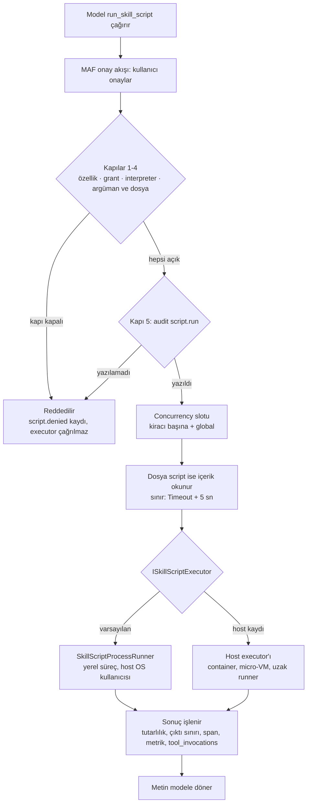
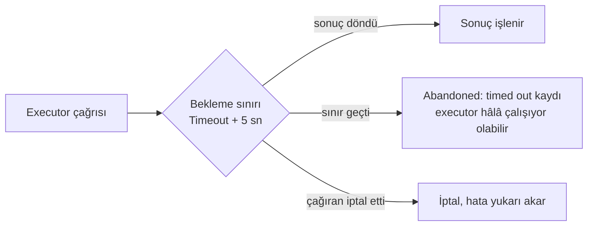

# Skill Script Çalıştırma Akışı

> Model `run_skill_script` çağırdığında Tracon'un ne yaptığını gösterir.
> Kaynak: `SandboxedSkillScriptRunner.cs`, `SkillScriptProcessRunner.cs`, `ISkillScriptExecutor.cs`.
> Diyagram koddan sapmışsa kod doğrudur. Kaynak okunarak 2026-10-17 tarihinde doğrulandı.

## Üst düzey akış

## Kapılar

Sıra, `SandboxedSkillScriptRunner.ExecuteAsync` içindeki sıradır. Bir kapı kapalıysa
executor hiç çağrılmaz. Her ret `script.denied` audit kaydı yazar ve `TraconException` fırlatır.

| # | Kapı | Kontrol |
|---|---|---|
| 1 | Özellik | `Skills.Scripts.Enabled` açık mı |
| 2 | Grant | Kiracı için geçerli `SkillScriptGrant` var mı. Stored script ise grant içerik hash'i taşımalı ve hash çalışacak içerikle eşleşmeli. Dar grant script hash'ini, skill geneli grant set hash'ini pinler |
| 3 | Interpreter | Dosya uzantısı `Interpreters` allow-list'inde mi |
| 4 | Argüman ve dosya | Argüman `MaxArgumentBytes` içinde ve şemaya uygun mu. Stored script adı düz dosya adı mı. Dosya script ise düzenli, boş olmayan ve `MaxScriptContentLength` içinde mi (metadata ile, dosya açılmadan) |
| 5 | Audit | `script.run` kaydı yazıldı mı. Yazılamazsa çalıştırma reddedilir |

**Saklı (stored) script yolunda** kapılardan önce iki ek kontrol vardır: `AllowStoredScripts`
açık olmalı, skill'de istenen ada sahip bir script bulunmalı. Parametre şeması da geçerli JSON olmalı.

## Kapı sonrası

1. Concurrency slotu alınır: önce kiracı başına limit, sonra global limit (`SkillScriptConcurrencyLimiter`).
   Slot, executor dönene veya bekleme sınırı geçene kadar tutulur.
2. Dosya script ise içerik bu noktada okunur. Okuma sınırı bir bayt fazlasıyla kontrol edilir.
3. Executor çağrılır.
4. Sonuç işlenir: tutarlılık kontrolü (timeout ile çıkış kodu birlikte, ya da ikisi de yoksa hata),
   çıktı sınırı yeniden uygulanır, span, metrik ve `tool_invocations` kaydı yazılır.

## Bekleme sınırı

Dosya okuma ve executor çağrısı tek bir sınır altındadır: `Timeout + 5 sn` (`ExecutorGracePeriod`).

## Executor seçimi

- **Varsayılan `SkillScriptProcessRunner`:** ayrı bir süreç başlatır, host'un OS kullanıcısıyla çalışır.
  Ortam değişkenleri temizlenir, yalnız `EnvironmentAllowList` içindekiler geçer. Argümanlar stdin'den gider.
  Timeout'ta süreç ağacı öldürülür ve geçici dizin silinir.
- **Host executor'ı:** `AddSingleton<ISkillScriptExecutor>` ile kaydedilir ve varsayılanın yerine geçer.
  `RequireCustomBinding<ISkillScriptExecutor>()` varsayılan çözülürse host'u durdurur.
- Kapılar her iki durumda da Tracon'dadır. Executor yalnız script'in nerede çalışacağını belirler.

## Sınır

Bu bir işletim sistemi sandbox'ı değildir. Tracon kapıları, bekleme sınırını, çıktı sınırını,
concurrency limitini ve audit kaydını sağlar. Script'in neyi okuyabileceği, hangi ağa çıkabileceği
ve hangi kaynakları kullanabileceği executor'ın ve host'un işidir.
