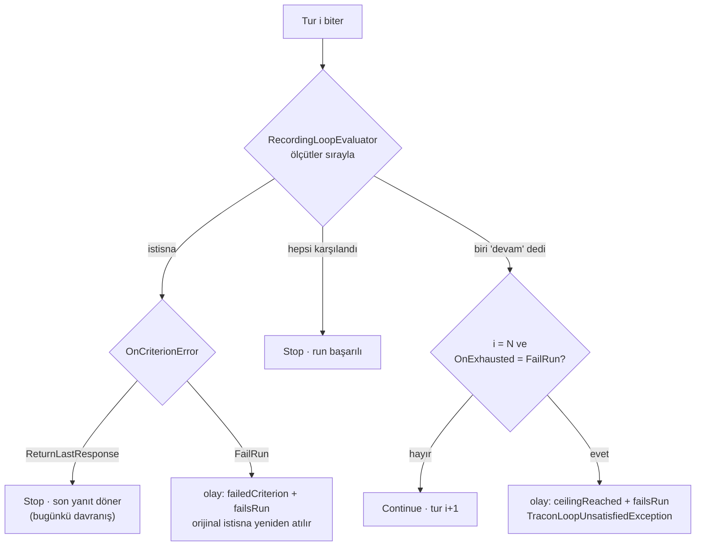

# Faz 192 — Döngü Tükenme Politikası

> **Durum:** ✅ Tamamlandı (2026-10-11)
> **Plan onayı:** Bakımcı, 2026-10-11 (engelleyici kararlar sohbette alındı: API şekli, son turun değerlendirilmesi, hata sınıfı)
> **Kaynak:** [ADAYLAR.md](../../ADAYLAR.md) · **F-293**
> **Önkoşul:** Yok. [Faz 151](151-HARNESSIN-DONGU-YETENEGI.md) döngüyü kurdu; bu faz onun bitiş davranışını seçilebilir yapar
> **Paketler:** `Tracon.Abstractions`, `Tracon.Core` · üretilen istemciler (`Tracon.Client`, `@tracon/client`) · `Tracon.UI` (yalnız iki sözlük satırı)
> **Yeni paket:** Yok · **Migration:** Yok (tanım JSON blob'unda yaşar; `run_errors.class` zaten `smallint`)
> **Public API:** Büyüyor — bir enum, iki `LoopSettings` alanı, bir istisna tipi, bir `RunErrorClass` üyesi. `1.0.0` GA'dan (K-603) önce ucuz: `wc -l src/*/PublicAPI.Shipped.txt` toplamı **17** satır (2026-10-11), her dosya yalnız başlık taşıyor
> **Tüketici yüzeyi:** site: `concepts/agents.md` (döngü bölümü), `guides/write-your-own-error-classifier.md` (sınıf listesi varsa) · sevk edilen: `LoopSettings` XML `<example>`, `RunErrorClass` ve `RunEventType.LoopIterationCompleted` XML'i, OpenAPI belgesi
> **Manuel test alanı:** `docs/manuel-test/02-CEKIRDEK-VE-KATALOG.md` — Faz 151 case'lerinin (`MT-CORE-123` civarı) yanına

---

## Bu Faza Başlarken

> `faz-baslangic` skill'ini uygula. Aşağıdaki liste o skill'in 2. adımıdır —
> **tamamını değil, yalnız işaret edilen bölümleri oku.**

1. Bu doküman
2. Kararlar — dosyanın tamamını **okuma**, yalnız bu kalemleri grep'le:
   ```bash
   grep -n "K-020\|K-603\|K-704\|K-705\|K-706\|K-840\|K-874" docs/KARARLAR.md
   ```
   **K-020** (`MAAI001` bastırması tek dosyada), **K-603** (`Shipped` GA'ya kadar boş; enum değerleri yeniden numaralanmaz), **K-704** (MAF'a tek composite evaluator), **K-705** (`MaxIterations` `null` → Tracon'in 10'u), **K-706** (`aiJudge` kendi binding'ini ister), **K-840** (`OperationCancellation.IsFailure`), **K-874** (yargıç istemcisi agent'tan önce kurulur, egress uygular)
3. Önceki faz devir notu gerekmez; döngünün kendi tasarımı [Faz 151](151-HARNESSIN-DONGU-YETENEGI.md) kaydındadır — yalnız grep'le:
   ```bash
   grep -n "ceilingReached\|failedCriterion\|MaxIterations" docs/arsiv/fazlar/151-HARNESSIN-DONGU-YETENEGI.md
   ```
4. Alan hafızası (üç alan):
   [`hafiza/maf-harness-ve-loop.md`](../../hafiza/maf-harness-ve-loop.md) (tavana ulaşan tur değerlendirilmez; evaluator istisnası run'ı düşürür) ·
   [`hafiza/run-olay-sozlesmesi.md`](../../hafiza/run-olay-sozlesmesi.md) (olay XML'i payload'da olmayan alan vaat edemez — `RunEventPayloadContractTests`) ·
   [`hafiza/agent-derleme-ve-onbellek.md`](../../hafiza/agent-derleme-ve-onbellek.md) (derlenmiş agent önbelleği, parmak izi)
5. Emsal: [Faz 131](131-YAPISAL-YANIT-DOGRULAMA-SEAMI.md) — akışlı yolda içerik aktıktan sonra run'ı `Failed` kapatan tek emsal. `grep -n "Akışta" docs/arsiv/fazlar/131-YAPISAL-YANIT-DOGRULAMA-SEAMI.md`

---

## Amaç

Bir tüketici (2026-10-11 podcast hattı) yazar agent'ına bir revizyon döngüsü
kurar: `aiJudge` ölçütü metni onaylamazsa agent yeniden yazar. Döngü tavana
ulaşırsa ya da yargıç hata verirse bugün run **başarılı** biter ve onaylanmamış
metin workflow'un sonraki düğümüne (TTS) geçer. Bu faz, tanımın sahibine iki
durumda da run'ı düşürme seçeneği verir. Varsayılan bugünkü davranıştır (K1).

- **F-293** — `LoopSettings`'e tükenme ve ölçüt hatası politikası; `FailRun`
  run'ı ayırt edilebilir bir hata sınıfıyla bitirir, workflow durur.

### Bugün ne çalışmıyor — doğrulanmış kanıt

| Kanıt | Gözlem |
|---|---|
| [`RecordingLoopEvaluator.cs:116-133`](../../../src/Tracon.Core/Compilation/RecordingLoopEvaluator.cs#L116-L133) | Ölçüt istisnası yakalanır, loglanır, `break` ile döngü durur; run başarılı biter |
| [`RecordingLoopEvaluator.cs:143-155`](../../../src/Tracon.Core/Compilation/RecordingLoopEvaluator.cs#L143-L155) | Tavan yalnız olayda `ceilingReached` olarak işaretlenir; son yanıt döner |
| [`LoopSettings.cs:72-110`](../../../src/Tracon.Abstractions/Agents/LoopSettings.cs#L72-L110) | `LoopSettings` yalnız `Criteria`, `MaxIterations`, `FreshContextPerIteration` taşır |
| [`LoopEvaluatorRegistry.cs:216`](../../../src/Tracon.Core/Compilation/LoopEvaluatorRegistry.cs#L216), [`:239-249`](../../../src/Tracon.Core/Compilation/LoopEvaluatorRegistry.cs#L239-L249) | MAF'a verilen `LoopAgentOptions.MaxIterations` tanımdaki tavanın kendisidir |
| [`hafiza/maf-harness-ve-loop.md`](../../hafiza/maf-harness-ve-loop.md) — MAF 1.20.0 probu | Tavana ulaşan tur **değerlendirilmez** (`MaxIterations = 10` → 10 model çağrısı, 9 değerlendirme; `= 1` → hiç) |
| [`HarnessLoopTests.cs:272`](../../../tests/Tracon.AspNetCore.FunctionalTests/HarnessLoopTests.cs#L272) | `A_criterion_that_throws_stops_the_loop_and_leaves_the_run_successful` bugünkü davranışı kilitler |
| [`RunErrorClass.cs:120`](../../../src/Tracon.Abstractions/Runs/RunErrorClass.cs#L120) | Son üye `StructuredResponseInvalid = 14`; döngü için bir sınıf yok |

> Kanıtlar 2026-10-11 tarihinde doğrulandı. MAF davranışı 1.20.0'da ölçüldü;
> depo hâlâ 1.20.0'dadır. Uygulama oturumu MAF sürümü değiştiyse ölçümü tekrarlar.

---

## 192.1 — Public sözleşme

İki alan, tek enum (kullanıcı kararı, 2026-10-11). İki durum bağımsız
ayarlanır: "yargıç ulaşılamadı → son yanıtı dön" ile "yargıç reddetti → düş"
farklı ihtiyaçlardır. Tek alanı GA'dan sonra ikiye bölmek kırıcı olurdu.

| Alan | Tip | Varsayılan | Anlam |
|---|---|---|---|
| `LoopSettings.OnExhausted` | `LoopOutcome` | `ReturnLastResponse` | Tavana ulaşıldı ve bir ölçüt hâlâ "devam" diyor |
| `LoopSettings.OnCriterionError` | `LoopOutcome` | `ReturnLastResponse` | Bir ölçüt değerlendirilirken istisna attı (run'ın kendi iptali hariç, K-840) |

`LoopOutcome` JSON'da **ad** olarak yazılır
(`[JsonConverter(typeof(JsonStringEnumConverter<LoopOutcome>))]`, depodaki
diğer tanım enum'larıyla aynı desen). Üyeler: `ReturnLastResponse = 0`,
`FailRun = 1`. Tanımlı olmayan sayısal değer derlemede
`TraconCompilationException` ile reddedilir (`Enum.IsDefined<T>`, AOT güvenli).

**Bugün eklemek bedava / sonradan eklemek kırıcı:** `LoopSettings` bir
`sealed record`'dur; GA'dan sonra alan eklemek ikili uyumluluk kararıdır.

## 192.2 — Son tur değerlendirilir (yalnız `OnExhausted = FailRun`)

MAF tavana ulaşan turu değerlendirmez. `FailRun` o turu değerlendirmeden
düşerse, son yanıt ölçütü karşılasa bile run düşer (yanlış ret). Bu yüzden
(kullanıcı kararı, 2026-10-11):

- `OnExhausted = FailRun` iken `LoopEvaluatorRegistry` MAF'a
  `MaxIterations = N + 1` verir. `RecordingLoopEvaluator` N. turda kendisi
  karar verir: bütün ölçütler karşılandıysa `Stop`; bir ölçüt "devam" diyorsa
  olay yazılır ve `TraconLoopUnsatisfiedException` atılır. MAF N+1. turu
  hiçbir zaman koşmaz.
- `OnExhausted = ReturnLastResponse` iken MAF'a `N` verilir ve davranış,
  olay sayısı ve maliyet **bugünküyle birebir aynıdır**.
- Bedel: `FailRun` modunda son turda bir ölçüt çağrısı daha (ölçüt `aiJudge`
  ise bir model çağrısı). Site sayfası bunu yazar.
- `ceilingReached` hesabı moda bağlıdır: `ReturnLastResponse` → `Iteration >= N - 1`
  (bugünkü formül), `FailRun` → `Iteration >= N`.
- `MaxIterations = 1` + `FailRun`: MAF'a 2 verilir, ilk tur değerlendirilir.
  Bugün `MaxIterations = 1` ile ölçüt hiç çağrılmıyor; bu fark site sayfasında
  ve XML'de yazılır.



## 192.3 — Hata kimliği

Kullanıcı kararı (2026-10-11): yeni sınıf yalnız tükenme içindir.

| Durum | İstisna | `ErrorType` | `RunErrorClass` |
|---|---|---|---|
| Tükenme, `FailRun` | `TraconLoopUnsatisfiedException` (yeni, `Tracon.Abstractions`) | `loop_unsatisfied` | `LoopUnsatisfied = 15` (yeni) |
| Ölçüt hatası, `FailRun` | Ölçütün attığı **orijinal** istisna (`ExceptionDispatchInfo.Throw`) | kendi kimliği | kendi sınıfı (`ProviderUnavailable`, `Timeout`, …) |

- Ölçüt hatasında hangi ölçütün düştüğünü `LoopIterationCompleted` olayının
  `failedCriterion` alanı zaten yazar; sağlayıcı arızası kalite reddiyle aynı
  kovaya karışmaz.
- `TraconLoopUnsatisfiedException` mesajı yalnız agent adını, tur sayısını ve
  "devam" diyen ölçütün **türünü** taşır. Model yanıtı ve ölçüt geri bildirimi
  **taşınmaz** (geri bildirim modele yazılmış serbest metindir; olay da onu
  taşımıyor). Önerilen üyeler: `AgentName`, `Iterations`, `UnsatisfiedCriterion`.
- `DefaultRunErrorClassifier.StableIdentities` `loop_unsatisfied` →
  `LoopUnsatisfied` eşlemesini alır.
- Yeni enum üyesi şunları birlikte değiştirir (F-246'nın listesi):
  `RunErrorClassContractTests` (`("LoopUnsatisfied", 15)`), OpenAPI belgesi
  (`docs/openapi/tracon.json`), üretilen `Tracon.Client` ve
  `packages/tracon-client/src/schema.ts`, iki sözlük
  (`locales/en/runs.ts`, `locales/tr/runs.ts` → `dashboard.errorClass.LoopUnsatisfied`).

## 192.4 — Olay sözleşmesi

`LoopIterationCompletedEventPayload` bir alan alır: `failsRun` (bool). Bu
değerlendirme run'ı `Failed` bitiriyorsa `true`'dur. Gerekçe: `ceilingReached`'in
bugünkü anlamı "bu olaydan sonra bir tur daha koşar ve değerlendirilmez"dir;
`FailRun` modunda sonraki tur koşmaz. Alan olmadan olay akışı ikisini ayıramaz.

- `RunEventType.LoopIterationCompleted` XML'i alanı adıyla anar.
  `RunEventPayloadContractTests` XML ile payload'ı karşılaştırır.
- Olay metni `failsRun` iken bunu söyler, ör.
  `iteration 3 continued by 'aiJudge'; the iteration ceiling ends the loop and fails the run`.
- Arayüz olayı tanıyor (`run-event.ts:42`, `run-detail.tsx:117`); yeni alan
  için ekran değişikliği **yoktur**. Konsolda düzenleme F-302'nin işidir.

## 192.5 — Akışlı yol ve workflow

- **Akışlı yol.** MAF akışta da her turdan sonra değerlendirir
  (`HarnessLoopTests.The_streaming_path_records_the_same_iterations_and_names_the_frame_on_the_wire`).
  `FailRun` kararı son tur akıp bittikten sonra verilir: istemci metni görmüş
  olur, sonra hata çerçevesini alır ve run `Failed` kapanır. Faz 131'in
  yapısal yanıt doğrulaması aynı sözleşmeyle çalışır. Site sayfası bunu açıkça
  yazar: "streaming clients receive the last turn's text before the failure".
- **Workflow.** Katılımcı agent'ın istisnası graf düzeyinde hata üretir ve
  `WorkflowRunner` run'ı düşürür ([`WorkflowRunner.cs:861-869`](../../../src/Tracon.Workflows/Internal/WorkflowRunner.cs#L861-L869)).
  Sonraki düğümün **koşmadığı** ve workflow run'ının hata sınıfı
  **Doğrulanmadı — fonksiyonel testle ölçülmeli** (MAF istisnayı
  `WorkflowErrorEvent.Exception` içinde sarmalıyor olabilir; sınıflandırıcı
  sarmalı açmıyorsa sınıf `Unknown` çıkar).
- **MAF istisnayı sarmalıyor mu?** Hafıza "evaluator istisnası run'ı düşürür"
  der ama türünü söylemez. **Doğrulanmadı — `maf-api-kesfi` ile ya da
  fonksiyonel testte `run.Error.Class` ile ölçülmeli.** Sarmalıyorsa sınıf
  `Unknown` olur; çözüm sınıflandırıcıda sarmalı açmaktır, istisna metnini
  eşlemek değil.

---

## Planlanan Public API

> Taslak imzalardır. Gerçekleşen imzalar kapanışta ayrı bir bölüme yazılır.

```csharp
// Tracon.Abstractions — Agents/LoopOutcome.cs
[JsonConverter(typeof(JsonStringEnumConverter<LoopOutcome>))]
public enum LoopOutcome
{
    ReturnLastResponse = 0,
    FailRun = 1,
}

// Tracon.Abstractions — Agents/LoopSettings.cs (yeni üyeler)
public sealed record LoopSettings
{
    public LoopOutcome OnExhausted { get; init; }        // varsayılan ReturnLastResponse
    public LoopOutcome OnCriterionError { get; init; }   // varsayılan ReturnLastResponse
}

// Tracon.Abstractions — TraconException.cs yanında (diğer istisnalarla aynı dosya deseni)
public sealed class TraconLoopUnsatisfiedException : TraconException
{
    public const string LoopUnsatisfiedErrorType = "loop_unsatisfied";
    public required string AgentName { get; init; }
    public required int Iterations { get; init; }
    public required string UnsatisfiedCriterion { get; init; }
    public override string ErrorType => LoopUnsatisfiedErrorType;
}

// Tracon.Abstractions — Runs/RunErrorClass.cs
LoopUnsatisfied = 15,
```

### HTTP `endpoint`'leri

Yeni uç yok. `PUT /api/agents/{name}` ve `POST /api/agents/validate` iki alanı
`harness.loop.onExhausted` / `harness.loop.onCriterionError` olarak kabul eder;
bilinmeyen ad `400` döner (string enum dönüştürücüsü).

### Arayüz payı

İki sözlük satırı. Bundle payı ölçülmeli (beklenen < 0,1 KB gzip; bütçe 250 KB).

---

## Planlanan Dosya Listesi

```
src/Tracon.Abstractions/
├── Agents/LoopOutcome.cs                     (yeni)
├── Agents/LoopSettings.cs                    (iki alan + XML + <example>)
├── Runs/RunErrorClass.cs                     (LoopUnsatisfied = 15)
├── Runs/RunEventType.cs                      (LoopIterationCompleted XML: failsRun)
├── TraconException.cs                        (TraconLoopUnsatisfiedException)
└── PublicAPI.Unshipped.txt
src/Tracon.Core/
├── Compilation/LoopEvaluatorRegistry.cs      (N+1, enum doğrulaması, politikayı evaluator'a ver)
├── Compilation/RecordingLoopEvaluator.cs     (politika, ceilingReached formülü, failsRun, throw)
└── Runs/DefaultRunErrorClassifier.cs         (loop_unsatisfied → LoopUnsatisfied)
src/Tracon.UI/frontend/src/locales/{en,tr}/runs.ts
docs/openapi/tracon.json · src/Tracon.Client/Generated/* · packages/tracon-client/src/schema.ts   (üretilir)
docs-site/src/content/docs/concepts/agents.md
tests/Tracon.Core.UnitTests/Compilation/LoopEvaluatorRegistryTests.cs
tests/Tracon.Core.UnitTests/Runs/RunErrorClassContractTests.cs
tests/Tracon.AspNetCore.FunctionalTests/HarnessLoopTests.cs
tests/Tracon.AspNetCore.FunctionalTests/  (workflow durma testi — WorkflowEndpointTests deseni)
```

---

## Hata Modları ve Testler

> Mutlu yoldan değil, **ne bozulabilir**den türetilir. Seviyeyi plan seçer.
> Sınır geçen davranış (DI · HTTP · kiracı · akış · depo · paket) birim
> testiyle kanıtlanamaz — [`.agents/ortak/test-seviyeleri.md`](../../../.agents/ortak/test-seviyeleri.md).

| Ne bozulabilir | Seviye | Test |
|---|---|---|
| Varsayılan politika bugünkü davranışı değiştirir (olay sayısı, model çağrısı, `Completed`) | Fonksiyonel | `HarnessLoopTests` mevcut on test **değişmeden** yeşil kalır |
| `FailRun` tükenmede run `Completed` kalır ya da sınıf `Unknown` çıkar | Fonksiyonel (HTTP + kayıt) | `HarnessLoopTests`: `run.Status == Failed`, `run.Error.Class == LoopUnsatisfied`, model çağrısı **N** (N+1 değil), olay sayısı N, son olay `ceilingReached` + `failsRun` |
| Son tur değerlendirilmez; son yanıt ölçütü karşılasa da run düşer | Fonksiyonel | Ölçüt yalnız N. turda karşılanır → `Completed` |
| `FailRun` modunda N+1. tur koşar (fatura) | Fonksiyonel | sağlayıcı istek sayısı tam N |
| Ölçüt hatası `FailRun`'da yutulur ya da sınıfı kaybolur | Fonksiyonel | atan ölçüt → `Failed`, sınıf orijinal istisnanınki; olay `failedCriterion` + `failsRun` |
| Run'ın kendi iptali ölçüt hatası sayılır | Fonksiyonel | mevcut `Cancellation_during_the_loop_…` testi `FailRun` ile de koşar → `Canceled`, `LoopUnsatisfied` değil |
| Akışlı yolda run `Completed` kalır ya da hata çerçevesi gelmez | Fonksiyonel (SSE) | akışlı `FailRun` tükenme: içerik çerçeveleri gelir, sonra hata çerçevesi, run `Failed` |
| Workflow sonraki düğümü koşar | Fonksiyonel (workflow) | sıralı workflow: agent (`FailRun`) → fonksiyon düğümü; fonksiyon çağrılmaz, workflow run `Failed`, sınıf ölçülür ve yazılır |
| MAF evaluator istisnasını sarmalar, sınıf `Unknown` olur | Fonksiyonel | yukarıdaki iki testin `Error.Class` iddiası |
| Tanımlı olmayan enum değeri sessizce `ReturnLastResponse` gibi davranır | Birim | `LoopEvaluatorRegistryTests`: `(LoopOutcome)7` → `TraconCompilationException` |
| Bilinmeyen ad tanıma yazılır | Fonksiyonel (HTTP) | `PUT` `"onExhausted":"Explode"` → `400` |
| MAF'a verilen tavan modda yanlış | Birim | `LoopEvaluatorRegistryTests`: `ReturnLastResponse` → `N`, `FailRun` → `N + 1` |
| Politika değişince önbellekteki agent eski politikayla koşar | Fonksiyonel | tanım `PUT` ile değişir → sonraki run yeni politikayı uygular (`CompiledAgentCacheKeyCoverageTests` kapsamı da kontrol edilir) |
| Eşzamanlı iki run birbirinin döngü durumunu görür | Birim | `RecordingLoopEvaluator` durum tutmaz; karar yalnız `LoopContext`'ten gelir — inceleme + mevcut yapı; yeni alan eklenirse eşzamanlı test |
| Olay yazımı hata verir, run sonucu değişir | Fonksiyonel | `RunEventWriter` hatayı yutar (mevcut sözleşme); karar olaydan bağımsız atılır |
| Yeni enum üyesi istemcide, sözlükte ya da sözleşme testinde eksik | Birim + derleme | `RunErrorClassContractTests`, sözlük eksikliği derleme hatası (K-228), OpenAPI tazelik kapısı |
| Olay XML'i `failsRun`'ı anmaz ya da payload'da yoktur | Birim | `RunEventPayloadContractTests` |
| İstisna mesajı model yanıtı ya da geri bildirim taşır | Birim | mesaj yalnız ad, tur sayısı, ölçüt türü içerir |

Beş soru: **iptal** — `OperationCancellation.IsFailure` korunur, run'ın kendi
iptali politikaya girmez · **eşzamanlılık** — evaluator durumsuz kalır ·
**boş/aşırı girdi** — `MaxIterations = 1`, tanımsız enum, bilinmeyen ad ·
**başka kiracı** — yeni kiracı yolu yok; yargıç istemcisi K-874 ile değişmez ·
**alt sistem hatası** — olay yazımı hatası kararı değiştirmez; yargıç
sağlayıcısı hatası `OnCriterionError`'a girer.

---

## Manuel Kabul Case'leri

> Kapanışta `docs/manuel-test/02-CEKIRDEK-VE-KATALOG.md` içine eklenir.
> Numara kapanışta alınır.

| # | Ön koşul | Adımlar | Beklenen sonuç |
|---|---|---|---|
| 1 | Örnek uygulama, gerçek model | `harness.loop`: `completionMarker` (model yazmayacak bir işaret), `maxIterations: 2`, `onExhausted: "FailRun"` → `run` | `run` `Failed`, `error.class` `LoopUnsatisfied`; olay akışında 2 `LoopIterationCompleted`, sonuncusu `failsRun: true` |
| 2 | Aynı tanım, `onExhausted` verilmez | `run` | `Completed` (bugünkü davranış), 1 olay, `ceilingReached: true` |
| 3 | Aynı tanım, akışlı uç | SSE ile `run` | metin çerçeveleri gelir, sonra hata çerçevesi; run `Failed` |
| 4 | `aiJudge` ölçütü, yargıç binding'i ulaşılamayan bir uca işaret eder, `onCriterionError: "FailRun"` | `run` | `Failed`, sınıf yargıç hatasının sınıfı (`LoopUnsatisfied` değil); olay `failedCriterion: "aiJudge"` |
| 5 | Sıralı workflow: agent (case 1 tanımı) → fonksiyon düğümü | workflow `run` | workflow `Failed`; fonksiyon düğümü koşmadı (`ExecutorCompleted` yok) |

---

## Açık Sorular

| # | Soru | Seçenekler | Öneri |
|---|---|---|---|
| 1 | Workflow run'ının hata sınıfı katılımcının sınıfını mı taşır? | A: sınıflandırıcı `WorkflowErrorEvent.Exception` sarmalını açar · B: workflow `Unknown` kalır, katılımcı run'ı doğru sınıfı taşır | Ölçümden sonra karar. A, sarmal tek tipse ucuzdur; sınıflandırıcıda metin eşleme **yapılmaz** |
| 2 | `ReturnLastResponse` modunda da son tur değerlendirilsin mi? | A: hayır (bugünkü maliyet) · B: evet, olay sayısı tur sayısına eşit olur | A. B bugünkü davranışı ve faturayı değiştirir (K1); istenirse ayrı aday |

---

## Bitiş Ölçütleri (DoD)

- [x] `onExhausted: "FailRun"` + ulaşılamayan işaret → `run` `Failed`, `error.class == "LoopUnsatisfied"`, sağlayıcı çağrısı tam `maxIterations` — `FailRun_on_exhaustion_fails_the_run_after_exactly_MaxIterations_turns`; canlı `MT-CORE-132`
- [x] Ölçüt yalnız son turda karşılanırsa `FailRun` modunda run `Completed` — `FailRun_on_exhaustion_completes_a_run_whose_last_turn_meets_the_criterion`
- [x] `onCriterionError: "FailRun"` → run orijinal hatanın sınıfıyla `Failed`; olay `failedCriterion` + `failsRun` — `FailRun_on_criterion_error_fails_the_run_with_the_criterions_own_class`
- [x] Alanlar verilmezse `HarnessLoopTests`'in mevcut on testi değişmeden yeşil — 19/19; canlı `MT-CORE-133`
- [x] Akışlı yolda içerik + hata çerçevesi + `Failed` — `FailRun_on_exhaustion_streams_the_last_turn_and_then_fails_the_run` (süreç içi akış); SSE çerçevesi canlı `MT-CORE-134`
- [x] Workflow sonraki düğümü koşmaz; workflow run sınıfı ölçüldü ve "Plandan Sapmalar"a yazıldı — `A_workflow_stops_at_an_agent_whose_loop_fails_on_exhaustion`; sapma #2, F-314
- [x] `RunErrorClassContractTests`, `RunEventPayloadContractTests`, OpenAPI tazeliği, iki sözlük yeşil
- [x] Dört doğrulama kapısı sıfır uyarı verir — `kapi.py kapanis --taban 07afea6b`
- [x] `samples/Tracon.Api` ile gerçek `run` yapıldı, çıktı belgeye yazıldı — `MT-CORE-132`…`134`, `136` (`gpt-5.4-mini`)
- [x] `secret` taraması boş döndü — kapanış kapısının `tarama` adımı
- [x] Manuel kabul case'leri `docs/manuel-test/02-CEKIRDEK-VE-KATALOG.md` içine eklendi; otomatikleştirilebilenler koşuldu — `MT-CORE-132`…`136` (135 ➜ CI)
- [x] `faz-denetim` koşuldu; 🔴 bulgu kalmadı — tek 🔴 düzeltildi (aşağıda)
- [x] `docs-site/` güncellendi (`concepts/agents.md`: iki alan, son tur bedeli, `MaxIterations = 1` farkı, akışlı yol cümlesi); `npm run build` + `check-links.mjs` temiz — `npm run check`
- [x] `en.ts` ve `tr.ts` eksiksiz; bundle payı ölçüldü ve yazıldı — +50 B gzip (201522 → 201572)

### Doğrulama komutları

```bash
# FailRun tükenme — örnek uygulama (port ve anahtar kurulumu: docs/manuel-test/00-INDEKS.md)
curl -s -X PUT http://localhost:5081/tracon/api/agents/loop-gate -H 'Content-Type: application/json' \
  -d '{"name":"loop-gate","model":{"provider":"openai","model":"gpt-5-mini"},"instructions":"Answer briefly.",
       "harness":{"loop":{"criteria":[{"kind":"completionMarker","marker":"NEVER-WRITTEN"}],"maxIterations":2,"onExhausted":"FailRun"}}}'
curl -s -X POST http://localhost:5081/tracon/api/agents/loop-gate/run -H 'Content-Type: application/json' -d '{"message":"hi"}'
# → run Failed, error.class LoopUnsatisfied
python3 scripts/kapi.py test --proje Tracon.AspNetCore.FunctionalTests --sinif "*HarnessLoopTests*"
```

---

## Riskler

| Risk | Önlem |
|------|-------|
| MAF loop API'si `MAAI001` (değerlendirme amaçlı); N+1 hilesi MAF'ın tavan davranışına dayanır | Davranış fonksiyonel testle kilitlenir (sağlayıcı istek sayısı tam N). MAF yükseltmesi testi kırarsa görünür |
| MAF evaluator istisnasını sarmalar, sınıf `Unknown` olur | §192.5 ölçümü; çözüm sınıflandırıcıda tip bazlı sarmal açma |
| Akışlı istemci reddedilen metni görür | Faz 131 emsali; site sayfası açıkça yazar. Metni tutup sonra salmak (buffer) bu fazın kapsamı değildir |
| `FailRun` bir `aiJudge` çağrısı ekler | Yalnız `FailRun` modunda; site sayfası bedeli yazar |

---

<!-- ============================================================
     AŞAĞISI KAPANIŞTA DOLDURULUR — `faz-tamamlama` skill'i.
     Plan anında boş kalır. Başlıkları SİLME.
     ============================================================ -->

## Plandan Sapmalar

> Kapanışta doldurulur. Plan ile gerçek arasındaki fark **gizlenmez** — sonraki
> oturumun en değerli bilgisidir.

| # | Plan | Gerçek | Neden |
|---|---|---|---|
| 1 | `TraconLoopUnsatisfiedException` üyeleri `required` | `init`, `required` değil (`AgentName`/`UnsatisfiedCriterion` `string?`) | Diğer Tracon istisnaları gibi üç standart kurucu (CA1032 deseni) kullanılabilir kalsın; `required` üye parametresiz kurucuyu `SetsRequiredMembers`'sız kullanılamaz yapardı. İstisnayı yalnız `RecordingLoopEvaluator` üretir ve üçünü de doldurur |
| 2 | Açık Soru 1: ölçümden sonra karar | **Ölçüldü:** MAF evaluator istisnasını sarmalamıyor; çocuk agent run'ı `LoopUnsatisfied` taşır. Workflow satırı `error.type` olarak CLR adını (`Tracon.TraconLoopUnsatisfiedException`) yazar ve `error.class` boş kalır — bu, `WorkflowRunner.ToRunError`'ın BÜTÜN workflow hataları için davranışıdır. Kullanıcı kararı (seçenek B): faz kapsamı dar kalır, yeni kusur adayı **F-314** | Değişiklik döngüye değil tüm workflow hatalarına dokunur ve `error.type` değerini değiştirir |
| 3 | Manuel case 1: `provider: "openai"`, `gpt-5-mini` | `provider: "openai-responses"`, `gpt-5.4-mini` (örnek uygulamanın varsayılanı) | Harness modu Chat Completions sağlayıcısında iki ayrı `400` ile düştü (web araması `web_search_options`; tool çağrısından sonra `messages.[1].role`). Faz dışı kusur, **F-315** |
| 4 | Üç kullanıcı kararı `KARARLAR.md`'ye | Tek satır **K-884** (üç kararı birlikte taşır) | Defter bütçesi %0 boşluktaydı (`karar-damit` aynı gün koştu); üçü tek bir API kararının parçalarıdır |
| 5 | MAF'a `N + 1` | `N < int.MaxValue` iken `N + 1`, aksi hâlde `N` | Taşma koruması; pratikte erişilemez |
| 6 | Arayüz: iki sözlük satırı | + `full-replace-editors.test.tsx` fikstürü iki alanı taşır; konsol ekran görüntüleri ve landing kırpım pin'leri yeniden üretildi | Üretilen TS şeması alanları zorunlu kılar; fikstür tam-PUT editörünün yeni alanları **koruduğunu** da kanıtlar (16/16). Ekran görüntüsü damgası arayüz kaynağının hash'idir; görsel değişiklik yok (kırpımlar gözle doğrulandı) |
| 7 | Site: `concepts/agents.md` (+ sınıf listesi varsa sınıflandırıcı kılavuzu) | `concepts/agents.md` yeni alt bölüm · `concepts/runs.md` sınıf cümlesi · `capabilities.md` satırı · `CHANGELOG.md` | Sınıflandırıcı kılavuzu sınıf listesi taşımıyor; değişmedi |
| 8 | Akışlı yol fonksiyonel testi | Test süreç içi `RunStreamingAsync` ile koşar, SSE ile değil; SSE `error` çerçevesi canlı `MT-CORE-134`'te ölçüldü | Hata çerçevesini yazan uç fazdan önce de vardı; fazın yeni davranışı istisnanın akışın sonunda atılmasıdır |
| 9 | Planda `usage` yoktu | `FailRun` yolu turların `usage`'ını yan kanala ekler: `RecordingLoopEvaluator` her değerlendirilen turun `LastResponse.Usage`'ını `LoopContext.AdditionalProperties`'te toplar, yalnız run'ı düşürürken `TraconRunContext.ExtraUsage`'a ekler | Denetim 🔴: istisnayla biten run'ın tek `usage` kaynağı yan kanaldır; düzeltmeden önce `run.usage`/`cost` `null`, kota `0`. Üç test düzeltmeden önce kırmızıydı (akışlı yol dahil); canlı `13142` token |
| 10 | Mağaza sözleşmesi planda yoktu | `AgentDefinitionStoreContract` `Harness.Loop`'u iki alan `FailRun` iken gidiş-dönüş taşır; dört mağazada yeşil | Denetim 🟢; yeni alanlar kalıcı JSON'a girer |
| 11 | — | Başarılı döngü run'ının `usage`'ı yalnız son turdur (akışlı ve akışsız) — fazdan ÖNCE de böyleydi. Başarılı yol testi bu yüzden eklenmedi; iş **F-317** (🟠) | Katman probu: `LoopAgent` `30/5`, dış MAF `OpenTelemetryAgent` `10/1`; akışlı yolda kaydedici son `UsageContent`'i yazar. Düzeltme boru hattı kararı ister |

## Bu Fazda Verilen Kararlar

> Kapanışta doldurulur. Fazın kararları burada yazılır. Dört kategoriden birine
> giren karar (AGENTS.md) ayrıca `docs/KARARLAR.md`'ye K-NNN ve kategori
> etiketiyle girer ve numarası burada anılır; girmeyen karar yalnız burada
> kalır (`faz-tamamlama` Adım 8). Plan numara rezerve etmez.
>
> Plan anında kullanıcıdan alınan üç karar (2026-10-11) kapanışta buraya ve —
> `public-api` kategorisinde — `KARARLAR.md`'ye yazılır: iki alan tek enum ·
> `FailRun`'da son tur değerlendirilir · yeni sınıf yalnız tükenme için.

- **K-884** *(public-api, kullanıcı kararı)* — üç plan kararı tek satırda: iki
  bağımsız alan + tek `LoopOutcome` enum'u; `OnExhausted = FailRun` iken tavandaki
  tur değerlendirilir (MAF'a `N + 1`); `LoopUnsatisfied = 15` yalnız tükenme için,
  ölçüt hatası orijinal istisnayla düşer.
- **Açık Soru 1** *(kullanıcı kararı, kategori dışı)* — workflow satırının
  sınıflandırılması bu fazda yapılmadı; ölçüm testte kilitli
  (`A_workflow_stops_at_an_agent_whose_loop_fails_on_exhaustion`), iş F-314'te.
- **Açık Soru 2** — plan önerisi A uygulandı: `ReturnLastResponse` modunda son tur
  değerlendirilmez (bugünkü maliyet); mevcut on test değişmeden yeşil.

## Gerçekleşen Public API

> Kapanışta doldurulur. Koddaki **gerçek** imzalar.

```csharp
// Tracon.Abstractions — Agents/LoopOutcome.cs
[JsonConverter(typeof(JsonStringEnumConverter<LoopOutcome>))]
public enum LoopOutcome { ReturnLastResponse = 0, FailRun = 1 }

// Tracon.Abstractions — Agents/LoopSettings.cs
public LoopOutcome OnExhausted { get; init; }        // varsayılan ReturnLastResponse
public LoopOutcome OnCriterionError { get; init; }   // varsayılan ReturnLastResponse

// Tracon.Abstractions — TraconException.cs
public sealed class TraconLoopUnsatisfiedException : TraconException
{
    public const string LoopUnsatisfiedErrorType = "loop_unsatisfied";
    public TraconLoopUnsatisfiedException();
    public TraconLoopUnsatisfiedException(string message);
    public TraconLoopUnsatisfiedException(string message, Exception innerException);
    public string? AgentName { get; init; }
    public int Iterations { get; init; }
    public string? UnsatisfiedCriterion { get; init; }
    public override string ErrorType { get; }       // "loop_unsatisfied"
}

// Tracon.Abstractions — Runs/RunErrorClass.cs
LoopUnsatisfied = 15,
```

Olay: `LoopIterationCompleted` payload'ı `failsRun` (bool) alanını taşır
(`LoopIterationCompletedEventPayload.FailsRun`, internal record). OpenAPI:
`LoopOutcome` şeması, `LoopSettings.onExhausted`/`onCriterionError`,
`RunErrorClass` enum'unda `LoopUnsatisfied`; `Tracon.Client` ve
`@tracon/client` yeniden üretildi. Public tip sayısı `Tracon.Abstractions`
405 → 407 (`public-surface-baseline.txt`).

## Dosya Listesi (gerçekleşen)

> Kapanışta doldurulur.

```
src/Tracon.Abstractions/Agents/LoopOutcome.cs                 (yeni)
src/Tracon.Abstractions/Agents/LoopSettings.cs                (iki alan, XML, ikinci <example>)
src/Tracon.Abstractions/Runs/RunErrorClass.cs                 (LoopUnsatisfied = 15)
src/Tracon.Abstractions/Runs/RunEventType.cs                  (LoopIterationCompleted XML: failsRun)
src/Tracon.Abstractions/TraconException.cs                    (TraconLoopUnsatisfiedException)
src/Tracon.Abstractions/PublicAPI.Unshipped.txt
src/Tracon.Core/Compilation/LoopEvaluatorRegistry.cs          (enum doğrulaması, N+1)
src/Tracon.Core/Compilation/RecordingLoopEvaluator.cs         (politika, ceilingReached, failsRun, throw, usage toplamı)
src/Tracon.Core/Recording/SideChannelUsageAccumulator.cs      (XML: üçüncü kaynak)
src/Tracon.Testing.Contracts.Xunit/Contracts/AgentDefinitionStoreContract.cs (Harness.Loop gidiş-dönüş)
src/Tracon.Core/Runs/DefaultRunErrorClassifier.cs             (loop_unsatisfied → LoopUnsatisfied)
src/Tracon.Client/Generated/TraconApiClient.g.cs              (üretildi)
src/Tracon.UI/frontend/src/locales/{en,tr}/runs.ts            (iki satır)
src/Tracon.UI/frontend/src/full-replace-editors.test.tsx      (fikstür)
docs/openapi/tracon.json · packages/tracon-client/src/schema.ts (üretildi)
docs-site/src/content/docs/concepts/{agents,runs}.md · capabilities.md · public/llms-full.txt
docs-site/public/screenshots/*.png + .ui-source.sha256 · docs-site/scripts/landing-captures.mjs (pin)
tests/Tracon.Core.UnitTests/Compilation/LoopEvaluatorRegistryTests.cs   (+6 vaka)
tests/Tracon.Core.UnitTests/Runs/{RunErrorClassContractTests,DefaultRunErrorClassifierTests}.cs
tests/Tracon.Core.UnitTests/Architecture/public-surface-baseline.txt
tests/Tracon.AspNetCore.FunctionalTests/HarnessLoopTests.cs   (+9 vaka; üç FailRun vakası usage iddiası taşır)
docs/hafiza/maf-harness-ve-loop.md · docs/ADAYLAR.md (F-314…F-317)
CHANGELOG.md
```

Testler: `LoopEvaluatorRegistryTests` (MAF tavanı `N`/`N+1`, yargıç politikası
tavanı değiştirmez, tanımsız enum iki alanda reddedilir) ·
`HarnessLoopTests` (tükenme `Failed`/`LoopUnsatisfied`/tam N istek/N olay ·
son turda karşılanan ölçüt `Completed` · `MaxIterations = 1` değerlendirilir ·
ölçüt hatası orijinal sınıf · iptal `Canceled` · akışlı yol metin + hata ·
bilinmeyen ad `400` · kayıtlı politika değişikliği önbellekteki agent'a ulaşır
· workflow sonraki düğümü koşmaz) · `RunErrorClassContractTests` ·
`DefaultRunErrorClassifierTests`.

## Süreç Ölçümü

> Kapanışta doldurulur. **Tablo olarak** — onay kutusu DEĞİL.

| Metrik | Değer |
|---|---|
| Plan revizyonu sayısı | 0 |
| Düzeltme turu sayısı | 4 (test derleme/yol · site kapısı: `llms-full`, ekran görüntüsü damgası, landing pin · denetim 🔴 · denetim 🟢 sözleşme) |
| 🔴 bulgu: gerçek / gürültü / araştırılacak | 1 / 0 / 0 |
| Fazın ürettiği regresyon | 0 |
| Faz kapandıktan sonra bulunan kusur | 0 |

## Denetim Bulguları

> Kapanışta doldurulur — `faz-denetim` çıktısı. Her satır: bulgu · seviye
> (🔴/🟡/🟢) · sonuç (düzeltildi / gerekçelendi / F-NN olarak devredildi).
> Bulgu yoksa "🔴 ve 🟡 yok" yazılır; boş bırakılmaz.

| Bulgu | Seviye | Sonuç |
|---|---|---|
| `FailRun` ile düşen run tamamlanan turların `usage`'ını kaybeder: `run.usage`/`cost` `null`, kota `Tokens = 0` | 🔴 | **Düzeltildi** — sapma #9; üç test kırmızı → yeşil; canlı `MT-CORE-132` `13142` token |
| Akışsız run endpoint'i `LoopUnsatisfied`'ı (ve `StructuredResponseInvalid`'ı) `502` ve `errorType`'sız döner | 🟢 | **F-316** olarak devredildi — public HTTP sözleşmesi kararı |
| `AgentDefinitionStoreContract` `Harness.Loop`'u gidiş-dönüş sınamaz | 🟢 | **Düzeltildi** — sapma #10; dört mağaza yeşil |
| Akışlı test SSE değil süreç içi | not | Sapma #8'e yazıldı |

🟡 yok. Düzeltme sırasında fazdan bağımsız, önceden var olan bir kusur bulundu:
başarılı döngü run'ı yalnız son turun `usage`'ını kaydeder — **F-317** (🟠).

## Sonraki Faza Devir Notu

> Kapanışta doldurulur: devralınan sözleşmeler, bilinen tuzaklar (🚨), yarım
> kalan işler, sıradaki faz.

**Devralınan sözleşmeler**

- `LoopSettings.OnExhausted` / `OnCriterionError` (`LoopOutcome`), varsayılan
  `ReturnLastResponse` = Faz 151 davranışı birebir. `FailRun` tükenmede
  `TraconLoopUnsatisfiedException` (`loop_unsatisfied`, `LoopUnsatisfied = 15`);
  ölçüt hatasında orijinal istisna.
- `LoopIterationCompleted` payload'ı `failsRun` taşır; `FailRun` tükenmesinde olay
  sayısı tur sayısına eşittir (varsayılan modda bir eksik).

**Bilinen tuzaklar**

- 🚨 `FailRun` tavanı MAF'a `N + 1` vererek çalışır ve MAF'ın "tavana ulaşan tur
  değerlendirilmez" kuralına dayanır (K-884). MAF yükseltmesi bunu değiştirirse
  `HarnessLoopTests`'in "sağlayıcı istek sayısı tam N" iddiası kırmızı olur.
- 🚨 Harness modu `openai` (Chat Completions) sağlayıcısında `400` ile düşer
  (F-315); gerçek model koşumlarında `openai-responses` kullan.
- Workflow satırı hata sınıfı taşımaz ve türü CLR adıyla yazar (F-314); sınıfı
  katılımcı agent run'ından oku.
- 🚨 Başarılı döngü run'ının `usage`'ı yalnız son turdur (F-317, önceden var).
  `FailRun` yolu kendi toplamını `ExtraUsage`'a ekler; F-317 düzeltilirken akışlı
  istisna yolu `usage` yazmaya başlarsa bu ekleme çift sayar — ikisi birlikte ele alınır.

**Yarım kalan / devredilen işler:** F-317 (🟠, döngü `usage`'ı), F-314 (workflow
satırını sınıflandırma), F-315 (harness + Chat Completions), F-316 (akışsız
endpoint durum kodu), F-302 (konsolda `Loop` düzenleme — iki yeni
alan da editörde yok; tam-PUT editörü onları korur, düzenlemez).

**Sıradaki faz:** [Faz 193](../../193-NET8-NET9-DUSURME.md) — `net8.0`/`net9.0`
düşürme; K-855 gereği **2026-11-10'dan önce başlamaz**. O tarihe kadar iş
`ADAYLAR.md`'den seçilir (🟠 F-317 kusur giderme; 🟠 F-294, F-295 faz planlama;
🟡 F-314, F-315 kusur giderme).
