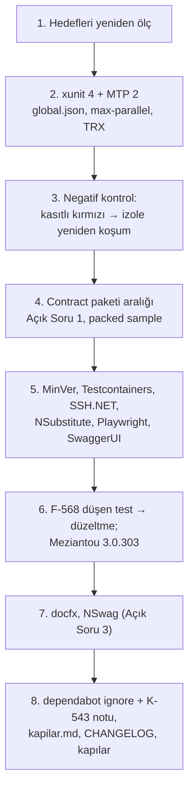

# Faz 215 — Test ve Derleme Araçları

> **Durum:** ✅ Tamamlandı (2026-10-16)
> **Plan onayı:** kullanıcı fazı `faza başla ve bitir` diyerek başlattı (2026-10-16); Açık Sorular 1-3 ayrıca yanıtlanmadı, **planın önerdiği seçenekle (A) uygulandı** — bkz. *Plandan Sapmalar* 1 ve *Bu Fazda Verilen Kararlar*. Kapsam kararı: **UR-009 B**, farukatasoy, 2026-10-16.
> **Kaynak:** [ADAYLAR.md](../../ADAYLAR.md) · **F-557** (üç fazın ikincisi), **F-568** (analyzer yükseltmesinin bulduğu yapılandırma kusuru)
> **Genellik:** Tüketiciye iki yoldan dokunur: sevk edilen `Tracon.Testing.Contracts.Xunit` `xunit.v3`'e bağlıdır (A-70) ve `Tracon.Client` NSwag ile üretilir. Geri kalanı geliştirme aparatıdır (`PrivateAssets=all`), ama kapanış kapısı ve CI ona dayanır. İkinci kanıt: K-543'ün beş `ignore` kaleminden ikisinin gerekçesi artık yok (deneme, 2026-10-16).
> **Karşı görüş:** "Araç yükseltmesi ürün değeri üretmez; MTP 2 test koşum hattını değiştirir ve kapanış kapısını kırabilir." **Cevap:** Doğru, bu yüzden faz ayrıdır ve ölçütü kapının kendisidir: kapı aynı testleri koşar, düşen testi aynı yolla yeniden koşar ve TRX'i aynı yere yükler. Deneme bu üçünün **sessizce** bozulduğunu gösterdi (§215.1); düzeltme kanıtlanmadan faz bitmez. Analyzer yükseltmesi bir gerçek kusur buldu (F-568) — bu da değerdir.
> **Önkoşul:** [Faz 214](214-CALISMA-ANI-BAGIMLILIKLARI-VE-MAF-125.md) — `Directory.Packages.props`, `dependabot.yml`, `CHANGELOG.md` ortak; paralel koşmaz.
> **Paketler:** `Tracon.Testing.Contracts.Xunit` (sevk edilen bağımlılık aralığı), `Tracon.Client` (NSwag üretimi, Açık Soru 3), `Tracon.Core` (F-568), analyzer'ların dokunduğu kaynaklar
> **Yeni paket:** Yok · **Migration:** Yok
> **Public API:** Büyümüyor. `Tracon.Client` üretilen yüzeyi NSwag 14.7.1 ile değişebilir (Açık Soru 3; ApiCompat ölçer). `PublicAPI.Shipped.txt` bugün **0** satır.
> **Tüketici yüzeyi:** site: `guides/testing.md` (contract paketinin xunit sürüm aralığı) · `reference/compatibility.md` · sevk edilen: `src/Tracon.Testing.Contracts.Xunit/README.md`, `CHANGELOG.md` `[Unreleased]` (F-568 davranış değişikliği)
> **Manuel test alanı:** [`manuel-test/36-GELISTIRME-KAPILARI.md`](../../manuel-test/36-GELISTIRME-KAPILARI.md) (kapı hattı) · [`manuel-test/24-TEST-PAKETI-VE-SABLON.md`](../../manuel-test/24-TEST-PAKETI-VE-SABLON.md) (contract paketi)

---

## Bu Faza Başlarken

1. Bu doküman
2. Kararlar — `grep -n "K-543\|K-349\|K-605\|K-197\|K-855" docs/KARARLAR.md`: **K-543** (bot `ignore` listesi ve gerekçeleri) · **K-349** (üretecin Roslyn'i en eski desteklenen SDK'nınkidir) · **K-605** (contract paketi) · **K-197** (SQLitePCLRaw) · **K-855** (net8/net9 2026-11-10'dan sonra düşer)
3. [Faz 214](214-CALISMA-ANI-BAGIMLILIKLARI-VE-MAF-125.md) devir notu: `awk '/## Sonraki Faza Devir Notu

**Sıradaki iş:** [Faz 216](../../216-NPM-BAGIMLILIKLARI.md) (npm: `src/Tracon.UI/frontend`, `packages/tracon-client`, `docs-site`). `Directory.Packages.props` ve `dependabot.yml` bu fazdan sonra kısmen boşalır; Faz 216 yalnız `package.json`/kilit dosyalarına ve CHANGELOG'a dokunur. Sonra F-558 (modernleşme) ve F-560 (deneysel tip).

**Başlangıç sayıları:** tam koşum **23.409** test (Faz 214: 23.370; +39 = `TraconUtilityModelBindingTests` 13 × 3 TFM) · `PublicAPI.Unshipped.txt` farkı 0 · `ADAYLAR.md` F-ID sayacı F-573'ün bir fazlasını gösterir · `kapi_test.py` + `dokuman_bakim_test.py` Faz 214 sonu 439 → bu fazda +10.

**Devralınan sözleşmeler:**

- **K-1018** — contract paketinin xunit alt sınırı `3.2.2`; `Directory.Packages.props`'taki iki sabit, `dependabot.yml`'daki iki `ignore` ve `kapi.py` `SHIPPED_DEPENDENCY_FLOORS` üçü birlikte durur. Yükseltmek tüketiciyi xunit.v3 4'e zorlar.
- **Test komutu MTP kipindedir.** `global.json` `test.runner`; `-maxcpucount` sıfır test koşar. Kapı: `kapi.py kapanis` (TRX `artifacts/test-results/<proje>/<tfm>_<mimari>/`).
- **F-568 kuralı:** `Tracon:UtilityModel` sayısı okunamazsa açılış durur (K-993 genişledi). Skaler seçeneklerde kural **yok** — F-572.

**🚨 Tuzaklar:**

- **`-maxcpucount` ve `--` ayıracı MTP kipinde sessizce test koşturmaz** (çıkış 5). Yeni bir `dotnet test` satırı yazarken `kapilar.md` tablosundaki karşılığı kullan; `kapi.py` sıfır testli yeşili artık kırmızı sayar (çıkış 8).
- **TRX ikilinin yanında değildir.** Tarayan her yeni araç `artifacts/test-results/` altını okur; ikilinin klasörü TRX'in `TestMethod codeBase` alanındadır.
- **`performans` kapısını depo içi ajan worktree'leri kırar** (BenchmarkDotNet "birden çok `Tracon.Benchmarks.csproj`"). Bu faz iki tanesini `~/Desktop/projects/Tracon-parked-worktrees/` altına taşıdı (Faz 216 denemesinin kaydedilmemiş farkı `agent-a6ce…` içinde). `git worktree list` ile bak; işin bitince `git worktree remove`.
- **NSwag çıktısına `generate-client-json-context.py`'nin ikinci argümanı olarak elle yazılan dosyayı verme** (`src/Tracon.Client/TraconApiClient.JsonContext.cs` ezilir). Çıktı `Generated/TraconClientJsonContext.g.cs`'tir.
- **`///` satırına iç numara (`F-NNN`, `K-NNN`) yazma:** `ShippedDocumentationSelfContainmentTests` kırar (özel metot dahil).
- **Sevk edilen paketin xunit alt sınırı yalnız 3.2.2 ile derlenir ama reponun her tüketicisi 4.0.2'dir:** 3.x tüketicisini yalnız `restore -warnaserror` ölçümü (`MT-TEST-098`) ve nuspec kapısı kapsar; çalışma anı 3.x'te ölçülmedi.

**Açık iş:** Faz 216, F-558, F-560, **F-572** (skaler `TryParse`-atla), **F-573** (hijyen), F-569 (Faz 193 net8/net9'u düşürünce Roslyn `5.0.0`). **Bakımcı eylemleri:** ilk CI koşumunda test sayısı ve `test-results-*` artifact'ının TRX taşıdığının okunması (DoD son madde; push yapılmadı), site yayını (`faz-tamamlama` Adım 10, `./scripts/site-deploy.sh` **koşulmadı** — `llms-full.txt`, CHANGELOG ve `write-your-own-store`/`configuration` sayfaları canlıda bir önceki fazı söylemeye devam eder).

## Amaç

Test, derleme ve üretim araçlarını en yeni sürüme taşı; kapanış kapısının ve CI'ın aynı şeyi koştuğunu yeniden kanıtla; artık geçersiz `ignore` gerekçelerini K-543'ten çıkar.

- **F-557 (2/3)** — xunit.v3 4 + Microsoft.Testing.Platform 2, MinVer 8, analyzer'lar, test altyapısı, docfx, NSwag.
- **F-568** — Meziantou 3.0.303'ün `MA0060`'ı: yardımcı model bağlamasında okunamayan sayı sessizce `0` olur.

### Bugün ne çalışmıyor — doğrulanmış kanıt

| Kanıt | Gözlem |
|---|---|
| [`TraconServiceCollectionExtensions.Binding.Models.cs:279-281`](../../../src/Tracon.Core/TraconServiceCollectionExtensions.Binding.Models.cs) | `Tracon:UtilityModel:Temperature = "abc"` → `TryParse` sonucu yok sayılır, değer boş olmadığı için `0` atanır (`:288-290`). preview.4'ün "okunamayan yapılandırma değeri başlangıcı durdurur" kuralı bu yolu kaçırdı (**F-568**) |
| `.github/dependabot.yml` `ignore` | Üç major: `Microsoft.CodeAnalysis.CSharp > 4.8.0`, `TrxReport >= 2`, `xunit.v3 >= 4` (K-543). `Microsoft.OpenApi >= 3` ve `SQLitePCLRaw.* >= 3` Faz 214'te sabitleriyle birlikte silindi: ikisi de artık `PackageVersion` değil, bot görmez |
| `.github/workflows/ci.yml:293,299` · [`scripts/kapi.py:1059`](../../../scripts/kapi.py) | `dotnet test … -maxcpucount:N -- --report-trx` |
| [`scripts/kapi.py:1080-1089`](../../../scripts/kapi.py) `failed_tests_from_trx` | TRX'i `artifacts/bin/*/release*/TestResults/` altında arar · `ci.yml:355` aynı glob'u yükler |
| `bench/capacity/Tracon.Capacity.Acceptance/Tracon.Capacity.Acceptance.csproj:49` | `xunit.v3` `3.2.0` CPM dışında sabit |
| `.config/dotnet-tools.json` | docfx `2.78.5` (son `2.81.0`), nswag `14.2.0` (son `14.7.1`) |

> Kanıtlar 2026-10-16'da doğrulandı (HEAD `9aaa6544`). Deneme yükseltmesi aynı gün izole worktree'de koşuldu (§215.1-215.5). **Deneme tabanı `1ae92822`'dir** (Faz 212 ve 213'ten önce; ajan worktree'si oturum başındaki commit'ten açıldı). Derleme hatası listeleri ve test sayıları bu yüzden uygulamanın ilk adımında HEAD üzerinde yeniden ölçülür.

---

## 215.1 — xunit.v3 4 ve Microsoft.Testing.Platform 2

Deneme: `xunit.v3*` `3.2.2` → `4.0.2`, `TrxReport` `1.9.1` → `2.5.1`. Tüm çözüm 0 uyarıyla derlendi; Core 4125/4125 (net10.0 ve net8.0), Contracts.Xunit 14/14 ×3 TFM, Testing 32/32, AspNetCore.FunctionalTests 2124/2124. Ama üç yer **değişmek zorunda**:

| Değişiklik | Neden | Yer |
|---|---|---|
| `global.json`'a `"test": {"runner": "Microsoft.Testing.Platform"}` | Olmadan her `dotnet test` "VSTest target is no longer supported" ile düşer | `global.json` |
| `-maxcpucount:N` → `--max-parallel-test-modules N`, `--` ayırıcısı kalkar | MTP modunda `-maxcpucount` çıkış kodu 5 verir: **sıfır test koşar** | `ci.yml:293,299` · `kapi.py:1059` · `kapi_test.py` (deneme 3 satır saydı) |
| TRX artık `<cwd>/TestResults/`'a yazılır | `failed_tests_from_trx` ve CI yüklemesi **sessizce boş** kalır: düşen test izole yeniden koşulmaz, CI rapor yüklemez | `--results-directory … --results-directory-layout per-module` + `kapi.py:1080` ayrıştırması + `ci.yml:355` |

🚨 İkinci ve üçüncü satır, kapının "yeşil" demesine rağmen hiçbir şey koşmamasının ya da düşen testi raporlamamasının yoludur. Negatif kontrol zorunlu: kasıtlı düşen bir testle `kapi.py kapanis` kırmızı olur **ve** "izole de DÜŞTÜ" satırını basar; CI'da TRX yüklenir.

**Sevk edilen contract paketi (A-70).** Yeni nuspec `xunit.v3.extensibility.core` ve `.assert`'i `>= 4.0.2` ister. 3.2.2'de kalan tüketici uyarı-hata altında dört `NU1608` alır. Ters yön çalışır: 3.2.2 ile derlenen preview.4 paketi 4.0.2 + TrxReport 2.5.1 üzerinde koştu (FileRunStore sample 129/129). **Açık Soru 1.**

## 215.2 — Kalan araçlar

| Küme | Hedef | Deneme sonucu | İş |
|---|---|---|---|
| MinVer | `7.0.0` → `8.0.0` | Sürüm, nuspec ve dosya listesi HEAD ile aynı (`1.0.0-preview.4.7`); tek kırıcı değişiklik (#1245) bu repoda kullanılmıyor | Yükselt |
| NSubstitute, Playwright, SwaggerUI | `6.2.0`, `1.63.0`, `10.3.0` | Restore ve derleme temiz (Playwright yalnız derlendi) | Yükselt; CI'daki `playwright install` sürümü ölç |
| Testcontainers | `4.13.0` → `4.16.0` | `SSH.NET` `2026.0.0`'ı doğrudan çeker (açıksız) | Yükselt; `SSH.NET` sabitini ve iki `csproj` referansını kaldır |
| Shouldly, BenchmarkDotNet, BannedApi/PublicApi analyzer'ları | — | Zaten son kararlı | — |
| Meziantou.Analyzer | `3.0.138` → `3.0.303` | **8 yeni hata** | §215.3 |
| docfx (yerel araç) | `2.78.5` → `2.81.0` | Ölçülmedi | Yükselt; site `npm run check` yeşil kalmalı |
| NSwag (yerel araç) | `14.2.0` → `14.7.1` | Yeniden üretilmedi | **Açık Soru 3** |
| `bench/…Acceptance.csproj` | `xunit.v3 3.2.0` CPM dışı | — | CPM'e al |

**Değişmeyenler (gerekçeli):**

| Paket | Neden | K-543 `ignore` |
|---|---|---|
| `Microsoft.OpenApi` 3.x | AspNetCore.OpenApi 10.0.13 `[2.12.2, 3.0.0)` ister; 3.x yalnız ASP.NET Core 11 RC ile; 10.0.10 + 3.10.2 üretecin kodunda `CS0200` | `ignore` Faz 214'te silindi (sabit kalktı); `PackageVersion` yeniden eklenirse 3.x yeniden dışlanır — gerekçe "3.x yalnız ASP.NET Core 11 ile" |
| `SQLitePCLRaw.*` 3.x | Derlenir, testler geçer; ama `Tracon.Sqlite` nuspec'i her tüketicinin SQLite yığınını Microsoft'un yalnız Data.Sqlite 11 ile eşlediği major'a taşır | `ignore` Faz 214'te silindi (sabit kalktı); gerekçe "Data.Sqlite 11'i izler" |
| `Microsoft.CodeAnalysis.CSharp` | K-349: üreteç en eski desteklenen SDK'nın derleyicisinde yüklenir. Ölçüldü: SDK 10.0.100 → Roslyn `5.0.0`, 10.0.402 → `5.9.0`, 9.0.306 → `4.14.0` | Kalır; **F-569**: Faz 193 net8/net9'u düşürünce `5.0.0`'a (5.9.0 değil) |

## 215.3 — Meziantou 3.0.303 ve F-568

| Bulgu | Yer | İş |
|---|---|---|
| `MA0060` **gerçek kusur (F-568)** | `Binding.Models.cs:279-281` | `kusur-giderme` protokolü: önce düşen test (`"abc"` → başlangıç durur, hata anahtarı adlandırır), sonra düzeltme; davranış preview.4 kuralına hizalanır. Sınıf taraması: `grep -rn "\.TryParse(" src | grep -v "if\|is\|=>"` |
| `MA0060` | `McpServer/McpTaskRunProvisioning.cs:84` | Ucuz düzeltme |
| `MA0054` (bilinçli) | `Internal/ExplainedEnumConverter.cs:81` | Gerekçeli bastırma (iç istisna bilerek atılır) |
| `MA0054` ×3 | `tests/Shared/Infrastructure/ProcessRunner.cs:80`, `StreamKeepAliveTests.cs:197`, `TemplateRunTests.cs:63` | Ucuz düzeltme |

## 215.4 — Sıra



---

## Planlanan Public API

Yok. `Tracon.Client` farkı Açık Soru 3'ün seçimine bağlıdır.

### HTTP `endpoint`'leri

Değişmez.

### Arayüz payı

Yok.

---

## Planlanan Dosya Listesi

```
global.json · Directory.Packages.props · .config/dotnet-tools.json · .github/dependabot.yml
.github/workflows/ci.yml                         (max-parallel-test-modules, TRX yolu)
scripts/kapi.py · scripts/kapi_test.py           (test komutu, failed_tests_from_trx)
.agents/ortak/kapilar.md                         (komut yüzeyi)
src/Tracon.Testing.Contracts.Xunit/Tracon.Testing.Contracts.Xunit.csproj   (Açık Soru 1)
src/Tracon.Core/TraconServiceCollectionExtensions.Binding.Models.cs        (F-568)
src/Tracon.AspNetCore/{McpServer/McpTaskRunProvisioning.cs,Internal/ExplainedEnumConverter.cs}
tests/** (MA0054 ×3, Testcontainers/SSH.NET referansları) · bench/capacity/**/…Acceptance.csproj
src/Tracon.Client/Generated/* (Açık Soru 3) · CHANGELOG.md
```

---

## Hata Modları ve Testler

| Ne bozulabilir | Seviye | Test |
|---|---|---|
| Kapı sıfır test koşar ama yeşil der | Kapı | `kapi_test.py` (komut satırı) + negatif kontrol: test sayısı > 0 iddiası |
| Düşen test izole yeniden koşulmaz (TRX bulunmaz) | Kapı | `kapi_test.py` `failed_tests_from_trx` vakası + kasıtlı kırmızı koşum |
| CI TRX yüklemez | CI | ilk CI koşumunda artifact listesi okunur |
| Contract paketi tüketiciyi xunit 4'e zorlar | Paket | `release_extension_samples.verify` + Açık Soru 1'in nuspec iddiası |
| `UtilityModel` sayı alanı sessizce `0` | Birim + Fonksiyonel | F-568 düşen testi (bağlayıcı) + başlangıç testi |
| MinVer sürümü kayar | Paket | `kapi.py yayin --kuru`'nun sürüm iddiası |
| NSwag üretimi `Tracon.Client` public yüzeyini değiştirir | Paket | `kapi.py yayin` ApiCompat (`breaking_changes.py`) + `nswag_postprocess_client_test.py` |
| SSH.NET sabiti kalkınca açık döner | Paket | `dotnet list … --vulnerable --include-transitive` |

Beş soru: yeni çalışma anı kod yolu yalnız F-568'dir — **boş girdi**: boş değer bugünkü gibi `null`; **aşırı girdi**: okunamayan değer başlangıcı durdurur. Diğer dördü uygulanmaz (yapılandırma bağlaması başlangıçta bir kez koşar).

---

## Manuel Kabul Case'leri

| # | Ön koşul | Adımlar | Beklenen sonuç |
|---|---|---|---|
| 1 | Temiz ağaç | Bir testi kasıtlı kır, `python3 scripts/kapi.py kapanis --taban HEAD` | Kırmızı; "izole de DÜŞTÜ" satırı; TRX `--results-directory` altında |
| 2 | Aynı | `python3 scripts/kapi.py test --proje Tracon.Testing.UnitTests --sinif "*"` | Test sayısı > 0 |
| 3 | `Tracon:UtilityModel:Temperature=abc` | Host'u başlat | Başlangıç durur, hata anahtarı adlandırır |
| 4 | xunit.v3 3.2.2 kullanan dış tüketici | Contract paketini `PackageReference` ile al | Açık Soru 1'in seçimine göre: NU1608 yok (A) ya da belgelenmiş alt sınır (B) |

---

## Açık Sorular

| # | Soru | Seçenekler | Öneri |
|---|---|---|---|
| 1 | Contract paketinin xunit alt sınırı (A-70) | A: repo testleri 4.x'te; sevk edilen paket `VersionOverride` ile `>= 3.2.2` kalır · B: paket `>= 4.0.2` ister | **A** — ters yön ölçüldü ve çalışıyor; tüketiciyi zorlamak bedava değil. 4.x'e geçiş 1.x minor'unda ekleyici değildir, bu yüzden karar freeze'den önce yazılır |
| 2 | Meziantou'nun `MA0054` bilinçli vakası | A: gerekçeli `#pragma` · B: kuralı dosyada kapat | **A** — repo deseni (gerekçe koda yazılır) |
| 3 | NSwag `14.2.0` → `14.7.1` | A: bu fazda; yeniden üret, `Tracon.Client` farkı yalnız başlık/biçimse kabul, public tip değişirse **dur** ve ayrı karar · B: freeze sonrası istisna olarak bırak | **A** — `Tracon.Client`'ın üretilen yüzeyi de 1.0'da donar; değişecekse şimdi |

---

## Bitiş Ölçütleri (DoD)

- [x] `Directory.Packages.props` ve `.config/dotnet-tools.json` §215.2 hedeflerinde; `restore` NU1605/NU1608/NU1903 yok — `dotnet list Tracon.slnx package --vulnerable --include-transitive`: açık yok; `restore` uyarısı yok
- [x] `global.json` MTP koşucusunu adlandırır; `ci.yml` ve `kapi.py` `--max-parallel-test-modules` kullanır — `kapi_test.py` ikisini ve TRX yolunu birlikte denetler
- [x] Negatif kontrol kayda geçti: kasıtlı kırmızı test kapıyı kırar, izole yeniden koşulur, TRX doğru yerdedir (manuel case 1) — *Örnek Uygulama Koşumu*'nun altındaki *Negatif kontrol* tablosu (`MT-GDK-057`, `059`)
- [x] Contract paketinin nuspec aralığı Açık Soru 1'in seçimini taşır; `release_extension_samples` yeşil — `kapi.py yayin --kuru --surum 1.0.0-preview.5.215` EXIT 0 (altı paketlenmiş örnek: FileRunStore 129/129, CustomModelProvider 39, CustomAgentSource 15, CustomTool 18, CustomRunJudge 11, CustomJobHandler 10; Native AOT ve net8 tüketici smoke); alt sınırı `dependency_floor_errors` kapısı sabitler
- [x] F-568: düşen test önce kırmızıydı (13 vakanın 7'si); düzeltme sonrası 13/13 yeşil ×3 TFM; sınıf taraması sonucu *Plandan Sapmalar* 6'dan sonraki *Sınıf taraması* bölümünde
- [x] Meziantou 3.0.303 ile sıfır uyarı — `dotnet build Tracon.slnx -c Release` 0 uyarı, 0 hata
- [x] `SSH.NET` sabiti yok; `dotnet list … --vulnerable --include-transitive` açık yok — Testcontainers 4.16.0 `SSH.NET` `2026.0.0`'ı kendisi çeker (`project.assets.json`)
- [x] `dependabot.yml`: xunit ve TrxReport `ignore`'u kalktı; CodeAnalysis gerekçesi yeni metinle; K-543 notu (ek: iki alt paket için yeni `ignore`, *Plandan Sapmalar* 3)
- [x] Açık Soru 3'ün seçimi uygulandı; `Tracon.Client` farkı okundu — public/protected/internal bildirim satırları özdeş (1981/1981); gövde farkı `ReadAsStringAsync(content, cancellationToken)`, 325 sürüm damgası, iki `#pragma`
- [x] `.agents/ortak/kapilar.md` ve `hafiza/test-kosum-tuzaklari.md` yeni komut yüzeyini yazar (ek: `MEMORY.md`, `nswag-istemci-uretimi.md`, `build-ve-analyzer.md`)
- [x] Dört doğrulama kapısı sıfır uyarı: `python3 scripts/kapi.py kapanis --taban <faz öncesi commit>` — sonuç *Sonraki Faza Devir Notu*'nun sonundaki *Kapanış kapısı* satırında
- [x] `samples/Tracon.Api` ile gerçek `run` yapıldı, çıktı belgeye yazıldı — *Örnek Uygulama Koşumu*
- [x] `secret` taraması boş döndü — `kapi.py tarama` (kapanış kapısının ilk adımı) temiz
- [x] Manuel kabul case'leri `36-GELISTIRME-KAPILARI.md` (`MT-GDK-057`…`060`, `054` yeniden yazıldı), `24-TEST-PAKETI-VE-SABLON.md` (`MT-TEST-098`) ve `02-CEKIRDEK-VE-KATALOG.md` (`MT-CORE-154`) içine eklendi; otomatikleştirilebilenler koşuldu
- [x] `faz-denetim` koşuldu; 🔴 bulgu kalmadı — *Denetim Bulguları*
- [x] İlk CI koşumunda test sayısı ve TRX yüklemesi okundu (push bakımcı onayıyla) — **bakımcıya devredildi**: push yapılmadı; yerel eşdeğer (`kapi.py` TRX sayımı ve `kapi_test.py` CI↔kapı uyumu) koştu; *Sonraki Faza Devir Notu* → *Bakımcı eylemleri*

---

## Riskler

| Risk | Önlem |
|------|-------|
| MTP 2 kapıyı sessizce boşaltır | Negatif kontrol; test sayısı iddiası |
| Windows CI bacağı farklı davranır | İlk CI koşumu iki bacakta okunur |
| NSwag çıktısı post-processor regex'lerini kırar | `nswag_postprocess_client_test.py`; Açık Soru 3'ün durma kuralı |
| F-568 düzeltmesi bugün çalışan bir yapılandırmayı durdurur | Yalnız okunamayan değer durur; CHANGELOG'da davranış değişikliği olarak anılır |
| Roslyn 5.0.0'a geçiş unutulur | F-569 tetik kalemi (Faz 193 kapanınca) |

---

<!-- ============================================================
     AŞAĞISI KAPANIŞTA DOLDURULUR — `faz-tamamlama` skill'i.
     Plan anında boş kalır. Başlıkları SİLME.
     ============================================================ -->

## Plandan Sapmalar

1. **Açık Sorular 1-3 = A, A, A** (plan önerisi; kullanıcı ayrıca yanıtlamadı). (1) Sevk edilen paket `xunit.v3.extensibility.core` ve `xunit.v3.assert` için `>= 3.2.2` kalır — `VersionOverride` yerine `Directory.Packages.props` iki sabiti `3.2.2`'de tutar ve gerekçesini yorumda taşır (tek tüketen csproj contract paketidir; fark yok). (2) `MA0054` bilinçli vakası gerekçeli `#pragma`. (3) NSwag `14.7.1` bu fazda; `Tracon.Client` farkı yalnız gövde, public yüzey değişmedi.
2. **`bench/capacity/…Acceptance.csproj` CPM'e alınmadı; `3.2.0` → `4.0.2` literal.** Plan "CPM'e al" diyordu. Kapasite aparatı bilerek CPM'in **dışındadır** (Faz 166: `scripts/capacity.py` dizini depo dışındaki geçici bir dizine kopyalar ve `bench/capacity/Directory.Packages.props` `ManagePackageVersionsCentrally=false` ile arama yolunu keser; `Shouldly` ve `Npgsql` de aynı sebeple literal). CPM'e almak kopyada `NU1008` verirdi.
3. **`dependabot.yml`'a iki yeni `ignore` girdi** (`xunit.v3.extensibility.core`, `xunit.v3.assert` `>= 4.0.0`) — plan yalnız silinen kalemleri yazıyordu. Açık Soru 1 = A'nın bot tarafı: gruplanan `xunit*` deseni alt sınırı sessizce 4.x'e çekerdi (K-1018). DoD'daki "xunit ve TrxReport `ignore`'u kalktı" korundu.
4. **`nswag.json` `runtime: Net90` → `Net100`.** Plan yazmıyordu: NSwag `14.7.1` konsol aracı `net10.0` altında koşar ve `The specified runtime in the document (Net90) differs from the current process runtime (Net100)` ile durur. İlk denemede üreteç `generate-client-json-context.py`'nin **çıktı yolunu** yanlış verdim (`src/Tracon.Client/TraconApiClient.JsonContext.cs`, elle yazılan dosya) ve dosya ezildi; `git checkout` ile geri alındı, doğru yol `src/Tracon.Client/Generated/TraconClientJsonContext.g.cs`'tir. NSwag adımı hata verince eski üretilmiş dosya yerinde kalır; zincir `&&` ile bağlanmadığında sonraki adımlar yine koşar (post-işlemci "idempotent değil" diye reddetti, JSON context üreteci ise elle yazılan dosyayı ezdi). Hafıza notu `nswag-istemci-uretimi.md`'dedir.
5. **TRX yolu planın tarif ettiğinden daha sağlam okunur.** Plan `failed_tests_from_trx` ayrıştırmasını "TRX'i `--results-directory` altında ara" diye yazıyordu. Gerçekleşen: `--results-directory-layout per-module` (`<proje>/<tfm>_<mimari>/`) + ikilinin klasörü (`release` / `release_<tfm>`) TRX'in `TestMethod codeBase` alanından okunur. Bildirilen çerçeveden türetmek bayat `release/` klasörünü yanlış koşturabilirdi (Faz 183 tuzağı).
6. **Sıfır test kapısı eklendi** (`kapi.py` `require_executed_tests`, çıkış `8`). Plan "test sayısı > 0 iddiası" diyordu ama mekanizmayı belirtmiyordu. Çıkış kodu 0 ve TRX'siz/boş bir koşum artık kırmızıdır. Ayrıca `_dotnet_test_project` ve `release_extension_samples.py` konumsal csproj yerine `--project` kullanır; `runs_multi_target_tests` hedefi `--solution`/`--project` değerinden okur (yoksa `args[2]` `--solution` olur ve çok hedefli runtime ön denetimi sessizce kalkardı).
7. **`dokuman-bakim.py` `tek_derleme_zinciri_bulgulari` düzeltildi** (plan listesinde yok): kapı `dotnet test Tracon.slnx` dizesini aradığı için `--solution Tracon.slnx` biçimi "test adımı yok" sayılırdı. Düzenli ifade iki biçimi de kabul eder; yeni test eklendi.
8. **`performans` kapısı depo içi artık ajan worktree'leriyle kırıldı.** Faz 214 ve 216 denemelerinin `.claude/worktrees/agent-*` dizinleri (ikisi de `1ae92822` tabanlı) BenchmarkDotNet'te "Found more than one matching project file" verdi (`kapilar.md` bunu önceden yazar). Kapı `bench/` yoluyla tetiklendiği için çıkış kırmızıydı. Silinmedi (a6ce… Faz 216 denemesinin kaydedilmemiş farkını taşıyor): `git worktree move` ile depo dışına, `~/Desktop/projects/Tracon-parked-worktrees/` altına park edildi.
9. **`docs/hafiza/test-kosum-tuzaklari.md` bütçesi** (16.000 B): yeni bölüm için çözülmüş Faz 176/178 AOT paragrafı, AOT `.pdb` paragrafı ve başlık geçmişi sıkıştırıldı. Denetim üç ayrıntının düştüğünü buldu (gerçek `clang` yolu ile teşhis ipucu, "lisans kapısı shim'lerin hepsini reddeder" cümlesi, "yayın provası AOT smoke dahil yeşil" ölçümü); tam metin `git show a0ec0223:docs/hafiza/test-kosum-tuzaklari.md` ile çözülür. Bütçe 16.000 B'de olduğundan geri eklenmedi.
10. **Playwright önbellek anahtarı** (`ci.yml`) `1.61.0` → `1.63.0`: planda "CI'daki `playwright install` sürümü ölç" vardı; kurulum betiği paketten gelir (`playwright.ps1`), yalnız anahtar elle yazılıdır.

### Sınıf taraması (F-568)

- Kusur deseni: bir `TryParse`'ın dönüş değeri yok sayılır ve `out` değeri (`0`) kullanılır. Tarama: `grep -rn "\.TryParse(" src --include='*.cs' | grep -v "if\|is \|=>\|&&\|||\|?"` (üç vaka `Binding.Models.cs`'te + `McpTaskRunProvisioning.cs:84`'ün `TryParseAgentName`'i). İkinci vaka işlevsel olarak zararsızdı (`out` başarısızlıkta `""` verir), `MA0060` yüzünden ifadeye çevrildi.
- Başka statement düzeyinde yok sayılan `TryParse` kalmadı (Meziantou 3.0.303 ile derleme 0 uyarı bunu tüm `src/`, `tests/`, `samples/` için doğrular). Kalan satırlar `X[key] = int.TryParse(…) ? v : 0` biçimidir (`Binding.Operations.cs:108,133`, `Binding.Models.cs:152`) ve bilerek öyledir: okunamayan bütçe `0` bağlanır, doğrulayıcı açılışta adlandırır (F-385/K-993).
- **Geniş kol açık:** `if (X.TryParse(…)) { option = v; }` okunamayan skaleri sessizce yutar ve seçeneği varsayılanda bırakır (~132 satır). Bu fazın kapsamı dışında; bağımsız denetim buldu → **F-572**.

## Bu Fazda Verilen Kararlar

Kayıt kuralına girenler `docs/KARARLAR.md`'ye yazıldı:

- **K-1018** *(kategori: public-api)* — sevk edilen `Tracon.Testing.Contracts.Xunit` paketi `xunit.v3.extensibility.core` ve `xunit.v3.assert` için `>= 3.2.2` alt sınırını korur; reponun kendi testleri xunit.v3 `4.0.2` + TrxReport `2.5.1` üzerinde koşar (Açık Soru 1 = A).
- **K-543** notu — `xunit.v3` ve `TrxReport` `ignore` kalemleri koşulları gerçekleştiği için silindi; iki alt paket için yeni kalem (K-1018).
- **K-993** notu — "okunamayan girdi atlanmaz" kuralı `Tracon:UtilityModel` sayılarına genişledi (F-568).

Faz içi kararlar (dört kategoriye girmediği için `K-*` açılmadı):

- **Açık Soru 2 = A:** `ExplainedEnumConverter`'daki `MA0054` gerekçeli `#pragma` (yakalanan istisna zaten değiştirilen ham STJ mesajıdır; zincir CLR tip adını ve bayt ofsetini geri getirirdi).
- **Açık Soru 3 = A:** NSwag `14.7.1`, `Tracon.Client` public yüzeyi özdeş olduğundan kabul edildi; "public tip değişirse dur" koşulu tetiklenmedi.
- **Tam koşum paralelliği:** yerel kapı `--max-parallel-test-modules 2` (Faz 184 ölçümü), CI `1` (runner donanımı ölçülmedi) — sayılar eski `-maxcpucount` değerleriyle aynı.
- **Sıfır test kapısı çıkış kodu `8`** (MTP'nin kendi "sıfır test" kodu): `kapi.py` TRX'ten sayar; modül başına sıfırı MTP kendisi yakalar, toplam sıfırı bu kapı.
- **MTP kipi** `global.json` `test.runner` ile açılır; hiçbir `csproj` özelliği değişmedi (`UseMicrosoftTestingPlatformRunner` ve `TestingPlatformDotnetTestSupport` yerinde kaldı).

## Gerçekleşen Public API

**Büyüme yok.** `PublicAPI.Unshipped.txt` farkı 0 dosya (`denetim-paketi.py`). `TraconOptions.UnreadableUtilityModel` `internal`'dır.

Davranış değişikliği (CHANGELOG `[Unreleased]` → *Changed*): `Tracon:UtilityModel`'in `Temperature`, `TopP`, `MaxOutputTokens` değeri sayı değilse host açılışta durur ve mesaj `TraconOptions.UtilityModel.<anahtar> is '<yazılan metin>', which is not a number…` der; boş/boşluk değer "verilmedi"dir.

`Tracon.Client`: yeniden üretildi, public yüzey özdeş; yalnız hata yanıtı gövdesinin okunmasında iptal belirteci geçer.

## Dosya Listesi (gerçekleşen)

```
global.json · Directory.Packages.props · .config/dotnet-tools.json · nswag.json
.github/dependabot.yml · .github/workflows/ci.yml
scripts/kapi.py (+ kapi_test.py) · scripts/dokuman-bakim.py (+ dokuman_bakim_test.py)
scripts/release_extension_samples.py · scripts/nswag_postprocess_client_test.py
src/Tracon.Core/{TraconOptions.cs, TraconOptionsValidator.cs, TraconServiceCollectionExtensions.cs,
                 TraconServiceCollectionExtensions.Binding.Models.cs}                  (F-568)
src/Tracon.AspNetCore/{Internal/ExplainedEnumConverter.cs, McpServer/McpTaskRunProvisioning.cs}
src/Tracon.Client/{Generated/TraconApiClient.g.cs, FileParameter.cs}
tests/Tracon.Core.UnitTests/Configuration/TraconUtilityModelBindingTests.cs            (yeni, 13 vaka)
tests/Shared/Infrastructure/ProcessRunner.cs · tests/Tracon.AspNetCore.FunctionalTests/StreamKeepAliveTests.cs
tests/Tracon.Package.Tests/TemplateRunTests.cs                                           (MA0054 ×3)
tests/Tracon.{SqlServer,PostgreSql}.IntegrationTests/*.csproj                            (SSH.NET referansı kalktı)
bench/capacity/Tracon.Capacity.Acceptance/Tracon.Capacity.Acceptance.csproj             (xunit.v3 3.2.0 → 4.0.2, literal)
CHANGELOG.md · README.md · MEMORY.md · docs/KARARLAR.md · docs/ADAYLAR.md · docs/YAYIN-HAZIRLIK.md
docs/hafiza/{test-kosum-tuzaklari,nswag-istemci-uretimi,build-ve-analyzer}.md · .agents/ortak/kapilar.md
.agents/skills/{faz-baslangic,faz-uygulama,kusur-giderme}/SKILL.md · nuget-danismani/resources/mercekler.md
docs/manuel-test/{00-INDEKS,02-CEKIRDEK-VE-KATALOG,24-TEST-PAKETI-VE-SABLON,36-GELISTIRME-KAPILARI}.md
docs-site/src/content/docs/{guides/write-your-own-store,reference/configuration}.md · docs-site/scripts/check-console-screens.mjs
docs-site/public/llms-full.txt (üretilen) · src/Tracon.Testing.Contracts.Xunit/README.md
```

Testler: yeni `TraconUtilityModelBindingTests` 13 vaka ×3 TFM = 39 (tam koşum 23.370 → 23.409); `kapi_test.py` ve `dokuman_bakim_test.py`'ye 10 yeni vaka (TRX yolu, sıfır test kapısı, `--solution`/`--project` biçimi, CI↔kapı uyumu, xunit alt sınırı).

## Örnek Uygulama Koşumu

`samples/Tracon.Api`, Production, bellek içi depo, `echo` sağlayıcısı (`dotnet artifacts/bin/Tracon.Api/release/Tracon.Api.dll --contentRoot … --urls http://127.0.0.1:5299`).

| Case | Girdi | Gerçek çıktı |
|---|---|---|
| `MT-CORE-154` | `Tracon__UtilityModel__Provider=openai`, `__Model=gpt-5.4-mini`, `__Temperature=abc` | Süreç **açılmadı**, çıkış `134`: `OptionsValidationException: TraconOptions.UtilityModel.Temperature is 'abc', which is not a number. Write a number or remove the key to use the provider default.` |
| | aynı, `__Temperature=` (boş) | Açıldı; `POST /tracon/api/agents/support/run` → `run · update · update · done`, `GET /tracon/api/runs/{id}` → `Completed`, çıktı `Echo: ping` |
| varsayılan dışı | `__Temperature=0.2`, `__MaxOutputTokens=256`, `Tracon__Observability__SuccessSampleRatio=1` | Aynı akış, `Completed`; günlükte hata satırı yok (eşleşenler `ProviderFailureNormalizingChatClient` adı) |
| varsayılan | `UtilityModel` yok | Aynı akış, `Completed` |

### Negatif kontrol (kapı)

Kasıtlı düşen test (`Tracon.Testing.UnitTests` içinde `false.ShouldBeTrue()`), üç projelik geçici bir `.slnf` (Testing.UnitTests, Contracts.Xunit.UnitTests ×3 TFM, Client.UnitTests) ve `kapi.full_solution_test_command()`'ın komutu:

| Durum | Gerçek çıktı |
|---|---|
| Kasıtlı kırmızı (`MT-GDK-057`) | `total: 100 · failed: 1`; `Test run completed with non-success exit code: 2`; kapı `❌ Çıkış 2 (6.46 s)`, ardından `🔬 İzole yeniden koşum` ve `❌ izole de DÜŞTÜ  Tracon.Testing.UnitTests · …Deliberately_red_for_the_negative_control`; TRX `artifacts/test-results/<proje>/<tfm>_arm64/` altında (beş dosya) |
| Test silindi, proje yeniden derlendi (pozitif) | `99 test, 5 modül (TRX: artifacts/test-results)`, `✅ 6.06 s`, `RC = 0` |
| Eski bayraklar (`-maxcpucount:2 -- --report-trx`, `MT-GDK-059`) | her modülde `Exit code: 5`, hiç test koşmadı |

Paketlenmiş contract paketine karşı tüketici (`MT-TEST-098`, `1.0.0-preview.5.215`): `xunit.v3 3.2.2` + `TrxReport 1.9.1` ve `4.0.2` + `2.5.1` — ikisinde `dotnet restore -warnaserror` uyarısız; çözülen `xunit.v3.extensibility.core` `3.2.2` ve `4.0.2`. `global.json` `test.runner` olmadan `4.0.2` tüketicisinde `dotnet test`: `Testing with VSTest target is no longer supported`; eklenince `1/1` yeşil.

## Süreç Ölçümü

| Metrik | Değer |
|---|---|
| Plan revizyonu sayısı | 0 (plan metni değişmedi; sapmalar yukarıda) |
| Düzeltme turu sayısı | 2: (1) tam koşumda `ShippedDocumentationSelfContainmentTests` ×3 TFM — F-568 commit'i sevk edilen `///` satırına iç numara yazdı; (2) bağımsız denetimin 🟡 7 bulgusu (xunit alt sınır kapısı, konumsal `dotnet test` kalıntıları, yorum yeri, üç bayat doküman, DoD kanıt boşlukları) |
| 🔴 bulgu: gerçek / gürültü / araştırılacak | 1 / 1 / 0 — gerçek: iç numara (kapı da yakaladı); gürültü: `release_extension_samples` konumsal `dotnet test` (SDK 10.0.402 biçimi kabul ediyor, ölçüldü; yine de `--project`'e çevrildi) |
| Fazın ürettiği regresyon | 1 (yukarıdaki iç numara; kapı yakaladı, aynı oturumda kapandı) |
| Faz kapandıktan sonra bulunan kusur | 0 |

## Denetim Bulguları

`faz-denetcisi` (taze bağlam, salt-okunur), `a0ec0223..HEAD`. Odak: kapı mantığı, CI, F-568, bağımlılıklar, istemci farkı, dokümanlar.

| # | Seviye | Bulgu | Triyaj | Sonuç |
|---|---|---|---|---|
| 1 | 🔴 | `release_extension_samples.verify` konumsal `dotnet test <csproj>` koşuyordu | gürültü (10.0.402 kabul ediyor) ama yön doğru | düzeltildi (`--project`); `kapi.py yayin --kuru` EXIT 0 |
| 2 | 🔴 | Sevk edilen `///` satırında iç numara; `ShippedDocumentationSelfContainmentTests` kırmızı | gerçek | düzeltildi (`9f0bc848`); tam kapanış yeniden koşuldu |
| 3 | 🟡 | xunit alt sınırını (K-1018) hiçbir kapı sabitlemiyor; plan bir nuspec iddiası vaat ediyordu | gerçek | düzeltildi: `kapi.py` `dependency_floor_errors` + 2 test + gerçek nuspec doğrulandı |
| 4 | 🟡 | Konumsal `dotnet test` kalıntıları (README, 3 skill, docs-site betiği; 28 test dosyasında yenileme komutları) | gerçek / ucuz kısmı | skill, README, betik düzeltildi; test dosyalarındaki komut metinleri **devredildi** (F-573: konumsal biçim ölçüldü, çalışıyor) |
| 5 | 🟡 | `ValidatePricing`'in `<summary>`'si `ValidateUtilityModel`'in üstünde kalmıştı | gerçek | düzeltildi (yer değişti) |
| 6 | 🟡 | `build-ve-analyzer.md`, `YAYIN-HAZIRLIK.md` A-70 ve `mercekler.md` bu fazın ölçümüyle çelişiyordu | gerçek | düzeltildi; A-70 kapandı olarak işaretlendi |
| 7 | 🟡 | DoD kanıt boşlukları (`yayin --kuru` koşulmadı, `24-…` case'i yok, son kapanış kırmızı) | gerçek | `yayin --kuru` EXIT 0, `MT-TEST-098` yazıldı ve koşuldu, kapanış yeniden koşuldu |
| 8 | 🟢 | Skaler `TryParse`-atla deseni (~132 satır) okunamayan değeri yutuyor | gerçek, kapsam dışı | **F-572** (🟡) |
| 9-10, 12 | 🟢 | `_trx_output_directory` `codeBase` yoksa `"release"`; bayat yorumlar; test dosyalarındaki komut metinleri | gerçek, küçük | **F-573** |
| 11 | 🟢 | `test-kosum-tuzaklari.md` sıkıştırması üç ayrıntıyı düşürdü | gerçek | *Plandan Sapmalar* 9 düzeltildi |
| 12 | 🟢 | Tüketici metni xunit 4'ün `global.json` şartını söylemiyordu | gerçek | README ve rehber cümlesi eklendi (ölçüldü) |
| 13 | 🟢 | `nswag.json` `runtime` kuralı yalnız faz dokümanındaydı | gerçek | `nswag-istemci-uretimi.md`'ye yazıldı |
| 14 | 🟢 | CHANGELOG "boş değer" cümlesi dardı | gerçek | "boş ya da boşluk" yazıldı |

Denetçinin kendi eylem açıklaması: iki geçici dosyayı depo dışında (scratchpad) yönlendirmeyle yazdı ve `dotnet test --help` çalıştırdı (test ikililerini `--help` ile başlatır); depoya dokunmadı.

## Sonraki Faza Devir Notu

> Kapanışta doldurulur: devralınan sözleşmeler, bilinen tuzaklar (🚨), yarım kalan işler, sıradaki faz.

**Kapanış kapısı:** *(kapanış koşumundan sonra yazılır)*
