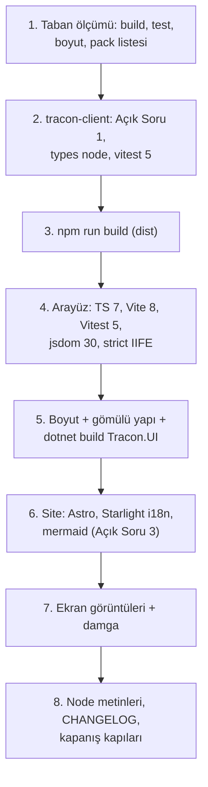

# Faz 216 — npm Bağımlılıkları: Arayüz, TypeScript İstemcisi ve Site

> **Durum:** ✅ Tamamlandı (2026-10-16)
> **Plan onayı:** 2026-10-16, farukatasoy: "faza başla ve bitir, commit atabilirsin". Açık Sorular 1-3 tek tek cevaplanmadı; **planın önerisi (A · A · A) ile kapatıldı** — bkz. *Açık Sorular*. Kapsam kararı: **UR-009 B**, farukatasoy, 2026-10-16.
> **Kaynak:** [ADAYLAR.md](../../ADAYLAR.md) · **F-557** (üç fazın üçüncüsü)
> **Genellik:** İki sevk edilen yapıta dokunur: `Tracon.UI.dll`'e gömülen arayüz (her `UseUI()` tüketicisi) ve npm'deki `@tracon/client`. Site tüketiciye dönük belgedir. İş tüketici kodunda kalamaz. İkinci kanıt: Node 20'nin destek sonu (Nisan 2026) ve sürüm gerilemesi — dört major geride (TypeScript, Vite, Vitest, jsdom).
> **Karşı görüş:** "Ön uç araçlarının major'ı ürüne değer katmaz; paket boyutu ve tarayıcı davranışı kayabilir." **Cevap:** Deneme (izole worktree, 2026-10-16) üç paketi dört küçük düzeltmeyle yeşile çevirdi; arayüz paketi 211.9 → 215.4 KB (bütçe 250 KB), `@tracon/client` paketi aynı 23 dosyayı, `.js`/`.d.ts` **baytı baytına aynı** çıkarır. Değişen her şey ölçülü ve aşağıdadır. Üç yerde "en yeni" bilerek seçilmez (Açık Sorular).
> **Önkoşul:** [Faz 215](215-TEST-VE-DERLEME-ARACLARI.md) — `CHANGELOG.md` ve CI ortak; paralel koşmaz. (Teknik bağımlılık yok; sıra yalnız birleştirme çakışmasını önler.)
> **Paketler:** `Tracon.UI` (gömülü varlıklar), `@tracon/client` (npm), `docs-site`
> **Yeni paket:** Yok · **Migration:** Yok
> **Public API:** Büyümüyor. `@tracon/client`'ın yayımlanan dosyaları aynı kalır (Açık Soru 1 = A ile).
> **Tüketici yüzeyi:** site: `getting-started/` ve kurulum sayfalarındaki Node alt sınırı; konsol ekran görüntüleri (damga yenilenir) · sevk edilen: `Tracon.UI.Frontend.targets:282,295` hata metni (Node sürümü), `README.md:328`, `CONTRIBUTING.md:18`
> **Manuel test alanı:** [`manuel-test/09-ARAYUZ-GENEL.md`](../../manuel-test/09-ARAYUZ-GENEL.md) · [`manuel-test/35-TYPESCRIPT-ISTEMCISI.md`](../../manuel-test/35-TYPESCRIPT-ISTEMCISI.md) · [`manuel-test/32-DOKUMAN-KALITESI.md`](../../manuel-test/32-DOKUMAN-KALITESI.md)

---

## Bu Faza Başlarken

1. Bu doküman
2. Kararlar — `grep -n "K-228\|K-543" docs/KARARLAR.md`: **K-228** (yerelleştirme; eksik anahtar derleme hatasıdır) · **K-543** (bot grupları)
3. Alan hafızası: [`hafiza/frontend.md`](../../hafiza/frontend.md) (bütçe, gömme, damga) · [`hafiza/frontend-test-altyapisi.md`](../../hafiza/frontend-test-altyapisi.md) · [`hafiza/nswag-istemci-uretimi.md`](../../hafiza/nswag-istemci-uretimi.md) (satır 60-62: `@tracon/client` `dist/` önce derlenir) · [`hafiza/site-yayin-ve-tema.md`](../../hafiza/site-yayin-ve-tema.md)
4. `MEMORY.md` — senkronizasyon kopyaları ve `tracon-frontend.stamp` (varlık değişince damga silinir)

---

## Amaç

Üç npm paketini en yeni sürüme taşı; gömülü arayüzün ve npm istemcisinin içeriğini ve boyutunu ölç; "en yeni"nin bilerek seçilmediği üç yeri gerekçesiyle yaz.

- **F-557 (3/3)** — `src/Tracon.UI/frontend`, `packages/tracon-client`, `docs-site`.

### Bugün ne çalışmıyor — doğrulanmış kanıt

| Kanıt | Gözlem |
|---|---|
| `npm outdated` (2026-10-16) | Arayüz: `typescript 5.9.3→7.0.2`, `vite 7.3.6→8.3.4`, `vitest 3.2.7→5.0.5`, `jsdom 27.4.0→30.1.3`, `@vitejs/plugin-react 5.2.0→6.1.2`, `react 19.2.8→19.3.1`. İstemci: `typescript→7.0.2`, `vitest→5.0.5`. Site: `astro 7.2.2→7.4.0`, `@astrojs/starlight 0.41.7→0.42.6`, `mermaid 11.16.1→12.2.0` |
| [`src/Tracon.UI/Tracon.UI.Frontend.targets:282`](../../../src/Tracon.UI/Tracon.UI.Frontend.targets) ve `:295` | Hata metni "Install Node.js 20.19+" der; jsdom 30 Node `^22.22.2` ister |
| `.github/workflows/ci.yml:112,402,546,781` | `node-version: '22'` (en yeni 22.x'e çözülür; yeni alt sınırları karşılar) |

> Kanıtlar 2026-10-16'da doğrulandı (HEAD `9aaa6544`). Deneme yükseltmesi aynı gün izole worktree'de koşuldu; fark `scratchpad/probe-npm.patch` (10 dosya, kilit dosyaları dahil) yalnız referanstır. **Deneme tabanı `1ae92822`'dir** (Faz 212 ve 213'ten önce; ajan worktree'si oturum başındaki commit'ten açıldı). Derleme hatası listeleri ve test sayıları bu yüzden uygulamanın ilk adımında HEAD üzerinde yeniden ölçülür.

---

## 216.1 — Arayüz (`src/Tracon.UI/frontend`)

| İş | Deneme sonucu |
|---|---|
| TypeScript 7 (yerel derleyici) | `tsc --noEmit` 0 hata (`tsconfig` zaten `types` taşır) |
| Vite 8 (Rolldown) + `@vitejs/plugin-react` 6 + Vitest 5 | Yapılandırma değişmez; 418/418 test; bütçe kapısı ve `THIRD-PARTY-NOTICES` denetimi geçer |
| 🚨 Gömülü IIFE `"use strict"`'ini kaybetti | `vite.embed.config.ts:30`'a `rolldownOptions: { output: { strict: true } }` |
| jsdom 30 | Node `^22.22.2` ister; Node 20.19.4'te 35 test dosyasının hepsi "Failed to start forks worker" ile düşer → **Açık Soru 2** |
| React 19.3.1 | +8,7 KB gzip (React 19.2.8 ile yeniden derlenerek ölçüldü) |

Boyut (bütçe kapısı, gzip -9, JS): **211,9 → 215,4 KB / 250**. CSS +1,7 KB ham (Lightning CSS `oklch`'yi çevirir, üç `-webkit-` öneki ekler; **görsel olarak doğrulanmadı** → manuel case 1). Gömülü yapı aynı: `index.html`, `assets/index-<8>.{js,css}.br`, `embed/embed.js.br`, `THIRD-PARTY-NOTICES.txt`; `EmbeddedUiAssetCatalog` `assets/` öneki ve `.br`'yi anahtar alır. E2E testleri yalnız `embed/embed.js`'i adıyla anar (`ToolTests.cs:71,111`).

`workflow-editor.test.tsx:314` yükseltmeden **önce** bir kez düştü, sonra dört kez geçti: kırılgan test adayı (`kusur-giderme` Adım 2 ile ayrılır, gerekirse F-NN).

## 216.2 — TypeScript istemcisi (`packages/tracon-client`)

🚨 `openapi-typescript` 7.13.0 (en yenisi) `typescript ^5.x` eş bağımlılığı ister ve derleyici API'sini çağırır. TypeScript 7'nin `typescript` paketi derleyici API'si **taşımaz**: `npm run generate` ve `schema-drift.test.ts` `createKeywordTypeNode` hatasıyla düşer; `overrides` eş çakışmasını (ERESOLVE) çözmez. → **Açık Soru 1**.

TypeScript 7'de derleme için `tsconfig.json`'a `"types": ["node"]` gerekir (yoksa `src/client.ts:14`, `src/sse.ts:185-241` TS2304/TS7017). Vitest 5 ile 41/41 test; `npm run generate` sonrası `src/schema.ts` farkı yok; `npm pack --dry-run` aynı 23 dosya, `.js`/`.d.ts` baytı baytına aynı.

## 216.3 — Site (`docs-site`)

| İş | Deneme sonucu |
|---|---|
| Astro 7.4 + Starlight 0.42 | Yeni uyarı: `collection "i18n" does not exist or is empty` → `src/content.config.ts`'e `i18n` koleksiyonu + `src/content/i18n/en.json` (`{}`) |
| mermaid 12 | `astro-mermaid 2.1.0` eşi `^10||^11`; `npm install` uyarır, **`npm ci` ERESOLVE ile düşer** (CI kırılır). `overrides` ile çalışır ve diyagramlar çizilir; ama elkjs 1,46 MB (449 KB gzip) tembel parça ekler, hiçbir diyagram ELK kullanmaz → **Açık Soru 3** |
| Konsol ekran görüntüsü damgası | `.ui-source.sha256` arayüzün `package.json`'ını ve kilidini özetler: **her** arayüz bağımlılığı değişince ekran görüntüleri (`DocumentationScreenshotTests`) ve `refresh-console-screenshot-stamp.mjs` yeniden koşulur |
| `astro preview` | Artık arka planda koşar (`astro preview stop`); `manuel-test/32-…:43` ve `01-…:2899` ön planda anlatır → metin düzeltilir |

## 216.4 — Node alt sınırı

Açık Soru 2 = A ise "Node.js 20.19+" şu yerlerde "22.22+" olur: `Tracon.UI.Frontend.targets:282,295` · `CONTRIBUTING.md:18` · `README.md:328` · `.agents/ortak/kapilar.md:81` · `ci.yml:107` yorumu · `docs/manuel-test/00-INDEKS.md:46` · `01-KURULUM-VE-PAKETLEME.md:114,393` · `35-TYPESCRIPT-ISTEMCISI.md:43`. Kesin liste: `grep -rn "20\.19" --include='*.md' --include='*.targets' --include='*.yml' .`. `@tracon/client`'ın `engines` alanı (`>=20`) çalışma anı içindir ve değişmez (yayımlanan paket Node 20'de çalışır).

## 216.5 — Sıra



---

## Planlanan Public API

Yok.

### HTTP `endpoint`'leri

Değişmez.

### Arayüz payı

**215,4 KB / 250 KB gzip** — uygulamada HEAD üzerinde yeniden ölçüldü, denemeyle aynı (taban 211,9 KB). Brotli gömülü: 179,4 → 182,3 KiB (ham 823,2 → 861,3 KiB; postbuild 1024'lüdür); CSS 33,77 → 35,43 kB ham (Vite'ın kB'si ondalıktır). Widget (`embed/embed.js`): 2,7 KB / 30 KB. React 19.3 payı +8,7 KB; Vite 8'in kendi kazancı −4,7 KB (denemede ölçüldü, ayrıca yeniden ölçülmedi).

---

## Planlanan Dosya Listesi

```
src/Tracon.UI/frontend/{package.json,package-lock.json,vite.embed.config.ts}
packages/tracon-client/{package.json,package-lock.json,tsconfig.json}
docs-site/{package.json,package-lock.json,src/content.config.ts,src/content/i18n/en.json}
docs-site/**/console-screenshots (yeniden üretilir) · .ui-source.sha256
src/Tracon.UI/Tracon.UI.Frontend.targets · README.md · CONTRIBUTING.md · .agents/ortak/kapilar.md
.github/workflows/ci.yml (yorum) · docs/manuel-test/{00-INDEKS,01-KURULUM-VE-PAKETLEME,32-DOKUMAN-KALITESI,35-TYPESCRIPT-ISTEMCISI}.md
CHANGELOG.md
```

---

## Hata Modları ve Testler

| Ne bozulabilir | Seviye | Test |
|---|---|---|
| Gömülü IIFE katı modu kaybeder | Birim (derleme çıktısı) | çıktıda `"use strict"` iddiası (yeni, `vite.embed` testi) |
| Bütçe aşılır | Kapı | arayüz bütçe kapısı (postbuild) |
| Gömülü varlık adı/yapısı kayar, `UseUI()` 404 döner | E2E | `Tracon.Ui.E2ETests` (tam derleme ile; `-p:TraconFrontendEnabled=false` UI uçlarını bağlamaz — Faz 213 devir notu) |
| `@tracon/client` yayımlanan dosyaları değişir | Paket | `npm pack --dry-run` dosya listesi + `.js`/`.d.ts` karşılaştırması |
| `schema.ts` üretimi bozulur | Birim | `schema-drift.test.ts` |
| CI'da `npm ci` düşer (eş çakışması) | CI | yerelde `npm ci` (temiz `node_modules`) üç pakette |
| Site diyagramları çizilmez | E2E (site) | `npm run check` + manuel case 3 |
| Lightning CSS görsel fark yaratır | Manuel | manuel case 1 (iki temada) |

Beş soru: çalışma anı kodu değişmez (yalnız derleme aracı); uygulanmaz.

---

## Manuel Kabul Case'leri

| # | Ön koşul | Adımlar | Beklenen sonuç |
|---|---|---|---|
| 1 | `samples/Tracon.Api` tam derleme | Arayüzü açık ve koyu temada gez (agent listesi, playground, workflow düzenleyici) | Görsel fark yok; konsolda hata yok 👤 |
| 2 | Gömülebilir sohbet sayfası | `embed/embed.js` ile sohbet | Çalışır; tarayıcı konsolunda katı mod ihlali yok |
| 3 | Site yerel önizleme | `/concepts/runs/` | Akış ve durum diyagramları çizilir |
| 4 | Temiz makine, Node 20 | `dotnet build src/Tracon.UI` | Açık Soru 2'nin seçimine uygun açık hata metni |

---

## Açık Sorular

| # | Soru | Seçenekler | Öneri |
|---|---|---|---|
| 1 | `@tracon/client` TypeScript 7 | A: bu pakette TypeScript 5.9 kalır (`openapi-typescript` TS 7'yi desteklediğinde geçilir); arayüz TS 7'ye geçer · B: iki derleyici: `typescript@5` üretici için + `tsgo` takma adı derleme için | **A** — B'de iki paket de `tsc` adlı bin taşır ve `.bin/tsc`'nin hangisine bağlanacağını npm belgelemez; denemede tutarlı çıktı ama garanti değil |
| 2 | Node alt sınırı | A: 22.22+ (jsdom 30) · B: jsdom 27'de kal, Node 20.19+ korunur | **A** — Node 20'nin desteği Nisan 2026'da bitti; CI zaten 22 |
| 3 | mermaid | A: `11.17.2` (aralık içi en yeni; eş uyumu, ELK parçası yok) · B: `12.2.0` + `overrides` | **A** — `astro-mermaid` 12'yi destekleyince geçilir; bot bunu görür. "En yeni" kuralının gerekçeli istisnası |

**Karar (2026-10-16):** 1 = **A** · 2 = **A** · 3 = **A**. Kullanıcı "faza başla ve bitir" dedi ve soruları ayrı ayrı cevaplamadı; öneriler uygulandı. Üçü de geri alınabilir (`package.json` satırı ve `dependabot.yml` `ignore` kalemi); itiraz gelirse tek commit'te değişir.

---

## Bitiş Ölçütleri (DoD)

- [x] Üç pakette `npm ci` (temiz `node_modules`) + `build` + `test` (+ `typecheck`) yeşil — istemci 41/41; arayüz 420/420 (36 dosya; 418 + `embed-build.test.ts` 2); site `npm run check` exit 0 (49 `node --test`, içerik 995 sayfa, 168.451 bağlantı kırık yok, SEO 0 hata, ağırlık tavanı içinde)
- [x] Arayüz bütçe kapısı yeşil; ölçülen değer "Arayüz payı" bölümüne yazıldı — 215,4 KB / 250 KB
- [x] Gömülü IIFE `"use strict"` taşır (test); `Tracon.Ui.E2ETests` tam derlemeyle yeşil — `embed-build.test.ts` düşerken görüldü (`(function(){var e=…`), düzeltmeyle geçti; sevk edilen bayt `curl --compressed …/tracon/embed/embed.js` → `"use strict";(function(){var e=class{…` (`Content-Encoding: br`, 2.312 B); E2E 98/98 (42,8 sn)
- [x] `@tracon/client`: `npm pack --dry-run` listesi aynı; `schema-drift.test.ts` yeşil — 23 dosya (20 `dist/` + `package.json` + `LICENSE.md` + `README.md`), ad+boyut listesi `diff` boş; `diff -r dist <önceki dist>` boş (`dist/` bayt bayt aynı; `package.json` yalnız `devDependencies` değişir, boyutu aynı kaldığı için liste farkı görmez); `npm run generate` sonrası `git status src/schema.ts` temiz
- [x] Site `npm run check` yeşil; i18n uyarısı yok; ekran görüntüleri ve damga yenilendi — koleksiyon geri alınınca uyarı döndü (`npx astro build`, kırmızı önce), eklenince yok; 44 PNG + `.ui-source.sha256` + 4 `CAPTURE_PINS` yenilendi
- [x] Node metinleri Açık Soru 2'nin seçimine göre güncellendi — `grep -rn "20\.19"` (arşiv ve bu doküman hariç) yalnız ölçüm kayıtlarını ve Node 20.19.4'ü **sürüm olarak** anan satırları döndürür: `hafiza/test-kosum-olcumleri.md:23,70` (2026-10 ölçüm kaydı, değişmez), `hafiza/tedarik-zinciri.md` ve `manuel-test/09` `MT-UI-061` (Faz 216'nın kendi tekrar üretme sürümü). Yazılan sınır tam aralıktır: 22.22.2+ (22.x), 24.15+ veya 26+ (`^22.22.2 || ^24.15.0 || >=26`)
- [x] `dependabot.yml` npm grupları seçilen istisnaları (TypeScript 7 istemcide, mermaid 12) `ignore` ile ve gerekçeyle taşır — `typescript` major (istemci), `mermaid` major (site); YAML ayrıştırılıp iki blok okundu
- [ ] Dört doğrulama kapısı sıfır uyarı: `python3 scripts/kapi.py kapanis --taban fbd9ffd8` — sonuç *Örnek Uygulama Koşumu*'nun altında
- [x] `samples/Tracon.Api` ile gerçek `run` yapıldı, çıktı belgeye yazıldı — *Örnek Uygulama Koşumu*
- [ ] `secret` taraması boş döndü — `kapi.py kapanis`'in ilk adımı (`tarama`)
- [x] Manuel kabul case'leri `09`, `35`, `32` dosyalarına eklendi; otomatikleştirilebilenler koşuldu — `MT-UI-059…061`, `MT-TSC-012`, `MT-DKL-041…042`; `MT-UI-060`, `061`, `MT-TSC-012`, `MT-DKL-041…042` koşuldu; `MT-UI-059`'un gözle bakış kısmı 👤
- [ ] `faz-denetim` koşuldu; 🔴 bulgu kalmadı

---

## Riskler

| Risk | Önlem |
|------|-------|
| TypeScript 7 ile istemcinin `.d.ts` çıktısı kayar | Açık Soru 1 = A (istemci TS 5.9'da kalır) |
| Rolldown başka bir çıktı farkı üretir | Gömülü yapı ve katı mod testi; E2E |
| CI'daki Node 22 sürümü 22.22'den eski | `setup-node` en yeni 22.x'e çözülür; ilk CI koşumunda sürüm okunur |
| Ekran görüntüsü yenileme makineye bağlı fark üretir | `hafiza/site-yayin-ve-tema.md` tarifi; fark görsel olarak okunur |

---

<!-- ============================================================
     AŞAĞISI KAPANIŞTA DOLDURULUR — `faz-tamamlama` skill'i.
     Plan anında boş kalır. Başlıkları SİLME.
     ============================================================ -->

## Plandan Sapmalar

> Plan ile gerçek arasındaki fark **gizlenmez** — sonraki oturumun en değerli bilgisidir.

1. **Açık Sorular öneriyle kapandı, kullanıcı cevaplamadı.** "Faza başla ve bitir" talimatı onay sayıldı; 1 = A · 2 = A · 3 = A. Üçü geri alınabilir.
2. **`packages/tracon-client/tsconfig.json` değişmedi; `tsgo` takma adı eklenmedi.** `"types": ["node"]` yalnız TypeScript 7'de gerekliydi; Açık Soru 1 = A ile istemci TypeScript 5.9'da kalır ve `tsc` onsuz geçer. Dosya listesinde vardı, çıktı.
3. **mermaid `^11.17.2`, `overrides` yok** (Açık Soru 3 = A). Planın "11.17.2 aralık içi en yeni" iddiası `npm view mermaid@11 version` ile doğrulandı.
4. **Planda olmayan: `src/Tracon.UI/frontend/.npmrc` (`engine-strict=true`).** Plan 216.4 yalnız **metin** değiştirmeyi söylüyordu ve manuel case 4 "açık hata metni" bekliyordu. Ölçüldü: `TraconDetectNode` yalnız `npm --version` çalışıyor mu bakar; Node 20.19.4'te `npm ci` geçer, sonra Vitest 36 kez `Failed to start forks worker` (`undici`, `Cannot read properties of undefined (reading 'bind')`) verir ve Node sürümünü anan tek cümle çıkmaz. `engine-strict` ile `npm ci` `EBADENGINE` + `Required: ^22.22.2 || ^24.15.0 || >=26.0.0` basıp `node_modules`'e dokunmadan durur (87 giriş önce/sonra). `Tracon.UI.Frontend.targets`'a sürüm denetimi yazılmadı: bir `.npmrc` satırı aynı işi MSBuild mantığı olmadan yapar. Case 4 bu yüzden `MT-UI-061` olarak yeniden yazıldı (hata metni targets'ın `TRACON0002`'si değil, npm'in motor hatasıdır).
5. **Planda olmayan: `npm audit fix` (aralık içi) istemci ve site kilidinde.** İstemci 3 high (`brace-expansion`, `js-yaml` ← `@redocly/openapi-core` ← `openapi-typescript`) → 0. Site 14 → 12: kalan `katex` (mermaid'den) ve `postcss-selector-parser` (expressive-code'dan) yalnız `--force` ile, yani starlight'ı geriye alarak kapanır; yapılmadı. Arayüz zaten 0. Hepsi geliştirme/derleme zamanı bağımlılığıdır; sevk edilen `dist/` ve `Tracon.UI.dll` etkilenmez.
6. **Alt sınır "22.22.2+, 24.15+ veya 26+" yazıldı, plandaki "22.22+" değil.** jsdom 30 `^22.22.2 || ^24.15.0 || >=26` ister (22.22.0, 22.22.1, 24.0–24.14 ve tek sayılı sürümler dışarıda); `engine-strict` bu aralığı zorlar, metin de onu söyler (bağımsız denetim 🟡 2). Site için "22.22+" (Astro 7.4 `>=22.22.0`). Yazılan yerler: `Tracon.UI.Frontend.targets:282,295` · `CONTRIBUTING.md` · `README.md:328` (arayüz) ve `:367` (site) · `kapilar.md:81` · `ci.yml` iki yorum · `manuel-test` `00`, `01` ×2, `31`, `32`, `35` · `hafiza/site-yayin-ve-tema.md`.
7. **Sitede Node alt sınırı yoktu.** Plan `getting-started/` ve kurulum sayfalarında bir alt sınır varsayıyordu; `grep -rn "Node" docs-site/src/content/docs` (capabilities hariç) boş. Site metni değişmedi; site yalnız bağımlılık, i18n koleksiyonu, ekran görüntüleri ve damga ile değişti.
8. **Katı mod yönergesi IIFE'nin önüne yazılır** (`"use strict";(function(){…`); Rollup içine yazıyordu. İkisi de tüm widget'ı katı yapar; test iki konumu kabul eder. Test `// @vitest-environment node` ile **çalışmaz** (`src/test/setup.ts` `Element`'e dokunur); jsdom'da koşar ve `vite`'ın `build()`'ini `write: false` ile çağırır.
9. **Test sayısı 418 → 420**, yalnız `embed-build.test.ts`'in iki testi. Plan "418/418"i denemeden aldı; HEAD tabanı da 418'dir.
10. **`dotnet test --project … -m:1` sıfır test koşar** (`-maxcpucount`, çıkış 5, "Handshake failures"). MEMORY.md bunu yazar; ben de düştüm. E2E test ana programı doğrudan koşturuldu.
11. **Piksel karşılaştırması yapıldı, plan "görsel olarak doğrulanmadı" diyordu.** Ayrıntı: `hafiza/dokumantasyon.md` (Faz 216 bölümü). Gözle bakış 👤 `MT-UI-059`'da açık kalır.

## Bu Fazda Verilen Kararlar

> **`K-*` açılmadı.** Hiçbiri public API/uyumluluk, güvenlik, kalıcı veri veya geri dönüşü pahalı sistem kararı değildir: sevk edilen dosyalar aynıdır (`@tracon/client` 23 dosya bayt bayt; `Tracon.UI` aynı beş gömülü dosya), `PublicAPI.*.txt` değişmedi, NuGet tüketicisi arayüzü derlemez. Yerel tercihlerdir ve burada kalır.

- **`@tracon/client` TypeScript 5.9'da kalır** *(Açık Soru 1 = A)*. Gerekçe: `openapi-typescript` 7.13 `typescript ^5` ister ve derleyici API'sini çağırır; TypeScript 7'nin paketi onu taşımaz (`createKeywordTypeNode`). `tsgo` takma adı reddedildi: iki paket de `tsc` bin'i taşır ve `.bin/tsc`'nin hangisine bağlanacağı belgelenmemiştir. Yeniden açma koşulu: `openapi-typescript` TypeScript 7'yi destekler; `dependabot.yml`'deki `ignore` kalemi o gün kalkar.
- **Node alt sınırı 22.22.2'dir (22.x; 24.x için 24.15, sonra 26+)** *(Açık Soru 2 = A)*. Gerekçe: jsdom 30 `^22.22.2`, Vitest 5 `^22.12`, Astro 7.4 `>=22.22`; Node 20'nin desteği Nisan 2026'da bitti; CI zaten `'22'` (en yeni 22.x'e çözülür). Yerel makine ölçümü: Node 22.23.2.
- **mermaid 11.17'de kalır** *(Açık Soru 3 = A)*. Gerekçe: `astro-mermaid` 2.1.0 eşi `^10 || ^11`; mermaid 12 ile `npm ci` ERESOLVE ile düşer, `overrides` ise 1,46 MB (449 KB gzip) elkjs parçası ekler ve hiçbir diyagram ELK kullanmaz. "En yeni" kuralının gerekçeli istisnası; `astro-mermaid` 12'yi destekleyince `ignore` kalemi kalkar.
- **`engine-strict` yalnız arayüzde** (`frontend/.npmrc`). İstemcide yok: onun `npm ci`'si `dotnet build`'de arayüzünkinden **sonra** koşar ve yayımlanan paketin `engines` alanı (`>=20`) çalışma anı içindir.

## Gerçekleşen Public API

Değişmedi. `PublicAPI.Shipped.txt` / `PublicAPI.Unshipped.txt` dokunulmadı. `@tracon/client` aynı 23 dosyayı yayımlar; `dist/` (20 dosya) bayt bayt aynıdır, `package.json` yalnız `devDependencies`'te değişir.

## Dosya Listesi (gerçekleşen)

```
src/Tracon.UI/frontend/{package.json,package-lock.json,vite.embed.config.ts,.npmrc}
src/Tracon.UI/frontend/src/embed/embed-build.test.ts                      (yeni, 2 test)
packages/tracon-client/{package.json,package-lock.json}
docs-site/{package.json,package-lock.json,src/content.config.ts,src/content/i18n/en.json (yeni)}
docs-site/public/screenshots/*.png (44) · .ui-source.sha256 · docs-site/scripts/landing-captures.mjs (4 pin)
src/Tracon.UI/Tracon.UI.Frontend.targets · README.md · CONTRIBUTING.md · CHANGELOG.md
.agents/ortak/kapilar.md · .github/{dependabot.yml,workflows/ci.yml (yorum)}
docs/manuel-test/{00-INDEKS,01-KURULUM-VE-PAKETLEME,09-ARAYUZ-GENEL,31-DOKUMAN-DOGRULUGU,32-DOKUMAN-KALITESI,35-TYPESCRIPT-ISTEMCISI}.md
docs/hafiza/{tedarik-zinciri,dokumantasyon,site-yayin-ve-tema,frontend-test-altyapisi}.md
```

## Örnek Uygulama Koşumu

`samples/Tracon.Api` arayüzü gömerek derlendi (`dotnet build samples/Tracon.Api -c Release`, 0 uyarı), `dotnet run --no-build -c Release --urls http://localhost:5081`; yerel PostgreSQL deposu ve kullanıcı `secret`'ları (anahtar adları `dotnet user-secrets list` ile görüldü, değerler yazılmadı).

| Case | Girdi | Gerçek çıktı |
|---|---|---|
| `MT-UI-058` benzeri | `GET /tracon/` | `200`; sayfa "Access token required" gösterir; betik `assets/index-zbNcOamN.js`; tarayıcı konsolunda **tek** hata `401 /tracon/api/agents` (token girilmeden) |
| gerçek `run` | `POST /tracon/api/agents/support/run` `{"message":"Reply with the single word: pong"}` (Bearer) | `text/event-stream`: `run` → `update` ×3 (`"text": "pong"`) → son; `GET /tracon/api/runs` → `Completed`, 348 girdi / 4 çıktı token, `0,000095 USD` (`source: Catalog`). İki kez koşuldu (ilk koşumun akışı JSON sanılıp ayrıştırılamadı, run yine `Completed` kaydedildi) |
| `MT-UI-060` | `curl -s --compressed http://localhost:5081/tracon/embed/embed.js \| head -c 60` | `"use strict";(function(){var e=class{options;url;constructor`; `Content-Encoding: br`, `Content-Length: 2312` |
| `MT-DKL-041` | `npx astro preview --port 4399`, `/concepts/runs/` | `pre.mermaid` 2, SVG'li 2 (`Agent execution decorator order…`, `Recorded run event lifecycle…`), hata düğümü 0, konsol 0 hata / 0 uyarı; `astro preview stop` durdurur |
| `MT-UI-061` | PATH'te Node 20.19.4, `npm ci` (in place) | `npm error code EBADENGINE` · `Required: {"node":"^22.22.2 \|\| ^24.15.0 \|\| >=26.0.0"}` · `Actual: …"node":"v20.19.4"`; `node_modules` 87 giriş önce/sonra; Node 22.23.2 ile `added 116 packages` |
| `MT-TSC-012` | temiz `npm ci`, build, test, generate, pack | 41/41; `schema.ts` farksız; 23 dosya; `diff -r dist` boş |

Varsayılan **dışı** yapılandırma uygulanmadı: faz çalışma anı kodunu değiştirmedi (yalnız derleme aracı).

E2E: `./artifacts/bin/Tracon.Ui.E2ETests/release/Tracon.Ui.E2ETests` → `total: 98 · succeeded: 98` (42,8 sn), tam frontend derlemesiyle. `DocumentationScreenshotTests` `TRACON_UI_SCREENSHOTS=1` ile 29 sn.

### Piksel karşılaştırması (`MT-UI-059`, gözle bakış hariç)

44 PNG'nin hepsi bayttan farklı; hepsinde ortak fark üst çubuktaki sürüm etiketi (~6.100 px). Fark maskeleri `agents-light`, `runs-light` ve `jobs-light` için açıldı: ek farklar yalnız dinamik hücrelerde (ULID, süre, "N sn önce", sütun hizası). Aşağı örneklenmiş ortalama fark ≤0,21/255. Anasayfa kırpımları (`approvals-wide`, `approvals-narrow`, `run-transcript-wide`, açık/koyu) `CROPS`'un anlattığı alanı çerçeveler.

### Tüketici yüzeyi envanteri (`tuketici-dokuman-senkronu` Adım 1)

`dokuman-bakim.py --site-denetle --taban fbd9ffd8` → `75 değişen dosya, 0 kural tetiklendi`; `build-agent-map.mjs --check` → `up to date and within budget`.

1. **`docs-site/`:** sayfa içeriği değişmedi. Değişenler bağımlılık (`package.json`, kilit), `content.config.ts` + `content/i18n/en.json`, 44 ekran görüntüsü + `.ui-source.sha256` ve `landing-captures.mjs` pinleri. Üretilen sayfalara (`api/`, `http-api/`) dokunulmadı.
2. **Sevk edilen metin:** kök `README.md` (Node alt sınırı, satır 328 ve 367) ve `CHANGELOG.md` (siteye `reference/changelog` olarak girer). `///` XML dokümanı, paket `README.md`'si, `tracon.json` ve `Tracon.UI.Frontend.targets`'ın derleme uyarı metni (yalnız repoyu derleyen görür) iç referans (`K-*`, `F-*`, faz no) taşımaz.
3. **Yerel referans / agent haritası:** `capabilities.md` ve `Tracon.Core.targets` değişmedi; yeni giriş noktası yok.

## Süreç Ölçümü

| Metrik | Değer |
|---|---|
| Plan revizyonu sayısı | 0 (plan metni değişmedi; yalnız onay satırı ve Açık Sorular kararı eklendi, sapmalar yukarıda) |
| Düzeltme turu sayısı | 1: bağımsız denetimin 🟡 3 + 🟢 4'ü (CHANGELOG'daki "bayt bayt aynı" iddiası `package.json`'ı yutuyordu · Node alt sınırı metni `engine-strict` aralığından gevşekti · üç yeni dosya izlenmiyordu · sevk edilen baytı ölçen E2E iddiası eklendi · `dependabot.yml` başlığı · DoD `grep` ve birim yazımı · kırılgan test notu). Denetimden önce kendi yakaladıklarım: ekran görüntüsü sayısı 38 yazılmıştı, 44'tür; `dotnet test -m:1` sıfır test koşar |
| 🔴 bulgu: gerçek / gürültü / araştırılacak | 0 / 0 / 0 |
| Fazın ürettiği regresyon | 0 bilinen (kapanış kapısı sonucu *Örnek Uygulama Koşumu*'nun sonunda) |
| Faz kapandıktan sonra bulunan kusur | 0 (ölçüm anı: kapanış) |

## Denetim Bulguları

`faz-denetcisi` (taze bağlam, salt-okunur; 91 araç çağrısı, ~14 dk), girdisi yalnız bu doküman ve `git diff HEAD`. **🔴 yok.** 🟡 3 · 🟢 5. Denetçi ayrıca `plugins: []` ile derlenen widget'ın sevk edilen `embed.js.br` ile bayt bayt aynı olduğunu ve `rolldownOptions` satırı silinince `embed-build.test.ts`'in düştüğünü kendi kopyasında ölçtü (test tiyatrosu yok).

| # | Seviye | Triyaj | Bulgu | Sonuç |
|---|---|---|---|---|
| 1 | 🟡 | gerçek | CHANGELOG "`@tracon/client` aynı 23 dosyayı **bayt bayt** yayımlar" diyordu; 23 dosyadan biri `package.json` ve `devDependencies`'i değişti. Pack listesi aynı boyutta olduğu için DoD'nin liste farkı bunu görmedi | Düzeltildi: CHANGELOG, DoD ve *Gerçekleşen Public API* "`dist/` (20 dosya) bayt bayt aynı, `package.json` yalnız `devDependencies`'te değişir" der |
| 2 | 🟡 | gerçek | Metinler "22.22.2+" dedi; `engine-strict` `^22.22.2 \|\| ^24.15.0 \|\| >=26` zorlar (24.0–24.14 ve tek sayılı sürümler reddedilir) | Düzeltildi: README, CONTRIBUTING, CHANGELOG, `kapilar.md`, `Tracon.UI.Frontend.targets` ×2, `manuel-test` `00`, `01` ×2, `35` tam aralığı yazar. Kapının sertliği (her geçişli dev bağımlılığın `engines`'i) bilinçlidir; bir bump alt sınırı yükseltirse yerel derleme kırılır ve metin onunla birlikte güncellenir |
| 3 | 🟡 | gerçek (sıra) | `dokuman-bakim.py --denetle` iki "Bayat kod yolu" verdi: üç yeni dosya `git ls-files`'ta yoktu | Düzeltildi: dosyalar izlenir; kapı `kapi.py kapanis` ile yeşil (aşağıda) |
| 4 | 🟢 | — | E2E `ToolTests.cs` yalnız `ShouldContain("TraconEmbed")` diyordu; sevk edilen baytta `"use strict"` yalnız birim testi ve elle `curl` ile kanıtlıydı | Düzeltildi: `body.ShouldStartWith("\"use strict\"")` eklendi (embedded kaynak → Brotli → HTTP zinciri); `*Embed_widget*` 2/2 geçti |
| 5 | 🟢 | — | `ci.yml` `node-version: '22'` runner toolcache'inden gelir; 22.22.2'den eskiyse `engine-strict` düşer (`check-latest` yok) | Kabul edildi, izlenecek: plan Riskler satırı aynıdır; yerel `node@22` 22.23.2. İlk CI koşumunda sürüm okunur; eski çıkarsa `'>=22.22.2 <23'` yazılır |
| 6 | 🟢 | — | `dependabot.yml` başlığı "gerekçe `Directory.Packages.props`'tadır" diyordu; iki npm kalemi gerekçesini kendi yorumunda taşır. Dependabot'un `engine-strict` ile davranışı ölçülemedi | Başlık düzeltildi. Dependabot davranışı **ölçülmedi**: ilk pazartesi koşumunda (`06:00 Europe/Istanbul`) arayüz PR'ı gelip gelmediği izlenir |
| 7 | 🟢 | — | DoD `grep "20\.19"` satırı iki ek yeri anmıyordu; "ham 861,3 KB" KiB, "CSS 35,43 KB" ondalık | Düzeltildi (DoD ve *Arayüz payı* birimleri yazar) |
| 8 | 🟢 | — | `workflow-editor.test.tsx` kırılganlık gözlemi yalnız faz dokümanındaydı; arşivlenince kaybolurdu | `hafiza/frontend-test-altyapisi.md`'ye yazıldı |

## Sonraki Faza Devir Notu

**Devralınan sözleşmeler**

- Arayüz derlemesi **Node.js 22.22.2+ (22.x), 24.15+ veya 26+** ister; kapı `src/Tracon.UI/frontend/.npmrc` `engine-strict=true`. Bir bağımlılık bump'ı jsdom/Vitest/Vite'ın `engines` alt sınırını yükseltirse **metinler birlikte güncellenir** (`grep -rn "22\.22\.2" --exclude-dir=arsiv --exclude-dir=node_modules .`).
- `@tracon/client` TypeScript 5.9'da kalır; `dependabot.yml` istemcide `typescript` major'ını, sitede `mermaid` major'ını yok sayar (iki gerekçe kalemin yorumundadır). Kalkma koşulları: `openapi-typescript` TypeScript 7'yi destekler · `astro-mermaid` mermaid 12'yi destekler.
- `embed/embed.js` katı moddadır; üç kapı: `embed-build.test.ts` (yapılandırma), `ToolTests.Embed_widget_script_is_served_with_the_real_built_bundle` (sevk edilen bayt), `MT-UI-060`.

**🚨 Tuzaklar**

- **Her arayüz bağımlılığı değişikliği 44 ekran görüntüsünü, `.ui-source.sha256`'yı ve (approvals/run-detail için) `CAPTURE_PINS`'i yeniler.** PNG'ler bayttan farklı çıkar; stil farkını piksel karşılaştırmasıyla ayır (`hafiza/dokumantasyon.md`).
- `dotnet test --project … -m:1` sıfır test koşar; E2E'yi test ana programından koş (`hafiza/frontend-test-altyapisi.md`).
- `TraconDetectNode` Node **sürümünü** denetlemez; sürüm kapısı yalnız `engine-strict`'tir.
- Site `npm audit`'te 12 uyarı (`katex`, `postcss-selector-parser`) üst akış sürümünü bekler; `--force` starlight'ı geriye alır.

**Yarım kalan / izlenecek**

- **Adım 10 (`./scripts/site-deploy.sh`) koşulmadı.** Site değişti (Astro 7.4, Starlight 0.42, 44 ekran görüntüsü); canlı site önceki sürümdür. Yayın dış dünyaya açıktır ve kullanıcı onayı ister.
- İlk CI koşumunda `setup-node` `'22'`'nin hangi sürüme çözüldüğü okunur (*Denetim Bulguları* 5). İlk Dependabot koşumunda arayüz PR'ı gelmeli (*Denetim Bulguları* 6).
- Gözle bakış `MT-UI-059` 👤.

**Sıradaki faz:** [F-558](../../ADAYLAR.md) (entegrasyon modernleşme işleri) — önkoşulu "Faz 214-216" bu fazla sağlandı. Plan dokümanı henüz yazılmadı; `faz-planlama` ile açılır.
