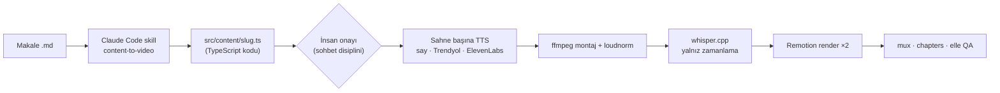
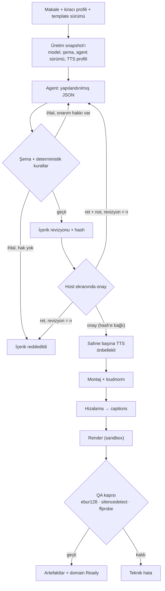
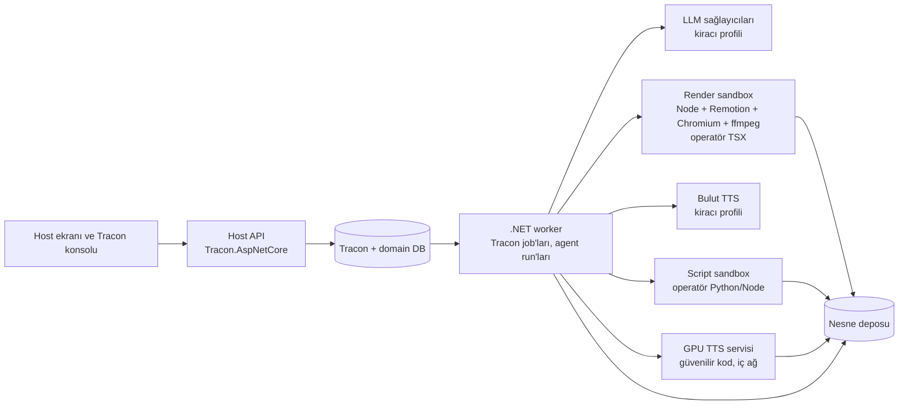
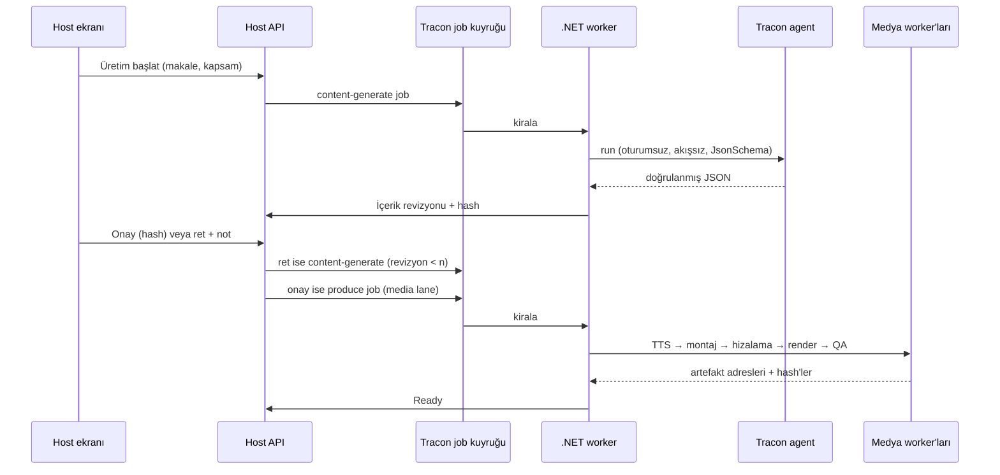

# Tracon — Explainer video üretimi için tüketici uyum raporu

**Tarih:** 11 Ekim 2026

**İnceleme zemini:** Tracon `b8906bfb` (Faz 192 kapalı). Tüketici reposu
`Explainer-Video`, tek commit `edb560a`.

**Yöntem:** Beş Tracon alanının kod haritası (workflow · agent/harness · job ve
sandbox · voice/artifact/cost · konsol/tenancy). Her alanın bulgusu ayrı bir
doğrulayıcı tarafından kodla çürütülmeye çalışıldı. Tüketici reposu ayrıca
okundu. Ekosistem kaynakları 2026-10-11'de tarandı. Yedi yüksek etkili iddia
elle okundu.

**Kapsam ve sınır:** Bu belge bir faz planı değildir. Hiçbir kusur
çalıştırılarak yeniden üretilmedi. Render, TTS ve LLM süreleri ölçülmedi;
yazılan sayılar ya tüketici reposundaki dosyalardan ya da üretici beyanından
gelir ve öyle işaretlidir.

**İlişkili kayıtlar:** [keşif kaydı](../../kesif/2026-10-11-explainer-video-tuketici.md)
(tur, kullanıcı cevapları, ham fikirler) · [ADAYLAR](../../ADAYLAR.md)
(F-318…F-344) · aynı gün yazılan
[podcast raporu](2026-10-11-podcast-tuketici-uyum-raporu.md). Podcast
raporunun upload/DB sıralaması (§ 9.2) ve side effect tablosu (§ 9.3) bu
tüketici için de geçerlidir; burada tekrarlanmaz.

---

## 1. Sonuç

**Bu hat Tracon üzerine kurulabilir. Bugün önerilen yol C'dir: Tracon LLM
adımını ve job altyapısını taşır; onay, revizyon ve medya hattı host
uygulamasındadır. Hedef yol A'dır: hattın tamamı bir Tracon workflow'u olur.**
A'yı bugün üç kusur ve iki eksik yetenek engeller (§ 8).

Dört sorunun kısa cevabı:

| Soru | Cevap |
|---|---|
| Harness mı workflow mu? | **Workflow.** Bir LLM adımı, bir onay kapısı ve n revizyon, sonra uzun deterministik medya adımları. LLM adımı tek bir agent'tır ve harness gerektirmez |
| Sandbox gerekli mi? | **İçerik için hayır**, içerik JSON veri olursa. **Operatör kodu için evet:** operatör sahne bileşenini ve script'i canlı yazar (cevap 17); bu kodu tüketicinin sandbox'ı çalıştırır, Tracon çalıştırmaz (K2) |
| Python nerede çalışır? | .NET sürecinde değil. Güvenilir GPU TTS modeli ayrı bir servistir. Operatör script'i sandbox'lı runner'da koşar. Bulut TTS seçen kiracıda Python gerekmez |
| Tracon'un eksikleri var mı? | Evet. 20 kusur (F-325…F-344) ve 7 yeni aday (F-318…F-324). En etkilileri: uzun workflow düğümü run'ı öldürür (F-325), job iki kez koşabilir (F-326), büyük onay isteği kaybolur (F-327), workflow agent adımı 2 dk sınırına takılır (F-328) |

Sorumluluk dağılımı: Tracon agent çalıştırmayı, yapılandırılmış çıktıyı, run
kaydını, maliyeti (token), job kuyruğunu, kiracı yalıtımını ve konsolu verir.
Tüketici şemayı, kural doğrulayıcısını, onay ekranını, üretim domain'ini,
medya worker'larını, sandbox'ı ve artefakt deposunu yazar.

---

## 2. Netleşen ihtiyaç

| Konu | Karar (2026-10-11) |
|---|---|
| Ürün | Çok kurumlu SaaS; kiracı başına profil |
| Girdi | 8 bölümlü Türkçe Markdown makale |
| Kapsam | Parametre; varsayılan tüm makale |
| Onay | Host ekranında onay/ret; n revizyon; içerik hash'i değişince onay düşer |
| Model | Kiracı başına; Claude dışı modeller de olabilir |
| TTS | EU bulut TTS serbest; Trendyol-TTS lisansı ve ses rızası teyitli |
| Çıktı | Temiz MP4 + VTT (tek render); yakılmış sürüm yok |
| Hacim | İlk kiracı için 84 video; gece batch; 1 TTS + 2–4 render worker |
| Kurallar | Render'ı çökertenler ve yapısal kurallar engelleyici; çeşitlilik kuralları uyarı |
| `bg`, `dur`, `art` | `bg` ve `dur` kodla; `art` LLM'de |
| Operatör | Sahne bileşenini ve script'i yazabilir, canlı günceller |
| Konsol | Kiracıların host'una açılır |
| Lisans | Remotion Automators; 4.0.x sabit |
| Saklama | Nesne deposu; taslak 30 gün, final kalıcı, onay kaydı süresiz |
| İptal ve yeniden deneme | İptal ≤ 30 sn; render 1, TTS 2 deneme |

Açık kalan kararlar § 17'dedir.

---

## 3. Bugünkü sistem ve sunucuya taşınırken değişmesi gerekenler

Bu hat bir geliştiricinin Mac'inde, elle ve sırayla koşar. Sunucuya
taşınırken altı şey değişmelidir:

1. **İçerik koddan veriye geçer.** Bugün script'ler LLM'in yazdığı `.ts`
   dosyasını esbuild ile paketleyip `import()` ediyor
   (`scripts/_content.mjs:7-16`, yedi giriş noktası). Aynı dosya Remotion
   bundle'ına girer ve ağ erişimli Chromium'da çalışır. Makale dış metindir;
   dolaylı prompt injection ile içerik dosyasına kod yazılabilir. İçerik JSON
   olur ve Remotion'a `inputProps` ile verilir. Süreyi `calculateMetadata`
   hesaplar. `Root.tsx`'teki statik import kataloğu tek bir generic
   composition'a iner.
2. **Şema tek kaynaktan üretilir.** Bugün şema üç yerde elle senkron:
   `schema.ts`, `_content.mjs` ve SKILL.md. Öneri § 5.1'dedir.
3. **macOS'a bağlı parçalar çıkar.** `say` Linux'ta yoktur. Trendyol script'i
   cihaz olarak yalnız `mps` veya `cpu` seçer; Linux GPU'da sessizce CPU'ya
   düşer (`tts_trendyol.py:24`).
4. **Ağ bağımlılıkları image build'e taşınır.** Fontlar render anında Google'dan
   iner (`src/system/fonts.ts`); Chromium ilk render'da indirilir;
   whisper.cpp çalışma anında clone edilip derlenir; model yalnız boyutla
   doğrulanır.
5. **Script'ler saf komut olur.** Bugün hepsi repo kökünü CWD sayar ve kaynak
   ağacına yazar. Her adım `--input manifest --workdir job-tmp --output dir`
   alan, idempotent bir komut olmalıdır.
6. **Tek render.** Cevap 6 yakılmış sürümü kaldırır. Render işi yarıya iner.

Ek olarak iki güvenlik bulgusu vardır: `content.id` doğrulanmadan dosya yoluna
ve `rmSync(recursive)` çağrısına girer (`scripts/tts-draft.mjs:26-27`);
`bg`, `art.src` ve `bgm` anahtarları `../` taşıyabilir. İkisi de içerik veri
olunca kodla türetilen alanlara döner (§ 5.1).

---

## 4. Harness ve workflow ayrımı

**Workflow** hangi adımın hangi koşulda koşacağını belirler: onaysız TTS yok,
revizyon sayısı n ile sınırlı, içerik hash'i değişince onay düşer.

**Harness** bir agent invocation'ının iç düzenini belirler: context, tool
döngüsü, iterasyon. Bu hatta LLM adımı tek atışta JSON üretir; tool
kullanmaz. Bu yüzden harness gerekmez. `Loop` yalnız anlamsal bir yargıç
istenirse eklenir; bugün yapılandırılmış doğrulamayla birlikte çalışmaz
(F-329).

Hedef akış:

---

## 5. İçerik üretimi: şema, doğrulama, revizyon

### 5.1 Şema tek kaynaktan gelir ve kuralları yapısal yapar

Kaynak **Zod v4** olur (Remotion 4.0.520 zaten taşır). Bir build adımı iki
JSON Schema üretir:

- **Sözleşme şeması:** tam şema; host doğrulayıcısı bunu kullanır.
- **Taşıma şeması:** sağlayıcının desteklediği alt küme. `oneOf` → `anyOf`,
  her nesnede `additionalProperties: false`, desteklenmeyen kısıtlar
  açıklamaya taşınır. Kiracı başka model seçebildiği için (cevap 12)
  sağlayıcı başına bir taşıma şeması gerekebilir.

Şemayı yeniden tasarlamak hata yüzeyini daraltır:

| Değişiklik | Kazanç |
|---|---|
| Düz `scenes[]` yerine `sections: [{label, sub, heroArt, scenes}]` | Bölüm numarası, ayraç sahnesi, "ayraçta vo yok" ve "her sahnede section" kuralları koddan türer |
| `art` yalnız `definition`/`takeaways` (side) ve bölüm (hero) düzeyinde | "Üç kombinasyon" kuralı yapısal olur |
| `quadrant.cells` → `{tl, tr, bl, br}` nesnesi | Tekillik ve dört hücre yapısal olur |
| `bg`, `art.src`, `bgm` asset manifest'inden üretilen enum | `../` taşıyan anahtar temsil edilemez |
| `id`, `vo` dosya adı, `sections`, `dur` ve `bg` kodla türer (cevap 10) | LLM yalnız metni, sahne tipini ve `art`'ı seçer |

Çapraz alan kuralları JSON Schema ile ifade edilemez: art aralığı, ardışık
`bg`, bölüm başına `statement`, metin bütçeleri. Bunlar kural kimlikli tek
bir linter'da yaşar. Kural sınıflaması tüketici kaynaklarından çıkarıldı:
47 kuralın 34'ü deterministik, 11'i karma, 2'si anlamsaldır.

### 5.2 Tracon ayarı

| Ayar | Değer | Neden |
|---|---|---|
| `ModelBinding.ResponseFormat` | `JsonSchema` + taşıma şeması | Sağlayıcıya şema gider (`AgentDefinitionCompiler.ChatOptions.cs:166-245`) |
| `ModelBinding.MaxOutputTokens` | Açıkça verilir | Anthropic varsayılanı 4096'dır (`AnthropicProviderOptions.cs:55`); 44 KB pilot içerik kesilir. Kesilme bugün ayrı sınıflanmaz (F-320) |
| `IStructuredResponseValidator` | Tüketici yazar: JSON Schema kütüphanesi + linter | Tracon şema doğrulamaz, yalnız JSON ayrıştırır (`IStructuredResponseValidator.cs:9-29`) |
| `Tracon:StructuredResponse:Enabled` | `true` | Host geneli bir ayardır; agent başına açılamaz |
| `MaxRepairAttempts` | 1–2 | Onarım yalnız oturumsuz ve akışsız run'da çalışır (`StructuredResponseValidatingAgent.cs:156-246`) |
| Harness | Yok | Gerekirse bütün sağlayıcılar kapatılır (F-339) ve OpenAI'da `openai-responses` seçilir (F-315) |
| Sağlayıcı `Timeout` | Uzun üretime göre | Dakikalar süren tek istek |

Doğrulayıcının iki sınırı vardır. Makaleyi görmez, bu yüzden "vo makaleyi
kopyalamasın" kuralı orada değil, run sonrası host kodunda koşar. Red nedeni
yanıt metnini taşımamalıdır, çünkü run olayı kalıcıdır.

### 5.3 Revizyon döngüsü (cevap 2)

- Ret notu yeni bir agent run'ına girdi olur: önceki JSON + not + makale.
- Run **oturumsuz** kalır. Kalıcı oturumlu run'da onarım kapalıdır.
- Revizyon sayısı kiracı profilindedir. Host sayar; n dolunca üretim
  "içerik reddedildi" olur.
- Her revizyon yeni bir içerik hash'i üretir. Onay hash'e bağlıdır; hash
  değişince onay düşer.
- Kuyruklu agent run'ı bugün `Documents` ve `Parameters` reddeder
  (`AgentEndpoints.cs:1007-1015`); F-294 bunu kapsar. Ayrıca parametreli
  agent kuyruklu yolda bağlanmadan koşabilir (F-330). Bu yüzden bugün LLM
  adımı ya senkron akışsız uçtan ya da host süreci içinde çağrılır.

### 5.4 Canlı şema (cevap 17)

Operatör yeni sahne tipi eklerse şema, talimat ve agent tanımı birlikte
değişir. Önerilen düzen:

1. Template sürümü yayımlanınca host, kiracının agent tanımını API ile
   günceller (`PUT /api/agents/{name}`); yeni bir agent sürümü oluşur.
2. Üretim snapshot'ı template sürümünü, şema hash'ini ve agent sürümünü
   tutar.
3. Revizyonlar aynı agent sürümüyle koşar.

İki Tracon sınırı vardır. HTTP run isteği agent sürümü taşımaz; sürüm ancak
deney ve eval yolunda sabitlenir. Süreç içinden sürüm sabitli çözümleme ise
güncel sürümün descriptor'ını kullanır ve yanlış şemayla doğrular (F-331).
F-300'ün kapsamı bu yüzden genişledi.

### 5.5 Eval

Kiracı ve template sürümü başına bir suite kurulur. Deterministik check'ler
`AddEvalCheck` ile kodda yazılır; CI eşiği `tracon eval --min-pass-rate`
ile kurulur. İki kusur bu yolu zayıflatır: `EvalCase.Context` agent'a gitmez
ve run'dan case'e terfi belgeyi düşürür (F-343).

---

## 6. Ses ve hizalama

### 6.1 Motor seçenekleri

| Motor | Nerede | Hizalama | Not (2026-10-11) |
|---|---|---|---|
| Trendyol-TTS (VoxCPM2) | Host'un GPU servisi | Yok; ayrı hizalama | Lisans teyitli (cevap 4). VoxCPM2 CUDA ≥ 12, yaklaşık 8 GB VRAM; RTF ~0.30 RTX 4090 (üretici beyanı), tüketici Mac MPS'te ~0.7 ölçtü |
| ElevenLabs | Bulut | `with-timestamps` karakter hizalaması | `previous_text`/`next_text`, `previous_request_ids` (≤ 3), `seed`; EU yerleşimi yalnız Enterprise; `eleven_v4` 2026-09-28 |
| Azure Speech tr-TR | Bulut, EU bölgesi | Batch `wordBoundaryEnabled` | tr-TR kelime sınırı açıkça doğrulanmadı |
| Google Cloud TTS / Gemini-TTS | Bulut, EU endpoint | Yalnız SSML `<mark>` | Ayrı hizalama gerekir |
| macOS `say` | Yalnız geliştirici | Yok | Sunucuda yok |

Kiracı motoru profilde seçer. Aynı süreçte yerel ve bulut motor yaşar. Bugün
bu, fonksiyon düğümünde veya job handler'ında keyed servislerle kurulur
(`AddKeyedSingleton<ISpeechSynthesizer>("voxcpm", …)`). Tracon'un tek yuvalı
yerleri `speak` tool'u, `/api/voice/*` ve fiyat okuyucusudur; adlı kayıt
F-298'dir (🟠).

### 6.2 Tracon ses katmanının sınırları

- `ISpeechSynthesizer` tek sesli ve sahne başına uygundur.
- Özel bir sentezleyiciyi `UseVoice` ile kaydetmek ElevenLabs ayarlarına
  takılır: doğrulama anahtar ister, maliyet ElevenLabs fiyatıyla yazılır,
  `speak` sınırı ayardan okunur (F-336).
- `SpeechRequest` süreklilik alanlarını ve ses ayarlarını taşımaz. F-296'nın
  "istek ayarları" dilimi diyalogdan önce yapılabilir.
- `SpeechAudio.Duration` ElevenLabs yolunda dolmaz; süre ses başlığından
  hesaplanır.
- Fonksiyon düğümünden TTS maliyeti raporlanamaz (F-299). Geçici yol:
  maliyet host domain'inde tutulur.

### 6.3 Hizalama sırası

1. Motor zaman veriyorsa onu kullan (ElevenLabs, Azure batch).
2. Vermiyorsa forced alignment: ElevenLabs Forced Alignment (Türkçe, EU
   endpoint) veya WhisperX + `mpoyraz/wav2vec2-xls-r-300m-cv7-turkish`
   (BSD-2 + CC-BY-4.0).
3. whisper.cpp yalnız geri dönüş yolu kalır.

Caption metni her yolda bilinen `vo` metninden gelir; hizalamadan yalnız
zaman alınır. Bugünkü cue = cümle eşlemesi 42 karakter sınırını 173 cue'nun
77'sinde aşar; aligner uzun cümleyi bölmelidir.

### 6.4 Önbellek anahtarı

Bugünkü anahtar 32 bitlik djb2'dir, iki kopyadır ve normalizasyon yapmaz.
Önerilen anahtar: `sha256(NFC(vo), motor, model revizyonu, referans ses
hash'i, parametreler, örnek hızı)`. Parçalar videolar arasında paylaşılır;
tek sahne değişince yalnız o parça yeniden sentezlenir.

---

## 7. Kod nerede çalışır; sandbox

### 7.1 Topoloji

### 7.2 Neden Tracon'un skill script runner'ı değil

Skill script runner bu iş için tasarlanmadı:

- Varsayılan zaman aşımı 30 sn, çıktı sınırı 256 KB, kiracı başına 2
  eşzamanlı script (`TraconOptions.cs:364-418`).
- Her çağrı yeni süreç açar; GPU modeli her seferinde soğuk yüklenir.
- Script modele yalnız LLM tool'u olarak açılır; zorunlu adım garantisi
  vermez.
- Süreç sunucunun OS kimliğiyle koşar; OS yalıtımı yoktur (K-862). Çok
  kiracılı host'ta stored script platform yetkisi ister (K-861).

### 7.3 Operatör kodu için sandbox (cevap 17)

Operatörün yazdığı sahne bileşeni ve script güvenilmez koddur. Tracon bu kodu
çalıştırmaz: tool kodu yalnız koddadır ve arayüzden yazılan kod çalıştırılmaz
(K2, L20). Kod tüketicinin sandbox'ında koşar:

- **Yalıtım:** iş başına geçici container; gVisor (`runsc`), Kata veya
  Firecracker mikro-VM.
- **Ağ:** varsayılan kapalı. Fontlar, Chromium ve modeller image'dadır.
  Girdi ve çıktı yalnız ön imzalı nesne adresleriyle akar.
- **Kimlik:** root olmayan kullanıcı, salt okunur kök, iş başına `tmpfs`
  scratch; env'de `secret` yok.
- **Kaynak:** CPU, bellek, süreç sayısı ve süre sınırı.
- **Sürüm:** operatör kodu içerik hash'iyle saklanır. Üretim belirli bir
  hash'e sabitlenir; canlı güncelleme yalnız yeni üretimleri etkiler.
- **Bundle:** Remotion bundle'ı da sandbox'ta üretilir. Bundler yapılandırması
  operatörün eline geçerse derleme de kod çalıştırır.
- **Chromium:** Remotion Chromium'u `--no-sandbox` ve kapalı site yalıtımıyla
  açar; container tek sınırdır.

GPU TTS servisi host'un güvenilir kodudur ve operatör kodundan ayrıdır.
**Operatör kodu yalnız CPU kullanır** (karar, 2026-10-11): GPU'lu sandbox
seçenekleri dardır ve GPU belleği kiracılar arasında paylaşılır.

**Operatörün tanımladığı içerik kuralı veridir** (karar, 2026-10-11): form veya
JSON Schema + hazır kural türleri. Bileşenin props şeması yayın anında bir kez
sandbox'ta çıkarılır ve veri olarak saklanır. Host doğrulayıcısı bu veriyi
süreç içinde okur; LLM çıktısı sandbox'tan geçmez.

Podcast turunun ertelenen ham #13'ü (skill script'ini harici sandbox'a
yönlendiren seam) bu cevapla ikinci vakayı aldı ve yeniden açıldı: F-345.
Seam yalnız LLM'in çağırdığı skill script yolunu kapsar; zorunlu medya
adımları host job'unda ve host'un sandbox'ında kalır.

---

## 8. Orkestrasyon alternatifleri

| Yol | Nasıl kurulur | Bugün ne gerekir veya ne engeller | Ne zaman |
|---|---|---|---|
| **A** · Tracon Workflows uçtan uca | Kod grafı: agent → doğrulama → `RequestPort` onayı (revizyon geri kenarı) → worker'ı çağıran fonksiyon düğümleri | Konsoldan veya HTTP SSE ile başlatılmaz (F-325). Onay isteğine içerik değil özet ve bağlantı konur (F-327). Agent adımı 2 dk sınırına takılır (F-328). Respond akışa bağlıdır (F-318). Retention kapalı tutulur (F-327). Çökmede resume elle yapılır (F-321) | Hedef |
| **B** · Agent onay posta kutusu + job | Kuyruklu agent run'ı `RequiresApproval` taşıyan bir `submit_for_production` tool'u çağırır; `approval.pending` gelir; karar devamı job'da koşar; tool `produce` job'unu kuyruğa alır | 44 KB JSON tool argümanı olur. Onay varsayılan 24 saatte düşer. Ret, modele tool sonucu olarak döner; n revizyonu modelin davranışı belirler. Job kusurları geçerli (F-326) | Kalıcı ve SSE'siz yerleşik onay gerekirse |
| **C** · Tracon = LLM adımı + job altyapısı | Host job'ları: `content-generate` (agent run), onay host ekranında, `produce` (`media` lane'i) | Job kusurları geçerli (F-326, F-323). Adımlar idempotent ve önbellekli olmalı | **Önerilen: ilk sürüm** |
| **D** · Tracon yalnız LLM adımı | Medya hattı host'un kendi orkestratöründe (Hangfire, Temporal vb.) | Tracon tarafında engel yok; run ağacı ve maliyet görünürlüğü azalır | Host'un zaten bir orkestratörü varsa |

### 8.1 Yol C ayrıntısı

Kurulum notları:

- API süreci `RunWorker = false` ile koşar. Medya worker süreci
  `Lanes = ["media"]` ve `MaxConcurrentJobsPerLane["media"]` ile kurulur
  (`TraconSchedulingOptions.cs:22-76`). `Lanes = null` olan bir süreç media
  işini de kiralar.
- `produce` job'u adımları item olarak modeller; tamamlanan item yeniden
  denemede atlanır.
- Kiracı ve atıf, job'u başlatan metodun gövdesinde açılır:
  `AmbientTenantScope.Begin(tenantId)` ve
  `AmbientRunAttributionScope.Begin(userId, labels)` (etiket örnekleri:
  `production`, `content`; en çok 8 etiket, değer en çok 256 karakter).
- "Render 1 deneme" bugün tam güvence değildir: kirası dolan job deneme
  sınırına bakılmadan yeniden kiralanır (F-326). Render çıktısı içerik
  anahtarıyla önbelleklenmelidir.
- İptal handler'a token olarak ulaşmaz; handler `IsCancelledAsync`'i
  yoklar ve süreç ağacını kendisi öldürür (F-323). İptalden sonra hata
  atmadan döner (F-326).
- Bildirim için `job.*` ve `workflow.request.pending` webhook'larına
  güvenilmez; yayınlanmazlar (F-333). Host kendi bildirimini job sonunda
  yazar.

### 8.2 Yol A'ya geçiş koşulları

Sıra: F-325 → F-326 → F-328 → F-327 kusurları kapanır; F-318 (bağlantıdan
bağımsız yürütme) ve F-319 (HITL karar sözleşmesi) gelir; F-303 agent düğümü
süresini kapsar. Bundan sonra revizyon geri kenarı ve onay bir kod grafında
kurulur. Konsol host'a açık olduğu için (cevap 18) F-325 ve F-335 kapanmadan
uzun run'lar konsoldan başlatılmamalıdır.

---

## 9. Çok kiracılılık ve operatör deneyimi

**Kiracı profili** şunları taşır: model ve sağlayıcı, TTS motoru ve ses,
template sürümü, revizyon sayısı n, kural şiddetleri, kullanılabilir `art`
seti. Profil kod değil veridir; host doğrular.

**Tracon tarafındaki yalıtım:** stored agent ve workflow tanımları, run'lar,
checkpoint'ler ve istek listesi kiracıya bağlıdır. Kodda tanımlı workflow ve
fonksiyon kayıtları bütün kiracılara ortaktır; kiracı farkı profil verisiyle
verilir.

**Eşzamanlılık:** `MaxConcurrentRuns` süreç başına tek semafordur ve
kiracılara ortaktır; job kiralama FIFO'dur. Adil sıra bugün host'un admission
katmanındadır; Tracon tarafı F-322'dir.

**Konsol (cevap 18):** Host konsolda agent talimatını sürümlü düzenler,
run ağacını ve maliyeti görür. Bugünkü sınırlar: workflow ekranı 30 sn sessiz
run'ı keser (F-325); başka yerden başlayan run'ın onay kartı açılmaz (F-335);
workflow zincirinde düğüm düzenlenmez (F-292); `Loop` konsoldan ayarlanmaz
(F-302); workflow ve skill için sürüm geçmişi yoktur (F-300).

**Host personeli ve kiracılar** (karar, 2026-10-11): konsol bir oturumda tek
kiracıyı gösterir; kiracı giriş kimliğinden veya API anahtarından gelir
(`HttpTenantContext.cs`). Host kendi kimlik sağlayıcısında "kiracı olarak gir"
özelliğini kurar ve kiracı claim'ini o üretir. Tracon tarafında değişiklik
gerekmez.

**Anahtarlar:** Model anahtarı kiracı BYOK ve egress altyapısıyla bağlanır
(K-874, K-878). Ses anahtarı bugün süreç genelidir. **Bütün LLM ve TTS anahtarlarının
sahibi host'tur** (podcast turuyla aynı). Kiracı başına seçim yine gerekir:
F-298 adlı kayıt ve kiracı bağlaması getirir; kiracı BYOK ikincildir.

---

## 10. Kalıcı durum, artefaktlar ve idempotency

**Domain kayıtları (host):** `Production`, `ContentRevision` (JSON, hash,
agent sürümü, şema sürümü), `Approval` (kim, ne zaman, hangi hash, karar,
not), `MediaArtifact` (anahtar, hash, bayt, MIME, süre). Bir üretim birden çok
Tracon run'ı açar; run kimliği bağlantıdır, üretim kimliği değildir.

**İçerik adresli artefakt anahtarları:**

| Artefakt | Anahtar girdileri |
|---|---|
| TTS parçası | NFC metin, motor, model revizyonu, referans ses hash'i, parametreler, örnek hızı |
| Ses manifesti | Parça anahtarları + sahne sırası |
| Ses rayı | Manifest + `dur` değerleri + zaman sabitleri + assembler/loudnorm sürümü |
| Caption'lar | Ses rayı hash'i + `vo` metinleri + aligner ve model hash'i |
| Render | Template bundle hash'i + `inputProps` hash'i + render ayarları + Remotion/Chromium sürümü |
| VTT, chapters | Caption'lar + timeline + render hash'i |

Her artefakt girdilerinin hash'ini taşır; orkestratör eşleşmeyen kombinasyonu
reddeder. Bugünkü repo bu bağı kurmadığı için senkronsuz render üretebilir
(§ 14).

**Upload ve DB sırası:** podcast raporu § 9.2 aynen geçerlidir. Nesne yazılır,
checksum doğrulanır, sonra domain transaction'ı `Ready` yazar.

**Saklama:** Tracon run ve ek retention'ı domain saklamasından ayrıdır.
Retention açıkken iki kusur dikkat ister: onay bekleyen workflow'un
checkpoint'i silinebilir (F-327) ve harici ek baytı silinmez (F-332). Büyük
medya Tracon ekine girmez (20 MiB sınırı, `video/mp4` izinli tür değil);
Tracon'a yalnız anahtar ve hash girer.

---

## 11. Kapasite ve maliyet

Tüketici dosyalarından (ölçülmüş boyut, ölçülmemiş süre):

| Kalem | Değer |
|---|---|
| Pilot video süresi | 906 sn → 27.191 kare (30 fps) |
| Temiz MP4 | 168.898.710 B |
| Ses rayı (48 kHz mono WAV) | 86.690.958 B |
| VTT | 21.413 B |
| Pilot içerik JSON | 39.494 B (60 sahne, 52 `vo`, 1.779 kelime) |

84 videoda yalnız temiz MP4 + VTT + ses rayı saklanırsa yaklaşık 21 GB eder
(hesap, ölçüm değil). Ara parçalar taslak saklama süresine girer.

Üçüncü taraf fiyatları (2026-10-11, kaynak keşif kaydı § 4):

- Remotion Automators: render başına $0.01, aylık $100 alt sınır. 84 video
  için maliyeti alt sınır belirler.
- ElevenLabs `eleven_v4`: 1.000 karakter başına $0.08. Video başına yaklaşık
  15.000 karakter varsayımıyla ~$1.2 (çıkarım).

Tracon varsayılanları bu hacim için yeniden ayarlanır:

| Ayar | Varsayılan | Bu hatta |
|---|---|---|
| `TraconWorkflowOptions.RunTimeout` | 10 dk | Yol A'da ölçüme göre; slot beklemesini de sayar (F-325) |
| `AgentGraph.ChildDeadline` | 2 dk | Workflow agent adımı için yükseltilir (F-328, F-303) |
| `AgentGraph.MaxTotalTokens` | 200.000 | Revizyonlar dahil ağaç bütçesi |
| `RunRecording.MaxPayloadLength` | 8.192 | Onay isteğine yalnız özet konur (F-327) |
| `TraconSchedulingOptions.LeaseDuration` | 5 dk | Uzun render'da yenileme şarttır (F-326) |
| `MaxConcurrentJobsPerLane["media"]` | — | GPU ve render worker sayısına göre |

---

## 12. Tracon kusurları: kanıt tablosu

Hepsi kod okumasıdır; hiçbiri çalıştırılarak yeniden üretilmedi. Her biri
`kusur-giderme` ile önce kırmızı testle kanıtlanır. Onaylanan sıra:
F-325 → F-326 → F-328 → F-327 → F-329 → F-330 → F-331, sonra F-332.

| F-NN | Bulgu | Kanıt | Sözleşme kaynağı | Repro fikri ve test seviyesi |
|---|---|---|---|---|
| F-325 | Workflow SSE keep-alive yazmaz; konsol 30 sn'de keser; run `Canceled` olur. Slot beklerken `RunTimeout` dolarsa OCE kapanış çerçevesiz kaçar, run satırı açılmaz | `WorkflowEndpoints.cs:738-799`; keep-alive yalnız `RunEndpoints.cs:1272`; `workflow-detail.tsx:88`; `sse.ts:216-240`; `WorkflowRunner.cs:404-418` | `api.ts:62-74` ("sunucu `: waiting` gönderir"); K-845; `IWorkflowRunner.cs:96-97` ("ilk olay her zaman `RunStarted`") | 45 sn iptali dinleyen düğüm; konsoldan çalıştır. Fonksiyonel (SSE çerçevesi) + E2E |
| F-326 | (1) Lease yenilemesi ilk hatada kalıcı durur; (2) kirası dolan job `MaxAttempts`'a bakılmadan yeniden kiralanır; (3) iptal edilen job hata atınca `Pending` olur | `JobWorkerBackgroundService.cs:612-635`, `:459-461`, `:446-491`; `PostgresQueries.cs:1165-1177`; `SqlQueriesBase.cs:1587-1609` | `IJobHandler.cs:56-65`; `TraconAsyncRunOptions.cs:28-38`; `JobStatus.cs:28-29` | Sarmalayan `IJobStore` (ilk yenileme hata atar); depo sözleşmesi; `WorkerHarness` + SIGKILL |
| F-327 | Bekleyen istek 8 KB'ta kırpılır ve düşer; retention `AwaitingInput` checkpoint'ini ve olayını siler; `KeepCheckpointsAfterCompletion=false` yanıt dalında kaynak checkpoint'i siler | `RunEventWriter.cs:278-293,567-575`; `WorkflowRequestDescriptor.cs:58-90`; `RetentionTargetRegistry.cs:77-82,151-157`; `WorkflowRunner.cs:1215-1222` | `RunEventWriter.cs:278-284` ("yük işlevin kendisidir"); K-128; K-130 | 10.000 karakterlik `RequestPort` istemi; retention koşumu. Birim + üç SQL sözleşme testi |
| F-328 | Workflow agent adımında deadline/bütçe reddi run'ı düşürmez; ret metni sonraki düğüme içerik olarak akar | `ChildAgentInvoker.cs:253-304,493-505`; `WorkflowAgentStepExecutor.cs:33-43`; `TraconOptions.cs:229` | `concepts/workflows.md:33-37`; `concepts/agents.md:215-218` | Yavaş sahte agent + kısa `ChildDeadline`. Birim + fonksiyonel |
| F-329 | Loop + yapılandırılmış doğrulama birleşik metni doğrular; son JSON geçerli olsa da `StructuredResponseInvalid`. Tool öncesi ara metin aynı sınıf | `LoopEvaluatorRegistry.cs:268-272`; `StructuredResponseValidatingAgent.cs:165-169,298-314`; MAF 1.20.0 XML | `StructuredResponseValidatingAgentDecorator.cs:12-21`; `guides/structured-output.md:36-41` | İki iterasyonlu loop + `ResponseFormat=Json`. Fonksiyonel (gerçek decorator zinciri) |
| F-330 | Parametreli agent kuyruklu, batch ve replay yolunda bağlanmadan koşar | `AgentEndpoints.cs:270-284` ↔ `:807-814`; `AgentBatchJobHandler.cs:52-56`; `RunReplayService.cs:118,163-164` | `concepts/agents.md:63-67` | Zorunlu parametreli agent'a parametresiz kuyruklu run; sistem metninde `{{`. Fonksiyonel |
| F-331 | Sabit sürümlü çözümleme güncel descriptor'ı kullanır | `CompositeAgentCatalog.cs:149-214`; `EvalJobHandler.cs:111-113,336-339` | `EvalJobHandler.cs:100-102`; `RunRecord.cs:106-107` | v1 `Text`, v2 `JsonSchema`, `agentVersion=1`. Fonksiyonel |
| F-332 | Retention ve erasure harici ek baytını silmez; workflow eki 7 gün sonra yetim | `SqlRetentionStore.cs:30-36,88-103`; `SqlDataSubjectStore.cs:63-113`; `RetentionTargetRegistry.cs:170-178`; `WorkflowSessionId.cs:25-29` | `IDataSubjectStore.cs:35`; `ChildAgentInvoker.cs:437-442` | Kaydeden sahte `IAttachmentStorage`. SQL sözleşme + fonksiyonel |
| F-333 | `workflow.request.pending`, `job.completed`, `job.failed`, `eval.completed` yayınlanmaz; workflow kökü `run.*` üretmez | `WebhookTypes.cs:26-87`; `WebhookEndpoints.cs:217`; yayın noktaları grep | `concepts/governance.md:684-694`; `WebhookTypes.cs:42-43` | Abonelik + `AwaitingInput` + job. Fonksiyonel |
| F-334 | `ExecutorFailed` ham istisna mesajını kalıcı yazar | `WorkflowEventMapper.cs:53-57,78-82`; `WorkflowEventMapperTests.cs:64-73` | `SafeErrorText.cs:8-18`; K-640 | Düğüm `HttpRequestException("...media-worker:8080")` atar. Birim + fonksiyonel |
| F-335 | Konsol başka yerden başlayan run'ın isteğini açamaz; yanıtlanan run "bekliyor" görünür; K-130 yorumu ve testi çelişkili | `workflow-detail.tsx:62,73-84`; `run-detail.tsx:359-374`; `WorkflowRunner.cs:152-155`; `WorkflowHumanInTheLoopTests.cs:110-127` | `locales/en/runs.ts:81-84`; `ui.md:208-209`; K-130 | API ile başlat, konsoldan yanıtla. E2E |
| F-336 | Özel sentezleyici ElevenLabs ayarına bağlı (doğrulama, fiyat, sağlık, `speak` sınırı); `ValidateOnStart` yok; dosya adı `.mp3` sabit | `VoiceOptionsValidator.cs:25-43`; `VoicePricing.cs:36-40`; `SpeakTool.cs:66-75`; `VoiceBuilderExtensions.cs:67-69`; `VoiceEndpoints.cs:139-197` | `guides/voice.md:145-155`; `SpeechContracts.cs:29-41`; `VoiceOptionsValidator.cs:5-7` | Site örneğiyle host + `/api/voice/speak`. Fonksiyonel |
| F-337 | Workflow kökü atıf taşımaz: düğümde `Labels`/`UserId` boş; kota tüketimi `RunId`'siz; `RunAttributionGate` atlanır | `WorkflowRunner.cs:449-459,473-503,1191-1209`; gate yalnız `AgentEndpoints.cs:223` | `TraconRunContext.cs:83-102`; `RunAttributionGate.cs:5-27` | Sabit etiketli `IRunAttributionContext` + etiketi okuyan düğüm. Birim + fonksiyonel |
| F-338 | Düğüm retry'ı kalıcı 4xx'i geçici sayar | `DefaultRunErrorClassifier.cs:222-226`; `WorkflowNodeRetry.cs:10-22` | `RunErrorClass.cs:29-30` | 401 atan düğüm. Birim |
| F-339 | Skill'siz harness agent CWD'den skill keşfeder | `AgentDefinitionCompiler.Agents.cs:265,283-286`; MAF 1.20.0 Harness XML | `AgentDefinition.cs:52-56`; `TraconOptions.cs:350-364` | CWD'de `skills/probe/SKILL.md`. Süreç sınırında fonksiyonel |
| F-340 | OpenAI `ProviderSettings` sessizce yok sayılır | `OpenAIChatClientFactory.cs:80-92` | `ModelBinding.cs:48-53`; `guides/model-providers.md:183-185`; K-208 | `POST /api/agents/validate` yabancı anahtarla. Birim + sözleşme |
| F-341 | `respond` dönüştürülemeyen yanıtta 400 yerine 200 + `Failed`; kayıt komşu tip uyumunu denetlemez | `WorkflowEndpoints.cs:611-648`; `WorkflowDefinitionValidator.cs:51-92` | `WorkflowContracts.cs:103-110`; `concepts/workflows.md:48-50` | Geçersiz `data` ile respond; `<string,string>` düğümlü zincir kaydı. Fonksiyonel |
| F-342 | Belge-kod kaymaları: site `RunTimeout` ve düğüm mesajı; `JobHandlerKeys.Workflow`; `SkillRoots`; `MaxOutputBytes`; resume hatası; konsolda `ToolCallUsage`; fallback `ChatOptions` ↔ K-444; MT-WF-114 | `concepts/workflows.md:168-171,189-190`; `JobHandlerKeys.cs:39-40`; `TraconOptions.cs:352-356,399-400`; `WorkflowRunner.cs:1017-1029`; `run-detail.tsx:543-590`; `FallbackChatClient.cs:433-457` | Her maddenin kendi XML/site cümlesi; K-444; K-844 | Belge düzeltmesi; iki madde karar ister |
| F-343 | `EvalCase.Context` agent'a gitmez; run'dan case'e terfi belgeyi ve 8 KB üstünü düşürür | `EvalJobHandler.cs:336-339,371-375`; `RunToCasePromoter.cs:83-108` | `EvalCase.cs:35-36` | Mesajları yakalayan sahte agent. Birim |
| F-344 | Reconciliation yetim workflow kökünü agent turu gibi sürdürür | `RunReconciliationService.cs:139-174,274-300`; `WorkflowRunner.cs:507-512` | `RunContinuationJobHandler.cs:6-37` | İki ayar açık, Running workflow kökü. Fonksiyonel |

**Kusur sayılmayan ama karar isteyen:** Yanıtlanmış isteğe ikinci yanıt yeni
dal açar (K-130, kasıtlı). Pahalı hatta bu ikinci render demektir. Opt-in tek
yanıt F-319'un kapsamındadır.

---

## 13. Tracon adayları ve mevcut adaylara etkisi

Yeni adaylar (tam gövde ADAYLAR'da):

| F-NN | Aday | Aciliyet |
|---|---|---|
| F-318 | Workflow `run`/`resume`/`respond` bağlantıdan bağımsız (`Prefer: respond-async` + kuyruk) | 🟠 |
| F-319 | Workflow HITL karar sözleşmesi: kiracı geneli liste, opt-in tek yanıt, karar denetimi, süre | 🟠 |
| F-320 | Kesilen model çıktısı ayrı sonuç + derleme uyarısı | 🟡 |
| F-321 | Çöken workflow run'ını checkpoint'ten otomatik sürdürme | 🟡 |
| F-322 | Kiracı başına workflow eşzamanlılığı, görünür kuyruk, adil kiralama | 🟡 |
| F-323 | Job süre sınırı ve iptalin handler token'ına ulaşması | 🟡 |
| F-324 | Karışık zincirde agent adımının iletim modu ve kayıtta tip uyumu | 🟢 |
| F-345 | Skill script yürütmesini harici sandbox'a yönlendiren public seam | 🟡 |
| F-346 | Anthropic güncel API ayarları: önbellek TTL'i ve yerleşimi, adaptive thinking, örnekleme kısıtı | 🟡 |
| F-347 | OpenAI strict şema modu ve etkin şemanın görünürlüğü | 🟡 |

Mevcut kalemlere işlenen etki: F-294 (kuyruklu agent run'ına parametre ve
belge) · F-295 (canlı güncelleme değeri artırır) · F-296 (istek ayarları
dilimi önce) · F-298 (🟡 → 🟠) · F-299 (çok birim: TTS karakteri, GPU ve
render saniyesi) · F-300 (run'a tanım sürümü damgası, üretim boyunca sürüm
sabit) · F-303 (agent düğümü süresi ve workflow başına `RunTimeout`).

Ertelenen fikirler (keşif kaydı § 3): dış işe devret ve bekle düğümü (A17'nin
dar dilimi; MAF durable yolu prerelease ve DTS ister) · baytsız artifact
manifesti · düğüm gözlemlenebilirliği ve job ilerleme alanı · transkript
kelime zamanı.

---

## 14. Tüketici reposundaki kusurlar

Bunlar Tracon kusuru değildir; taşımadan önce tüketici düzeltir.

| Kusur | Kanıt | Etki |
|---|---|---|
| ElevenLabs yolu ortak assembler'ı atlar ve `timing.json` yazmaz | `scripts/tts-elevenlabs.mjs:57-61` | "Nihai" diye belgelenen yol senkronsuz ses üretir; loudnorm yok |
| Artefaktlar birbirine bağlı değil | Commit'teki timing 876 sn, diskteki ses rayı 906 sn'lik koşudan | Bugünkü ağaçtan render alınırsa ses kayar, son ~27 sn kesilir |
| Taslak TTS Trendyol önbelleğini siler | `tts-draft.mjs:26-27` ↔ `tts-trendyol.mjs:45-46` | 52 GPU parçası yeniden ve farklı sürelerle üretilir |
| Trendyol önbellek anahtarı referans sesi ve parametreleri içermez | `tts-trendyol.mjs:52-54` | Tek videoda iki ses karışabilir |
| ElevenLabs önbellek adı sahne indeksini içerir | `tts-elevenlabs.mjs:35-36` | Sahne eklemek ücretli yeniden sentez ister |
| `render-all.mjs` composition listesini yanlış ayrıştırır; `-Clean`/`-clean` farkı | `render-all.mjs:6-7`; `mux-subtitles.mjs:21` | Linux'ta mux adımı kırılır |
| Geçersiz `bg` render'ı geç aşamada düşürür | `primitives.tsx:30-34` | Dakikalarca render boşa gider |
| Doğrulanmayan değerler render'ı çökertir (`theme`, `q`, `dur ≤ 0`, Türkçe composition ID) | `Video.tsx:44`; `infographic.tsx:140,155` | JSON'a geçince çalışma anı şema doğrulaması şart |
| Pilot içerik kendi kurallarını ihlal eder | Ardışık aynı `bg` 16 kez; art aralığı 2 kez; 7. bölümde `section: 6` (`uzman-01-degisime-uyum.ts:539`) | Few-shot örnek olarak verilirse ihlali öğretir |
| Ölü veya yanıltıcı alanlar | `transition: "cut"` fade gibi çalışır; `captionsFile` okunmaz | LLM'i yanlış yönlendirir |
| Çok adımlı yazımlar atomik değil | `_assemble.mjs:15,39-42`; `tts_trendyol.py:60` | Yarım parça kalıcı önbelleğe girer |
| SRT satırları 42 karakteri aşar | 173 cue'nun 77'si; en uzun 97 karakter | Okunabilirlik ve erişilebilirlik |
| Caption hizalama sessizce bozulabilir | `align-captions.mjs:40-52,100-111` | Yanlış WAV ile caption hata vermeden üretilir |
| `voKey` 32 bit, iki kopya, normalizasyonsuz | `schema.ts:263-267`; `_content.mjs:23-28` | Paylaşılan önbellekte çakışma; NFC/NFD farkı |
| Chapter başlığı FFMETADATA'ya kaçışsız yazılır | `chapters.mjs:27-33` | LLM etiketi metadata enjekte edebilir |
| Tanımsız bağımlılık (`esbuild`) ve kullanılmayan paketler | `_content.mjs:10`; `package.json:21,24` | Tedarik zinciri kırılganlığı |

---

## 15. İhtiyacın genişleyebileceği noktalar

| Genişleme | Bugünden korunacak sınır |
|---|---|
| Ret notunun sahne düzeyinde olması (yalnız değişen sahneyi yeniden üretmek) | Kararlı sahne kimliği; sahne başına hash; kısmi TTS ve yeniden hizalama |
| Önizlemeyle onay (sahne still'i, taslak ses) | Still render'ı da sandbox'ta; önizleme onay hash'ine bağlı |
| İkinci dil | Dil şemada parametre; motor ve hizalama dil yeteneği profilde |
| Kiracı başına tema ve marka | Template sürümü kiracı profilinde; token dosyası veri |
| Operatörün yeni kural tanımlaması | Kural veri olmalı (JSON Schema + bildirimsel kısıt); kod olursa doğrulayıcı da sandbox'a girer |
| Konuya özel illüstrasyon (`generate_image` mevcut) | "Bilgi taşıyan görsel üretilmez" kuralı korunur |
| Görsel QA (still kareler üzerinde görsel model ile taşma kontrolü) | Still'ler sandbox'ta üretilir; karar uyarı düzeyinde başlar |
| LMS yayını (SCORM/xAPI) | `Ready` ile `Published` ayrı durum; yayın ayrı side effect |
| Gece batch'inde 84 video ve sonra çok kiracı | Kiracı başına kabul sınırı; lane ve worker kapasitesi |
| Üretim maliyet tavanı | Token, TTS, GPU ve render ayrı birimler (F-299) |
| Template değişince eski videoları yeniden render | Her video bir template hash'ine sabit; toplu yeniden render açık karar |

---

## 16. Kabul senaryoları

Bu senaryolar önerilen kabul setidir; bu rapor kapsamında çalıştırılmadı.

1. Doğrulayıcı engelleyici bir ihlal bulursa TTS'e hiç istek gitmez.
2. Ret notuyla n revizyon koşar; n+1'inci ret üretimi "içerik reddedildi"
   ile kapatır.
3. Onaydan sonra içerik değişirse (operatör düzenlemesi) onay düşer; medya
   job'u başlamaz.
4. İki kiracı farklı model ve TTS motoruyla eşzamanlı üretim yapar;
   artefakt ve maliyet kayıtları karışmaz.
5. Operatör template'i canlı günceller; devam eden üretim eski template
   hash'iyle ve eski agent sürümüyle biter.
6. Operatör bileşeni ağa çıkmayı veya dosya sistemi dışına yazmayı dener;
   sandbox engeller ve üretim teknik hatayla biter.
7. `content.id`, `bg` veya `art.src` alanında `../` taşıyan JSON şema
   doğrulamasında reddedilir.
8. Render sırasında worker öldürülür; kurtarma tamamlanan TTS parçalarını
   yeniden kullanır ve render bir kez daha koşar.
9. İptal 30 sn içinde render süreç ağacını durdurur; job `Cancelled` kalır.
10. Kesilen LLM çıktısı ayrı bir nedenle raporlanır ve onarım aynı sınıra
    yeniden çarpmaz.
11. QA kapısı loudness veya sessizlik eşiğini aşan videoyu `Ready` yapmaz.
12. Tracon retention koşumu domain'in sakladığı final videoyu silmez.

---

## 17. Açık kararlar

Bu turda açık karar kalmadı. Cevaplananlar (2026-10-11): harici sandbox
seam'i yeniden açıldı (F-345); bütün anahtarların sahibi host'tur; OpenAI
strict ve Anthropic güncel API ayarları aday oldu (F-347, F-346); operatör
kodu yalnız CPU kullanır; operatörün içerik kuralı veridir; host personeli
kiracıya host'un kimlik sağlayıcısı üzerinden girer (§ 7.3, § 9).

**Ret notu içerik düzeyindedir** (karar, 2026-10-11): not bütün içeriğe
yöneliktir ve revizyon bütün içeriği yeniden üretir (§ 5.3). Not isteğe bağlı
olarak sahne kimliği taşıyabilir; bu, sahne düzeyine geçişi kolaylaştırır.
Sahne düzeyi kısmi yeniden üretim bir genişleme noktasıdır (§ 15).
