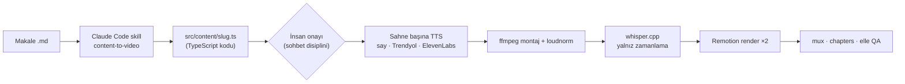
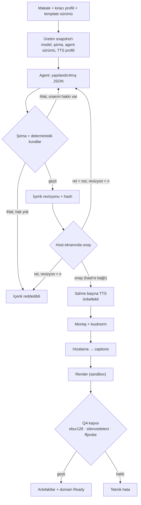
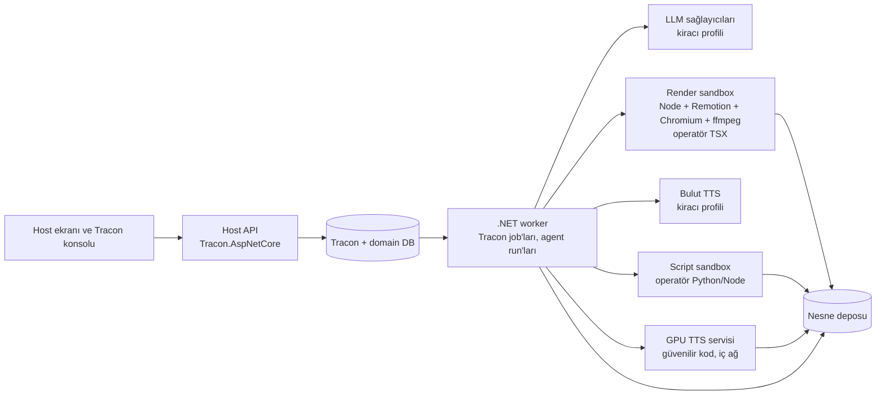
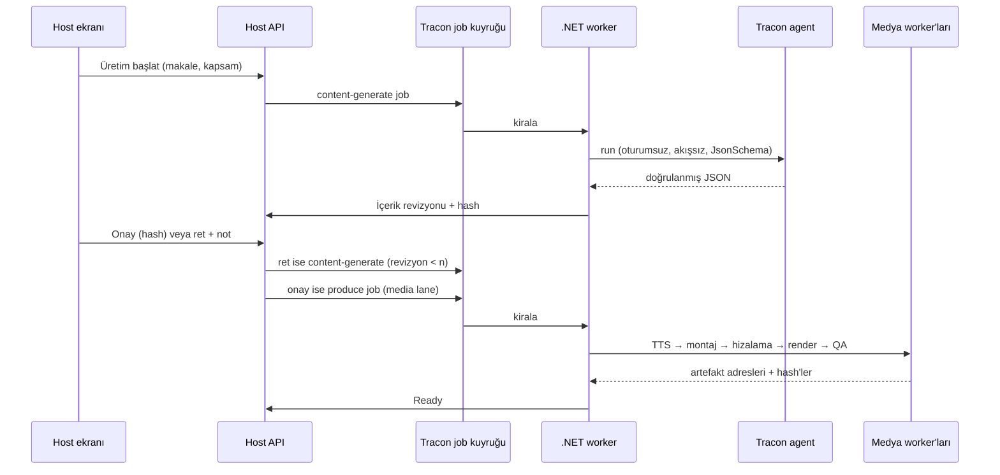

# Tracon — Explainer video üretimi için tüketici uyum raporu

**Tarih:** 12 Ekim 2026. Bu belge 11 Ekim tarihli ilk sürümün yerine geçer;
dosya adı bağlantılar bozulmasın diye ilk yazım tarihini taşır.

**İnceleme zemini:** Tracon `b7c0e173` artı Faz 194'ün commit edilmemiş
çalışma ağacı (2026-10-12). Faz 192 kapalı; 2026-10-12 kusur turu kapalı
(K-885…K-896); Faz 193 ve 195 planlı; Faz 194 uygulanıyor. Tüketici reposu
`Explainer-Video`, tek commit `edb560a`.

**Yöntem:** Beş Tracon alanının kod haritası (workflow · agent/harness · job ve
sandbox · voice/artifact/cost · konsol/tenancy); her alanın bulgusu ayrı bir
doğrulayıcı tarafından kodla çürütülmeye çalışıldı; tüketici reposu ayrıca
okundu; ekosistem 2026-10-11'de tarandı. 2026-10-12'de kapanan kusurların
durumu `docs/arsiv/ERTELENEN-ADAYLAR.md` ve site metinlerinden ölçüldü.

**Kapsam ve sınır:** Bu belge bir faz planı değildir. Açık kusurlar
çalıştırılarak yeniden üretilmedi. Render, TTS ve LLM süreleri ölçülmedi;
sayılar tüketici reposundaki dosyalardan ya da üretici beyanından gelir.

**İlişkili kayıtlar:** [keşif kaydı](../../kesif/2026-10-11-explainer-video-tuketici.md)
(tur, kullanıcı cevapları, ham fikirler) · [ADAYLAR](../../ADAYLAR.md)
(F-318…F-324, F-345…F-347) · aynı tüketici projesinin
[podcast raporu](2026-10-11-podcast-tuketici-uyum-raporu.md). Podcast
raporunun upload/DB sıralaması (§ 9.2) ve side effect tablosu (§ 9.3) bu hat
için de geçerlidir; burada tekrarlanmaz.

---

## 1. Sonuç

**Bu hat Tracon üzerine kurulabilir. İlk sürüm için önerilen yol C'dir:
Tracon LLM adımını ve job altyapısını taşır; onay, revizyon ve medya hattı
host uygulamasındadır. Hedef yol A'dır: hattın tamamı bir Tracon workflow'u
olur.** A'yı 11 Ekim'de üç kusur ve iki eksik yetenek engelliyordu. Üç kusur
(F-325, F-327, F-328) 2026-10-12'de kapandı. A'yı bugün yalnız iki eksik
yetenek (F-318, F-319) ve bir kurulum ayarı (`AgentGraph.ChildDeadline`)
sınırlar (§ 8).

Dört sorunun kısa cevabı:

| Soru | Cevap |
|---|---|
| Harness mı workflow mu? | **Workflow.** Bir LLM adımı, bir onay kapısı ve n revizyon, sonra uzun deterministik medya adımları. LLM adımı tek bir agent'tır ve harness gerektirmez |
| Sandbox gerekli mi? | **İçerik için hayır**, içerik JSON veri olursa. **Operatör kodu için evet:** operatör sahne bileşenini ve script'i canlı yazar (cevap 17); bu kodu tüketicinin sandbox'ı çalıştırır, Tracon çalıştırmaz (K2) |
| Python nerede çalışır? | .NET sürecinde değil. Güvenilir GPU TTS modeli ayrı bir servistir. Operatör script'i sandbox'lı runner'da koşar. Bulut TTS seçen kiracıda Python gerekmez |
| Tracon'un eksikleri var mı? | Evet, ama azaldı. 20 kusurun 16'sı kapandı; 4'ü açık ve 🟢 (F-341…F-344). 10 aday bekliyor (F-318…F-324, F-345…F-347). Kapanış turunun sınıf taramasından bu hatta dokunan 6 yeni bulgu var (§ 12.3) |

Sorumluluk dağılımı: Tracon agent çalıştırmayı, yapılandırılmış çıktıyı, run
kaydını, maliyeti (token), job kuyruğunu, kiracı yalıtımını, webhook'u ve
konsolu verir. Tüketici şemayı, kural doğrulayıcısını, onay ekranını, üretim
domain'ini, medya worker'larını, sandbox'ı ve artefakt deposunu yazar.

---

## 2. Netleşen ihtiyaç

| Konu | Karar (2026-10-11) |
|---|---|
| Ürün | Çok kurumlu SaaS; kiracı başına profil |
| Girdi | 8 bölümlü Türkçe Markdown makale |
| Kapsam | Parametre; varsayılan tüm makale |
| Onay | Host ekranında onay/ret; n revizyon; içerik hash'i değişince onay düşer. İleride agent onayı planlanıyor (§ 15) |
| Model | Kiracı başına; Claude dışı modeller de olabilir |
| TTS | EU bulut TTS serbest; Trendyol-TTS lisansı ve ses rızası teyitli |
| Çıktı | Temiz MP4 + VTT (tek render); yakılmış sürüm yok |
| Hacim | İlk kiracı için 84 video; gece batch; 1 TTS + 2–4 render worker |
| Kurallar | Render'ı çökertenler ve yapısal kurallar engelleyici; çeşitlilik kuralları uyarı |
| `bg`, `dur`, `art` | `bg` ve `dur` kodla; `art` LLM'de |
| Operatör | Sahne bileşenini ve script'i yazabilir, canlı günceller; operatör kodu yalnız CPU |
| Konsol | Kiracıların host'una açılır; host personeli kiracıya host'un kimlik sağlayıcısı üzerinden girer |
| Anahtarlar | Bütün LLM ve TTS anahtarlarının sahibi host |
| Lisans | Remotion Automators; 4.0.x sabit |
| Saklama | Nesne deposu; taslak 30 gün, final kalıcı, onay kaydı süresiz |
| İptal ve yeniden deneme | İptal ≤ 30 sn; render 1, TTS 2 deneme |
| Ret notu | İçerik düzeyinde; isteğe bağlı sahne kimliği taşıyabilir |

Açık kalan kararlar § 17'dedir.

---

## 3. Bugünkü sistem ve sunucuya taşınırken değişmesi gerekenler

Bu hat bir geliştiricinin Mac'inde, elle ve sırayla koşar. Sunucuya
taşınırken altı şey değişmelidir:

1. **İçerik koddan veriye geçer.** Bugün script'ler LLM'in yazdığı `.ts`
   dosyasını esbuild ile paketleyip `import()` ediyor
   (`scripts/_content.mjs:7-16`, yedi giriş noktası). Aynı dosya Remotion
   bundle'ına girer ve ağ erişimli Chromium'da çalışır. Makale dış metindir;
   dolaylı prompt injection ile içerik dosyasına kod yazılabilir. İçerik JSON
   olur ve Remotion'a `inputProps` ile verilir. Süreyi `calculateMetadata`
   hesaplar. `Root.tsx`'teki statik import kataloğu tek bir generic
   composition'a iner.
2. **Şema tek kaynaktan üretilir.** Bugün şema üç yerde elle senkron:
   `schema.ts`, `_content.mjs` ve SKILL.md. Öneri § 5.1'dedir.
3. **macOS'a bağlı parçalar çıkar.** `say` Linux'ta yoktur. Trendyol script'i
   cihaz olarak yalnız `mps` veya `cpu` seçer; Linux GPU'da sessizce CPU'ya
   düşer (`tts_trendyol.py:24`).
4. **Ağ bağımlılıkları image build'e taşınır.** Fontlar render anında Google'dan
   iner (`src/system/fonts.ts`); Chromium ilk render'da indirilir;
   whisper.cpp çalışma anında clone edilip derlenir; model yalnız boyutla
   doğrulanır.
5. **Script'ler saf komut olur.** Bugün hepsi repo kökünü CWD sayar ve kaynak
   ağacına yazar. Her adım `--input manifest --workdir job-tmp --output dir`
   alan, idempotent bir komut olmalıdır.
6. **Tek render.** Cevap 6 yakılmış sürümü kaldırır. Render işi yarıya iner.

Ek olarak iki güvenlik bulgusu vardır: `content.id` doğrulanmadan dosya yoluna
ve `rmSync(recursive)` çağrısına girer (`scripts/tts-draft.mjs:26-27`);
`bg`, `art.src` ve `bgm` anahtarları `../` taşıyabilir. İkisi de içerik veri
olunca kodla türetilen alanlara döner (§ 5.1).

---

## 4. Harness ve workflow ayrımı

**Workflow** hangi adımın hangi koşulda koşacağını belirler: onaysız TTS yok,
revizyon sayısı n ile sınırlı, içerik hash'i değişince onay düşer.

**Harness** bir agent invocation'ının iç düzenini belirler: context, tool
döngüsü, iterasyon. Bu hatta LLM adımı tek atışta JSON üretir; tool
kullanmaz. Bu yüzden harness gerekmez. `Loop` yalnız anlamsal bir yargıç
istenirse eklenir; F-329 kapandığı için (K-889) Loop artık yapılandırılmış
doğrulamayla birlikte çalışır: doğrulayıcı son asistan mesajını doğrular.

Hedef akış:

---

## 5. İçerik üretimi: şema, doğrulama, revizyon

### 5.1 Şema tek kaynaktan gelir ve kuralları yapısal yapar

Kaynak **Zod v4** olur (Remotion 4.0.520 zaten taşır). Bir build adımı iki
JSON Schema üretir:

- **Sözleşme şeması:** tam şema; host doğrulayıcısı bunu kullanır.
- **Taşıma şeması:** sağlayıcının desteklediği alt küme. `oneOf` → `anyOf`,
  her nesnede `additionalProperties: false`, desteklenmeyen kısıtlar
  açıklamaya taşınır. Kiracı başka model seçebildiği için (cevap 12)
  sağlayıcı başına bir taşıma şeması gerekebilir. OpenAI strict modu ve
  etkin şemanın görünürlüğü F-347'dir.

Şemayı yeniden tasarlamak hata yüzeyini daraltır:

| Değişiklik | Kazanç |
|---|---|
| Düz `scenes[]` yerine `sections: [{label, sub, heroArt, scenes}]` | Bölüm numarası, ayraç sahnesi, "ayraçta vo yok" ve "her sahnede section" kuralları koddan türer |
| `art` yalnız `definition`/`takeaways` (side) ve bölüm (hero) düzeyinde | "Üç kombinasyon" kuralı yapısal olur |
| `quadrant.cells` → `{tl, tr, bl, br}` nesnesi | Tekillik ve dört hücre yapısal olur |
| `bg`, `art.src`, `bgm` asset manifest'inden üretilen enum | `../` taşıyan anahtar temsil edilemez |
| `id`, `vo` dosya adı, `sections`, `dur` ve `bg` kodla türer (cevap 10) | LLM yalnız metni, sahne tipini ve `art`'ı seçer |

Çapraz alan kuralları JSON Schema ile ifade edilemez: art aralığı, ardışık
`bg`, bölüm başına `statement`, metin bütçeleri. Bunlar kural kimlikli tek
bir linter'da yaşar. Kural sınıflaması tüketici kaynaklarından çıkarıldı:
47 kuralın 34'ü deterministik, 11'i karma, 2'si anlamsaldır.

### 5.2 Tracon ayarı

| Ayar | Değer | Neden |
|---|---|---|
| `ModelBinding.ResponseFormat` | `JsonSchema` + taşıma şeması | Sağlayıcıya şema gider (`AgentDefinitionCompiler.ChatOptions.cs`) |
| `ModelBinding.MaxOutputTokens` | Açıkça verilir | Anthropic varsayılanı 4096'dır (`AnthropicProviderOptions.cs`); 44 KB pilot içerik kesilir. Kesilme bugün ayrı sınıflanmaz (F-320) |
| `IStructuredResponseValidator` | Tüketici yazar: JSON Schema kütüphanesi + linter | Tracon şema doğrulamaz, yalnız JSON ayrıştırır (`IStructuredResponseValidator.cs`) |
| `Tracon:StructuredResponse:Enabled` | `true` | Host geneli bir ayardır; agent başına açılamaz |
| `MaxRepairAttempts` | 1–2 | Onarım yalnız oturumsuz ve akışsız run'da çalışır (`StructuredResponseValidatingAgent.cs`) |
| `AgentParameter` (`scope`, `language`) | Tanımda bildirilir | Talimat `{{scope}}` ile alır; senkron, kuyruklu ve batch run değer taşır (Faz 194) |
| `Documents` | Makale belge kanalıyla gider | Senkron ve kuyruklu run'da (Faz 194); belge kullanıcı mesajından önce mesaj olur |
| Harness | Yok | Harness agent'ı artık CWD'den skill keşfetmez ve `./agent-file-memory`'ye yazmaz (F-339 kapalı, K-892); web araması opt-in (`EnableWebSearch`) |
| Sağlayıcı `Timeout` | Uzun üretime göre | Dakikalar süren tek istek |
| `ProviderSettings` | Yalnız tanınan `openai.*` / `anthropic.*` anahtarları | Bilinmeyen anahtar artık `400` verir (F-340 kapalı); önbellek TTL'i ve adaptive thinking F-346 |

Doğrulayıcının iki sınırı vardır. Makaleyi görmez, bu yüzden "vo makaleyi
kopyalamasın" kuralı orada değil, run sonrası host kodunda koşar. Red nedeni
yanıt metnini taşımamalıdır, çünkü run olayı kalıcıdır.

### 5.3 Revizyon döngüsü (cevap 2)

- Ret notu yeni bir agent run'ına girdi olur: önceki JSON + not + makale.
- Run **oturumsuz** kalır. Kalıcı oturumlu run'da onarım kapalıdır.
- Revizyon sayısı kiracı profilindedir. Host sayar; n dolunca üretim
  "içerik reddedildi" olur.
- Her revizyon yeni bir içerik hash'i üretir. Onay hash'e bağlıdır; hash
  değişince onay düşer.
- Kuyruklu agent run'ı (`Prefer: respond-async`) `parameters` ve `documents`
  taşır (Faz 194, `AgentEndpoints.cs`; `AgentRunJobHandler` yükü okur). Faz
  kapanmadan önce bu yol **commit edilmemiş** koddadır. Parametresiz
  yollar varsayılanı bağlar; varsayılansız zorunlu parametre girişte `400`
  verir (F-330 kapalı, K-890). Kuyruklu run isteğin `culture`'ını ve deney
  kolunu taşır (F-351 kapalı).
- 🚨 **Güvenlik sınırı (Faz 194 kararı):** `jobs.payload` korumalı sütun
  değildir. Kuyruklu run'ın mesajı, parametreleri ve belgeleri — yani
  kurumsal makale metni — veritabanında düz durur. İçerik koruması kapanışta
  ayrı aday olarak açılır. Makaleyi kuyruğa koymak yerine host kendi
  deposundaki anahtarı parametre olarak geçip metni job handler'ında
  okuyabilir; bu durumda LLM adımı host'un kendi job'unda `IAgentCatalog` ile
  koşar.

### 5.4 Canlı şema (cevap 17)

Operatör yeni sahne tipi eklerse şema, talimat ve agent tanımı birlikte
değişir. Önerilen düzen:

1. Template sürümü yayımlanınca host, kiracının agent tanımını API ile
   günceller (`PUT /api/agents/{name}`); yeni bir agent sürümü oluşur.
2. Üretim snapshot'ı template sürümünü, şema hash'ini ve agent sürümünü
   tutar.
3. Revizyonlar aynı agent sürümüyle koşar.

Tracon sınırları: HTTP run isteği agent sürümü taşımaz; sürüm ancak deney ve
eval yolunda sabitlenir (kapsam F-300). Süreç içinden sabit sürümlü çözümleme
artık **o sürümün kendi descriptor'ını** kullanır (F-331 kapalı, K-891).
Onay devamı kaynak run'ın sürümüyle koşar (F-352 kapalı, K-895). Sabit
sürümlü üst agent'ın alt agent'ı ve workflow adımı güncel sürümü çözer — bu
belgelenmiş tasarımdır (K-309); alt sürümü üste bağlamak F-300'ün
kapsamındadır.

### 5.5 Eval

Kiracı ve template sürümü başına bir suite kurulur. Deterministik check'ler
`AddEvalCheck` ile kodda yazılır; CI eşiği `tracon eval --min-pass-rate`
ile kurulur. Eval case run'ı artık sabit sürümü yazar (F-331). İki kusur bu
yolu hâlâ zayıflatır: `EvalCase.Context` agent'a gitmez ve run'dan case'e
terfi belgeyi düşürür (F-343, açık). Terfi `run_inputs`'tan okuyabilir; Faz
194 parametreleri de oraya yazar.

---

## 6. Ses ve hizalama

### 6.1 Motor seçenekleri

| Motor | Nerede | Hizalama | Not (2026-10-11) |
|---|---|---|---|
| Trendyol-TTS (VoxCPM2) | Host'un GPU servisi | Yok; ayrı hizalama | Lisans teyitli (cevap 4). VoxCPM2 CUDA ≥ 12, yaklaşık 8 GB VRAM; RTF ~0.30 RTX 4090 (üretici beyanı), tüketici Mac MPS'te ~0.7 ölçtü |
| ElevenLabs | Bulut | `with-timestamps` karakter hizalaması | `previous_text`/`next_text`, `previous_request_ids` (≤ 3), `seed`; EU yerleşimi yalnız Enterprise; `eleven_v4` 2026-09-28 |
| Azure Speech tr-TR | Bulut, EU bölgesi | Batch `wordBoundaryEnabled` | tr-TR kelime sınırı açıkça doğrulanmadı |
| Google Cloud TTS / Gemini-TTS | Bulut, EU endpoint | Yalnız SSML `<mark>` | Ayrı hizalama gerekir; Gemini adaptörü F-297 |
| macOS `say` | Yalnız geliştirici | Yok | Sunucuda yok |

Kiracı motoru profilde seçer. Aynı süreçte yerel ve bulut motor yaşar. Bugün
bu, fonksiyon düğümünde veya job handler'ında keyed servislerle kurulur
(`AddKeyedSingleton<ISpeechSynthesizer>("voxcpm", …)`). Tracon'un tek yuvalı
yerleri `speak` tool'u, `/api/voice/*` ve fiyat okuyucusudur; adlı kayıt ve
kiracı bağlaması F-298'dir (🟠).

### 6.2 Tracon ses katmanının sınırları

- `ISpeechSynthesizer` tek sesli ve sahne başına uygundur. Arayüz artık
  `ProviderName` ve `MaxCharactersPerRequest` bildirir (F-336 kapalı).
- Özel bir sentezleyici `UseVoice()`'tan **önce** kaydedilirse ElevenLabs
  ayarları (`Provider`, `ApiKey`, `Endpoint`) gerekmez; fiyat
  `Tracon:Pricing:Voice` altında `ProviderName` ile okunur; `speak` sınırı
  uygulamanın kendi limitidir; `UseVoice` `ValidateOnStart` taşır (F-336
  kapalı). Dosya adı çıktının türünden türer.
- `SpeechRequest` süreklilik alanlarını ve ses ayarlarını taşımaz. F-296'nın
  "istek ayarları" dilimi diyalogdan önce yapılabilir.
- `SpeechAudio.Duration` ElevenLabs yolunda dolmaz; süre ses başlığından
  hesaplanır.
- Fonksiyon düğümünden TTS maliyeti raporlanamaz (F-299). Geçici yol:
  maliyet host domain'inde tutulur.

### 6.3 Hizalama sırası

1. Motor zaman veriyorsa onu kullan (ElevenLabs, Azure batch).
2. Vermiyorsa forced alignment: ElevenLabs Forced Alignment (Türkçe, EU
   endpoint) veya WhisperX + `mpoyraz/wav2vec2-xls-r-300m-cv7-turkish`
   (BSD-2 + CC-BY-4.0).
3. whisper.cpp yalnız geri dönüş yolu kalır.

Caption metni her yolda bilinen `vo` metninden gelir; hizalamadan yalnız
zaman alınır. Bugünkü cue = cümle eşlemesi 42 karakter sınırını 173 cue'nun
77'sinde aşar; aligner uzun cümleyi bölmelidir.

### 6.4 Önbellek anahtarı

Bugünkü anahtar 32 bitlik djb2'dir, iki kopyadır ve normalizasyon yapmaz.
Önerilen anahtar: `sha256(NFC(vo), motor, model revizyonu, referans ses
hash'i, parametreler, örnek hızı)`. Parçalar videolar arasında paylaşılır;
tek sahne değişince yalnız o parça yeniden sentezlenir.

---

## 7. Kod nerede çalışır; sandbox

### 7.1 Topoloji

### 7.2 Neden Tracon'un skill script runner'ı değil

Skill script runner bu iş için tasarlanmadı:

- Varsayılan zaman aşımı 30 sn, çıktı sınırı 256 KB, kiracı başına 2
  eşzamanlı script (`TraconOptions.cs`, `TraconSkillScriptOptions`).
- Her çağrı yeni süreç açar; GPU modeli her seferinde soğuk yüklenir.
- Script modele yalnız LLM tool'u olarak açılır; zorunlu adım garantisi
  vermez.
- Süreç sunucunun OS kimliğiyle koşar; OS yalıtımı yoktur (K-862). Çok
  kiracılı host'ta stored script platform yetkisi ister (K-861).
- Yürütmeyi host'un sandbox'ına taşıyan public seam henüz yoktur (F-345,
  aday). Seam gelse de yalnız LLM'in çağırdığı skill script yolunu kapsar.

### 7.3 Operatör kodu için sandbox (cevap 17)

Operatörün yazdığı sahne bileşeni ve script güvenilmez koddur. Tracon bu kodu
çalıştırmaz: tool kodu yalnız koddadır ve arayüzden yazılan kod çalıştırılmaz
(K2, L20). Kod tüketicinin sandbox'ında koşar:

- **Yalıtım:** iş başına geçici container; gVisor (`runsc`), Kata veya
  Firecracker mikro-VM.
- **Ağ:** varsayılan kapalı. Fontlar, Chromium ve modeller image'dadır.
  Girdi ve çıktı yalnız ön imzalı nesne adresleriyle akar.
- **Kimlik:** root olmayan kullanıcı, salt okunur kök, iş başına `tmpfs`
  scratch; env'de `secret` yok.
- **Kaynak:** CPU, bellek, süreç sayısı ve süre sınırı.
- **Sürüm:** operatör kodu içerik hash'iyle saklanır. Üretim belirli bir
  hash'e sabitlenir; canlı güncelleme yalnız yeni üretimleri etkiler.
- **Bundle:** Remotion bundle'ı da sandbox'ta üretilir. Bundler yapılandırması
  operatörün eline geçerse derleme de kod çalıştırır.
- **Chromium:** Remotion Chromium'u `--no-sandbox` ve kapalı site yalıtımıyla
  açar; container tek sınırdır.

GPU TTS servisi host'un güvenilir kodudur ve operatör kodundan ayrıdır.
**Operatör kodu yalnız CPU kullanır** (karar, 2026-10-11): GPU'lu sandbox
seçenekleri dardır (gVisor `nvproxy` sınırlı, Firecracker GPU geçirmez) ve
GPU belleği kiracılar arasında paylaşılır.

**Operatörün tanımladığı içerik kuralı veridir** (karar, 2026-10-11): form veya
JSON Schema + hazır kural türleri. Bileşenin props şeması yayın anında bir kez
sandbox'ta çıkarılır ve veri olarak saklanır. Host doğrulayıcısı bu veriyi
süreç içinde okur; LLM çıktısı sandbox'tan geçmez.

Podcast hattı aynı tüketici projesindedir ve podcast script'ini de operatör
canlı yazar (karar, 2026-10-12). Bu bölümün sandbox modeli iki hatta da
uygulanır; iki hat tek bir sandbox runner servisini paylaşır.

---

## 8. Orkestrasyon alternatifleri

| Yol | Nasıl kurulur | Bugün ne gerekir veya ne engeller | Ne zaman |
|---|---|---|---|
| **A** · Tracon Workflows uçtan uca | Kod grafı: agent → doğrulama → `RequestPort` onayı (revizyon geri kenarı) → worker'ı çağıran fonksiyon düğümleri; üretim kimliği ve profil değerleri workflow parametresi (Faz 194) | Run HTTP akışına bağlıdır: keep-alive var (F-325 kapalı), ama bağlantı koparsa run `Canceled` olur; `respond` da akışa bağlıdır (F-318). Bağlantısız yol: `tracon.workflow` job'u (başlatır, yanıt veremez) veya host'un kendi job'unda public `IWorkflowRunner` (yetki kapısı atlanır). Agent adımı `AgentGraph.ChildDeadline`'ı (2 dk) aşarsa run `Failed` olur (F-328 kapalı); süre kurulum geneli yükseltilir, düğüm başına ayar F-303. Onay isteği 8 KB'ta kırpılsa da yanıtlanır (F-327 kapalı); yine de isteğe özet + bağlantı konur. Retention bekleyen run'ı tutar. İkinci yanıt yeni dal açar (K-130; opt-in tek yanıt F-319). Çökmede resume elle (F-321) | Hedef; F-318 → F-319 sonrası |
| **B** · Agent onay posta kutusu + job | Kuyruklu agent run'ı `RequiresApproval` taşıyan bir `submit_for_production` tool'u çağırır; `approval.pending` gelir; karar devamı job'da kaynak run'ın sürümüyle koşar (F-352 kapalı); tool `produce` job'unu kuyruğa alır | 44 KB JSON tool argümanı olur. Onay varsayılan 24 saatte düşer. Ret, modele tool sonucu olarak döner; n revizyonu modelin davranışı belirler. Devam ikinci onay isterse posta kutusuna yazılmaz (F-370, açık) | Kalıcı ve SSE'siz yerleşik onay gerekirse |
| **C** · Tracon = LLM adımı + job altyapısı | Host job'ları: `content-generate` (agent run), onay host ekranında, `produce` (`media` lane'i) | Adımlar idempotent ve önbellekli olmalı. Kira ve deneme sözleşmesi artık tutar (F-326, F-348 kapalı). İptal handler token'ına ulaşmaz (F-323) | **Önerilen: ilk sürüm** |
| **D** · Tracon yalnız LLM adımı | Medya hattı host'un kendi orkestratöründe (Hangfire, Temporal vb.) | Tracon tarafında engel yok; run ağacı ve maliyet görünürlüğü azalır | Host'un zaten bir orkestratörü varsa |

### 8.1 Yol C ayrıntısı

Kurulum notları:

- API süreci `RunWorker = false` ile koşar. Medya worker süreci
  `Lanes = ["media"]` ve `MaxConcurrentJobsPerLane["media"]` ile kurulur
  (`TraconSchedulingOptions.cs`). `Lanes = null` olan bir süreç media
  işini de kiralar.
- `produce` job'u adımları item olarak modeller; tamamlanan item yeniden
  denemede atlanır.
- Kiracı ve atıf, job'u başlatan metodun gövdesinde açılır:
  `AmbientTenantScope.Begin(tenantId)` ve
  `AmbientRunAttributionScope.Begin(userId, labels)` (etiket örnekleri:
  `production`, `content`; en çok 8 etiket, değer en çok 256 karakter).
  `RunAttributionGate` artık her run başlatan uçta çalışır ve workflow kökü
  atıf taşır (F-337 kapalı). Kuyruklu ve zamanlanmış **workflow** kökü hâlâ
  atıf taşımaz (F-364, 🟢).
- "Render 1 deneme" artık güvencedir: kirası dolan job deneme sınırına
  bakılarak `tracon.job.attempts-exhausted` ile düşer, yeniden koşmaz
  (F-326 kapalı, K-886). Handler bittikten sonraki `store` hatası handler
  hatası sayılmaz; yazım kira içinde tekrarlanır (F-348 kapalı). Render
  çıktısı yine içerik anahtarıyla önbelleklenmelidir.
- İptal handler'a token olarak ulaşmaz; handler `IsCancelledAsync`'i
  yoklar ve süreç ağacını kendisi öldürür (F-323). İptal edilen job hata
  atsa da `Cancelled` kalır (F-326).
- Bildirim: `job.completed`, `job.failed`, `run.completed`/`run.failed`
  (workflow kökü dahil) ve `workflow.request.pending` webhook'ları artık
  yayınlanır (F-333 kapalı). Host ekranı bunlara abone olabilir; webhook
  teslimi başarılı gönderimden sonraki `store` hatasında ikinci kez
  gönderilebilir (F-366, 🟡) — alıcı idempotent olmalıdır.

### 8.2 Yol A'ya geçiş koşulları

F-318 (bağlantıdan bağımsız `run`/`resume`/`respond`) ve F-319 (HITL karar
sözleşmesi: kiracı geneli liste, opt-in tek yanıt, karar denetimi, süre)
gelir; F-303 agent düğümü süresini düğüm başına ayarlar; F-321 çökmede
otomatik sürdürmeyi getirir. Bundan sonra revizyon geri kenarı ve onay bir kod
grafında kurulur. Konsol host'a açık olduğu için (cevap 18) uzun run'lar
konsoldan başlatılabilir: workflow akışı 15 sn'de bir keep-alive yazar
(`StreamKeepAliveInterval`), bu değer ters proxy'nin boşta kalma süresinin
altında tutulur. Başka yerden başlayan run'ın isteği run sayfasından açılır
(F-335 kapalı).

**Bugün A'ya en yakın kurulum:** host `tracon.workflow` job'u ile workflow'u
kuyruktan başlatır (bağlantı yok; üretim kimliği parametre olarak gider), onay
host ekranında verilir, host'un kendi job'u `IWorkflowRunner.RespondStreamingAsync`
ile yanıtı akıtır ve bitene kadar okur. Bu kurulumda `IRunAuthorizationHandler`
kapısı respond için çalışmaz; yetkiyi host kendi ekranında denetler.

---

## 9. Çok kiracılılık ve operatör deneyimi

**Kiracı profili** şunları taşır: model ve sağlayıcı, TTS motoru ve ses,
template sürümü, revizyon sayısı n, kural şiddetleri, kullanılabilir `art`
seti. Profil kod değil veridir; host doğrular. Run başına değişen değerler
(kapsam, dil, ton) workflow ve agent parametresidir (Faz 194); tanım
kopyalanmaz.

**Tracon tarafındaki yalıtım:** stored agent ve workflow tanımları, run'lar,
checkpoint'ler ve istek listesi kiracıya bağlıdır. Kodda tanımlı workflow ve
fonksiyon kayıtları bütün kiracılara ortaktır; kiracı farkı profil verisiyle
verilir. Özetleyici ve `aiJudge` yargıcı kiracının egress politikasını ve kendi
anahtarını uygular (K-874); kaydedilen politika önbellekteki agent'a da ulaşır
(K-875).

**Eşzamanlılık:** `MaxConcurrentRuns` süreç başına tek semafordur ve
kiracılara ortaktır; job kiralama FIFO'dur. Slot bekleyen run'ın satırı artık
vardır ve `Running` görünür; bekleme `RunTimeout`'a sayılır (F-325). Adil
sıra bugün host'un admission katmanındadır; Tracon tarafı F-322'dir.

**Konsol (cevap 18):** Host konsolda agent talimatını sürümlü düzenler,
run ağacını ve maliyeti görür, bekleyen isteği run sayfasından açar. Bugünkü
sınırlar: workflow zincirinde düğüm düzenlenmez ve fonksiyon düğümü ayar
almaz (F-292 + F-295 → [Faz 195](../../195-WORKFLOW-DUGUM-DUZENLEME-VE-AYAR.md),
planlı); `Loop` konsoldan ayarlanmaz (F-302); workflow ve skill için sürüm
geçmişi yoktur (F-300); workflow parametre **şeması** konsolda düzenlenmez,
yalnız korunur (Faz 194 kapsam dışı).

**Host personeli ve kiracılar** (karar, 2026-10-11): konsol bir oturumda tek
kiracıyı gösterir; kiracı giriş kimliğinden veya API anahtarından gelir
(`HttpTenantContext.cs`). Host kendi kimlik sağlayıcısında "kiracı olarak gir"
özelliğini kurar ve kiracı claim'ini o üretir. Tracon tarafında değişiklik
gerekmez.

**Anahtarlar:** Model anahtarı kiracı BYOK ve egress altyapısıyla bağlanır
(K-874, K-878). Ses anahtarı bugün süreç genelidir. **Bütün LLM ve TTS
anahtarlarının sahibi host'tur** (podcast turuyla aynı). Kiracı başına seçim
yine gerekir: F-298 adlı kayıt ve kiracı bağlaması getirir; kiracı BYOK
ikincildir.

---

## 10. Kalıcı durum, artefaktlar ve idempotency

**Domain kayıtları (host):** `Production`, `ContentRevision` (JSON, hash,
agent sürümü, şema sürümü), `Approval` (kim, ne zaman, hangi hash, karar,
not), `MediaArtifact` (anahtar, hash, bayt, MIME, süre). Bir üretim birden çok
Tracon run'ı açar; run kimliği bağlantıdır, üretim kimliği değildir.

**İçerik adresli artefakt anahtarları:**

| Artefakt | Anahtar girdileri |
|---|---|
| TTS parçası | NFC metin, motor, model revizyonu, referans ses hash'i, parametreler, örnek hızı |
| Ses manifesti | Parça anahtarları + sahne sırası |
| Ses rayı | Manifest + `dur` değerleri + zaman sabitleri + assembler/loudnorm sürümü |
| Caption'lar | Ses rayı hash'i + `vo` metinleri + aligner ve model hash'i |
| Render | Template bundle hash'i + `inputProps` hash'i + render ayarları + Remotion/Chromium sürümü |
| VTT, chapters | Caption'lar + timeline + render hash'i |

Her artefakt girdilerinin hash'ini taşır; orkestratör eşleşmeyen kombinasyonu
reddeder. Bugünkü repo bu bağı kurmadığı için senkronsuz render üretebilir
(§ 14).

**Upload ve DB sırası:** podcast raporu § 9.2 aynen geçerlidir. Nesne yazılır,
checksum doğrulanır, sonra domain transaction'ı `Ready` yazar.

**Saklama:** Tracon run ve ek retention'ı domain saklamasından ayrıdır.
Retention `AwaitingInput` run'ın istek olayını ve checkpoint'lerini süresiz
tutar (K-888); harici ek baytı satırdan önce silinir ve workflow run'ı
oturumunun eklerine sahiptir (K-896). Yanıtlanmış istek de K-130 gereği
`AwaitingInput` kalır; bu satırlar F-319'un "süre" maddesi gelene kadar hiç
silinmez. Büyük medya Tracon ekine girmez (20 MiB sınırı, `video/mp4` izinli
tür değil); Tracon'a yalnız anahtar ve hash girer. Veri sahibi dışa aktarımı
ve silmesi `workflow_checkpoints`'i atlar (F-371, 🟡); serileştirilmiş durum
makale metni içerebilir.

---

## 11. Kapasite ve maliyet

Tüketici dosyalarından (ölçülmüş boyut, ölçülmemiş süre):

| Kalem | Değer |
|---|---|
| Pilot video süresi | 906 sn → 27.191 kare (30 fps) |
| Temiz MP4 | 168.898.710 B |
| Ses rayı (48 kHz mono WAV) | 86.690.958 B |
| VTT | 21.413 B |
| Pilot içerik JSON | 39.494 B (60 sahne, 52 `vo`, 1.779 kelime) |

84 videoda yalnız temiz MP4 + VTT + ses rayı saklanırsa yaklaşık 21 GB eder
(hesap, ölçüm değil). Ara parçalar taslak saklama süresine girer.

Üçüncü taraf fiyatları (2026-10-11, kaynak keşif kaydı § 4):

- Remotion Automators: render başına $0.01, aylık $100 alt sınır. 84 video
  için maliyeti alt sınır belirler.
- ElevenLabs `eleven_v4`: 1.000 karakter başına $0.08. Video başına yaklaşık
  15.000 karakter varsayımıyla ~$1.2 (çıkarım).

Tracon varsayılanları bu hacim için yeniden ayarlanır:

| Ayar | Varsayılan | Bu hatta |
|---|---|---|
| `TraconWorkflowOptions.RunTimeout` | 10 dk | Yol A'da ölçüme göre; slot beklemesini de sayar; aşımda `Canceled` + `TimeoutException` |
| `AgentGraph.ChildDeadline` | 2 dk | Workflow agent adımı ve alt agent için kurulum geneli yükseltilir; aşımda run `Failed` (`child_run_timeout`); düğüm başına F-303 |
| `AgentGraph.MaxTotalTokens` | 200.000 | Revizyonlar dahil ağaç bütçesi; aşımda run `Failed` (`run_budget_exceeded`) |
| `RunRecording.MaxPayloadLength` | 8.192 | Onay isteğine özet konur; kırpılan istek yine yanıtlanır |
| `TraconSchedulingOptions.LeaseDuration` | 5 dk | Yenileme kiranın üçte birinde; uzun render'da kira işin süresinden bağımsızdır, handler çalışırken yenilenir |
| `TraconSchedulingOptions.MaxAttempts` | 3 | Render job'unda `MaxAttempts = 1`; kira dolumu da deneme sayılır |
| `TraconEndpointOptions.StreamKeepAliveInterval` | 15 sn | Ters proxy boşta kalma süresinin ve konsolun 30 sn'sinin altında |
| `MaxConcurrentJobsPerLane["media"]` | — | GPU ve render worker sayısına göre |

---

## 12. Tracon kusurları

### 12.1 Kapanan kusurlar (2026-10-12)

Tam kanıt, karar ve kırmızı test adları
[`arsiv/ERTELENEN-ADAYLAR.md`](../ERTELENEN-ADAYLAR.md) § kapanan kusurlar
tablosundadır. Burada bu hatta ne değiştiği durur.

| F-NN | Kapanış | Bu hatta etkisi |
|---|---|---|
| F-325 | K-885: her SSE ucu keep-alive yazar; slot beklemesi run satırından sonra | Konsol ve host SSE'si uzun düğümü kesmez; bağlantı kopması yine run'ı iptal eder |
| F-326 | K-886: yenileme kiranın üçte birinde ve hatada durmaz; kira dolumu deneme sayılır; iptal edilen job `Cancelled` kalır | "Render 1 deneme" güvence oldu |
| F-327 | K-888: istek kimliği olay `Text`'inden; retention bekleyen run'ı tutar; checkpoint oturumda bekleyen run varken silinmez | Büyük onay isteği kaybolmaz; `KeepCheckpointsAfterCompletion=false` güvenli |
| F-328 (+F-314) | K-887: workflow katılımcısı `ChildRefusalMode.Fail`; süre/bütçe/onay reddi run'ı düşürür; satır hata sınıfı taşır | Yavaş LLM adımı sessizce sonraki düğüme metin akıtmaz |
| F-329 (+F-317) | K-889: doğrulayıcı son asistan mesajını doğrular; çok turlu usage toplanır | Loop + `JsonSchema` birlikte kullanılabilir |
| F-330 | K-890: parametre her yolda bağlanır ya da girişte düşer | Parametreli agent kuyruk ve batch'te güvenli; değer taşıma Faz 194 |
| F-331 | K-891: sabit sürüm kendi descriptor'ını kullanır | Eval ve sabit sürümlü çözümleme doğru şemayla doğrular |
| F-332 | K-896: harici ek baytı satırdan önce silinir; workflow eki run yaşadıkça tutulur | Nesne deposunda yetim bayt kalmaz |
| F-333 | `run.*`, `workflow.request.pending`, `job.*`, `eval.completed` yayınlanır | Host bildirimi webhook'la kurabilir |
| F-334 | K-640 deseni: `ExecutorFailed` güvenli metin ve tek `ref` taşır | Medya worker adresi olay tablosuna sızmaz |
| F-335 | Workflow ekranı run'ı adresten okur; run sayfası isteğe bağlanır | Host konsoldan API ile başlayan run'ı yanıtlayabilir |
| F-336 | Özel sentezleyici ElevenLabs ayarından bağımsız; `ValidateOnStart`; dosya adı türden | Yerel GPU motoru `ISpeechSynthesizer` olarak kaydedilebilir |
| F-337 | Atıf her run başlatan uçta; workflow kökü `UserId`/`Labels` taşır | `production` etiketi düğümlere iner (kuyruklu workflow hariç, F-364) |
| F-338 | Kalıcı `4xx` düğüm retry'ında, fallback'te ve yargıçta ilk denemede atılır | `401`/`404` dönen medya worker'ı tekrar denenmez |
| F-339 (+F-315) | K-892: skill yalnız `SkillNames`; dosya belleği yalnız `EnableFileMemory`; web araması opt-in | Harness agent'ı sunucu dizininden kod okumaz |
| F-340 | Bilinmeyen `ProviderSettings` anahtarı her OpenAI kaydında `400` | Yanlış ayar sessiz kalmaz; F-347 strict üstüne kurulur |

### 12.2 Açık kusurlar

Hepsi kod okumasıdır; `kusur-giderme` ile önce kırmızı testle kanıtlanır.

| F-NN | Bulgu | Kanıt | Repro fikri ve test seviyesi |
|---|---|---|---|
| F-341 🟢 | `respond` dönüştürülemeyen yanıtta `400` yerine `200` + `Failed` verir (dönüşüm akış içinde, `WorkflowResponseFactory`); kayıt komşu düğümlerin `InputType`/`OutputType` uyumunu denetlemez | `WorkflowEndpoints.cs` `RespondAsync`; `WorkflowDefinitionValidator.cs` | Geçersiz `data` ile respond; `<string,string>` düğümlü zincir kaydı. Fonksiyonel |
| F-342 🟢 | Belge-kod kaymaları demeti; `RunTimeout` cümlesi F-325 ile düzeldi, kalanlar açık (`JobHandlerKeys.Workflow`, `SkillRoots`, `MaxOutputBytes`, resume hatası, konsolda `ToolCallUsage`, fallback `ChatOptions` ↔ K-444, MT-WF-114) | Her maddenin kendi XML/site cümlesi | Belge düzeltmesi; iki madde karar ister |
| F-343 🟢 | `EvalCase.Context` agent'a gitmez; run'dan case'e terfi belgeyi ve 8 KB üstünü düşürür | `EvalJobHandler.cs`; `RunToCasePromoter.cs`; `EvalCase.cs:36` | Mesajları yakalayan sahte agent. Birim |
| F-344 🟢 | Reconciliation yetim workflow kökünü agent turu gibi sürdürür (`RunKind` ayırmaz) | `RunReconciliationService.cs` (`src/Tracon.Core/Recording/`) | İki ayar açık, `Running` workflow kökü. Fonksiyonel; F-321 önkoşulu |

### 12.3 Kapanış turunun sınıf taramasından bu hatta dokunan bulgular

| F-NN | Bulgu | Bu hatta |
|---|---|---|
| F-364 🟢 | Kuyruklu ve zamanlanmış workflow run'ı atıf taşımaz | `tracon.workflow` ile başlatılan üretimde `production` etiketi düşer; üretim kimliği parametre olarak taşınır |
| F-366 🟡 | Webhook teslimi başarılı gönderimden sonraki `store` hatasında ikinci kez gönderir | Host alıcısı idempotent olmalı |
| F-367 🟡 | Kuyruklu run'da `SaveSessionAsync` hatası başarılı run'ı handler hatası yapar | Oturumsuz run etkilenmez; oturumlu kullanılırsa dikkat |
| F-370 🟡 | Onay devamı ikinci onay isterse posta kutusuna yazılmaz | Yol B'de zincir takılır |
| F-371 🟡 | Veri sahibi dışa aktarımı ve silmesi `workflow_checkpoints`'i atlar | Checkpoint makale metni taşıyabilir; KVKK silme isteğinde eksik |
| F-372 🟡 | Retention arşiv modu arşivlemediği satırı silebilir | Arşiv modu açılırsa önce ölçülür |

**Kusur sayılmayan ama karar isteyen:** Yanıtlanmış isteğe ikinci yanıt yeni
dal açar (K-130, kasıtlı). Pahalı hatta bu ikinci render demektir. Opt-in tek
yanıt F-319'un kapsamındadır; o gelene kadar host "bir istek, bir yanıt"
kuralını kendi domain'inde zorlar.

---

## 13. Tracon adayları ve mevcut adaylara etkisi

| F-NN | Aday | Aciliyet | Durum (2026-10-12) |
|---|---|---|---|
| F-318 | Workflow `run`/`resume`/`respond` bağlantıdan bağımsız (`Prefer: respond-async` + kuyruk) | 🟠 | Aday; F-325 ve F-326 önkoşulları kapandı |
| F-319 | Workflow HITL karar sözleşmesi: kiracı geneli liste, opt-in tek yanıt, karar denetimi, süre | 🟠 | Aday; F-327 ve F-335 önkoşulları kapandı |
| F-320 | Kesilen model çıktısı ayrı sonuç + derleme uyarısı | 🟡 | Aday |
| F-321 | Çöken workflow run'ını checkpoint'ten otomatik sürdürme | 🟡 | Aday; F-344 önce |
| F-322 | Kiracı başına workflow eşzamanlılığı, görünür kuyruk, adil kiralama | 🟡 | Aday |
| F-323 | Job süre sınırı ve iptalin handler token'ına ulaşması | 🟡 | Aday; F-326 önkoşulu kapandı |
| F-324 | Karışık zincirde agent adımının iletim modu ve kayıtta tip uyumu | 🟢 | Aday; F-341 ile |
| F-345 | Skill script yürütmesini harici sandbox'a yönlendiren public seam | 🟡 | Aday |
| F-346 | Anthropic güncel API ayarları: önbellek TTL'i ve yerleşimi, adaptive thinking, örnekleme kısıtı | 🟡 | Aday |
| F-347 | OpenAI strict şema modu ve etkin şemanın görünürlüğü | 🟡 | Aday; F-340 önkoşulu kapandı |

Mevcut kalemler: F-294 → [Faz 194](../fazlar/194-WORKFLOW-VE-KUYRUK-PARAMETRELERI.md)
(uygulanıyor; kuyruklu run'a parametre ve belge dahil) · F-292 + F-295 →
[Faz 195](../../195-WORKFLOW-DUGUM-DUZENLEME-VE-AYAR.md) (planlı) · F-296
(istek ayarları dilimi önce) · F-298 (🟠) · F-299 (çok birim: TTS karakteri,
GPU ve render saniyesi) · F-300 (run'a tanım sürümü damgası, alt sürüm
bağlama) · F-303 (agent düğümü süresi düğüm başına).

Ertelenen fikirler (keşif kaydı § 3): dış işe devret ve bekle düğümü (A17'nin
dar dilimi; MAF durable yolu prerelease ve DTS ister) · baytsız artifact
manifesti · düğüm gözlemlenebilirliği ve job ilerleme alanı · transkript
kelime zamanı.

---

## 14. Tüketici reposundaki kusurlar

Bunlar Tracon kusuru değildir; taşımadan önce tüketici düzeltir.

| Kusur | Kanıt | Etki |
|---|---|---|
| ElevenLabs yolu ortak assembler'ı atlar ve `timing.json` yazmaz | `scripts/tts-elevenlabs.mjs:57-61` | "Nihai" diye belgelenen yol senkronsuz ses üretir; loudnorm yok |
| Artefaktlar birbirine bağlı değil | Commit'teki timing 876 sn, diskteki ses rayı 906 sn'lik koşudan | Bugünkü ağaçtan render alınırsa ses kayar, son ~27 sn kesilir |
| Taslak TTS Trendyol önbelleğini siler | `tts-draft.mjs:26-27` ↔ `tts-trendyol.mjs:45-46` | 52 GPU parçası yeniden ve farklı sürelerle üretilir |
| Trendyol önbellek anahtarı referans sesi ve parametreleri içermez | `tts-trendyol.mjs:52-54` | Tek videoda iki ses karışabilir |
| ElevenLabs önbellek adı sahne indeksini içerir | `tts-elevenlabs.mjs:35-36` | Sahne eklemek ücretli yeniden sentez ister |
| `render-all.mjs` composition listesini yanlış ayrıştırır; `-Clean`/`-clean` farkı | `render-all.mjs:6-7`; `mux-subtitles.mjs:21` | Linux'ta mux adımı kırılır |
| Geçersiz `bg` render'ı geç aşamada düşürür | `primitives.tsx:30-34` | Dakikalarca render boşa gider |
| Doğrulanmayan değerler render'ı çökertir (`theme`, `q`, `dur ≤ 0`, Türkçe composition ID) | `Video.tsx:44`; `infographic.tsx:140,155` | JSON'a geçince çalışma anı şema doğrulaması şart |
| Pilot içerik kendi kurallarını ihlal eder | Ardışık aynı `bg` 16 kez; art aralığı 2 kez; 7. bölümde `section: 6` (`uzman-01-degisime-uyum.ts:539`) | Few-shot örnek olarak verilirse ihlali öğretir |
| Ölü veya yanıltıcı alanlar | `transition: "cut"` fade gibi çalışır; `captionsFile` okunmaz | LLM'i yanlış yönlendirir |
| Çok adımlı yazımlar atomik değil | `_assemble.mjs:15,39-42`; `tts_trendyol.py:60` | Yarım parça kalıcı önbelleğe girer |
| SRT satırları 42 karakteri aşar | 173 cue'nun 77'si; en uzun 97 karakter | Okunabilirlik ve erişilebilirlik |
| Caption hizalama sessizce bozulabilir | `align-captions.mjs:40-52,100-111` | Yanlış WAV ile caption hata vermeden üretilir |
| `voKey` 32 bit, iki kopya, normalizasyonsuz | `schema.ts:263-267`; `_content.mjs:23-28` | Paylaşılan önbellekte çakışma; NFC/NFD farkı |
| Chapter başlığı FFMETADATA'ya kaçışsız yazılır | `chapters.mjs:27-33` | LLM etiketi metadata enjekte edebilir |
| Tanımsız bağımlılık (`esbuild`) ve kullanılmayan paketler | `_content.mjs:10`; `package.json:21,24` | Tedarik zinciri kırılganlığı |

---

## 15. İhtiyacın genişleyebileceği noktalar

| Genişleme | Bugünden korunacak sınır |
|---|---|
| **İnsan onayının agent onayına dönmesi** (karar, 2026-10-12: `Loop` ölçütü) | Onay kararı LLM adımının harness `Loop` ölçütü olur (`aiJudge`; F-329 sonrası `JsonSchema` ile uyumlu); podcast hattıyla aynı şekil. Karar yine hash'e bağlı `Approval` kaydına yazılır, "kim" alanı yargıç modeli ve agent sürümüdür. Yol C'de aynı ölçüt `content-generate` run'ının içinde koşar; host ekranı onay kapısı olmaktan çıkar ve yalnız sonucu gösterir. Yargıcın maliyeti kendi modeliyle yazılır (F-349); yargıç kiracı egress'ine uyar (K-874). Revizyon sayısı `Loop.MaxIterations`'tır; tavanda run düşer ve üretim "içerik reddedildi" olur |
| Ret notunun sahne düzeyinde olması (yalnız değişen sahneyi yeniden üretmek) | Kararlı sahne kimliği; sahne başına hash; kısmi TTS ve yeniden hizalama |
| Önizlemeyle onay (sahne still'i, taslak ses) | Still render'ı da sandbox'ta; önizleme onay hash'ine bağlı |
| İkinci dil | Dil şemada parametre; motor ve hizalama dil yeteneği profilde |
| Kiracı başına tema ve marka | Template sürümü kiracı profilinde; token dosyası veri |
| Operatörün yeni kural tanımlaması | Kural veri olmalı (JSON Schema + bildirimsel kısıt); kod olursa doğrulayıcı da sandbox'a girer |
| Konuya özel illüstrasyon (`generate_image` mevcut) | "Bilgi taşıyan görsel üretilmez" kuralı korunur |
| Görsel QA (still kareler üzerinde görsel model ile taşma kontrolü) | Still'ler sandbox'ta üretilir; karar uyarı düzeyinde başlar |
| LMS yayını (SCORM/xAPI) | `Ready` ile `Published` ayrı durum; yayın ayrı side effect |
| Gece batch'inde 84 video ve sonra çok kiracı | Kiracı başına kabul sınırı; lane ve worker kapasitesi |
| Üretim maliyet tavanı | Token, TTS, GPU ve render ayrı birimler (F-299) |
| Template değişince eski videoları yeniden render | Her video bir template hash'ine sabit; toplu yeniden render açık karar |

---

## 16. Kabul senaryoları

Bu senaryolar önerilen kabul setidir; bu rapor kapsamında çalıştırılmadı.

1. Doğrulayıcı engelleyici bir ihlal bulursa TTS'e hiç istek gitmez.
2. Ret notuyla n revizyon koşar; n+1'inci ret üretimi "içerik reddedildi"
   ile kapatır.
3. Onaydan sonra içerik değişirse (operatör düzenlemesi) onay düşer; medya
   job'u başlamaz.
4. İki kiracı farklı model ve TTS motoruyla eşzamanlı üretim yapar;
   artefakt ve maliyet kayıtları karışmaz.
5. Operatör template'i canlı günceller; devam eden üretim eski template
   hash'iyle ve eski agent sürümüyle biter.
6. Operatör bileşeni ağa çıkmayı veya dosya sistemi dışına yazmayı dener;
   sandbox engeller ve üretim teknik hatayla biter.
7. `content.id`, `bg` veya `art.src` alanında `../` taşıyan JSON şema
   doğrulamasında reddedilir.
8. Render sırasında worker öldürülür; `MaxAttempts = 1` job
   `tracon.job.attempts-exhausted` ile düşer, yeniden koşmaz; kurtarma
   tamamlanan TTS parçalarını yeniden kullanır ve render yeni bir job'da bir
   kez daha koşar.
9. İptal 30 sn içinde render süreç ağacını durdurur; job `Cancelled` kalır.
10. Kesilen LLM çıktısı ayrı bir nedenle raporlanır ve onarım aynı sınıra
    yeniden çarpmaz.
11. QA kapısı loudness veya sessizlik eşiğini aşan videoyu `Ready` yapmaz.
12. Tracon retention koşumu domain'in sakladığı final videoyu silmez.
13. Aynı onay isteğine iki kez yanıt gönderilir; host ikinci yanıtı reddeder
    ve ikinci render başlamaz.
14. Host webhook alıcısı aynı `job.completed` olayını iki kez alır; üretim
    durumu bir kez ilerler.

---

## 17. Açık kararlar

11 Ekim'de cevaplananlar: harici sandbox seam'i yeniden açıldı (F-345);
bütün anahtarların sahibi host'tur; OpenAI strict ve Anthropic güncel API
ayarları aday oldu (F-347, F-346); operatör kodu yalnız CPU kullanır;
operatörün içerik kuralı veridir; host personeli kiracıya host'un kimlik
sağlayıcısı üzerinden girer (§ 7.3, § 9); ret notu içerik düzeyindedir
(§ 5.3).

Bu sürümde açılan kararlar:

| Karar | Neyi değiştirir? |
|---|---|
| Makale metni kuyruk yüküne girsin mi? | `jobs.payload` düz durur (§ 5.3); girmezse LLM adımı host job'unda süreç içinden koşar |

2026-10-12'de cevaplananlar: podcast script'ini de operatör canlı yazar, iki
hat tek sandbox runner'ını paylaşır (§ 7.3); agent onayı `Loop` ölçütü olarak
gelir (§ 15).
