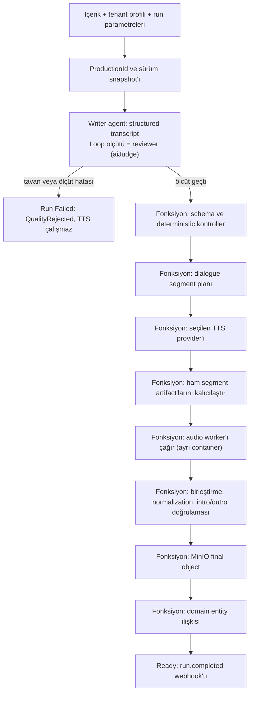
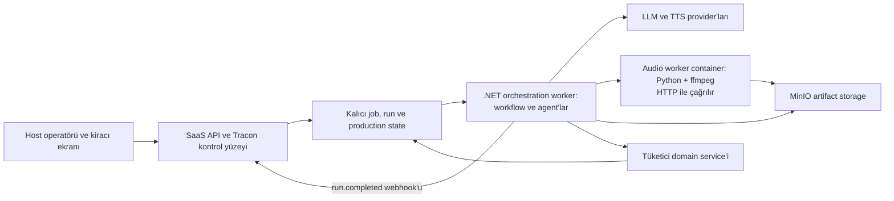

# Tracon — Podcast üretimi için tüketici uyum raporu

**Tarih:** 12 Ekim 2026 (üçüncü değerlendirme). Bu belge önceki sürümlerin
yerine geçer; dosya adı bağlantılar bozulmasın diye ilk yazım tarihini taşır.

**İnceleme zemini:** Tracon `99fe0b13` artı aynı günün commit edilmemiş kusur
turu (K-903…K-911). Faz 192 (döngü tükenme politikası) ve Faz 194 (run
parametreleri) kapandı. Faz 195'in (düğüm düzenleme ve fonksiyon düğümü ayarı)
kodu büyük ölçüde hazır, kapanışı bekliyor. Faz 196…202 planlandı, onay
bekliyor.

**Yöntem:** Public sözleşme ve uygulama kodu incelemesi; ElevenLabs, Google ve
Docker'ın resmi dokümanları (2026-10-11); kapanan kusurların durumu
`docs/arsiv/ERTELENEN-ADAYLAR.md` ve site metinlerinden ölçüldü.

**Kapsam:** Tüketici mimarisi, mevcut yeteneklerin uyumu ve Tracon için
öncelikli geliştirme önerileri. Bu belge bir faz planı değildir. Her yeteneğin
yayımlanmış belirli bir NuGet sürümünde bulunduğunu doğrulamaz. Gerçek TTS
çağrısı, MinIO entegrasyonu, crash recovery veya 20 eşzamanlı üretim testi
yapılmadı. Kapasite ve kalite önerileri ölçülmüş sonuç değil tasarım
önerisidir.

**İlişkili kayıtlar:** [keşif kaydı](../../kesif/2026-10-11-podcast-tuketici.md) ·
planlanan fazlar [196](../../196-UZUN-ADIM-SURE-VE-IPTAL.md) ·
[197](../../197-DAYANIKLI-WORKFLOW-YURUTMESI.md) · [198](../../198-ADLI-KONUSMA-SAGLAYICISI.md) ·
[199](../../199-FONKSIYON-DUGUMU-MALIYETI.md) · [200](../../200-WORKFLOW-SURUM-GECMISI-VE-SABITLEME.md) ·
[201](../../201-LOOP-DUZENLEME-VE-OLCUT-FABRIKASI.md) · [ADAYLAR](../../ADAYLAR.md) (F-296, F-297,
F-385, F-406, F-407, F-411) · aynı tüketici projesinin
[explainer video raporu](2026-10-11-explainer-video-tuketici-uyum-raporu.md).
İki hat aynı host'ta, aynı kiracı ekranından başlar; video raporunun sandbox
modeli (§ 7.3), kusur tabloları (§ 12) ve yol A/C ayrımı (§ 8) burada
tekrarlanmaz.

## 1. Sonuç

**Bu senaryo Tracon üzerine kurulabilir. Mevcut paketler bütün podcast hattını
hazır olarak sunmaz.** Agent çalıştırma, workflow, checkpoint, background job,
eval, ElevenLabs TTS, webhook ve attachment genişleme noktaları kullanılabilir.
Tüketici; podcast state'ini, kalite kararının policy'sini, çok konuşmacılı
üretimi, provider routing'i, Python worker'ını ve entity ilişkisini yazmalıdır.

Önerilen yapı, host'un yönettiği **tenant'a göre ayarlanan bir workflow**'dur.
Writer agent'ı workflow'un ilk adımıdır; reviewer bu agent'ın harness
`Loop` ölçütüdür (`aiJudge`). TTS, audio işleme ve domain kaydı deterministic
fonksiyon düğümleridir. Run başına değişen değerler (dil, ses, süre hedefi)
workflow parametresidir (Faz 194).

Bu tüketicide en belirgin Tracon boşlukları şunlardır:

1. Çok konuşmacılı TTS sözleşmesi ve ElevenLabs dialogue/Gemini TTS adapter'ları
   yoktur (F-296, F-297).
2. TTS provider ve credential seçimi voice katmanında tenant bazında değildir
   (Faz 198, planlandı). Özel sentezleyici kaydı artık ElevenLabs ayarından bağımsızdır
   (F-336 kapalı); yalnız adla seçim ve kiracı bağlaması eksiktir.
3. Konsolda function içeren zincirin düzenlenmesi ve fonksiyon düğümü ayarı
   Faz 195 ile gelir (kodu büyük ölçüde hazır, kapanmadı). Conditional graf
   kodda kurulur.
4. Background job retry'si workflow checkpoint'inden kendiliğinden devam etmez
   (Faz 197, planlandı). Podcast adımlarının kalıcı ilerlemesi ve idempotency'si tüketiciye
   aittir.
5. Workflow içindeki TTS/Python function çağrıları kendiliğinden podcast
   maliyet kaydına dönüşmez (Faz 199, planlandı).

Bunların hepsi aynı tür eksiklik değildir. Provider sözleşmesi ve workflow
düzenleme yüzeyi genel ürün boşluğudur. `PodcastEpisode` entity'si, MinIO
policy'si ve audio mastering mantığı tüketicinin domain sorumluluğudur.

## 2. Netleşen ihtiyaç ve açık sınırlar

| Konu | Netleşen gereksinim |
|---|---|
| Runtime | .NET 10; Docker deployment |
| Kiracılık | Multitenant SaaS |
| Akışın sahibi | Host yönetir; müşteriler workflow kodunu düzenlemez |
| Tenant farkları | Her müşterinin akışı veya ayarları farklı olabilir |
| Düzenleme sınırı | Operatör instruction, provider ve script ayarlarını değiştirir **ve audio script'ini canlı yazar**; uygulama ayaktayken günceller (karar, 2026-10-12). Script güvenilmez koddur ve tüketicinin sandbox'ında koşar (§ 7.2) |
| Kalite kararı | Eşik geçilince otomatik TTS; başarısız transcript sınırlı revizyona döner; insan onayı şimdilik yok |
| Audio | İki konuşmacı; episode başına 10–20 dakika |
| Provider ve voice seçimi | Tenant bazında; ElevenLabs ve başka provider'lar, Gemini de değerlendiriliyor |
| Credential sahipliği | Bütün TTS credential'larını host yönetir; müşteri BYOK ilk kapsamda yoktur |
| Dil | Türkçe ve İngilizce |
| Python/audio işlemleri | Segment birleştirme, normalization ve intro/outro |
| Eşzamanlı üretim | 20'ye kadar |
| Çıktı | MinIO object'i ve tüketici uygulamasının entity ilişkisi; sonuç kiracı ekranına düşer |

Kabul kriterleri, revizyon sayısı, completion süresi hedefi ve normalization
parametreleri henüz netleşmedi. Bir içerik için iki dilde ayrı episode üretimi
ile seçilen tek dilde üretim arasındaki ürün kuralı da açık. Bu belge bu
konular için kesin değer atamaz.

## 3. Mevcut yeteneklerin karşılığı

| İhtiyaç | Mevcut karşılık | Tüketicinin yazacağı bölüm / sınır |
|---|---|---|
| İçerikten senaryo üretmek | Agent definition; instruction, model, skill ve sürüm seçimi; `{{param}}` ile talimata bağlanan parametre | Podcast transcript schema'sı, kaynak referansları ve süre hedefi |
| Reviewer ile revizyon döngüsü | Harness `Loop` + `aiJudge` ölçütü; `MaxIterations`; tavanda ve ölçüt hatasında run düşer (`OnExhausted`, `OnCriterionError`, Faz 192) | Rubric, structured verdict ve kabul policy'si; ayrı reviewer agent'ı istenirse ölçüt fabrikası (Faz 201) |
| Eval ile kaliteyi izlemek | Eval suite, online judge, run score ve experiment | Üretim öncesindeki blocking gate workflow'un kendisidir |
| Tek voice ile ElevenLabs TTS | `Tracon.Voice`, `ISpeechSynthesizer`, `SpeechRequest` | Segmentleme ve episode assembly hazır değildir |
| İki konuşmacı | Tek voice çağrılarını sırayla birleştirmek mümkündür | Native dialogue çağrısı mevcut adapter'da yoktur (F-296) |
| Gemini TTS | `Tracon.Google` model provider'ı vardır; `Google.GenAI` 1.16.0 `MultiSpeakerVoiceConfig` taşır | Gemini TTS adapter'ı yoktur (F-297) |
| Tenant bazlı TTS/voice seçimi | Tüketici kendi `ISpeechSynthesizer`'ını `UseVoice()`'tan önce kaydeder; ElevenLabs ayarı gerekmez (F-336) | Adla seçim, kiracı bağlaması ve egress denetimi yoktur (Faz 198); fonksiyon düğümünde keyed servis |
| Türkçe ve İngilizce | Agent instruction culture'ı ve `SpeechRequest.LanguageCode` | Her dialogue adapter'ının dil desteği, pronunciation ve iki dilde kalite kabulü doğrulanır |
| Python | Opt-in skill script runner; ayrı OS process'i | Python image/dependency yönetimi ve OS izolasyonu host'a aittir |
| Zorunlu audio adımları | `AddWorkflowFunction<TInput,TOutput>`; fonksiyon run parametrelerini `context.GetRunParameters()` ile okur (Faz 194) | Hazır script'i çağıran worker client ve artifact protokolü; düğüm başına ayar Faz 195 |
| Tenant bazlı workflow | Tenant'a göre saklanan workflow definition'ları; run başına parametre; tenant içeren agent cache anahtarı | Host yönetim yetkileri, template/profile sistemi ve tenant provisioning |
| Workflow'u değiştirmek | Sequential agent/function `Nodes` API'si; beş hazır pattern | Konsol zinciri ve ayarı Faz 195 ile düzenler; serbest conditional graf kodda |
| Kalıcı çalıştırma | SQL store, checkpoint, background job lease/retry; kira dolumu deneme sayılır (F-326) | İş adımı recovery'si, side effect ledger'ı ve sürüm snapshot'ı |
| MinIO | `IAttachmentStorage` ile dış storage; retention baytı siler (F-332) | Hazır MinIO adapter'ı yoktur |
| Entity ilişkisi | Code function veya custom `IJobHandler` | Tüketicinin domain service'i ve DB transaction'ı |
| Sonucu kiracı ekranına düşürmek | `run.completed`/`run.failed` (workflow kökü dahil), `job.*` webhook'ları yayınlanır (F-333) | Host'un bildirim ve ekran güncelleme katmanı; teslim en az bir kez, alıcı `X-Tracon-Delivery` ile tekilleştirir |
| İzleme | Workflow/agent run tree, node event'leri, score, job durumu; workflow kökü atıf taşır (F-337) | Episode/segment ilerlemesi; dış servis, CPU ve storage maliyeti (Faz 199) |

Kod kanıtları: [agent catalog](../../../src/Tracon.Abstractions/Agents/IAgentCatalog.cs), [workflow definition](../../../src/Tracon.Abstractions/Workflows/WorkflowDefinition.cs), [function registration](../../../src/Tracon.Workflows/TraconWorkflowFunctionExtensions.cs), [run parametresi okuma](../../../src/Tracon.Workflows/TraconWorkflowContextExtensions.cs), [voice sözleşmesi](../../../src/Tracon.Abstractions/Voice/SpeechContracts.cs), [Google kaydı](../../../src/Tracon.Google/GoogleProviderExtensions.cs), [attachment storage](../../../src/Tracon.Abstractions/Attachments/IAttachmentStore.cs).

## 4. Harness ve workflow ayrımı

**Workflow**, hangi adımın hangi koşulda çalışacağını belirler. Bu işte
onaylanan transcript'ten önce TTS çalışmaması ve revizyon sayısının
sınırlanması workflow kuralıdır.

**Harness**, bir agent invocation'ının çalışma düzenini belirler. Context
yönetimi, tool kullanımı, iteration sınırı ve agent'ın tekrar çağrılması
harness konusudur. `HarnessSettings.Loop` revizyon döngüsüdür: reviewer bir
döngü ölçütüdür (`aiJudge`; ölçüt ve talimatı operatör düzenler), revizyon
sayısı `LoopSettings.MaxIterations`'tır, geri bildirim sonraki iterasyona
taşınır. Faz 192'den beri loop tavana ulaşınca ya da ölçüt hata verince run
**düşer** (`OnExhausted`, `OnCriterionError`); onaylanmamış metin TTS'e
geçmez. Yapılandırılmış çıktı (`ResponseFormat = JsonSchema`) Loop ile
birlikte kullanılabilir; doğrulayıcı son asistan mesajını doğrular (F-329).
Kaynak: [HarnessSettings](../../../src/Tracon.Abstractions/Agents/HarnessSettings.cs),
[LoopSettings](../../../src/Tracon.Abstractions/Agents/LoopSettings.cs),
[LoopEvaluatorRegistry](../../../src/Tracon.Core/Compilation/LoopEvaluatorRegistry.cs).

Aşağıdaki diagram önerilen tüketici akışını gösterir. Hazır bir Tracon
template'i değildir.

Bu graf düz bir `Sequential` zincirdir: `Nodes` listesi agent ve fonksiyon
düğümlerini sırayla taşır; koşul ve geri kenar yoktur. Revizyon kolu agent'ın
içindedir (Loop); ret kolu run'ın düşmesidir. Yalnız `Sequential` fonksiyon
düğümü alır. Bir fonksiyonun bir zincirde iki kez kullanımı reddedilir
(executor kimliği düğüm adıdır); gerekirse kodda ikinci ad kaydedilir.
Kaynak: [WorkflowNodeReference](../../../src/Tracon.Abstractions/Workflows/WorkflowNodeReference.cs),
[compiler](../../../src/Tracon.Workflows/Internal/WorkflowDefinitionCompiler.cs).

Agent adımı bir **katılımcıdır** (`ChildAgentInvoker`, `ChildRefusalMode.Fail`):
`AgentGraph.ChildDeadline` (2 dk) aşımı, ağaç bütçesi reddi veya tool onayı
isteği run'ı `Failed` bitirir (K-887). Uzun transcript üreten writer için
`ChildDeadline` kurulum geneli yükseltilir. Fonksiyon düğümü süresi Faz 196'dır
(planlandı); agent düğümü süresi F-405.

## 5. Transcript kalitesi ve eval

### 5.1 Üretimdeki blocking gate

Writer, yalnız düz metin üretmemelidir. Transcript modeli en az episode, bölüm,
segment sırası, iki speaker kimliği, okunacak metin ve kaynak referanslarını
taşımalıdır. Delivery instruction'ları okunacak metinden ayrı tutulmalıdır.
Provider adapter'ı bu yapıyı kendi protokolüne çevirir.

Reviewer'a özgün içerik, transcript ve kalite rubric'i birlikte verilmelidir.
Aksi hâlde reviewer, kaynakta olmayan ama akıcı yazılmış bilgiyi iyi
puanlayabilir. Writer ve reviewer'a TTS, upload veya DB yazma tool'u vermek
gerekmez. Yan etkileri workflow'un fonksiyon düğümleri başlatır.

| Kontrol | Uygun mekanizma |
|---|---|
| Schema, boş segment, bilinmeyen speaker, iki speaker şartı | `IStructuredResponseValidator` (oturumsuz, akışsız run) ve ilk fonksiyon düğümü |
| Hedef uzunluk ve segment büyüklüğü | Kelime/karakter kontrolü; audio sonrasında gerçek süre ölçümü |
| Kaynağa bağlılık ve önemli bilgilerin korunması | `aiJudge` ölçütü ve kaynak referansı doğrulaması |
| Doğallık, tekrar, geçiş ve iki speaker dengesi | Reviewer rubric'i (`JudgeCriteria`, `JudgeInstructions`) |
| Kabul, revizyon veya ret | `Loop.MaxIterations` + `OnExhausted = Fail` |

Verdict; boyutlara göre score, kritik ihlal listesi ve somut revision
feedback'i taşımalıdır. Kabul policy'si yalnız ortalama score'a bakmamalıdır.
Kaynak uydurma gibi kritik bir ihlal, yüksek doğallık score'uyla kapanmamalıdır.

`MaxIterations`, minimum score'lar ve kritik ihlaller tenant profiline ve run
parametresine bağlanabilir; host alt/üst sınırları kodda belirler. Limit
dolunca run `Failed` biter ve hata sınıfı `LoopUnsatisfied` olur; domain bunu
`QualityRejected` sayar. Reviewer veya provider hatası ayrı bir teknik
failure'dır (`OnCriterionError`); aynı retry policy'si iki duruma
uygulanmamalıdır. Yargıcın model çağrısı run usage'ına kendi modelinin
fiyatıyla girer (F-349) ve kiracının egress politikasına uyar (K-874).

### 5.2 Tracon eval'in işi

Eval suite, instruction/model değişimini örnek içeriklerle karşılaştırmak için
uygundur. Online judge tamamlanan run'ları örnekleyerek score üretir. Bu
mekanizma üretimde TTS'yi başlatma kararını vermez; kalite kapısı workflow
içinde bütün üretimlerde çalışır. Kaynak: [evaluation anlatısı](../../../docs-site/src/content/docs/concepts/evaluation.md),
[OnlineEvalJobHandler](../../../src/Tracon.Core/Evaluation/OnlineEvalJobHandler.cs).

Regression set'i; kısa ve uzun kaynak, eksik kaynak, tekrar eden içerik, özel
isim, sayı/tarih, teknik terim ve iki speaker senaryolarını kapsamalıdır.
Rubric değişimi de sürümlenmelidir. Kaynak metin case'in `context` alanına
konur; agent'a belge kanalıyla sorgudan önce gider (F-343 kapandı, K-905).

Türkçe ve İngilizce için ayrı eval case'leri gerekir. Instruction dili ile
episode dili ayrı alanlardır; episode dili run parametresidir. İki dilde aynı
threshold'un uygun olduğu ölçülmeden kabul edilmemelidir.

### 5.3 Audio sonrası kalite

İyi transcript, doğru audio'yu garanti etmez. Çıktının açılabildiği, beklenen
segmentlerin tamamlandığı, süre ve sessizlik sınırlarının sağlandığı kontrol
edilmelidir. Gerekirse STT çıktısı onaylanan transcript'le karşılaştırılır.
Loudness ve clipping kontrolleri deterministic audio analizidir. Bu katman da
tüketici kodudur.

## 6. İki konuşmacılı TTS ve provider değişimi

### 6.1 Mevcut voice sınırı

`SpeechRequest` bir `Text`, bir `VoiceId`, `ModelId`, `OutputFormat`,
`LanguageCode` ve timestamp isteği taşır. Speaker listesi veya dialogue turn
listesi yoktur. ElevenLabs adapter'ı `/v1/text-to-speech/{voiceId}` ailesini
çağırır. `VoiceOptions.Provider` yalnız `elevenlabs` değerini alır ve yalnız
yerleşik istemciyi yapılandırır. `ISpeechSynthesizer` artık `ProviderName` ve
`MaxCharactersPerRequest` bildirir; fiyat `Tracon:Pricing:Voice` altında
`ProviderName` ile okunur (F-336). Kaynak: [SpeechModels](../../../src/Tracon.Abstractions/Voice/SpeechModels.cs),
[VoiceOptions](../../../src/Tracon.Voice/VoiceOptions.cs),
[ElevenLabsSpeechClient](../../../src/Tracon.Voice/Internal/ElevenLabsSpeechClient.cs).

Tüketici speaker başına tek voice çağrısı yapıp sonuçları birleştirebilir.
Ancak karşılıklı konuşmanın prosody'si ve doğal geçişleri ayrıca
değerlendirilmelidir.

ElevenLabs Text to Dialogue endpoint'i text/voice çiftleri alır; istek başına
2.000 karakter altı önerilir, en çok 10 ses. Google Gemini TTS tek istekte en
çok iki speaker alır; 24 kHz mono 16-bit PCM/WAV döner. Mevcut Tracon
adapter'ları bunları kullanmaz (F-296, F-297). Kaynak:
[ElevenLabs Create dialogue](https://elevenlabs.io/docs/api-reference/text-to-dialogue/convert),
[Gemini TTS](https://ai.google.dev/gemini-api/docs/speech-generation).

### 6.2 Tenant'a göre seçim

Yerleşik `ISpeechSynthesizer` singleton'dır; voice provider ve credential'ları
süreç genelinde yapılandırılır. Bu katman text model provider'larının tenant
BYOK ve egress sistemine bağlı değildir; `SpeechRequest` provider veya
credential reference alanı taşımaz. Kaynak: [speech sözleşmesi](../../../src/Tracon.Abstractions/Voice/SpeechContracts.cs),
[UseVoice kaydı](../../../src/Tracon.Voice/VoiceBuilderExtensions.cs).

Öneri: tüketici kendi uygulamasında dialogue üretim servisi kurar. Servis
production snapshot'ından tenant'ın provider, model, episode dili ve iki
speaker eşlemesini alır; host'un credential resolver'ı uygun provider hesabını
çözer. Aynı süreçte birden çok sentezleyici keyed servis olarak yaşar
(`AddKeyedSingleton<ISpeechSynthesizer>("gemini", …)`); fonksiyon düğümü
sağlayıcıyı run parametresinden (Faz 194) ya da düğüm ayarından (Faz 195)
seçer. Provider'ın iki speaker, dil ve format capability kontrolü ücretli
çağrıdan önce yapılır. Paket tarafı genelleştirmesi Faz 198'dir (planlandı);
agent yolunun sağlayıcıyı adla seçmesi F-406.

**Bütün TTS credential'larını host yönetir.** İlk kapsamda müşteri anahtar
yükleme ekranı gerekmez. Tenant bazlı provider seçimi yine gerekir; host bir
provider hesabını birden fazla tenant için kullanabilir, account quota'sı
ortak, production attribution ve tenant maliyet kaydı ayrı tutulur. Kalıcı
profile'a yalnız host hesabının kimliği veya secret reference'ı yazılır
(K-059).

### 6.3 Provider geçişinin sınırı

Provider değiştirmek voice ID'sini korumaz. Speaker A/B için her provider'a ait
ayrı eşleme gerekir. Format, sample rate, delivery kontrolü ve alignment
yetenekleri de farklı olabilir. Adapter bunları ortak artifact metadata'sına
çevirir.

Bir episode'un ortasında otomatik provider fallback'i ses kimliğini
değiştirebilir; varsayılan kabul edilmemelidir. Tamamlanan segmentler
provider/model ve parametre hash'iyle kaydedilir.

## 7. Python nerede çalışır; sandbox gerekli mi?

### 7.1 Tracon'in mevcut script yolu

Skill script'leri opt-in'dir. `UseSkillScripts(...)` ile açılır.
`SkillScriptProcessRunner` interpreter'ı ayrı OS process'inde başlatır: shell
açmaz; JSON argümanını stdin'e yazar; stdout/stderr'i sınırlar; timeout'ta
process tree'yi sonlandırır. Host'ta Python interpreter ve bağımlılıkları
bulunmalıdır. Kaynak: [script builder](../../../src/Tracon.Core/Skills/TraconSkillScriptBuilderExtensions.cs),
[process runner](../../../src/Tracon.Core/Skills/Scripts/SkillScriptProcessRunner.cs).

Bu process **Tracon'le aynı container ve OS kullanıcı kimliğinde** çalışır.
Env allowlist ve geçici dizin dosya/ağ izolasyonu sağlamaz; runner'ın kendi
kodu bunun OS sandbox olmadığını belirtir (K-862). Her çalıştırma beş kapıdan
geçer (Enabled · içeriğe pinli grant · yorumlayıcı listesi · argüman doğrulama
· denetim izi). Yürütmeyi host'un sandbox'ına taşıyan public seam
[Faz 202](../../202-SKILL-SCRIPT-YURUTUCU-SEAM.md)'dir (planlandı). Kaynak: [SandboxedSkillScriptRunner](../../../src/Tracon.Core/Skills/Scripts/SandboxedSkillScriptRunner.cs),
[güvenlik modeli](../../MIMARI-GUVENLIK.md#skill-script-çalıştırma).

Skill script yolu agent'ın gerektiğinde seçtiği yardımcı işlemler içindir;
script'i ne zaman çağıracağını agent belirler, zorunlu pre/post adım garantisi
yoktur. Zorunlu medya adımları için fonksiyon düğümü ve ayrı worker önerilir.

### 7.2 Bu tüketici için önerilen deployment

**Audio script'i operatörün canlı yazdığı güvenilmez koddur ve tüketicinin
sandbox'ında çalışır** (karar, 2026-10-12). Model video raporu § 7.3 ile
aynıdır: iş başına geçici container (gVisor, Kata veya Firecracker), root
olmayan kullanıcı, salt okunur kök, `tmpfs` scratch, kapalı ağ, ön imzalı nesne
adresleri, CPU/bellek/süre sınırı. Script içeriği tüketicinin uygulamasında
sürümlü ve içerik hash'iyle saklanır; devam eden üretim başladığı hash'le
biter, canlı güncelleme yalnız yeni üretimleri etkiler. İki hat tek bir sandbox
runner servisini paylaşır; Python, ffmpeg ve kilitli bağımlılıklar runner
image'ındadır. Operatör kodu yalnız CPU kullanır.

API process'inde `TraconSchedulingOptions.RunWorker = false` kullanılır.
Orchestration worker ayrı process'te aynı kalıcı queue'yu işler. Workflow
`tracon.workflow` job'u ile kuyruktan başlatılabilir (bağlantı tutmaz; run
parametrelerini taşır, Faz 194) ya da host'un kendi `IJobHandler`'ından
`IWorkflowRunner` ile. Kuyruklu workflow kuyruğa alanın kullanıcı ve etiketlerini
taşır (F-364 kapandı, K-904); `ProductionId` parametre olarak gider. 🚨 Lane
koleksiyonları bugün yapılandırmadan bağlanmaz (F-385); worker'ın lane ayarı
kodda `UseScheduling(o => …)` ile verilir. Kaynak: [scheduling options](../../../src/Tracon.Abstractions/Scheduling/TraconSchedulingOptions.cs),
[custom job handler rehberi](../../../docs-site/src/content/docs/guides/write-your-own-job-handler.md).

Audio worker image'ı Python sürümünü, kilitli dependency set'ini ve gereken
audio binary'lerini taşır. Fonksiyon düğümü worker'a artifact kimliklerini ve
küçük JSON parametrelerini gönderir. Audio baytları LLM context'ine, workflow
mesajına veya job JSON'una konmaz.

Worker non-root kullanıcıyla çalışır. Script dizini read-only olur. Her
production için ayrı scratch dizini açılır. CPU, memory, process sayısı ve
disk sınırları deployment'ta uygulanır (Docker varsayılanı limit koymaz).
Worker'a geniş DB/TTS credential'ları verilmez. Storage erişimi gerekli object
scope'uyla sınırlanır. Ağ erişimi yalnız gereken servislere açılır. Host
path'i veya Docker socket'i worker'a verilmez. Kaynak: [Docker resource constraints](https://docs.docker.com/engine/containers/resource_constraints).

Bu runner Tracon'in skill script runner'ını dışarı taşıyan hazır bir
extension değildir; Tracon arayüzden yazılan kodu çalıştırmaz (K2,
2026-10-12'de değerlendirildi ve korundu) ve skill
runner'ı OS yalıtımı vermez (K-862). Tüketici; script sürümleme, typed
parametre validation'ı, audit, timeout, process cleanup ve artifact
doğrulamasını açıkça uygular. Müşteri (kiracı) kod yazamaz; yalnız host
operatörü yazar.

### 7.3 Pre-processing ve post-processing

Kesin kapsam **segment birleştirme, normalization ve intro/outro**'dur. TTS
öncesinde metni/provider girdisini ve mevcut intro/outro asset'lerini
hazırlama; TTS sonrasında segment'leri sırayla birleştirme, normalization ve
intro/outro'yu seçilen preset'in işlem sırasıyla uygulama. Asset sürümü ve
işlem sırası production snapshot'ına girer.

Normalization yöntemi ve hedefi, final codec/sample rate, intro/outro asset
seçimi ve geçiş biçimi henüz belirlenmedi; bunlar preset'in doğrulanan
parametreleridir ve Faz 195 ile düğüm ayarı olarak saklanabilir. Arka plan
müziği ve sessizlik düzenleme genişleme seçenekleridir.

Zorunlu script adımı agent'ın kararına bırakılmaz. Workflow belirli script
sürümünü çalıştırır. Girdi ve çıktı manifest'i, checksum, exit code ve timeout
sonucu kaydedilir. Başarısız script sonrasında episode `Ready` olmaz; fonksiyon
düğümü istisna atar ve run `Failed` biter. Fonksiyon düğümünün retry policy'si
yalnız geçici hatayı tekrar dener; kalıcı `4xx` ilk denemede atılır (F-338).

## 8. Operatöre nasıl kolaylık sağlanır?

### 8.1 Kod ile profile ayrımı

Host bir veya birkaç versioned workflow template'i deploy eder. Her tenant'ın
profile'ı template'i, writer/reviewer ayarlarını, kabul policy'sini, episode
dilini, iki speaker eşlemesini, TTS provider/model seçimini ve audio preset'ini
belirtir. Run başına değişenler (dil, süre hedefi, ses) workflow
parametresidir; tenant başına sabit olanlar düğüm ayarıdır (Faz 195) ya da
profil verisidir. Gerçekten farklı topology gerekiyorsa ayrı code-defined
template seçilir.

Her tenant için graf kodunu kopyalamak bakım maliyetini büyütür. Bütün
farkları LLM instruction'ına gömmek kontrolü zayıflatır. Topology kodda;
desteklenen farklar doğrulanan profile verisinde ve parametrelerde.

`PodcastProductionProfile` gibi bir tip tüketicinin domain modeli olabilir.
Profile; arbitrary script path'i, shell command veya executable content
taşımaz.

### 8.2 Düzenleme yüzeyi

| Operatör işlemi | Bugünkü Tracon desteği | Ek yüzey |
|---|---|---|
| Writer/reviewer instruction değiştirmek | Stored agent definition'ları, version history, konsol | Host'a özel tenant/profile eşleme ekranı |
| Modeli değiştirmek | Agent model binding; kiracı egress ve BYOK | Profile sınırları ve regression doğrulaması |
| Revizyon sayısı ve yargıç ölçütleri | API ile `Harness.Loop` | Konsol editörü Faz 201 (planlandı) |
| Hazır script seçmek ve parametre vermek | Fonksiyon düğümü + run parametresi (Faz 194) | Düğüm ayarı ve JSON alanı Faz 195 |
| TTS provider/model/voice seçmek | Tek provider voice ayarı; özel sentezleyici kaydı | Dialogue provider catalog'u ve tenant profile alanları (F-296, Faz 198) |
| Türkçe/İngilizce ve audio preset seçmek | Instruction culture'ı, `LanguageCode`, run parametresi | Dil/voice uyum kontrolü ve preset formu |
| Sequential function zincirini değiştirmek | API ile `Nodes`; konsol salt okunur | Konsol düğüm listesi Faz 195 |
| Üretim ilerlemesini görmek | Run tree, node event'leri, job ekranı, webhook'lar | Episode/segment/artifact odaklı görünüm |
| Ayarı denemek | Agent run, eval ve experiment | Küçük audio preview ve profile denemesi |

Stored skill editor Python kodunu da taşıyabilir; seçilen ihtiyaçta operatöre
bu yetki verilmez. Instruction düzenlenebilsin diye agent'ı yalnız
code-defined kaydetmek doğru olmaz; code kaydı aynı isimli stored kaydın önüne
geçer. Kaynak: [catalog öncelikleri](../../../src/Tracon.Core/Catalog/CompositeAgentCatalog.cs),
[skill editor](../../../src/Tracon.UI/frontend/src/screens/skills/skill-editor.tsx).

### 8.3 Değişiklik ne zaman etkili olur?

Önerilen policy: yeni profile sürümü yeni production'larda kullanılır. Devam
eden production başladığı snapshot'la tamamlanır. Mevcut workflow runner bunu
bütün bağımlılıklar için otomatik sağlamaz.

Agent catalog belirli stored definition sürümünü resolve edebilir ve sabit
sürüm artık kendi descriptor'ıyla gelir (F-331). Buna rağmen workflow adımı
agent'ı çağrı sırasında **güncel** catalog'dan resolve eder; bu belgelenmiş
tasarımdır (K-895 (c)). Workflow grafı da run/resume sırasında yeniden çözülür.
Workflow sürüm geçmişi ve run'ın sürüme sabitlenmesi
[Faz 200](../../200-WORKFLOW-SURUM-GECMISI-VE-SABITLEME.md)'dür (planlandı); alt
agent ve skill sürüm sabiti F-409'dur. Kaynak: [version resolution](../../../src/Tracon.Abstractions/Agents/IAgentCatalog.cs),
[WorkflowAgentCache](../../../src/Tracon.Workflows/Internal/WorkflowAgentCache.cs),
[ChildAgentInvoker](../../../src/Tracon.Core/Graph/ChildAgentInvoker.cs).

Tüketici snapshot'ında workflow template sürümü, agent sürümleri, rubric,
episode dili, provider/model, speaker eşlemeleri, host hesap reference'ı,
script image sürümü, intro/outro asset sürümleri ve audio parametreleri
tutulur. Secret değeri snapshot'a girmez.

## 9. Kalıcı state, MinIO ve entity ilişkisi

### 9.1 Üretimin sahibi tüketici domain'idir

`ProductionId` episode üretiminin kalıcı kimliğidir; workflow run kimliği
bununla aynı kabul edilmez. Revizyon, resume veya yeniden deneme birden fazla
run kaydı oluşturabilir. Domain; production, tenant, episode ve run
ilişkilerini tutar. `ProductionId` run'a etiket (`AmbientRunAttributionScope`,
F-337) ve parametre olarak girer.

MinIO object key'i tenant/production/segment sürümüyle belirlenir. Bucket ve
object key kalıcı reference olarak tutulur; süresi dolan presigned URL kalıcı
anahtar yapılmaz. Her erişimde authenticated tenant ile artifact sahipliği
doğrulanır.

Tracon UI'da audio attachment gösterilecekse `IAttachmentStorage` adapter'ı
uygulanabilir; retention ve erasure artık harici baytı da siler (F-332) ve
`DeleteAsync` var olmayan konum için başarı dönmelidir. Domain'in uzun ömürlü
final dosyası kendi media storage servisiyle yönetilir. Kaynak:
[storage sözleşmesi](../../../src/Tracon.Abstractions/Attachments/IAttachmentStore.cs),
[resmi MinIO .NET SDK](https://github.com/minio/minio-dotnet).

### 9.2 Upload ile DB ilişkisi

MinIO upload ve uygulama DB transaction'ı tek atomik işlem değildir. Sıralama:
final artifact'i belirli object key'e yaz; checksum/metadata'yı doğrula;
domain transaction'ında ilişkiyi ve `Ready` durumunu kaydet. Transaction
başarısızsa aynı artifact üzerinden ilişki adımı tekrar denenir; TTS yeniden
çağrılmaz.

Kalıcı step ledger'ı ve outbox/reconciliation mekanizması eksik veya sahipsiz
object'leri bulur. Final object yalnız upload başarılı diye kullanıcıya hazır
gösterilmez.

Tracon run/attachment retention'ı ile müşteri episode retention'ı ayrı
policy'lerdir. Bekleyen (`AwaitingInput`) run'ın olayları, checkpoint'leri ve
ekleri retention'dan muaftır (K-888, K-896). Kaynak: [SpeakTool retention notu](../../../src/Tracon.Voice/Tools/SpeakTool.cs),
[SqlAttachmentStore](../../../src/Tracon.Sql.Shared/Stores/SqlAttachmentStore.cs).

### 9.3 Side effect tekrarları

Tracon job yürütmesi at-least-once davranır; kira dolumu bir deneme sayılır ve
sınır aşılınca job koşmadan `tracon.job.attempts-exhausted` ile düşer (F-326).
Handler bittikten sonraki `store` hatası handler hatası sayılmaz; yazım kira
içinde tekrarlanır (F-348). Function node'ları eski checkpoint'ten resume
edilince tekrar çalışabilir. Kaynak: [job runtime contract](../../../docs-site/src/content/docs/guides/write-your-own-job-handler.md#runtime-contract),
[function replay sözleşmesi](../../../src/Tracon.Workflows/TraconWorkflowFunctionExtensions.cs).

| Failure noktası | Beklenen recovery |
|---|---|
| TTS sonucu geldi; kalıcı artifact yazımı tamamlandı | Segment kaydını bul; aynı metni yeniden seslendirme |
| TTS provider çağrıyı işledi; client sonucu alamadı | Sonuç belirsizliğini kaydet; duplicate ücretin önlendiğini iddia etme |
| Audio worker öldü | Tamamlanan segmentleri koru; eksik adımı yeni scratch dizininde tekrar çalıştır |
| MinIO upload bitti; entity transaction'ı başarısız | Mevcut object'ten ilişki adımını yeniden dene |
| Worker lease'i kayboldu | `MaxAttempts = 1` ise job düşer, yeniden koşmaz; run reconciliation ile kapanır; yeni job tamamlanan adımları atlar |
| Süreç çöktü; workflow run'ı `Running` kaldı | Reconciliation açıksa `Failed` kapanır ve ret olayı resume'u adlandırır (F-344 kapandı); `POST .../resume` elle (otomatik sürdürme Faz 197) |
| Operatör profile'ı değiştirdi | Eski production snapshot'ını koru; yeni production'a yeni sürümü uygula |

Idempotency key; tenant, production, step/segment ve input/parameter hash'ini
içerir. Episode dili de hash'e girer. Yerel unique key dış provider'da
exactly-once ücret garantisi sağlamaz.

## 10. 20 eşzamanlı üretim

**20 active production, 20 sınırsız TTS çağrısı veya 20 eşzamanlı Python
process'i demek değildir.** Her aşamanın kapasitesi ayrı yönetilir.

| Ayar | Varsayılan | Etkisi |
|---|---|---|
| `TraconSchedulingOptions.MaxConcurrentJobs` | 2 / process | Job worker kapasitesi; lane bütçeleri ek kapasite verir |
| `TraconSchedulingOptions.LeaseDuration` | 5 dakika | Yenileme kiranın üçte birinde; handler çalışırken yenilenir |
| `TraconSchedulingOptions.MaxAttempts` | 3 | Kira dolumu deneme sayılır |
| `TraconWorkflowOptions.MaxConcurrentRuns` | 4 | Tenant'lar arasında paylaşılan limit; bekleyen run `Running` görünür, bekleme `RunTimeout`'a sayılır |
| `TraconWorkflowOptions.RunTimeout` | 10 dakika | Cooperative deadline; aşımda `Canceled` + `TimeoutException`; node'u zorla durdurmaz |
| `AgentGraph.ChildDeadline` | 2 dakika | Writer adımının sınırı; aşımda run `Failed` |
| `TraconEndpointOptions.StreamKeepAliveInterval` | 15 saniye | SSE akışı; proxy boşta kalma süresinin altında |
| `VoiceOptions.MaxConcurrentRequests` | 2 | Yerleşik ElevenLabs client'ının limiti |
| `VoiceOptions.MaxCharactersPerRequest` | 5.000 | Yerleşik client'ın limiti; özel sentezleyici kendi limitini bildirir |
| `TraconSkillScriptOptions.MaxConcurrentTotal` / `PerTenant` / `Timeout` | 8 / 2 / 30 sn | Yalnız skill script runner; audio worker'a uygulanmaz |
| `TraconAttachmentOptions.MaxBytes` | 20 MiB | HTTP attachment upload sınırı |

Kaynak: [scheduling](../../../src/Tracon.Abstractions/Scheduling/TraconSchedulingOptions.cs),
[workflow options](../../../src/Tracon.Workflows/TraconWorkflowOptions.cs),
[voice options](../../../src/Tracon.Voice/VoiceOptions.cs),
[script/attachment/graph options](../../../src/Tracon.Core/TraconOptions.cs).

Audio süresi ile üretim süresi ayrı ölçüdür. Model, revizyon, TTS, queue ve
audio işlemlerinin gerçek süresi ölçülür; her network/process adımına kendi
timeout'u konur (fonksiyon düğümü süresi Faz 196). Süreç içi concurrency sınırları
replica sayısıyla çoğalır; provider hesabının toplam quota'sı ayrıca koordine
edilir. Tenant bazlı limit ve adil queue policy'si (F-322) bir müşterinin bütün
kapasiteyi tüketmesini önler; Tracon lane'leri iş türünü ayırır, tenant
fairness garantisi değildir.

### 10.1 Memory ve artifact büyüklüğü

Codec bitrate/sample format hesabıdır; benchmark değildir:

| 20 dakikalık tek audio | Yaklaşık payload |
|---|---|
| 128 kbit/s MP3 | 19,2 MB; yaklaşık 18,3 MiB |
| 24 kHz, 16-bit, mono PCM | 57,6 MB; yaklaşık 54,9 MiB |
| 48 kHz, 16-bit, mono PCM | 115,2 MB; yaklaşık 109,9 MiB |

20 adet 24 kHz PCM çıktısı yalnız payload olarak yaklaşık 1,15 GB tutar.
`SpeechAudio.Data` memory'de bulunur; attachment store yollarında byte array
kopyaları vardır. Episode'ları bellekte birleştirmek yerine stream/file tabanlı
artifact akışı önerilir. Kaynak: [SpeechAudio](../../../src/Tracon.Abstractions/Voice/SpeechModels.cs),
[SQL attachment yazımı](../../../src/Tracon.Sql.Shared/Stores/SqlAttachmentStore.cs).

## 11. Tüketici implementasyonunun kurulumu

Mevcut .NET 10 hedefi uygundur. `net8.0` ve `net9.0` 2026-11-10'dan sonra
düşer (Faz 193). Kaynak: [paket target framework'leri](../../../src/Directory.Build.props).

| Katman | Kullanılacak yüzey |
|---|---|
| Agent ve kontrol düzlemi | `Tracon.Core`, `Tracon.AspNetCore`; gerekirse `Tracon.UI` |
| Workflow | `Tracon.Workflows`, `UseWorkflows()`, stored `Sequential` tanımı veya code-defined `AddWorkflow(...)`; `AddWorkflowFunction<TInput,TOutput>` |
| Writer/reviewer model provider'ları | Seçilen LLM'e ait Tracon provider paketleri |
| Kalıcı storage | Desteklenen SQL store paketlerinden biri; DB seçimi henüz verilmedi |
| Background işler | Scheduling, `tracon.workflow` job'u veya custom `IJobHandler`, worker lane'leri |
| Mevcut tek voice ElevenLabs | `Tracon.Voice`; dialogue için ek adapter |
| Dialogue provider routing | Tüketicinin production/profile-aware TTS servisi (keyed `ISpeechSynthesizer`) |
| Audio işleme | Ayrı container'da deploy edilmiş Python görevleri |
| Final artifact | Tüketicinin MinIO storage servisi; gerekirse `IAttachmentStorage` adapter'ı |
| Domain kaydı | Tüketicinin scoped domain service'i |
| Bildirim | `run.completed`/`run.failed`, `job.*` webhook'ları; idempotent alıcı |

Workflow function factory'si bir kez çalışır ve handler closure'ı concurrent
run'lar arasında paylaşılır. Singleton closure içinde scoped `DbContext`
yakalanmaz; invocation başına scope açılır. Mutable production state handler
field'ında tutulmaz. Kaynak: [function lifetime sözleşmesi](../../../src/Tracon.Workflows/TraconWorkflowFunctionExtensions.cs).

Agent node'u ile function node'u arasındaki veri tipi açık olmalıdır. Mixed
sequential agent executor'ı `List<ChatMessage>` alıp döndürür ve yanıtın
**bütün** mesajlarını iletir; ilk fonksiyon düğümü son asistan mesajını kendisi
seçer (iletim modu F-324). Kaynak: [WorkflowAgentStepExecutor](../../../src/Tracon.Workflows/Internal/WorkflowAgentStepExecutor.cs).

## 12. Tracon ürün boşlukları ve önerilen öncelik

| Öncelik | Genel ürün boşluğu | Tüketiciye etkisi | Durum (2026-10-12) |
|---|---|---|---|
| Yüksek | Dialogue/multi-speaker TTS sözleşmesi ve adapter'ları | İki speaker için kendi TTS katmanını yazması gerekir | F-296, F-297 aday |
| Yüksek | Tenant/profile bazlı TTS routing ve host credential çözümleme | Farklı provider/voice seçimleri hazır karşılanmaz | Faz 198 planlandı (F-298) |
| Yüksek | Çalışan production için bütün bağımlılıkların version pinning'i | Instruction değişimi devam eden akışa karışabilir | Faz 200 planlandı (workflow); alt agent ve skill sabiti F-409 aday |
| Orta | Lane ayarının yapılandırmadan bağlanması | `appsettings`'teki lane bütçesi yok sayılır | F-385 açık; ayar kodda verilir |
| Orta | Workflow UI'da function node düzenleme ve düğüm ayarı | Operatör zinciri API'den düzenler | Faz 195 (kodu büyük ölçüde hazır) |
| Orta | Workflow function dış maliyet/usage görünürlüğü | TTS ve audio maliyeti LLM toplamından ayrı kalır | Faz 199 planlandı (F-299) |
| Orta | Job ile workflow checkpoint recovery entegrasyonu | Custom production recovery yazılır | Faz 197 planlandı (F-318, F-321) |
| Orta | Fonksiyon düğümüne zaman aşımı ve iptal token'ı | Takılan worker bütün run'ı tutar | Faz 196 planlandı (F-303, F-323) |
| Düşük | Konsolda `Loop` düzenleme; `AddLoopEvaluator` fabrika | Revizyon sayısı API'den; ayrı reviewer agent'ı DI'a ulaşamaz | Faz 201 planlandı (F-301, F-302) |
| Düşük | Onay `Loop` ölçütünün denetim izi | Agent onayına geçişte "kim onayladı" sorusu | F-411 aday |

Run başına parametre Faz 194 ile kapandı.

MinIO adapter'ı, mastering preset'leri ve domain entity'leri tüketiciye ait
kalır. Operatör canlı kod yazdığı için sandbox tüketicinin runner'ındadır
(video raporu § 7.3); Tracon'a yeni kod çalıştırma yüzeyi açılmaz. Skill script
yolunu o sandbox'a yönlendiren seam Faz 202'dir (planlandı).

## 13. İhtiyacın genişleyebileceği noktalar

| Genişleme | Bugünden korunması gereken sınır |
|---|---|
| Başka diller ve ayrıntılı pronunciation kontrolü | İki dil için kurulan profile, eval ve capability sınırı genişletilir |
| Arka plan müziği ve ek audio preset'leri | Preset'e versioned asset ve işlem parametreleri eklenir |
| Bir cümleyi veya bölümü yeniden üretmek | Stable segment ID, transcript revision ve segment artifact cache'i |
| Speaker/voice değiştirmek | Provider'a özel eşlemeler; hangi segmentlerin geçersizleştiği açık olur |
| Subtitle ve chapter üretmek | Alignment kaynağı; final audio işlemleri sonrasında zaman güncellemesi |
| İnsan onayı eklemek | Writer adımından sonra `RequestPort`; video raporu § 8 yol A koşulları (Faz 197, F-319) |
| Üretim maliyet tavanı | Writer/reviewer retry, TTS, regeneration ve compute/storage ayrı maliyetler (Faz 199); tükenen bütçede düğüm başlamaz (F-407) |
| Provider outage | Explicit retry/fallback policy; aynı episode'da farklı ses kullanımı kararı |
| İptal ve yeniden başlatma | Kalıcı step state; tamamlanan artifact'i koruma ve scratch cleanup |
| Otomatik yayın/RSS | `Ready` ile `Published` ayrı state; harici yayın ayrı side effect |
| Müşteri kendi credential'ını kullanır | Tenant secret resolver ve quota sahipliği; Faz 198'in ikincil kapsamı |

Timestamp ihtiyacında non-streaming `IncludeTimestamps` karakter alignment'ı
taşıyabilir. `SynthesizeStreamingAsync` yalnız ham audio byte parçaları döner.
Post-processing eski alignment'ı geçersiz kılabilir. Kaynak: [SpeechRequest/Alignment](../../../src/Tracon.Abstractions/Voice/SpeechModels.cs).

## 14. Uygulama kabulünde doğrulanacak senaryolar

Bu senaryolar önerilen kabul setidir; bu rapor kapsamında çalıştırılmadılar.

1. Reviewer ölçütü geçmeyince TTS provider'ına hiç request gitmez. `MaxIterations`
   dolunca run `Failed` biter ve domain üretimi kalite reddiyle kapatır.
2. Kaynağı eksik veya verdict schema'sı bozuk run TTS'ye geçmez.
3. Farklı provider/voice profile'ları olan iki tenant eşzamanlı üretim yapar;
   artifact ve maliyet attribution'ı karışmaz.
4. Tenant B, tenant A'nın episode/artifact kimliğiyle download isteği yapar;
   erişim reddedilir.
5. Provider/model/speaker kombinasyonu desteklenmiyorsa üretim ücretli
   çağrıdan önce reddedilir.
6. TTS segmentinden sonra worker öldürülür. Recovery kalıcılaştırılmış
   segmentleri kullanır; belirsiz provider sonucu raporlanır.
7. MinIO upload sonrası DB hatası oluşur. Retry mevcut object'i ilişkilendirir;
   yeni TTS üretmez.
8. Production devam ederken instruction/profile değiştirilir. Eski production
   kendi snapshot'ıyla, yeni production yeni sürümle ilerler.
9. 20 production ile çok replica altında load test yapılır.
10. Audio worker timeout, bozuk çıktı ve aşırı büyük dosya üretir. Final entity
    `Ready` olmaz; cleanup doğrulanır.
11. Tracon retention koşumu yapılır. Final episode kaybolmaz.
12. Operatör desteklenen ayarları değiştirir. İzin verilmeyen script path'i,
    code content veya provider değeri execution'a ulaşmaz.
13. Türkçe ve İngilizce case'lerinde episode dili, iki speaker, özel isimler
    ve sayı/kısaltma telaffuzu doğrulanır.
14. Birleştirme sırası, intro/outro asset sürümü ve normalization hedefi
    doğrulanır.
15. Aynı `run.completed` webhook'u iki kez gelir; kiracı ekranı bir kez
    güncellenir.
16. Writer adımı `ChildDeadline`'ı aşar; run `Failed` biter, sonraki düğüm
    koşmaz ve hata türü `child_run_timeout` olur.

Function node'u model çağrısı yapmadığı için kendi run row'unu ve cost/token
toplamını oluşturmaz. Dış TTS/audio usage Faz 199 gelene kadar host domain'inde
kaydedilir. Kaynak:
[function node görünürlüğü](../../../docs-site/src/content/docs/concepts/workflows.md#function-nodes).

## 15. Sonraki tasarım için açık kararlar

| Karar | Neyi değiştirir? |
|---|---|
| Her provider için tek host hesabı mı, birden fazla mı? | Credential routing ve account quota paylaşımı |
| Bir içerikten iki dilde ayrı episode mu, tek dilde mi? | Production sayısı, maliyet, transcript ve artifact ilişkisi |
| Normalization yöntemi/hedefi, işlem sırası, final format ve intro/outro preset'i | Worker image, timeout, disk ve preset schema'sı (Faz 195 düğüm ayarı) |
| Kalite rubric'i, eşikler ve `MaxIterations` | Kabul davranışı ve üretim başına maliyet sınırı |
| 20 production için süre hedefi ve provider quota'sı | Worker sayısı, stage slot'ları ve queue planı |
| Farklı tenant akışı parametre farkı mı, topology farkı mı? | Ortak template + parametre/ayar yeterliliği veya birden fazla code template |
| DB seçimi ve domain transaction sınırı | Store paketi, outbox/reconciliation implementasyonu |
| Audio/ham segment saklama süreleri | Retention, storage maliyeti ve partial regeneration |
| Provider fallback ve audio sonrası ret policy'si | Ses tutarlılığı, ek ücret ve yeniden üretim kapsamı |

2026-10-12'de cevaplananlar: audio script'ini operatör canlı yazar ve host'un
sandbox runner'ında koşar (§ 7.2); K2 gevşetilmez; insan onayı eklenirse `Loop`
ölçütü olarak gelir (video raporu § 15). Bu hatta dokunan altı faz planlandı
(Faz 196…201); her planın Açık Soruları onay bekler. Aynı günün kusur turunun
varsayılan kararları (K-903…K-911) de onay bekler.

Bu açık değerler uygulama tasarımından önce belirlenir. Uyum sonucu bunlara
rağmen nettir: Tracon kontrol ve çalıştırma altyapısını sağlar; iki
konuşmacılı, tenant'a göre ayarlanan otomatik podcast hattı için tüketici
entegrasyonu gerekir.
