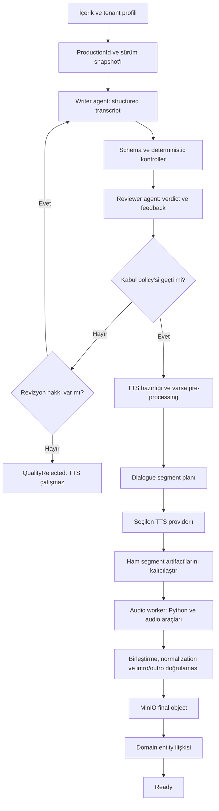
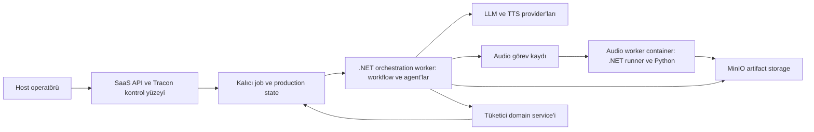

# Tracon — Podcast üretimi için tüketici uyum raporu

**Tarih:** 11 Ekim 2026

**İnceleme zemini:** `3a4b4c9c` commit'i üzerindeki mevcut çalışma ağacı. İnceleme sırasında repo'da önceden yapılmış, commit edilmemiş değişiklikler vardı.

**Yöntem:** Public sözleşme ve uygulama kodu incelemesi; ElevenLabs, Google ve Docker'ın güncel resmi dokümanları.

**Kapsam:** Tüketici mimarisi, mevcut yeteneklerin uyumu ve Tracon için öncelikli geliştirme önerileri. Bu belge bir faz planı değildir.

Bu değerlendirme repo'nun bugünkü davranışını esas alır. Her yeteneğin yayımlanmış belirli bir NuGet sürümünde bulunduğunu doğrulamaz. Gerçek TTS çağrısı, MinIO entegrasyonu, crash recovery veya 20 eşzamanlı üretim testi yapılmadı. Aşağıdaki kapasite ve kalite önerileri, ölçülmüş sonuç değil tasarım önerisidir.

## 1. Sonuç

**Bu senaryo Tracon üzerine kurulabilir. Mevcut paketler bütün podcast hattını hazır olarak sunmaz.** Agent çalıştırma, workflow, checkpoint, background job, eval, ElevenLabs TTS ve attachment genişleme noktaları kullanılabilir. Tüketici; podcast state'ini, kalite kararını, çok konuşmacılı üretimi, provider routing'i, Python worker'ını ve entity ilişkisini yazmalıdır.

Önerilen yapı, host'un yönettiği **tenant'a göre ayarlanan bir workflow**'dur. Writer ve reviewer agent'ları bu workflow'un adımlarıdır. TTS, audio işleme ve domain kaydı deterministic kod adımlarıdır. Harness, bu adımlardaki agent'ın context ve tool döngüsünü yönetir.

Bu tüketicide en belirgin Tracon boşlukları şunlardır:

1. Çok konuşmacılı TTS sözleşmesi ve ElevenLabs dialogue/Gemini TTS adapter'ları yoktur.
2. TTS provider ve credential seçimi mevcut voice katmanında tenant bazında değildir.
3. UI, function içeren workflow zincirinin adımlarını düzenleyemez. Conditional graf ve revizyon döngüsü kodda kurulmalıdır.
4. Background job retry'si workflow checkpoint'inden kendiliğinden devam etmez. Podcast adımlarının kalıcı ilerlemesi ve idempotency'si tüketiciye aittir.
5. Workflow içindeki doğrudan TTS/Python function çağrıları, kendiliğinden podcast maliyet kaydına dönüşmez.

Bunların hepsi aynı tür eksiklik değildir. Provider sözleşmesi ve workflow düzenleme yüzeyi genel ürün boşluğudur. `PodcastEpisode` entity'si, MinIO policy'si ve audio mastering mantığı tüketicinin domain sorumluluğudur.

## 2. Netleşen ihtiyaç ve açık sınırlar

| Konu | Netleşen gereksinim |
|---|---|
| Runtime | .NET 10; Docker deployment |
| Kiracılık | Multitenant SaaS |
| Akışın sahibi | Host yönetir; müşteriler workflow kodunu düzenlemez |
| Tenant farkları | Her müşterinin akışı veya ayarları farklı olabilir |
| Düzenleme sınırı | Geliştirici kodu deploy eder; operatör instruction, provider ve hazır script ayarlarını değiştirir |
| Kalite kararı | Eşik geçilince otomatik TTS; başarısız transcript sınırlı revizyona döner |
| Audio | İki konuşmacı; episode başına 10–20 dakika |
| Provider ve voice seçimi | Tenant bazında; ElevenLabs ve başka provider'lar, Gemini de değerlendiriliyor |
| Credential sahipliği | Bütün TTS credential'larını host yönetir; müşteri BYOK ilk kapsamda yoktur |
| Dil | Türkçe ve İngilizce |
| Python/audio işlemleri | Segment birleştirme, normalization ve intro/outro |
| Eşzamanlı üretim | 20'ye kadar |
| Çıktı | MinIO object'i ve tüketici uygulamasının entity ilişkisi |

Kabul kriterleri, revizyon sayısı, completion süresi hedefi ve normalization parametreleri henüz netleşmedi. Bir içerik için iki dilde ayrı episode üretimi ile seçilen tek dilde üretim arasındaki ürün kuralı da açık. Bu belge bu konular için kesin değer atamaz.

## 3. Mevcut yeteneklerin karşılığı

| İhtiyaç | Mevcut karşılık | Tüketicinin yazacağı bölüm / sınır |
|---|---|---|
| İçerikten senaryo üretmek | Agent definition; instruction, model, skill ve sürüm seçimi | Podcast transcript schema'sı, kaynak referansları ve süre hedefi |
| Ayrı agent ile review | Catalog'dan reviewer agent çalıştırmak | Structured verdict, kabul policy'si ve revizyon feedback'i |
| Eval ile kaliteyi izlemek | Eval suite, online judge, run score ve experiment | Üretim öncesindeki blocking gate ayrıca kurulur |
| Tek voice ile ElevenLabs TTS | `Tracon.Voice`, `ISpeechSynthesizer`, `SpeechRequest` | Segmentleme ve episode assembly hazır değildir |
| İki konuşmacı | Tek voice çağrılarını sırayla birleştirmek mümkündür | Native dialogue çağrısı mevcut adapter'da yoktur |
| Gemini TTS | `Tracon.Google` model provider'ı vardır | Google model kaydı, Gemini TTS adapter'ı sağlamaz |
| Tenant bazlı TTS/voice seçimi | Tüketici kendi synthesis servisini kaydedebilir | Hazır dialogue provider routing'i yoktur; host credential resolver'ı ve tenant seçim doğrulaması gerekir |
| Türkçe ve İngilizce | Agent instruction culture'ı ve `SpeechRequest.LanguageCode` alanı vardır | Her dialogue adapter'ının dil desteği, pronunciation ve iki dilde kalite kabulü doğrulanır |
| Python | Opt-in skill script runner; ayrı OS process'i | Python image/dependency yönetimi ve OS izolasyonu host'a aittir |
| Zorunlu audio adımları | `AddWorkflowFunction<TInput,TOutput>` veya kodda custom graf | Hazır script'i çağıran worker client ve artifact protokolü |
| Tenant bazlı workflow | Tenant'a göre saklanan workflow definition'ları ve tenant içeren agent cache anahtarı | Host yönetim yetkileri, template/profile sistemi ve tenant provisioning |
| Workflow'u değiştirmek | Sequential agent/function `Nodes` API'si; beş hazır pattern | Function zincirini UI'dan değiştirmek ve serbest conditional graf düzenlemek yoktur |
| Kalıcı çalıştırma | SQL store, checkpoint, background job lease/retry | İş adımı recovery'si, side effect ledger'ı ve sürüm snapshot'ı |
| MinIO | `IAttachmentStorage` ile dış storage implementasyonu | Hazır MinIO adapter'ı yoktur |
| Entity ilişkisi | Code function veya custom `IJobHandler` | Tüketicinin domain service'i ve DB transaction'ı |
| İzleme | Workflow/agent run tree, node event'leri, score ve job durumu | Episode/segment ilerlemesi; dış servis, CPU ve storage maliyeti |

Kod kanıtları: [agent catalog](../../../src/Tracon.Abstractions/Agents/IAgentCatalog.cs), [workflow definition](../../../src/Tracon.Abstractions/Workflows/WorkflowDefinition.cs), [function registration](../../../src/Tracon.Workflows/TraconWorkflowFunctionExtensions.cs), [voice sözleşmesi](../../../src/Tracon.Abstractions/Voice/SpeechContracts.cs), [Google kaydı](../../../src/Tracon.Google/GoogleProviderExtensions.cs), [attachment storage](../../../src/Tracon.Abstractions/Attachments/IAttachmentStore.cs).

## 4. Harness ve workflow ayrımı

**Workflow**, hangi adımın hangi koşulda çalışacağını belirler. Bu işte onaylanan transcript'ten önce TTS çalışmaması ve revizyon sayısının sınırlanması workflow kuralıdır.

**Harness**, bir agent invocation'ının çalışma düzenini belirler. Context yönetimi, tool kullanımı, iteration sınırı ve agent'ın tekrar çağrılması harness konusudur. Tracon'in `HarnessSettings.Loop` alanında `aiJudge` gibi stop criterion'ları vardır. Bunlar ayrı writer/reviewer/domain adımlarını içeren bütün üretim hattının yerini almaz. Kaynak: [HarnessSettings](../../../src/Tracon.Abstractions/Agents/HarnessSettings.cs), [LoopSettings](../../../src/Tracon.Abstractions/Agents/LoopSettings.cs), [LoopEvaluatorRegistry](../../../src/Tracon.Core/Compilation/LoopEvaluatorRegistry.cs).

Aşağıdaki diagram önerilen tüketici akışını gösterir. Bugün hazır bir Tracon template'i değildir.

Bu grafın revizyon kolu için kodda conditional graf gerekir. Database definition'ındaki mixed `Sequential.Nodes` listesi düz bir zincirdir; condition, tekrar kullanılır node instance'ı ve node parametreleri taşımaz. Alternatif olarak tek bir code-defined üretim function'ı revizyon döngüsünü yönetebilir. Bu yaklaşım daha az graf kodu ister; ayrı adımların checkpoint ve node görünürlüğü azalır. Kaynak: [WorkflowNodeReference](../../../src/Tracon.Abstractions/Workflows/WorkflowNodeReference.cs), [compiler](../../../src/Tracon.Workflows/Internal/WorkflowDefinitionCompiler.cs).

## 5. Transcript kalitesi ve eval

### 5.1 Üretimdeki blocking gate

Writer, yalnız düz metin üretmemelidir. Tüketicinin transcript modeli en az episode, bölüm, segment sırası, iki speaker kimliği, okunacak metin ve kaynak referanslarını taşımalıdır. Delivery instruction'ları okunacak metinden ayrı tutulmalıdır. Provider adapter'ı bu yapıyı kendi protokolüne çevirir.

Reviewer'a özgün içerik, transcript ve kalite rubric'i birlikte verilmelidir. Aksi hâlde reviewer, kaynakta olmayan ama akıcı yazılmış bilgiyi iyi puanlayabilir. Writer ve reviewer'a TTS, upload veya DB yazma tool'u vermek gerekmez. Yan etkileri workflow kodu başlatır.

| Kontrol | Uygun mekanizma |
|---|---|
| Schema, boş segment, bilinmeyen speaker, iki speaker şartı | Deterministic validation |
| Hedef uzunluk ve segment büyüklüğü | Kelime/karakter kontrolü; audio sonrasında gerçek süre ölçümü |
| Kaynağa bağlılık ve önemli bilgilerin korunması | Reviewer ve kaynak referansı doğrulaması |
| Doğallık, tekrar, geçiş ve iki speaker dengesi | Reviewer rubric'i |
| Kabul, revizyon veya ret | Host'un kodda uyguladığı policy |

Verdict; boyutlara göre score, kritik ihlal listesi ve somut revision feedback'i taşımalıdır. Kabul policy'si yalnız ortalama score'a bakmamalıdır. Kaynak uydurma gibi kritik bir ihlal, yüksek doğallık score'uyla kapanmamalıdır. Schema'sı bozuk veya eksik verdict TTS'yi başlatmamalıdır.

`MaxRevisions`, minimum score'lar ve kritik ihlaller tenant profiline bağlanabilir. Host alt/üst sınırları kodda belirler. Limit dolunca üretim `QualityRejected` olur. Reviewer veya provider hatası ise ayrı bir teknik failure'dır. Aynı retry policy'si bu iki duruma uygulanmamalıdır.

### 5.2 Tracon eval'in işi

Eval suite, instruction/model değişimini örnek içeriklerle karşılaştırmak için uygundur. Online judge tamamlanan run'ları örnekleyerek score üretir. Bu mekanizma üretimde TTS'yi başlatma kararını kendiliğinden vermez. Kalite kapısı workflow içinde bütün üretimlerde çalışmalıdır. Kaynak: [evaluation anlatısı](../../../docs-site/src/content/docs/concepts/evaluation.md), [OnlineEvalJobHandler](../../../src/Tracon.Core/Evaluation/OnlineEvalJobHandler.cs).

Regression set'i; kısa ve uzun kaynak, eksik kaynak, tekrar eden içerik, özel isim, sayı/tarih, teknik terim ve iki speaker senaryolarını kapsamalıdır. Rubric değişimi de sürümlenmelidir. Score'ları farklı rubric sürümleri arasında doğrudan karşılaştırmak yanlış kalite sinyali üretebilir.

Türkçe ve İngilizce için ayrı eval case'leri gerekir. Instruction dili ile episode dili ayrı alanlardır. Reviewer, istenen episode dilini ve o dilde iki speaker'ın doğallığını kontrol eder. Özel isim, kısaltma ve sayıların okunması audio kabulüne de girer. İki dilde aynı threshold'un uygun olduğu ölçülmeden kabul edilmemelidir.

### 5.3 Audio sonrası kalite

İyi transcript, doğru audio'yu garanti etmez. Çıktının açılabildiği, beklenen segmentlerin tamamlandığı, süre ve sessizlik sınırlarının sağlandığı kontrol edilmelidir. Gerekirse STT çıktısı onaylanan transcript'le karşılaştırılır. Loudness ve clipping kontrolleri deterministic audio analizidir. Bu katman da tüketici kodudur.

## 6. İki konuşmacılı TTS ve provider değişimi

### 6.1 Mevcut voice sınırı

`SpeechRequest` bir `Text`, bir `VoiceId`, `ModelId`, `OutputFormat`, `LanguageCode` ve timestamp isteği taşır. Speaker listesi veya dialogue turn listesi yoktur. ElevenLabs adapter'ı `/v1/text-to-speech/{voiceId}` ailesini çağırır. Mevcut `VoiceOptions.Provider` yalnız ElevenLabs'ı destekler. Kaynak: [SpeechModels](../../../src/Tracon.Abstractions/Voice/SpeechModels.cs), [VoiceOptions](../../../src/Tracon.Voice/VoiceOptions.cs), [ElevenLabsSpeechClient](../../../src/Tracon.Voice/Internal/ElevenLabsSpeechClient.cs).

Tüketici speaker başına tek voice çağrısı yapıp sonuçları birleştirebilir. Böylece bugünkü interface kullanılabilir. Ancak karşılıklı konuşmanın prosody'si ve doğal geçişleri ayrıca değerlendirilmelidir.

ElevenLabs, text/voice çiftleri alan ayrı bir Text to Dialogue endpoint'i sunuyor. Resmi endpoint dokümanı güvenilir üretim için toplam segment metnini istek başına 2.000 karakter altında tutmayı öneriyor. Bu değer bütün episode'u tek çağrıda üretme varsayımını desteklemiyor. Mevcut Tracon adapter'ı bu endpoint'i kullanmıyor. Kaynak: [ElevenLabs Create dialogue](https://elevenlabs.io/docs/api-reference/text-to-dialogue/convert).

Google'ın TTS API'si tek istekte iki speaker yapılandırmasını destekliyor. Mevcut `Tracon.Google.UseGoogle(...)` kaydı bunu voice katmanına bağlamıyor. Gemini için ayrı TTS adapter'ı gerekir. Provider'ın tek çağrı ve çıktı limitleri seçilen model/API sürümüne göre doğrulanmalıdır. Kaynak: [Gemini TTS](https://ai.google.dev/gemini-api/docs/speech-generation).

### 6.2 Tenant'a göre seçim

Mevcut `ISpeechSynthesizer` singleton'dır. Voice provider ve credential'ları süreç genelinde yapılandırılır. Bu katman text model provider'larının tenant BYOK sistemine bağlı değildir. `SpeechRequest` provider veya credential reference alanı taşımaz. Kaynak: [speech sözleşmesinin tenant açıklaması](../../../src/Tracon.Abstractions/Voice/SpeechContracts.cs), [UseVoice kaydı](../../../src/Tracon.Voice/VoiceBuilderExtensions.cs).

Bu tüketici için öneri, kendi uygulamasında dialogue üretim servisi kurmasıdır. Bu servis production snapshot'ından tenant'ın provider, model, episode dili ve iki speaker eşlemesini alır. Host'un yönettiği credential resolver uygun provider hesabını çözer. Tenant profili yalnız host operatörünün tanımladığı seçimleri taşır. Provider'ın iki speaker, dil ve format capability kontrolü ücretli çağrıdan önce yapılır.

Bu servis Tracon'de bugün bulunan yeni bir API değildir. Tüketici implementasyonudur. Paket tarafında genelleştirilirse mevcut interface'e zorunlu üyeler eklemek yerine compatibility değerlendirmesi yapılmalıdır. Yeni dialogue sözleşmesi tek voice sözleşmesinden ayrı tasarlanabilir.

**Bütün TTS credential'larını host yönetir.** İlk kapsamda müşteri anahtar yükleme ekranı veya voice BYOK entegrasyonu gerekmez. Tenant bazlı provider seçimi yine gerekir; credential sahipliğinin ortak olması routing ihtiyacını kaldırmaz. Host bir provider hesabını birden fazla tenant için kullanabilir. Bu durumda account quota'sı ortak, production attribution ve tenant maliyet kaydı ayrı tutulur.

Kalıcı profile gerekiyorsa yalnız host hesabının kimliği veya secret reference'ı yazılır. Secret değeri tenant'a gösterilmez; transcript'e, script argümanına veya log'a girmez. Host'un tek hesap mı birden fazla hesap mı kullanacağı henüz belirlenmedi.

### 6.3 Provider geçişinin sınırı

Provider değiştirmek voice ID'sini korumaz. Speaker A/B için her provider'a ait ayrı eşleme gerekir. Format, sample rate, delivery kontrolü ve alignment yetenekleri de farklı olabilir. Adapter bunları ortak artifact metadata'sına çevirir.

Bir episode'un ortasında otomatik provider fallback'i ses kimliğini değiştirebilir. Bu davranış varsayılan kabul edilmemelidir. Fallback ile yeniden üretim policy'si ayrıca belirlenir. Tamamlanan segmentler, provider/model ve parametre hash'iyle kaydedilir.

## 7. Python nerede çalışır; sandbox gerekli mi?

### 7.1 Tracon'in mevcut script yolu

Skill script'leri opt-in'dir. `UseSkillScripts(...)` ile açılır. `SkillScriptProcessRunner`, `ProcessStartInfo` kullanarak interpreter'ı ayrı OS process'inde başlatır. Shell açmaz; JSON argümanını stdin'e yazar; stdout/stderr'i sınırlar ve timeout'ta process tree'yi sonlandırır. Host'ta Python interpreter ve bağımlılıkları bulunmalıdır. Kaynak: [script builder](../../../src/Tracon.Core/Skills/TraconSkillScriptBuilderExtensions.cs), [process runner](../../../src/Tracon.Core/Skills/Scripts/SkillScriptProcessRunner.cs).

Bu process varsayılan olarak **Tracon'le aynı container ve OS kullanıcı kimliğinde** çalışır. Env allowlist veya geçici dizin, dosya/ağ izolasyonu sağlamaz. Script runner'ın kendi kodu da bunun OS sandbox olmadığını açıkça belirtir. Kaynak: [SandboxedSkillScriptRunner](../../../src/Tracon.Core/Skills/Scripts/SandboxedSkillScriptRunner.cs), [güvenlik modeli](../../MIMARI-GUVENLIK.md#skill-script-çalıştırma).

Skill script yolu grant ve MAF approval akışı taşır. Approval rule ile dispatcher çağrısı otomatik onaylanabilir; her çağrıda insan beklemek zorunlu değildir. Functional test bu yolu açıkça kullanır. Approval rule ile içerik grant'ı ayrı kapılardır: otomatik approval, stored script'in içerik hash'i kontrolünü kaldırmaz. Kaynak: [SkillScriptContentPinTests](../../../tests/Tracon.AspNetCore.FunctionalTests/SkillScriptContentPinTests.cs).

Bu imkân otomatik podcast hattını mümkün kılar; fakat script'i ne zaman çağıracağını hâlâ agent belirliyorsa zorunlu pre/post adım garantisi sağlamaz. Bu nedenle bu tüketicinin zorunlu medya adımları için deterministic workflow/worker çağrısı önerilir. Skill script yolu agent'ın gerektiğinde seçtiği yardımcı işlemlerde ayrıca kullanılabilir.

### 7.2 Bu tüketici için önerilen deployment

**Audio işlemleri ayrı worker container'ında çalışmalıdır.** Script kodunu geliştirici image içine deploy eder. Operatör yalnız script kimliği ve doğrulanan parametreleri seçer. Bu sınır, kullanıcının belirttiği yetki modeline uyar.

API process'inde `TraconSchedulingOptions.RunWorker=false` kullanılabilir. Orchestration worker ayrı process'te aynı kalıcı queue'yu işler. Audio görevleri custom `IJobHandler` ve özel lane ile ayrılabilir; worker `Lanes` ile yalnız kendi görevlerini alabilir. Bu, mevcut Tracon scheduling yüzeyidir. Audio görev sonucu ile bekleyen workflow arasındaki koordinasyonu tüketici yazar. Kaynak: [scheduling options](../../../src/Tracon.Abstractions/Scheduling/TraconSchedulingOptions.cs), [custom job handler rehberi](../../../docs-site/src/content/docs/guides/write-your-own-job-handler.md).

Audio worker image'ı Python sürümünü, kilitli dependency set'ini ve gereken audio binary'lerini taşır. .NET workflow node'u worker'a artifact kimliklerini ve küçük JSON parametrelerini gönderir. Audio baytları LLM context'ine veya job JSON'una konmaz.

Worker non-root kullanıcıyla çalışır. Script dizini read-only olur. Her production için ayrı scratch dizini açılır. CPU, memory, process sayısı ve disk sınırları deployment'ta uygulanır. Worker'a geniş DB/TTS credential'ları verilmez. Storage erişimi gerekli object scope'uyla sınırlanır. Ağ erişimi yalnız gerçekten gereken servislere açılır. Docker'ın varsayılan container ayarları CPU/memory limitlerini kendiliğinden koymaz. Kaynak: [Docker resource constraints](https://docs.docker.com/engine/containers/resource_constraints).

Güvenilir kod çalıştırıldığı için her işte yeni VM veya tenant'a özel container zorunluluğu bu talepten çıkmaz. Ayrı worker'ın paylaştığı process/disk/cache alanları yine tenant izolasyonu açısından incelenmelidir. Host path'i veya Docker socket'i script container'ına verilmemelidir.

Bu worker, Tracon'in internal skill runner'ını dışarı taşıyan hazır bir extension değildir. Kendi kodu ile process çalıştırır. Skill grant, audit ve timeout kurallarını otomatik devralmaz. Tüketici; deploy edilmiş script allowlist'i, typed parametre validation'ı, audit, timeout, process cleanup ve artifact doğrulamasını açıkça uygular. Bu yolda müşterinin keyfi kodu çalıştırılmaz.

### 7.3 Pre-processing ve post-processing

Kesin kapsam **segment birleştirme, normalization ve intro/outro** işlemleridir. TTS öncesinde henüz yeni podcast audio'su yoktur. Bu adım metni/provider girdisini ve mevcut intro/outro asset'lerini hazırlayabilir. TTS sonrasında worker speech segment'lerini sırayla birleştirir; normalization ve intro/outro adımlarını seçilen preset'in işlem sırasıyla uygular. Asset sürümü ve işlem sırası production snapshot'ına girer.

Normalization yöntemi ve hedefi, final codec/sample rate, intro/outro asset seçimi ve geçiş biçimi henüz belirlenmedi. Bunlar preset'in doğrulanan parametreleridir. Gereken resampling/encoding adapter veya worker tarafından yapılabilir. Arka plan müziği ve sessizlik düzenleme genişleme seçenekleridir; kesin kapsama eklenmez.

Zorunlu script adımı agent'ın kararına bırakılmaz. Workflow belirli script sürümünü çalıştırır. Girdi ve çıktı manifest'i, checksum, exit code ve timeout sonucu kaydedilir. Başarısız script sonrasında episode `Ready` olmaz.

## 8. Operatöre nasıl kolaylık sağlanır?

### 8.1 Kod ile profile ayrımı

Host bir veya birkaç versioned workflow template'i deploy eder. Her tenant'ın profile'ı template'i, writer/reviewer ayarlarını, kabul policy'sini, episode dilini, iki speaker eşlemesini, TTS provider/model seçimini ve audio preset'ini belirtir. Audio preset'i birleştirme, normalization ve intro/outro ayarlarını taşır. Gerçekten farklı topology gerekiyorsa ayrı code-defined template seçilir.

Her tenant için graf kodunu kopyalamak bakım maliyetini büyütür. Bütün farkları LLM instruction'ına gömmek de kontrolü zayıflatır. Öneri, topology'yi kodda; desteklenen farkları doğrulanan profile verisinde tutmaktır.

`PodcastProductionProfile` gibi bir tip tüketicinin domain modeli olabilir. Bu ad Tracon'de hazır bir public tip değildir. Profile; arbitrary script path'i, shell command veya executable content taşımaz. Yalnız deploy edilmiş script/preset kimlikleri ve parametreler taşır.

### 8.2 Düzenleme yüzeyi

| Operatör işlemi | Bugünkü Tracon desteği | Ek yüzey |
|---|---|---|
| Writer/reviewer instruction değiştirmek | Stored agent definition'ları ve version history | Host'a özel tenant/profile eşleme ekranı |
| Modeli değiştirmek | Agent model binding | Profile sınırları ve regression doğrulaması |
| Hazır script seçmek ve parametre vermek | Genel skill/script editor vardır | Otomatik audio worker için preset editor ve parametre formu |
| TTS provider/model/voice seçmek | Tek provider voice ayarı ve voice listeleme | Dialogue provider catalog'u ve tenant profile alanları |
| Türkçe/İngilizce ve audio preset seçmek | Genel instruction culture'ı ve tek voice language alanı vardır | Episode dili seçicisi, dil/voice uyum kontrolü ve normalization/intro/outro formu |
| Sequential function zincirini değiştirmek | API ile `Nodes` düzenlenebilir | UI'da agent/function seçici ve sıralama eksik |
| Kabul/revizyon kuralı değiştirmek | Code-defined policy içinde uygulanabilir | Rubric, eşik ve revision limit editor'ı |
| Üretim ilerlemesini görmek | Run tree, node event'leri ve job ekranı | Episode/segment/artifact odaklı görünüm |
| Ayarı denemek | Agent run, eval ve experiment | Küçük audio preview ve production profile denemesi |

Stored skill editor Python kodunu da taşıyabilir; fakat seçilen ihtiyaçta operatöre bu yetki verilmez. Instruction düzenlenebilsin diye agent'ı yalnız code-defined kaydetmek de doğru olmaz. Code kaydı aynı isimli stored kaydın önüne geçebilir. Düzenlenecek instruction'lar stored definition veya tüketicinin açık configuration mekanizmasıyla sağlanmalıdır. Kaynak: [catalog öncelikleri](../../../src/Tracon.Core/Catalog/CompositeAgentCatalog.cs), [skill editor](../../../src/Tracon.UI/frontend/src/screens/skills/skill-editor.tsx).

### 8.3 Değişiklik ne zaman etkili olur?

Önerilen policy: yeni profile sürümü yeni production'larda kullanılır. Devam eden production, başladığı snapshot'la tamamlanır. Rapor bu policy'yi önerir; mevcut workflow runner bunu bütün bağımlılıklar için otomatik sağlamaz.

Agent catalog belirli stored definition sürümünü resolve edebilir. Buna rağmen mevcut workflow wrapper'ı agent'ı çağrı sırasında güncel catalog'dan resolve eder; workflow grafı da run/resume sırasında yeniden çözülür. Bu yüzden version history ile bütün production'ın version pinning'i aynı şey değildir. Kaynak: [version resolution](../../../src/Tracon.Abstractions/Agents/IAgentCatalog.cs), [WorkflowAgentCache](../../../src/Tracon.Workflows/Internal/WorkflowAgentCache.cs), [ChildAgentInvoker](../../../src/Tracon.Core/Graph/ChildAgentInvoker.cs), [WorkflowRunner](../../../src/Tracon.Workflows/Internal/WorkflowRunner.cs).

Tüketici snapshot'ında workflow template sürümü, agent sürümleri, rubric, episode dili, provider/model, speaker eşlemeleri, host hesap reference'ı, script image/content sürümü, intro/outro asset sürümleri ve audio parametreleri tutulmalıdır. Custom graf veya orchestration katmanı bu snapshot'ı kullanmalıdır. Secret değeri snapshot'a girmez. Kullanılabilir API'lerle run tree bağlamını ve pinned agent resolution'ını birlikte sağlayan entegrasyon ayrıca doğrulanmalıdır.

## 9. Kalıcı state, MinIO ve entity ilişkisi

### 9.1 Üretimin sahibi tüketici domain'idir

`ProductionId` episode üretiminin kalıcı kimliğidir. Workflow run kimliği bununla aynı kabul edilmemelidir. Revizyon, resume veya yeniden deneme birden fazla run kaydı oluşturabilir. Domain; production, tenant, episode ve run ilişkilerini tutar.

Örnek domain kayıtları; episode, production attempt, transcript revision, audio segment ve artifact olabilir. Bunlar tüketici entity'leridir. Tracon'in kendi store'ları değiştirilmeden ilişkilendirilebilir. EF Core kullanımı da tüketici uygulamasının tercihidir.

MinIO object key'i tenant/production/segment sürümüyle belirlenir. Bucket ve object key kalıcı reference olarak tutulur. Süresi dolan presigned URL kalıcı entity anahtarı yapılmaz. Her erişimde authenticated tenant ile artifact sahipliği doğrulanır.

Tracon UI'da audio attachment gösterilecekse `IAttachmentStorage` adapter'ı uygulanabilir. Domain'in uzun ömürlü final media dosyası kendi media storage servisiyle de yönetilebilir. MinIO SDK bağımlılığı tüketici veya ayrı adapter paketinde kalır. Kaynak: [storage sözleşmesi](../../../src/Tracon.Abstractions/Attachments/IAttachmentStore.cs), [resmi MinIO .NET SDK](https://github.com/minio/minio-dotnet).

### 9.2 Upload ile DB ilişkisi

MinIO upload ve uygulama DB transaction'ı tek atomik işlem değildir. Önerilen sıralama: final artifact'i belirli object key'e yaz; object checksum/metadata'sını doğrula; domain transaction'ında ilişkiyi ve `Ready` durumunu kaydet. Transaction başarısızsa aynı artifact üzerinden ilişki adımı tekrar denenir. TTS yeniden çağrılmaz.

Kalıcı step ledger'ı ve outbox/reconciliation mekanizması eksik veya sahipsiz object'leri bulmalıdır. Final object yalnız upload başarılı diye kullanıcıya hazır gösterilmez. Domain ilişkisinin de tamamlanması gerekir.

Tracon run/attachment retention'ı ile müşteri episode retention'ı ayrı policy'lerdir. Bir artifact'i domain entity'sine bağlamak, Tracon'in retention kararını kendiliğinden değiştirmez. Tracon attachment yolu kullanılacaksa session/run ilişkisi ve silme davranışı doğrulanmalıdır. Kaynak: [SpeakTool retention notu](../../../src/Tracon.Voice/Tools/SpeakTool.cs), [SqlAttachmentStore](../../../src/Tracon.Sql.Shared/Stores/SqlAttachmentStore.cs).

### 9.3 Side effect tekrarları

Tracon job yürütmesi at-least-once davranır. Function node'ları eski checkpoint'ten resume edilince tekrar çalışabilir. Kaynak: [job runtime contract](../../../docs-site/src/content/docs/guides/write-your-own-job-handler.md#runtime-contract), [function replay sözleşmesi](../../../src/Tracon.Workflows/TraconWorkflowFunctionExtensions.cs).

| Failure noktası | Beklenen recovery |
|---|---|
| TTS sonucu geldi; kalıcı artifact yazımı tamamlandı | Segment kaydını bul; aynı metni yeniden seslendirme |
| TTS provider çağrıyı işledi; client sonucu alamadı | Sonuç belirsizliğini kaydet; provider'ın recovery/idempotency desteğini değerlendir. Duplicate ücretin önlendiğini iddia etme |
| Audio worker öldü | Tamamlanan segmentleri koru; eksik audio adımını yeni scratch dizininde tekrar çalıştır |
| MinIO upload bitti; entity transaction'ı başarısız | Mevcut object'ten ilişki adımını yeniden dene |
| Worker lease'i kayboldu; ikinci worker işi aldı | Production/step sahipliği, unique key ve eşzamanlı yazma kontrolüyle yarışan sonucu engelle |
| Operatör profile'ı değiştirdi | Eski production snapshot'ını koru; yeni production'a yeni sürümü uygula |

Idempotency key; tenant, production, step/segment ve input/parameter hash'ini içermelidir. Episode dili de input/parameter hash'ine girer. İki dilde ayrı episode üretilecekse transcript ve artifact reference'ları birbirinden ayrılır. Yerel unique key, dış provider'da exactly-once ücret garantisi sağlamaz. TTS yanıtı ile artifact yazımı arasındaki crash penceresi ayrıca ele alınmalıdır.

## 10. 20 eşzamanlı üretim

**20 active production, 20 sınırsız TTS çağrısı veya 20 eşzamanlı Python process'i demek değildir.** Her aşamanın kapasitesi ayrı yönetilmelidir. Bekleyen production queue'da görünür; pahalı aşamalar mevcut slot ve provider quota'sı ölçüsünde çalışır.

Mevcut varsayılanlar hedefe göre yeniden yapılandırılmalıdır:

| Ayar | Varsayılan | Etkisi |
|---|---|---|
| `TraconSchedulingOptions.MaxConcurrentJobs` | 2 / process | Job worker kapasitesi; lane bütçeleri ek kapasite verebilir |
| `TraconWorkflowOptions.MaxConcurrentRuns` | 4 | Bir runner'ın tenant'lar arasında paylaşılan workflow limiti |
| `TraconWorkflowOptions.RunTimeout` | 10 dakika | Cooperative deadline; yeni adımları sınırlar, node'u zorla durdurmaz |
| `VoiceOptions.MaxConcurrentRequests` | 2 | Mevcut ElevenLabs client'ının request limiti |
| `VoiceOptions.MaxCharactersPerRequest` | 5.000 | Tek request limiti; otomatik chunking değildir |
| `TraconSkillScriptOptions.MaxConcurrentTotal` | 8 | Mevcut skill script runner toplam limiti |
| `TraconSkillScriptOptions.MaxConcurrentPerTenant` | 2 | Skill script runner tenant limiti |
| `TraconSkillScriptOptions.Timeout` | 30 saniye | Skill script process timeout'u; özel audio worker'a uygulanmaz |
| `TraconAttachmentOptions.MaxBytes` | 20 MiB | HTTP attachment upload sınırı; doğrudan store yazımına güvenlik garantisi değildir |

Kaynak: [scheduling](../../../src/Tracon.Abstractions/Scheduling/TraconSchedulingOptions.cs), [workflow options](../../../src/Tracon.Workflows/TraconWorkflowOptions.cs), [voice options](../../../src/Tracon.Voice/VoiceOptions.cs), [script/attachment options](../../../src/Tracon.Core/TraconOptions.cs).

Audio süresi ile üretim süresi ayrı ölçüdür. 20 dakikalık episode için workflow timeout'unun mutlaka 20 dakika olması gerekmez. Model, revizyon, TTS, queue ve audio işlemlerinin gerçek süresi ölçülür. Her network/process adımına kendi timeout'u konur. Job lease süresi de job execution timeout'u değildir; worker çalışırken lease yenilenir.

Süreç içi concurrency sınırları replica sayısıyla çoğalır. İki worker replica'sı aynı host TTS hesabını kullanıyorsa provider hesabına ait toplam quota ayrıca koordine edilmelidir. Tenant admission limiti, provider/account concurrency ve RPM/TPM benzeri limitler ayrı kontrollerdir. Google limitleri tier/proje üzerinden değerlendirilir; bu müşterinin gerçek quota'sı bilinmiyor. Kaynak: [Gemini rate limits](https://ai.google.dev/gemini-api/docs/rate-limits).

Audio worker için tek bir sayı vermek yerine production kabul limiti 20'ye kadar tutulur; TTS ve mastering slot'ları quota ve load test sonucuna göre atanır. Tenant bazlı limit ve adil queue policy'si bir müşterinin bütün kapasiteyi tüketmesini önlemelidir. Tracon lane'leri iş türünü ayırabilir; tek başına tenant fairness garantisi değildir.

### 10.1 Memory ve artifact büyüklüğü

Aşağıdaki değerler codec bitrate/sample format hesabıdır; benchmark değildir:

| 20 dakikalık tek audio | Yaklaşık payload |
|---|---|
| 128 kbit/s MP3 | 19,2 MB; yaklaşık 18,3 MiB |
| 24 kHz, 16-bit, mono PCM | 57,6 MB; yaklaşık 54,9 MiB |
| 48 kHz, 16-bit, mono PCM | 115,2 MB; yaklaşık 109,9 MiB |

20 adet 24 kHz PCM çıktısı yalnız payload olarak yaklaşık 1,15 GB tutar. Decode, assembly ve kopyalama bu miktarı büyütür. `SpeechAudio.Data` memory'de bulunur; mevcut attachment store yollarında ayrıca byte array kopyaları vardır. Bu yüzden bütün episode'ları bellekte birleştirmek yerine stream/file tabanlı artifact akışı önerilir. Kaynak: [SpeechAudio](../../../src/Tracon.Abstractions/Voice/SpeechModels.cs), [SQL attachment yazımı](../../../src/Tracon.Sql.Shared/Stores/SqlAttachmentStore.cs), [in-memory attachment yazımı](../../../src/Tracon.Core/Storage/InMemoryAttachmentStore.cs).

20 MiB HTTP upload varsayılanı, özellikle WAV çıktıları için ayrıca gözden geçirilmelidir. Domain artifact yolunda dosya büyüklüğü, MIME/signature, duration ve storage quota kontrolleri tüketici tarafından uygulanır.

## 11. Tüketici implementasyonunun kurulumu

Mevcut .NET 10 hedefi uygundur. Kaynak: [paket target framework'leri](../../../src/Directory.Build.props).

| Katman | Kullanılacak yüzey |
|---|---|
| Agent ve kontrol düzlemi | `Tracon.Core`, `Tracon.AspNetCore`; gerekirse `Tracon.UI` |
| Workflow | `Tracon.Workflows`, `UseWorkflows()`, code-defined `AddWorkflow(...)` |
| Writer/reviewer model provider'ları | Seçilen LLM'e ait Tracon provider paketleri |
| Kalıcı storage | Desteklenen SQL store paketlerinden biri; DB seçimi henüz verilmedi |
| Background işler | Scheduling, custom `IJobHandler`, worker lane'leri |
| Mevcut tek voice ElevenLabs | `Tracon.Voice`; dialogue gereksinimi için ek adapter |
| Dialogue provider routing | Tüketicinin production/profile-aware TTS servisi |
| Audio işleme | Ayrı container'da deploy edilmiş Python görevleri |
| Final artifact | Tüketicinin MinIO storage servisi; gerekirse `IAttachmentStorage` adapter'ı |
| Domain kaydı | Tüketicinin scoped domain service'i |

Workflow function factory'si bir kez çalışır ve handler closure'ı concurrent run'lar arasında paylaşılır. Singleton closure içinde scoped `DbContext` yakalanmamalıdır. Domain kaydı için invocation başına scope veya uygun factory kullanılmalıdır. Mutable production state handler field'ında tutulmamalıdır. Kaynak: [function lifetime/thread-safety sözleşmesi](../../../src/Tracon.Workflows/TraconWorkflowFunctionExtensions.cs).

Agent node'u ile function node'u arasındaki veri tipi de açık olmalıdır. Mevcut mixed sequential agent executor'ı `List<ChatMessage>` alıp döndürür. Typed domain DTO'ları doğrudan bu node'un yanına koymak otomatik mapping sağlamaz. Code-defined graf adapter'ları veya artifact/production reference'ı taşıyan açık mesaj sözleşmesi gerekir. Kaynak: [WorkflowAgentStepExecutor](../../../src/Tracon.Workflows/Internal/WorkflowAgentStepExecutor.cs).

## 12. Tracon ürün boşlukları ve önerilen öncelik

Bu tablo mevcut ihtiyaç için öncelik önerisidir. Yeni aday numarası veya onaylanmış faz planı oluşturmaz.

| Öncelik | Genel ürün boşluğu | Tüketiciye etkisi | Önerilen sınır |
|---|---|---|---|
| Yüksek | Dialogue/multi-speaker TTS sözleşmesi ve adapter'ları | İki speaker için kendi TTS katmanını yazması gerekir | Provider-independent turn/speaker modeli; provider capability doğrulaması |
| Yüksek | Tenant/profile bazlı TTS routing ve host credential çözümleme | Aynı SaaS process'inde farklı provider/voice seçimleri hazır karşılanmaz | Host hesap reference'ı, dil/speaker capability doğrulaması, tenant attribution ve ortak account limitleri |
| Yüksek | Çalışan production için bütün bağımlılıkların version pinning'i | Instruction/profile değişimi devam eden akışa karışabilir | Mevcut agent version API'sini kullanan açık snapshot sözleşmesi |
| Orta | Workflow UI'da function node düzenleme | Operatör agent/function zincirini API'den düzenlemek zorunda kalır | Mevcut API'nin UI karşılığı; arbitrary kod editörü açılmaz |
| Orta | Workflow function dış maliyet/usage görünürlüğü | TTS ve audio maliyeti LLM toplamından ayrı kalır | Function/step attribution; cost source ve ölçüm/estimate ayrımı |
| Orta | Job ile workflow checkpoint recovery entegrasyonu | Custom production recovery yazılır | Retry'nin restart/resume policy'si açık olur; exactly-once vaadi verilmez |
| Gereksinime bağlı | Host template + tenant override deneyimi | Çok tenant için profile/provisioning ekranı yazılır | Topology ile parametre ayrımı; host edit yetkisi |

Function zincirini UI'dan düzenleme işi mevcut [aday kaydında](../../ADAYLAR.md) zaten bulunuyor. Bu rapor onu ikinci kez adaylaştırmaz. Serbest conditional graf editor'ü bununla aynı kapsam değildir.

MinIO adapter'ı, mastering preset'leri ve domain entity'leri tüketiciye ait kalabilir. Bunları Tracon çekirdeğine koymak podcast domain'ini genel agent kontrol düzlemine bağlar. Mevcut extension'lar bu sorumluluğu tüketicide tutmaya uygundur.

Native OS sandbox, bu ihtiyaç için Tracon'e yeni genel code execution ürünü eklemeyi gerektirmez. Deploy edilmiş güvenilir script'ler ayrı worker'da çalıştırılabilir. Müşteriye arbitrary Python yükleme yetkisi daha sonra verilirse güvenlik modeli yeniden değerlendirilir.

## 13. İhtiyacın genişleyebileceği noktalar

| Genişleme | Bugünden korunması gereken sınır |
|---|---|
| Türkçe/İngilizce dışındaki diller ve daha ayrıntılı pronunciation kontrolü | İlk kapsamdaki iki dil için kurulan profile, eval ve capability sınırı genişletilir |
| Arka plan müziği ve ek audio preset'leri | Mevcut birleştirme/normalization/intro/outro preset'ine versioned asset ve işlem parametreleri eklenir |
| Bir cümleyi veya bölümü yeniden üretmek | Stable segment ID, transcript revision ve segment artifact cache'i |
| Speaker/voice değiştirmek | Provider'a özel eşlemeler; hangi segmentlerin geçersizleştiği açık olur |
| Subtitle ve chapter üretmek | Alignment kaynağı/granularity; final audio işlemleri sonrasında zamanların güncellenmesi |
| Üretim maliyet tavanı | Writer/reviewer retry, TTS, regeneration ve compute/storage ayrı maliyetler |
| Provider outage | Explicit retry/fallback policy; aynı episode'da farklı ses kullanımı kararı |
| İptal ve yeniden başlatma | Kalıcı step state; tamamlanan artifact'i koruma ve scratch cleanup |
| Otomatik yayın/RSS | `Ready` ile `Published` ayrı state; harici yayın ayrı side effect |
| Müşteri kendi credential'ını kullanır | Tenant secret resolver ve quota sahipliği; bugünkü voice katmanı bunu sağlamaz |

Timestamp ihtiyacında mevcut non-streaming `IncludeTimestamps` karakter alignment'ı taşıyabilir. `SynthesizeStreamingAsync` ise yalnız ham audio byte parçaları döndürür; timestamp ile birlikte kullanım desteklenmez. Kesme, ekleme ve hız değişimi gibi post-processing adımları eski alignment'ı geçersiz kılabilir. Kaynak: [SpeechRequest/Alignment](../../../src/Tracon.Abstractions/Voice/SpeechModels.cs).

## 14. Uygulama kabulünde doğrulanacak senaryolar

Bu senaryolar önerilen kabul setidir. Bu rapor kapsamında çalıştırılmadılar.

1. Reviewer başarısız verdict verdiğinde TTS provider'ına hiç request gitmez. Revision limit'i dolunca üretim kalite reddiyle kapanır.
2. Kaynağı eksik veya verdict schema'sı bozuk run, yüksek score metni taşısa bile TTS'ye geçmez.
3. Farklı provider/voice profile'ları olan iki tenant eşzamanlı üretim yapar. Her production doğru profile ve host provider hesabını kullanır; artifact ve maliyet attribution'ı tenant'lar arasında karışmaz. Aynı host hesabının bilinçli paylaşılması ayrı tenant hesabı şartı değildir.
4. Tenant B, tenant A'nın episode/artifact kimliğiyle download veya regenerate isteği yapar. Erişim reddedilir.
5. Provider/model/speaker kombinasyonu desteklenmiyorsa üretim ücretli çağrıdan önce reddedilir.
6. TTS segmentinden sonra worker öldürülür. Recovery kalıcılaştırılmış segmentleri kullanır; belirsiz provider sonucu ayrıca raporlanır.
7. MinIO upload sonrası DB hatası oluşur. Retry mevcut object'i ilişkilendirir; yeni TTS üretmez.
8. Production devam ederken instruction/profile değiştirilir. Eski production kendi snapshot'ıyla, yeni production yeni sürümle ilerler.
9. 20 production ile çok replica altında load test yapılır. Provider quota, queue fairness, timeout, memory ve scratch disk ölçülür.
10. Audio worker timeout, bozuk çıktı ve aşırı büyük dosya üretir. Final entity `Ready` olmaz; process/artifact cleanup doğrulanır.
11. Tracon retention koşumu yapılır. Müşterinin saklaması gereken final episode kaybolmaz.
12. Operatör desteklenen ayarları değiştirir. İzin verilmeyen script path'i, code content veya provider değeri execution'a ulaşmaz.
13. Türkçe ve İngilizce case'lerinde episode dili, iki speaker, özel isimler ve sayı/kısaltma telaffuzu doğrulanır. Seçilen provider/voice dil kombinasyonu desteklenmiyorsa ücretli çağrı başlamaz.
14. Birleştirme sırası, intro/outro asset sürümü ve normalization hedefi doğrulanır. Eksik segment veya yanlış preset ile final episode `Ready` olmaz.

Function node'u model çağrısı yapmadığı için kendi run row'unu ve cost/token toplamını kendiliğinden oluşturmaz. Node event'leri görünür; dış TTS/audio usage ayrıca kaydedilmelidir. İlgili maliyet kabul testi yalnız transcript model faturasıyla sınırlandırılmamalıdır. Kaynak: [function node görünürlüğü](../../../docs-site/src/content/docs/concepts/workflows.md#function-nodes).

## 15. Sonraki tasarım için açık kararlar

| Karar | Neyi değiştirir? |
|---|---|
| Her provider için tek host hesabı mı, birden fazla host hesabı mı? | Credential routing ve account quota paylaşımı; müşteri BYOK ilk kapsamda yoktur |
| Bir içerikten iki dilde ayrı episode mu, seçilen tek dilde episode mu? | Production sayısı, maliyet, transcript ve artifact ilişkisi |
| Normalization yöntemi/hedefi, işlem sırası, final format ve intro/outro preset'i | Worker dependency/image, timeout, disk ve preset schema'sı; işlem türleri artık nettir |
| Kalite rubric'i, eşikler ve `MaxRevisions` | Kabul davranışı ve üretim başına maliyet sınırı |
| 20 production için süre hedefi ve provider quota'sı | Worker sayısı, stage slot'ları ve queue planı |
| Farklı tenant akışı parametre farkı mı, topology farkı mı? | Ortak template ile profile yeterliliği veya birden fazla code template gereksinimi |
| DB seçimi ve domain transaction sınırı | Store paketi, outbox/reconciliation implementasyonu |
| Audio/ham segment saklama süreleri | Retention, storage maliyeti ve partial regeneration |
| Provider fallback ve audio sonrası ret policy'si | Ses tutarlılığı, ek ücret ve yeniden üretim kapsamı |

Bu açık değerler uygulama tasarımından önce belirlenmelidir. Mevcut uyum sonucu bunlara rağmen nettir: Tracon kontrol ve çalıştırma altyapısını sağlar; iki konuşmacılı, tenant'a göre ayarlanan otomatik podcast hattı için tüketici entegrasyonu gerekir.
